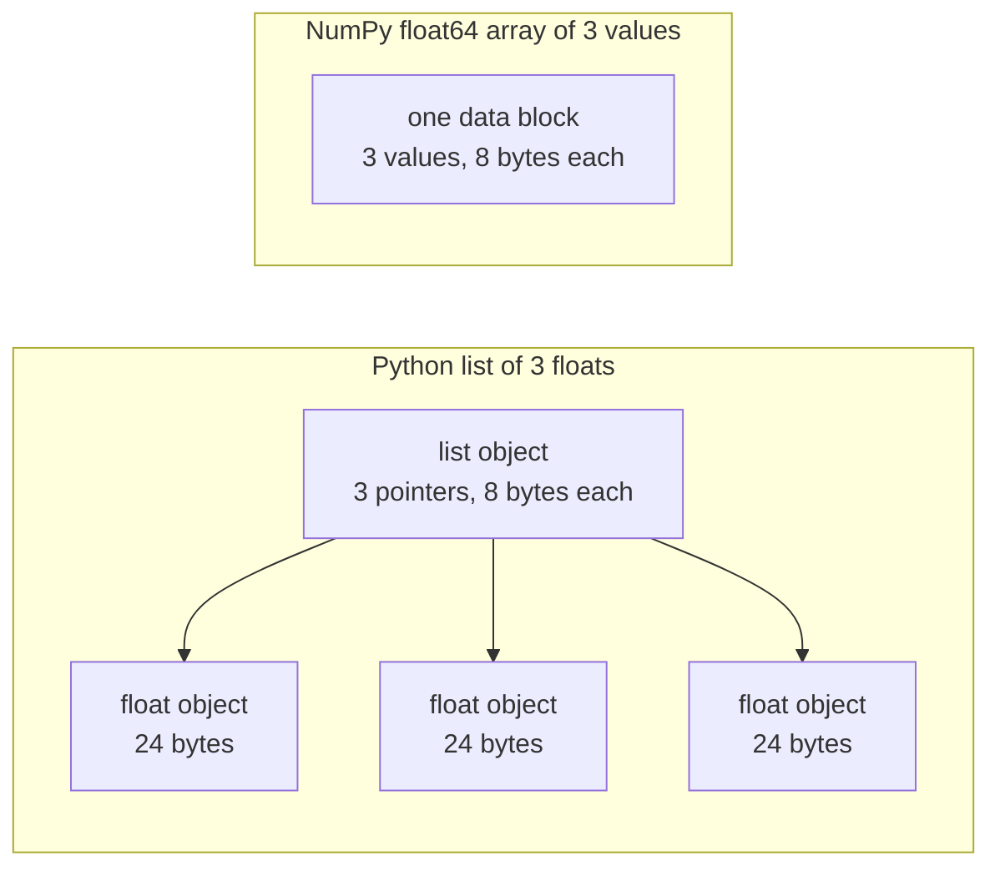

# بايثون لمهندسة الذكاء الاصطناعي

> معظم الشفرة في هذه الدورة تستخدم نفس مجموعة صغيرة من لغات Python. تعلم هذه المجموعة هنا، قبل أن تعتمد الدروس الرياضية والنموذج عليها.

**Type:** Build
**Languages:** Python
**Prerequisites:** Dev Environment, Python Environments
**Time:** ~120 minutes

## أهداف التعلم

- قراءة وكتابة المفاهيم التي تستخدمها معظم كود الدورة، من إزالة الحزم و f-strings إلى فئات البيانات والفهم.
- ابحث عن ثلاث أخطاء في Python التي تعطى نتائج خاطئة دون خطأ: القوائم المشتركة، والإعدادات الافتراضية المتغيرة، والجهازات المولدة المستخدمة.
- قم ببناء محرك تحميل CSV و JSON، وفرق بذور، ومدفوعة صغيرة مع المكتبة القياسية فقط.
- اكتب نسبة النقاط، المتوسط، والانحراف القياسي في Python النقي، وقاس سرعة واستخدام الذاكرة.
- شرح لماذا حلقة طاهرة في Python على الأرقام بطيئة، وكيف تنشر NumPy يُحرك الحلقة إلى رمز مرتب.

## المشكلة

تستخدم الدروس بعد هذه المرحلة Python العادي للرياضيات والنماذج. من بين 541 ملف Python في الدروس، 276 استيراد `dataclasses`أيضاً، 187 ملفات تتصل`random.seed`أو خلق`random.Random`إذا كانت هذه الأفكار جديدة بالنسبة لك، يمكنك قراءة النص عندما تريد قراءة الرياضيات.

يحتوي Python أيضًا على سلوكيات توفر نتائج خاطئة دون رسالة خطأ. يمكن أن تشير أسماء إلى قائمة واحدة ، لذلك تغيير من خلال اسم واحد يغير الآخر أيضًا. الحجة الافتراضية تحتفظ بقيمةها من مكالمة إلى أخرى. إن مولد فارغ بعد مرور واحد ، لذلك لا تحصل أي إطار تدريب ثانٍ على بيانات ولا يتغير الخسارة.

المشكلة الأخيرة هي السرعة. على جهاز الكمبيوتر المحمول لدينا، حلقة Python نقية أكثر من مليون طائرة استغرق حوالي 30 ملثانية. قمنا بمحاسبة نفس المنتج من النقاط في أقل من ملثانية. تحتاج إلى معرفة السبب، حتى تتمكن من اختيار بين حلقة واضحة وعملية الترتيب.

## المفهوم

### ما يستخدم رمز الدورة

لقد قمنا بتحليل جميع ملفات Python 541 في`phases/*/*/code/`مع`ast`الطاولة تعدد الملفات التي تستخدم كل بناء مرة واحدة على الأقل. العد من اليوم الذي كتبنا هذا الدروس، وتتغير مع إضافة الدروس.

| Construct | Files | Share |
|-----------|-------|-------|
| Function definitions | 541 | 100% |
| `if __name__ == "__main__":` | 529 | 98% |
| f-strings | 517 | 96% |
| Tuple unpacking | 448 | 83% |
| Classes | 379 | 70% |
| List comprehensions | 375 | 69% |
| Type hints on functions | 342 | 63% |
| Generator expressions | 326 | 60% |
| Slices | 314 | 58% |
| `lambda` | 175 | 32% |
| `try` and `except` | 120 | 22% |
| `with` statements | 96 | 18% |
| Dict comprehensions | 93 | 17% |
| Generator functions with `yield` | 14 | 3% |

الإيرادات تظهر ما هي وحدات القياسية المهمة. من بين الملفات 541، 340 تبدأ مع `from __future__ import annotations`و 276 واردات`dataclasses`- المُؤمنون`math`،`random`و`json`ويتمّ إظهار الوحدات في ملفات 187 و 175 و 126`collections`يظهر هذا الوحد في 70 ملف، و`itertools`يظهر في 4 فقط

لا تدخل دروس`map()`أو`filter()`الفهم يعمل ذلك`sorted`،`min`،`max`أو`.sort`مع`key=`هذه الدروس تقضي معظم الوقت على الأغراض التي تقع في أعلى هذه القوائم.

### الاسماء تشير إلى الأشياء

في بايثون، المتغير هو اسم يشير إلى جسم. التعيين يربط اسمًا بمنشأة. لا ينسخ هذا الموضوع. عندما يشير اسمان إلى قائمة واحدة، يتم رؤية تغيير من خلال أي من الأسماء من خلال كلا الإسمين. لا يمكن تغيير الأرقام والسلسلة والجماعات، لذلك لا تسبب هذه القاعدة أي مشاكل لهم. يمكن تغيير القوائم والقوائم والجماعات، لذلك قم بتنسخ عندما تحتاج إلى نسخة مستقلة.

### القائمة تحتوي على المؤشرات، صف يحوي الأرقام

ليست قائمة Python تخزين الأرقام مباشرة. إنها تخزين المؤشرات، ويشير كل مؤشرة إلى كائن Python كامل. في بناء 64 بت من CPython، كل مؤشرة تأخذ 8 بايت وكل `float`المادة تستغرق 24 بايت`float64`تخزين صف القيم الخام 8 بايت جنبا إلى جنب في كتلة واحدة من الذاكرة.



يقوم الحلقة على قائمة بعمل كبير لكل عنصر. يقوم المترجم بتشغيل تعليمات رمز البايت واحد في كل مرة. يتبع لكل عنصر مؤشرًا ويتحقق من نوع كل عمل. ثم يدعو رمز الزحام مضاعفة ويجعل كائنًا زحامًا في Python ليحمل النتيجة.

يقوم NumPy بنفس الحسابات في حلقة من الرمز المجمّع على القيم الخامة. يُحقق من نوع البيانات مرة واحدة لكل صف، ولا يُصنع أي كائن Python لكل عنصر. يشير الرمز المتجه إلى عملية واحدة على صف بأكمله، مثل `(x - mean) / std`و تقوم مكتبة بتشغيل الحلقة. وظائف المتجهة في هذه الدروس تتبع هذه القاعدة. كل منها يقوم بعمل صف واحد، لذلك يمكنك استبدالها بمكالمة NumPy واحدة في وقت لاحق.

### قائمة تحتوي على كل عنصر، مولد تحتوي على واحد

إن فهم القائمة يُبني كل عنصر قبل تشغيل الخط التالي. يقوم مولد بإنشاء عنصر واحد كل مرة يطلب فيها المدعو الآخر. تتزايد الذاكرة للفقرة مع عدد العناصر. تبقى الذاكرة لجهاز مولد بنفس الطريقة تقريباً لعدد من العناصر.

إنّه من الممكن أن يُشغّل المولّد مرة واحدة فقط، بعد العنصر الأخير، يُرفع`StopIteration`على كل طلب، لذا ثانية `for`لا يحصل على أي عناصر. رمز التدريب يقرأ مجموعة البيانات مرة واحدة في كل عصر، لذلك يجب أن تخلق مولد جديد لكل عصر.

وظائف المولدات نادرة في رمز الدروس. محملات البيانات التي تستخدمها دروس التعلم العميق هي قابلة للتكرار من مجموعات، لذلك تكون الفكرة في كل حلقة تدريبية. يظهر الرسمي كلا النهجين على نفس ثمانية صفات.

```figure
s0-list-vs-generator
```

## الأغراف التي تحتاجها

كل كتلة في هذا القسم تعمل بمفردها. حفظها في ملف وتشغيله مع `python3`. الحجرات تحتاج إلى Python 3.11 أو أحدث، النسخة التي وضعت في دروس بيئة تطوير.

### 1. القيم والمجموعات و إفراغها

بايثون لديه أربعة مجموعات مدمجة تعلم متى تستخدم كل واحدة.

| Type | Example | Ordered | Can change | Typical use in the course |
|------|---------|---------|------------|---------------------------|
| `list` | `[0.5, 1.2]` | Yes | Yes | Samples, losses, weights |
| `tuple` | `(32, 784)` | Yes | No | Shapes, fixed records, dict keys |
| `dict` | `{"lr": 0.01}` | Insertion order | Yes | Configs, vocabularies, JSON rows |
| `set` | `{"cat", "dog"}` | No | Yes | Unique tokens, overlap checks |

هذه الحجر تظهر أن المهمة لا نسخ قائمة.

```python
weights = [0.5, -1.2, 3.0]
alias = weights
alias[0] = 99.0
print(weights)

independent = list(weights)
independent[1] = 0.0
print(weights, independent)

grid = [[0] * 3] * 2
grid[0][0] = 1
print(grid)

grid = [[0] * 3 for _ in range(2)]
grid[0][0] = 1
print(grid)
```

```text
[99.0, -1.2, 3.0]
[99.0, -1.2, 3.0] [99.0, 0.0, 3.0]
[[1, 0, 0], [1, 0, 0]]
[[1, 0, 0], [0, 0, 0]]
```

التعبير`[[0] * 3] * 2`يقوم القائمة الخارجية بإشارات اثنتين إلى قائمة داخلية واحدة. يقوم الفهم بإعداد قائمة داخلية جديدة لكل سطر. مرحلة الرياضيات تقوم ببناء المصفوفات من القوائم، لذا استخدم شكل الفهم.

يُخصص إزالة التعبيرات عناصر تسلسل إلى العديد من الأسماء في سطر واحد. يجمع اسمًا نجمًا العناصر المتبقية. يضع سلسلة f قيمة تعبير في سلسلة، مع تنسيق اختياري بعد عمود عمودي.

```python
shape = (32, 784)
batch_size, n_features = shape
first, *middle, last = [1, 2, 3, 4, 5]
x, y = 1.0, 3.0
x, y = y, x

config = {"lr": 0.01, "epochs": 5}
config["seed"] = 7
tokens = ["the", "cat", "sat", "on", "the", "mat"]
vocab = set(tokens)

print(batch_size, n_features, first, middle, last, x, y)
print(config.get("momentum", 0.9), "cat" in vocab, len(vocab))
print(f"lr={config['lr']:.0e} loss={0.123456:.3f} n={60_000:,} {batch_size=}")
```

```text
32 784 1 [2, 3, 4] 5 3.0 1.0
0.9 True 5
lr=1e-02 loss=0.123 n=60,000 batch_size=32
```

`dict.get`يعيد قيمة افتراضية عندما يفتقد المفتاح.`in`تستغرق اختبار على مجموعة نفس الوقت تقريباً لأي حجم مجموعة.`{batch_size=}`النموذج يطبع الاسم والقيمة، مما يساعد عند إعادة التحليل.

شرائح`a[start:stop:step]`يشمل `start`و يستبعد`stop`. مؤشرات سلبية تعود إلى نهاية. شريحة من القائمة هي قائمة جديدة، لذلك شريحة من القائمة الكبيرة نسخ جميع المؤشرات.

```python
tokens = ["<s>", "the", "cat", "sat", "on", "the", "mat", "</s>"]
print(tokens[1:-1])
print(tokens[:3], tokens[-3:])
print(tokens[::2])
print(tokens[::-1][:2])
windows = [tokens[i:i + 3] for i in range(len(tokens) - 2)]
print(len(windows), windows[0])
```

```text
['the', 'cat', 'sat', 'on', 'the', 'mat']
['<s>', 'the', 'cat'] ['the', 'mat', '</s>']
['<s>', 'cat', 'on', 'mat']
['</s>', 'mat']
6 ['<s>', 'the', 'cat']
```

### 2. التفاهمات

الفهم يبني قائمة أو تعبير أو مجموعة من تعديلي في تعبير واحد. يقرأ مثل الرياضيات التي يصفها.

```python
scores = [0.91, 0.42, 0.77, 0.15, 0.66]
labels = [1 if s >= 0.5 else 0 for s in scores]
high = [s for s in scores if s > 0.6]
squares = {i: i * i for i in range(4)}
lengths = {len(word) for word in ["a", "bb", "cc", "ddd"]}
sum_sq = sum(s * s for s in scores)

matrix = [[1, 2, 3], [4, 5, 6]]
transposed = [list(column) for column in zip(*matrix)]
flat = [v for row in matrix for v in row]

print(labels, high, squares, lengths, round(sum_sq, 4))
print(transposed, flat)
```

```text
[1, 0, 1, 0, 1] [0.91, 0.77, 0.66] {0: 0, 1: 1, 2: 4, 3: 9} {1, 2, 3} 2.0555
[[1, 4], [2, 5], [3, 6]] [1, 2, 3, 4, 5, 6]
```

- تتابع`if`يحتفظ فقط ببعض العناصر`for`يمكن أن يكون تعبير مشروط`a if condition else b`اثنان`for`القواعد تعمل بنفس الترتيب الذي يفعله حلقان متجمعة

العوامل الدائرة تصنع تعبير مولد`sum(s * s for s in scores)`،`sum`يقرأ مربع واحد في وقت واحد، و Python لا يُبني قائمة.`zip(*matrix)`، النجم يمر كل سطر كحجة منفصلة ، و`zip`يزوج العناصر في كل موقف.

### 3. الوظائف والحجج والإغلاقات

قيمة افتراضية تجعل الحجة اختيارية. حجة الكلمة الرئيسية تسمي المعيار في الدعوة.`*`من قبل نفسها في قائمة المعلمات يجعل المعلمات التالية كلمة مفتاح فقط.

```python
def clip(value, low=0.0, high=1.0):
    return max(low, min(high, value))


def train(data, *, lr=0.01, epochs=3):
    return f"{len(data)} samples, lr={lr}, epochs={epochs}"


def make_scaler(factor):
    def scale(values):
        return [v * factor for v in values]
    return scale


print(clip(1.7), clip(-3.0, low=-1.0), clip(0.4, high=0.3))
print(train([1, 2, 3], lr=0.1))
to_percent = make_scaler(100)
print(to_percent([0.25, 0.5]))
```

```text
1.0 -1.0 0.3
3 samples, lr=0.1, epochs=3
[25.0, 50.0]
```

مع الحجج الكلمات الرئيسية فقط، دعوة مثل `train(data, 0.1, 3)`يرفع`TypeError`يجب على المتصل أن يكتب`lr=0.1`، لذا لا يمكن لأرقامين أن يغيروا مكانهم عن طريق الخطأ

الوظيفة الداخلية`scale`استخدامات`factor`من الوظيفة التي أنشأتها.`factor`طالما`scale`الوظيفة التي تبقي المتغيرات من خالقها هي إغلاق. الموحد في بناء ذلك يستخدم إغلاق للحفاظ على إحصاءات التدريب.

أ`lambda`هو وظيفة تعبير واحد بدون اسم.`key=`وظيفة، كما هو موضح في الجزء الثامن.

يقوم Python بتقييم قيمة افتراضية مرة واحدة، عندما يدير `def`كل مكالمة تستخدم الافتراض تتلقى نفس الكائن

```python
def add_bad(item, bucket=[]):
    bucket.append(item)
    return bucket


def add_good(item, bucket=None):
    if bucket is None:
        bucket = []
    bucket.append(item)
    return bucket


add_bad("a")
print(add_bad("b"))
add_good("a")
print(add_good("b"))
```

```text
['a', 'b']
['b']
```

استخدام`None`كالمثال الافتراضي للفصل أو القسم أو المجموعة. قم بإنشاء الكائن الجديد داخل الوظيفة.

### 4. فئات وطبقات البيانات

- نعم`@dataclass`المُزخّر يكتب`__init__`،`__repr__`و`__eq__`من الحقول الملاحظة.`frozen=True`لا يمكن أن يتغير بعد إنشاءه، ويمكنك استخدامه كفتاح إقليم أو وضعها في مجموعة.

```python
from dataclasses import dataclass, field


@dataclass(frozen=True)
class Example:
    features: tuple[float, ...]
    label: int


@dataclass
class TrainConfig:
    lr: float = 0.01
    epochs: int = 5
    hidden: list[int] = field(default_factory=lambda: [64, 32])

    def describe(self):
        return f"lr={self.lr} epochs={self.epochs} hidden={self.hidden}"


ex = Example((1.5, 2.0), 1)
print(ex)
print(ex == Example((1.5, 2.0), 1), len({ex, Example((1.5, 2.0), 1)}))
print(TrainConfig(epochs=10).describe())
try:
    ex.label = 0
except AttributeError as err:
    print(type(err).__name__)
```

```text
Example(features=(1.5, 2.0), label=1)
True 1
lr=0.01 epochs=10 hidden=[64, 32]
FrozenInstanceError
```

`field(default_factory=...)`يعطي كل مثال قائمة جديدة. إنه يحل مشكلة الافتراض المشترك من الجزء 3 داخل فئة البيانات.

طرق خاصة تربط فئة مع نحو Python. `len(ds)`مكالمات`__len__`و`ds[2]`مكالمات`__getitem__`. . .

```python
class SquaresDataset:
    def __init__(self, n):
        self.n = n

    def __len__(self):
        return self.n

    def __getitem__(self, index):
        if not 0 <= index < self.n:
            raise IndexError(index)
        return index, index * index


ds = SquaresDataset(4)
print(len(ds), ds[2])
print(list(ds))
```

```text
4 (2, 4)
[(0, 0), (1, 1), (2, 4), (3, 9)]
```

- نعم`for`حلقة داخل`list(ds)`يعمل بدون`__iter__`طريقة. مكالمات Python `__getitem__`مع 0, 1, 2 وهكذا حتى يحصل`IndexError`. مجموعة بيانات على شكل خريطة بيتورش تستخدم نفس الطرق`__len__`و`__getitem__`. . .

### 5. المعدلات والمولدات

المُتكرر هو أيّ شئ يُمكن أن يُعَدّ`for`الحلقة تقبل.`iter()`يحصل على إعادة التكرار من ذلك، و `next()`يطلب من المتكرر عنصر واحد. عندما لا يوجد لدى المتكرر المزيد من العناصر، فإنه يرفع `StopIteration`.`for`مكالمات الحلقة`next()`لك و توقف في`StopIteration`. . .

```python
numbers = [10, 20, 30]
it = iter(numbers)
print(next(it), next(it), next(it))
try:
    next(it)
except StopIteration:
    print("no more items")


def countdown(n):
    while n > 0:
        yield n
        n -= 1


gen = countdown(3)
print(type(gen).__name__)
print(list(gen))
print(list(gen))
```

```text
10 20 30
no more items
generator
[3, 2, 1]
[]
```

وظيفة مع`yield`في جسمها يوجد عمل مولد. دعوة له لا تشغيل أي من رموزها وتعود كائن مولد. كل `next()`يُرسل الجسم إلى الجثة التالية`yield`ويقف هناك. الثاني`list(gen)`فهي فارغة لأن أولها استنفد المولد

إنّ المولّد يمكنه قراءة ملف واحد خط في كل مرة.

```python
import os
import tempfile


def read_rows(path):
    with open(path, encoding="utf-8") as fh:
        header = fh.readline().rstrip("\n").split(",")
        for line in fh:
            yield dict(zip(header, line.rstrip("\n").split(",")))


with tempfile.TemporaryDirectory() as tmp:
    path = os.path.join(tmp, "rows.csv")
    with open(path, "w", encoding="utf-8") as fh:
        fh.write("x,label\n")
        fh.writelines(f"{i * 0.5},{i % 2}\n" for i in range(5))
    rows = read_rows(path)
    print(next(rows))
    print(sum(1 for _ in rows))
```

```text
{'x': '0.0', 'label': '0'}
4
```

`read_rows`يحتفظ خط واحد من الملف في الذاكرة في كل مرة.`read_rows`في الرسم. يتم تقسيمها على العقاطع للحفاظ على مثال قصير. الملفات CSV الحقيقية يمكن أن تحتوي على العقاطع داخل الحقول المقتبسة، لذلك بناء يستخدم `csv`الوحدة

```python
import sys

as_list = [i * i for i in range(1_000_000)]
as_generator = (i * i for i in range(1_000_000))
print(sys.getsizeof(as_list), sys.getsizeof(as_generator))
print(sum(as_list) == sum(as_generator))
```

على 64 بت CPython، تقرير القائمة عن 8 MB ومدفوع حوالي 200 بايت. `sys.getsizeof`يحتسب فقط المؤشرات في القائمة، والكائنات العددية تستخدم المزيد من الذاكرة.`tracemalloc`، التي استخدمتها في دروس التحليل والتحليل

### 6. مدير السياق والاستثناءات

أ`with`تصفية تشغيل حتى عندما يرفع الجسم استثناء. الملف كائن من `open()`هو مدير السياق الذي يغلق الملف.

في دروس التحليل والتحليل المرجعي، كتبنا`Timer`الفصل مع`__enter__`و`__exit__`- المُؤمنون`contextlib.contextmanager`المُزخرف يصنع نفس النوع من الأشياء من مولد.`yield`هو الإعداد، وال `finally`الحجر هو التنظيف.

```python
import time
from contextlib import contextmanager


@contextmanager
def timer(label):
    start = time.perf_counter()
    try:
        yield
    finally:
        print(f"{label}: {(time.perf_counter() - start) * 1000:.1f} ms")


def parse_label(text):
    try:
        return int(text)
    except ValueError:
        raise ValueError(f"label must be an integer, got {text!r}") from None


with timer("sum of squares"):
    total = sum(i * i for i in range(200_000))

print(parse_label("3"))
try:
    parse_label("cat")
except ValueError as err:
    print("rejected:", err)
```

```text
sum of squares: 9.4 ms
3
rejected: label must be an integer, got 'cat'
```

الوقت على جهازك سيكون مختلفاً.`except`النص، مثل `ValueError`أو`KeyError`- من`except:`الفقرة بدون نوع استثناء تتعامل أيضا `KeyboardInterrupt`، بحيث يمكن أن تفشل Ctrl + C في إيقاف حلقة تحتوي عليه. قم بإعداد استثناء مع رسالة واضحة عندما تكون المدخلات خاطئة.`from None`عندما تبدل رسالتك على التتبع الأصلي

### 7. إشارات النمط والفروع والحرس الرئيسي

تُخبر النصوص القارئة بما يأخذه وظيفة وتعود إليه. لا تتحقق منه Python عندما يتم تشغيل الرمز. يقرأها جهاز التحقق من النوع، مثل mypy، قبل تشغيل الرمز.

```python
from __future__ import annotations

from collections.abc import Iterable, Sequence


def mean(values: Sequence[float]) -> float:
    if not values:
        raise ValueError("mean() needs at least one value")
    return sum(values) / len(values)


def count_tokens(docs: Iterable[str]) -> int:
    return sum(len(doc.split()) for doc in docs)


def main() -> None:
    print(mean([1.0, 2.0, 4.0]))
    print(count_tokens(["the cat sat", "on the mat"]))
    print(mean.__annotations__)


if __name__ == "__main__":
    main()
```

```text
2.3333333333333335
6
{'values': 'Sequence[float]', 'return': 'float'}
```

مع`from __future__ import annotations`، بايثون تخزين كل إشارة كسلسلة، كما يظهر في السطر الأخير. `Sequence`يعني أي كائن مع `len()`و مؤشرات مثل القائمة أو الـ tuple. `Iterable`يعني أي كائن ي`for`يقبل الحلقة. العديد من ملفات الدورة تستورد نفس الأسماء من `typing`، والذي يعمل أيضاً

كلّ شخص`.py`الملف هو وحدات. عندما تقوم بتشغيل ملف مع `python3 file.py`، Python يضع`__name__`إلى`"__main__"`عندما يقوم ملف آخر باستيراده`__name__`هذا اسم الوحدة، الحارس يطلب`main()`فقط في الحالة الأولى بسبب الحارس،`code/tests/`يمكن أن تستورد`main.py`بدون بدء التجربة

### 8. الملفات، JSON، CSV، والترتيب

`pathlib.Path`يربط المسارات مع `/`ويمكنك قراءة أو كتابة ملف كامل في مكالمة واحدة.`encoding="utf-8"`، لأن التشفير الافتراضي يعتمد على النظام التشغيلي.

```python
import csv
import json
import tempfile
from pathlib import Path

rows = [
    {"text": "great movie", "label": 1, "score": 0.93},
    {"text": "boring plot", "label": 0, "score": 0.12},
    {"text": "fine acting", "label": 1, "score": 0.58},
]

with tempfile.TemporaryDirectory() as tmp:
    json_path = Path(tmp) / "reviews.json"
    json_path.write_text(json.dumps(rows, indent=2), encoding="utf-8")
    from_json = json.loads(json_path.read_text(encoding="utf-8"))

    csv_path = Path(tmp) / "reviews.csv"
    with csv_path.open("w", newline="", encoding="utf-8") as fh:
        writer = csv.DictWriter(fh, fieldnames=["text", "label", "score"])
        writer.writeheader()
        writer.writerows(rows)
    with csv_path.open(newline="", encoding="utf-8") as fh:
        from_csv = list(csv.DictReader(fh))

print(from_json == rows)
print(from_csv[0])

by_score = sorted(rows, key=lambda r: r["score"], reverse=True)
print([r["text"] for r in by_score])
print(max(rows, key=lambda r: r["score"])["text"])
print([r["text"] for r in sorted(rows, key=lambda r: (-r["label"], r["text"]))])
```

```text
True
{'text': 'great movie', 'label': '1', 'score': '0.93'}
['great movie', 'fine acting', 'boring plot']
great movie
['fine acting', 'great movie', 'boring plot']
```

JSON يحتفظ بالأرقام كأرقام. CSV يعيد كل حقل كسلسلة، لذلك يجب عليك تحويل كل حقل. فتح ملفات CSV مع `newline=""`، كـ`csv`الوثائق تقول لك ذلك

أ`key=`يعيد هذا العامل القيمة التي يقارن بها Python لكل عنصر. `sorted`،`min`و`max`جميع القبول واحد. تفرق مفتاح طوبي بالقيمة الأولى، ويستخدم القيمة الثانية فقط للعلاقات. علامة - لا تضع العلامة الأكبر أولا. تصنيف بايثون مستقرة، لذلك العناصر ذات المفاتيح المتساوية تحتفظ بترتيبها الأصلي.

### 9. أدوات العد والجميع والعكسر

هذه الوحدات الثنائية تحتوي على هيكل البيانات وأدوات التكرار التي لا تعطيك القوائم والقوائم العادية.

```python
from collections import Counter, defaultdict, deque
from itertools import chain, islice, product

labels = ["cat", "dog", "cat", "bird", "cat", "dog"]
counts = Counter(labels)
print(counts.most_common(2))

positions = defaultdict(list)
for i, label in enumerate(labels):
    positions[label].append(i)
print(dict(positions))

recent = deque(maxlen=3)
for loss in [2.0, 1.5, 1.2, 1.1, 0.9]:
    recent.append(loss)
print(list(recent), round(sum(recent) / len(recent), 3))

print(list(product([0.1, 0.01], [16, 32])))
print(list(chain([1, 2], [3], [4, 5])))
print(list(islice(range(100), 5, 10)))
```

```text
[('cat', 3), ('dog', 2)]
{'cat': [0, 2, 4], 'dog': [1, 5], 'bird': [3]}
[1.2, 1.1, 0.9] 1.067
[(0.1, 16), (0.1, 32), (0.01, 16), (0.01, 32)]
[1, 2, 3, 4, 5]
[5, 6, 7, 8, 9]
```

`Counter`يحتسب العناصر التي يمكن إزالتها، مثل العلامات التجارية أو الرموز. `defaultdict(list)`يخلق قائمة فارغة في المرة الأولى التي تستخدم فيها مفتاحًا جديدًا ، لذلك لا تحتاج حلقة التجميع إلى تحديد مفتاح. `deque(maxlen=3)`يزيل أقدم عنصر عندما تضيف رابع، مما يعطي نافذة تحرك على الخسائر الأخيرة. `enumerate`يُعطى كل عنصر مؤشر له.

`product`يعطي كل مزيج من مدخلاتها، وهو شبكة مفاتيح فائقة. `chain`يضم المتكررات من النهاية إلى النهاية. `islice`يأخذ شريحة من أي إعادة التكرار، بما في ذلك مولد. مولد المجموعة الصغيرة في بناء ذلك يستخدم `islice`. . .

### 10. لماذا تكون الحلقات فوق الأرقام بطيئة

- نعم`dis`يقوم الوحدة بطبع تعليمات رمز البايت التي يعمل بها المترجم للوظيفة.

```python
import dis


def dot(a, b):
    total = 0.0
    for x, y in zip(a, b):
        total += x * y
    return total


dis.dis(dot)
```

التعليمات من`FOR_ITER`ثم قم بالقيام بتشغيل كل عنصر مرة واحدة، وهذا حوالي عشرة تعليمات لكل مضاعفة وإضافة.

تحصل حلقة على أسرع عندما يتم تشغيل عدد أقل من خطواتها كرمز البايت.`sum`،`map`و`zip`ويقوم بـ "بناءها" بتقييم هذا التأثير في بيثون النقي، و "استعملها" تنتقل الحلقة بأكملها إلى "نومبي".

## بناءها

الآن قم ببناء الأجزاء التي تحتاجها الدروس لاحقاً.`code/main.py`و`code/tests/test_main.py`كل كتلة تحتها تعمل بمفردها

### الخطوة الأولى: نوع السجل ومحمول مجموعة البيانات

يقوم محمول القراءة ملف CSV أو ملف JSON في شكل واحد: مجموعة من ميزات العبور وتسمية عدد كامل.

```python
import csv
import json
import tempfile
from dataclasses import dataclass
from pathlib import Path


@dataclass(frozen=True)
class Record:
    features: tuple[float, ...]
    label: int


def row_to_record(row, names, label_field="label"):
    if label_field not in row:
        raise ValueError(f"row has no {label_field!r} field: {row}")
    if set(row) != {*names, label_field}:
        raise ValueError(f"row fields {list(row)} do not match {[*names, label_field]}")
    return Record(tuple(float(row[name]) for name in names), int(row[label_field]))


def load_records(path, label_field="label"):
    path = Path(path)
    if path.suffix == ".json":
        rows = json.loads(path.read_text(encoding="utf-8"))
    elif path.suffix == ".csv":
        with path.open(newline="", encoding="utf-8") as fh:
            rows = list(csv.DictReader(fh))
    else:
        raise ValueError(f"unsupported file type: {path.suffix!r}")
    if not rows:
        return []
    names = [key for key in rows[0] if key != label_field]
    return [row_to_record(row, names, label_field) for row in rows]


with tempfile.TemporaryDirectory() as tmp:
    csv_path = Path(tmp) / "data.csv"
    csv_path.write_text("x1,x2,label\n1.5,60,1\n1.8,82.5,0\n", encoding="utf-8")
    json_path = Path(tmp) / "data.json"
    json_path.write_text('[{"x1": 1.5, "x2": 60, "label": 1}]', encoding="utf-8")
    print(load_records(csv_path))
    print(load_records(json_path))
```

```text
[Record(features=(1.5, 60.0), label=1), Record(features=(1.8, 82.5), label=0)]
[Record(features=(1.5, 60.0), label=1)]
```

الصف الأول يحدد أسماء الميزات وتسلسلها. `DictReader`و`json.loads`الحفاظ على المفاتيح في ترتيب الملف، والإقليمية الحفاظ على الترتيب الذي تم إضافة المفاتيح فيه. معيار JSON لا تعريف ترتيب للمفاتيح في جسم، لذلك `row_to_record`يقرأ كل سطر باسم، في ترتيب الصف الأول. علامة مفقودة، أو ميزة مفقودة أو إضافية، أو نوع ملف مجهول يرفع `ValueError`مع رسالة، لذلك الملف السيئ يوقف الجري في البداية. `main.py`أيضاً`save_records`، والتي تكتب نفس الشكلين.

### الخطوة الثانية: قطار ذو بذور وقطع اختبار

```python
import random


def train_test_split(items, test_fraction=0.2, seed=0):
    if not 0.0 < test_fraction < 1.0:
        raise ValueError(f"test_fraction must be between 0 and 1, got {test_fraction}")
    if len(items) < 2:
        raise ValueError(f"need at least 2 items to split, got {len(items)}")
    order = list(range(len(items)))
    random.Random(seed).shuffle(order)
    n_test = min(max(1, round(len(items) * test_fraction)), len(items) - 1)
    test = [items[i] for i in order[:n_test]]
    train = [items[i] for i in order[n_test:]]
    return train, test


items = list(range(10))
print(train_test_split(items, seed=1))
print(train_test_split(items, seed=1) == train_test_split(items, seed=1))
print(train_test_split(items, seed=2)[1])
print(items)
```

```text
([9, 7, 5, 3, 0, 4, 1, 2], [6, 8])
True
[5, 9]
[0, 1, 2, 3, 4, 5, 6, 7, 8, 9]
```

`random.Random(seed)`يخلق مولد أرقام عشوائية خاصة.`random.seed(seed)`إعادة تعيين المولد العالمي واحد الذي تتشارك فيه جميع الوحدات، بحيث يمكن لمكالمة في مكتبة أخرى تغيير تسلسلك. في الدورة، 100 ملفات الدروس الاتصال`random.seed`و 96 خلق `random.Random`استخدم مولد خاص في رمز جديد

تقوم الوظيفة بتدمير قائمة من المؤشرات، بحيث تظل قائمة الإدخال دون تغيير. نفس البذور دائماً يعطي نفس الانقسام. كل جانب يحتفظ على الأقل بعنصر واحد، بحيث ترتفع قائمة أقل من 2 عناصر `ValueError`. تقسيم البيانات قبل أي خطوة تتعلم منها، مثل التوحيد. في درس التحليل والتحليل، رأينا أن التداخل بين بيانات القطار والاختبار يعطي درجات اختبار عالية جدا.

### الخطوة الثالثة: مولد الحزمة الصغيرة

```python
from itertools import islice


def batches(items, batch_size, drop_last=False):
    if batch_size < 1:
        raise ValueError(f"batch_size must be at least 1, got {batch_size}")
    return _batch_iter(iter(items), batch_size, drop_last)


def _batch_iter(iterator, batch_size, drop_last):
    while True:
        batch = list(islice(iterator, batch_size))
        if not batch or (drop_last and len(batch) < batch_size):
            return
        yield batch


print(list(batches(range(10), 4)))
print(list(batches(range(10), 4, drop_last=True)))
squares = (i * i for i in range(7))
print([len(b) for b in batches(squares, 3)])

for epoch in range(2):
    sizes = [len(b) for b in batches(range(10), 4)]
    print(f"epoch {epoch}: {sizes}")
```

```text
[[0, 1, 2, 3], [4, 5, 6, 7], [8, 9]]
[[0, 1, 2, 3], [4, 5, 6, 7]]
[3, 3, 1]
epoch 0: [4, 4, 2]
epoch 1: [4, 4, 2]
```

`islice`يبدأ`batch_size`عناصر من المُعكر. `batches`احتياجات فقط`iter()`، لذلك فإنه يقبل القوائم، الملفات، وغيرها من المولدات. اللحظة الأخيرة أصغر عندما يكون طولها ليس مضاعفاً من حجم اللحظة. `drop_last=True`يزيل تلك اللحظة، لنموذج يحتاج إلى شكل اللحظة الثابتة.

العمل في وظائف اثنتين لأن وظيفة المولد لا تشغيل أي رمز حتى أول `next()`مع الشيك داخل المولد`batches(data, 0)`سوف يعود دون خطأ. الخطأ سوف يأتي في وقت لاحق، من داخل حلقة التدريب.`batches()`مرة أخرى لكل عصر، لأن المولد يعطي عناصرها مرة واحدة فقط.

### الخطوة الرابعة: الرياضيات المتجهة والمعايير

```python
import math


def dot(a, b):
    return sum(x * y for x, y in zip(a, b, strict=True))


def mean(values):
    if not values:
        raise ValueError("mean() needs at least one value")
    return sum(values) / len(values)


def std(values):
    mu = mean(values)
    return math.sqrt(sum((v - mu) ** 2 for v in values) / len(values))


def make_standardizer(rows):
    columns = list(zip(*rows))
    means = [mean(c) for c in columns]
    scales = [s if s > 0 else 1.0 for s in (std(c) for c in columns)]

    def standardize(row):
        return [(v - m) / s for v, m, s in zip(row, means, scales, strict=True)]

    return standardize


print(dot([1.0, 2.0, 3.0], [4.0, 5.0, 6.0]))
values = [2.0, 4.0, 4.0, 4.0, 5.0, 5.0, 7.0, 9.0]
print(mean(values), std(values))

train_rows = [(1.0, 100.0), (2.0, 300.0), (3.0, 500.0)]
standardize = make_standardizer(train_rows)
print([[round(v, 3) for v in standardize(r)] for r in train_rows])
print([round(v, 3) for v in standardize((4.0, 700.0))])
```

```text
32.0
5.0 2.0
[[-1.225, -1.225], [0.0, 0.0], [1.225, 1.225]]
[2.449, 2.449]
```

مع`strict=True`،`zip`يرفع`ValueError`عندما يكون للنواقلين طول مختلف`zip`يتوقف عند نهاية الإدخال الأقصر ويرد إجابة خاطئة دون خطأ.`strict`الحجة تحتاج إلى Python 3.10 أو أحدث.

`std`تقسيمها بالـ`n`، لذلك يعطي الانحراف القياسي للسكان، كما `statistics.pstdev`نعم، تقسيمها`n - 1`عندما تقيم انتشار عدد أكبر من السكان من عينة.

`make_standardizer`هو إغلاق. يحسب الوسائل والانحرافات القياسية من صفوف التدريب مرة واحدة، و`standardize`تطبق نفس الوظيفة على الصفوف الاختبارية، لذلك لا يكون بيانات الاختبار لها تأثير على الإحصاءات. عمود ثابت لديه انحراف معيار من 0، لذلك الموحد يستخدم مقياس من 1 له.

### الخطوة 5: إعادة التدريب الكامل

`code/main.py`يربط القطع. يقوم بإنشاء 400 سجل من مجموعة، يحفظها على شكل CSV و JSON، ويحمّل كلتا الملفات مرة أخرى. ثم يقوم بتقسيم السجلات، ويقوم بتصوير الموحد على تقسيم التدريب، ويحسب مركزيات الفئة من مجموعات من 48.

تخزن مؤسسة المركزية القريبة متجهات المتوسط لكل فئة. وهي تنبأ بالفئة التي تكون المتوسط أقرب إلى المدخل. `fit_centroids`يجمع الصفوف على حدة، لذا لا يحتاج أبداً إلى التدريب الكامل في الذاكرة. `predict`استخدامات`min()`مع`key=`وظيفة للعثور على أقرب مركز

```bash
python3 phases/00-setup-and-tooling/13-python-for-ai-engineering/code/main.py
```

```text
Python for AI engineering: a standard-library toolkit
data     400 records, CSV and JSON load back unchanged: True
split    320 train, 80 test, records in both: 0
batches  size 48: [48, 48, 48, 48, 48, 48, 32]
scale    train feature means after standardizing: [0.0, 0.0]
model    nearest-centroid test accuracy: raw 0.86, standardized 0.89
speed    dot product of 200,000 floats, best of 5:
           index loop         6.60 ms
           zip generator      5.93 ms
           map + mul          2.89 ms
memory   peak bytes to sum 100,000 squares:
           list              4,000,616
           generator               472
```

الميزانين لديهم مقياس مختلف جداً. الميزان الثاني لديه عشرة أضعاف انتشار الأول، لذلك فإنه يتحكم في المسافات الخام، والدقة الخام أقل. سيفارق عدد السرعة والذاكرة الخاصة بك من هذه الأرقام.

### الخطوة 6: قياس السرعة والذاكرة

```python
import operator
import random
import time
import tracemalloc


def dot_index_loop(a, b):
    total = 0.0
    for i in range(len(a)):
        total += a[i] * b[i]
    return total


def dot_zip(a, b):
    return sum(x * y for x, y in zip(a, b, strict=True))


def dot_map(a, b):
    return sum(map(operator.mul, a, b))


def best_time(fn, *args, repeat=5):
    times = []
    for _ in range(repeat):
        start = time.perf_counter()
        fn(*args)
        times.append(time.perf_counter() - start)
    return min(times)


def peak_bytes(fn):
    tracemalloc.start()
    try:
        fn()
        return tracemalloc.get_traced_memory()[1]
    finally:
        tracemalloc.stop()


rng = random.Random(0)
a = [rng.random() for _ in range(1_000_000)]
b = [rng.random() for _ in range(1_000_000)]
for fn in (dot_index_loop, dot_zip, dot_map):
    print(f"{fn.__name__:15} {best_time(fn, a, b) * 1000:7.2f} ms")

print(peak_bytes(lambda: sum([i * i for i in range(100_000)])))
print(peak_bytes(lambda: sum(i * i for i in range(100_000))))
```

`best_time`يذكر أن البرامج الأخرى على الجهاز لا يمكن إلا إضافة الوقت، لذلك الحد الأدنى هو أقرب إلى التكلفة الحقيقية.`timeit`ويعطي هذا الموديل نفس النصيحة.

على حاسوبنا المحمول بايثون 3.11, أخذ حلقة المؤشر حوالي 33 ثانية.`map`الإصدار حوالي 14 سم. كل ثلاثة يفعلون نفس الحساب.`map`الإصدار أسرع لأن `map`و`operator.mul`يتم كتابة هذه الأرقام باللغة C، وبالتالي يتم تشغيل أقل من تعليمات رمز البايت لكل عنصر. تكرر أرقام الذاكرة الرقم: حوالي 4 MB للقائمة وأقل من 1 KB للجهاز المولّد.

## استخدمها

### الإصدارات القياسية للمكتبة

المكتبة القياسية لديها نسخة اختبارية من معظم الأجزاء التي بنيتها.

| You built | Standard library | Note |
|-----------|------------------|------|
| `mean`, `std` | `statistics.fmean`, `statistics.pstdev` | The tests compare against these |
| `dot` | `math.sumprod` | Python 3.12 or newer |
| `batches` | `itertools.batched` | Python 3.12 or newer, gives tuples |
| `best_time` | `timeit.repeat` | Also turns off garbage collection during the runs |
| `peak_bytes` | `tracemalloc` | The same module, with snapshots and per-line statistics |

```python
import statistics
import sys

values = [2.0, 4.0, 4.0, 4.0, 5.0, 5.0, 7.0, 9.0]
print(statistics.fmean(values), statistics.pstdev(values))

if sys.version_info >= (3, 12):
    import math
    from itertools import batched

    print(math.sumprod([1.0, 2.0, 3.0], [4.0, 5.0, 6.0]))
    print(list(batched(range(10), 4)))
```

```text
5.0 2.0
32.0
[(0, 1, 2, 3), (4, 5, 6, 7), (8, 9)]
```

الدورة تدعم Python 3.11, لذلك `main.py`يستخدمها الخاصة`dot`و`batches`في بايثون 3.11, البلوك يطبخ فقط الخط الأول.

### نفس الرياضيات مع المجموعات المجمعة

قم بتثبيت NumPy في البيئة الافتراضية من دروس بيئة Python ، على سبيل المثال مع `uv pip install numpy`لا تحتاج إلى الرمز و الاختبارات

```python
import time

import numpy as np

n = 1_000_000
rng = np.random.default_rng(0)
a = rng.random(n)
b = rng.random(n)
a_list, b_list = a.tolist(), b.tolist()

start = time.perf_counter()
slow = sum(x * y for x, y in zip(a_list, b_list))
python_ms = (time.perf_counter() - start) * 1000

start = time.perf_counter()
fast = float(a @ b)
numpy_ms = (time.perf_counter() - start) * 1000

print(f"pure Python {python_ms:8.2f} ms")
print(f"NumPy       {numpy_ms:8.2f} ms")
print(f"difference  {abs(slow - fast):.1e}")
print(a.dtype, a.itemsize, a.nbytes)
```

على جهاز الكمبيوتر المحمول التجريبي لدينا، استغرق NumPy أقل من 1 ms، والنسخة الطاهرة Python استغرق حوالي 30 ms. النتائج تختلف في الأرقام الأخيرة، لأن النسختين تضيف المنتجات في ترتيب مختلف. إضافة نقطة عائمة تعطى نتائج مختلفة قليلا في ترتيب مختلف.

إنّ (نومبي) أسرع لثلاث أسباب:

- المجموعة تخزن الخام`float64`القيم، 8 بايت لكل، في كتلة واحدة من الذاكرة. تحتاج قائمة من العائدات إلى مؤشر 8 بايت و 24 بايت عائدة كائن لكل قيمة.
- يدير الحلقة في رمز مرتب. يحقق NumPy من نوع البيانات مرة واحدة للمجموعة بأكملها ولا يصنع أي كائن Python لكل عنصر.
- القيم التي تقع جنبا إلى جنب في الذاكرة تسمح لـ NumPy باستخدام تعليمات SIMD ، التي تعالج العديد من القيم بمعرفة واحدة.

بالنسبة للمصفوفات الصغيرة جداً، يمكن أن تكون التكلفة الثابتة لمكالمة NumPy واحدة أكبر من حلقة Python قصيرة. تمرين 4 يجد حجم حيث يصبح NumPy أسرع على جهازك.

### الإذاعة

الإذاعة تسمح NumPy الجمع بين صفوف مختلفة الأشكال دون حلول في رمزك. هذا الحجر يفعل نفس العمل مثل `make_standardizer`من الخطوة الرابعة

```python
import numpy as np

X = np.array([[1.0, 100.0], [2.0, 300.0], [3.0, 500.0]])
mu = X.mean(axis=0)
sigma = X.std(axis=0)
Z = (X - mu) / sigma
print(X.shape, mu.shape, Z.shape)
print(Z.round(3))

norms = np.sqrt((X ** 2).sum(axis=1, keepdims=True))
print(norms.shape, (X / norms).shape)
```

```text
(3, 2) (2,) (3, 2)
[[-1.225 -1.225]
 [ 0.     0.   ]
 [ 1.225  1.225]]
(3, 1) (3, 2)
```

يُقارن NumPy الشكلين من الأبعاد الأخيرة إلى الأبعاد الأولى. يُتوافق أبعادٌ اثنان عندما تكون متساوية أو عندما يكون أحدها 1. يُعد الأبعاد الرائدة المفقودة ك1. يتم استخدام بعد من حجم 1 مرة أخرى على طول الأبعاد الأكبر، و لا يقوم NumPy بنسخة من البيانات.

| Shape of `X` | Shape of the other array | Result |
|--------------|--------------------------|--------|
| `(3, 2)` | `(2,)`, column means | `(3, 2)` |
| `(3, 2)` | `(3, 1)`, row norms with `keepdims=True` | `(3, 2)` |
| `(3, 2)` | `(3,)`, row norms without `keepdims` | `ValueError` |

الخط الأخير خطأ شائع. NumPy يقارن التابعة 2 مع 3، ولا أحد منهم هو 1.`keepdims=True`عندما تقلل من خلال الصفوف ثم تجمع النتيجة مع الترتيب الأصلي.

## أرسله

هذا الدرس يُنتج`outputs/prompt-python-review.md`. هو طلب مراجعة رمز Python في AI ومشاريع البيانات. أعطيه ملف أو فرق. فإنه يبحث عن الرمز للاستعبارات والخطأ الصامت من هذا الدروس:

- الإشارات المشتركة والحجج المتغيرة للتخلف
- المولدات التي تقرأها العصر الثاني بعد استهلاكها
- أرقام عشوائية بدون بذرة، أو فقط مع بذرة العالمية
- الإحصاءات التي تأتي من تقسيم الاختبار
- حلقات Pure-Python على صفوف رقمية كبيرة

إنه يبلغ عن كل ما وجد مع موقع، والمشكلة، والإصلاح.

## التمارين

1. أركض`run_demo(seed=8)`من`main.py`. ابحث عن خطوط الخروج التي تتغير والخطوط التي تبقى نفسها . اشرح لماذا تبقى أحجام التقسيم نفسها
2. اكتب`median(values)`في بيثون النقي. اختبروا ضد`statistics.median`على قوائم بطول غريب وطول متساوي
3. اكتب`stream_records(path)`، مولد يُعطى واحد `Record`في وقت واحد من ملف CSV. صنع ملف من 200،000 صف. مقارنة ذروة الذاكرة`stream_records`و`load_records`مع`tracemalloc`. . .
4. اكتب`matvec(matrix, vector)`في بيثون نقي و في NumPy. قياس كل منهما مع `best_time`تحديد الحجم الذي يصبح NumPy أسرع عليه على جهازك.
5. اكتب مسح البناء من المفهوم.`ast.parse`و`ast.walk`في كل ملف في`phases/*/*/code/*.py`عد الملفات التي تحتوي`ast.ListComp`،`ast.Yield`و`ast.With`و قم بتقارن حساباتك مع الطاولة

## الشروط الرئيسية

| Term | What people say | What it means |
|------|----------------|----------------------|
| Iterable | "Something you can loop over" | An object that `iter()` accepts, such as a list, a file, or a generator |
| Iterator | "A cursor" | An object whose `__next__` method returns one item per call and raises `StopIteration` at the end |
| Generator | "A lazy list" | An iterator from a `yield` function or a generator expression. It makes each item on request and runs only once. |
| Comprehension | "A one-line loop" | An expression that builds a list, dict, or set from an iterable, with an optional filter |
| Closure | "A function inside a function" | A function that keeps variables from the function that created it |
| Dataclass | "A struct" | A class whose `__init__`, `__repr__`, and `__eq__` methods Python writes from the annotated fields |
| Context manager | "A with block" | An object that runs setup code at the start of a `with` block and cleanup code at the end, even after an exception |
| Seed | "The random number" | The start value of a pseudo-random generator. The same seed gives the same sequence. |
| Vectorized code | "Fast code" | Code that applies one operation to a whole array, so that compiled code runs the loop |
| Broadcasting | "Automatic shape matching" | The NumPy rules that combine arrays of different shapes by using size-1 dimensions again, with no copy |

## المزيد من القراءة

- [The Python Tutorial: Data Structures](https://docs.python.org/3/tutorial/datastructures.html): القوائم، الجماعات، المجموعات، القوائم، والفهم.
- [The Python Tutorial: Classes](https://docs.python.org/3/tutorial/classes.html): المجالات، والفئات، والعكسرات، والمولدات.
- [dataclasses](https://docs.python.org/3/library/dataclasses.html): كل خيارات المزيّن، بما في ذلك`frozen`و`field`. . .
- [collections](https://docs.python.org/3/library/collections.html): `Counter`،`defaultdict`،`deque`، والأنواع الأخرى من الحاويات
- [itertools](https://docs.python.org/3/library/itertools.html): `islice`،`chain`،`product`،`batched`، و وصفات تجمع بينها
- [Sorting Techniques](https://docs.python.org/3/howto/sorting.html): وظائف رئيسية، أنواع مستقرة، وأنواع على العديد من المفاتيح.
- [timeit](https://docs.python.org/3/library/timeit.html)كيفية قياس قطع صغيرة من الرمز، ولماذا تقديم التقرير الحد الأدنى.
- [random](https://docs.python.org/3/library/random.html): المولد العالمي`random.Random`الحالات، والتكاثر.
- [PEP 255: Simple Generators](https://peps.python.org/pep-0255/): الاقتراح الذي أضاف`yield`، مع أسباب تصميمها
- [NumPy: Broadcasting](https://numpy.org/doc/stable/user/basics.broadcasting.html): قواعد الشكل الكامل، مع الرسومات.
- [Harris et al., Array programming with NumPy, Nature 585, 2020](https://doi.org/10.1038/s41586-020-2649-2): تصميم صف NumPy و أسباب سرعة ذلك.
