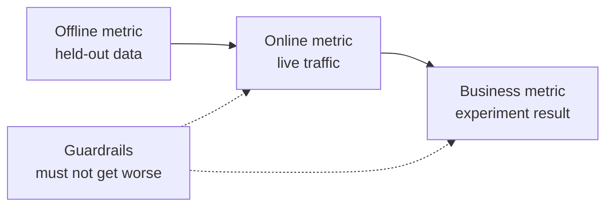

# تصميم النظام ML  من المشكلة إلى النموذج المستخدم

> النموذج هو جزء من النظام. التصميم يقرر ما يتوقع النموذج، ومن يعمل عليه، ما تكلفة، وما يحدث عندما يفشل.

**Type:** Build
**Languages:** Python
**Prerequisites:** Phase 2, Lessons 09 (Model Evaluation) and 13 (ML Pipelines)
**Time:** ~110 minutes

## أهداف التعلم

- إطار مشكلة الأعمال كمهمة ML مع تنبؤ، قرار يستخدمها، وسبب لماذا القواعد ليست كافية
- فصل عن بعضها البعض عن طريق الإنترنت، والشركات، والحافظية، ومقارنة كل نموذج مع خطوط أساسية بسيطة وهمسية
- تقدير التكلفة اليومية، والتأخير، والباقي في الحزمة والإستنتاج عبر الإنترنت من أعداد حركة المرور
- اختر نمط التنفيذ (الظل، القناري، اختبار A/B) والتحديد الافتراضي الآمن لكل وضع فشل
- تحديد حلقات التعليق التي يغير فيها النموذج البيانات التي تدرب نسخة أخرى
- اكتب وثيقة تصميم ML وتحسنها مقابل قائمة تحقيقت ثابتة

## المشكلة

شركة اشتراكية تطلب "نموذج تشرن". عالم بيانات تدرب تصنيفية تعزز التدرج وتبلغ عن AUC من 0.91. بعد ثلاثة أشهر، لا أحد يستخدمها.

الأسباب لا علاقة لها بالخوارزمية. لم يقرر أحد أي إجراء يبدأه النتيجة. تأتي النتيجة مرة واحدة في الأسبوع، ولكن فريق الاحتفاظ يتصل بالعملاء كل يوم. جاءت اللقب من جدول إلغاء الذي حفظ سبب إلغاء أيضًا، لذلك كانت ميزة واحدة تحتوي على الإجابة. لم يقارن أحد النموذج بالقاعدة التي استخدمها فريق الدعم بالفعل: دعوة أي شخص لفترتين.

كل هذه الفشل حدث قبل بدء التدريب. إنها فشل تصميم، ويقول وثيقة تصميم صفحة واحدة عن كل منها. هذا الدروس يعلم القرارات في هذا الوثيقة. تقوم ببناء مجموعة أدوات التي تسعر الحزمة والخدمة عبر الإنترنت، وتقارن النموذج مع خطوطها الأساسية، وتسجل وثيقة تصميم ضد قائمة التحقق.

## المفهوم

### من هدف عمل إلى مهمة إدارة الأعمال

هدف الأعمال ليس مهمة التكنولوجيا المهنية، يمكنك تحويلها إلى واحدة مع أربعة أسئلة:

1. ما الذي يتوقع النموذج بالضبط، وبالنسبة إلى أي كيان (المستخدم، الدفع، المخزن، البند) ؟
2. ما القرار الذي يستخدم التنبؤ، ومن أو ماذا يقرر ذلك؟
3. متى يكون التنبؤ ضروريًا، وما هي البيانات الموجودة في ذلك الوقت؟
4. كيف ستعرف أن القرار تحسنت؟

| Business goal | Prediction | Decision that uses it | ML task |
|---|---|---|---|
| Reduce churn | Probability that a user cancels in the next 30 days | Send a save offer to the top 5 percent each night | Binary classification |
| Cut fraud losses | Probability that a payment is fraud | Approve, review, or block within 100 ms | Binary classification |
| Keep shelves stocked | Units sold per store per day next week | Order quantity for each store | Forecasting |
| Show relevant items | Relevance score for a (user, item) pair | Order of items in the feed | Ranking |

"توقع" يترك الأفق، الكيان، والعمل مفتوحا. "تنبؤ ما إذا كان هذا المستخدم يلغي في غضون 30 يوماً القادمة، حتى يمكن للعمل الليلة اختيار من يحصل على عرض" يصلح كل ثلاثة.

### متى لا تستخدم ML

القاعدة رقم 1 في قواعد التعلم الآلي في جوجل تقول عدم الخوف من إطلاق منتج دون تعلم الآلة. يتطلب التعلم الآلي بيانات، وغالبا ما يمنحك هيرستيكا بسيطة جزء من الطريق. لا تستخدم ML في هذه الحالات:

- القاعدة القصيرة تصل إلى الهدف وتبقى صحيحة. القاعدة أرخص للتشغيل والاختبار والشرح.
- ليس لديك أي ملصقات ولا طريقة عملية لجمعها
- لا أحد يتصرف على التنبؤ، لذا التنبؤ الأفضل لا يغير شيئاً.
- البيانات الموجودة في وقت التنبؤ لا تحتوي على الإشارة.
- خطأ واحد غير مقبول ولا يمكن لأي شخص التحقق من الخروج.
- إن بناء النظام وتشغيله يكلف أكثر من قيمة القرارات الأفضل

عندما تصبح القاعدة طويلة ومرضحة، تبدأ ML في التحقق من ثمن. يفضل القاعدة رقم 3 من نفس الدليل ML على نظام هيرستي معقد، لأن النموذج المكتشف أسهل تحديثه وصيانته.

### ثلاث طبقات من المقاييس

تقوم بقياس نظام ML على ثلاث طبقات، بالإضافة إلى مجموعة من الحدود:

| Layer | When you can measure it | Churn example |
|---|---|---|
| Offline metric | Before launch, on held-out past data | F1 at the offer threshold, precision in the top 5 percent |
| Online metric | During launch, on live traffic | Offer acceptance rate, share of users scored, score distribution |
| Business metric | Weeks after launch, with an experiment | 30-day churn rate in the treated group versus a holdout group |
| Guardrail metric | All the time | Offer cost per saved user, unsubscribe rate, p99 latency |



غالباً ما تكون الطبقات غير متفقة. مقياس خارج الإنترنت يسجل البيانات السابقة، والماضي لم يحتوي على نموذجك. يعتمد مقياس عبر الإنترنت على كيفية رد فعل الناس على القرار. مقياس الأعمال يتحرك ببطء ويحمل الضوضاء من كل شيء آخر في الشركة.

اختر المقياس غير التواصل الذي يطابق القرار. إذا كان العمل يتواصل مع أفضل 5 في المائة من المستخدمين، قياس الدقة في أفضل 5 في المائة. متوسط AUC فوق كل عتبة، بما في ذلك العتبات التي لا تستخدمها أبدا. القاعدة رقم 2 من نفس الدليل يقول لتصميم وتنفيذ المقياسات أولا، قبل أن تقرر ما سيفعل نظام ML.

### خطوط أساسية

القيمة المتريكية لا تعني شيئا وحدها. ف1 من 0.56 هو جيد إذا كان أفضل بديل يصل إلى 0.30 وفقير إذا كان قاعدة يصل إلى 0.60. مقارنة كل نموذج مع ثلاثة أنواع من الخط الأساسي:

- **Trivial baseline.**دائماً توقع الفئة الأغلبية، أو دائماً توقع متوسط التدريب. استخدمنا هذا التحقق في درس تقييم النموذج.
- **Heuristic baseline.**قاعدة من معرفة المجال، أو عتبة ذات ميزة واحدة التي تتناسب مع بيانات التدريب.
- **Current system.**مهما كان القرار اليوم، حتى لو كان الشخص لديه ورقة حسابية.

الرفع هو النموذج النموذجي ناقص النتيجة من أقوى خط أساسي. حدد الحد الأدنى من الرفع قبل النظر إلى النتائج، وجعله كبير بما فيه الكفاية لدفع مقابل النظام الإضافي. خط أساسي بسيط هو عادة ضعيف. خط أساسي هيرستي هو الصعب أن تتغلب.

### متطلبات البيانات والتسميات

قبل التدريب، اجيب على هذه الأسئلة:

- **Label source.**أي طاولة أو حدث يحدد اللقب، ومن يملكها؟
- **Label delay.**كم من الوقت بعد التنبؤات التي تأتي النتيجة الحقيقية؟ يمكن أن تأتي إعادة الشحنات الاحتيال بعد أسابيع من الدفع. علامات التشويش تصل في نهاية الأفق 30 يوما.
- **Label quality.**من يمنح العلامة، وكم من المرات هي خاطئة؟
- **Availability at prediction time.**هل كل ميزة موجودة في لحظة التنبؤ؟
- **Volume per class.**كم عدد الأمثلة الإيجابية الموجودة؟ 200 مثالا إيجابيا يحدّدكم إلى نماذج بسيطة.
- **Time split.**استمر في التأمل في الفترة الأخيرة، ونقسم البيانات حسب الوقت في دروس السلسلة الزمنية لسبب واحد.

### التأخير والكلفة والمدخلات

ثلاثة أرقام مرتبطة بكل تصميم:

- **Latency budget.**تأخر p99 هو الوقت الذي 99 من 100 طلبات تبقى تحت. يمكن أن تحتاج فحص الدفع إلى 50 ms. تقرير ليلي قد يستغرق ساعات.
- **Peak throughput.**قياس النظام لأكثر دقيقة ازدحاما، وليس بالنسبة للمعدل اليومي. قمة QPS غالبا ما تكون عدة مرات من المتوسط.
- **Cost budget.**اعبر عن ذلك بالدولار يوميا أو بالدولار لكل 1000 توقعات، حتى تتمكن من مقارنة التصاميم.

قانون ليتل يربط أول اثنين. عدد الطلبات المتقدمة يساوي التدفق مرات التأخير. عند 400 طلب في الثانية و 50 ms كل، 20 طلبات في أي وقت.

### استنتاج المجموعة مقابل استنتاج عبر الإنترنت

هناك طريقتان أساسيتان لتقديم التنبؤات:

- **Batch inference.**يقوم الوظيفة المجدولة بتسجيل كل كيان وتكتب النتائج إلى جدول أو متجر قيمة مفتاح. يقرأ التطبيق النتائج المخزنة في وقت الطلب.
- **Online inference.**يرسل التطبيق الميزات إلى خدمة نموذجية في وقت الطلب وينتظر النتيجة.

| Property | Batch | Online |
|---|---|---|
| Freshness | As old as the last run, plus the run time | Uses the data of the request |
| Request latency | One key-value read, a few ms | Feature fetch plus model time |
| Cost driver | Number of entities times runs per day | Replicas sized for peak QPS |
| New entities | No score until the next run | Scored on the first request |
| When it breaks | Old scores stay readable | Requests fail or time out |

تكلفة الحزمة تنمو مع عدد الكيانات وعدد الجولات في اليوم. يعني حد التوقف أقصر المزيد من الجولات. تكلفة الإنترنت تنمو مع ارتفاع حركة المرور ، لأنك تدفع مقابل النسخة العاطفة بين القمم. لا يمكن للعمل الحزمي الذي يستغرق ساعة واحدة أن يلبي حد التوقف أقل من ساعة واحدة بأي ثمن.

تصميم هجين شائع. عمل اللحظة الليلية يسجل المستخدمين المعروفين، والمسار عبر الإنترنت يسجل المستخدمين الجدد والطلبات التي تحتاج إلى بيانات جديدة.

### أنماط الانتشار

النموذج الجديد يصل للمستخدمين في مراحل:

1. **Shadow.**النموذج الجديد يتلقى نسخة من حركة المرور الحية. يقوم النظام بتسجيل توقعاته ولا يستخدمها أبدًا. يمكنك مقارنة التأخير ومعدل الخطأ وتوزيع التنبؤات مع النموذج الحالي.
2. **Canary.**النموذج الجديد يُخذ قرارات حقيقية عن حصة صغيرة من حركة المرور، غالبًا ما 1 إلى 5 في المئة.
3. **A/B test.**تُقيسُ المقياسات التجارية بإختبار إحصائي، وتحتاجُ إلى حركة مرورٍ كافيةٍ وقتاً كافياً لرؤية الفرق.

كل مرحلة تحتاج إلى إعادة التدريب التي تستغرق دقائق. الحفاظ على النسخة القديمة النموذجية نشرت وتغيير حركة المرور مع التكوين. مرحلة تقديم LLM تغطي نفس النماذج الثلاثة لنماذج اللغة في [shadow and canary lesson](../../../17-infrastructure-and-production/20-shadow-canary-progressive/docs/en.md)و [A/B testing lesson](../../../17-infrastructure-and-production/21-ab-testing-llm-features/docs/en.md). . .

### حلقات الإعلام

يوجد حلقة ردود الفعل عندما تغير قرارات النموذج البيانات التي تدرب نسختها التالية. قام سكولي وزملاؤه بتعريض حلقات ردود الفعل المباشرة والخفية بين المصادر الرئيسية للديون التقنية في أنظمة ML. ثلاث حالات شائعة:

- **Interventions hide the label.**نموذج تشورن يرسل عروض، والعروض تبقى بعض المستخدمين. الشهر المقبل، المستخدمين عالية المخاطر تبدو مخلصة، والنموذج المتدربة تكتشف أن ميزاتهم لا تتوقع تشورن.
- **Blocked actions have no outcome.**نموذج الاحتيال يمنع الدفع، بحيث لا يحصل الدفع على علامة إعادة التسديد. النماذج المتدربة ترى أقل أمثلة على الاحتيال من المنطقة المحظورة.
- **Exposure limits feedback.**نموذج التصنيف يظهر العناصر الرئيسية، لذلك فقط تلك العناصر تجمع النقرات.

تشترك الإصلاحات في فكرة واحدة: احتفظ ببعض البيانات التي لم تؤثر عليها النموذج. قم بتحديد مجموعة عشوائية صغيرة لا تحصل على التدخل أبدًا. أعط حصة صغيرة من حركة المرور قرار عشوائي. سجل النتيجة والقرار مع كل مثال ، بحيث يمكن للتدريب في وقت لاحق معرفة البيانات المتأثرة من البيانات النظيفة.

### أساليب الفشل والإغراض الآمنة

كل جزء من النظام يفشل عاجلاً أم آجلاً. تحدد الإجراء الافتراضي لكل فشل في التصميم، وليس أثناء الحادث:

| Failure | Result without a plan | Safe default |
|---|---|---|
| Model service times out | The request fails | Use the heuristic baseline |
| Nightly batch job fails | Scores go missing or get old | Serve the last good scores for a fixed time, then the rule |
| Feature is missing or out of range | The model scores bad input | Use the documented default value and log the event |
| New entity with no history | No score exists | Use the rule or the population average |
| Score distribution moves suddenly | Wrong decisions at scale | Pause automatic actions and alert a person |

خط أساسي هيرستي من قسم الميترات الخاص بك هو أيضا الافتراض لمعظم الفشل، لذلك بني ذلك أولا.

### وثيقة التصميم

يقوم وثيقة التصميم بتسجيل كل قرار أعلاه في مكان واحد ، قبل بدء التدريب. يقوم المحقق في هذه الدروس بتسجيل نسخة من JSON منه. ستة عناصر تمنع مراجعة ، لأن كل منها يجعل النظام غير آمن أو غير مفيد:

| Section | Question it answers | Blocking |
|---|---|---|
| Problem | What is predicted, which decision uses it, and why rules are not enough? | The decision |
| Metrics | Which offline, online, business, and guardrail metrics apply? | The business metric |
| Baselines | Which trivial, heuristic, and current-system baselines apply? | A heuristic or current baseline |
| Data | Where do labels come from, how late, and does each feature exist at prediction time? | No leakage |
| Budgets and serving | Which latency, peak QPS, cost, and staleness limits apply, and which serving mode fits them? | No |
| Rollout | Which shadow, canary, and A/B stages apply, and how do you roll back? | Shadow or canary, plus rollback |
| Feedback loops | How can the model change its own future data, and what keeps clean data? | No |
| Failure modes | What is the default action for each failure? | A default for every failure |
| Monitoring | What do you watch after launch? | No |

```figure
mlprod-serving-cost
```

## بناءها

الرمز في`code/main.py`يستخدم المكتبة القياسية فقط. لديها ثلاث أدوات: نموذج تكلفة خدمة، مقارنة خط الأساس، ومحقق الوثائق التصميمية.

### الخطوة الأولى: وصف حجم العمل والأسعار

تحوي حمولة العمل أرقام حركة المرور وميزانيات. نموذج التكلفة يحوي الأسعار. الأسعار هي أرقام مستديرة للممارسة، وليس عروض البائع.

```python
@dataclass(frozen=True)
class Workload:
    name: str
    entities: int
    requests_per_day: int
    peak_qps: float
    max_staleness_hours: float
    latency_budget_ms: float


@dataclass(frozen=True)
class CostModel:
    batch_dollars_per_million: float = 0.40
    batch_job_hours: float = 1.0
    lookup_dollars_per_million: float = 0.25
    lookup_latency_ms: float = 4.0
    replica_dollars_per_hour: float = 0.50
    replica_qps: float = 200.0
    min_replicas: int = 2
    online_latency_ms: float = 35.0
```

### الخطوة الثانية: أسعار المجموعة والخدمة عبر الإنترنت

يجب أن تنتهي عملية اللحظة داخل حدود التأخير. الوقت بين الجولات هو الحد ناقص وقت العمل. كل جولة تسجل كل كيان، سواء طلب أي شخص ذلك النتيجة أم لا.

```python
def batch_plan(workload: Workload, costs: CostModel) -> ServingPlan:
    refresh_hours = workload.max_staleness_hours - costs.batch_job_hours
    if refresh_hours <= 0:
        return ServingPlan(
            "batch", False, math.inf, costs.lookup_latency_ms, math.inf, 0.0,
            "staleness limit is shorter than one batch job",
        )
    runs_per_day = 24.0 / refresh_hours
    predictions = workload.entities * runs_per_day
    dollars = (
        predictions / 1e6 * costs.batch_dollars_per_million
        + workload.requests_per_day / 1e6 * costs.lookup_dollars_per_million
    )
    ...
```

يتم دفع خدمة الإنترنت للكفاية من النسخة للتعامل مع الذروة، مع وجود ما لا يقل عن اثنين:

```python
def online_plan(workload: Workload, costs: CostModel) -> ServingPlan:
    replicas = max(costs.min_replicas, math.ceil(workload.peak_qps / costs.replica_qps))
    dollars = replicas * costs.replica_dollars_per_hour * 24.0
    feasible = costs.online_latency_ms <= workload.latency_budget_ms
    ...
```

`choose_serving`يحتفظ بالخطة التي تلبي حدود التأخير والباقي وتعطي أرخص واحد.`None`عندما لا تتناسب الخطة، مما يخبرك بتغيير الميزانيات.

### الخطوة الثالثة: مقارنة النموذج مع خطوطه الأساسية

مقارنة يقدر النموذج وكل خط أساسي بنفس المقياس. يقيّد الارتفاع ضد أقوى خط أساسي، وليس الأضعف.

```python
def compare_to_baselines(
    y_true: list,
    model_pred: list,
    baselines: dict[str, list],
    metric,
    metric_name: str,
    higher_is_better: bool = True,
    min_lift: float = 0.02,
) -> BaselineReport:
    if not baselines:
        raise ValueError("a model needs at least one baseline")
    scores = {name: metric(y_true, pred) for name, pred in baselines.items()}
    pick = max if higher_is_better else min
    best_name = pick(scores, key=scores.get)
    model_score = metric(y_true, model_pred)
    lift = model_score - scores[best_name] if higher_is_better else scores[best_name] - model_score
    return BaselineReport(metric_name, {"model": model_score, **scores}, best_name, lift, min_lift)
```

خط أساسية الهورستية هي قاعدة ذات ميزة واحدة`fit_rule`يختبر كل قيمة من الميزة كمعاير على بيانات التدريب ويحافظ على العائر مع أفضل F1.

### الخطوة الرابعة: تسجيل النتائج في وثيقة التصميم

كل عنصر في قائمة التحقق له مفتاح ووزن و علم حظر و رسالة و وظيفة التحقق.

```python
CheckItem("decision", 2, True, "name the action that uses each prediction", lambda d: _text(d, "problem.decision")),
CheckItem("baselines", 2, True, "add a heuristic or current-system baseline", check_baselines),
CheckItem("no_leakage", 2, True, "confirm every feature exists at prediction time",
          lambda d: get_path(d, "data.features_available_at_prediction_time") is True),
CheckItem("serving_fit", 1, False, "pick a serving mode that meets the staleness, latency, and cost budgets",
          check_serving_fit),
```

`check_serving_fit`يستخدم نموذج التكلفة مرة أخرى. يقرأ أرقام الحملة من الوثيقة ويمثل الأسعار للوضع المختار. الفحص يفشل عندما يفوت هذا النظام حد التأخير، أو ميزانية التأخير، أو ميزانية التكلفة اليومية. وثيقة تقول "بارت" مع حد توقف ثلاث دقائق تفشل في هذا التحقق. نموذج التكلفة ليس لديه خطة هجينة، لذلك وثيقة تقول "هائبريد" تفشل في هذا التحقق حتى تضيف ذلك الخطة في التمرين 1.

`review_design_doc`يضيف وزنا البنود الممرة ويقسمه بالجميع. الحكم "أستعد للمراجعة" فقط عندما تصل النتيجة إلى 0.85 ولا تفشل أي عنصر محظور.

### الخطوة 5: إشغلها

```bash
python3 code/main.py
```

```console
nightly churn scores
  ok batch        $0.91/day      4 ms  1.0 runs per day over 2,000,000 entities
  ok online      $24.00/day     35 ms  2 replicas sized for 40 peak QPS
  choose: batch

feed ranking, 2-hour freshness
  ok batch       $48.50/day      4 ms  24.0 runs per day over 5,000,000 entities
  ok online      $24.00/day     35 ms  2 replicas sized for 120 peak QPS
  choose: online

=== Model versus baselines (churn, metric F1) ===
  model                    0.564
  days_idle > 12.8688      0.500
  random at base rate      0.232
  majority class           0.000
  model beats the strongest baseline (days_idle > 12.8688) by +0.064
```

يصل عدد أساسيات الأغلبية إلى 0 في الفورمولا 1 ، لأنه لا يتوقع أبداً التحول. القاعدة الملائمة هي المنافس الحقيقي. يضربه النموذج بنسبة 0.064, لذلك يستحق النموذج مكانه. مع ميزات أضعف يمكن للقاعدة الفوز ، ثم القاعدة هي النظام الصحيح لنشر.

يقوم مراجعة الوثيقة المصممة بطبع الوثيقة الضعيفة مع ستة عناصر حظر والوثيقة الكاملة مع درجة 1.00.

```bash
python3 code/main.py my_design_doc.json
```

## استخدمها

كل جزء من مجموعة الأدوات تقوم بتحديد الأدوات التي تستخدمها الفريق في الإنتاج.

**Baselines.**يقدم scikit-learn خطوط أساسية بسيطة كمتقدمين ، لذلك فهي تناسب نفس خط الأنابيب مع النموذج:

```python
from sklearn.dummy import DummyClassifier, DummyRegressor
from sklearn.metrics import f1_score

majority = DummyClassifier(strategy="most_frequent").fit(X_train, y_train)
base_rate = DummyClassifier(strategy="stratified", random_state=0).fit(X_train, y_train)
mean_value = DummyRegressor(strategy="mean").fit(X_train, y_reg_train)

print(f1_score(y_test, majority.predict(X_test)))
```

`most_frequent`المزاد`majority_baseline`و`stratified`المزاد`base_rate_baseline`. لا يوجد في "سيكيت-ليرن" أي خط أساسي للآثار، لأن الآثار تأتي من مجالكم.

**Batch serving.**يقوم جهاز تخطيط تدفق العمل مثل Apache Airflow أو Dagster بتشغيل وظيفة تسجيل النتائج. يكتب الوظيفة النتائج إلى جدول مستودع أو إلى متجر قيمة رئيسية مثل Redis أو DynamoDB.

**Online serving.**الخوادم النموذجية مثل KServe و BentoML و NVIDIA Triton و TorchServe تغلف نموذجًا وراء نقطة نهاية HTTP أو gRPC. تعمل خدمة الويب العادية مع نموذج محمل أيضًا للنماذج الصغيرة.

**Rollouts.**أدوات Kubernetes مثل Argo Rollouts تقسم حركة المرور لإصدارات القناريات. منصات التجربة مثل GrowthBook و Statsig تعيين المستخدمين إلى مجموعات A / B وتحساب الإحصاءات.

**Design review.**نشر بريك وآخرون درجة اختبار ML، وهي إطار من 28 اختبارًا ومراقبة احتياجات أنظمة ML الإنتاجية. فالمحقق لدينا أصغر. يسأل الأسئلة التصميمية التي تأتي قبل تلك الاختبارات.

## أرسله

هذا الدرس يُنتج`outputs/skill-ml-design-review.md`. تقوم المهارة بمراجعة وثيقة تصميم ML قسمًا بعد قسم وسمي الفجوات الممنوعة أولاً. كما تحقق من خيار الخدمة مع الحزمة والرسوم التكلفة عبر الإنترنت من هذا الدروس.

## التمارين

1. إضافة خطة هجينة إلى `choose_serving`. تسجيل المستخدمين المعروفين في المجموعة والمستخدمين الجدد على الإنترنت. مقارنة التكلفة اليومية.
2. تغيير بيانات التحول حتى النموذج لم يعد يتغلب على القاعدة. إبلاغ عن أصغر تغيير في معدل الذي يزيل المصعد.
3. إضافة`budgets.max_dollars_per_1k_predictions`إكتب اختبارًا يفشل بدونه
4. اكتب وثيقة تصميم JSON للتحقق من احتيال الدفع، قم بتشغيل المحقق وإصلاح كل عنصر محاصر.
5. محاكاة حلقة ردود الفعل التشغيلية إزالة علامات المستخدمين الذين حصلوا على عرض، إعادة تدريب، ومقياس التغيير في F1.

## الشروط الرئيسية

| Term | What people say | What it means |
|------|----------------|----------------------|
| ML task | "Build a churn model" | A prediction target, an entity, a horizon, and the decision that uses the prediction |
| Offline metric | "The model score" | A metric computed on held-out past data before launch |
| Online metric | "Live numbers" | A metric measured on real traffic while the model runs |
| Business metric | "The goal" | The company outcome that the decision must change, measured with an experiment |
| Guardrail metric | "Do no harm" | A metric that must not get worse when the new model launches |
| Baseline | "The dumb model" | A trivial, heuristic, or current-system predictor that the model must beat by a set margin |
| Batch inference | "Precomputed scores" | A scheduled job scores every entity and stores the results for lookup |
| Online inference | "Real-time model" | The model scores each request when it arrives |
| Shadow deployment | "Dark launch" | The new model scores live traffic, and nobody uses its output |
| Canary release | "Slow rollout" | The new model decides for a small, growing share of traffic, with a rollback ready |
| Feedback loop | "The model trains itself" | The model's decisions change the data that trains its next version |

## المزيد من القراءة

- [Sculley et al., Hidden Technical Debt in Machine Learning Systems (NeurIPS 2015)](https://papers.nips.cc/paper/2015/hash/86df7dcfd896fcaf2674f757a2463eba-Abstract.html): حلقات المراجعة، التشابك، وتكاليف النظام حول نموذج
- [Google, Rules of Machine Learning](https://developers.google.com/machine-learning/guides/rules-of-ml): القواعد العملية لنموذج الأول، والمقاييس، والاتساق في تقديم التدريب
- [Breck et al., The ML Test Score (IEEE Big Data 2017)](https://research.google/pubs/the-ml-test-score-a-rubric-for-ml-production-readiness-and-technical-debt-reduction/): 28 اختبار يقيس استعداد الإنتاج
- [Kohavi, Tang, and Xu, Trustworthy Online Controlled Experiments (Cambridge University Press, 2020)](https://experimentguide.com/): كيفية إجراء اختبارات A/B التي توفر إجابات صحيحة
- [Sato, Wider, and Windheuser, Continuous Delivery for Machine Learning (2019)](https://martinfowler.com/articles/cd4ml.html): بيانات نسخية، نماذج، وخطوط النشاط
- [Google Cloud, MLOps: Continuous delivery and automation pipelines in machine learning](https://cloud.google.com/architecture/mlops-continuous-delivery-and-automation-pipelines-in-machine-learning): ثلاثة مستويات نضج للتدريب وتلقيح الخدمات
