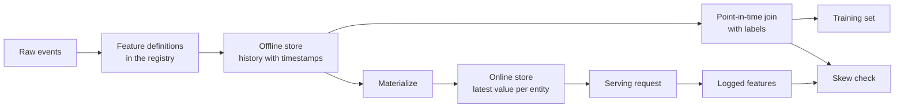

# متجر الميزات و خدمة التدريب

> يحتوي الميزة على تعريف واحد وقارئين. يقرأ التدريب تاريخها من كل وقت من علامات التسمية، ويقرأ الخدمة أحدث قيمته. عندما يختلف القارئين، يرى النموذج مدخلات لم يتدرب عليها أبدا.

**Type:** Build
**Languages:** Python
**Prerequisites:** Phase 2, Lessons 08 (Feature Engineering), 13 (ML Pipelines), 15 (Time Series), and 19 (ML System Design)
**Time:** ~100 minutes

## أهداف التعلم

- وصف المتجر غير متصل بالإنترنت، المتجر عبر الإنترنت، الكيانات، علامات الزمنية للمحدث، و TTL، ومهام كل منها
- تنفيذ نقطة في الوقت المناسب المشتركة الصحيحة وتظهر كيف أن المشتركة الباهظة نسخ القيم المستقبلية في بيانات التدريب
- أسمائ أربعة أسباب لتحيز خدمة التدريب: مسارات رمزية اثنتين، ميزات قديمة، وقصور مختلف، والسفر عبر الزمن
- بناء سجل الميزات التي تعريف واحد تغذية كل من مسار التدريب والمسار الخدمة
- إعادة إكمال ميزة جديدة على التواريخ السابقة دون قراءة البيانات من بعد كل تاريخ
- اكتشاف التحايل عن طريق مقارنة ميزات الخدمة المسجلة مع مسار التدريب لنفس الكيان والوقت

## المشكلة

يقوم فريق ببناء نموذج تشرن. كل علامة تقول ما إذا كان المستخدم لم يشتري في 30 يومًا بعد يوم التسمية. يضم الفريق التسميات إلى جدول ميزات المستخدم على `user_id`و تدرب قاعدة على`days_since_last_purchase`دقة خارج الاتصال هي 0.948.

في حركة المرور الحية، النموذج أسوأ من نسخة قديمة وبسيطة. كان جدول الميزات يحتوي على أحدث قيمة لكل مستخدم، من أسابيع بعد أيام التسمية. كان المستخدم الذي كان آخر شراء له في اليوم 115 أظهر 60 يومًا غير فعالًا في اليوم 175، لذا كانت الميزة تحتوي على الإجابة. في الوقت نفسه، فريق آخر كتب الميزات الخدمة مرة أخرى في خدمة مختلفة. كان نافذة 30 يوماً لها تضم يوم إضافي واحد، وكانت افتراضية لمستخدم جديد هي -1 بدلاً من 365.

كل من العيوب لها نفس السبب. تم تحديد "الميزة نفسها" في طريقتين مختلفتين. تقوم هذه الدروس ببناء قطع متجر الميزات من الصفر. تكتب سجلًا ، وتكملًا ، وتضمنت نقطة في الوقت ، ومحلًا على الإنترنت مع TTL ، وفقًا للتحقق من التمييز. تمثل التجربة كل من العيوب بأرقام.

## المفهوم

### قراء من نفس الميزة

التدريب والخدمة تطلب خصائص في أشكال مختلفة:

| Property | Training (offline) | Serving (online) |
|---|---|---|
| Question | "What was the value for each of 10 million (entity, time) pairs?" | "What is the value for this one entity now?" |
| Time | Many points in the past | The present |
| Volume | Millions of rows per job | One row per request |
| Latency | Minutes are fine | A few milliseconds |
| Storage | Offline store: full history with timestamps, in columnar files or a warehouse | Online store: the latest value per entity, in a key-value database |

متجر الميزات يحافظ على كلتا المتجر مليئة من مجموعة واحدة من تعريفات الميزات. المادة هي العمل الذي ينقل أحدث القيم من متجر خارج الاتصال إلى متجر الإنترنت.



### الكيانات، وخطوط الوقت، و TTL

أربعة مصطلحات تصف كل صف ميزة:

- **Entity.**المفتاح الذي يصفها ميزة، مثل `user_id`أو`card_id`. . .
- **Event timestamp.**الوقت الذي أصبح فيه القيمة صحيحة. حساب الشراء "من اليوم 14" لديه العلامة الزمنية الحدث يوم 14.
- **Created timestamp.**الوقت الذي كتب فيه النظام الصف. إعادة التعبئة التي تعمل اليوم تكتب الصفوف مع طوابع زمنية حدث قديم وتخميم وقت جديد.
- **TTL (time to live).**السن القصوى للقيمة. تعتبر القيمة الأكبر سنا من TTL مفقودة، لذلك القارئ يستخدم الافتراض.

غالبًا ما تسمى مجموعة من الميزات ذات نفس الكيان والصدر و TTL عرضًا للميزات.

### المفاصل الصحيحة في الوقت المناسب

يزدوج صف التدريب علامة مع قيم الميزات التي كانت موجودة في وقت التسمية. يقوم المزدوج في الوقت الحالي بهذا لكل علامة:

1. ابحث عن صفوف الميزات من نفس الكيان
2. احتفظ بالصفوف التي تمتلك علامة زمنية على الحدث عند علامة زمنية على العلامة أو قبلها.
3. خذ آخر صفوف
4. اتركها إذا كانت علامة التسمية الخمسة الخمسة الخمسة الخمسة الخمسة الخمسة الخمسة الخمسة الخمسة الخمسة الخمسة الخمسة الخمسة الخمسة الخمسة الخمسة الخمسة الخمسة الخمسة الخمسة الخمسة الخمسة الخمسة الخمسة الخمسة الخمسة الخمسة الخمسة الخمسة الخمسة الخمسة الخمسة الخمسة الخمسة الخمسة الخمسة الخمسة الخمسة الخمسة الخمسة الخمسة الخمسة الخمسة الخمسة الخمسة الخمسة الخمسة الخمسة الخمسة الخمسة الخمسة الخمسة الخمسة الخمسة الخمسة الخمسة الخمسة الخمسة الخمسة الخمسة الخمسة الخمسة الخمسة الخمسة الخمسة الخمسة الخمسة الخمسة الخمسة الخمسة الخمسة الخمسة الخسية الخسية الخسية الخسية الخسية الخسية الخسية الخسية الخسية الخسية الخسية الخسية الخسية الخسية الخسية الخسية الخسية الخسية الخسية الخسية الخسية الخسية الخسية الخسية الخسية الخسية الخسية الخسية الخسية الخسية الخسية الخسية الخسية الخسية الخسية الخسية الخسية الخسية الخسية الخسية الخسية الخسية الخسية الخسية الخسية الخسية الخسية الخسية.

هنا مستخدم واحد، علامة في اليوم 16، وسلسلة ميزات أسبوعية:

| Feature row day | `purchases_30d` | Point-in-time join | Naive join on `user_id` |
|---|---|---|---|
| 7 | 4 | | |
| 14 | 3 | Selected | |
| 21 | 1 | Future | |
| 28 | 0 | Future | Selected |

يسأل العلامة إذا كان المستخدم يشتري أي شيء في الأيام 17 إلى 46. يعد صف اليوم 28 الأيام الهادئة بعد يوم العلامة. يظهر 0 شراء لأن المستخدم توقف عن الشراء، وهو الحدث الذي يقيس العلامة. ينسخ المشترك الباهض الإجابة إلى المدخل.

نحن نقسم البيانات حسب الوقت في درس سلسلة الوقت لسبب نفسه. نقطة في الوقت يطبق هذا القاعدة على كل سطر بدلا من نقطة تقسيم واحدة.

### أسباب تحيز الخدمات التدريبية

تعرّف قواعد التعلم الآلي في جوجل التشويق في خدمة التدريب على أنه اختلاف بين الأداء أثناء التدريب والأداء أثناء الخدمة. وهي تسمّي ثلاثة أسباب: تعامل مختلف للبيانات في الأنابيبين، وتغيير البيانات بين التدريب والخدمة، ومرحلة ردود الفعل. في أنابيب الميزات، تظهر أربعة أسباب ملموسة مرارا وتكرارا:

| Cause | What happens | Example from the demo |
|---|---|---|
| Two code paths | Training and serving compute the feature with different code | The serving window includes day `now - 30`, and the training window does not |
| Stale features | The value that serving reads has a different age from the value that training used | Training reads weekly snapshots, and a new service computes fresh values |
| Different defaults | The two paths fill a missing value differently | Training uses 365 for "no purchase yet", and serving uses -1 |
| Time travel | Training reads a value from after the label time | The naive join reads the newest snapshot for every label |

القاعدة رقم 32 من نفس الدليل تقول لإعادة استخدام الكود بين خط التدريب وخط الخدمة كلما أمكن. متجر الميزات يتبع هذه القاعدة مع تعريف واحد يدعو كل من الطرق.

### سجل الميزات

السجل هو كتالوج من تعريفات الميزات. كل مدخل يحوي اسمًا ووحدة ومصدرًا وتحويلًا ونفذة وقيمة افتراضية و TTL ومالكًا ونسخة وصفًا.

قوانين تحافظ على سلامته

- كلا الطرق يقرأ التعريف من السجل لا توجد خدمة تحتفظ بنسخة خاصة من التحويل
- تغيير التعريف يخلق نسخة جديدة، والنسخة القديمة تبقى، لذا النماذج القديمة تبقى الميزة التي تدربت عليها.

### الملفات الخلفية

لا يوجد تاريخ لميزة جديدة، ولكن التدريب يحتاج لقيمة في كل وقت سابق من التسمية. يقوم الملف الخلفي بتشغيل التعريف في كل تاريخ سابق ويكتب سطراً واحداً لكل كيان وتاريخ. يقرأ كل جولة الأحداث فقط مع طوابع زمنية في أو قبل تاريخها.

تكلفة الاحتمالات الخلفية التي تنمو مع عدد الكيانات مضاعفة عدد التواريخ. فإنها تجلب أيضا تسربً ظريفًا. يكتب الاحتمالات الخلفية التي تعمل اليوم صفوفًا مع طوابع زمنية سابقة للمحدث، ولكنها يمكن قراءة البيانات التي وصلت متأخرة أو تم تصحيحها في وقت لاحق. يُحقق من المشاركة الصارمة في الوقت أيضًا من أن طوابع الوقت المُنشأة في وقت أو قبل وقت اللقب.

### اكتشاف التحريف

القاعدة رقم 29 من نفس الدليل تقول تسجيل الميزات في وقت الخدمة واستخدامها في التدريب. حتى عينة صغيرة مسجلة تسمح لك بتحقق من التساوي. مقارنة كل قيمة مسجلة مع القيمة التي تنتجها مسار التدريب لنفس الكيان والوقت. لكل ميزة، إبلغ عن نسبة عدم الملاءمة والفرق المعتدل المطلق.

لمعرفة السبب، قم بمقارنة ثلاثة أزواج:

1. متجر على الانترنت قراءة مقابل التدريب المشترك هذا يختبر النظام بأكمله ويجب أن يظهر صفر تحيز.
2. الحسابات الجديدة مقابل التدريب المشترك هذا يعزل التأخير
3. طريق الكود الثاني مقابل الحسابات الجديدة. هذا يعزل اختلافات الكود، مثل النوافذ والإعدادات الافتراضية.

```figure
mlprod-pit-join
```

## بناءها

الرمز في`code/main.py`يستخدم المكتبة القياسية فقط. الوقت هو عدد كامل من الأيام. عمل اللحظة الأسبوعية يكتب اللقطات الميزة في الأيام 7، 14، وهكذا على سبيل المثال حتى 175

### الخطوة الأولى: تعريفات الميزات والسجل

أ`FeatureDefinition`تحتوي على التحويل كبيانات: مجموع، نافذة، والتحويل الافتراضي.`compute`الطريقة لا تقرأ الأحداث بعد`as_of`. . .

```python
@dataclass(frozen=True)
class FeatureDefinition:
    name: str
    entity: str
    aggregate: str
    window_days: int | None
    default: float
    version: int = 1
    owner: str = "growth-team"
    description: str = ""

    def compute(self, events: list[Event], as_of: int) -> float:
        visible = [e for e in events if e.day <= as_of]
        if self.window_days is not None:
            visible = [e for e in visible if e.day > as_of - self.window_days]
        if self.aggregate == "count":
            return float(len(visible))
        if self.aggregate == "sum":
            return round(sum(e.amount for e in visible), 2)
        if self.aggregate == "days_since_last":
            return float(as_of - max(e.day for e in visible)) if visible else self.default
        raise ValueError(f"unknown aggregate {self.aggregate!r}")
```

`FeatureRegistry.register`تقبل نفس التعريف مرتين، ولكنها ترفض تعريفًا مختلفًا مع نفس الاسم والإصدار. `fill_defaults`يعطي كلا المسارات نفس الاختيار الافتراضي لقيمة مفقودة.

النموذج يضع تعريفًا مع مرجع مثل `spend_30d@1`. .`compute`و`fill_defaults`حل الإشارة، والاسم دون `@`يقرأ أحدث نسخة.`@`ولا يوجد إصدار يزيد من عدد`ValueError`، لذلك لا يمكن لخطأ النص الأخير قراءة دون تحذير. المرجع هو أيضا مفتاح في كل سطر مخزن، لذلك الملفات الخلفية، المتجر على الانترنت، والقراءة الخدمة جميع استخدام التعريف المثبت.

### الخطوة الثانية: إعادة إكمال المتجر غير متصل

```python
def backfill(registry: FeatureRegistry, names: list[str], events: list[Event], days: list[int]) -> list[FeatureRow]:
    rows = []
    for entity, entity_events in sorted(group_events(events).items()):
        for day in days:
            rows.append(FeatureRow(entity, day, registry.compute(names, entity_events, day)))
    return rows
```

يضيف التجربة ثلاث ميزات ل299 مستخدمًا في 25 يومًا من اللقطة الفورية ، مما يعطي 7475 صفًا.

### الخطوة الثالثة: الانضمام في الوقت المناسب

قم بتصنيف صفوف كل كيان مرة واحدة يومياً.`bisect_right`يجد آخر صف في أو قبل يوم التسمية. فالتحقق TTL يترك صف قديم جدا.

```python
def point_in_time_join(labels: list[LabelRow], rows: list[FeatureRow], ttl_days: int | None = None) -> list[JoinedRow]:
    by_entity: dict[str, list[FeatureRow]] = defaultdict(list)
    for row in rows:
        by_entity[row.entity].append(row)
    days_index = {}
    for entity, entity_rows in by_entity.items():
        entity_rows.sort(key=lambda r: r.day)
        days_index[entity] = [r.day for r in entity_rows]
    joined = []
    for label in labels:
        days = days_index.get(label.entity, [])
        pos = bisect.bisect_right(days, label.day) - 1
        match = by_entity[label.entity][pos] if pos >= 0 else None
        if match is not None and ttl_days is not None and label.day - match.day > ttl_days:
            match = None
        joined.append(JoinedRow(
            label.entity, label.day, label.label,
            match.day if match else None, match.values if match else None,
        ))
    return joined
```

### الخطوة الرابعة: قياس التسرب من المفصل البطيء

`naive_latest_join`يضم على الكيان فقط، لذلك يعيد أحدث صف لكل ملصق. يقوم التجربة ببناء الملصقات في الأيام 100، 120، و 140 ويتلائم قاعدة ذات ميزة واحدة على كل مجموعة تدريبية. ثم يختبر القواعد على الملصقات من اليوم 145، مع ميزات نقطة في الوقت:

```console
  naive join used a snapshot from after the label day for 100% of rows
  offline accuracy, naive join: 0.948 (rule: idle > 53 days)
  offline accuracy, PIT join:   0.893 (rule: idle > 19 days)
  accuracy on day 145, trained with naive join: 0.763
  accuracy on day 145, trained with PIT join:   0.876
```

يبدو المشترك البديل أفضل خارج الاتصال، 0.948 مقابل 0.893 . في البيانات الجديدة هو أسوأ، 0.763 مقابل 0.876.

### الخطوة 5: المتجر عبر الإنترنت والتحقيق

يحتفظ المتجر عبر الإنترنت بعبارة واحدة لكل كيان ويرفض الصفوف التي أكبر من TTL. `materialize`يكتب فقط صفوف يقع يومها في وقت العمل أو قبل ذلك.

```python
class OnlineStore:
    def __init__(self, ttl_days: int):
        self.ttl_days = ttl_days
        self._latest: dict[str, FeatureRow] = {}

    def write(self, row: FeatureRow) -> None:
        current = self._latest.get(row.entity)
        if current is None or row.day >= current.day:
            self._latest[row.entity] = row

    def read(self, entity: str, now: int) -> dict[str, float] | None:
        row = self._latest.get(entity)
        if row is None or row.day > now or now - row.day > self.ttl_days:
            return None
        return dict(row.values)
```

مع TTL من 10 أيام، قراءة في اليوم 145 يعود إلى اليوم 140 صف. قراءة في اليوم 160, دون أي مادة جديدة، يعود إلى الافتراضات، لأن الصف هو 20 يوم.

### الخطوة 6: فحص التحيز

`detect_skew`يُقارن وجهات النظر المُقدمة من `(entity, day)`. يبلغ عن معدل عدم التطابق والفرق المطلق المتوسط لكل ميزة ويضع علامة على ميزة عندما تختلف أكثر من 1٪ من القيم.`ValueError`عندما يكون لدى المشاهدين مفتاحان مختلفان أو لا مفتاحان، يمكن أن يخفي طلب مفقود منحنى، والتحقق بدون طلبات لا يظهر شيئا.

```python
def detect_skew(
    training: dict[tuple[str, int], dict[str, float]],
    serving: dict[tuple[str, int], dict[str, float]],
    features: list[str],
    tolerance: float = 1e-6,
    max_mismatch_rate: float = 0.01,
) -> list[SkewReport]:
    if set(training) != set(serving):
        raise ValueError(f"{len(set(training) ^ set(serving))} keys are in only one view: log and compare the same requests")
    if not training:
        raise ValueError("no requests to compare")
    keys = sorted(training)
    reports = []
    for feature in features:
        diffs = [abs(training[k][feature] - serving[k][feature]) for k in keys]
        mismatches = sum(1 for d in diffs if d > tolerance)
        rate = mismatches / len(keys)
        mean_diff = sum(diffs) / len(keys)
        reports.append(SkewReport(feature, len(keys), rate, mean_diff, rate > max_mismatch_rate))
    return reports
```

سجلات التجربة الطلبات في الأيام 141 إلى 150 وتشغيل المقارنات الثلاثة من قسم المفهوم. مجموعة الطلبات تشمل 20 مستخدمًا جديدًا بدون تاريخ.

```bash
python3 code/main.py
```

```console
=== Skew checks on 383 logged requests, days 141 to 150 ===
  online store read  vs  training join (one definition, same snapshots)
    ok   days_since_last_purchase   mismatch   0.0%  mean |diff|    0.00
    ok   purchases_30d              mismatch   0.0%  mean |diff|    0.00
    ok   spend_30d                  mismatch   0.0%  mean |diff|    0.00
  fresh compute      vs  training join (staleness only)
    SKEW days_since_last_purchase   mismatch  83.0%  mean |diff|    2.77
    SKEW purchases_30d              mismatch  30.5%  mean |diff|    0.38
    SKEW spend_30d                  mismatch  37.1%  mean |diff|   16.77
  second code path   vs  fresh compute (code differences only)
    SKEW days_since_last_purchase   mismatch   5.5%  mean |diff|   20.07
    SKEW purchases_30d              mismatch  12.5%  mean |diff|    0.13
    SKEW spend_30d                  mismatch  12.5%  mean |diff|    5.09
```

اقرأ كل ثلاثة كتب بالترتيب:

- **One definition, same snapshots.**المتجر الإلكتروني والمركز التدريبي يقرأ نفس الصفوف المتحولة، لذا المتحول هو صفر.
- **Staleness.**يختلف القيمة الطازجة عن اللقطة الفورية الأسبوعية على معظم الطلبات. لا تكون البيانات الطازجة أفضل تلقائيًا هنا، لأن النموذج تعلم من القيم التي تصل إلى ستة أيام.
- **Code differences.**يختلف مسار الشفرة الثانية على 12.5 في المائة من حسابات النافذة، لأن نافذته تشمل يومًا إضافيًا.`days_since_last_purchase`فقط للمستخدمين الجدد، ولكن بكمية كبيرة: -1 مقابل 365.

## استخدمها

فيست هو متجر ميزات مفتوح المصدر. كل قطعة من الرمز من الصفر لديها نظير فيست:

| From scratch | Feast |
|---|---|
| `FeatureDefinition`, `FeatureRegistry` | `Entity`, `FeatureView`, and `Field` in a feature repository, registered with `feast apply` |
| `FeatureRow` history | An offline store, for example a `FileSource` over Parquet files or a warehouse table |
| `point_in_time_join` with a TTL | `store.get_historical_features(entity_df=..., features=[...])` |
| `materialize` | `feast materialize-incremental <end time>` |
| `OnlineStore.read` | `store.get_online_features(features=[...], entity_rows=[...])` |
| Created timestamp check | `created_timestamp_column` on the source and `filter_by_created_timestamp=True` |

التعريفات تبدو هكذا، الرمز يتبع بداية العيد السريعة ولا يحتاج لتشغيل هذه الدروس.

```python
from datetime import timedelta

from feast import Entity, FeatureView, Field, FileSource
from feast.types import Float32, Int64

user = Entity(name="user", join_keys=["user_id"])

user_activity_source = FileSource(
    name="user_activity_source",
    path="data/user_activity.parquet",
    timestamp_field="event_timestamp",
    created_timestamp_column="created",
)

user_activity = FeatureView(
    name="user_activity",
    entities=[user],
    ttl=timedelta(days=10),
    schema=[
        Field(name="purchases_30d", dtype=Int64),
        Field(name="spend_30d", dtype=Float32),
        Field(name="days_since_last_purchase", dtype=Int64),
    ],
    source=user_activity_source,
)
```

ثم التدريب والخدمة يقرأون نفس الميزة:

```python
from feast import FeatureStore

store = FeatureStore(repo_path=".")

training_df = store.get_historical_features(
    entity_df=labels_df,
    features=["user_activity:purchases_30d", "user_activity:days_since_last_purchase"],
    filter_by_created_timestamp=True,
).to_df()

online = store.get_online_features(
    features=["user_activity:purchases_30d", "user_activity:days_since_last_purchase"],
    entity_rows=[{"user_id": 42}],
).to_dict()
```

`labels_df`تحتوي على سطر واحد لكل ملصق مع `user_id`،`event_timestamp`و التسمية. توضح وثائق عيد أن TTL هو النسبي لكل طابع زمني في إطار بيانات الكيان، وليس إلى وقت البحث. وهذا يطابق التحقق من TTL في `point_in_time_join`نفس الصفحة تصف`filter_by_created_timestamp=True`لا يدعم كل متجر خارج الاتصال هذا الخيار. متجر بدون دعم يثير خطأ بدلا من تجاهل الخيار.

تستخدم Tecton وHopsworks والمتاجر الميزة في منصات ML السحابية الكبيرة نفس الانقسام بين المتاجر غير الحكومية والإنترنت. لتحقق من التمييز، يمكن أن تقارن تصحيح بيانات التدريب مع بيانات خدمة الكشف عن التمييز. يصف Breck et al. نظام تصحيح البيانات في TFX، منصة ML من نهاية إلى نهاية جوجل، بما في ذلك التمييز الذي يقدم التدريب.

## أرسله

هذا الدرس يُنتج`outputs/skill-feature-skew-audit.md`. تقوم المهارات بمراجعة خط الأنابيب المميزة للسفر عبر الزمن والتحديدات التي تخدم التدريب. تمر عبر المشتركة، والتحديدات، والإعدادات القابلة للتخلف، والجدد لكل مسار، والسجلات التي تحتاجها التحقق من التحديدات.

## التمارين

1. قم بتغيير فترة الصور الفورية من 7 أيام إلى 1 يوم، كرر مقارنة التوقف وتوضح النتيجة.
2. حدد التوقيت التوقيتي إلى 3 أيام، و أعد صفوف التدريب التي تفقد ميزاتها وتحصل على الافتراضات القابلة
3. إضافة يوم تم إنشاؤه إلى `FeatureRow`اجعل المشترك يتجاهل الصفوف التي كتبت بعد يوم التسمية
4. سجل`spend_7d`في النسخة 2 من `spend_30d`إملأها و طبع كلتا النسختين من السجل
5. إصلاح`legacy_serving_features`حتى يمر الفحص الثالث

## الشروط الرئيسية

| Term | What people say | What it means |
|------|----------------|----------------------|
| Feature store | "A database for features" | A system that computes features from one set of definitions and serves them to training and to serving |
| Offline store | "The training data" | Full feature history with event timestamps, read by training jobs and backfills |
| Online store | "The feature cache" | The latest value per entity, read by the serving path in milliseconds |
| Entity | "The ID" | The key that a feature describes, such as a user or a card |
| Event timestamp | "When it happened" | The time at which a feature value became true |
| Point-in-time join | "An as-of join" | A join that pairs each label with the latest feature row at or before the label time |
| TTL | "Expiry" | The maximum age of a feature value before a reader treats it as missing |
| Materialization | "Syncing to online" | The job that copies the latest feature values from the offline store to the online store |
| Backfill | "Computing history" | Running a feature definition at past dates to create its history |
| Training-serving skew | "It worked offline" | A difference between the features or behavior in training and in serving |

## المزيد من القراءة

- [Feast, Point-in-time joins](https://docs.feast.dev/getting-started/concepts/point-in-time-joins): سمانيات TTL والمرشح الزمني المُخلق
- [Feast documentation](https://docs.feast.dev/): عرض الميزات، المحلات التجارية غير التواصلية، المحلات التجارية عبر الإنترنت، والتحقيق
- [Google, Rules of Machine Learning](https://developers.google.com/machine-learning/guides/rules-of-ml): قواعد التشويش التي تُخدم في التدريب، من القاعدة رقم 29 إلى القاعدة رقم 37
- [Breck et al., Data Validation for Machine Learning (SysML 2019)](https://research.google/pubs/data-validation-for-machine-learning/): التحقق من المصادقة بالبيانات في جوجل، بما في ذلك التشويق في تقديم التدريب
- [TensorFlow Data Validation guide](https://www.tensorflow.org/tfx/guide/tfdv): فحص النظام، اكتشاف التحريف، وكشف التجول
- [Sculley et al., Hidden Technical Debt in Machine Learning Systems (NeurIPS 2015)](https://papers.nips.cc/paper/2015/hash/86df7dcfd896fcaf2674f757a2463eba-Abstract.html): الاعتماد على البيانات وديون خط الأنابيب حول نموذج
