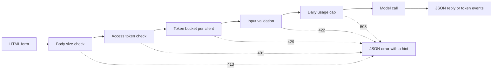

# نموذج واجهات التجربة  من وظيفة إلى تطبيق قابل للمشاركة

> نموذج التجربة لديه عقد واحد: مدخل، دعوة نموذج، ومخرج. ضع حدًا على كل جزء قبل مشاركة الرابط.

**Type:** Build
**Languages:** Python
**Prerequisites:** Phase 11 · 13 (Building a Production LLM Application), Phase 17 · 08 (Inference Metrics), Phase 17 · 19 (AI Gateways)
**Time:** ~90 minutes

## أهداف التعلم

- اكتب الدخول، النموذج الدعوة، والعقد الخروج من عرض التجربة، مع حد لكل جزء.
- قم ببناء تطبيق HTTP المكتبة القياسي مع صفحة HTML واحدة ، نقطة نهاية JSON ، ونقطة نهاية Server-Sent Events.
- تأكيد المدخلات حسب التكلفة، وعيد أخطاء JSON التي تخبر المستخدم بالعمل التالي.
- حماية عرض عرض عام مع علبة رموز لكل عميل، حد استخدام يومي، ورمز الوصول الاختياري.
- اكتب سجلات الطلبات التي لا تحتفظ بنص إدخال ولا عنوان عميل.
- مقارنة عرض المكتبة القياسي مع إصدارين إطارية، وتسمية الإشارات التي يجب أن يصبح عرض عرض منتج.

## المشكلة

نموذجك يعمل في دفتر ملاحظات. الآن المراجعة تريد أن تجرب عشرة مدخلات، والعميل يريد أن يرى نتيجة واحدة على الهاتف. لا أحد منهم سوف تفتح دفتر ملاحظاتك.

خلية دفتر الملاحظات لا توجد حدود إدخال ولا توجد عرض تقدم. أخطائها هي آثار التعبئة التي يمكنك قراءتها فقط. كما أنها تعمل مع إشعارك وال ميزانيتك. إذا وضعت الخلية وراء عنوان URL عام دون تغييرات، يمكنك توقع أخطاء مثل هذه:

- يضم المستخدم وثيقة من 40 ألف حرف، وتجري المكالمة النموذجية لمدة دقيقة ثم تفشل مع تعقب كومة.
- نص واحد يرسل 500 طلب في دقيقة واحدة كل طلب هو مكالمة نموذجية مدفوعة
- الصفحة لا تظهر شيئا لمدة ثمانية ثوان، لذلك المستخدم يضغط على الزر أربع مرات أخرى.
- سجل الخادم يحفظ كل إدخال، بما في ذلك الإدخال مع رقم حساب العميل.

يمنع واجهة التجربة هذه الفشل مع كمية صغيرة من الكود. هذه الدروس تبني واحدة مع مكتبة Python القياسية، حتى تتمكن من رؤية كل جزء. ثم تقوم ببناء نفس التجربة مع إطاريتين شعبيتين وتقارن ما يفعله كل منهما افتراضيًا.

## المفهوم

### الاكتشاف هو عقد

كل عرض عرض يحتوي على ثلاثة أجزاء. المدخل هو ما يمكن للمستخدم إرساله. استدعاء النموذج يحول المدخل إلى خروج. الخروج هو ما يراه المستخدم، وهذا يشمل الأخطاء.

اكتب العقد قبل كتابة الصفحة:

| Part | Question to answer | Answer in this lesson |
|------|--------------------|-----------------------|
| Input | What type, what size, which characters? | A string of 1 to 500 characters, with no control characters |
| Model call | How long does one call take, and what does it cost? | A toy keyword model that runs in under a millisecond at no cost |
| Output | What does the user see on success and on failure? | A label, a score, and a reply, or a JSON error with a hint |

لا يوجد حد للكتب الملاحظة لأي من الأجزاء الثلاثة. تحدد المشاهدة حدًا لكل جزء ، ويتم تطبيق الخادم الحدود على كل عميل.



التحققات تعمل في ترتيب التكلفة. طلب سيء يتوقف عند التحقق الأول أنه يفشل، لذلك يكلف الخادم تقريبا أي شيء. النموذج المكالمة تأتي الأخيرة، لأنه الخطوة الوحيدة التي تكلف المال.

### التحقق من الصلاحية قبل تشغيل النموذج

يمكن للمتنشر التحقق من المدخل قبل إرسال أي شيء.`maxlength`و`required`تعطي الميزات على منطقة نصية للمستخدم تعليقات دون اتصال شبكي. هذه التحققات تساعد المستخدمين الصادقين فقط. أي عميل يمكن إرسال طلب دون الصفحة، لذلك يقوم الخادم بتكرار كل التحقق.

ضع الشيكات على الخادم حسب التكلفة:

1. اقرأ`Content-Length`رفض الجثة فوق الحد قبل قراءتها
2. تحليل جسم JSON. رفض جسم ليس كائن JSON.
3. تحقق من الحقول، ورفض النص الفارغ، النص فوق الحد، وترتيب الأحرف.
4. إضافة مكالمة نموذجية فقط على طلب تمكنت من إجراء كل شيك

| Failed check | HTTP status | Error code |
|--------------|-------------|------------|
| Body over 4,096 bytes | 413 Content Too Large | `body_too_large` |
| Body stops before `Content-Length` bytes arrive | 408 Request Timeout | `request_timeout` |
| Content type is not JSON | 415 Unsupported Media Type | `unsupported_media_type` |
| Body is not a JSON object | 400 Bad Request | `bad_json` |
| Text is missing, empty, too long, or has control characters | 422 Unprocessable Content | `missing_text`, `empty_text`, `text_too_long`, `control_characters` |

RFC 9110 تعريف هذه الرموز الحالة وأسمائها.

المثال هو جزء من تصميم المدخلات. يظهر مثال للمستخدم كيف يبدو مدخل جيد. كما يعطي المراجع اختبارًا بنقرة واحدة. اختر مثالًا واحدًا لكل فئة خروج. هذا التجربة لديها مثال إيجابي وسلبي ومثال محايد.

### أظهر أن النموذج يعمل

يمكن أن تستغرق مكالمة النموذج عدة ثوان. بدون تعليقات، لا يمكن للمستخدم معرفة النموذج البطيء من صفحة مكسورة. يمكن للمستخدم الذي لا يرى أي تغيير انقر مرة أخرى، ثم يحصل الخادم على طلب مدفوع ثان.

الصفحة في هذا الدروس تعطى أربعة أنواع من المراجعة:

- إنه يعطى زر الإرسال أثناء تشغيل طلب.
- يظهر الوقت المتأخر ويحديثه كل 100 ميل ثانية
- يظهر الوقت لأول رمز عندما يصل الرمز الأول.
- يظهر الوقت الإجمالي عندما ينتهي الطلب.

عندما كنتِ تدرسين[inference metrics](../../08-inference-metrics-goodput/)وقت إلى أول رمز (TTFT) كان مقياس الخادم. الصفحة التجريبية تظهر نفس الرقم للمستخدم، التي يتم قياسها في المتصفح.

### إرسال الخروج كشريان

إن نموذج اللغة ينتج ردته رمزًا واحدًا في كل مرة. إذا انتظر الخادم آخر رمز ، ينتظر المستخدم الجيل الكامل. إذا أرسل الخادم كل رمز عندما يكون جاهزًا ، يبدأ المستخدم في قراءة بعد الرمز الأول.

الأحداث المرسلة من الخادم (SSE) هي النموذج القياسي لهذا.`text/event-stream`كل حدث هو مجموعة من`event:`و`data:`الخطوط، والخط الفارغ ينهي الحدث. معيار WHATWG HTML يحدد النموذج.

```text
event: token
data: {"index":0,"text":"Label:"}

event: token
data: {"index":1,"text":" positive."}

event: done
data: {"label":"positive","score":1.0,"tokens":11}
```

المتصفح لديه `EventSource`واجهة SSE ، ولكنها ترسل طلبات GET فقط. طلب GET يضع المدخل في عنوان URL ، وكتب خوادم الويب والوكسيات عناوين URL في سجلات الوصول الخاصة بهم. هذا التجربة يرسل طلب POST مع جسم JSON بدلاً من ذلك.`fetch()`و`response.body.getReader()`، ويقوم بتحليل شكل الحدث نفسه

يحتوي سلسلة على مشكلة واحدة لا يوجد فيها رد JSON واحد. سيرفر يرسل الحالة 200 قبل الرمز الأول. إذا فشل النموذج بعد ذلك، لا يمكن للخادم تغيير الحالة. لذلك سيرفر يرسل `error`حدث في التيار، والصفحة تظهر هذا الحدث كخطأ.

عندما بنيت[production LLM application](../../../11-llm-engineering/13-production-app/)هذا الدروس يكتب نفس البروتوكول يدويا، حتى تتمكن من رؤية كل سطر الذي يرسله الخادم.

### اكتب الأخطاء التي يمكن للمستخدم العمل عليها

رسالة الخطأ لها وظائف اثنتين. يخبر المستخدم بما حدث، ويخبر المستخدم ما يجب القيام به التالي. لا يعمل تعقب كومة أي من وظائف الغرباء.

كل خطأ في هذا التجربة لديه نفس شكل JSON:

```json
{
  "error": {
    "code": "text_too_long",
    "message": "The text has 812 characters. The limit is 500.",
    "hint": "Shorten the text to 500 characters or fewer.",
    "request_id": "a8f3c2b435e3"
  }
}
```

- `code`هو اسم مستقر، وترتيبات العميل و اختباراتها مقارنة معه
- `message`يظهر الحقيقة، مع الأرقام التي يحتاجها المستخدم.
- `hint`يمنح المستخدم عمل واحد.
- `request_id`يربط تقرير المستخدم بسجل تسجيل واحد.

يحدد RFC 9457 تنسيق خطأ قياسي لبرامج API HTTP ، يسمى تفاصيل المشكلة. يستخدم هذا التجربة شكلًا أصغر لنفس الغرض. استخدم RFC 9457 عندما تستدعي فرق أخرى API الخاص بك.

### مشاركة عرض عرض عام بأمان

يغير رابط عام من يمكنه إرسال الطلبات. خطط لتحكم واحد لكل مخاطر:

| Risk | Control in this demo | Control for a larger audience |
|------|----------------------|-------------------------------|
| One client sends too many requests | A token bucket per client, with 429 and `Retry-After` | Per-user limits after sign-in |
| Strangers find the link | An optional access token in the `Authorization` header | Single sign-on with an identity provider |
| Total cost grows with no limit | A daily usage cap, with 503 and `Retry-After` | Spend limits and alerts at the model provider |
| Very large or unusual input | Body size limit, text length limit, control character check | Content moderation on input and output |
| Logs keep private input | Records with the input length and a keyed hash of the client | A retention period and access control on the logs |

يستخدم علبة الرموز رقمين. القدرة هي أكبر انفجار يمكن لعميل واحد إرسالها. معدل إعادة التعبئة هو معدل الطلب طويل الأجل. كل طلب يأخذ رمزًا واحدًا، ويتم إعادة التعبئة المستمرة إلى قدرة قدرته:

```text
tokens = min(capacity, tokens + refill_rate * seconds_since_last_request)
accept the request if tokens >= 1, then subtract 1
```

عندما يكون السد فارغ، يستجيب الخادم`429 Too Many Requests`. RFC 6585 تعريف الحالة 429 ، و يسمح للخادم إضافة `Retry-After`هذا التجربة دائما يضيف الرأس، مع عدد الثواني حتى الرمز التالي. الصفحة تقرأ الرأس وتعطيل الزر لهذا الوقت.

يستخدم التجربة عنوان IP العميل كمفتاح سطل. وراء وكيل عكسية، كل طلب يأتي من عنوان البروكسي، لذلك جميع المستخدمين يشتركون سطل واحد. في هذه الحالة، قراءة عنوان العميل من عنوان الذي يحدده وكيل الخاص بك. لا تثق في هذا العنوان من أي مصدر آخر، لأن العميل يمكن أن يضع أي قيمة فيه.

عندما كنتِ تدرسين[AI gateways](../../19-ai-gateways/)يستخدم الموقع الحد الأقصى لتحديد المبلغ المطلوب من خلال الموقع. يستخدم الموقع الحد الأقصى لتحديد المبلغ المطلوب من خلال الموقع. يستخدم الموقع الحد الأقصى لتحديد المبلغ.

السجلات تحتاج إلى نفس الرعاية مثل المدخلات.`http.server`يكتب المدير عنوان IP العميل وعنوان الطلب إلى خطأ قياسي. إذا كانت المدخلات في عنوان URL ، فإن المدخلات تذهب إلى السجل. هذا التجربة يستبدل ذلك السجل. يكتب كل طلب سجلًا واحدًا مع الطريق ، والحالة ، وكود الخطأ ، والبطء ، وطول المدخل. يصبح عنوان العميل هشًا مفتاحًا ، بحيث يمكنك حساب الطلبات لكل عميل دون تخزين العنوان.

أخبر المستخدمين ما تحفظه. صفحة التجربة تقول أن الخادم يحفظ طول النص وليس النص نفسه أبدا.

### عندما يصبح التجربة منتجاً

إشارات إشارة هذه تخبرك أن الإشارة الإعلانية هي الآن منتج:

- الناس خارج فريقك يستخدمونها كل أسبوع.
- شخص ما يطلب هدف التشغيل أو يبلغ عن انقطاع
- يطلب المستخدمون تسجيل الدخول أو حفظ النتائج أو مشاهدة تاريخهم.
- تكلفة النموذج الأسبوعي هي خط في الميزانية.
- وتشمل المدخلات البيانات التي تغطي العقد أو القانون.

| Property | Demo | Product |
|----------|------|---------|
| Users | Known people, short sessions | Unknown people, daily use |
| State | None | Accounts, history, saved results |
| Availability | Best effort, one process | A written target, replicas, an on-call owner |
| Cost control | One daily usage cap | Per-user quotas and billing |
| Observability | One log record per request | Traces, metrics, and alerts |

عندما ترى هذه الإشارات، نقلها إلى كومة الإنتاج من دروس التطبيقات الإنتاج LLM. هذه الكومة تضيف المصادقة الحقيقية، النماذج الخلفية، التتبع، وتتبع التكلفة لكل مستخدم.

```figure
demo-token-bucket
```

## بناءها

الرمز هو ملف واحد،`code/main.py`لا يوجد أي اعتماد خارج المكتبة القياسية إجر الاختبار الذاتي أولاً

```bash
python3 code/main.py
```

يختبر الاختبار الذاتي المصادق والسلة الوهمية ومصيغة التدفق، وجولة ذهاب وإياب HTTP واحدة حقيقية. يبدأ الخادم على منفذ مجاني، يرسل ثلاثة طلبات، ويقف الخادم، ويقوم بالخروج. يبدأ الخادم لمصفح فقط عندما تحتاج إليه:

```bash
python3 code/main.py --serve
```

افتح`http://127.0.0.1:8000`في متصفح. اضغط على Ctrl + C لإيقاف الخادم.

### الخطوة الأولى: المكالمة النموذجية

النموذج هو عداد الكلمات الرئيسية لعبة. يسمي النص الإيجابي أو السلبي أو المحايد. كما ينتج إجابة قصيرة، رمز واحد في كل مرة.

```python
def classify(text):
    words = WORD_RE.findall(text.lower())
    positive = sum(1 for word in words if word in POSITIVE)
    negative = sum(1 for word in words if word in NEGATIVE)
    score = (positive - negative) / max(1, positive + negative)
    if score > 0:
        label = "positive"
    elif score < 0:
        label = "negative"
    else:
        label = "neutral"
    return {"label": label, "score": round(score, 3), "positive_cues": positive,
            "negative_cues": negative, "words": len(words)}


def generate(text):
    result = classify(text)
    reply = (
        f"Label: {result['label']}. Positive cues: {result['positive_cues']}. "
        f"Negative cues: {result['negative_cues']}. Words read: {result['words']}."
    )
    parts = reply.split(" ")
    yield parts[0]
    for part in parts[1:]:
        yield " " + part
```

نموذج حقيقي يُستبدل`generate`و لا شيء آخر. ضع مكالمة API أو نموذج محلي داخلها. حافظ على التوقيع: تدخل سلسلة، وتخرج الرموز. المحقق، والحدود، والصفحة تبقى نفسها.

### الخطوة الثانية: التحقق من الصحة والردود على الأخطاء

فئة استثناء واحدة تحمل كل خطأ. تحتوي على حالة HTTP، رمز مستقرة، رسالة، إشارة، و عناوين الاستجابة الاختيارية.

```python
class DemoError(Exception):
    def __init__(self, status, code, message, hint, headers=None):
        super().__init__(message)
        self.status = status
        self.code = code
        self.message = message
        self.hint = hint
        self.headers = dict(headers or {})


def validate_text(payload, max_chars=MAX_CHARS):
    if "text" not in payload:
        raise DemoError(422, "missing_text", 'The field "text" is missing.', 'Add a "text" field with your input.')
    text = payload["text"]
    if not isinstance(text, str):
        raise DemoError(422, "text_not_string", 'The field "text" is not a string.', "Send the input as a string.")
    text = text.strip()
    if not text:
        raise DemoError(422, "empty_text", "The text is empty.", "Type a sentence or pick an example.")
    if len(text) > max_chars:
        raise DemoError(422, "text_too_long", f"The text has {len(text)} characters. The limit is {max_chars}.",
                        f"Shorten the text to {max_chars} characters or fewer.")
    if CONTROL_RE.search(text):
        raise DemoError(422, "control_characters", "The text contains control characters.",
                        "Remove the hidden characters, then send the text again.")
    return text
```

يقوم المحقق بإزالة المساحة البيضاء الرائدة والمتأخرة أولاً. يظهر النص الذي يضم مساحات فقط بعد ذلك كبيراً، ويقول الإشارة للمستخدم ما يجب كتابته. `check_body_size`و`parse_json_body`استخدم نفس النمط في الحالات 411, 413, 415 و 400. `error_body`يُحوّل أيّ شيء`DemoError`في شكل JSON من قسم المفهوم.

### الخطوة الثالثة: علبة الوسائل

```python
class TokenBucket:
    def __init__(self, capacity, refill_per_second, now):
        if capacity < 1:
            raise ValueError("capacity must be at least 1")
        if refill_per_second <= 0:
            raise ValueError("refill_per_second must be positive")
        self.capacity = float(capacity)
        self.refill_per_second = float(refill_per_second)
        self.tokens = float(capacity)
        self.updated = now

    def take(self, now, cost=1.0):
        elapsed = max(0.0, now - self.updated)
        self.tokens = min(self.capacity, self.tokens + elapsed * self.refill_per_second)
        self.updated = now
        if self.tokens >= cost:
            self.tokens -= cost
            return 0.0
        return (cost - self.tokens) / self.refill_per_second
```

`take`يعود 0.0 عندما يقبل الطلب. وإلا يعود الثواني حتى يكون العبوة كافية الوهم. الخادم يدور التي قيمة وترسلها `Retry-After`. . .

`RateLimiter`يحتفظ بالسفن الواحدة لكل عميل في`OrderedDict`قفل يحمي القاموس، لأن`ThreadingHTTPServer`يُعامل كل طلب في خيط خاص به.`max_clients`إدخالات، القيود إزالة العميل مع أقدم طلب. العميل إزالة يحصل على سطل كامل على طلبها التالي. حدد `max_clients`أكثر من عدد العملاء النشطين الذي تتوقعه

المحدد يأخذ`clock`الاختبارات تمر`FakeClock`، لذا يمكن للاختبار أن يقدم الوقت بعشر ثواني دون انتظار`UsageCap`يستخدم نفس نمط الساعة لجميع اليوم. يعد المكالمات في نوافذ ثابتة من 86,400 ثانية، ويرد الثواني حتى النافذة التالية عندما يكون العد كامل.

### الخطوة الرابعة: التيار

```python
def sse_event(event, data):
    payload = json.dumps(data, separators=(",", ":"), ensure_ascii=False)
    return f"event: {event}\ndata: {payload}\n\n".encode("utf-8")


def stream_events(text, generate_fn=generate, delay=0.0, sleep=time.sleep):
    count = 0
    try:
        for token in generate_fn(text):
            yield sse_event("token", {"index": count, "text": token})
            count += 1
            if delay:
                sleep(delay)
    except Exception:
        yield sse_event("error", MODEL_ERROR)
        return
    result = classify(text)
    yield sse_event("done", {"label": result["label"], "score": result["score"], "tokens": count})
```

`json.dumps`يكتب خط جديد داخل سلسلة كالعلامتين`\n`. لذلك كل حدث لديه سطر بيان واحد بدون خط جديد خام فيه.

الجهاز المصنع يلاحظ فشل النموذج ويرسل إرسال`error`حدث، لأن الخادم قد أرسل بالفعل خط الحالة.`delay`و`sleep`الحجج تبطئ تدفق المصفح، وتحافظ على الاختبارات سريعة.

### الخطوة 5: معالج الطلب

`DemoHandler`يمتد `BaseHTTPRequestHandler`. يدير POST التحققات بالترتيب من قسم المفهوم:

```python
def do_POST(self):
    app = self.server.app
    request_id = uuid.uuid4().hex[:12]
    client_id = self.client_address[0]
    started = time.perf_counter()
    route = self.path if self.path in self.routes else "other"
    status, code, chars = 200, None, 0
    try:
        declared = self.headers.get("Content-Length")
        try:
            if route == "other":
                raise DemoError(404, "not_found", "This endpoint does not exist.",
                                "Send requests to /api/predict or /api/stream.")
            size = check_body_size(declared, app.config.max_body_bytes)
        except DemoError:
            self.drain(int(declared) if declared and declared.isdigit() else 0)
            raise
        try:
            body = self.rfile.read(size)
        except TimeoutError:
            self.close_connection = True
            raise DemoError(408, "request_timeout", "The request body did not arrive in time.",
                            "Send the request again with the full body.") from None
        app.admit(client_id, self.headers.get("Authorization"))
        text = app.read_text(self.headers.get("Content-Type"), body)
        chars = len(text)
        app.charge()
        if route == "/api/predict":
            self.send_json(200, predict(text), request_id)
        else:
            code = self.send_stream(text, request_id)
    except DemoError as err:
        status, code = err.status, err.code
        self.send_error_json(err, request_id)
    except TimeoutError:
        status, code = 408, "request_timeout"
        self.close_connection = True
    except Exception:
        status, code = 500, "internal_error"
        self.send_error_json(DemoError(500, "internal_error", "The server failed on this request.",
                                       "Try again. Quote the request id if you report the problem."), request_id)
    finally:
        latency_ms = (time.perf_counter() - started) * 1000
        app.log.record(request_id, route, client_id, status, chars, latency_ms, code)
```

`admit`يُحقق من رمز الوصول و سطل الوسائل. `charge`يفتقد القيادة اليومية. إنه يعمل الأخير، لذلك فقط الطلبات الصالحة تعتبر ضد القيادة. كل طلب يكتب سجل تسجيل واحد في `finally`و هذا يشمل طلبات رفضها.`route`، أبداً المسار الخام، لأن المسار يمكن أن يحمل سلسلة استفسار مع نص المستخدم.

أربعة تفاصيل تمنع الفشل الذي يسهل تفويتها:

- `timeout = 10`في فئة المعاملة يغلق اتصال عندما يتوقف العميل عن إرسال. بدون ذلك ، يحتفظ العميل الذي يعلن 100 بايت ويرسل 10 بخيط خادم إلى الأبد. يرسل المعامل خطأ 408 JSON مع معرف الطلب ويقفل الاتصال. توقف الوقت بعد بدء التدفق يغلق الاتصال فقط ، لأن خط الحالة تم إرساله بالفعل.
- `log_message`يعود دون خروج. هذا يزيل خط السجل الافتراضي مع عنوان العميل وخط الطلب.
- `drain`يقرأ ويستبعاد ما يصل إلى 64 كيب من الجسم الذي تم رفضه. RFC 1122 يقول أن TCP يرسل إعادة تعيين عندما يغلق مضيف اتصال مع بيانات غير قراءة. يمكن للعميل بعد ذلك فقدان الرد 413.
- `send_stream`الصيد`BrokenPipeError`عندما يغلق المستخدم علامة التبويب، يتوقف النموذج، والطلب لا يكلف أكثر من ذلك.

`BaseHTTPRequestHandler`يستخدم HTTP/1.0 افتراضيًا. نهاية جسم التدفق هو بعد ذلك اللحظة التي يغلق فيها الخادم الاتصال. يقوم الخادم الذي يستخدم HTTP/1.1 بإرسال الجسم مع تشفير نقل مقطوع للاستخدام نفسه.

### الخطوة السادسة: الصفحة

`render_page`يعيد وثيقة HTML واحدة مع نمط داخلي وخطوط داخلية. الصفحة لا تحميل خطوط خارجية أو الخطوط أو الصورة. النص يقرأ التدفق على هذا النحو:

```javascript
const reader = response.body.getReader();
const decoder = new TextDecoder();
let buffer = "";
while (true) {
  const chunk = await reader.read();
  if (chunk.done) { break; }
  buffer += decoder.decode(chunk.value, { stream: true });
  let cut = buffer.indexOf("\n\n");
  while (cut >= 0) {
    const frame = parseFrame(buffer.slice(0, cut));
    buffer = buffer.slice(cut + 2);
    cut = buffer.indexOf("\n\n");
    if (frame.event === "token") { output.textContent += frame.data.text; }
  }
}
```

يمكن أن ينتهي جزء من الشبكة في منتصف حدث. القارئ يحتفظ بالجزء غير الكامل في`buffer`حتى يصل الخط الفارغ

الصفحة تكتب النموذج الخارجي مع `textContent`و لا أبداً مع`innerHTML`. النموذج الخارجي هو نص غير موثوق به. لنفترض أن الصفحة تضع ردًا على شكل HTML، والرد يحتوي على عنصر مع `onerror`هذه الصفة يمكن أن تشغيل الرمز في متصفح المستخدم.

الخادم أيضاً يرسل`Content-Security-Policy`الرأس مع `default-src 'none'`تسمح هذه السياسة بكتابة واحدة داخل الخط وتصفيق واحد داخل الخط، يتم تحديدها بواسطة أشرطة SHA-256 . يرفض المتصفح كل الكتب الأخرى، بما في ذلك الكتب التي يقوم المهاجم بإدخالها في الصفحة.

```python
def csp_hash(source):
    digest = hashlib.sha256(source.encode("utf-8")).digest()
    return "'sha256-" + base64.b64encode(digest).decode("ascii") + "'"
```

### الخطوة السابعة: إشغلها وحاول كسرها

تشغيل الخادم، ثم استخدام `curl`إرسال سبع طلبات متتالية إلى خادم جديد، وعاء يحمل خمسة رموز ويحصل على رمزاً جديداً كل ثانيةين:

```bash
for i in 1 2 3 4 5 6 7; do
  curl -s -o /dev/null -w '%{http_code} ' -X POST http://127.0.0.1:8000/api/predict \
    -H 'Content-Type: application/json' -d '{"text": "ok"}'
done
```

```text
200 200 200 200 200 429 429
```

انتظر 10 ثواني ثم أرسل رسالة فارغة

```bash
curl -s -X POST http://127.0.0.1:8000/api/predict \
  -H 'Content-Type: application/json' -d '{"text": ""}'
```

```json
{"error": {"code": "empty_text", "message": "The text is empty.", "hint": "Type a sentence or pick an example.", "request_id": "e3e3599feaea"}}
```

شاهدوا سلسلة الأحداث مع`curl -N`، الذي يطفئ خفض الخروج:

```bash
curl -N -X POST http://127.0.0.1:8000/api/stream \
  -H 'Content-Type: application/json' -d '{"text": "The screen is bright."}'
```

لتحقيق طلب من رمز الوصول، تعيين `DEMO_ACCESS_TOKEN`قبل تشغيل الخادم، ثم يظهر الصفحة حقل للبرمجة.

```bash
export DEMO_ACCESS_TOKEN="$(python3 -c 'import secrets; print(secrets.token_urlsafe(24))')"
echo "$DEMO_ACCESS_TOKEN"
python3 code/main.py --serve
```

اجري الاختبارات:

```bash
python3 -m unittest discover -s code/tests -v
```

اختبارات HTTP تبدأ الخادم على ميناء 0، لذلك يختار النظام التشغيلي ميناء حر. `tearDown`توقف الخادم و تحقق من أن موضوعه انتهى.

## استخدمها

إطار Python اثنين يبنون نفس النوع من الادموكات مع أقل رمز: Gradio و Streamlit. كل من الأمثلة أدناه استيراد العقد من `main.py`، لذلك يبقى المحقق والنموذج نفسه.`main.py`أو الاختبارات

### المكونات حول وظيفة واحدة

يضع Gradio واجهة ويب حول وظيفة Python واحدة. يصف مكونات المدخل والخروج العقد، و يقوم وظيفة الجناتور بإرسال خروج جزئية.

```python
import os

import gradio as gr

from main import EXAMPLES, MAX_CHARS, DemoError, classify, generate, validate_text


def label_text(text):
    try:
        clean = validate_text({"text": text})
    except DemoError as err:
        raise gr.Error(f"{err.message} {err.hint}")
    label = classify(clean)["label"]
    reply = ""
    for token in generate(clean):
        reply += token
        yield reply, label


demo = gr.Interface(
    fn=label_text,
    inputs=gr.Textbox(label="Text to label", lines=5, max_length=MAX_CHARS),
    outputs=[gr.Textbox(label="Reply"), gr.Textbox(label="Label")],
    examples=list(EXAMPLES),
    flagging_mode="never",
)

if __name__ == "__main__":
    demo.queue(max_size=20).launch(auth=("demo", os.environ["DEMO_PASSWORD"]))
```

كل واحد`yield`يُستبدل القيمة الإخراجية بأكملها، وبالتالي فإنّ الوظيفة تُعطي الإجابة الكاملة حتى الآن في كل خطوة.

المجموعة`flagging_mode`قبل مشاركة الرابط. الوضع الافتراضي يظهر زر العلم. عندما يضغطها المستخدم، كريديو يكتب المدخل والخروج إلى ملف CSV على الخادم. القيمة `"never"`يزيل الزر

`queue(max_size=20)`يحدد عدد الطلبات المتوقعة. الحد الافتراضي للتزامن هو مكالمة واحدة تشغيل لكل حدث. النموذج البطيء ثم يخدم مستخدم واحد في وقت واحد حتى ترفع الحد. يخلق Gradio أيضًا نقاط نهاية API عند إطلاق التطبيق ، بحيث يمكن للخطوط الدلائل التجريبية دون الصفحة. يجب أن ينطبق حد معدلك على تلك النقاط النهائية أيضًا.

### نص يكرر كل دخول

يدير Streamlit النص كله من أعلى إلى أسفل كل مرة يغير فيها المستخدم الويجيت. يقوم النموذج بجمع قيم الويجيت الخاصة به ويرسلها في دفعة واحدة عندما يضغط المستخدم زر الإرسال.

```python
import streamlit as st

from main import EXAMPLES, MAX_CHARS, DemoError, classify, generate, validate_text

st.title("Toy sentiment demo")
st.caption("Do not paste private data.")

example = st.selectbox("Start from an example", ["", *EXAMPLES])
with st.form("demo"):
    text = st.text_area("Text to label", value=example, max_chars=MAX_CHARS)
    submitted = st.form_submit_button("Run model")

if submitted:
    try:
        clean = validate_text({"text": text})
    except DemoError as err:
        st.error(f"{err.message} {err.hint}")
    else:
        st.write_stream(generate(clean))
        st.write(f"Label: {classify(clean)['label']}")
```

`st.write_stream`يأخذ المولّد مباشرة ويكتب كل قطعة عندما يصل.`@st.cache_resource`لأن النص يُجرى مرة أخرى في كل عرض، ويحفظ المُزيّف نسخة واحدة من النموذج لكل جلسة.

### ما يفعله كل خيار افتراضي

| Need | Standard library (this lesson) | Gradio | Streamlit |
|------|--------------------------------|--------|-----------|
| Form, examples, result area | You write the HTML | `Interface` builds them from components and `examples` | Widgets such as `st.text_area` and `st.selectbox` |
| Input length limit | `maxlength` on the page and a server check | `max_length` on `Textbox` | `max_chars` on `st.text_area` |
| Partial output | You write SSE and the stream reader | A generator function, where each `yield` replaces the output | `st.write_stream` with a generator of chunks |
| Progress display | You write the timer | A progress display on the output area, set by `show_progress` | `st.write_stream` shows each chunk when it arrives |
| Errors for the user | JSON with `code`, `message`, `hint`, `request_id` | `raise gr.Error(...)` shows the message | `st.error(...)` shows the message |
| Concurrency | One thread per request, no limit | A queue, with one running call per event by default | Each interaction runs the script again for that session |
| Public link | You run the server and the domain | `launch(share=True)` gives a link that expires after one week | You deploy the app to a server |
| Sign-in | A bearer token check | `launch(auth=...)` with user names and passwords | `st.login()` with an OpenID Connect provider |
| Rate limit and cost cap | Token bucket and daily cap | Your code, with the client address from the request | Your code |
| Input that the tool writes to disk | Only the input length, in the log | Flagged samples in a CSV file, unless `flagging_mode="never"` | Your code decides |

توفر الإطاريات أكبر عدد من العمل على الصفحة: النموذج، والمثال، وعرض التقدم، والإخراج الجزئي. توفر أقل من العمل على مخاطر الرابط العام. في كل الإصدارات الثلاث، الحد من المعدلات، حد التكلفة، وحفظ السجلات هو عملك. يظهر الإصدار القياسي لكل هذه الأجزاء، حتى تعرف ما يجب التحقق من في الإطار.

## أرسله

هذا الدرس يُنتج`outputs/skill-demo-interface-checklist.md`. أعطيه وصف نموذج تجريبي أو رمزه. يعيد مراجعة مرور أو فشل للعقد ، والردود ، والخطأ ، والتحكم في رابط عام. كل فشل يأتي مع تصحيح واحد.

## التمارين

1. المجموعة`BUCKET_CAPACITY`إلى 2 و `REFILL_PER_SECOND`التنبؤ بمخرج حلقة السبع طلبات ثم تشغيله ومقارنة.
2. إضافة`language`المجال إلى الجهة الطلبة.`"en"`أعيد خطأ 422 مع إشارة لأي قيمة أخرى، وأضف اختبارات.
3. ابحث عن جملة يضعها النموذج على اللعبة علامة خاطئة، مثل "الشاشة ليست جيدة". أضفها كمثال رابع، مع ملاحظة على الصفحة تشرح الحد.
4. ضع الاكتشاف خلف الوكيل العكسي على جهازك`trust_proxy`الخيار الذي يقرأ`X-Forwarded-For`إكتب اختباراً يثبت أن العميل لا يستطيع اختيار مفتاح السلة الخاص به
5. استبدل`generate`مع دعوة إلى نموذج API الذي يعيد الرموز كمتد. الحفاظ على المؤكد، والحدود، ونموذج الحدث. مقارنة الوقت لأول رموز في الصفحة مع التأخير في سجل الخادم.

## الشروط الرئيسية

| Term | What people say | What it actually means |
|------|-----------------|------------------------|
| Demo contract | "The UI" | The input limits, the model call, and the output shape, including errors |
| Token bucket | "A rate limiter" | A per-client counter that refills at a fixed rate up to a capacity. Each request uses one token |
| Retry-After | "Try later" | A response header with the number of seconds, or a date, after which the client can try again |
| Server-Sent Events | "Streaming" | A `text/event-stream` response of `event:` and `data:` lines, with a blank line after each event |
| Time to first token | "Latency" | The time from the request to the first token on the user's screen |
| Usage cap | "The budget" | A limit on the total number of model calls in a time window, for all clients together |
| Keyed hash | "An anonymous ID" | An HMAC of the client address with a secret salt. It is a pseudonym: anyone with the salt can test a known address |
| Content Security Policy | "CSP" | A response header that tells the browser which scripts, styles, and connections the page can use |

## المزيد من القراءة

- [Python `http.server` documentation](https://docs.python.org/3/library/http.server.html): فئات الخادم، وال HTTP / 1.0 الافتراضية، خط السجل الافتراضي، والتحذير من أن الوحدة ليست للإنتاج.
- [WHATWG HTML Standard, server-sent events](https://html.spec.whatwg.org/multipage/server-sent-events.html): أسلوب سلسلة الأحداث والإجراءات`EventSource`-تواصل
- [MDN, Using server-sent events](https://developer.mozilla.org/en-US/docs/Web/API/Server-sent_events/Using_server-sent_events): أمثلة على تنسيق الحدث و API المتصفح.
- [MDN, Using readable streams](https://developer.mozilla.org/en-US/docs/Web/API/Streams_API/Using_readable_streams): كيفية قراءة`fetch()`رد فعل الجسم قطعة بقطعة
- [MDN, Using the Fetch API](https://developer.mozilla.org/en-US/docs/Web/API/Fetch_API/Using_Fetch): الطلبات مع جسم JSON، ومعالجة الاستجابة.
- [MDN, 429 Too Many Requests](https://developer.mozilla.org/en-US/docs/Web/HTTP/Reference/Status/429)و[MDN, Retry-After](https://developer.mozilla.org/en-US/docs/Web/HTTP/Reference/Headers/Retry-After): وضع الحد الأقصى للأسعار وعنوانها.
- [MDN, Content Security Policy](https://developer.mozilla.org/en-US/docs/Web/HTTP/Guides/CSP): الهيشيز للخطوط الداخلية وال `default-src`الموجب
- [RFC 6585](https://www.rfc-editor.org/rfc/rfc6585.html): رموز حالة HTTP إضافية، بما في ذلك 429.
- [RFC 9110](https://www.rfc-editor.org/rfc/rfc9110.html): سمانيات HTTP، بما في ذلك 413، 415، و 422.
- [RFC 9457](https://www.rfc-editor.org/rfc/rfc9457.html): تفاصيل المشكلة، شكل خطأ JSON القياسي لبرامج API HTTP.
- [RFC 1122](https://www.rfc-editor.org/rfc/rfc1122.html): متطلبات المضيف، بما في ذلك إعادة تعيين TCP على الإغلاق مع البيانات غير القراءة (القطاع 4.2.2.13).
- [Gradio, Sharing your app](https://gradio.app/guides/sharing-your-app): مشاركة الروابط، والتصديق، صفحة API، ومحدودية الأسعار.
- [Gradio, Streaming outputs](https://gradio.app/guides/streaming-outputs): تعمل المولدة كمخرج جزئي.
- [Gradio, Interface](https://gradio.app/docs/gradio/interface): `examples`،`flagging_mode`و`concurrency_limit`. . .
- [Gradio, Using flagging](https://gradio.app/guides/using-flagging): حيث تذهب العينات المشاركة على القرص.
- [Streamlit, Basic concepts](https://docs.streamlit.io/get-started/fundamentals/main-concepts): تدفق البيانات المتكررة.
- [Streamlit, st.write_stream](https://docs.streamlit.io/develop/api-reference/write-magic/st.write_stream)و[Streamlit, Caching](https://docs.streamlit.io/develop/concepts/architecture/caching): الناتج الجزئي ونموذج يحمل مرة واحدة.
- [Streamlit, st.login](https://docs.streamlit.io/develop/api-reference/user/st.login): تسجيل الدخول مع مزود OpenID Connect.
