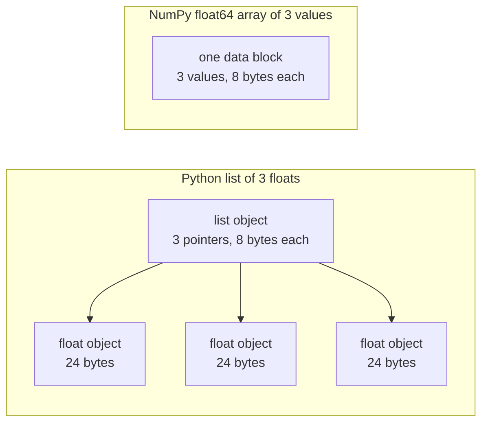

# Python para ingeniería de IA

> La mayoría de los códigos en este curso utilizan el mismo conjunto pequeño de idiomas Python. Aprenda ese conjunto aquí, antes de que las lecciones de matemáticas y modelos dependen de él.

**Type:** Build
**Languages:** Python
**Prerequisites:** Dev Environment, Python Environments
**Time:** ~120 minutes

## Objetivos de aprendizaje

- Lea y escriba los idiomas que la mayoría de los códigos de cursos utilizan, desde desempacar y f-strings hasta clases de datos y comprensiones.
- Encuentra tres errores de Python que dan resultados equivocados sin error: listas compartidas, valores predeterminados mutables y generadores usados.
- Construir un cargador CSV y JSON, una división semillada y un generador de mini lotes con solo la biblioteca estándar.
- Escriba el producto de puntos, el promedio y la desviación estándar en Python puro, y mide su velocidad y uso de memoria.
- Explica por qué un bucle de Python puro sobre números es lento, y cómo la transmisión NumPy mueve el bucle en código compilado.

## El problema

Las clases después de esta fase utilizan Python para las matemáticas y los modelos.`dataclasses`Además, 187 archivos de llamada.`random.seed`o crear un `random.Random`Si esos idiomas son nuevos para ti, puedes leer la sintaxis cuando quieres leer las matemáticas.

Python también tiene comportamientos que dan resultados incorrectos sin mensaje de error. Dos nombres pueden referirse a una lista, por lo que un cambio a través de un nombre también cambia el otro. Un argumento predeterminado mantiene su valor de una llamada a la siguiente. Un generador está vacío después de un paso, por lo que una segunda época de entrenamiento no obtiene datos y la pérdida no cambia.

El último problema es la velocidad. En nuestra computadora portátil de prueba, un bucle de Python puro de más de un millón de floats tomó aproximadamente 30 milisegundos. NumPy calculó el mismo producto de puntos en menos de un milisegundo. Necesitas saber la razón, para que puedas elegir entre un bucle claro y una operación de matriz.

## El concepto

### Lo que utiliza el código del curso

Hemos analizado todos los 541 archivos Python en `phases/*/*/code/`con el `ast`La tabla cuenta los archivos que utilizan cada construcción al menos una vez. Los recuentos son desde el día en que escribimos esta lección, y cambian a medida que se añaden lecciones.

| Construct | Files | Share |
|-----------|-------|-------|
| Function definitions | 541 | 100% |
| `if __name__ == "__main__":` | 529 | 98% |
| f-strings | 517 | 96% |
| Tuple unpacking | 448 | 83% |
| Classes | 379 | 70% |
| List comprehensions | 375 | 69% |
| Type hints on functions | 342 | 63% |
| Generator expressions | 326 | 60% |
| Slices | 314 | 58% |
| `lambda` | 175 | 32% |
| `try` and `except` | 120 | 22% |
| `with` statements | 96 | 18% |
| Dict comprehensions | 93 | 17% |
| Generator functions with `yield` | 14 | 3% |

Las importaciones muestran qué módulos estándar son importantes.`from __future__ import annotations`, y 276 importaciones `dataclasses`- El .`math`¿ Qué ?`random`, y `json`Los módulos aparecen en los archivos 187, 175 y 126.`collections`El módulo aparece en 70 archivos, y `itertools`aparece en sólo 4.

No hay llamadas de clase .`map()`o `filter()`Las comprensiones hacen ese trabajo.`sorted`¿ Qué ?`min`¿ Qué ?`max`, o`.sort`con un `key=`En la actualidad, la función de la función de la función de la función de la función de la función de la función de la función de la función de la función de la función de la función de la función de la función de la función de la función de la función de la función de la función de la función de la función de la función de la función de la función de la función de la función de la función de la función de la función de la función de la función de la función de la función de la función de la función de la función de la función de la función de la función de la función de la función de la función de la función de la función de la función de la función de la función de la función de la función de la función de la función de la función de la función de la función de la función de la función de la función de la función de la función de la función de la función de la función de la función de la función de la función de la función de la función de la función de la función de la función de la función de la función de la función de la función de la función de la función de la función de la función de la función de la función de la función de la función de la función de la función de la función de la función de la función de la función de la función de la función de la función de la función de la función de la función de la función de la función de la función de la función de la función de la función de la función de la función de la función de la función de la función de la función de la función de la función de la cuadro de la cubo se puede ser de más de más de más de más de más de más de más de 140 de los archivos de los archivos de más de más de los archivos de más de los archivos de más de los archivos de más de los archivos de más de más de los archivos de más de los archivos de más de los archivos de más de los archivos de más de los archivos de más de los archivos de más de más de los 140 de los archivos de los archivos de más de los archivos de más de la clase de la que se pueden encontrar en más de más de la que se pueden.

### Los nombres se refieren a objetos

En Python, una variable es un nombre que se refiere a un objeto. Assignment une un nombre a un objeto. No copia el objeto. Cuando dos nombres se refieren a una lista, un cambio a través de cualquiera de los nombres es visible a través de ambos. Los números, cadenas y tuples no pueden cambiar, por lo que esta regla no causa problemas para ellos. Listas, dicts y conjuntos pueden cambiar, por lo que haga una copia cuando necesite una versión independiente.

### Una lista contiene punteros, una matriz contiene números

Una lista de Python no almacena números directamente. Almacena punteros, y cada puntero se refiere a un objeto completo de Python. En una construcción de 64 bits de CPython, cada puntero toma 8 bytes y cada `float`El objeto toma 24 bytes.`float64`array almacena los valores de 8 bytes en bruto uno al lado del otro en un bloque de memoria.



Un bucle sobre una lista hace mucho trabajo para cada elemento. El intérprete ejecuta una instrucción de código de byte a la vez. Para cada elemento, sigue un puntero y verifica el tipo de cada operando. Luego llama al código flotante multiplicador y hace un objeto flotante de Python para mantener el resultado.

NumPy hace la misma aritmética en un bucle de código compilado sobre los valores brutos. Verifica el tipo de datos una vez para toda la matriz, y no hace ningún objeto Python para cada elemento.`(x - mean) / std`Las funciones vectoriales en esta lección siguen esa regla. cada una hace una operación de matriz, por lo que puede reemplazarlo con una llamada NumPy más tarde.

### Una lista contiene todos los elementos, un generador contiene uno

Una lista de comprensión construye cada elemento antes de que se ejecute la siguiente línea. Un generador construye un elemento cada vez que el llamador pide el siguiente. La memoria de una lista crece con el número de elementos. La memoria de un generador se mantiene casi igual para cualquier número de elementos.

Un generador sólo puede funcionar una vez.`StopIteration`en cada solicitud, por lo que un segundo `for`El código de entrenamiento lee el conjunto de datos una vez por época, por lo que debe crear un nuevo generador para cada época.

Las funciones de generador son raras en el código de la lección. Los cargadores de datos que utilizan las lecciones de aprendizaje profundo son iterables de lotes, por lo que la idea está en cada bucle de entrenamiento. La figura muestra ambos enfoques en las mismas ocho filas.

```figure
s0-list-vs-generator
```

## Los idiomas que necesitas

Cada bloque en esta sección se ejecuta por sí mismo. Guarde en un archivo y ejecuta con`python3`Los bloques necesitan Python 3.11 o más reciente, la versión que instalamos en la lección de entorno de desarrollo.

### 1. Valores, colecciones y desempaquetado

Python tiene cuatro colecciones incorporadas. Aprenda cuándo usar cada una.

| Type | Example | Ordered | Can change | Typical use in the course |
|------|---------|---------|------------|---------------------------|
| `list` | `[0.5, 1.2]` | Yes | Yes | Samples, losses, weights |
| `tuple` | `(32, 784)` | Yes | No | Shapes, fixed records, dict keys |
| `dict` | `{"lr": 0.01}` | Insertion order | Yes | Configs, vocabularies, JSON rows |
| `set` | `{"cat", "dog"}` | No | Yes | Unique tokens, overlap checks |

Este bloque muestra que la tarea no copia una lista.

```python
weights = [0.5, -1.2, 3.0]
alias = weights
alias[0] = 99.0
print(weights)

independent = list(weights)
independent[1] = 0.0
print(weights, independent)

grid = [[0] * 3] * 2
grid[0][0] = 1
print(grid)

grid = [[0] * 3 for _ in range(2)]
grid[0][0] = 1
print(grid)
```

```text
[99.0, -1.2, 3.0]
[99.0, -1.2, 3.0] [99.0, 0.0, 3.0]
[[1, 0, 0], [1, 0, 0]]
[[1, 0, 0], [0, 0, 0]]
```

La expresión`[[0] * 3] * 2`La comprensión hace una nueva lista interna para cada fila. La fase matemática construye matrices a partir de listas, así que use la forma de comprensión.

Desempaqueo asigna los elementos de una secuencia a varios nombres en una línea. Un nombre estrellado recoge los elementos restantes. Una cadena f coloca el valor de una expresión en una cadena, con un formato opcional después de un colon.

```python
shape = (32, 784)
batch_size, n_features = shape
first, *middle, last = [1, 2, 3, 4, 5]
x, y = 1.0, 3.0
x, y = y, x

config = {"lr": 0.01, "epochs": 5}
config["seed"] = 7
tokens = ["the", "cat", "sat", "on", "the", "mat"]
vocab = set(tokens)

print(batch_size, n_features, first, middle, last, x, y)
print(config.get("momentum", 0.9), "cat" in vocab, len(vocab))
print(f"lr={config['lr']:.0e} loss={0.123456:.3f} n={60_000:,} {batch_size=}")
```

```text
32 784 1 [2, 3, 4] 5 3.0 1.0
0.9 True 5
lr=1e-02 loss=0.123 n=60,000 batch_size=32
```

`dict.get`devuelve un valor predeterminado cuando la clave está ausente.`in`El ensayo en un conjunto requiere aproximadamente el mismo tiempo para cualquier tamaño del conjunto.`{batch_size=}`el formulario imprime el nombre y el valor, lo que ayuda cuando se descompone.

Una rebanada .`a[start:stop:step]`incluye `start`y excluye `stop`Los índices negativos cuentan desde el final. Una rebanada de una lista es una nueva lista, así que una rebanada de una lista grande copia todos sus punteros.

```python
tokens = ["<s>", "the", "cat", "sat", "on", "the", "mat", "</s>"]
print(tokens[1:-1])
print(tokens[:3], tokens[-3:])
print(tokens[::2])
print(tokens[::-1][:2])
windows = [tokens[i:i + 3] for i in range(len(tokens) - 2)]
print(len(windows), windows[0])
```

```text
['the', 'cat', 'sat', 'on', 'the', 'mat']
['<s>', 'the', 'cat'] ['the', 'mat', '</s>']
['<s>', 'cat', 'on', 'mat']
['</s>', 'mat']
6 ['<s>', 'the', 'cat']
```

### 2. Los conocimientos

Una comprensión construye una lista, dictado o conjunto de un iterable en una expresión.

```python
scores = [0.91, 0.42, 0.77, 0.15, 0.66]
labels = [1 if s >= 0.5 else 0 for s in scores]
high = [s for s in scores if s > 0.6]
squares = {i: i * i for i in range(4)}
lengths = {len(word) for word in ["a", "bb", "cc", "ddd"]}
sum_sq = sum(s * s for s in scores)

matrix = [[1, 2, 3], [4, 5, 6]]
transposed = [list(column) for column in zip(*matrix)]
flat = [v for row in matrix for v in row]

print(labels, high, squares, lengths, round(sum_sq, 4))
print(transposed, flat)
```

```text
[1, 0, 1, 0, 1] [0.91, 0.77, 0.66] {0: 0, 1: 1, 2: 4, 3: 9} {1, 2, 3} 2.0555
[[1, 4], [2, 5], [3, 6]] [1, 2, 3, 4, 5, 6]
```

Un traslado .`if`La expresión anterior`for`puede ser una expresión condicional,`a if condition else b`- Dos .`for`Las cláusulas funcionan en el mismo orden que dos bucles anidados.

Los soportes redondos hacen una expresión generadora.`sum(s * s for s in scores)`¿ Qué ?`sum`leyendo un cuadrado a la vez, y Python no construye ninguna lista.`zip(*matrix)`, la estrella pasa cada fila como un argumento separado, y `zip`empareja los elementos en cada posición.

### 3. Funciones, argumentos y cierre

Un valor predeterminado hace que un argumento sea opcional. Un argumento de palabra clave nombra el parámetro en la llamada.`*`por sí mismo en la lista de parámetros hace los siguientes parámetros sólo palabras clave.

```python
def clip(value, low=0.0, high=1.0):
    return max(low, min(high, value))


def train(data, *, lr=0.01, epochs=3):
    return f"{len(data)} samples, lr={lr}, epochs={epochs}"


def make_scaler(factor):
    def scale(values):
        return [v * factor for v in values]
    return scale


print(clip(1.7), clip(-3.0, low=-1.0), clip(0.4, high=0.3))
print(train([1, 2, 3], lr=0.1))
to_percent = make_scaler(100)
print(to_percent([0.25, 0.5]))
```

```text
1.0 -1.0 0.3
3 samples, lr=0.1, epochs=3
[25.0, 50.0]
```

Con argumentos de palabras clave, una llamada como `train(data, 0.1, 3)`¿ Cómo se puede aumentar ?`TypeError`El que llama debe escribir .`lr=0.1`, por lo que dos números no pueden cambiar de lugar por accidente.

La función interna`scale`usos `factor`Python mantiene la función que la creó.`factor`por el tiempo que`scale`Una función que mantiene variables de su creador es un cierre. el estandarizador en Construir utiliza un cierre para mantener las estadísticas de entrenamiento.

¿ Qué es esto ?`lambda`Es una función de una sola expresión sin nombre.`key=`La función, que muestra la parte 8.

Python evalúa un valor predeterminado una vez, cuando ejecuta el `def`Cada llamada que utiliza el predeterminado obtiene el mismo objeto.

```python
def add_bad(item, bucket=[]):
    bucket.append(item)
    return bucket


def add_good(item, bucket=None):
    if bucket is None:
        bucket = []
    bucket.append(item)
    return bucket


add_bad("a")
print(add_bad("b"))
add_good("a")
print(add_good("b"))
```

```text
['a', 'b']
['b']
```

Usar`None`como el predeterminado para una lista, dictar, o conjunto. Crea el nuevo objeto dentro de la función.

### 4. Clasificaciones y clases de datos

El `@dataclass`El decorador escribe `__init__`¿ Qué ?`__repr__`, y `__eq__`de los campos anotados.`frozen=True`, el objeto no puede cambiar después de la creación, y se puede usar como una clave dictada o ponerlo en un conjunto.

```python
from dataclasses import dataclass, field


@dataclass(frozen=True)
class Example:
    features: tuple[float, ...]
    label: int


@dataclass
class TrainConfig:
    lr: float = 0.01
    epochs: int = 5
    hidden: list[int] = field(default_factory=lambda: [64, 32])

    def describe(self):
        return f"lr={self.lr} epochs={self.epochs} hidden={self.hidden}"


ex = Example((1.5, 2.0), 1)
print(ex)
print(ex == Example((1.5, 2.0), 1), len({ex, Example((1.5, 2.0), 1)}))
print(TrainConfig(epochs=10).describe())
try:
    ex.label = 0
except AttributeError as err:
    print(type(err).__name__)
```

```text
Example(features=(1.5, 2.0), label=1)
True 1
lr=0.01 epochs=10 hidden=[64, 32]
FrozenInstanceError
```

`field(default_factory=...)`Resolve el problema de parcelación por defecto de la parte 3 dentro de una clase de datos.

Métodos especiales conectan una clase a la sintaxis de Python. `len(ds)`llamadas`__len__`, y `ds[2]`llamadas`__getitem__`¿ Qué ?

```python
class SquaresDataset:
    def __init__(self, n):
        self.n = n

    def __len__(self):
        return self.n

    def __getitem__(self, index):
        if not 0 <= index < self.n:
            raise IndexError(index)
        return index, index * index


ds = SquaresDataset(4)
print(len(ds), ds[2])
print(list(ds))
```

```text
4 (2, 4)
[(0, 0), (1, 1), (2, 4), (3, 9)]
```

El `for`un bucle dentro `list(ds)`trabaja sin un `__iter__`método. llamadas de Python `__getitem__`con 0, 1, 2, y así sucesivamente hasta que se consigue `IndexError`. Datos de tipo PyTorch usan los mismos dos métodos, `__len__`y `__getitem__`¿ Qué ?

### 5. Iteradores y generadores

Un iterable es cualquier objeto que un `for`el bucle acepta. `iter()`obtiene un iterador de ella, y `next()`Cuando el iterador no tiene más elementos, eleva `StopIteration`- ¿ Qué ?`for`llamadas de bucle`next()`para ti y se detiene en `StopIteration`¿ Qué ?

```python
numbers = [10, 20, 30]
it = iter(numbers)
print(next(it), next(it), next(it))
try:
    next(it)
except StopIteration:
    print("no more items")


def countdown(n):
    while n > 0:
        yield n
        n -= 1


gen = countdown(3)
print(type(gen).__name__)
print(list(gen))
print(list(gen))
```

```text
10 20 30
no more items
generator
[3, 2, 1]
[]
```

Una función con `yield`En su cuerpo hay una función generadora. Una llamada a ella no ejecuta nada de su código y devuelve un objeto generador.`next()`corre el cuerpo al siguiente `yield`Y se detiene allí.`list(gen)`está vacío porque el primero usó el generador.

Un generador puede leer un archivo una línea a la vez.

```python
import os
import tempfile


def read_rows(path):
    with open(path, encoding="utf-8") as fh:
        header = fh.readline().rstrip("\n").split(",")
        for line in fh:
            yield dict(zip(header, line.rstrip("\n").split(",")))


with tempfile.TemporaryDirectory() as tmp:
    path = os.path.join(tmp, "rows.csv")
    with open(path, "w", encoding="utf-8") as fh:
        fh.write("x,label\n")
        fh.writelines(f"{i * 0.5},{i % 2}\n" for i in range(5))
    rows = read_rows(path)
    print(next(rows))
    print(sum(1 for _ in rows))
```

```text
{'x': '0.0', 'label': '0'}
4
```

`read_rows`El archivo de archivo de archivo de archivo de archivo de archivo de archivo de archivo de archivo de archivo de archivo de archivo de archivo de archivo de archivo de archivo de archivo de archivo de archivo de archivo de archivo de archivo de archivo de archivo de archivo de archivo de archivo de archivo de archivo de archivo de archivo de archivo de archivo de archivo de archivo de archivo de archivo de archivo de archivo de archivo de archivo de archivo de archivo de archivo de archivo de archivo de archivo de archivo de archivo de archivo de archivo de archivo de archivo de archivo de archivo de archivo de archivo de archivo de archivo de archivo de archivo de archivo de archivo de archivo de archivo de archivo de archivo de archivo de archivo de archivo de archivo de archivo de archivo de archivo de archivo de archivo de archivo de archivo de archivo de archivo de archivo de archivo de archivo de archivo de archivo de archivo de archivo de archivo de archivo de archivo de archivo de archivo de archivo de archivo de archivo de archivo de archivo de archivo de archivo de archivo de archivo de archivo de archivo de archivo de archivo de archivo de archivo de archivo de archivo de archivo de archivo de archivo de archivo de archivo de archivo de archivo de archivo de archivo de archivo de archivo de archivo de archivo de archivo de archivo de archivo de archivo de archivo de archivo de archivo de archivo de archivo de archivo de archivo de archivo de archivo de archivo de archivo de archivo de archivo de archivo de archivo de archivo de archivo de archivo de archivo de archivo de archivo de archivo de archivo de archivo de archivo de archivo de archivo de archivo de archivo de archivo de archivo de archivo de archivo de archivo de archivo de archivo de archivo de archivo de archivo de archivo de archivo de archivo de archivo de archivo`read_rows`Se divide en vírgenes para mantener el ejemplo corto. Los archivos CSV reales pueden contener vírgenes dentro de los campos citados, por lo que Build It utiliza el `csv`el módulo.

```python
import sys

as_list = [i * i for i in range(1_000_000)]
as_generator = (i * i for i in range(1_000_000))
print(sys.getsizeof(as_list), sys.getsizeof(as_generator))
print(sum(as_list) == sum(as_generator))
```

En CPython de 64 bits, la lista informa de alrededor de 8 MB y el generador de alrededor de 200 bytes. `sys.getsizeof`Cuenta sólo los punteros de la lista, y los objetos enteros utilizan más memoria.`tracemalloc`, que usamos en la lección de depuración y creación de perfiles.

### 6. Gerenciadores de contexto y excepciones

¿ Qué es esto ?`with`La instrucción ejecuta el código de configuración, luego su cuerpo, y luego el código de limpieza.`open()`es un gestor de contexto que cierra el archivo.

En la lección de depuración y creación de perfiles, escribimos un `Timer`clase con `__enter__`y `__exit__`- El .`contextlib.contextmanager`El decorator hace el mismo tipo de objeto de un generador.`yield`es la configuración, y el `finally`El bloque es la limpieza.

```python
import time
from contextlib import contextmanager


@contextmanager
def timer(label):
    start = time.perf_counter()
    try:
        yield
    finally:
        print(f"{label}: {(time.perf_counter() - start) * 1000:.1f} ms")


def parse_label(text):
    try:
        return int(text)
    except ValueError:
        raise ValueError(f"label must be an integer, got {text!r}") from None


with timer("sum of squares"):
    total = sum(i * i for i in range(200_000))

print(parse_label("3"))
try:
    parse_label("cat")
except ValueError as err:
    print("rejected:", err)
```

```text
sum of squares: 9.4 ms
3
rejected: label must be an integer, got 'cat'
```

El tiempo en su máquina será diferente.`except`cláusula, como `ValueError`o `KeyError`- ¿ Qué ?`except:`cláusula sin tipo de excepción también se ocupa `KeyboardInterrupt`, para que Ctrl + C no pueda detener un bucle que lo contiene.`from None`Cuando su mensaje reemplaza el rastreo original.

### 7. Indicaciones de tipografía, módulos y el guardador principal

Las sugerencias de tipo le dicen al lector lo que una función toma y devuelve. Python no las verifica cuando se ejecuta el código. Un verificador de tipo, como mypy, las lee antes de que se ejecute el código.

```python
from __future__ import annotations

from collections.abc import Iterable, Sequence


def mean(values: Sequence[float]) -> float:
    if not values:
        raise ValueError("mean() needs at least one value")
    return sum(values) / len(values)


def count_tokens(docs: Iterable[str]) -> int:
    return sum(len(doc.split()) for doc in docs)


def main() -> None:
    print(mean([1.0, 2.0, 4.0]))
    print(count_tokens(["the cat sat", "on the mat"]))
    print(mean.__annotations__)


if __name__ == "__main__":
    main()
```

```text
2.3333333333333335
6
{'values': 'Sequence[float]', 'return': 'float'}
```

Con `from __future__ import annotations`, Python almacena cada indicio como una cadena, como muestra la última línea. `Sequence`significa cualquier objeto con `len()`y índices, como una lista o un tuple. `Iterable`significa cualquier objeto que una `for`Muchos archivos de cursos importan los mismos nombres de `typing`, que también funciona.

Cada uno .`.py`Cuando ejecutas un archivo con `python3 file.py`, Python establece su`__name__`¿ Qué ?`"__main__"`Cuando otro archivo lo importa,`__name__`Es el nombre del módulo.`main()`En el primer caso, sólo en el primer caso.`code/tests/`puede importar`main.py`Sin un comienzo de la demostración.

### 8. Archivos, JSON, CSV y clasificación

`pathlib.Path`se une los caminos con `/`Y puede leer o escribir un archivo entero en una sola llamada.`encoding="utf-8"`, porque la codificación predeterminada depende del sistema operativo.

```python
import csv
import json
import tempfile
from pathlib import Path

rows = [
    {"text": "great movie", "label": 1, "score": 0.93},
    {"text": "boring plot", "label": 0, "score": 0.12},
    {"text": "fine acting", "label": 1, "score": 0.58},
]

with tempfile.TemporaryDirectory() as tmp:
    json_path = Path(tmp) / "reviews.json"
    json_path.write_text(json.dumps(rows, indent=2), encoding="utf-8")
    from_json = json.loads(json_path.read_text(encoding="utf-8"))

    csv_path = Path(tmp) / "reviews.csv"
    with csv_path.open("w", newline="", encoding="utf-8") as fh:
        writer = csv.DictWriter(fh, fieldnames=["text", "label", "score"])
        writer.writeheader()
        writer.writerows(rows)
    with csv_path.open(newline="", encoding="utf-8") as fh:
        from_csv = list(csv.DictReader(fh))

print(from_json == rows)
print(from_csv[0])

by_score = sorted(rows, key=lambda r: r["score"], reverse=True)
print([r["text"] for r in by_score])
print(max(rows, key=lambda r: r["score"])["text"])
print([r["text"] for r in sorted(rows, key=lambda r: (-r["label"], r["text"]))])
```

```text
True
{'text': 'great movie', 'label': '1', 'score': '0.93'}
['great movie', 'fine acting', 'boring plot']
great movie
['fine acting', 'great movie', 'boring plot']
```

JSON mantiene los números como números. CSV devuelve cada campo como una cadena, por lo que debe convertir cada campo. Abre archivos CSV con `newline=""`, como el `csv`La documentación te dice que sí.

¿ Qué es esto ?`key=`La función devuelve el valor que Python compara para cada elemento. `sorted`¿ Qué ?`min`, y `max`La clave tuple clasifica por el primer valor, y utiliza el segundo valor sólo para lazos. El signo menos pone la etiqueta más grande primero. El orden de Python es estable, por lo que los elementos con claves iguales mantienen su orden original.

### 9. Herramientas de conteo, agrupación y iterador

Estos dos módulos contienen las estructuras de datos y las herramientas de iterador que las listas y los dicts no le dan.

```python
from collections import Counter, defaultdict, deque
from itertools import chain, islice, product

labels = ["cat", "dog", "cat", "bird", "cat", "dog"]
counts = Counter(labels)
print(counts.most_common(2))

positions = defaultdict(list)
for i, label in enumerate(labels):
    positions[label].append(i)
print(dict(positions))

recent = deque(maxlen=3)
for loss in [2.0, 1.5, 1.2, 1.1, 0.9]:
    recent.append(loss)
print(list(recent), round(sum(recent) / len(recent), 3))

print(list(product([0.1, 0.01], [16, 32])))
print(list(chain([1, 2], [3], [4, 5])))
print(list(islice(range(100), 5, 10)))
```

```text
[('cat', 3), ('dog', 2)]
{'cat': [0, 2, 4], 'dog': [1, 5], 'bird': [3]}
[1.2, 1.1, 0.9] 1.067
[(0.1, 16), (0.1, 32), (0.01, 16), (0.01, 32)]
[1, 2, 3, 4, 5]
[5, 6, 7, 8, 9]
```

`Counter`cuenta los elementos que pueden ser objeto de manipulación, como las etiquetas o los tokens. `defaultdict(list)`crea una lista vacía la primera vez que usa una nueva clave, por lo que un bucle de agrupación no necesita verificación de llaves. `deque(maxlen=3)`elimina el artículo más antiguo cuando se agrega un cuarto, lo que da una ventana de movimiento sobre las pérdidas recientes. `enumerate`se da a cada elemento su índice.

`product`da cada combinación de sus entradas, que es una red de hiperparámetros. `chain`Se unen los iterables de extremo a extremo. `islice`El generador de mini lotes en Build It utiliza `islice`¿ Qué ?

### 10. ¿Por qué los bucles sobre números son lentos

El `dis`El módulo imprime las instrucciones de código de byte que el intérprete ejecuta para una función.

```python
import dis


def dot(a, b):
    total = 0.0
    for x, y in zip(a, b):
        total += x * y
    return total


dis.dis(dot)
```

Las instrucciones de `FOR_ITER`para el salto de vuelta a él ejecutar una vez para cada elemento. Eso es aproximadamente diez instrucciones para cada multiplicar y agregar.

Un bucle se hace más rápido cuando menos de sus pasos se ejecutan como código de byte.`sum`¿ Qué ?`map`, y `zip`Se escriben en C. Construir mide este efecto en Python puro, y Use It mueve todo el bucle en NumPy.

## Construye el mismo

Ahora construye las piezas que las lecciones posteriores necesitan.`code/main.py`, y `code/tests/test_main.py`Cada bloque de abajo se ejecuta por sí mismo.

### Paso 1: Tipo de registro y cargador de conjuntos de datos

El cargador lee un archivo CSV o un archivo JSON en una forma: un tuple de características flotantes y una etiqueta de números enteros.

```python
import csv
import json
import tempfile
from dataclasses import dataclass
from pathlib import Path


@dataclass(frozen=True)
class Record:
    features: tuple[float, ...]
    label: int


def row_to_record(row, names, label_field="label"):
    if label_field not in row:
        raise ValueError(f"row has no {label_field!r} field: {row}")
    if set(row) != {*names, label_field}:
        raise ValueError(f"row fields {list(row)} do not match {[*names, label_field]}")
    return Record(tuple(float(row[name]) for name in names), int(row[label_field]))


def load_records(path, label_field="label"):
    path = Path(path)
    if path.suffix == ".json":
        rows = json.loads(path.read_text(encoding="utf-8"))
    elif path.suffix == ".csv":
        with path.open(newline="", encoding="utf-8") as fh:
            rows = list(csv.DictReader(fh))
    else:
        raise ValueError(f"unsupported file type: {path.suffix!r}")
    if not rows:
        return []
    names = [key for key in rows[0] if key != label_field]
    return [row_to_record(row, names, label_field) for row in rows]


with tempfile.TemporaryDirectory() as tmp:
    csv_path = Path(tmp) / "data.csv"
    csv_path.write_text("x1,x2,label\n1.5,60,1\n1.8,82.5,0\n", encoding="utf-8")
    json_path = Path(tmp) / "data.json"
    json_path.write_text('[{"x1": 1.5, "x2": 60, "label": 1}]', encoding="utf-8")
    print(load_records(csv_path))
    print(load_records(json_path))
```

```text
[Record(features=(1.5, 60.0), label=1), Record(features=(1.8, 82.5), label=0)]
[Record(features=(1.5, 60.0), label=1)]
```

La primera fila establece los nombres de las características y su orden. `DictReader`y `json.loads`mantenga las claves en orden de archivo, y un dict mantiene el orden en que se agregaron las claves. El estándar JSON no define un orden para las claves en un objeto, por lo que `row_to_record`Se lee cada fila por nombre, en el orden de la primera fila.`ValueError`con un mensaje, así que un archivo malo detiene la ejecución al principio. `main.py`También ha tenido`save_records`, que escribe los mismos dos formatos.

### Paso 2: Un tren semillado y la prueba dividido

```python
import random


def train_test_split(items, test_fraction=0.2, seed=0):
    if not 0.0 < test_fraction < 1.0:
        raise ValueError(f"test_fraction must be between 0 and 1, got {test_fraction}")
    if len(items) < 2:
        raise ValueError(f"need at least 2 items to split, got {len(items)}")
    order = list(range(len(items)))
    random.Random(seed).shuffle(order)
    n_test = min(max(1, round(len(items) * test_fraction)), len(items) - 1)
    test = [items[i] for i in order[:n_test]]
    train = [items[i] for i in order[n_test:]]
    return train, test


items = list(range(10))
print(train_test_split(items, seed=1))
print(train_test_split(items, seed=1) == train_test_split(items, seed=1))
print(train_test_split(items, seed=2)[1])
print(items)
```

```text
([9, 7, 5, 3, 0, 4, 1, 2], [6, 8])
True
[5, 9]
[0, 1, 2, 3, 4, 5, 6, 7, 8, 9]
```

`random.Random(seed)`crea un generador de números aleatorios privado.`random.seed(seed)`Resete el generador global que todos los módulos comparten, para que una llamada en otra biblioteca pueda cambiar su secuencia.`random.seed`y 96 crear `random.Random`Utilice el generador privado en nuevo código.

La función mezcla una lista de índices, por lo que la lista de entrada se mantiene sin cambios. La misma semilla siempre da la misma división. Cada lado mantiene al menos un elemento, por lo que una lista con menos de 2 elementos aumenta `ValueError`En la lección de debugging y perfiles, vimos que la superposición entre los datos del tren y los de prueba da puntuaciones de prueba demasiado altas.

### Paso 3: Generador de mini lotes

```python
from itertools import islice


def batches(items, batch_size, drop_last=False):
    if batch_size < 1:
        raise ValueError(f"batch_size must be at least 1, got {batch_size}")
    return _batch_iter(iter(items), batch_size, drop_last)


def _batch_iter(iterator, batch_size, drop_last):
    while True:
        batch = list(islice(iterator, batch_size))
        if not batch or (drop_last and len(batch) < batch_size):
            return
        yield batch


print(list(batches(range(10), 4)))
print(list(batches(range(10), 4, drop_last=True)))
squares = (i * i for i in range(7))
print([len(b) for b in batches(squares, 3)])

for epoch in range(2):
    sizes = [len(b) for b in batches(range(10), 4)]
    print(f"epoch {epoch}: {sizes}")
```

```text
[[0, 1, 2, 3], [4, 5, 6, 7], [8, 9]]
[[0, 1, 2, 3], [4, 5, 6, 7]]
[3, 3, 1]
epoch 0: [4, 4, 2]
epoch 1: [4, 4, 2]
```

`islice`Se lleva hasta `batch_size`elementos del iterador. `batches`sólo necesita`iter()`El último lote es más pequeño cuando la longitud no es un múltiplo del tamaño del lote. `drop_last=True`elimina ese lote, para un modelo que necesita una forma fija del lote.

El trabajo se realiza en dos funciones porque una función generadora no ejecuta código hasta la primera `next()`Con el cheque dentro del generador,`batches(data, 0)`La función externa es una función normal, por lo que verifica el argumento de inmediato.`batches()`y de nuevo para cada época, porque un generador da sus elementos sólo una vez.

### Paso 4: Matemáticas vectoriales y un estandarizador

```python
import math


def dot(a, b):
    return sum(x * y for x, y in zip(a, b, strict=True))


def mean(values):
    if not values:
        raise ValueError("mean() needs at least one value")
    return sum(values) / len(values)


def std(values):
    mu = mean(values)
    return math.sqrt(sum((v - mu) ** 2 for v in values) / len(values))


def make_standardizer(rows):
    columns = list(zip(*rows))
    means = [mean(c) for c in columns]
    scales = [s if s > 0 else 1.0 for s in (std(c) for c in columns)]

    def standardize(row):
        return [(v - m) / s for v, m, s in zip(row, means, scales, strict=True)]

    return standardize


print(dot([1.0, 2.0, 3.0], [4.0, 5.0, 6.0]))
values = [2.0, 4.0, 4.0, 4.0, 5.0, 5.0, 7.0, 9.0]
print(mean(values), std(values))

train_rows = [(1.0, 100.0), (2.0, 300.0), (3.0, 500.0)]
standardize = make_standardizer(train_rows)
print([[round(v, 3) for v in standardize(r)] for r in train_rows])
print([round(v, 3) for v in standardize((4.0, 700.0))])
```

```text
32.0
5.0 2.0
[[-1.225, -1.225], [0.0, 0.0], [1.225, 1.225]]
[2.449, 2.449]
```

Con `strict=True`¿ Qué ?`zip`¿ Cómo se puede aumentar ?`ValueError`Cuando los dos vectores tienen diferentes longitudes.`zip`se detiene al final de la entrada más corta y devuelve una respuesta errónea sin error.`strict`El argumento necesita Python 3.10 o más reciente.

`std`se divide por `n`, por lo que da la desviación estándar de la población, como `statistics.pstdev`Sí, dividir por`n - 1`cuando se estima la propagación de una población mayor a partir de una muestra.

`make_standardizer`El sistema de formación de los alumnos de la escuela de formación de formación de formación de formación de formación de formación de formación de formación de formación de formación de formación de formación de formación de formación de formación de formación de formación de formación de formación de formación de formación de formación de formación de formación de formación de formación de formación de formación de formación de formación de formación de formación de formación de formación de formación de formación de formación de formación de formación de formación de formación de formación de formación de formación de formación de formación de formación de formación de formación de formación de formación de formación de formación de formación de formación de formación de formación de formación de formación de formación de formación de formación de formación de formación de formación de formación de formación de formación de formación de formación de formación de formación de formación de formación de formación de formación de formación de formación de formación de formación de formación de formación de formación de formación de formación de formación de formación de formación de formación de formación de formación de formación de formación de formación de formación de formación de formación de formación de formación de formación de formación de formación de formación de formación de formación de formación de formación de formación de formación de formación de formación de formación de formación de formación de formación de formación de formación de formación de formación de formación de formación de formación de formación de formación de formación de formación de formación de formación de formación de formación de formación de formación de formación de formación de formación de formación de formación de formación de formación de formación de formación de formación de formación de formación de formación de formación de formación de formación de formación de formación de formación de formación de formación de formación de formación de formación de formación de formación de formación de formación de formación de formación de formación de formación de formación de formación de formación de formación de formación de formación de formación de formación de formación de formación de formación de formación de formación de formación de formación de formación de formación de formación de formación de formación de formación de formación de formación de formación de formación de formación de formación de formación de formación de formación de formación de formación de formación de formación de formación de formación de formación de formación de formación de formación de formación de formación de formación de formación de formación de formación de formación de formación de formación de formación de formación de formación de formación de formación de formación de formación de formación de formación de formación de formación de formación de formación de formación de formación de formación de formación de formación de formación de formación de formación de formación de formación de formación de formación de formación de formación de formación de formación de formación de formación de formación de formación de formación de formación de formación de formación`standardize`Las líneas de prueba son las mismas que las de la columna constante, y las de las filas de prueba son las mismas que las de la columna constante.

### Paso 5: Una carrera completa

`code/main.py`Se hace 400 registros de dos grupos, los guarda como CSV y JSON, y carga ambos archivos de nuevo. Luego se divide los registros, se ajusta el estandarizador en la división de entrenamiento, y calcula los centroides de clase de lotes de 48.

Un clasificador de centroides más cercano almacena el vector de características medio de cada clase. Predece la clase cuya media está más cerca de la entrada. `fit_centroids`añade las filas un lote a la vez, por lo que nunca necesita el entrenamiento completo establecido en memoria. `predict`usos `min()`con un `key=`Función para encontrar el centroide más cercano.

```bash
python3 phases/00-setup-and-tooling/13-python-for-ai-engineering/code/main.py
```

```text
Python for AI engineering: a standard-library toolkit
data     400 records, CSV and JSON load back unchanged: True
split    320 train, 80 test, records in both: 0
batches  size 48: [48, 48, 48, 48, 48, 48, 32]
scale    train feature means after standardizing: [0.0, 0.0]
model    nearest-centroid test accuracy: raw 0.86, standardized 0.89
speed    dot product of 200,000 floats, best of 5:
           index loop         6.60 ms
           zip generator      5.93 ms
           map + mul          2.89 ms
memory   peak bytes to sum 100,000 squares:
           list              4,000,616
           generator               472
```

Las dos características tienen escalas muy diferentes. La segunda característica tiene diez veces la propagación de la primera, por lo que controla las distancias en bruto, y la precisión en bruto es menor.

### Paso 6: Medir la velocidad y la memoria

```python
import operator
import random
import time
import tracemalloc


def dot_index_loop(a, b):
    total = 0.0
    for i in range(len(a)):
        total += a[i] * b[i]
    return total


def dot_zip(a, b):
    return sum(x * y for x, y in zip(a, b, strict=True))


def dot_map(a, b):
    return sum(map(operator.mul, a, b))


def best_time(fn, *args, repeat=5):
    times = []
    for _ in range(repeat):
        start = time.perf_counter()
        fn(*args)
        times.append(time.perf_counter() - start)
    return min(times)


def peak_bytes(fn):
    tracemalloc.start()
    try:
        fn()
        return tracemalloc.get_traced_memory()[1]
    finally:
        tracemalloc.stop()


rng = random.Random(0)
a = [rng.random() for _ in range(1_000_000)]
b = [rng.random() for _ in range(1_000_000)]
for fn in (dot_index_loop, dot_zip, dot_map):
    print(f"{fn.__name__:15} {best_time(fn, a, b) * 1000:7.2f} ms")

print(peak_bytes(lambda: sum([i * i for i in range(100_000)])))
print(peak_bytes(lambda: sum(i * i for i in range(100_000))))
```

`best_time`Los programas de la máquina sólo pueden agregar tiempo, por lo que el mínimo es lo más cercano al costo real.`timeit`El módulo da los mismos consejos.

En nuestro portátil de prueba con Python 3.11, el bucle de índice tomó aproximadamente 33 ms. La versión zip tomó aproximadamente 30 ms, y el `map`La versión de alrededor de 14 ms. Los tres hacen la misma aritmética.`map`la versión es más rápida porque `map`y `operator.mul`Los números de memoria repiten la figura: aproximadamente 4 MB para la lista y menos de 1 KB para el generador.

## Usalo

### Las versiones estándar de la biblioteca

La biblioteca estándar tiene una versión probada de la mayoría de las piezas que construiste.

| You built | Standard library | Note |
|-----------|------------------|------|
| `mean`, `std` | `statistics.fmean`, `statistics.pstdev` | The tests compare against these |
| `dot` | `math.sumprod` | Python 3.12 or newer |
| `batches` | `itertools.batched` | Python 3.12 or newer, gives tuples |
| `best_time` | `timeit.repeat` | Also turns off garbage collection during the runs |
| `peak_bytes` | `tracemalloc` | The same module, with snapshots and per-line statistics |

```python
import statistics
import sys

values = [2.0, 4.0, 4.0, 4.0, 5.0, 5.0, 7.0, 9.0]
print(statistics.fmean(values), statistics.pstdev(values))

if sys.version_info >= (3, 12):
    import math
    from itertools import batched

    print(math.sumprod([1.0, 2.0, 3.0], [4.0, 5.0, 6.0]))
    print(list(batched(range(10), 4)))
```

```text
5.0 2.0
32.0
[(0, 1, 2, 3), (4, 5, 6, 7), (8, 9)]
```

El curso admite Python 3.11, así que `main.py`utiliza su propio `dot`y `batches`En Python 3.11, el bloque imprime sólo la primera línea.

### La misma matemática con matrices compiladas

Instalar NumPy en el entorno virtual desde la lección de entornos Python, por ejemplo con `uv pip install numpy`El código de lección y las pruebas no lo necesitan.

```python
import time

import numpy as np

n = 1_000_000
rng = np.random.default_rng(0)
a = rng.random(n)
b = rng.random(n)
a_list, b_list = a.tolist(), b.tolist()

start = time.perf_counter()
slow = sum(x * y for x, y in zip(a_list, b_list))
python_ms = (time.perf_counter() - start) * 1000

start = time.perf_counter()
fast = float(a @ b)
numpy_ms = (time.perf_counter() - start) * 1000

print(f"pure Python {python_ms:8.2f} ms")
print(f"NumPy       {numpy_ms:8.2f} ms")
print(f"difference  {abs(slow - fast):.1e}")
print(a.dtype, a.itemsize, a.nbytes)
```

En nuestra computadora portátil de prueba, NumPy tomó menos de 1 ms, y la versión de Python pura tomó aproximadamente 30 ms. Los dos resultados difieren en los últimos dígitos, porque las dos versiones agregan los productos en un orden diferente.

NumPy es más rápido por tres razones:

- El matriz almacena crudo `float64`Una lista de floats necesita un puntero de 8 bytes y un objeto float de 24 bytes para cada valor.
- El bucle se ejecuta en código compilado. NumPy verifica el tipo de datos una vez para toda la matriz y no hace ningún objeto Python para cada elemento.
- Los valores que se sientan uno al lado del otro en la memoria permiten a NumPy utilizar instrucciones SIMD, que procesan varios valores con una instrucción.

Para matrices muy pequeñas, el costo fijo de una llamada NumPy puede ser mayor que un bucle Python corto.

### La radiodifusión

La transmisión permite que NumPy combine matrices de diferentes formas sin un bucle en su código.`make_standardizer`desde el paso 4.

```python
import numpy as np

X = np.array([[1.0, 100.0], [2.0, 300.0], [3.0, 500.0]])
mu = X.mean(axis=0)
sigma = X.std(axis=0)
Z = (X - mu) / sigma
print(X.shape, mu.shape, Z.shape)
print(Z.round(3))

norms = np.sqrt((X ** 2).sum(axis=1, keepdims=True))
print(norms.shape, (X / norms).shape)
```

```text
(3, 2) (2,) (3, 2)
[[-1.225 -1.225]
 [ 0.     0.   ]
 [ 1.225  1.225]]
(3, 1) (3, 2)
```

NumPy compara las dos formas desde la última dimensión hasta la primera. Dos dimensiones son compatibles cuando son iguales o cuando una de ellas es 1. Una dimensión principal que falta cuenta como 1.

| Shape of `X` | Shape of the other array | Result |
|--------------|--------------------------|--------|
| `(3, 2)` | `(2,)`, column means | `(3, 2)` |
| `(3, 2)` | `(3, 1)`, row norms with `keepdims=True` | `(3, 2)` |
| `(3, 2)` | `(3,)`, row norms without `keepdims` | `ValueError` |

La última fila es un error común. NumPy compara el seguimiento 2 con 3, y ninguno de ellos es 1. Mantenga `keepdims=True`cuando se reduce sobre filas y luego combinar el resultado con la matriz original.

## Envío

Esta lección produce`outputs/prompt-python-review.md`Es un prompt de revisión para código Python en IA y proyectos de datos. Dale un archivo o un dif. Verifica el código para los idiomas y los errores silenciosos de esta lección:

- Referencias compartidas y argumentos por defecto mutables
- Generadores que una segunda época lee después de que se utilizan
- Números aleatorios sin semilla, o con sólo la semilla global
- Estadísticas procedentes de la división de pruebas
- Los bucles de Python puro sobre grandes matrices numéricas

Informará cada hallazgo con una ubicación, el problema y una solución.

## Los ejercicios

1. - ¿ Qué ?`run_demo(seed=8)`de la`main.py`Encuentra las líneas de salida que cambian y las que permanecen iguales.
2. Escriba .`median(values)`En Python puro. Pruébalo contra`statistics.median`en listas de longitud impar y longitud par.
3. Escriba .`stream_records(path)`, un generador que da uno `Record`Haga un archivo de 200.000 filas. Compara la memoria máxima de`stream_records`y `load_records`con`tracemalloc`¿ Qué ?
4. Escriba .`matvec(matrix, vector)`En Python puro y en NumPy.`best_time`Encuentra el tamaño en el que NumPy se hace más rápido en tu máquina.
5. Escriba el escáner de construcción de The Concept.`ast.parse`y `ast.walk`en cada archivo en `phases/*/*/code/*.py`Cuenta los archivos que contienen`ast.ListComp`¿ Qué ?`ast.Yield`, y `ast.With`, y comparar sus recuentos con la mesa.

## Términos clave

| Term | What people say | What it means |
|------|----------------|----------------------|
| Iterable | "Something you can loop over" | An object that `iter()` accepts, such as a list, a file, or a generator |
| Iterator | "A cursor" | An object whose `__next__` method returns one item per call and raises `StopIteration` at the end |
| Generator | "A lazy list" | An iterator from a `yield` function or a generator expression. It makes each item on request and runs only once. |
| Comprehension | "A one-line loop" | An expression that builds a list, dict, or set from an iterable, with an optional filter |
| Closure | "A function inside a function" | A function that keeps variables from the function that created it |
| Dataclass | "A struct" | A class whose `__init__`, `__repr__`, and `__eq__` methods Python writes from the annotated fields |
| Context manager | "A with block" | An object that runs setup code at the start of a `with` block and cleanup code at the end, even after an exception |
| Seed | "The random number" | The start value of a pseudo-random generator. The same seed gives the same sequence. |
| Vectorized code | "Fast code" | Code that applies one operation to a whole array, so that compiled code runs the loop |
| Broadcasting | "Automatic shape matching" | The NumPy rules that combine arrays of different shapes by using size-1 dimensions again, with no copy |

## Leer más

- [The Python Tutorial: Data Structures](https://docs.python.org/3/tutorial/datastructures.html)Las listas, los tuples, los conjuntos, los dictos y las comprensiones.
- [The Python Tutorial: Classes](https://docs.python.org/3/tutorial/classes.html): escopo, clases, iteradores y generadores.
- [dataclasses](https://docs.python.org/3/library/dataclasses.html): todas las opciones del decorador, incluyendo `frozen`y `field`¿ Qué ?
- [collections](https://docs.python.org/3/library/collections.html)¿ Qué es esto ?`Counter`¿ Qué ?`defaultdict`¿ Qué ?`deque`, y los otros tipos de contenedores.
- [itertools](https://docs.python.org/3/library/itertools.html)¿ Qué es esto ?`islice`¿ Qué ?`chain`¿ Qué ?`product`¿ Qué ?`batched`, y recetas que las combinen.
- [Sorting Techniques](https://docs.python.org/3/howto/sorting.html): funciones clave, tipos estables y tipos en varias teclas.
- [timeit](https://docs.python.org/3/library/timeit.html): cómo medir pequeños trozos de código y por qué informar el mínimo.
- [random](https://docs.python.org/3/library/random.html): el generador global, `random.Random`las instancias y la reproducibilidad.
- [PEP 255: Simple Generators](https://peps.python.org/pep-0255/): la propuesta que añadió `yield`, con las razones de su diseño.
- [NumPy: Broadcasting](https://numpy.org/doc/stable/user/basics.broadcasting.html): las reglas de forma completa, con diagramas.
- [Harris et al., Array programming with NumPy, Nature 585, 2020](https://doi.org/10.1038/s41586-020-2649-2): el diseño de la matriz NumPy y las razones de su velocidad.
