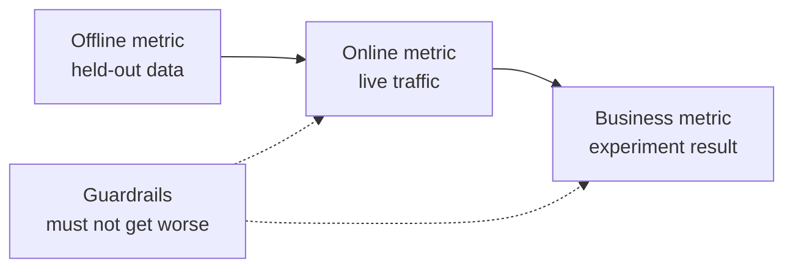

# Diseño de sistemas ML  Del problema al modelo implementado

> Un modelo es una parte de un sistema, el diseño decide lo que predice el modelo, quién actúa sobre él, cuánto cuesta y qué sucede cuando falla.

**Type:** Build
**Languages:** Python
**Prerequisites:** Phase 2, Lessons 09 (Model Evaluation) and 13 (ML Pipelines)
**Time:** ~110 minutes

## Objetivos de aprendizaje

- Enmarcar un problema de negocio como una tarea de ML con una predicción, una decisión que lo utiliza y una razón por la que las reglas no son suficientes
- Separar las métricas de línea, línea, negocios y guardrail, y comparar cada modelo con líneas de base triviales y heurísticas
- Estimar el costo diario, la latencia y la latencia del lote y la inferencia en línea a partir de los números de tráfico
- Seleccione un patrón de despliegue (sombra, canario, prueba A/B) y un estándar seguro para cada modo de falla
- Identificar los bucles de retroalimentación en los que el modelo cambia los datos que entrenan su próxima versión
- Escriba un documento de diseño de ML y califique en comparación con una lista fija

## El problema

Una compañía de suscripción pide un "modelo de churn". Un científico de datos entrena un clasificador aumentado en gradientes y informa de una AUC de 0.91.

Las razones no tienen nada que ver con el algoritmo. Nadie decidió qué acción inicia una puntuación. Las puntuaciones llegan una vez a la semana, pero el equipo de retención llama a los clientes todos los días. La etiqueta provino de una tabla de cancelaciones que también almacenaba la razón de cancelación, por lo que una característica contenía la respuesta. Nadie comparó el modelo con la regla que el equipo de soporte ya usaba: llamar a alguien inactivo durante dos semanas.

Cada uno de estos fallos ocurrió antes de que comenzara la formación. Son fallos de diseño, y un documento de diseño de una página pregunta sobre cada uno de ellos. Esta lección enseña las decisiones en ese documento.

## El concepto

### De un objetivo de negocio a una tarea de ML

Un objetivo de negocio no es una tarea de ML. Lo conviertes en una con cuatro preguntas:

1. ¿Qué predice exactamente el modelo y para qué entidad (usuario, pago, almacenaje, artículo)?
2. ¿Qué decisión utiliza la predicción, y quién o qué toma esa decisión?
3. ¿Cuándo es necesaria la predicción, y qué datos existen en ese momento?
4. ¿Cómo sabrás que la decisión fue mejor?

| Business goal | Prediction | Decision that uses it | ML task |
|---|---|---|---|
| Reduce churn | Probability that a user cancels in the next 30 days | Send a save offer to the top 5 percent each night | Binary classification |
| Cut fraud losses | Probability that a payment is fraud | Approve, review, or block within 100 ms | Binary classification |
| Keep shelves stocked | Units sold per store per day next week | Order quantity for each store | Forecasting |
| Show relevant items | Relevance score for a (user, item) pair | Order of items in the feed | Ranking |

La segunda columna necesita más cuidado. "Predict churn" deja el horizonte, la entidad y la acción abiertas. "Predict si este usuario cancela en los próximos 30 días, para que el trabajo de esta noche pueda elegir quién recibe una oferta" arregla las tres.

### Cuándo no utilizar ML

La regla número 1 de las Reglas de Aprendizaje de Máquina de Google dice que no tengas miedo de lanzar un producto sin aprendizaje de máquina. El aprendizaje de máquina necesita datos, y una simple heurística a menudo te lleva a una parte del camino. No uses ML en estos casos:

- Una regla corta alcanza el objetivo y se mantiene correcta.
- No tienes etiquetas ni forma práctica de recogerlas.
- Nadie actúa en base a la predicción, así que una mejor predicción no cambia nada.
- Los datos que existen en el momento de la predicción no contienen la señal.
- Un error es inaceptable y ninguna persona puede comprobar la salida.
- Construir y ejecutar el sistema cuesta más que valer las mejores decisiones.

Cuando una regla se hace larga y frágil, el ML comienza a dar sus frutos. La regla #3 de la misma guía prefiere el ML sobre una heurística compleja, porque un modelo aprendido es más fácil de actualizar y mantener.

### Tres capas de métricas

Midas un sistema ML en tres capas, más un conjunto de límites:

| Layer | When you can measure it | Churn example |
|---|---|---|
| Offline metric | Before launch, on held-out past data | F1 at the offer threshold, precision in the top 5 percent |
| Online metric | During launch, on live traffic | Offer acceptance rate, share of users scored, score distribution |
| Business metric | Weeks after launch, with an experiment | 30-day churn rate in the treated group versus a holdout group |
| Guardrail metric | All the time | Offer cost per saved user, unsubscribe rate, p99 latency |



Las capas a menudo están en desacuerdo. Una métrica fuera de línea marca los datos pasados, y el pasado no contenía su modelo. Una métrica en línea depende de cómo reaccionan las personas a la decisión. Una métrica de negocios se mueve lentamente y lleva ruido de todo lo demás en la empresa.

Seleccione la métrica fuera de línea que coincida con la decisión. Si el trabajo se comunica con el 5 por ciento de los usuarios más altos, mide la precisión en el 5 por ciento más alto. AUC promedias sobre todos los umbrales, incluyendo los umbrales que nunca se usan. La regla #2 de la misma guía dice que primero diseñar e implementar métricas, antes de decidir lo que el sistema ML hará.

### Líneas de base

Un valor métrico no significa nada solo. Una F1 de 0,56 es buena si la mejor alternativa alcanza 0,30 y pobre si una regla alcanza 0,60.

- **Trivial baseline.**Siempre predecir la clase mayoritaria, o siempre predecir el promedio de entrenamiento.
- **Heuristic baseline.**Una regla de dominio o un umbral de una característica que se ajusta a los datos de entrenamiento.
- **Current system.**Sea cual sea la decisión que tome hoy, incluso cuando es una persona con una hoja de cálculo.

El elevador es el puntaje del modelo menos el puntaje de la línea de base más fuerte. Establezca un elevador mínimo antes de mirar los resultados, y haga lo suficientemente grande como para pagar el sistema adicional. La línea de base trivial suele ser débil. La línea de base heurística es la más difícil de superar.

### Requisitos de datos y etiquetas

Responde a estas preguntas antes de entrenar:

- **Label source.**¿Qué mesa o evento define la etiqueta, y quién la posee?
- **Label delay.**¿Cuánto tiempo después de la predicción llega el resultado verdadero? Los reembolsos de fraudes pueden llegar semanas después del pago.
- **Label quality.**¿Quién asigna la etiqueta, y con qué frecuencia es errónea?
- **Availability at prediction time.**¿Existe cada característica en el momento de la predicción? Una característica que el sistema escribe después del resultado filtra la etiqueta en el entrenamiento.
- **Volume per class.**¿Cuántos ejemplos positivos existen?
- **Time split.**Se dividen los datos por tiempo en la lección de la serie temporal por la misma razón.

### Los presupuestos de latencia, rendimiento y costes

Tres números enlazados en cada diseño de servicio:

- **Latency budget.**La latencia p99 es el tiempo que 99 de 100 solicitudes permanecen bajo. Un cheque de pago puede necesitar 50 ms. Un informe nocturno puede tomar horas.
- **Peak throughput.**El sistema debe ser calificado para el minuto más ocupado, no para el promedio diario.
- **Cost budget.**Expresarlo en dólares por día o dólares por 1000 predicciones, para que puedas comparar diseños.

La ley de Little conecta las dos primeras. El número de solicitudes en proceso es igual a tiempo de latencia. A 400 solicitudes por segundo y 50 ms cada, 20 solicitudes están en proceso en cualquier momento.

### Inferencia por lotes frente a inferencia en línea

Hay dos formas básicas de servir predicciones:

- **Batch inference.**Un trabajo programado califica cada entidad y escribe las puntuaciones en una tabla o en un almacén de valores clave.
- **Online inference.**La aplicación envía las características a un servicio modelo en el momento de la solicitud y espera el resultado.

| Property | Batch | Online |
|---|---|---|
| Freshness | As old as the last run, plus the run time | Uses the data of the request |
| Request latency | One key-value read, a few ms | Feature fetch plus model time |
| Cost driver | Number of entities times runs per day | Replicas sized for peak QPS |
| New entities | No score until the next run | Scored on the first request |
| When it breaks | Old scores stay readable | Requests fail or time out |

El conjunto de herramientas en esta lección cuesta ambos. El costo de lote aumenta con el número de entidades y con el número de carreras por día. Un límite de latencia más corto significa más carreras. El costo en línea aumenta con el tráfico máximo, porque pagas por replicas inactivas entre picos. Un trabajo de lote que dura una hora no puede cumplir con un límite de latencia inferior a una hora a ningún precio.

Un diseño híbrido es común. Un trabajo de lote nocturno califica a usuarios conocidos, y un camino en línea califica a nuevos usuarios y solicitudes que necesitan datos frescos.

### Modelos de despliegue

Un nuevo modelo llega a los usuarios en etapas:

1. **Shadow.**El nuevo modelo recibe una copia del tráfico en vivo. El sistema registra sus predicciones y nunca las utiliza. Se compara la latencia, la tasa de error y la distribución de predicción con el modelo actual.
2. **Canary.**El nuevo modelo toma decisiones reales para una pequeña parte del tráfico, a menudo de 1 a 5 por ciento.
3. **A/B test.**Una división aleatoria de usuarios ve cada modelo. Mide la métrica de negocio con una prueba estadística, y necesita suficiente tráfico y suficiente tiempo para ver la diferencia.

Cada etapa necesita un retroceso que toma minutos. Mantenga la versión del modelo antiguo implementada y cambie el tráfico con la configuración.[shadow and canary lesson](../../../17-infrastructure-and-production/20-shadow-canary-progressive/docs/en.md)y el [A/B testing lesson](../../../17-infrastructure-and-production/21-ab-testing-llm-features/docs/en.md)¿ Qué ?

### Los bucles de retroalimentación

Un bucle de retroalimentación existe cuando las decisiones del modelo cambian los datos que entrenan su próxima versión. Sculley et al. enumeran los bucles de retroalimentación directos y ocultos entre las principales fuentes de deuda técnica en los sistemas ML. Tres casos comunes:

- **Interventions hide the label.**Un modelo de churn envía ofertas, y las ofertas retienen a algunos usuarios. El mes siguiente, los usuarios de alto riesgo parecen fieles, y el modelo retrainado aprende que sus características no predicen churn.
- **Blocked actions have no outcome.**Un modelo de fraude bloquea un pago, por lo que el pago nunca recibe una etiqueta de devolución de cargos.
- **Exposure limits feedback.**Un modelo de clasificación muestra sus principales elementos, por lo que sólo esos elementos recogen clics.

Las correcciones comparten una idea: guardar algunos datos que el modelo no influyó. Mantener un pequeño grupo aleatorio que nunca recibe la intervención. Dar una pequeña parte del tráfico una decisión aleatoria. Registrar la puntuación y la decisión con cada ejemplo, para que más tarde el entrenamiento pueda distinguir los datos influenciados de los datos limpios.

### Modo de falla y defecto seguro

Cada parte del sistema falla tarde o temprano. Decide la acción predeterminada para cada falla en el diseño, no durante el incidente:

| Failure | Result without a plan | Safe default |
|---|---|---|
| Model service times out | The request fails | Use the heuristic baseline |
| Nightly batch job fails | Scores go missing or get old | Serve the last good scores for a fixed time, then the rule |
| Feature is missing or out of range | The model scores bad input | Use the documented default value and log the event |
| New entity with no history | No score exists | Use the rule or the population average |
| Score distribution moves suddenly | Wrong decisions at scale | Pause automatic actions and alert a person |

La línea de base heurística de su sección métrica es también el predeterminado para la mayoría de fallas, así que construye primero.

### El documento de diseño

El documento de diseño registra todas las decisiones anteriores en un solo lugar, antes de que comience la formación. El comprobador en esta lección califica una versión JSON de ella. Seis elementos bloquean una revisión, porque cada uno hace que el sistema sea inseguro o inútil:

| Section | Question it answers | Blocking |
|---|---|---|
| Problem | What is predicted, which decision uses it, and why rules are not enough? | The decision |
| Metrics | Which offline, online, business, and guardrail metrics apply? | The business metric |
| Baselines | Which trivial, heuristic, and current-system baselines apply? | A heuristic or current baseline |
| Data | Where do labels come from, how late, and does each feature exist at prediction time? | No leakage |
| Budgets and serving | Which latency, peak QPS, cost, and staleness limits apply, and which serving mode fits them? | No |
| Rollout | Which shadow, canary, and A/B stages apply, and how do you roll back? | Shadow or canary, plus rollback |
| Feedback loops | How can the model change its own future data, and what keeps clean data? | No |
| Failure modes | What is the default action for each failure? | A default for every failure |
| Monitoring | What do you watch after launch? | No |

```figure
mlprod-serving-cost
```

## Construye el mismo

El código en `code/main.py`El sistema de evaluación de los costes de servicio, el comparador de líneas de base y el verificador de documentos de diseño.

### Paso 1: Describa la carga de trabajo y los precios

Una carga de trabajo contiene los números de tráfico y los presupuestos. Un modelo de costo contiene los precios. Los precios son números redondos para el ejercicio, no cotizaciones de proveedores.

```python
@dataclass(frozen=True)
class Workload:
    name: str
    entities: int
    requests_per_day: int
    peak_qps: float
    max_staleness_hours: float
    latency_budget_ms: float


@dataclass(frozen=True)
class CostModel:
    batch_dollars_per_million: float = 0.40
    batch_job_hours: float = 1.0
    lookup_dollars_per_million: float = 0.25
    lookup_latency_ms: float = 4.0
    replica_dollars_per_hour: float = 0.50
    replica_qps: float = 200.0
    min_replicas: int = 2
    online_latency_ms: float = 35.0
```

### Paso 2: Precio por lote y servicio en línea

Un trabajo de lote debe terminar dentro del límite de latencia. El tiempo entre las carreras es el límite menos el tiempo de trabajo. Cada carrera marca cada entidad, ya sea que alguien pida o no ese puntaje.

```python
def batch_plan(workload: Workload, costs: CostModel) -> ServingPlan:
    refresh_hours = workload.max_staleness_hours - costs.batch_job_hours
    if refresh_hours <= 0:
        return ServingPlan(
            "batch", False, math.inf, costs.lookup_latency_ms, math.inf, 0.0,
            "staleness limit is shorter than one batch job",
        )
    runs_per_day = 24.0 / refresh_hours
    predictions = workload.entities * runs_per_day
    dollars = (
        predictions / 1e6 * costs.batch_dollars_per_million
        + workload.requests_per_day / 1e6 * costs.lookup_dollars_per_million
    )
    ...
```

El servicio en línea paga por suficientes réplicas para manejar el pico, con un mínimo de dos para disponibilidad:

```python
def online_plan(workload: Workload, costs: CostModel) -> ServingPlan:
    replicas = max(costs.min_replicas, math.ceil(workload.peak_qps / costs.replica_qps))
    dollars = replicas * costs.replica_dollars_per_hour * 24.0
    feasible = costs.online_latency_ms <= workload.latency_budget_ms
    ...
```

`choose_serving`mantiene los planes que cumplan con los límites de latencia y latencia y devuelve el más barato.`None`Cuando no hay un plan que encaje, que te dice que cambie los presupuestos.

### Paso 3: Comparar un modelo con sus líneas de base

El comparador califica el modelo y cada línea de base con la misma métrica. mide el levantamiento contra la línea de base más fuerte, no la más débil.

```python
def compare_to_baselines(
    y_true: list,
    model_pred: list,
    baselines: dict[str, list],
    metric,
    metric_name: str,
    higher_is_better: bool = True,
    min_lift: float = 0.02,
) -> BaselineReport:
    if not baselines:
        raise ValueError("a model needs at least one baseline")
    scores = {name: metric(y_true, pred) for name, pred in baselines.items()}
    pick = max if higher_is_better else min
    best_name = pick(scores, key=scores.get)
    model_score = metric(y_true, model_pred)
    lift = model_score - scores[best_name] if higher_is_better else scores[best_name] - model_score
    return BaselineReport(metric_name, {"model": model_score, **scores}, best_name, lift, min_lift)
```

La línea de base heurística es una regla de una característica. `fit_rule`El programa de demostración de la función de simulación de la velocidad de conversión de un motor de velocidad de velocidad de velocidad de velocidad de velocidad de velocidad de velocidad de velocidad de velocidad de velocidad de velocidad de velocidad de velocidad de velocidad de velocidad de velocidad de velocidad de velocidad de velocidad de velocidad de velocidad de velocidad de velocidad de velocidad de velocidad de velocidad de velocidad de velocidad de velocidad de velocidad de velocidad de velocidad de velocidad de velocidad de velocidad de velocidad de velocidad de velocidad de velocidad de velocidad de velocidad de velocidad de velocidad de velocidad de velocidad de velocidad de velocidad de velocidad de velocidad de velocidad de velocidad de velocidad de velocidad de velocidad de velocidad de velocidad de velocidad de velocidad de velocidad de velocidad de velocidad de velocidad de velocidad de velocidad de velocidad de velocidad de velocidad de velocidad de velocidad de velocidad de velocidad de velocidad de velocidad de velocidad de velocidad de velocidad de velocidad de velocidad de velocidad de velocidad de velocidad de velocidad de velocidad de velocidad de velocidad de velocidad de velocidad de velocidad de velocidad de velocidad de velocidad de velocidad de velocidad de velocidad de velocidad de velocidad de velocidad de velocidad de velocidad de velocidad de velocidad de velocidad de velocidad de velocidad de velocidad de velocidad de velocidad de velocidad de velocidad de velocidad de velocidad de velocidad de velocidad de velocidad de velocidad de velocidad de velocidad de velocidad de velocidad de velocidad de velocidad de velocidad de velocidad de velocidad de velocidad de velocidad de velocidad de velocidad de velocidad de velocidad de velocidad de velocidad de velocidad de velocidad de velocidad de velocidad de velocidad de velocidad de velocidad de velocidad de velocidad de velocidad de velocidad de velocidad de velocidad de velocidad de velocidad de velocidad de velocidad de velocidad de velocidad de velocidad de velocidad de velocidad de velocidad de velocidad de velocidad de velocidad de velocidad de velocidad de velocidad de velocidad de velocidad

### Paso 4: Obtenga un resultado de un documento de diseño

Cada elemento de la lista de verificación tiene una clave, un peso, una bandera de bloqueo, un mensaje y una función de verificación.

```python
CheckItem("decision", 2, True, "name the action that uses each prediction", lambda d: _text(d, "problem.decision")),
CheckItem("baselines", 2, True, "add a heuristic or current-system baseline", check_baselines),
CheckItem("no_leakage", 2, True, "confirm every feature exists at prediction time",
          lambda d: get_path(d, "data.features_available_at_prediction_time") is True),
CheckItem("serving_fit", 1, False, "pick a serving mode that meets the staleness, latency, and cost budgets",
          check_serving_fit),
```

`check_serving_fit`reutiliza el modelo de coste. Leer los números de carga de trabajo del documento y precios del modo elegido. El cheque falla cuando ese modo no cumple con el límite de latencia, el presupuesto de latencia o el presupuesto de costos diarios. Un documento que dice "parcela" con un límite de 3 minutos de latencia falla en esta verificación. El modelo de costo no tiene un plan híbrido, por lo que un documento que dice "híbrido" falla en esta verificación hasta que añades ese plan en el ejercicio 1.

`review_design_doc`El veredicto está "listo para revisión" sólo cuando la puntuación alcanza 0,85 y ningún elemento bloqueador falla.

### Paso 5: ejecuta

```bash
python3 code/main.py
```

```console
nightly churn scores
  ok batch        $0.91/day      4 ms  1.0 runs per day over 2,000,000 entities
  ok online      $24.00/day     35 ms  2 replicas sized for 40 peak QPS
  choose: batch

feed ranking, 2-hour freshness
  ok batch       $48.50/day      4 ms  24.0 runs per day over 5,000,000 entities
  ok online      $24.00/day     35 ms  2 replicas sized for 120 peak QPS
  choose: online

=== Model versus baselines (churn, metric F1) ===
  model                    0.564
  days_idle > 12.8688      0.500
  random at base rate      0.232
  majority class           0.000
  model beats the strongest baseline (days_idle > 12.8688) by +0.064
```

La mayoría de la línea de base obtiene 0 en F1, porque nunca predice el giro. La regla adecuada es el competidor real. El modelo lo supera en 0.064, por lo que el modelo gana su lugar. Con características más débiles la regla puede ganar, y entonces la regla es el sistema correcto para implementar.

La revisión del documento de diseño imprime el documento débil con seis elementos de bloqueo y el documento completo con una puntuación de 1.00.

```bash
python3 code/main.py my_design_doc.json
```

## Usalo

Cada parte del kit de herramientas presenta las herramientas que los equipos utilizan en la producción.

**Baselines.**scikit-learn proporciona las líneas de base triviales como estimadores, por lo que encajan en la misma línea de conducción que el modelo:

```python
from sklearn.dummy import DummyClassifier, DummyRegressor
from sklearn.metrics import f1_score

majority = DummyClassifier(strategy="most_frequent").fit(X_train, y_train)
base_rate = DummyClassifier(strategy="stratified", random_state=0).fit(X_train, y_train)
mean_value = DummyRegressor(strategy="mean").fit(X_train, y_reg_train)

print(f1_score(y_test, majority.predict(X_test)))
```

`most_frequent`las partidas`majority_baseline`, y `stratified`las partidas`base_rate_baseline`. scikit-learn no tiene línea de base heurística, porque la heurística proviene de su dominio.

**Batch serving.**Un programador de flujo de trabajo como Apache Airflow o Dagster ejecuta el trabajo de puntuación.

**Online serving.**Los servidores de modelo como KServe, BentoML, NVIDIA Triton y TorchServe envuelven un modelo detrás de un punto final HTTP o gRPC.

**Rollouts.**Las herramientas de Kubernetes como Argo Rollouts dividen el tráfico para los lanzamientos de canarios.

**Design review.**Breck et al. publicaron el Score de Prueba de ML, una rubrica de 28 pruebas y necesidades de monitoreo para los sistemas de ML de producción.

## Envío

Esta lección produce`outputs/skill-ml-design-review.md`. La habilidad revisa una sección por sección de un documento de diseño de ML y nombra primero las lagunas de bloqueo.

## Los ejercicios

1. Añadir un plan híbrido a `choose_serving`.Correctar usuarios conocidos en lote y nuevos usuarios en línea. Comparar su costo diario.
2. Cambiar los datos de giro hasta que el modelo ya no supera la regla.
3. Añadir un`budgets.max_dollars_per_1k_predictions`Escriba una prueba que falle sin ella.
4. Escriba un documento de diseño JSON para una verificación de fraude de pagos.
5. Simula el ciclo de retroalimentación de la torcida, elimina las etiquetas de los usuarios que recibieron una oferta, retrain y mide el cambio en F1.

## Términos clave

| Term | What people say | What it means |
|------|----------------|----------------------|
| ML task | "Build a churn model" | A prediction target, an entity, a horizon, and the decision that uses the prediction |
| Offline metric | "The model score" | A metric computed on held-out past data before launch |
| Online metric | "Live numbers" | A metric measured on real traffic while the model runs |
| Business metric | "The goal" | The company outcome that the decision must change, measured with an experiment |
| Guardrail metric | "Do no harm" | A metric that must not get worse when the new model launches |
| Baseline | "The dumb model" | A trivial, heuristic, or current-system predictor that the model must beat by a set margin |
| Batch inference | "Precomputed scores" | A scheduled job scores every entity and stores the results for lookup |
| Online inference | "Real-time model" | The model scores each request when it arrives |
| Shadow deployment | "Dark launch" | The new model scores live traffic, and nobody uses its output |
| Canary release | "Slow rollout" | The new model decides for a small, growing share of traffic, with a rollback ready |
| Feedback loop | "The model trains itself" | The model's decisions change the data that trains its next version |

## Leer más

- [Sculley et al., Hidden Technical Debt in Machine Learning Systems (NeurIPS 2015)](https://papers.nips.cc/paper/2015/hash/86df7dcfd896fcaf2674f757a2463eba-Abstract.html): bucles de retroalimentación, entrelazamiento y costos del sistema en torno a un modelo
- [Google, Rules of Machine Learning](https://developers.google.com/machine-learning/guides/rules-of-ml): reglas prácticas para el primer modelo, métricas y coherencia en la formación
- [Breck et al., The ML Test Score (IEEE Big Data 2017)](https://research.google/pubs/the-ml-test-score-a-rubric-for-ml-production-readiness-and-technical-debt-reduction/): 28 pruebas que miden la preparación de producción
- [Kohavi, Tang, and Xu, Trustworthy Online Controlled Experiments (Cambridge University Press, 2020)](https://experimentguide.com/): cómo ejecutar pruebas A/B que dan respuestas correctas
- [Sato, Wider, and Windheuser, Continuous Delivery for Machine Learning (2019)](https://martinfowler.com/articles/cd4ml.html): datos, modelos y canales de implementación versionados
- [Google Cloud, MLOps: Continuous delivery and automation pipelines in machine learning](https://cloud.google.com/architecture/mlops-continuous-delivery-and-automation-pipelines-in-machine-learning): tres niveles de madurez para la formación y la automatización de servicios
