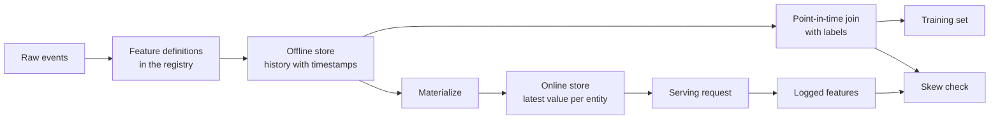

# Tiendas de características y esqueleto de formación

> Una característica tiene una definición y dos lectores. El entrenamiento lee su historia a partir de cada tiempo de etiqueta, y servir lee su valor más reciente. Cuando los dos lectores no están de acuerdo, el modelo ve entradas en las que nunca se entrenó.

**Type:** Build
**Languages:** Python
**Prerequisites:** Phase 2, Lessons 08 (Feature Engineering), 13 (ML Pipelines), 15 (Time Series), and 19 (ML System Design)
**Time:** ~100 minutes

## Objetivos de aprendizaje

- Describa la tienda fuera de línea, la tienda en línea, las entidades, las fichas de tiempo del evento y los TTL, y el trabajo de cada uno
- Implementar una combinación correcta en el momento y mostrar cómo una combinación ingenua copia valores futuros en datos de capacitación
- Nombre de cuatro causas de sesgo en el servicio de entrenamiento: dos vías de código, características obsoletas, diferentes defectos y viajes en el tiempo
- Construir un registro de características en el que una definición alimenta tanto la ruta de entrenamiento como la ruta de servicio
- Recompletar una nueva función en fechas anteriores sin leer datos de después de cada fecha
- Detectar sesgo comparando las características de servicio registradas con la ruta de entrenamiento para la misma entidad y tiempo

## El problema

Un equipo construye un modelo de churn. Cada etiqueta indica si un usuario no hizo ninguna compra en los 30 días posteriores a un día de etiqueta.`user_id`y entrena una regla sobre `days_since_last_purchase`La precisión fuera de línea es de 0.948.

En el tráfico en vivo, el modelo hace peor que una versión más antigua y simple. La tabla de características contenía el valor más reciente para cada usuario, a partir de semanas después de los días de etiqueta. Un usuario cuya última compra fue el día 115 mostró 60 días de inactividad en el día 175, por lo que la función contenía la respuesta. Mientras tanto, otro equipo escribió las características de servicio de nuevo en un servicio diferente. Su ventana de 30 días incluía un día extra, y su predeterminado para un nuevo usuario era -1 en lugar de 365.

Las dos deficiencias tienen la misma causa. El entrenamiento y la prestación de servicios computaban "la misma característica" de dos maneras diferentes. Esta lección construye las piezas de una tienda de características desde cero.

## El concepto

### Dos lectores de la misma característica

El entrenamiento y el servicio exigen características de diferentes formas:

| Property | Training (offline) | Serving (online) |
|---|---|---|
| Question | "What was the value for each of 10 million (entity, time) pairs?" | "What is the value for this one entity now?" |
| Time | Many points in the past | The present |
| Volume | Millions of rows per job | One row per request |
| Latency | Minutes are fine | A few milliseconds |
| Storage | Offline store: full history with timestamps, in columnar files or a warehouse | Online store: the latest value per entity, in a key-value database |

Una tienda de características mantiene ambas tiendas llenas de un conjunto de definiciones de características.



### Las entidades, las temporadas y el TTL

Cuatro términos describen cada fila de características:

- **Entity.**La clave que describe una característica, como `user_id`o `card_id`¿ Qué ?
- **Event timestamp.**El momento en que el valor se hizo verdadero. Un recuento de compra "a partir del día 14" tiene el sello de tiempo del evento día 14.
- **Created timestamp.**El tiempo en que el sistema escribió la fila. Un backfill que se ejecuta hoy escribe filas con antiguos sellos de tiempo de evento y una nueva marca de tiempo creada.
- **TTL (time to live).**El valor de un valor mayor que el TTL se considera como ausente, por lo que el lector utiliza el valor predeterminado.

Un grupo de características con la misma entidad, fuente y TTL a menudo se llama vista de características.

### Conexiones correctas en el punto en el tiempo

Una fila de entrenamiento empareja una etiqueta con los valores de características que existían en el momento de la etiqueta.

1. Encuentra las filas de características de la misma entidad.
2. Mantenga las filas cuyo sello de tiempo del evento está en o antes del sello de tiempo de la etiqueta.
3. Toma la última de esas filas.
4. Se puede soltar si la marca de tiempo de la etiqueta menos la marca de tiempo del evento es mayor que el TTL.

Aquí hay un usuario, una etiqueta en el día 16, y filas de características semanales:

| Feature row day | `purchases_30d` | Point-in-time join | Naive join on `user_id` |
|---|---|---|---|
| 7 | 4 | | |
| 14 | 3 | Selected | |
| 21 | 1 | Future | |
| 28 | 0 | Future | Selected |

La etiqueta pregunta si el usuario compra algo en los días 17 a 46. El día 28 fila cuenta ya los días tranquilos después del día de etiqueta. Muestra 0 compras porque el usuario dejó de comprar, que es el evento que la etiqueta mide.

Dividimos los datos por tiempo en la lección de serie de tiempo por la misma razón.

### Causas de la sesga en el servicio de formación

Las Reglas de Aprendizaje Automático de Google definen la sesgación de servicio de entrenamiento como una diferencia entre el rendimiento durante el entrenamiento y el rendimiento durante el servicio. Nombran tres causas: diferentes manipulaciones de datos en las dos líneas de servicio, un cambio en los datos entre el entrenamiento y el servicio y un bucle de retroalimentación. En las líneas de servicio de funciones, aparecen una y otra vez cuatro causas concretas:

| Cause | What happens | Example from the demo |
|---|---|---|
| Two code paths | Training and serving compute the feature with different code | The serving window includes day `now - 30`, and the training window does not |
| Stale features | The value that serving reads has a different age from the value that training used | Training reads weekly snapshots, and a new service computes fresh values |
| Different defaults | The two paths fill a missing value differently | Training uses 365 for "no purchase yet", and serving uses -1 |
| Time travel | Training reads a value from after the label time | The naive join reads the newest snapshot for every label |

La regla #32 de la misma guía dice que se reutilice el código entre la línea de entrenamiento y la línea de servicio siempre que sea posible.

### Un registro de características

El registro es el catálogo de definiciones de características. Cada entrada contiene un nombre, una entidad, una fuente, una transformación, una ventana, un valor predeterminado, un TTL, un propietario, una versión y una descripción.

Dos reglas lo mantienen seguro:

- Ambos caminos leen la definición del registro. Ningún servicio guarda una copia privada de la transformación.
- El cambio de una definición crea una nueva versión, la versión antigua se mantiene, así que los modelos antiguos mantienen la característica en la que se entrenaron.

### Recheos de recarga

Una nueva característica no tiene historia, pero la capacitación necesita su valor en cada tiempo de etiqueta antigua. Un backfill ejecuta la definición en cada fecha pasada y escribe una fila por entidad y fecha.

Los recuerdos de costos de cálculo crecen con el número de entidades multiplicado por el número de fechas. También traen una filtración sutil. Un recuadro que se ejecuta hoy escribe filas con antiguos sellos de tiempo de eventos, pero puede leer datos que llegaron tarde o fueron corregidos más tarde.

### Detección de sesgo

La regla #29 de la misma guía dice que se registren las características en el tiempo de servicio y se utilizan en el entrenamiento. Incluso una pequeña muestra registrada le permite verificar la consistencia. Comparar cada valor registrado con el valor que produce el camino de entrenamiento para la misma entidad y tiempo. Para cada característica, informe la proporción de desajustes y la diferencia absoluta media.

Para encontrar la causa, comparar tres pares:

1. En la tienda en línea, se lee contra entrenamiento, esto prueba todo el sistema y debe mostrar cero sesgo.
2. El nuevo cálculo contra el entrenamiento se une. Esto aisla la estancia.
3. El segundo camino de código frente a un nuevo cálculo. Esto aisla las diferencias de código, como ventanas y valores predeterminados.

```figure
mlprod-pit-join
```

## Construye el mismo

El código en `code/main.py`El tiempo es un número completo de días. Un trabajo de lote semanal escribe instantáneas de características en días 7, 14, y así sucesivamente hasta 175.

### Paso 1: Definiciones de características y registro

¿ Qué es esto ?`FeatureDefinition`El sistema de datos de la transformación de datos contiene la transformación como datos: un agregado, una ventana y un defecto.`compute`El método nunca lee eventos después de `as_of`¿ Qué ?

```python
@dataclass(frozen=True)
class FeatureDefinition:
    name: str
    entity: str
    aggregate: str
    window_days: int | None
    default: float
    version: int = 1
    owner: str = "growth-team"
    description: str = ""

    def compute(self, events: list[Event], as_of: int) -> float:
        visible = [e for e in events if e.day <= as_of]
        if self.window_days is not None:
            visible = [e for e in visible if e.day > as_of - self.window_days]
        if self.aggregate == "count":
            return float(len(visible))
        if self.aggregate == "sum":
            return round(sum(e.amount for e in visible), 2)
        if self.aggregate == "days_since_last":
            return float(as_of - max(e.day for e in visible)) if visible else self.default
        raise ValueError(f"unknown aggregate {self.aggregate!r}")
```

`FeatureRegistry.register`La Comisión Europea ha adoptado una definición diferente, pero no acepta la misma definición dos veces, pero rechaza una definición diferente con el mismo nombre y la misma versión. `fill_defaults`da a ambos caminos el mismo valor predeterminado para un valor faltante.

Un modelo pin una definición con una referencia como `spend_30d@1`- ¿ Qué ?`compute`y `fill_defaults`Resolver la referencia y un nombre sin `@`Se lee la última versión.`@`y no hay aumento de número de versiones `ValueError`La referencia es también la clave en cada fila almacenada, por lo que el respaldo, la tienda en línea y la lectura de servicio utilizan la definición fijada.

### Paso 2: Reemplaza la tienda fuera de línea

```python
def backfill(registry: FeatureRegistry, names: list[str], events: list[Event], days: list[int]) -> list[FeatureRow]:
    rows = []
    for entity, entity_events in sorted(group_events(events).items()):
        for day in days:
            rows.append(FeatureRow(entity, day, registry.compute(names, entity_events, day)))
    return rows
```

La demostración completa tres funciones para 299 usuarios en 25 días de instantáneas, lo que da 7475 filas.

### Paso 3: El punto en el tiempo de unión

Ordenar las filas de cada entidad una vez al día.`bisect_right`El TTL deja caer una fila que es demasiado vieja.

```python
def point_in_time_join(labels: list[LabelRow], rows: list[FeatureRow], ttl_days: int | None = None) -> list[JoinedRow]:
    by_entity: dict[str, list[FeatureRow]] = defaultdict(list)
    for row in rows:
        by_entity[row.entity].append(row)
    days_index = {}
    for entity, entity_rows in by_entity.items():
        entity_rows.sort(key=lambda r: r.day)
        days_index[entity] = [r.day for r in entity_rows]
    joined = []
    for label in labels:
        days = days_index.get(label.entity, [])
        pos = bisect.bisect_right(days, label.day) - 1
        match = by_entity[label.entity][pos] if pos >= 0 else None
        if match is not None and ttl_days is not None and label.day - match.day > ttl_days:
            match = None
        joined.append(JoinedRow(
            label.entity, label.day, label.label,
            match.day if match else None, match.values if match else None,
        ))
    return joined
```

### Paso 4: Medir la fuga de una unión ingenua

`naive_latest_join`La demostración construye etiquetas en los días 100, 120 y 140 y se ajusta a una regla de una característica en cada conjunto de entrenamiento. Luego prueba ambas reglas en etiquetas a partir del día 145, con características de punto en tiempo:

```console
  naive join used a snapshot from after the label day for 100% of rows
  offline accuracy, naive join: 0.948 (rule: idle > 53 days)
  offline accuracy, PIT join:   0.893 (rule: idle > 19 days)
  accuracy on day 145, trained with naive join: 0.763
  accuracy on day 145, trained with PIT join:   0.876
```

La combinación ingenua se ve mejor fuera de línea, 0.948 contra 0.893. En los nuevos datos es peor, 0.763 contra 0.876. La característica filtrada movió el umbral ajustado de 19 a 53 días inactivos.

### Paso 5: La tienda en línea y la materialización

La tienda en línea mantiene una fila por entidad y rechaza las filas mayores a la TTL. `materialize`escribe sólo las filas cuyo día es en o antes de la hora de trabajo.

```python
class OnlineStore:
    def __init__(self, ttl_days: int):
        self.ttl_days = ttl_days
        self._latest: dict[str, FeatureRow] = {}

    def write(self, row: FeatureRow) -> None:
        current = self._latest.get(row.entity)
        if current is None or row.day >= current.day:
            self._latest[row.entity] = row

    def read(self, entity: str, now: int) -> dict[str, float] | None:
        row = self._latest.get(entity)
        if row is None or row.day > now or now - row.day > self.ttl_days:
            return None
        return dict(row.values)
```

Con un TTL de 10 días, una lectura en el día 145 devuelve la fila de día 140. Una lectura en el día 160, sin nueva materialización, devuelve los valores predeterminados, porque la fila es de 20 días.

### Paso 6: El control de sesgo

`detect_skew`compara dos puntos de vista de `(entity, day)`. Informará de la tasa de desajuste y la diferencia absoluta media por característica y señalará una característica cuando más del 1% de los valores difieren.`ValueError`Cuando las dos vistas tienen diferentes claves o no hay claves. Una solicitud que falta puede ocultar sesgo, y un cheque sin solicitudes no muestra nada.

```python
def detect_skew(
    training: dict[tuple[str, int], dict[str, float]],
    serving: dict[tuple[str, int], dict[str, float]],
    features: list[str],
    tolerance: float = 1e-6,
    max_mismatch_rate: float = 0.01,
) -> list[SkewReport]:
    if set(training) != set(serving):
        raise ValueError(f"{len(set(training) ^ set(serving))} keys are in only one view: log and compare the same requests")
    if not training:
        raise ValueError("no requests to compare")
    keys = sorted(training)
    reports = []
    for feature in features:
        diffs = [abs(training[k][feature] - serving[k][feature]) for k in keys]
        mismatches = sum(1 for d in diffs if d > tolerance)
        rate = mismatches / len(keys)
        mean_diff = sum(diffs) / len(keys)
        reports.append(SkewReport(feature, len(keys), rate, mean_diff, rate > max_mismatch_rate))
    return reports
```

El registro de demostración registra las solicitudes en los días 141 a 150 y realiza las tres comparaciones de la sección de conceptos.

```bash
python3 code/main.py
```

```console
=== Skew checks on 383 logged requests, days 141 to 150 ===
  online store read  vs  training join (one definition, same snapshots)
    ok   days_since_last_purchase   mismatch   0.0%  mean |diff|    0.00
    ok   purchases_30d              mismatch   0.0%  mean |diff|    0.00
    ok   spend_30d                  mismatch   0.0%  mean |diff|    0.00
  fresh compute      vs  training join (staleness only)
    SKEW days_since_last_purchase   mismatch  83.0%  mean |diff|    2.77
    SKEW purchases_30d              mismatch  30.5%  mean |diff|    0.38
    SKEW spend_30d                  mismatch  37.1%  mean |diff|   16.77
  second code path   vs  fresh compute (code differences only)
    SKEW days_since_last_purchase   mismatch   5.5%  mean |diff|   20.07
    SKEW purchases_30d              mismatch  12.5%  mean |diff|    0.13
    SKEW spend_30d                  mismatch  12.5%  mean |diff|    5.09
```

Lea los tres bloques en orden:

- **One definition, same snapshots.**La tienda en línea y la formación juntas leen las mismas filas materializadas, así que la sesgación es cero.
- **Staleness.**Un valor fresco difiere del instantáneo semanal de la mayoría de las solicitudes.
- **Code differences.**El segundo camino de código difiere en el 12,5% de los recuentos de ventanas, porque su ventana incluye un día extra.`days_since_last_purchase`Sólo para nuevos usuarios, pero en gran cantidad: -1 contra 365.

## Usalo

Feast es una tienda de características de código abierto. Cada pieza del código desde cero tiene una contraparte de Feast:

| From scratch | Feast |
|---|---|
| `FeatureDefinition`, `FeatureRegistry` | `Entity`, `FeatureView`, and `Field` in a feature repository, registered with `feast apply` |
| `FeatureRow` history | An offline store, for example a `FileSource` over Parquet files or a warehouse table |
| `point_in_time_join` with a TTL | `store.get_historical_features(entity_df=..., features=[...])` |
| `materialize` | `feast materialize-incremental <end time>` |
| `OnlineStore.read` | `store.get_online_features(features=[...], entity_rows=[...])` |
| Created timestamp check | `created_timestamp_column` on the source and `filter_by_created_timestamp=True` |

El código sigue el inicio rápido de la fiesta y no es necesario para ejecutar esta lección.

```python
from datetime import timedelta

from feast import Entity, FeatureView, Field, FileSource
from feast.types import Float32, Int64

user = Entity(name="user", join_keys=["user_id"])

user_activity_source = FileSource(
    name="user_activity_source",
    path="data/user_activity.parquet",
    timestamp_field="event_timestamp",
    created_timestamp_column="created",
)

user_activity = FeatureView(
    name="user_activity",
    entities=[user],
    ttl=timedelta(days=10),
    schema=[
        Field(name="purchases_30d", dtype=Int64),
        Field(name="spend_30d", dtype=Float32),
        Field(name="days_since_last_purchase", dtype=Int64),
    ],
    source=user_activity_source,
)
```

Entrenamiento y servicio luego leer la misma visión de características:

```python
from feast import FeatureStore

store = FeatureStore(repo_path=".")

training_df = store.get_historical_features(
    entity_df=labels_df,
    features=["user_activity:purchases_30d", "user_activity:days_since_last_purchase"],
    filter_by_created_timestamp=True,
).to_df()

online = store.get_online_features(
    features=["user_activity:purchases_30d", "user_activity:days_since_last_purchase"],
    entity_rows=[{"user_id": 42}],
).to_dict()
```

`labels_df`contiene una fila por etiqueta con `user_id`¿ Qué ?`event_timestamp`La documentación de Feast indica que el TTL es relativo a cada sello de tiempo en el marco de datos de la entidad, no al tiempo de la consulta.`point_in_time_join`La misma página describe`filter_by_created_timestamp=True`No todas las tiendas fuera de línea admiten esta opción. Una tienda sin soporte plantea un error en lugar de ignorar la opción.

Tecton, Hopsworks y las tiendas de características de las grandes plataformas de ML en la nube utilizan la misma división entre tiendas offline y online. Para la verificación de sesgo, TensorFlow Data Validation puede comparar datos de entrenamiento con datos de servicio para detectar sesgo. Breck et al. describen el sistema de validación de datos en TFX, la plataforma de ML de extremo a extremo de Google, incluyendo sesgo de servicio de entrenamiento.

## Envío

Esta lección produce`outputs/skill-feature-skew-audit.md`La habilidad audita una línea de características para viajar en el tiempo y la inclinación que sirve de formación.

## Los ejercicios

1. Cambiar el intervalo de instantáneas de 7 días a 1 día.
2. Configure el TTL a 3 días, cuenta las filas de entrenamiento que pierden sus características y obtienen defectuosos.
3. Añadir un día creado a `FeatureRow`Haga que la combinación ignore las filas escritas después del día de etiqueta.
4. Registro .`spend_7d`como versión 2 de `spend_30d`Reempléelo y imprime ambas versiones del registro.
5. - ¿ Qué ?`legacy_serving_features`Hasta que pase el tercer cheque de sesgo.

## Términos clave

| Term | What people say | What it means |
|------|----------------|----------------------|
| Feature store | "A database for features" | A system that computes features from one set of definitions and serves them to training and to serving |
| Offline store | "The training data" | Full feature history with event timestamps, read by training jobs and backfills |
| Online store | "The feature cache" | The latest value per entity, read by the serving path in milliseconds |
| Entity | "The ID" | The key that a feature describes, such as a user or a card |
| Event timestamp | "When it happened" | The time at which a feature value became true |
| Point-in-time join | "An as-of join" | A join that pairs each label with the latest feature row at or before the label time |
| TTL | "Expiry" | The maximum age of a feature value before a reader treats it as missing |
| Materialization | "Syncing to online" | The job that copies the latest feature values from the offline store to the online store |
| Backfill | "Computing history" | Running a feature definition at past dates to create its history |
| Training-serving skew | "It worked offline" | A difference between the features or behavior in training and in serving |

## Leer más

- [Feast, Point-in-time joins](https://docs.feast.dev/getting-started/concepts/point-in-time-joins): Semántica TTL y el filtro de timestamp creado
- [Feast documentation](https://docs.feast.dev/): vistas de características, tiendas fuera de línea, tiendas en línea y materialización
- [Google, Rules of Machine Learning](https://developers.google.com/machine-learning/guides/rules-of-ml): las reglas de sesgo de la formación, desde el artículo 29 hasta el artículo 37
- [Breck et al., Data Validation for Machine Learning (SysML 2019)](https://research.google/pubs/data-validation-for-machine-learning/): validación de datos en Google, incluida la inclusión de servicios de formación
- [TensorFlow Data Validation guide](https://www.tensorflow.org/tfx/guide/tfdv): comprobaciones de esquemas, detección de sesgos y detección de deriva
- [Sculley et al., Hidden Technical Debt in Machine Learning Systems (NeurIPS 2015)](https://papers.nips.cc/paper/2015/hash/86df7dcfd896fcaf2674f757a2463eba-Abstract.html): dependencias de datos y deuda de la tubería en torno a un modelo
