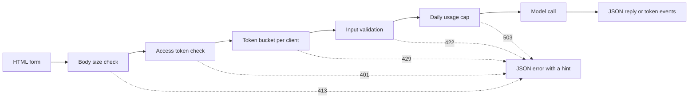

# Modelo de interfaces de demostración  De una función a una aplicación compartible

> Una demostración de modelo tiene un contrato: una entrada, una llamada de modelo y una salida.

**Type:** Build
**Languages:** Python
**Prerequisites:** Phase 11 · 13 (Building a Production LLM Application), Phase 17 · 08 (Inference Metrics), Phase 17 · 19 (AI Gateways)
**Time:** ~90 minutes

## Objetivos de aprendizaje

- Escriba el contrato de entrada, llamada de modelo y salida de una demostración, con un límite en cada parte.
- Construir una aplicación HTTP de biblioteca estándar con una página HTML, un punto final JSON y un punto final de eventos enviados por servidor.
- Valida la entrada en orden de costo y devuelve errores JSON que indican al usuario la siguiente acción.
- Proteja una demostración pública con un token de cada cliente, un límite de uso diario y un token de acceso opcional.
- Escriba registros de solicitudes que no guardan texto de entrada ni dirección de cliente.
- Comparar la demostración de la biblioteca estándar con dos versiones de marco, y nombrar las señales de que una demostración debe convertirse en un producto.

## El problema

Ahora un revisor quiere probar diez entradas y un cliente quiere ver un resultado en un teléfono. Ninguno de ellos abrirá su cuaderno.

Una célula de portátil no tiene límites de entrada y no muestra el progreso. Sus errores son rastros de pila que solo usted puede leer. También se ejecuta con sus credenciales y su presupuesto. Si coloca la célula detrás de una URL pública sin cambios, puede esperar fallas como estas:

- Un usuario pega un documento de 40.000 caracteres, el modelo de llamada se ejecuta durante un minuto y luego falla con un rastro de pila.
- Un script envía 500 solicitudes en un minuto.
- La página no muestra nada durante ocho segundos, por lo que el usuario hace clic en el botón cuatro veces más.
- El registro del servidor mantiene todas las entradas, incluidas las entradas con un número de cuenta del cliente.

Una interfaz demo evita estos fallos con una pequeña cantidad de código. Esta lección construye una con la biblioteca estándar de Python, para que pueda ver cada parte. Luego construye la misma demo con dos marcos populares y compara lo que cada uno hace por defecto.

## El concepto

### Una demostración es un contrato

Cada demo tiene tres partes. La entrada es lo que el usuario puede enviar. La llamada modelo convierte la entrada en una salida. La salida es lo que el usuario ve, e incluye errores.

Escriba el contrato antes de escribir la página:

| Part | Question to answer | Answer in this lesson |
|------|--------------------|-----------------------|
| Input | What type, what size, which characters? | A string of 1 to 500 characters, with no control characters |
| Model call | How long does one call take, and what does it cost? | A toy keyword model that runs in under a millisecond at no cost |
| Output | What does the user see on success and on failure? | A label, a score, and a reply, or a JSON error with a hint |

Un portátil no tiene límite en ninguna de las tres partes. Una demostración establece un límite en cada parte, y el servidor aplica los límites a cada cliente.



Los cheques se ejecutan en orden de costo. Una mala solicitud se detiene en la primera chequea que falla, por lo que no cuesta casi nada al servidor. La llamada modelo viene por último, porque es el único paso que cuesta dinero.

### Validación antes de que el modelo se ejecute

El navegador puede comprobar la entrada antes de enviar nada.`maxlength`y `required`Los atributos en un área de texto dan a la respuesta al usuario sin ninguna llamada de red. Estas verificaciones ayudan a los usuarios honestos. Cualquier cliente puede enviar una solicitud sin la página, por lo que el servidor repite cada verificación.

Pon los cheques del servidor en orden de costo:

1. Lea el `Content-Length`Rechazar un cuerpo por encima del límite antes de leerlo.
2. Parsear el cuerpo JSON. Rechazar un cuerpo que no es un objeto JSON.
3. Rechazar los campos. Rechazar texto vacío, texto más allá del límite, y controlar caracteres.
4. Gaste una llamada modelo sólo en una solicitud que haya pasado todos los cheques.

| Failed check | HTTP status | Error code |
|--------------|-------------|------------|
| Body over 4,096 bytes | 413 Content Too Large | `body_too_large` |
| Body stops before `Content-Length` bytes arrive | 408 Request Timeout | `request_timeout` |
| Content type is not JSON | 415 Unsupported Media Type | `unsupported_media_type` |
| Body is not a JSON object | 400 Bad Request | `bad_json` |
| Text is missing, empty, too long, or has control characters | 422 Unprocessable Content | `missing_text`, `empty_text`, `text_too_long`, `control_characters` |

La RFC 9110 define estos códigos de estado y sus nombres.

Los ejemplos son parte del diseño de entrada. Un ejemplo muestra al usuario cómo se ve una buena entrada. También le da a un revisor una prueba con un clic. Elija un ejemplo para cada clase de salida. Esta demostración tiene un ejemplo positivo, negativo y neutral.

### Muestre que el modelo está funcionando

Una llamada de modelo puede tardar varios segundos. Sin retroalimentación, el usuario no puede distinguir un modelo lento de una página rota. Un usuario que no ve ningún cambio puede hacer clic de nuevo, y luego el servidor recibe una segunda solicitud pagada.

La página de esta lección ofrece cuatro tipos de comentarios:

- Desactiva el botón enviar mientras se ejecuta una solicitud.
- Muestra el tiempo transcurrido y lo actualiza cada 100 milisegundos.
- Muestra el tiempo de la primera señal cuando llega la primera señal.
- Indica el tiempo total en que finaliza la solicitud.

Cuando estudiaste .[inference metrics](../../08-inference-metrics-goodput/)La página demo muestra el mismo número al usuario, medido en el navegador.

### Envía la salida como un flujo

Un modelo de lenguaje produce su respuesta un token a la vez. Si el servidor espera el último token, el usuario espera la generación completa. Si el servidor envía cada token cuando está listo, el usuario comienza a leer después del primer token.

Los eventos enviados por servidor (SSE) son el formato estándar para esto.`text/event-stream`Cada evento es un grupo de`event:`y `data:`El estándar HTML WHATWG define el formato.

```text
event: token
data: {"index":0,"text":"Label:"}

event: token
data: {"index":1,"text":" positive."}

event: done
data: {"label":"positive","score":1.0,"tokens":11}
```

El navegador tiene un `EventSource`La aplicación de GET es una aplicación de Internet de acceso que permite a los usuarios acceder a la red de acceso de Internet de Internet de Internet de Internet de Internet de Internet de Internet de Internet de Internet de Internet de Internet de Internet de Internet de Internet de Internet de Internet de Internet de Internet de Internet de Internet de Internet de Internet de Internet de Internet de Internet de Internet de Internet de Internet de Internet de Internet de Internet de Internet de Internet de Internet de Internet de Internet de Internet de Internet de Internet de Internet de Internet de Internet de Internet de Internet de Internet de Internet de Internet de Internet de Internet de Internet de Internet de Internet de Internet de Internet de Internet de Internet de Internet de Internet de Internet de Internet de Internet de Internet de Internet de Internet de Internet de Internet de Internet de Internet de Internet de Internet de Internet de Internet de Internet de Internet de Internet de Internet de Internet de Internet de Internet de Internet de Internet de Internet de Internet de Internet de Internet de Internet de Internet de Internet de Internet de Internet de Internet de Internet de Internet de Internet de Internet de Internet de Internet de Internet de Internet de Internet de Internet de Internet de Internet de Internet de Internet de Internet de Internet de Internet de Internet de Internet de Internet de Internet de Internet de Internet de Internet de Internet de Internet de Internet de Internet de Internet de Internet de Internet de Internet de Internet de Internet de Internet de Internet de Internet de Internet de Internet de Internet de Internet de Internet de Internet de Internet de Internet de Internet de Internet de Internet de Internet de Internet de Internet de Internet de Internet de Internet de Internet de Internet de Internet de Internet de Internet de Internet de Internet de Internet de Internet de Internet de Internet de Internet de Internet de Internet de Internet de Internet de Internet de Internet de Internet de Internet de Internet de Internet de Internet de Internet de Internet de Internet de Internet de Internet de Internet de Internet de Internet de Internet de Internet de Internet de Internet de Internet de Internet de Internet de Internet de Internet de Internet de Internet de Internet de Internet de (IGIS de Internet de Internet de Internet de Internet de Internet de Internet de Internet de Internet de Internet de Internet de Internet de Internet de Internet de Internet de Internet de Internet de Internet de Internet de Internet de Internet de Internet de Internet de Internet de Internet de Internet de Internet de Internet de Internet de Internet de Internet de Internet de Internet de Internet de Internet de Internet de Internet de Internet de Internet de Internet de Internet de Internet de Internet de Internet de Internet de Internet de Internet de Internet de Internet de Internet de Internet de Internet de Internet de`fetch()`y `response.body.getReader()`, y analiza el formato del evento en sí.

Un flujo tiene un problema que una sola respuesta JSON no tiene. El servidor envía el estado 200 antes de la primera ficha. Si el modelo falla después de eso, el servidor no puede cambiar el estado. Así que el servidor envía un `error`evento en la corriente, y la página muestra ese evento como un error.

Cuando construiste el[production LLM application](../../../11-llm-engineering/13-production-app/)Esta lección escribe el mismo protocolo a mano, para que pueda ver cada línea que el servidor envía.

### Escriba errores que un usuario puede actuar sobre

Un mensaje de error tiene dos funciones: le dice al usuario lo que pasó y le dice a el usuario qué hacer a continuación.

Cada error en esta demostración tiene la misma forma JSON:

```json
{
  "error": {
    "code": "text_too_long",
    "message": "The text has 812 characters. The limit is 500.",
    "hint": "Shorten the text to 500 characters or fewer.",
    "request_id": "a8f3c2b435e3"
  }
}
```

- `code`El código del cliente y las pruebas se comparan con él.
- `message`El número de datos que el usuario necesita.
- `hint`da al usuario una acción.
- `request_id`conecta un informe de usuario a un registro de registro.

RFC 9457 define un formato de error estándar para las API HTTP, llamado detalles de problemas. Esta demostración utiliza una forma más pequeña para el mismo propósito.

### Compartir una demostración pública de forma segura

Un enlace público cambia quién puede enviar solicitudes. Planifique un control para cada riesgo:

| Risk | Control in this demo | Control for a larger audience |
|------|----------------------|-------------------------------|
| One client sends too many requests | A token bucket per client, with 429 and `Retry-After` | Per-user limits after sign-in |
| Strangers find the link | An optional access token in the `Authorization` header | Single sign-on with an identity provider |
| Total cost grows with no limit | A daily usage cap, with 503 and `Retry-After` | Spend limits and alerts at the model provider |
| Very large or unusual input | Body size limit, text length limit, control character check | Content moderation on input and output |
| Logs keep private input | Records with the input length and a keyed hash of the client | A retention period and access control on the logs |

Un cubo de tokens utiliza dos números. La capacidad es la mayor explosión que un cliente puede enviar. La tasa de reempleo es la tasa de solicitud a largo plazo. Cada solicitud toma un token, y el cubo se reemplea continuamente hasta su capacidad:

```text
tokens = min(capacity, tokens + refill_rate * seconds_since_last_request)
accept the request if tokens >= 1, then subtract 1
```

Cuando el cubo está vacío, el servidor responde.`429 Too Many Requests`. RFC 6585 define el estado 429, y permite al servidor añadir un `Retry-After`Esta demostración siempre añade el encabezado, con el número de segundos hasta el siguiente token. La página lee el encabezado y desactiva el botón para ese tiempo.

La demostración utiliza la dirección IP del cliente como la clave de cubo. Detrás de un proxy inverso, cada solicitud proviene de la dirección de proxy, por lo que todos los usuarios comparten un cubo. En ese caso, lea la dirección del cliente desde un encabezado que su propio proxy establece. No confíe en ese encabezado de ninguna otra fuente, porque un cliente puede poner cualquier valor en él.

Cuando estudiaste .[AI gateways](../../19-ai-gateways/)Un demo necesita el mismo control a una escala más pequeña. Un límite de tarifa controla a cada cliente, pero no controla el total. Cientos de clientes que se alojan bajo el límite pueden usar el presupuesto completo. Un límite de uso cuenta todas las llamadas de modelo en un día y rechaza las llamadas después de un número fijo.

Los registros necesitan el mismo cuidado que las entradas.`http.server`El procesador escribe la dirección IP del cliente y la línea de solicitud para un error estándar. Si la entrada está en la URL, la entrada entra en el registro. Esta demostración reemplaza esa línea de registro. Cada solicitud escribe un registro con la ruta, el estado, el código de error, la latencia y la longitud de entrada. La dirección del cliente se convierte en un hash con teclado, por lo que puede contar las solicitudes por cliente sin almacenar la dirección.

La página demo dice que el servidor guarda la longitud del texto y nunca el texto mismo.

### Cuando una demostración se convierte en un producto

Una demostración sirve a personas conocidas en sesiones cortas de un proceso. Estas señales le dicen que la demostración es ahora un producto:

- La gente fuera de tu equipo la usa cada semana.
- Alguien pide un objetivo de tiempo de actividad, o informa de un apagón.
- Los usuarios piden iniciar sesión, guardar resultados o ver su historial.
- El costo semanal del modelo es una línea en un presupuesto.
- La entrada incluye datos que cubren un contrato o una ley.

| Property | Demo | Product |
|----------|------|---------|
| Users | Known people, short sessions | Unknown people, daily use |
| State | None | Accounts, history, saved results |
| Availability | Best effort, one process | A written target, replicas, an on-call owner |
| Cost control | One daily usage cap | Per-user quotas and billing |
| Observability | One log record per request | Traces, metrics, and alerts |

Cuando vea estas señales, mueva la demostración en la pila de producción de la lección de aplicación de LLM de producción. Esa pila agrega autenticación real, modelos de retroceso, rastreo y seguimiento de costos por usuario.

```figure
demo-token-bucket
```

## Construye el mismo

El código es un archivo,`code/main.py`, sin dependencias fuera de la biblioteca estándar. ejecuta la auto-prueba primero:

```bash
python3 code/main.py
```

El auto-test verifica el validador, el cubo de tokens, el formato de la corriente y una vuelta de HTTP real. Inicia el servidor en un puerto libre, envía tres solicitudes, detiene el servidor y sale. Inicia el servidor para un navegador solo cuando lo necesites:

```bash
python3 code/main.py --serve
```

Abriéndome .`http://127.0.0.1:8000`Presione Ctrl + C para detener el servidor.

### Paso 1: La llamada modelo

El modelo es un contador de palabras clave de juguete. etiqueta el texto como positivo, negativo o neutral. También produce una respuesta corta, un token a la vez.

```python
def classify(text):
    words = WORD_RE.findall(text.lower())
    positive = sum(1 for word in words if word in POSITIVE)
    negative = sum(1 for word in words if word in NEGATIVE)
    score = (positive - negative) / max(1, positive + negative)
    if score > 0:
        label = "positive"
    elif score < 0:
        label = "negative"
    else:
        label = "neutral"
    return {"label": label, "score": round(score, 3), "positive_cues": positive,
            "negative_cues": negative, "words": len(words)}


def generate(text):
    result = classify(text)
    reply = (
        f"Label: {result['label']}. Positive cues: {result['positive_cues']}. "
        f"Negative cues: {result['negative_cues']}. Words read: {result['words']}."
    )
    parts = reply.split(" ")
    yield parts[0]
    for part in parts[1:]:
        yield " " + part
```

Un modelo real reemplaza`generate`Coloque una llamada de API o un modelo local dentro de ella. Mantenga la firma: una cadena entra, y los tokens salen. El validador, los límites y la página permanecen iguales.

### Paso 2: Validación y respuestas de error

Una clase de excepción contiene todos los errores. Tiene el estado HTTP, un código estable, un mensaje, una pista y encabezados de respuesta opcionales.

```python
class DemoError(Exception):
    def __init__(self, status, code, message, hint, headers=None):
        super().__init__(message)
        self.status = status
        self.code = code
        self.message = message
        self.hint = hint
        self.headers = dict(headers or {})


def validate_text(payload, max_chars=MAX_CHARS):
    if "text" not in payload:
        raise DemoError(422, "missing_text", 'The field "text" is missing.', 'Add a "text" field with your input.')
    text = payload["text"]
    if not isinstance(text, str):
        raise DemoError(422, "text_not_string", 'The field "text" is not a string.', "Send the input as a string.")
    text = text.strip()
    if not text:
        raise DemoError(422, "empty_text", "The text is empty.", "Type a sentence or pick an example.")
    if len(text) > max_chars:
        raise DemoError(422, "text_too_long", f"The text has {len(text)} characters. The limit is {max_chars}.",
                        f"Shorten the text to {max_chars} characters or fewer.")
    if CONTROL_RE.search(text):
        raise DemoError(422, "control_characters", "The text contains control characters.",
                        "Remove the hidden characters, then send the text again.")
    return text
```

El validador elimina primero el espacio blanco anterior y posterior. Un texto de sólo espacios luego no aparece como vacío, y la pista le dice al usuario qué escribir. `check_body_size`y `parse_json_body`utilizar el mismo patrón para los casos 411, 413, 415, y 400. `error_body`¿ Qué pasa ?`DemoError`en la forma JSON desde la sección de concepto.

### Paso 3: El cubo de símbolos

```python
class TokenBucket:
    def __init__(self, capacity, refill_per_second, now):
        if capacity < 1:
            raise ValueError("capacity must be at least 1")
        if refill_per_second <= 0:
            raise ValueError("refill_per_second must be positive")
        self.capacity = float(capacity)
        self.refill_per_second = float(refill_per_second)
        self.tokens = float(capacity)
        self.updated = now

    def take(self, now, cost=1.0):
        elapsed = max(0.0, now - self.updated)
        self.tokens = min(self.capacity, self.tokens + elapsed * self.refill_per_second)
        self.updated = now
        if self.tokens >= cost:
            self.tokens -= cost
            return 0.0
        return (cost - self.tokens) / self.refill_per_second
```

`take`El servidor devuelve 0.0 cuando acepta la solicitud. de lo contrario devuelve los segundos hasta que el cubo tiene suficientes tokens. El servidor ronda que valor y lo envía `Retry-After`¿ Qué ?

`RateLimiter`mantiene un cubo por cliente en un`OrderedDict`Una cerradura protege el diccionario, porque`ThreadingHTTPServer`El dicionario de la información de la información de la información de la información de la información de la información de la información de la información de la información de la información de la información de la información de la información de la información de la información de la información de la información de la información de la información de la información de la información.`max_clients`En el caso de un cliente eliminado, el limitador elimina el cliente con la solicitud más antigua.`max_clients`por encima del número de clientes activos que espera.

El limitador toma un`clock`Los test pasan un`FakeClock`, para que una prueba pueda avanzar el tiempo en diez segundos sin esperar. `UsageCap`El sistema cuenta las llamadas en ventanas fijas de 86.400 segundos, y devuelve los segundos hasta la próxima ventana cuando el recuento esté lleno.

### Paso 4: El arroyo

```python
def sse_event(event, data):
    payload = json.dumps(data, separators=(",", ":"), ensure_ascii=False)
    return f"event: {event}\ndata: {payload}\n\n".encode("utf-8")


def stream_events(text, generate_fn=generate, delay=0.0, sleep=time.sleep):
    count = 0
    try:
        for token in generate_fn(text):
            yield sse_event("token", {"index": count, "text": token})
            count += 1
            if delay:
                sleep(delay)
    except Exception:
        yield sse_event("error", MODEL_ERROR)
        return
    result = classify(text)
    yield sse_event("done", {"label": result["label"], "score": result["score"], "tokens": count})
```

`json.dumps`escribe una línea nueva dentro de una cadena como los dos caracteres `\n`. Cada evento tiene, por lo tanto, una línea de datos sin nueva línea en bruto.

El generador detecta un fallo del modelo y envía una señal.`error`El evento, porque el servidor ya envió la línea de estado.`delay`y `sleep`Los argumentos ralentizan la corriente de un navegador, y mantienen las pruebas rápidas.

### Paso 5: El procesador de las solicitudes

`DemoHandler`se extiende `BaseHTTPRequestHandler`El manipulador POST ejecuta los controles en el orden de la sección de conceptos:

```python
def do_POST(self):
    app = self.server.app
    request_id = uuid.uuid4().hex[:12]
    client_id = self.client_address[0]
    started = time.perf_counter()
    route = self.path if self.path in self.routes else "other"
    status, code, chars = 200, None, 0
    try:
        declared = self.headers.get("Content-Length")
        try:
            if route == "other":
                raise DemoError(404, "not_found", "This endpoint does not exist.",
                                "Send requests to /api/predict or /api/stream.")
            size = check_body_size(declared, app.config.max_body_bytes)
        except DemoError:
            self.drain(int(declared) if declared and declared.isdigit() else 0)
            raise
        try:
            body = self.rfile.read(size)
        except TimeoutError:
            self.close_connection = True
            raise DemoError(408, "request_timeout", "The request body did not arrive in time.",
                            "Send the request again with the full body.") from None
        app.admit(client_id, self.headers.get("Authorization"))
        text = app.read_text(self.headers.get("Content-Type"), body)
        chars = len(text)
        app.charge()
        if route == "/api/predict":
            self.send_json(200, predict(text), request_id)
        else:
            code = self.send_stream(text, request_id)
    except DemoError as err:
        status, code = err.status, err.code
        self.send_error_json(err, request_id)
    except TimeoutError:
        status, code = 408, "request_timeout"
        self.close_connection = True
    except Exception:
        status, code = 500, "internal_error"
        self.send_error_json(DemoError(500, "internal_error", "The server failed on this request.",
                                       "Try again. Quote the request id if you report the problem."), request_id)
    finally:
        latency_ms = (time.perf_counter() - started) * 1000
        app.log.record(request_id, route, client_id, status, chars, latency_ms, code)
```

`admit`verifica el token de acceso y el cubo de token. `charge`El registro de registro de la fecha de inicio de sesión de la solicitud de registro de registro de registro de registro de registro de registro de registro de registro de registro de registro de registro de registro de registro de registro de registro de registro de registro de registro de registro de registro de registro de registro de registro de registro de registro de registro de registro de registro de registro de registro de registro de registro de registro de registro de registro de registro de registro de registro de registro de registro de registro de registro de registro de registro de registro de registro de registro de registro de registro de registro de registro de registro de registro de registro de registro de registro de registro de registro de registro de registro de registro de registro de registro de registro de registro de registro de registro de registro de registro de registro de registro de registro de registro de registro de registro de registro de registro de registro de registro de registro de registro de registro de registro de registro de registro de registro de registro de registro de registro de registro de registro de registro de registro de registro de registro de registro de registro de registro de registro de registro de registro de registro de registro de registro de registro de registro de registro de registro de registro de registro de registro de registro de registro de registro de registro de registro de registro de registro de registro de registro de registro de registro de registro de registro de registro de registro de registro de registro de registro de registro de registro de registro de registro de registro de registro de registro de registro de registro de registro de registro de registro de registro de registro de registro de registro de registro de registro de registro de registro de registro de registro de registro de registro de registro de registro de registro de registro de registro de registro de registro de registro de registro de registro de registro de registro de registro de registro de registro de registro de registro de registro de registro de registro de registro de registro de registro de registro de registro de registro de registro de registro de registro de registro de registro de registro de registro de registro de registro de registro de registro de registro de registro de registro de registro de registro de registro de registro de registro de registro de registro de registro de registro de registro de registro de registro de registro de registro de registro de registro de registro de registro de registro de registro de registro de registro de registro de registro de registro de registro de registro de registro de registro de registro de registro de registro de registro de registro de registro de registro de registro de registro de registro de registro de registro de registro de registro de registro de registro de registro de registro de registro de registro de registro de registro de registro de registro de registro de registro`finally`El registro mantiene los datos de los casos de los que se han rechazado las solicitudes.`route`, nunca el camino bruto, porque un camino puede llevar una cadena de consulta con texto de usuario.

Cuatro detalles evitan los fracasos que son fáciles de perder:

- `timeout = 10`En la clase de procesador se cierra una conexión cuando el cliente deja de enviar. Sin ella, un cliente que declara 100 bytes y envía 10 mantiene un hilo del servidor para siempre. El procesador envía un error 408 JSON con el id de solicitud y cierra la conexión. Un tiempo después de que comience el flujo solo cierra la conexión, porque la línea de estado ya se envía.
- `log_message`Retorna sin salida. Esto elimina la línea de registro predeterminada con la dirección del cliente y la línea de solicitud.
- `drain`RFC 1122 dice que TCP envía un restablecimiento cuando un host cierra una conexión con datos no leídos.
- `send_stream`las capturas `BrokenPipeError`Cuando el usuario cierra la pestaña, el modelo se detiene y la solicitud no cuesta más.

`BaseHTTPRequestHandler`El servidor que utiliza HTTP/1.0 en forma predeterminada en el momento en que el servidor cierra la conexión.

### Paso 6: La página

`render_page`El texto de la página no carga ningún script externo, fuente o imagen. El script lee el flujo de manera siguiente:

```javascript
const reader = response.body.getReader();
const decoder = new TextDecoder();
let buffer = "";
while (true) {
  const chunk = await reader.read();
  if (chunk.done) { break; }
  buffer += decoder.decode(chunk.value, { stream: true });
  let cut = buffer.indexOf("\n\n");
  while (cut >= 0) {
    const frame = parseFrame(buffer.slice(0, cut));
    buffer = buffer.slice(cut + 2);
    cut = buffer.indexOf("\n\n");
    if (frame.event === "token") { output.textContent += frame.data.text; }
  }
}
```

Una parte de la red puede terminar en medio de un evento.`buffer`hasta que llegue la línea en blanco.

La página escribe la salida del modelo con `textContent`y nunca con `innerHTML`. El modelo de salida es texto no confiable. Supongamos que la página inserta una respuesta como HTML, y la respuesta contiene un elemento con un `onerror`Ese atributo puede ejecutar código en el navegador del usuario.

El servidor también envía un `Content-Security-Policy`encabezado con `default-src 'none'`La política permite un script en línea y un estilo en línea, identificados por sus hashes SHA-256. El navegador rechaza todos los otros script, incluido un script que un atacante inyecta en la página.

```python
def csp_hash(source):
    digest = hashlib.sha256(source.encode("utf-8")).digest()
    return "'sha256-" + base64.b64encode(digest).decode("ascii") + "'"
```

### Paso 7: ejecutarlo y tratar de romperlo

Inicie el servidor, luego use `curl`Envía siete solicitudes seguidas a un servidor nuevo. El cubo contiene cinco tokens y recibe un nuevo token cada dos segundos:

```bash
for i in 1 2 3 4 5 6 7; do
  curl -s -o /dev/null -w '%{http_code} ' -X POST http://127.0.0.1:8000/api/predict \
    -H 'Content-Type: application/json' -d '{"text": "ok"}'
done
```

```text
200 200 200 200 200 429 429
```

Espera diez segundos, y luego envíe un mensaje de texto vacío:

```bash
curl -s -X POST http://127.0.0.1:8000/api/predict \
  -H 'Content-Type: application/json' -d '{"text": ""}'
```

```json
{"error": {"code": "empty_text", "message": "The text is empty.", "hint": "Type a sentence or pick an example.", "request_id": "e3e3599feaea"}}
```

Mira el flujo de eventos con `curl -N`, que desactiva el amortiguador de salida:

```bash
curl -N -X POST http://127.0.0.1:8000/api/stream \
  -H 'Content-Type: application/json' -d '{"text": "The screen is bright."}'
```

Para requerir un token de acceso, fijar `DEMO_ACCESS_TOKEN`La página muestra un campo para el token.

```bash
export DEMO_ACCESS_TOKEN="$(python3 -c 'import secrets; print(secrets.token_urlsafe(24))')"
echo "$DEMO_ACCESS_TOKEN"
python3 code/main.py --serve
```

Realizar las pruebas:

```bash
python3 -m unittest discover -s code/tests -v
```

Las pruebas HTTP arrancan el servidor en el puerto 0, por lo que el sistema operativo elige un puerto libre. `tearDown`detiene el servidor y comprueba que su hilo ha terminado.

## Usalo

Dos marcos Python construyen el mismo tipo de demo con menos código: Gradio y Streamlit.`main.py`, para que el validador y el modelo permanezcan iguales.`main.py`o las pruebas.

### Componentes alrededor de una función

Gradio pone una interfaz web alrededor de una función Python. Los componentes de entrada y salida describen el contrato, y una función generadora envía una salida parcial.

```python
import os

import gradio as gr

from main import EXAMPLES, MAX_CHARS, DemoError, classify, generate, validate_text


def label_text(text):
    try:
        clean = validate_text({"text": text})
    except DemoError as err:
        raise gr.Error(f"{err.message} {err.hint}")
    label = classify(clean)["label"]
    reply = ""
    for token in generate(clean):
        reply += token
        yield reply, label


demo = gr.Interface(
    fn=label_text,
    inputs=gr.Textbox(label="Text to label", lines=5, max_length=MAX_CHARS),
    outputs=[gr.Textbox(label="Reply"), gr.Textbox(label="Label")],
    examples=list(EXAMPLES),
    flagging_mode="never",
)

if __name__ == "__main__":
    demo.queue(max_size=20).launch(auth=("demo", os.environ["DEMO_PASSWORD"]))
```

Cada uno .`yield`La función de salida de la función de salida de salida de la función de salida de salida de salida de salida de salida de salida de salida de salida de salida de salida de salida de salida de salida de salida de salida de salida de salida de salida de salida de salida de salida de salida de salida de salida de salida de salida de salida de salida de salida de salida de salida de salida de salida de salida de salida de salida de salida de salida de salida de salida de salida de salida de salida de salida de salida de salida de salida de salida de salida de salida de salida de salida de salida de salida de salida de salida de salida de salida de salida de salida de salida de salida de salida de salida de salida de salida de salida de salida de salida de salida de salida de salida de salida de salida de salida de salida de salida de salida de salida de salida de salida de salida de salida de salida de salida de salida de salida de salida de salida de salida de salida de salida de salida de salida de salida de salida de salida de salida de salida de salida de salida de salida de salida de salida de salida de salida de salida de salida de salida de salida de salida de salida de salida de salida de salida de salida de salida de salida de salida de salida de salida de salida de salida de salida de salida de salida de salida de salida de salida de salida de salida de salida de salida de salida de salida de salida de salida de salida de salida de salida de salida de salida de salida de salida de salida de salida de salida de salida de salida de salida de salida de salida de salida de salida de salida de salida de salida de salida de salida de salida de salida de salida de de salida de salida de de de de salida de salida de de de de salida de salida de de de de de salida de de de de de de de de de salida de salida de de de de de salida de de de de de de de de de de de de salida de de de de de de de de de de de de de de de de de de de de de de de de de salida de de de de de de de de de de de de de de de de de de de de de de de de de de de de de de de de de de de de de de de de de de de de de de de de de de de de de de de de de de de de de de de de de de de de de de de de de de de de de de de de de de de de de de de de de de

Se ha establecido`flagging_mode`El modo predeterminado muestra un botón de bandera. Cuando un usuario lo presiona, Gradio escribe la entrada y salida a un archivo CSV en el servidor. El valor `"never"`quita el botón.

`queue(max_size=20)`El modelo lento sirve a un usuario a la vez hasta que se eleva el límite. Gradio también crea puntos finales de API cuando se lanza la aplicación, por lo que los scripts pueden llamar a la demostración sin la página. Su límite de velocidad debe aplicarse a esos puntos finales también.

### Un guión que se repite en cada entrada

Streamlit ejecuta todo el guión de arriba a abajo cada vez que el usuario cambia un widget. Un formulario recopila sus valores de widget y los envía en un lote cuando el usuario pulsa el botón enviar.

```python
import streamlit as st

from main import EXAMPLES, MAX_CHARS, DemoError, classify, generate, validate_text

st.title("Toy sentiment demo")
st.caption("Do not paste private data.")

example = st.selectbox("Start from an example", ["", *EXAMPLES])
with st.form("demo"):
    text = st.text_area("Text to label", value=example, max_chars=MAX_CHARS)
    submitted = st.form_submit_button("Run model")

if submitted:
    try:
        clean = validate_text({"text": text})
    except DemoError as err:
        st.error(f"{err.message} {err.hint}")
    else:
        st.write_stream(generate(clean))
        st.write(f"Label: {classify(clean)['label']}")
```

`st.write_stream`toma el generador directamente y escribe cada pieza cuando llega.`@st.cache_resource`El decorador guarda una copia del modelo para todas las sesiones.

### Lo que cada opción hace por defecto

| Need | Standard library (this lesson) | Gradio | Streamlit |
|------|--------------------------------|--------|-----------|
| Form, examples, result area | You write the HTML | `Interface` builds them from components and `examples` | Widgets such as `st.text_area` and `st.selectbox` |
| Input length limit | `maxlength` on the page and a server check | `max_length` on `Textbox` | `max_chars` on `st.text_area` |
| Partial output | You write SSE and the stream reader | A generator function, where each `yield` replaces the output | `st.write_stream` with a generator of chunks |
| Progress display | You write the timer | A progress display on the output area, set by `show_progress` | `st.write_stream` shows each chunk when it arrives |
| Errors for the user | JSON with `code`, `message`, `hint`, `request_id` | `raise gr.Error(...)` shows the message | `st.error(...)` shows the message |
| Concurrency | One thread per request, no limit | A queue, with one running call per event by default | Each interaction runs the script again for that session |
| Public link | You run the server and the domain | `launch(share=True)` gives a link that expires after one week | You deploy the app to a server |
| Sign-in | A bearer token check | `launch(auth=...)` with user names and passwords | `st.login()` with an OpenID Connect provider |
| Rate limit and cost cap | Token bucket and daily cap | Your code, with the client address from the request | Your code |
| Input that the tool writes to disk | Only the input length, in the log | Flagged samples in a CSV file, unless `flagging_mode="never"` | Your code decides |

Los frameworks ahorran la mayor cantidad de trabajo en la página: el formulario, los ejemplos, la visualización de progreso y la salida parcial. Ahorran menos trabajo en los riesgos de un enlace público. En las tres versiones, el límite de tarifa, el límite de costos y la privacidad de registro son su trabajo. La versión estándar de la biblioteca muestra cada una de estas partes, por lo que sabe qué comprobar en un framework.

## Envío

Esta lección produce`outputs/skill-demo-interface-checklist.md`. Darle una descripción de un modelo demo o su código. devuelve una revisión de paso o falla del contrato, la retroalimentación, los errores y los controles para un enlace público.

## Los ejercicios

1. Se ha establecido`BUCKET_CAPACITY`a 2 y `REFILL_PER_SECOND`Prevé la salida del bucle de siete solicitudes. Luego ejecuta y compara.
2. Añadir un`language`El campo de la solicitud se enviará al organismo de solicitud.`"en"`Retorna un error 422 con una pista para cualquier otro valor, y añada dos pruebas.
3. Encuentra una frase que el modelo de juguete etiquete mal, como "La pantalla no es buena". Añádelo como cuarto ejemplo, con una nota en la página que explica el límite.
4. Coloque la demostración detrás de un proxy inverso en su máquina.`trust_proxy`Opción que dice `X-Forwarded-For`Escriba una prueba que demuestre que un cliente no puede elegir su propia llave de cubo.
5. Reemplazar`generate`Con el tiempo de inicio de la página con la latencia en el registro del servidor.

## Términos clave

| Term | What people say | What it actually means |
|------|-----------------|------------------------|
| Demo contract | "The UI" | The input limits, the model call, and the output shape, including errors |
| Token bucket | "A rate limiter" | A per-client counter that refills at a fixed rate up to a capacity. Each request uses one token |
| Retry-After | "Try later" | A response header with the number of seconds, or a date, after which the client can try again |
| Server-Sent Events | "Streaming" | A `text/event-stream` response of `event:` and `data:` lines, with a blank line after each event |
| Time to first token | "Latency" | The time from the request to the first token on the user's screen |
| Usage cap | "The budget" | A limit on the total number of model calls in a time window, for all clients together |
| Keyed hash | "An anonymous ID" | An HMAC of the client address with a secret salt. It is a pseudonym: anyone with the salt can test a known address |
| Content Security Policy | "CSP" | A response header that tells the browser which scripts, styles, and connections the page can use |

## Leer más

- [Python `http.server` documentation](https://docs.python.org/3/library/http.server.html): las clases de servidor, el HTTP/1.0 por defecto, la línea de registro por defecto y la advertencia de que el módulo no es para producción.
- [WHATWG HTML Standard, server-sent events](https://html.spec.whatwg.org/multipage/server-sent-events.html): el formato del flujo de eventos y el `EventSource`Interfaz.
- [MDN, Using server-sent events](https://developer.mozilla.org/en-US/docs/Web/API/Server-sent_events/Using_server-sent_events): ejemplos del formato del evento y de la API del navegador.
- [MDN, Using readable streams](https://developer.mozilla.org/en-US/docs/Web/API/Streams_API/Using_readable_streams): cómo leer una`fetch()`Respuesta del cuerpo pieza por pieza.
- [MDN, Using the Fetch API](https://developer.mozilla.org/en-US/docs/Web/API/Fetch_API/Using_Fetch): solicitudes con un cuerpo JSON y manejo de respuestas.
- [MDN, 429 Too Many Requests](https://developer.mozilla.org/en-US/docs/Web/HTTP/Reference/Status/429)y [MDN, Retry-After](https://developer.mozilla.org/en-US/docs/Web/HTTP/Reference/Headers/Retry-After): el estado del límite de tasa y su título.
- [MDN, Content Security Policy](https://developer.mozilla.org/en-US/docs/Web/HTTP/Guides/CSP): hashes para los scripts en línea y el `default-src`La directiva.
- [RFC 6585](https://www.rfc-editor.org/rfc/rfc6585.html): códigos de estado HTTP adicionales, incluidos los 429.
- [RFC 9110](https://www.rfc-editor.org/rfc/rfc9110.html): Semántica HTTP, incluyendo 413, 415, y 422.
- [RFC 9457](https://www.rfc-editor.org/rfc/rfc9457.html): detalles del problema, un formato de error JSON estándar para las API HTTP.
- [RFC 1122](https://www.rfc-editor.org/rfc/rfc1122.html): requisitos de host, incluido el reset TCP en cerrar con datos no leídos (sección 4.2.2.13).
- [Gradio, Sharing your app](https://gradio.app/guides/sharing-your-app): compartir enlaces, autenticación, la página de API y límites de tarifas.
- [Gradio, Streaming outputs](https://gradio.app/guides/streaming-outputs): el generador funciona como salida parcial.
- [Gradio, Interface](https://gradio.app/docs/gradio/interface)¿ Qué es esto ?`examples`¿ Qué ?`flagging_mode`, y `concurrency_limit`¿ Qué ?
- [Gradio, Using flagging](https://gradio.app/guides/using-flagging): donde las muestras marcadas se colocan en disco.
- [Streamlit, Basic concepts](https://docs.streamlit.io/get-started/fundamentals/main-concepts): el flujo de datos de repetición.
- [Streamlit, st.write_stream](https://docs.streamlit.io/develop/api-reference/write-magic/st.write_stream)y [Streamlit, Caching](https://docs.streamlit.io/develop/concepts/architecture/caching): salida parcial y un modelo que carga una vez.
- [Streamlit, st.login](https://docs.streamlit.io/develop/api-reference/user/st.login): iniciar sesión con un proveedor de OpenID Connect.
