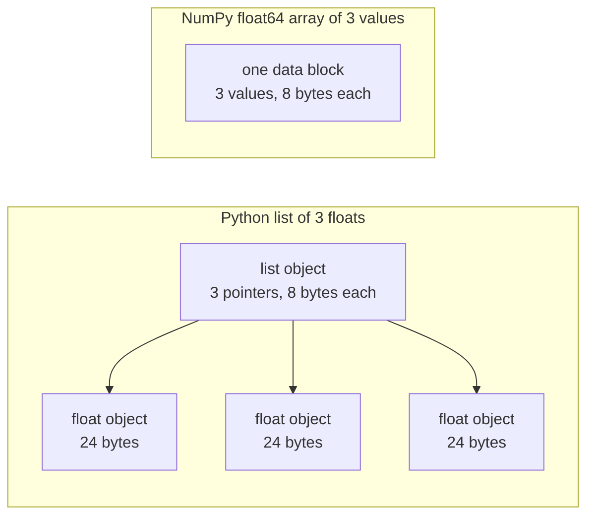

# پایتون برای مهندسی هوش مصنوعی

> بیشتر کد در این دوره از همان مجموعه کوچک از زبان های پایتون استفاده می کند. این مجموعه را قبل از اینکه درس ریاضی و مدل به آن بستگی داشته باشد، اینجا یاد بگیرید.

**Type:** Build
**Languages:** Python
**Prerequisites:** Dev Environment, Python Environments
**Time:** ~120 minutes

## اهداف یادگیری

- زبان های زبان که بیشتر کد دوره ها از آن استفاده می کنند را بخوانید و بنویسید، از پاک کردن و رشته های f تا کلاس های داده و درک.
- سه اشتباه پایتون را پیدا کنید که نتایج غلط بدون خطا را ارائه می دهند: لیست های مشترک، پیش فرض های تغییر پذیر و ژنراتورهای استفاده شده.
- یک بارگر CSV و JSON، یک تقسیم تخم، و یک ژنراتور mini-batch با فقط کتابخانه استاندارد بسازید.
- محصول نقطه، متوسط و انحراف استاندارد را در پایتون خالص بنویسید و سرعت و استفاده از حافظه آنها را اندازه گیری کنید.
- توضیح دهید که چرا یک حلقه خالص پایتون بر روی اعداد کند است و چگونه پخش NumPy حلقه را به کد مرتب می کند.

## مشکل

دروس پس از این مرحله از پایتون ساده برای ریاضیات و مدل ها استفاده می کنند. از 541 فایل پایتون در درس ها، 276 وارداتی`dataclasses`. و همچنین 187 پرونده تماس`random.seed`یا ایجاد یک`random.Random`اگر این اصطلاحات برای شما جدید هستند، شما زمانی که می خواهید ریاضیات را بخوانید، ترکیب را می خوانید.

پیتون همچنین رفتارهای مختلفی دارد که نتایج اشتباه را بدون پیام خطا می دهد. دو نام می توانند به یک لیست اشاره کنند، بنابراین تغییر از طریق یک نام نیز دیگری را تغییر می دهد. یک استدلال پیش فرض ارزش خود را از یک تماس به دیگری حفظ می کند. یک ژنراتور پس از یک عبور خالی است، بنابراین دوره آموزش دوم هیچ داده ای دریافت نمی کند و از دست دادن تغییر نمی کند.

آخرین مشکل سرعت است. در لپ تاپ آزمایشی ما، یک حلقه خالص پایتون بیش از یک میلیون فلوت حدود 30 میلی ثانیه طول کشید. NumPy همان محصول نقطه را در کمتر از یک میلی ثانیه محاسبه کرد. شما باید دلیل آن را بدانید، بنابراین شما می توانید بین یک حلقه شفاف و یک عملیات آرایه انتخاب کنید.

## مفهوم

### استفاده از کد دوره

ما تمام 541 پرونده پایتون رو در`phases/*/*/code/`با`ast`ماژول. جدول فایل هایی را که حداقل یک بار از هر ساخت استفاده می کنند می شمرد. شمارش از روز نوشتن این درس است و با اضافه کردن درس ها تغییر می کند.

| Construct | Files | Share |
|-----------|-------|-------|
| Function definitions | 541 | 100% |
| `if __name__ == "__main__":` | 529 | 98% |
| f-strings | 517 | 96% |
| Tuple unpacking | 448 | 83% |
| Classes | 379 | 70% |
| List comprehensions | 375 | 69% |
| Type hints on functions | 342 | 63% |
| Generator expressions | 326 | 60% |
| Slices | 314 | 58% |
| `lambda` | 175 | 32% |
| `try` and `except` | 120 | 22% |
| `with` statements | 96 | 18% |
| Dict comprehensions | 93 | 17% |
| Generator functions with `yield` | 14 | 3% |

واردات نشان می دهد که کدام ماژول های استاندارد مهم هستند. از 541 فایل، 340 از`from __future__ import annotations`، و 276 واردات`dataclasses`.`math`،`random`و`json`ماژول ها در پرونده های ۱۸۷، ۱۷۵ و ۱۲۶ ظاهر می شوند.`collections`ماژول در ۷۰ فایل ظاهر می شود و`itertools`فقط 4 تا ظاهر می شه

هيچ درس نيازي نداره`map()`یا`filter()`درک ها کارشون رو انجام ميدن`sorted`،`min`،`max`، یا`.sort`با یک`key=`این درس بیشتر وقت را در مورد اصطلاحات در بالای این لیست صرف می کند.

### نام ها به اشیاء اشاره دارند

در پایتون، یک متغیر نامی است که به یک شی اشاره دارد. اختصاص یک نام را به یک شی متصل می کند. این نام را کپی نمی کند. هنگامی که دو نام به یک لیست اشاره می کنند، تغییر از طریق هر یک از نام ها از طریق هر دو قابل مشاهده است. اعداد، رشته ها و توپل ها نمی توانند تغییر کنند، بنابراین این قاعده برای آنها هیچ مشکلی ایجاد نمی کند. لیست ها، دیکت ها و مجموعه ها می توانند تغییر کنند، بنابراین هنگام نیاز به نسخه مستقل، یک کپی بسازید.

### یک لیست حاوی اشاره ها، یک صف حاوی اعداد است

یک لیست پایتون به طور مستقیم اعداد را ذخیره نمی کند. آن را ذخیره می کند اشاره، و هر اشاره اشاره به یک شی Python کامل اشاره می کند. در یک 64 بیت ساخت CPython، هر اشاره 8 بیت و هر `float`این موضوع 24 بایت داره.`float64`آرایه ارزش های خام 8 بایت را در یک بلوک حافظه کنار هم ذخیره می کند.



یک حلقه در یک لیست برای هر عنصر کار زیادی انجام می دهد. مترجم یک دستور بایت کد را در یک زمان اجرا می کند. برای هر عنصر، آن را دنبال یک اشاره کننده و بررسی نوع هر اپراند. سپس آن را فرا می خواند شناور ضرب کد و یک شی شناور پایتون برای نگه داشتن نتیجه.

NumPy در یک حلقه کد جمع آوری شده بر روی ارزش های خام، حساب مشابه را انجام می دهد. این نوع داده را یک بار برای کل آرایه بررسی می کند و برای هر عنصر هیچ شی Python ایجاد نمی کند. کد ویکتوریزه یک عملیات را بر روی یک آرایه کامل توصیف می کند، مانند `(x - mean) / std`در این درس، عملکردهای ویکتور به این قانون عمل می کنند. هر کدام یک از عملیات های ردیف را انجام می دهند، بنابراین شما می توانید آن را با یک تماس NumPy جایگزین کنید.

### يه ليست همه چيز رو نگه مي داره، يه ژنراتور يه چيزي رو نگه مي داره

یک فهرست درک هر آیتم را قبل از اجرای خط بعدی ایجاد می کند. یک ژنراتور هر بار که تماس گیرنده برای یکی بعدی درخواست کند یک آیتم را ایجاد می کند. حافظه برای یک لیست با تعداد آیتم ها رشد می کند. حافظه برای یک ژنراتور تقریباً برای هر تعداد آیتم یکسان باقی می ماند.

یک ژنراتور فقط یک بار می تواند اجرا شود. پس از آخرین عنصر، آن را بالا می برد.`StopIteration`در هر درخواست، پس یک ثانیه`for`کد آموزش مجموعه داده ها را یک بار در هر دوره می خواند، بنابراین باید برای هر دوره یک ژنراتور جدید ایجاد کند.

عملکردهای ژنراتور در کد درس نادر هستند. بارگذاری داده هایی که در درس های یادگیری عمیق استفاده می شود تکرار پذیر دسته هستند، بنابراین ایده در هر حلقه آموزشی است. این شکل هر دو رویکرد را در هشت ردیف مشابه نشان می دهد.

```figure
s0-list-vs-generator
```

## زبان هایی که نیاز دارید

هر بلوک در این بخش به طور مستقل اجرا می شود. آن را به یک فایل ذخیره کنید و آن را با `python3`بلوک ها به پایتون 3.11 یا جدیدتر نیاز دارند، نسخه ای که ما در درس محیط توسعه نصب کردیم.

### 1. ارزش ها، جمع آوری ها و پاک کردن

پایتون چهار مجموعه ای داره که در آن ها قرار داره. یاد بگیر هر کدام را چه وقت استفاده کنی.

| Type | Example | Ordered | Can change | Typical use in the course |
|------|---------|---------|------------|---------------------------|
| `list` | `[0.5, 1.2]` | Yes | Yes | Samples, losses, weights |
| `tuple` | `(32, 784)` | Yes | No | Shapes, fixed records, dict keys |
| `dict` | `{"lr": 0.01}` | Insertion order | Yes | Configs, vocabularies, JSON rows |
| `set` | `{"cat", "dog"}` | No | Yes | Unique tokens, overlap checks |

این بلوک نشان می دهد که وظیفه یک لیست را کپی نمی کند.

```python
weights = [0.5, -1.2, 3.0]
alias = weights
alias[0] = 99.0
print(weights)

independent = list(weights)
independent[1] = 0.0
print(weights, independent)

grid = [[0] * 3] * 2
grid[0][0] = 1
print(grid)

grid = [[0] * 3 for _ in range(2)]
grid[0][0] = 1
print(grid)
```

```text
[99.0, -1.2, 3.0]
[99.0, -1.2, 3.0] [99.0, 0.0, 3.0]
[[1, 0, 0], [1, 0, 0]]
[[1, 0, 0], [0, 0, 0]]
```

عبارت`[[0] * 3] * 2`در مرحله ریاضی از لیست ها ماتریس ها را می سازد، بنابراین از فرم درک استفاده کنید.

Unpacking عناصر یک ردیف را به چندین نام در یک خط اختصاص می دهد. یک نام ستاره ای عناصر باقیمانده را جمع آوری می کند. یک رشته f ارزش یک عبارت را به یک رشته قرار می دهد، با یک قالب اختیاری پس از یک ستون.

```python
shape = (32, 784)
batch_size, n_features = shape
first, *middle, last = [1, 2, 3, 4, 5]
x, y = 1.0, 3.0
x, y = y, x

config = {"lr": 0.01, "epochs": 5}
config["seed"] = 7
tokens = ["the", "cat", "sat", "on", "the", "mat"]
vocab = set(tokens)

print(batch_size, n_features, first, middle, last, x, y)
print(config.get("momentum", 0.9), "cat" in vocab, len(vocab))
print(f"lr={config['lr']:.0e} loss={0.123456:.3f} n={60_000:,} {batch_size=}")
```

```text
32 784 1 [2, 3, 4] 5 3.0 1.0
0.9 True 5
lr=1e-02 loss=0.123 n=60,000 batch_size=32
```

`dict.get`وقتی کلید گم شده است یک مقدار پیش فرض را باز می گرداند.`in`تست روی یک مجموعه تقریباً برای هر اندازه مجموعه ای به همان زمان نیاز دارد.`{batch_size=}`این فرم نام و ارزش را چاپ می کند که وقتی شما اشکال زدایی می کنید کمک می کند.

یه برش`a[start:stop:step]`شامل می شود`start`و از آن خارج می شود`stop`. شاخص های منفی از آخر حساب می شوند. یک قطعه از یک لیست یک لیست جدید است، بنابراین یک قطعه از یک لیست بزرگ تمام شاخص های آن را کپی می کند.

```python
tokens = ["<s>", "the", "cat", "sat", "on", "the", "mat", "</s>"]
print(tokens[1:-1])
print(tokens[:3], tokens[-3:])
print(tokens[::2])
print(tokens[::-1][:2])
windows = [tokens[i:i + 3] for i in range(len(tokens) - 2)]
print(len(windows), windows[0])
```

```text
['the', 'cat', 'sat', 'on', 'the', 'mat']
['<s>', 'the', 'cat'] ['the', 'mat', '</s>']
['<s>', 'cat', 'on', 'mat']
['</s>', 'mat']
6 ['<s>', 'the', 'cat']
```

### 2. درک

درک یک لیست، فرض یا مجموعه را از یک تکرار پذیر در یک عبارت ایجاد می کند. مانند ریاضیاتی که توصیف می کند.

```python
scores = [0.91, 0.42, 0.77, 0.15, 0.66]
labels = [1 if s >= 0.5 else 0 for s in scores]
high = [s for s in scores if s > 0.6]
squares = {i: i * i for i in range(4)}
lengths = {len(word) for word in ["a", "bb", "cc", "ddd"]}
sum_sq = sum(s * s for s in scores)

matrix = [[1, 2, 3], [4, 5, 6]]
transposed = [list(column) for column in zip(*matrix)]
flat = [v for row in matrix for v in row]

print(labels, high, squares, lengths, round(sum_sq, 4))
print(transposed, flat)
```

```text
[1, 0, 1, 0, 1] [0.91, 0.77, 0.66] {0: 0, 1: 1, 2: 4, 3: 9} {1, 2, 3} 2.0555
[[1, 4], [2, 5], [3, 6]] [1, 2, 3, 4, 5, 6]
```

يه پيچ`if`فقط چند تا از اونها رو نگه داره`for`می تونه یه عبارت مشروط باشه`a if condition else b`دو تا`for`بند ها در همان ترتیب دو حلقه ی سرپوش هستند.

برنج های گرد یک عبارت ژنراتور را تشکیل می دهند.`sum(s * s for s in scores)`،`sum`در هر زمان یک مربع را می خواند و پایتون هیچ لیست ای ایجاد نمی کند.`zip(*matrix)`، ستاره هر ردیف را به عنوان یک استدلال جداگانه عبور می کند و`zip`جفت های اشیاء در هر موقعیت.

### 3. عملکردها، استدلال ها و بسته شدن

یک مقدار پیش فرض یک استدلال را اختیاری می کند. یک استدلال کلمه کلیدی نام پارامتر را در تماس می دهد.`*`خود در لیست پارامترها، پارامترهای بعدی را فقط با کلمات کلیدی انجام می دهد.

```python
def clip(value, low=0.0, high=1.0):
    return max(low, min(high, value))


def train(data, *, lr=0.01, epochs=3):
    return f"{len(data)} samples, lr={lr}, epochs={epochs}"


def make_scaler(factor):
    def scale(values):
        return [v * factor for v in values]
    return scale


print(clip(1.7), clip(-3.0, low=-1.0), clip(0.4, high=0.3))
print(train([1, 2, 3], lr=0.1))
to_percent = make_scaler(100)
print(to_percent([0.25, 0.5]))
```

```text
1.0 -1.0 0.3
3 samples, lr=0.1, epochs=3
[25.0, 50.0]
```

با استدلال های فقط کلمات کلیدی، یک تماس مانند `train(data, 0.1, 3)`افزایش`TypeError`. تماس گرفته بايد بنویسه`lr=0.1`، پس دو عدد نمی توانند به طور تصادفی جای خود را تغییر دهند.

عملکرد داخلی`scale`استفاده`factor`از تابع که آن را ایجاد کرد. پایتون نگه می دارد `factor`تا زمانی که`scale`یک تابع که متغیرها را از خالقش نگه می دارد، یک بسته بندی است. استاندارد کننده در ساخت آن از بسته بندی برای نگه داشتن آمار آموزش استفاده می کند.

A`lambda`یک تابع یک عبارت بدون نام است. کد دوره اغلب آن را به عنوان یک `key=`تابع، که بخش 8 نشان می دهد.

پایتون یک بار یک مقدار پیش فرض را ارزیابی می کند، وقتی که `def`هر تماس که از حالت پیش فرض استفاده می کند همان شی را دریافت می کند.

```python
def add_bad(item, bucket=[]):
    bucket.append(item)
    return bucket


def add_good(item, bucket=None):
    if bucket is None:
        bucket = []
    bucket.append(item)
    return bucket


add_bad("a")
print(add_bad("b"))
add_good("a")
print(add_good("b"))
```

```text
['a', 'b']
['b']
```

استفاده کنید`None`به عنوان پیش فرض برای یک لیست، dict، یا مجموعه. ایجاد شی جدید در داخل تابع.

### 4. کلاس ها و کلاس های داده

.`@dataclass`دکوراتور نوشته`__init__`،`__repr__`و`__eq__`از رشته های تشریح شده`frozen=True`، این شی نمی تواند پس از ایجاد تغییر کند، و شما می توانید از آن به عنوان یک کلید دستور استفاده کنید یا آن را در مجموعه قرار دهید.

```python
from dataclasses import dataclass, field


@dataclass(frozen=True)
class Example:
    features: tuple[float, ...]
    label: int


@dataclass
class TrainConfig:
    lr: float = 0.01
    epochs: int = 5
    hidden: list[int] = field(default_factory=lambda: [64, 32])

    def describe(self):
        return f"lr={self.lr} epochs={self.epochs} hidden={self.hidden}"


ex = Example((1.5, 2.0), 1)
print(ex)
print(ex == Example((1.5, 2.0), 1), len({ex, Example((1.5, 2.0), 1)}))
print(TrainConfig(epochs=10).describe())
try:
    ex.label = 0
except AttributeError as err:
    print(type(err).__name__)
```

```text
Example(features=(1.5, 2.0), label=1)
True 1
lr=0.01 epochs=10 hidden=[64, 32]
FrozenInstanceError
```

`field(default_factory=...)`این مسئله به عنوان یک مشکل مشترک از بخش 3 در داخل یک کلاس داده ها حل می شود.

روش های ویژه یک کلاس را به سنتکس پایتون متصل می کنند.`len(ds)`تماس ها`__len__`و`ds[2]`تماس ها`__getitem__`. .

```python
class SquaresDataset:
    def __init__(self, n):
        self.n = n

    def __len__(self):
        return self.n

    def __getitem__(self, index):
        if not 0 <= index < self.n:
            raise IndexError(index)
        return index, index * index


ds = SquaresDataset(4)
print(len(ds), ds[2])
print(list(ds))
```

```text
4 (2, 4)
[(0, 0), (1, 1), (2, 4), (3, 9)]
```

.`for`داخل حلقه`list(ds)`بدون کار`__iter__`روش.پایتون تماس می گیرد`__getitem__`با 0، 1، 2 و غیره تا وقتی که بدست می آید`IndexError`مجموعه داده های سبک نقشه PyTorch از دو روش مشابه استفاده می کنند.`__len__`و`__getitem__`. .

### 5. دستگاه های تولید کننده

یک تکرار پذیر هر شی است که یک`for`حلقه قبول ميکنه`iter()`ازش تکرار کننده ای پیدا می کند و`next()`وقتی که تکرار کننده دیگر عناصر ندارد، آن را افزایش می دهد `StopIteration`.`for`تماس های حلقه ای`next()`برای تو و توقف در`StopIteration`. .

```python
numbers = [10, 20, 30]
it = iter(numbers)
print(next(it), next(it), next(it))
try:
    next(it)
except StopIteration:
    print("no more items")


def countdown(n):
    while n > 0:
        yield n
        n -= 1


gen = countdown(3)
print(type(gen).__name__)
print(list(gen))
print(list(gen))
```

```text
10 20 30
no more items
generator
[3, 2, 1]
[]
```

یک تابع با `yield`در بدنش یک تابع ژنراتور وجود دارد. یک تماس به آن هیچ کدی از کدش را اجرا نمی کند و یک جنیتر را به ارجاع می دهد. هر یک از`next()`بدن رو به يکي ديگه مي برد`yield`و در آنجا توقف می کند.`list(gen)`خالی است چون اولين دستگاه ژنراتور رو مصرف کرد

یک ژنراتور می تواند یک فایل را یکبار بخواند.

```python
import os
import tempfile


def read_rows(path):
    with open(path, encoding="utf-8") as fh:
        header = fh.readline().rstrip("\n").split(",")
        for line in fh:
            yield dict(zip(header, line.rstrip("\n").split(",")))


with tempfile.TemporaryDirectory() as tmp:
    path = os.path.join(tmp, "rows.csv")
    with open(path, "w", encoding="utf-8") as fh:
        fh.write("x,label\n")
        fh.writelines(f"{i * 0.5},{i % 2}\n" for i in range(5))
    rows = read_rows(path)
    print(next(rows))
    print(sum(1 for _ in rows))
```

```text
{'x': '0.0', 'label': '0'}
4
```

`read_rows`در هر زمان یک خط از فایل را در حافظه نگه می دارد.`read_rows`در این شکل. این به قطر قطر تقسیم می شود تا مثال را کوتاه نگه دارد. فایل های CSV واقعی می توانند قطر قطر در داخل زمینه های ذکر شده باشند، بنابراین ساخت آن از `csv`ماژول

```python
import sys

as_list = [i * i for i in range(1_000_000)]
as_generator = (i * i for i in range(1_000_000))
print(sys.getsizeof(as_list), sys.getsizeof(as_generator))
print(sum(as_list) == sum(as_generator))
```

در 64 بیت CPython، لیست حدود 8 مگابایت و ژنراتور حدود 200 بیت را گزارش می دهد. `sys.getsizeof`فقط شاخص های لیست را می شمرد و اشیاء عددی از حافظه بیشتری استفاده می کنند.`tracemalloc`، که ما در درس درست کردن و پروفایل استفاده کردیم.

### 6. مدیریت کنستکت و استثنای

A`with`در این بیان کد تنظیم، سپس کد بدن و سپس کد تمیز کردن اجرا می شود. تمیز کردن حتی زمانی که بدن استثنا را مطرح می کند اجرا می شود. فایل از`open()`یک مدیر زمینه است که پرونده را می بندد.

در درس "دوبگ و پروفایلینگ" ما یک مقاله نوشتیم`Timer`کلاس با `__enter__`و`__exit__`.`contextlib.contextmanager`دکوراتور از ژنراتور همچین چیزی رو می کنه`yield`این ترتیب و`finally`بلوک تو تمیز کردن

```python
import time
from contextlib import contextmanager


@contextmanager
def timer(label):
    start = time.perf_counter()
    try:
        yield
    finally:
        print(f"{label}: {(time.perf_counter() - start) * 1000:.1f} ms")


def parse_label(text):
    try:
        return int(text)
    except ValueError:
        raise ValueError(f"label must be an integer, got {text!r}") from None


with timer("sum of squares"):
    total = sum(i * i for i in range(200_000))

print(parse_label("3"))
try:
    parse_label("cat")
except ValueError as err:
    print("rejected:", err)
```

```text
sum of squares: 9.4 ms
3
rejected: label must be an integer, got 'cat'
```

زمان روی دستگاه شما متفاوت خواهد بود. استثنا دقیقی را که انتظار دارید در دستگاه را نام ببرید.`except`بند، مانند `ValueError`یا`KeyError`. یک`except:`بند بدون نوع استثنا نیز در نظر گرفته می شود `KeyboardInterrupt`، بنابراین Ctrl + C می تواند یک حلقه ای را که آن را دارد متوقف کند. یک استثنا را با یک پیام واضح ایجاد کنید وقتی ورودی اشتباه است. اضافه کنید `from None`وقتي که پيام شما رد پيام اصلي رو عوض ميکنه

### 7. راهنمایی های تایپ، ماژول ها و محافظ اصلی

اشاره های تایپ به خواننده می گویند که یک تابع چه چیزی را می گیرد و می دهد. پایتون آنها را هنگام اجرا کردن کد بررسی نمی کند. یک چک کننده تایپ مانند mypy آنها را قبل از اجرا کردن کد می خواند.

```python
from __future__ import annotations

from collections.abc import Iterable, Sequence


def mean(values: Sequence[float]) -> float:
    if not values:
        raise ValueError("mean() needs at least one value")
    return sum(values) / len(values)


def count_tokens(docs: Iterable[str]) -> int:
    return sum(len(doc.split()) for doc in docs)


def main() -> None:
    print(mean([1.0, 2.0, 4.0]))
    print(count_tokens(["the cat sat", "on the mat"]))
    print(mean.__annotations__)


if __name__ == "__main__":
    main()
```

```text
2.3333333333333335
6
{'values': 'Sequence[float]', 'return': 'float'}
```

با`from __future__ import annotations`،پایتون هر اشاره را به عنوان یک رشته ذخیره می کند، همانطور که خط آخر نشان می دهد.`Sequence`یعنی هر شی با `len()`و شاخص هایی مانند لیست یا یک تپل. `Iterable`یعنی هر شی که یک`for`خیلی از فایل های دوره ها از همان نام ها وارد می شوند`typing`، که هم کار ميکنه

هر کس`.py`فایل یک ماژول است. وقتی یک فایل را با `python3 file.py`، پایتون تنظیمش کرده`__name__`به`"__main__"`وقتی پرونده ی دیگه واردش می کنه`__name__`اسم ماژول ـه . نگهبان زنگ ميزنه`main()`فقط در مورد اول، به خاطر نگهبان، تست ها در`code/tests/`می تونم واردش کنم`main.py`بدون شروع نمایش

### 8. فایل ها، JSON، CSV و طبقه بندی

`pathlib.Path`مسیرها را با `/`و می تونه یک فایل کامل رو در یک تماس بخونه یا بنویسه`encoding="utf-8"`، چون کد گذاری پیش فرض به سیستم عامل بستگی دارد.

```python
import csv
import json
import tempfile
from pathlib import Path

rows = [
    {"text": "great movie", "label": 1, "score": 0.93},
    {"text": "boring plot", "label": 0, "score": 0.12},
    {"text": "fine acting", "label": 1, "score": 0.58},
]

with tempfile.TemporaryDirectory() as tmp:
    json_path = Path(tmp) / "reviews.json"
    json_path.write_text(json.dumps(rows, indent=2), encoding="utf-8")
    from_json = json.loads(json_path.read_text(encoding="utf-8"))

    csv_path = Path(tmp) / "reviews.csv"
    with csv_path.open("w", newline="", encoding="utf-8") as fh:
        writer = csv.DictWriter(fh, fieldnames=["text", "label", "score"])
        writer.writeheader()
        writer.writerows(rows)
    with csv_path.open(newline="", encoding="utf-8") as fh:
        from_csv = list(csv.DictReader(fh))

print(from_json == rows)
print(from_csv[0])

by_score = sorted(rows, key=lambda r: r["score"], reverse=True)
print([r["text"] for r in by_score])
print(max(rows, key=lambda r: r["score"])["text"])
print([r["text"] for r in sorted(rows, key=lambda r: (-r["label"], r["text"]))])
```

```text
True
{'text': 'great movie', 'label': '1', 'score': '0.93'}
['great movie', 'fine acting', 'boring plot']
great movie
['fine acting', 'great movie', 'boring plot']
```

JSON اعداد را به عنوان اعداد نگه می دارد. CSV هر فیلد را به عنوان یک رشته باز می کند، بنابراین شما باید هر فیلد را تبدیل کنید. فایل های CSV را با `newline=""`، به عنوان`csv`اسناد به شما میگه.

A`key=`تابع مقدار را که پایتون برای هر عنصر مقایسه می کند، باز می آورد. `sorted`،`min`و`max`همه یک را قبول می کنند. یک کلید تپل با ارزش اول طبقه بندی می شود و از ارزش دوم فقط برای روابط استفاده می کند. علامت منفی برچسب بزرگتر را در اولویت قرار می دهد. طبقه بندی پایتون پایدار است، بنابراین عناصر با کلید های برابر ترتیب اصلی خود را حفظ می کنند.

### 9. ابزار شمارش، گروه بندی و تکرار

این دو ماژول ساختار داده ها و ابزارهای تکرار کننده را نگه می دارد که لیست ها و دیکت ها به شما نمی دهند.

```python
from collections import Counter, defaultdict, deque
from itertools import chain, islice, product

labels = ["cat", "dog", "cat", "bird", "cat", "dog"]
counts = Counter(labels)
print(counts.most_common(2))

positions = defaultdict(list)
for i, label in enumerate(labels):
    positions[label].append(i)
print(dict(positions))

recent = deque(maxlen=3)
for loss in [2.0, 1.5, 1.2, 1.1, 0.9]:
    recent.append(loss)
print(list(recent), round(sum(recent) / len(recent), 3))

print(list(product([0.1, 0.01], [16, 32])))
print(list(chain([1, 2], [3], [4, 5])))
print(list(islice(range(100), 5, 10)))
```

```text
[('cat', 3), ('dog', 2)]
{'cat': [0, 2, 4], 'dog': [1, 5], 'bird': [3]}
[1.2, 1.1, 0.9] 1.067
[(0.1, 16), (0.1, 32), (0.01, 16), (0.01, 32)]
[1, 2, 3, 4, 5]
[5, 6, 7, 8, 9]
```

`Counter`تعداد کالا ای که می توان از آنها استفاده کرد، مانند برچسب ها یا توکن ها. `defaultdict(list)`در اولین بار که از کلید جدید استفاده می کنید یک لیست خالی ایجاد می کند، بنابراین یک حلقه گروه بندی نیازی به چک کلید ندارد. `deque(maxlen=3)`وقتی چهارمین مورد را اضافه می کنید قدیمی ترین مورد را حذف می کند که پنجره ای را نسبت به خسارت های اخیر می دهد. `enumerate`هر کدوم را با شاخصش می دهد.

`product`هر ترکیب از ورودی های خود را می دهد که یک شبکه های هیپر پارامتر است.`chain`تکرارگرها را از آخر به آخر می پیوندد.`islice`یک قطعه از هر تکرار کننده، از جمله یک ژنراتور. ژنراتور بخش کوچک در ساخت آن استفاده می کند `islice`. .

### 10. چرا حلقه ها در مورد اعداد آهسته هستند

.`dis`ماژول دستورالعمل های بایت کد را که مترجم برای یک تابع اجرا می کند چاپ می کند.

```python
import dis


def dot(a, b):
    total = 0.0
    for x, y in zip(a, b):
        total += x * y
    return total


dis.dis(dot)
```

دستورالعمل های از`FOR_ITER`به سمت پرش به آن یک بار برای هر عنصر اجرا کنید. این حدود ده دستورالعمل برای هر ضرب و افزونه است. نام دقیق دستورالعمل بین نسخه های پایتون تغییر می کند.

یک حلقه زمانی که مراحل کمتری از آن به عنوان بایت کد اجرا می شود سریع تر می شود.`sum`،`map`و`zip`این اثر را در پایتون خالص اندازه گیری می کند و Use It کل حلقه را به NumPy منتقل می کند.

## آن را بسازید

حالا قطعاتي که در درس هاي بعد بهشون نياز داره بساز`code/main.py`و`code/tests/test_main.py`هر بلوک زیر خودش رو اجرا ميکنه

### مرحله 1: نوع رکورد و بارگذاری مجموعه داده

بارگذاری یک فایل CSV یا یک فایل JSON را به یک شکل می خواند: یک تپل از ویژگی های شناور و یک برچسب عدد کامل.

```python
import csv
import json
import tempfile
from dataclasses import dataclass
from pathlib import Path


@dataclass(frozen=True)
class Record:
    features: tuple[float, ...]
    label: int


def row_to_record(row, names, label_field="label"):
    if label_field not in row:
        raise ValueError(f"row has no {label_field!r} field: {row}")
    if set(row) != {*names, label_field}:
        raise ValueError(f"row fields {list(row)} do not match {[*names, label_field]}")
    return Record(tuple(float(row[name]) for name in names), int(row[label_field]))


def load_records(path, label_field="label"):
    path = Path(path)
    if path.suffix == ".json":
        rows = json.loads(path.read_text(encoding="utf-8"))
    elif path.suffix == ".csv":
        with path.open(newline="", encoding="utf-8") as fh:
            rows = list(csv.DictReader(fh))
    else:
        raise ValueError(f"unsupported file type: {path.suffix!r}")
    if not rows:
        return []
    names = [key for key in rows[0] if key != label_field]
    return [row_to_record(row, names, label_field) for row in rows]


with tempfile.TemporaryDirectory() as tmp:
    csv_path = Path(tmp) / "data.csv"
    csv_path.write_text("x1,x2,label\n1.5,60,1\n1.8,82.5,0\n", encoding="utf-8")
    json_path = Path(tmp) / "data.json"
    json_path.write_text('[{"x1": 1.5, "x2": 60, "label": 1}]', encoding="utf-8")
    print(load_records(csv_path))
    print(load_records(json_path))
```

```text
[Record(features=(1.5, 60.0), label=1), Record(features=(1.8, 82.5), label=0)]
[Record(features=(1.5, 60.0), label=1)]
```

صف اول نام ها و ترتیب آنها را تعیین می کند. `DictReader`و`json.loads`کلید ها را در ترتیب فایل نگه دارید و یک dict ترتیب اضافه شده را نگه می دارد. استاندارد JSON ترتیب کلید ها را در یک شی تعریف نمی کند، بنابراین `row_to_record`هر ردیف را با نام، در ترتیب ردیف اول می خواند. یک برچسب گم شده، یک ویژگی گم شده یا اضافی یا یک نوع فایل ناشناخته را افزایش می دهد `ValueError`با پيام، پس پرونده بد در ابتدا اجرا رو متوقف ميکنه.`main.py`همش داره`save_records`، که دو فرمت مشابه را می نویسد.

### مرحله دوم: قطار تخم ریزی شده و تقسیم آزمون

```python
import random


def train_test_split(items, test_fraction=0.2, seed=0):
    if not 0.0 < test_fraction < 1.0:
        raise ValueError(f"test_fraction must be between 0 and 1, got {test_fraction}")
    if len(items) < 2:
        raise ValueError(f"need at least 2 items to split, got {len(items)}")
    order = list(range(len(items)))
    random.Random(seed).shuffle(order)
    n_test = min(max(1, round(len(items) * test_fraction)), len(items) - 1)
    test = [items[i] for i in order[:n_test]]
    train = [items[i] for i in order[n_test:]]
    return train, test


items = list(range(10))
print(train_test_split(items, seed=1))
print(train_test_split(items, seed=1) == train_test_split(items, seed=1))
print(train_test_split(items, seed=2)[1])
print(items)
```

```text
([9, 7, 5, 3, 0, 4, 1, 2], [6, 8])
True
[5, 9]
[0, 1, 2, 3, 4, 5, 6, 7, 8, 9]
```

`random.Random(seed)`یک ژنراتور شماره تصادفی خصوصی ایجاد می کند.`random.seed(seed)`یک ژنراتور جهانی را که همه ماژول ها به اشتراک می گذارند، تنظیم می کند، بنابراین یک تماس در کتابخانه دیگر می تواند ترتیب شما را تغییر دهد. در این دوره، 100 فایل درس تماس می گیرد`random.seed`و 96 تا ایجاد`random.Random`از ژنراتور خصوصی استفاده کن

این تابع یک لیست شاخص ها را مخلوط می کند، بنابراین لیست ورودی بدون تغییر باقی می ماند. همان دانه همیشه تقسیم مشابه را می دهد. هر طرف حداقل یک عنصر را نگه می دارد، بنابراین یک لیست با کمتر از 2 عنصر افزایش می یابد `ValueError`در درس اشکال زدایی و پروفایل سازی، ما دیدیم که تعادل بین داده های قطار و آزمون نمرات آزمون را بیش از حد بالا می دهد.

### مرحله سوم: یک ژنراتور کوچک

```python
from itertools import islice


def batches(items, batch_size, drop_last=False):
    if batch_size < 1:
        raise ValueError(f"batch_size must be at least 1, got {batch_size}")
    return _batch_iter(iter(items), batch_size, drop_last)


def _batch_iter(iterator, batch_size, drop_last):
    while True:
        batch = list(islice(iterator, batch_size))
        if not batch or (drop_last and len(batch) < batch_size):
            return
        yield batch


print(list(batches(range(10), 4)))
print(list(batches(range(10), 4, drop_last=True)))
squares = (i * i for i in range(7))
print([len(b) for b in batches(squares, 3)])

for epoch in range(2):
    sizes = [len(b) for b in batches(range(10), 4)]
    print(f"epoch {epoch}: {sizes}")
```

```text
[[0, 1, 2, 3], [4, 5, 6, 7], [8, 9]]
[[0, 1, 2, 3], [4, 5, 6, 7]]
[3, 3, 1]
epoch 0: [4, 4, 2]
epoch 1: [4, 4, 2]
```

`islice`تا`batch_size`عناصر از تکرار کننده`batches`فقط نیاز داره`iter()`، بنابراین لیست ها، فایل ها و سایر ژنراتورها را پذیرفته است. آخرین دسته زمانی کوچکتر است که طول آن چند برابر اندازه دسته نیست. `drop_last=True`این دسته را حذف می کند، برای یک مدل که نیاز به شکل دسته ثابت دارد.

کار در دو تابع است چون یک تابع ژنراتور تا اولین کد را اجرا نمی کند `next()`با چک داخل ژنراتور`batches(data, 0)`خطا بعد از داخل حلقه آموزش می آید. تابع خارجی یک تابع طبیعی است، بنابراین بلافاصله استدلال را بررسی می کند. حلقه دوره صدا می کند`batches()`دوباره برای هر دوره، چون یک ژنراتور تنها یک بار اشیا را می دهد.

### مرحله 4: ریاضیات متری و استاندارد کننده

```python
import math


def dot(a, b):
    return sum(x * y for x, y in zip(a, b, strict=True))


def mean(values):
    if not values:
        raise ValueError("mean() needs at least one value")
    return sum(values) / len(values)


def std(values):
    mu = mean(values)
    return math.sqrt(sum((v - mu) ** 2 for v in values) / len(values))


def make_standardizer(rows):
    columns = list(zip(*rows))
    means = [mean(c) for c in columns]
    scales = [s if s > 0 else 1.0 for s in (std(c) for c in columns)]

    def standardize(row):
        return [(v - m) / s for v, m, s in zip(row, means, scales, strict=True)]

    return standardize


print(dot([1.0, 2.0, 3.0], [4.0, 5.0, 6.0]))
values = [2.0, 4.0, 4.0, 4.0, 5.0, 5.0, 7.0, 9.0]
print(mean(values), std(values))

train_rows = [(1.0, 100.0), (2.0, 300.0), (3.0, 500.0)]
standardize = make_standardizer(train_rows)
print([[round(v, 3) for v in standardize(r)] for r in train_rows])
print([round(v, 3) for v in standardize((4.0, 700.0))])
```

```text
32.0
5.0 2.0
[[-1.225, -1.225], [0.0, 0.0], [1.225, 1.225]]
[2.449, 2.449]
```

با`strict=True`،`zip`افزایش`ValueError`وقتی دو متری طول متفاوتی دارند. بدون آن،`zip`در پایان ورودی کوتاه تر متوقف می شود و پاسخ نادرست را بدون خطا باز می گرداند.`strict`به دلیل نیاز به پایتون 3.10 یا جدیدتر

`std`به  تقسیم می شود`n`، پس این انحراف استاندارد جمعیت را می دهد،`statistics.pstdev`می کنه. به دو قسمت تقسیم میشه`n - 1`وقتی که انتشار جمعیت بزرگتر را از یک نمونه تخمین می زنید.

`make_standardizer`این یک بسته است. این یک بار ابزار و انحرافات استاندارد از صف های آموزش را محاسبه می کند و`standardize`شما همان تابع را برای ردیف های تست اعمال می کنید، بنابراین داده های تست هیچ تأثیری بر آمار ندارد. یک ستون ثابت انحراف استاندارد 0 دارد، بنابراین استاندارد کننده از مقیاس 1 برای آن استفاده می کند.

### مرحله 5: یک اجرا کامل

`code/main.py`این فایل ها را به صورت CSV و JSON ذخیره می کند و هر دو فایل را به صورت مجدد بارگذاری می کند. سپس آن را تقسیم می کند، استاندارد را در تقسیم آموزش قرار می دهد و مرکز های کلاس را از دسته های 48 محاسبه می کند.

طبقه بندی کننده نزدیک ترین مرکز را ذخیره می کند متری ویژگی متوسط هر کلاس. آن را پیش بینی کلاس که متوسط نزدیک ترین به ورودی است. `fit_centroids`به هر حال، این برنامه به یک دسته از صف ها اضافه می کند، بنابراین هرگز به آموزش کامل در حافظه نیاز ندارد.`predict`استفاده`min()`با یک`key=`تابع برای پیدا کردن نزدیک ترین مرکز

```bash
python3 phases/00-setup-and-tooling/13-python-for-ai-engineering/code/main.py
```

```text
Python for AI engineering: a standard-library toolkit
data     400 records, CSV and JSON load back unchanged: True
split    320 train, 80 test, records in both: 0
batches  size 48: [48, 48, 48, 48, 48, 48, 32]
scale    train feature means after standardizing: [0.0, 0.0]
model    nearest-centroid test accuracy: raw 0.86, standardized 0.89
speed    dot product of 200,000 floats, best of 5:
           index loop         6.60 ms
           zip generator      5.93 ms
           map + mul          2.89 ms
memory   peak bytes to sum 100,000 squares:
           list              4,000,616
           generator               472
```

این دو ویژگی دارای مقیاس های بسیار متفاوت هستند. ویژگی دوم دارای ده برابر گسترش اول است، بنابراین فاصله های خام را کنترل می کند و دقت خام کمتر است. سرعت و تعداد حافظه شما از این اعداد متفاوت خواهد بود.

### مرحله 6: سرعت و حافظه را اندازه گیری کنید

```python
import operator
import random
import time
import tracemalloc


def dot_index_loop(a, b):
    total = 0.0
    for i in range(len(a)):
        total += a[i] * b[i]
    return total


def dot_zip(a, b):
    return sum(x * y for x, y in zip(a, b, strict=True))


def dot_map(a, b):
    return sum(map(operator.mul, a, b))


def best_time(fn, *args, repeat=5):
    times = []
    for _ in range(repeat):
        start = time.perf_counter()
        fn(*args)
        times.append(time.perf_counter() - start)
    return min(times)


def peak_bytes(fn):
    tracemalloc.start()
    try:
        fn()
        return tracemalloc.get_traced_memory()[1]
    finally:
        tracemalloc.stop()


rng = random.Random(0)
a = [rng.random() for _ in range(1_000_000)]
b = [rng.random() for _ in range(1_000_000)]
for fn in (dot_index_loop, dot_zip, dot_map):
    print(f"{fn.__name__:15} {best_time(fn, a, b) * 1000:7.2f} ms")

print(peak_bytes(lambda: sum([i * i for i in range(100_000)])))
print(peak_bytes(lambda: sum(i * i for i in range(100_000))))
```

`best_time`گزارش سریع ترین از چندین اجرا. برنامه های دیگر در ماشین فقط می توانند زمان اضافه کنند، بنابراین حداقل به هزینه واقعی نزدیک است. اسناد از `timeit`ماژول هم همین توصیه را می دهد.

در لپ تاپ آزمایشی ما با پایتون 3.11, حلقه شاخص حدود 33ms طول کشید. نسخه زپ حدود 30ms طول کشید و `map`در مورد 14ms. هر سه انجام حسابداري مشابه.`map`نسخه سریعتر است چون`map`و`operator.mul`در این حالت، تعداد حافظه ها این رقم را تکرار می کنند: حدود 4 MB برای لیست و کمتر از 1 KB برای ژنراتور.

## ازش استفاده کن

### نسخه های استاندارد کتابخانه

کتابخانه استاندارد نسخه آزمایشی از اکثر قطعات ساخته شده شما را دارد.

| You built | Standard library | Note |
|-----------|------------------|------|
| `mean`, `std` | `statistics.fmean`, `statistics.pstdev` | The tests compare against these |
| `dot` | `math.sumprod` | Python 3.12 or newer |
| `batches` | `itertools.batched` | Python 3.12 or newer, gives tuples |
| `best_time` | `timeit.repeat` | Also turns off garbage collection during the runs |
| `peak_bytes` | `tracemalloc` | The same module, with snapshots and per-line statistics |

```python
import statistics
import sys

values = [2.0, 4.0, 4.0, 4.0, 5.0, 5.0, 7.0, 9.0]
print(statistics.fmean(values), statistics.pstdev(values))

if sys.version_info >= (3, 12):
    import math
    from itertools import batched

    print(math.sumprod([1.0, 2.0, 3.0], [4.0, 5.0, 6.0]))
    print(list(batched(range(10), 4)))
```

```text
5.0 2.0
32.0
[(0, 1, 2, 3), (4, 5, 6, 7), (8, 9)]
```

این دوره از پایتون 3.111 پشتیبانی می کند، پس`main.py`از خودش استفاده ميکنه`dot`و`batches`در پایتون 3.11, بلوک فقط خط اول رو چاپ ميکنه

### همان ریاضیات با آرایه های مرتب شده

NumPy را در محیط مجازی از درس محیط های پایتون نصب کنید، به عنوان مثال با `uv pip install numpy`.کد درس و تست ها به آن نیاز ندارند

```python
import time

import numpy as np

n = 1_000_000
rng = np.random.default_rng(0)
a = rng.random(n)
b = rng.random(n)
a_list, b_list = a.tolist(), b.tolist()

start = time.perf_counter()
slow = sum(x * y for x, y in zip(a_list, b_list))
python_ms = (time.perf_counter() - start) * 1000

start = time.perf_counter()
fast = float(a @ b)
numpy_ms = (time.perf_counter() - start) * 1000

print(f"pure Python {python_ms:8.2f} ms")
print(f"NumPy       {numpy_ms:8.2f} ms")
print(f"difference  {abs(slow - fast):.1e}")
print(a.dtype, a.itemsize, a.nbytes)
```

در لپ تاپ آزمایشی ما، NumPy کمتر از 1ms طول کشید و نسخه خالص پایتون حدود 30ms طول کشید. دو نتیجه در اعداد آخر متفاوت است، زیرا دو نسخه محصولات را در یک ترتیب متفاوت اضافه می کنند. اضافه کردن نقطه شناور نتایج کمی متفاوت را در یک ترتیب متفاوت می دهد.

NumPy به سه دلیل سریع تر است:

- آرایه مخزن خام`float64`یک لیست از شناورها نیاز به یک اشارهگر 8 بایت و یک شی شناور 24 بایت برای هر مقدار دارد.
- حلقه در کد مرتب اجرا می شود. NumPy نوع داده را برای کل آرایه یک بار بررسی می کند و هیچ شی Python برای هر عنصر ایجاد نمی کند.
- ارزش هایی که در حافظه کنار هم قرار دارند اجازه می دهد NumPy از دستورالعمل های SIMD استفاده کند که چندین مقدار را با یک دستورالعمل پردازش می کند.

برای آرایه های بسیار کوچک، هزینه ثابت یک تماس NumPy می تواند بزرگتر از یک حلقه Python کوتاه باشد. تمرین 4 اندازه ای را پیدا می کند که NumPy در دستگاه شما سریع تر می شود.

### پخش

پخش اجازه می دهد NumPy ترکیب صف های اشکال مختلف بدون حلقه در کد شما. این بلوک کار مشابه به انجام می دهد`make_standardizer`از مرحله چهارم

```python
import numpy as np

X = np.array([[1.0, 100.0], [2.0, 300.0], [3.0, 500.0]])
mu = X.mean(axis=0)
sigma = X.std(axis=0)
Z = (X - mu) / sigma
print(X.shape, mu.shape, Z.shape)
print(Z.round(3))

norms = np.sqrt((X ** 2).sum(axis=1, keepdims=True))
print(norms.shape, (X / norms).shape)
```

```text
(3, 2) (2,) (3, 2)
[[-1.225 -1.225]
 [ 0.     0.   ]
 [ 1.225  1.225]]
(3, 1) (3, 2)
```

NumPy دو شکل را از ابعاد آخر به ابعاد اول مقایسه می کند. دو ابعاد متوافق هستند زمانی که برابر هستند یا زمانی که یکی از آنها 1 است. یک ابعاد پیشرو گم شده به عنوان 1 حساب می شود. ابعاد 1 دوباره در طول ابعاد بزرگتر استفاده می شود و NumPy هیچ کپی از داده ها را نمی کند.

| Shape of `X` | Shape of the other array | Result |
|--------------|--------------------------|--------|
| `(3, 2)` | `(2,)`, column means | `(3, 2)` |
| `(3, 2)` | `(3, 1)`, row norms with `keepdims=True` | `(3, 2)` |
| `(3, 2)` | `(3,)`, row norms without `keepdims` | `ValueError` |

آخرین ردیف یک اشتباه رایج است. NumPy مقایسه 2 عقب با 3 و هیچ یک از آنها 1 است. نگه دارید `keepdims=True`وقتی که شما روی ردیف ها را کاهش می دهید و سپس نتیجه را با آرایه اصلی ترکیب می کنید.

## -باده

این درس به ما کمک می کند`outputs/prompt-python-review.md`. این یک درخواست بررسی برای کد پایتون در AI و پروژه های داده است. به آن یک فایل یا یک تفاوت بدهید. این کد را برای اصطلاحات و خطاهای خاموش از این درس بررسی می کند:

- مرجع های مشترک و استدلال های متغیر پیش فرض
- ژنراتور هایی که عصر دوم بعد از استفاده از آنها می خواند
- اعداد تصادفی بدون دانه یا فقط با دانه جهانی
- آمار از تقسیم بندی آزمایش
- حلقه های Pure-Python در آرایه های عددی بزرگ

هر چيزي که پيدا کرد رو با جايگاهي، مشکل و راه حلي گزارش ميده

## تمرینات

1. فرار کن`run_demo(seed=8)`از`main.py`.خط های خروجی را پیدا کنید که تغییر می کنند و خطوط باقی مانده را پیدا کنید . توضیح دهید که چرا اندازه های تقسیم یکسان باقی می مانند
2. بنویس`median(values)`با پایتون خالص، با آن را امتحان کنید`statistics.median`در لیست های طول عجیب و حتی
3. بنویس`stream_records(path)`، یک ژنراتور که یک تولید می کند`Record`از یک فایل CSV به طور همزمان یک فایل از 200 هزار ردیف بسازید.`stream_records`و`load_records`با`tracemalloc`. .
4. بنویس`matvec(matrix, vector)`در پیتون خالص و در NumPy. هر دو را با اندازه گیری کنید`best_time`برای اندازه های 4, 64 و 1024. اندازه ای را پیدا کنید که NumPy در دستگاه شما سریع تر می شود.
5. اسکن ساخت رو از "کونتسپت" بنويسيد.`ast.parse`و`ast.walk`در هر پرونده در `phases/*/*/code/*.py`. پرونده هاي موجود رو بشمار`ast.ListComp`،`ast.Yield`و`ast.With`، و شمارش رو با ميز مقایسه کن

## اصطلاحات کلیدی

| Term | What people say | What it means |
|------|----------------|----------------------|
| Iterable | "Something you can loop over" | An object that `iter()` accepts, such as a list, a file, or a generator |
| Iterator | "A cursor" | An object whose `__next__` method returns one item per call and raises `StopIteration` at the end |
| Generator | "A lazy list" | An iterator from a `yield` function or a generator expression. It makes each item on request and runs only once. |
| Comprehension | "A one-line loop" | An expression that builds a list, dict, or set from an iterable, with an optional filter |
| Closure | "A function inside a function" | A function that keeps variables from the function that created it |
| Dataclass | "A struct" | A class whose `__init__`, `__repr__`, and `__eq__` methods Python writes from the annotated fields |
| Context manager | "A with block" | An object that runs setup code at the start of a `with` block and cleanup code at the end, even after an exception |
| Seed | "The random number" | The start value of a pseudo-random generator. The same seed gives the same sequence. |
| Vectorized code | "Fast code" | Code that applies one operation to a whole array, so that compiled code runs the loop |
| Broadcasting | "Automatic shape matching" | The NumPy rules that combine arrays of different shapes by using size-1 dimensions again, with no copy |

## خواندن بیشتر

- [The Python Tutorial: Data Structures](https://docs.python.org/3/tutorial/datastructures.html): لیست ها، توپل ها، مجموعه ها، دکت ها و درک ها
- [The Python Tutorial: Classes](https://docs.python.org/3/tutorial/classes.html): دامنه ها، کلاس ها، تکرار کنندگان و ژنراتورها.
- [dataclasses](https://docs.python.org/3/library/dataclasses.html): هر گزینه ای از تزئین کننده، از جمله`frozen`و`field`. .
- [collections](https://docs.python.org/3/library/collections.html).`Counter`،`defaultdict`،`deque`، و انواع دیگر کانتینر ها
- [itertools](https://docs.python.org/3/library/itertools.html).`islice`،`chain`،`product`،`batched`، و دستورات که آنها را ترکیب می کنند.
- [Sorting Techniques](https://docs.python.org/3/howto/sorting.html): عملکردهای کلیدی، انواع ثابت و انواع در چندین کلید.
- [timeit](https://docs.python.org/3/library/timeit.html): چگونه قطعات کوچک کد را اندازه گیری کنیم و چرا حداقل را گزارش کنیم.
- [random](https://docs.python.org/3/library/random.html): ژنراتور جهانی`random.Random`نمونه ها و بازتولیدی
- [PEP 255: Simple Generators](https://peps.python.org/pep-0255/): پیشنهاد که اضافه کرد`yield`، با دلایل طراحی آن
- [NumPy: Broadcasting](https://numpy.org/doc/stable/user/basics.broadcasting.html): قوانین شکل کامل، با نمودارها
- [Harris et al., Array programming with NumPy, Nature 585, 2020](https://doi.org/10.1038/s41586-020-2649-2): طراحی آرایه NumPy و دلایل سرعت آن
