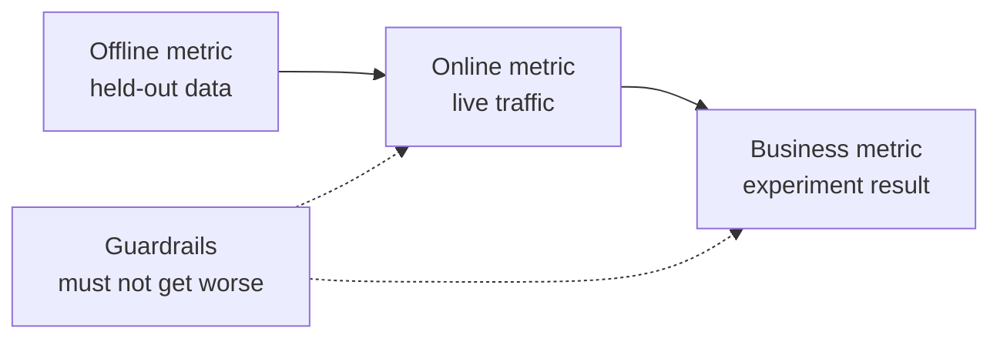

# طراحی سیستم ML  از مشکل تا مدل استفاده شده

> یک مدل بخشی از یک سیستم است. طراحی تصمیم می گیرد که مدل چه چیزی را پیش بینی می کند، چه کسی بر روی آن عمل می کند، هزینه اش چه خواهد بود و وقتی شکست می خورد چه اتفاقی می افتد.

**Type:** Build
**Languages:** Python
**Prerequisites:** Phase 2, Lessons 09 (Model Evaluation) and 13 (ML Pipelines)
**Time:** ~110 minutes

## اهداف یادگیری

- یک مشکل کسب و کار را به عنوان یک وظیفه ML با پیش بینی، یک تصمیم که از آن استفاده می کند و دلیل اینکه چرا قوانین کافی نیستند، چارچوب بندی کنید
- متریک های آفلاین، آنلاین، کسب و کار و guardrail را جدا کنید و هر مدل را با خط های پایه معمولی و هوریستی مقایسه کنید
- تخمین هزینه روزانه، تاخیر و تاخیر دسته بندی و نتیجه گیری آنلاین از اعداد ترافیک
- یک الگوی راه اندازی (ظل، کاناری، آزمایش A/B) و یک حالت پیش فرض امن برای هر حالت شکست را انتخاب کنید
- حلقه های بازخورد را شناسایی کنید که در آن مدل داده های آموزش نسخه بعدی را تغییر می دهد
- یک سند طراحی ML بنویسید و آن را با یک لیست چک ثابت ارزیابی کنید

## مشکل

یک شرکت اشتراک برای "نمونه Churn" می خواهد. یک دانشمند داده یک طبقه بندی گرادیوتی را آموزش می دهد و گزارش می دهد که AUC 0.91 است. سه ماه بعد، هیچ کس از آن استفاده نمی کند.

دلایل مربوط به الگوریتم نیست. هیچ کس تصمیم نمی گیرد که کدام اقدام یک امتیاز شروع می شود. امتیاز ها هفته ای یک بار می آیند، اما تیم حفظ مشتریان هر روز تماس می گیرند. برچسب از یک جدول لغو شده که دلیل لغو نیز ذخیره شده است، بنابراین یک ویژگی شامل پاسخ است. هیچ کس مدل را با قاعده ای که تیم پشتیبانی قبلاً استفاده می کرد مقایسه نمی کند: هر کسی را برای دو هفته بیکار بخوانید.

هر یک از این شکست ها قبل از شروع آموزش رخ داده است. این شکست های طراحی هستند و یک سند طراحی یک صفحه از هر یک از آنها سوال می کند. این درس تصمیمات در آن سند را یاد می دهد. شما یک ابزارک ایجاد می کنید که قیمت دسته بندی و ارائه آنلاین را مقایسه می کند، یک مدل را با خطوط پایه آن مقایسه می کند و یک سند طراحی را با یک لیست چک می کند.

## مفهوم

### از یک هدف تجاری به یک وظیفه ML

هدف کسب و کار یک کار ML نیست. شما آن را به یک با چهار سوال تبدیل:

1. دقیقا مدل چه چیزی را پیش بینی می کند و برای کدام واحد (کاربری، پرداخت، فروشگاه، عنصر) ؟
2. چه تصمیمی از پیش بینی استفاده می کند و چه کسی یا چه چیزی این تصمیمی را می گیرد؟
3. چه زمانی پیش بینی مورد نیاز است و چه داده هایی در آن لحظه وجود دارد؟
4. از کجا ميدوني که تصميم بهتر شده؟

| Business goal | Prediction | Decision that uses it | ML task |
|---|---|---|---|
| Reduce churn | Probability that a user cancels in the next 30 days | Send a save offer to the top 5 percent each night | Binary classification |
| Cut fraud losses | Probability that a payment is fraud | Approve, review, or block within 100 ms | Binary classification |
| Keep shelves stocked | Units sold per store per day next week | Order quantity for each store | Forecasting |
| Show relevant items | Relevance score for a (user, item) pair | Order of items in the feed | Ranking |

ستون دوم به دقت بیشتری نیاز دارد. "پیش بینی" افق، موجودیت و عمل را باز می کند. "پیش بینی کنید که آیا این کاربر در ۳۰ روز آینده لغو می کند، تا کار امشب بتواند انتخاب کند که چه کسی پیشنهاد می کند" سه را حل می کند.

### چه زمانی نباید از ML استفاده کرد

قانون شماره یک در قوانین یادگیری ماشین گوگل می گوید که نباید از راه اندازی محصول بدون یادگیری ماشین بترسید. یادگیری ماشین به داده ها نیاز دارد و یک هوریستی ساده اغلب شما را به بخشی از راه می رساند. در این موارد از ML استفاده نکنید:

- یک قانون کوتاه به هدف می رسد و درست باقی می ماند. یک قانون ارزان تر است که اجرا شود، آزمایش شود و توضیح داده شود.
- شما هیچ برچسب و هیچ راه عملی برای جمع آوری آنها ندارید.
- هيچکس بر اساس پيش بيني عمل نميکنه، پس پيش بيني بهتر هيچ چيزي رو عوض نميکنه.
- داده هایی که در زمان پیش بینی وجود دارند، سیگنال را در خود ندارند.
- یک خطا قابل قبول نیست و هیچ کس نمی تواند محصول را بررسی کند.
- ساخت و اجرا این سیستم هزینه بیشتری دارد تا ارزش تصمیمات بهتر است.

هنگامی که یک قانون طولانی و شکننده می شود، ML شروع به پرداخت هزینه می کند. قانون شماره 3 همان راهنما ML را بر روی یک هوریستیک پیچیده ترجیح می دهد، زیرا یک مدل آموخته را به روز و نگهداری آسان تر است.

### سه لایه از متریک

شما یک سیستم ML را در سه لایه و مجموعه ای از محدودیت ها اندازه گیری می کنید:

| Layer | When you can measure it | Churn example |
|---|---|---|
| Offline metric | Before launch, on held-out past data | F1 at the offer threshold, precision in the top 5 percent |
| Online metric | During launch, on live traffic | Offer acceptance rate, share of users scored, score distribution |
| Business metric | Weeks after launch, with an experiment | 30-day churn rate in the treated group versus a holdout group |
| Guardrail metric | All the time | Offer cost per saved user, unsubscribe rate, p99 latency |



یک متریک آفلاین داده های گذشته را نشان می دهد و گذشته شامل مدل شما نبود. یک متریک آنلاین بستگی به واکنش مردم به تصمیم دارد. یک متریک تجاری به آرامی حرکت می کند و از همه چیز دیگر در شرکت سر و صدا را حمل می کند.

اگر کار با ۵ درصد از کاربران برتر تماس بگیرد، دقت را در ۵ درصد برتر اندازه گیری کنید. AUC میانگین بیش از هر حد، از جمله حد هایی است که هرگز استفاده نمی کنید. قانون شماره ۲ همان راهنما می گوید که قبل از تصمیم گیری درباره کاری که سیستم ML انجام می دهد، باید اولین بار معیارهای را طراحی و پیاده سازی کنید.

### خط پایه

یک مقدار متریکی به تنهایی هیچ معنی ندارد. F1 از 0.56 خوب است اگر بهترین جایگزین به 0.30 برسد و ضعیف است اگر یک قانون به 0.60 برسد. هر مدل را با سه نوع خط پایه مقایسه کنید:

- **Trivial baseline.**همیشه کلاس اکثریت را پیش بینی کنید یا همیشه متوسط آموزش را پیش بینی کنید. ما از این چک در درس ارزیابی مدل استفاده کردیم.
- **Heuristic baseline.**یک قانون از دانش حوزه، یا یک حد یک ویژگی که شما متناسب با داده های آموزش.
- **Current system.**هرکدوم که امروز تصمیم می گیرد، حتی وقتی که کسی با یک جداول حساب باشد.

بالا بردن نماد است که نماد بالا بردن است. حداقل بالا بردن را قبل از اینکه به نتایج نگاه کنید تنظیم کنید و آن را به اندازه کافی بزرگ کنید تا هزینه سیستم اضافی را پرداخت کنید. پایه معمولی معمولا ضعیف است. پایه های هوریستیک سخت ترین آن است که شکست داده شود.

### داده ها و الزامات برچسب

قبل از آموزش به این سوال ها پاسخ بده:

- **Label source.**چه ميز و رویداد اي برچسب را مشخص ميکنه و صاحبش کيه؟
- **Label delay.**چه مدت پس از پیش بینی نتیجه واقعی می رسد؟ بارگیری های کلاهبرداری ممکن است هفته ها پس از پرداخت برسد. برچسب های کلر در پایان افق ۳۰ روز می رسند.
- **Label quality.**چه کسی برچسب را تعیین می کند و چقدر اشتباه می کند؟
- **Availability at prediction time.**آیا هر ویژگی در لحظه پیش بینی وجود دارد؟ یک ویژگی که سیستم پس از نتیجه نوشته است لیبل را به آموزش.
- **Volume per class.**چند نمونه مثبت وجود داره؟ 200 نمونه مثبت شما رو به مدل های ساده محدود می کنه.
- **Time split.**آخرین دوره را نگه دارید. ما داده ها را به زمان در درس سری زمان به همین دلیل تقسیم می کنیم.

### تاخیر، تولید و بودجه هزینه

سه عدد در هر طرح خدمت بسته شده:

- **Latency budget.**تاخیر p99 زمان است که 99 از 100 درخواست زیر است. یک چک پرداخت ممکن است 50 ms نیاز داشته باشد. یک گزارش شبانه ممکن است ساعت ها طول بکشد.
- **Peak throughput.**اندازه گیری سیستم برای پرش ترین دقیقه، نه برای متوسط روزانه.
- **Cost budget.**آن را به صورت دلار در روز یا دلار در 1000 پیش بینی بیان کنید، تا بتوانید طرح ها را مقایسه کنید.

قانون لیتل دو مورد اول را به هم متصل می کند. تعداد درخواست های در حال انجام برابر زمان خستگی است. در 400 درخواست در ثانیه و 50 ms هر یک، 20 درخواست در هر لحظه در حال انجام است.

### نتیجه گیری دسته بندی در مقابل نتیجه گیری آنلاین

دو راه اساسی برای پیش بینی وجود دارد:

- **Batch inference.**یک شغل برنامه ریزی شده هر واحد را نمره می دهد و نمره ها را به یک جدول یا یک فروشگاه ارزش کلیدی می نویسد. برنامه در زمان درخواست نمره ذخیره شده را می خواند.
- **Online inference.**این برنامه ویژگی ها را در زمان درخواست به یک سرویس مدل ارسال می کند و منتظر نمره است.

| Property | Batch | Online |
|---|---|---|
| Freshness | As old as the last run, plus the run time | Uses the data of the request |
| Request latency | One key-value read, a few ms | Feature fetch plus model time |
| Cost driver | Number of entities times runs per day | Replicas sized for peak QPS |
| New entities | No score until the next run | Scored on the first request |
| When it breaks | Old scores stay readable | Requests fail or time out |

در این درس، قیمت هر دو ابزار وجود دارد. هزینه دسته با تعداد شرکت ها و تعداد اجرا در روز افزایش می یابد. محدودیت توقف کوتاهتر به معنای اجرا بیشتر است. هزینه آنلاین با ترافیک بالا افزایش می یابد، زیرا شما برای نسخه های بیکار بین قله ها پرداخت می کنید. یک کار دسته ای که یک ساعت طول می کشد نمی تواند با هر قیمت، محدودیت توقف کمتر از یک ساعت را برآورده کند.

یک طراحی ترکیبی رایج است. یک کار دسته ای شبانه کاربران شناخته شده را نمره می دهد و یک مسیر آنلاین کاربران جدید و درخواست هایی را که به داده های تازه نیاز دارند نمره می دهد.

### الگوهای استفاده

یک مدل جدید به کاربران در مراحل می رسد:

1. **Shadow.**مدل جدید یک کپی از ترافیک زنده دریافت می کند. سیستم پیش بینی های خود را ثبت می کند و هرگز از آنها استفاده نمی کند. شما تاخیر، نرخ خطا و توزیع پیش بینی را با مدل فعلی مقایسه می کنید.
2. **Canary.**مدل جدید تصمیمات واقعی را برای بخش کوچکی از ترافیک می گیرد، اغلب 1 تا 5 درصد. شما سهم را در مراحل گسترش می دهید و وقتی یک رایل محافظت شکسته می شود، عقب می روید.
3. **A/B test.**یک دسته تصادفی از کاربران هر مدل را می بینند. شما متریک کسب و کار را با یک آزمون آماری اندازه گیری می کنید، و شما نیاز به ترافیک کافی و زمان کافی برای دیدن تفاوت دارید.

هر مرحله نیاز به یک رول بیک دارد که به چند دقیقه طول می کشد. نسخه مدل قدیمی را در دسترس نگه دارید و ترافیک را با پیکربندی تغییر دهید. مرحله خدمت LLM شامل همان سه الگوی برای مدل های زبان در [shadow and canary lesson](../../../17-infrastructure-and-production/20-shadow-canary-progressive/docs/en.md)و[A/B testing lesson](../../../17-infrastructure-and-production/21-ab-testing-llm-features/docs/en.md). .

### حلقه های بازخورد

یک حلقه بازخورد وجود دارد زمانی که تصمیمات مدل تغییر داده هایی را که نسخه بعدی آن را آموزش می دهد. Sculley و همکاران، حلقه های بازخورد مستقیم و پنهان را در میان منابع اصلی بدهی فنی در سیستم های ML فهرست می کنند. سه مورد رایج:

- **Interventions hide the label.**یک مدل churn پیشنهادات را ارسال می کند و پیشنهادات برخی از کاربران را حفظ می کند. ماه آینده، کاربران با ریسک بالا وفادار به نظر می رسند و مدل آموزش دیده می آموزد که ویژگی های آنها پیش بینی نمی کنند churn.
- **Blocked actions have no outcome.**یک مدل کلاهبرداری یک پرداخت را مسدود می کند، بنابراین پرداخت هرگز برچسب بازگشت هزینه را دریافت نمی کند. مدل های آموزش دیده نمونه های کلاهبرداری کمتری از منطقه مسدود را مشاهده می کنند.
- **Exposure limits feedback.**یک مدل رتبه بندی عناصر اصلی خود را نشان می دهد، بنابراین فقط این عناصر کلیک ها را جمع آوری می کنند.

اصلاحات یک ایده را به اشتراک می گذارند: برخی از داده هایی را که مدل تحت تأثیر قرار نداده است نگه دارید. یک گروه تصادفی کوچک را نگه دارید که هرگز مداخله نمی کند. به بخش کوچکی از ترافیک یک تصمیم تصادفی بدهید. امتیاز و تصمیم را با هر مثال ثبت کنید، تا آموزش بعدی بتواند داده های تحت تاثیر را از داده های تمیز تشخیص دهد.

### حالت شکست و معیارهای ایمن

هر قسمت از سیستم دیر یا زود شکست می خورد. تصمیم گیری در مورد عمل پیش فرض برای هر شکست در طراحی، نه در طول حادثه:

| Failure | Result without a plan | Safe default |
|---|---|---|
| Model service times out | The request fails | Use the heuristic baseline |
| Nightly batch job fails | Scores go missing or get old | Serve the last good scores for a fixed time, then the rule |
| Feature is missing or out of range | The model scores bad input | Use the documented default value and log the event |
| New entity with no history | No score exists | Use the rule or the population average |
| Score distribution moves suddenly | Wrong decisions at scale | Pause automatic actions and alert a person |

خط پایه هوریستی از بخش متریک شما نیز پیش فرض برای اکثر شکست ها است، بنابراین ابتدا آن را بسازید.

### سند طراحی

سند طراحی هر تصمیم فوق را قبل از شروع آموزش در یک مکان ثبت می کند. چکگر در این درس یک نسخه JSON از آن را نمره می دهد. شش عنصر یک بررسی را مسدود می کنند، زیرا هر یک از آنها سیستم را غیر امن یا بی فایده می کند:

| Section | Question it answers | Blocking |
|---|---|---|
| Problem | What is predicted, which decision uses it, and why rules are not enough? | The decision |
| Metrics | Which offline, online, business, and guardrail metrics apply? | The business metric |
| Baselines | Which trivial, heuristic, and current-system baselines apply? | A heuristic or current baseline |
| Data | Where do labels come from, how late, and does each feature exist at prediction time? | No leakage |
| Budgets and serving | Which latency, peak QPS, cost, and staleness limits apply, and which serving mode fits them? | No |
| Rollout | Which shadow, canary, and A/B stages apply, and how do you roll back? | Shadow or canary, plus rollback |
| Feedback loops | How can the model change its own future data, and what keeps clean data? | No |
| Failure modes | What is the default action for each failure? | A default for every failure |
| Monitoring | What do you watch after launch? | No |

```figure
mlprod-serving-cost
```

## آن را بسازید

کد در`code/main.py`این برنامه سه ابزار دارد: مدل هزینه خدمت، مقایسه خط پایه و چکگر اسناد طراحی.

### مرحله ی اول: بار کاری و قیمت ها را شرح دهید

یک بار کاری تعداد ترافیک و بودجه را نگه می دارد. یک مدل هزینه قیمت را نگه می دارد. قیمت ها اعداد گرد برای تمرین هستند، نه پیشنهادات فروشنده.

```python
@dataclass(frozen=True)
class Workload:
    name: str
    entities: int
    requests_per_day: int
    peak_qps: float
    max_staleness_hours: float
    latency_budget_ms: float


@dataclass(frozen=True)
class CostModel:
    batch_dollars_per_million: float = 0.40
    batch_job_hours: float = 1.0
    lookup_dollars_per_million: float = 0.25
    lookup_latency_ms: float = 4.0
    replica_dollars_per_hour: float = 0.50
    replica_qps: float = 200.0
    min_replicas: int = 2
    online_latency_ms: float = 35.0
```

### مرحله دوم: قیمت دسته بندی و ارائه آنلاین

یک کار دسته باید در داخل محدوده تاخیر تمام شود. زمان بین اجراها محدوده کمتر از زمان کار است. هر اجرا هر موجود را نمره می دهد، چه کسی از آن نمره بخواهد یا نه.

```python
def batch_plan(workload: Workload, costs: CostModel) -> ServingPlan:
    refresh_hours = workload.max_staleness_hours - costs.batch_job_hours
    if refresh_hours <= 0:
        return ServingPlan(
            "batch", False, math.inf, costs.lookup_latency_ms, math.inf, 0.0,
            "staleness limit is shorter than one batch job",
        )
    runs_per_day = 24.0 / refresh_hours
    predictions = workload.entities * runs_per_day
    dollars = (
        predictions / 1e6 * costs.batch_dollars_per_million
        + workload.requests_per_day / 1e6 * costs.lookup_dollars_per_million
    )
    ...
```

سرویس آنلاین برای نسخه های کافی برای رسیدگی به اوج، با حداقل دو برای دسترسی پرداخت می شود:

```python
def online_plan(workload: Workload, costs: CostModel) -> ServingPlan:
    replicas = max(costs.min_replicas, math.ceil(workload.peak_qps / costs.replica_qps))
    dollars = replicas * costs.replica_dollars_per_hour * 24.0
    feasible = costs.online_latency_ms <= workload.latency_budget_ms
    ...
```

`choose_serving`برنامه هایی که محدودیت تاخیر و تاخیر را برآورده می کند را حفظ می کند و ارزان ترین را باز می گرداند.`None`وقتی هیچ برنامه ای مناسب نیست، که به شما میگه بودجه رو تغییر دهید.

### مرحله 3: مقایسه یک مدل با خط پایه آن

مقارن کننده مدل و هر خط پایه را با همان متریک ارزیابی می کند. این افزایش را با قوی ترین خط پایه اندازه می گیرد، نه ضعیف ترین.

```python
def compare_to_baselines(
    y_true: list,
    model_pred: list,
    baselines: dict[str, list],
    metric,
    metric_name: str,
    higher_is_better: bool = True,
    min_lift: float = 0.02,
) -> BaselineReport:
    if not baselines:
        raise ValueError("a model needs at least one baseline")
    scores = {name: metric(y_true, pred) for name, pred in baselines.items()}
    pick = max if higher_is_better else min
    best_name = pick(scores, key=scores.get)
    model_score = metric(y_true, model_pred)
    lift = model_score - scores[best_name] if higher_is_better else scores[best_name] - model_score
    return BaselineReport(metric_name, {"model": model_score, **scores}, best_name, lift, min_lift)
```

خط پایه هوریستی یک قانون یک ویژگی است.`fit_rule`هر مقدار از ویژگی را به عنوان یک حد در داده های آموزش آزمایش می کند و با بهترین F1، حد را حفظ می کند.

### مرحله 4: نمره یک سند طراحی

هر کليد از فهرست چک، وزن، پرچم مسدود کننده، پيام و تابع چک دارد.

```python
CheckItem("decision", 2, True, "name the action that uses each prediction", lambda d: _text(d, "problem.decision")),
CheckItem("baselines", 2, True, "add a heuristic or current-system baseline", check_baselines),
CheckItem("no_leakage", 2, True, "confirm every feature exists at prediction time",
          lambda d: get_path(d, "data.features_available_at_prediction_time") is True),
CheckItem("serving_fit", 1, False, "pick a serving mode that meets the staleness, latency, and cost budgets",
          check_serving_fit),
```

`check_serving_fit`مدل هزینه را دوباره استفاده می کند. تعداد بار کاری را از سند می خواند و قیمت را برای حالت انتخاب شده می دهد. وقتی این حالت از حد توقف، بودجه تاخیر یا بودجه هزینه روزانه خارج می شود، چک شکست می خورد. سندي که ميگه "بچ" با 3 دقيقه اي که محدود به توقف باشه اين چک رو شکست ميده مدل هزینه هیچ طرح ترکیبی ندارد، بنابراین یک سند که می گوید "هائبرید" این چک را شکست می دهد تا زمانی که شما این طرح را در تمرین 1 اضافه کنید.

`review_design_doc`در این صورت، در این مورد، در نظر گرفته می شود که در مورد این موضوع، در نظر گرفته شده است که آیا این موضوع در نظر گرفته شده است.

### مرحله پنجم: اجرا کن

```bash
python3 code/main.py
```

```console
nightly churn scores
  ok batch        $0.91/day      4 ms  1.0 runs per day over 2,000,000 entities
  ok online      $24.00/day     35 ms  2 replicas sized for 40 peak QPS
  choose: batch

feed ranking, 2-hour freshness
  ok batch       $48.50/day      4 ms  24.0 runs per day over 5,000,000 entities
  ok online      $24.00/day     35 ms  2 replicas sized for 120 peak QPS
  choose: online

=== Model versus baselines (churn, metric F1) ===
  model                    0.564
  days_idle > 12.8688      0.500
  random at base rate      0.232
  majority class           0.000
  model beats the strongest baseline (days_idle > 12.8688) by +0.064
```

در F1، اکثر نقاط پایه 0 هستند زیرا هیچ وقت پیش بینی نمی کند. قانون مناسب رقبای واقعی است. مدل 0.064 را شکست می دهد، بنابراین مدل جایگاه خود را به دست می آورد. با ویژگی های ضعیف تر، قانون می تواند برنده شود و پس از آن قانون سیستم مناسب برای استفاده است.

بررسی سند طراحی، سند ضعیف را با شش عنصر مسدود کننده و سند کامل را با نمره 1.00 چاپ می کند. مسیر را برای بررسی سند خود عبور کنید:

```bash
python3 code/main.py my_design_doc.json
```

## ازش استفاده کن

هر بخش از ابزارک نقشه هایی از ابزارها را که تیم ها در تولید استفاده می کنند می کند.

**Baselines.**scikit-learn خط های پایه معمولی را به عنوان تخمین دهندگان ارائه می دهد، بنابراین آنها در همان خط لوله با مدل قرار می گیرند:

```python
from sklearn.dummy import DummyClassifier, DummyRegressor
from sklearn.metrics import f1_score

majority = DummyClassifier(strategy="most_frequent").fit(X_train, y_train)
base_rate = DummyClassifier(strategy="stratified", random_state=0).fit(X_train, y_train)
mean_value = DummyRegressor(strategy="mean").fit(X_train, y_reg_train)

print(f1_score(y_test, majority.predict(X_test)))
```

`most_frequent`دوچاپ`majority_baseline`و`stratified`دوچاپ`base_rate_baseline`. سکیت-لرن هیچ پایه ای هوریستیک ندارد، چون هوریستیک از حوزه شما می آید.

**Batch serving.**برنامه نویس جریان کار مانند Apache Airflow یا Dagster کار امتیاز را اجرا می کند. این کار امتیاز را به یک جدول ذخیره سازی یا به یک فروشگاه ارزش کلیدی مانند Redis یا DynamoDB می نویسد.

**Online serving.**سرورهای مدل مانند KServe، BentoML، NVIDIA Triton و TorchServe یک مدل را پشت یک نقطه پایان HTTP یا gRPC بسته بندی می کنند. یک سرویس وب ساده با یک مدل بارگذاری نیز برای مدل های کوچک کار می کند.

**Rollouts.**ابزار Kubernetes مانند Argo Rollouts ترافیک را برای انتشارات کاناری تقسیم می کند. پلتفرم های آزمایش مانند GrowthBook و Statsig کاربران را به گروه های A / B اختصاص می دهند و آمار را محاسبه می کنند.

**Design review.**برک و همکارانش نمره آزمون ML را منتشر کردند که شامل 28 آزمون و نظارت بر نیازهای سیستم های تولید ML است. چکگر ما کوچکتر است. این پرسش های طراحی را که قبل از این آزمایش ها مطرح می شود، می پرسد.

## -باده

این درس به ما کمک می کند`outputs/skill-ml-design-review.md`مهارت بررسی یک بخش از سند طراحی ML را به ترتیب بخش و نام شکاف های مسدود کننده را در ابتدا بررسی می کند. همچنین انتخاب وعده را با دسته و حساب هزینه آنلاین از این درس بررسی می کند.

## تمرینات

1. به برنامه های ترکیبی اضافه کنید`choose_serving`.کاربری های شناخته شده را در دسته و کاربری های جدید آنلاین ارزیابی کنید. هزینه روزانه آن را مقایسه کنید.
2. اطلاعات چرخش را تا زمانی که مدل دیگر قاعده را نبرد. کوچکترین تغییر ضریب را گزارش کنید که آسانسور را حذف می کند.
3. اضافه کنید`budgets.max_dollars_per_1k_predictions`يه آزمون بنويس که بدونش شکست خورده باشه
4. یک سند طراحی JSON برای چک تقلب پرداخت بنویسید. چکگر را اجرا کنید و هر عنصر مسدود کننده را اصلاح کنید.
5. چکش بازخوردي را شبیه سازيد، برچسب هاي کاربراني را که پیشنهادي به دست آوردند حذف كنيد، آموزش مجدد كنيد و تغییر را در F1 اندازه بگيريد.

## اصطلاحات کلیدی

| Term | What people say | What it means |
|------|----------------|----------------------|
| ML task | "Build a churn model" | A prediction target, an entity, a horizon, and the decision that uses the prediction |
| Offline metric | "The model score" | A metric computed on held-out past data before launch |
| Online metric | "Live numbers" | A metric measured on real traffic while the model runs |
| Business metric | "The goal" | The company outcome that the decision must change, measured with an experiment |
| Guardrail metric | "Do no harm" | A metric that must not get worse when the new model launches |
| Baseline | "The dumb model" | A trivial, heuristic, or current-system predictor that the model must beat by a set margin |
| Batch inference | "Precomputed scores" | A scheduled job scores every entity and stores the results for lookup |
| Online inference | "Real-time model" | The model scores each request when it arrives |
| Shadow deployment | "Dark launch" | The new model scores live traffic, and nobody uses its output |
| Canary release | "Slow rollout" | The new model decides for a small, growing share of traffic, with a rollback ready |
| Feedback loop | "The model trains itself" | The model's decisions change the data that trains its next version |

## خواندن بیشتر

- [Sculley et al., Hidden Technical Debt in Machine Learning Systems (NeurIPS 2015)](https://papers.nips.cc/paper/2015/hash/86df7dcfd896fcaf2674f757a2463eba-Abstract.html): حلقه های بازخورد، پیچیدگی و هزینه های سیستم در اطراف یک مدل
- [Google, Rules of Machine Learning](https://developers.google.com/machine-learning/guides/rules-of-ml): قوانین عملی برای اولین مدل، متریک ها و پیوستگی در خدمات آموزش
- [Breck et al., The ML Test Score (IEEE Big Data 2017)](https://research.google/pubs/the-ml-test-score-a-rubric-for-ml-production-readiness-and-technical-debt-reduction/): 28 آزمایش که آماده سازی تولید را اندازه گیری می کنند
- [Kohavi, Tang, and Xu, Trustworthy Online Controlled Experiments (Cambridge University Press, 2020)](https://experimentguide.com/): چگونه تست های A/B را اجرا کنیم که پاسخ های درست را ارائه دهند
- [Sato, Wider, and Windheuser, Continuous Delivery for Machine Learning (2019)](https://martinfowler.com/articles/cd4ml.html): داده های نسخه ای، مدل ها و خط های پیاده سازی
- [Google Cloud, MLOps: Continuous delivery and automation pipelines in machine learning](https://cloud.google.com/architecture/mlops-continuous-delivery-and-automation-pipelines-in-machine-learning): سه سطح بلوغ برای آموزش و خدمات خودکار
