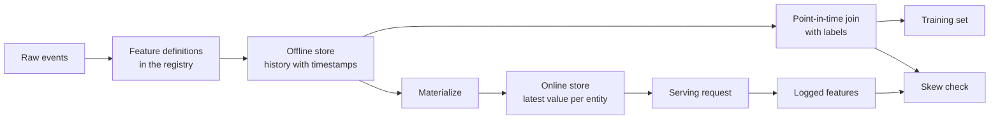

# فروشگاه های ویژه و اسکوی خدمات آموزشی

> یک ویژگی دارای یک تعریف و دو خواننده است. آموزش تاریخچه خود را از هر زمان برچسب می خواند و خدمت آخرین ارزش آن را می خواند. هنگامی که دو خواننده با یکدیگر مخالفند، مدل ورودی هایی را می بیند که هرگز آموزش داده نشده است.

**Type:** Build
**Languages:** Python
**Prerequisites:** Phase 2, Lessons 08 (Feature Engineering), 13 (ML Pipelines), 15 (Time Series), and 19 (ML System Design)
**Time:** ~100 minutes

## اهداف یادگیری

- فروشگاه آفلاین، فروشگاه آنلاین، اشخاص، زمان نامه های رویداد و TTL ها و کار هر یک را توصیف کنید
- پیاده سازی یک پیوستن صحیح در نقطه در زمان و نشان دادن اینکه چگونه یک پیوستن ساده نسخه های آینده به داده های آموزش
- چهار علت انحراف در آموزش را ذکر کنید: دو مسیر کد، ویژگی های قدیمی، اشکال مختلف و سفر در زمان
- ایجاد یک فهرست ویژگی هایی که در آن یک تعریف هم مسیر آموزش و هم مسیر خدمت را تغذیه می کند
- یک ویژگی جدید را از تاریخ های گذشته بدون خواندن داده های پس از هر تاریخ تکمیل کنید
- تشخیص انحراف با مقایسه ویژگی های سرویس ثبت شده با مسیر آموزش برای همان واحد و زمان

## مشکل

یک تیم یک مدل churn ایجاد می کند. هر برچسب می گوید آیا یک کاربر در 30 روز پس از یک روز برچسب خرید نکرده است. تیم برچسب ها را به جدول ویژگی های کاربر در `user_id`و آموزش قاعده ای در مورد`days_since_last_purchase`دقت غیر فعال 0.948

در ترافیک زنده، مدل بدتر از نسخه قدیمی تر و ساده تر است. جدول ویژگی ها آخرین مقدار را برای هر کاربر در هفته های بعد از روز های برچسب قرار داده است. یک کاربر که آخرین خریدش در روز 115 بود، 60 روز بیکار را در روز 175 نشان داد، بنابراین ویژگی پاسخ را در خود داشت. در همین حال، تیم دیگری دوباره ویژگی های خدمت را در یک سرویس متفاوت نوشت. پنجره ۳۰ روزه آنها شامل یک روز اضافی بود و پیش فرض برای کاربر جدید به جای ۳۶۵، ۱ بود.

هر دو نقص علت مشابهی دارند. آموزش و خدمت به دو روش مختلف "یک ویژگی" را محاسبه می کند. این درس قطعات یک فروشگاه ویژگی را از ابتدا می سازد. شما یک ثبت نام، یک پر کردن پس از کار، یک پیوستن نقطه ای در زمان، یک فروشگاه آنلاین با TTL و یک چک انحراف را می نویسید. دمو هر دو نقص را با اعداد تولید می کند.

## مفهوم

### دو خواننده از یک ویژگی

آموزش و خدمت به ویژگی های مختلف نیاز دارد:

| Property | Training (offline) | Serving (online) |
|---|---|---|
| Question | "What was the value for each of 10 million (entity, time) pairs?" | "What is the value for this one entity now?" |
| Time | Many points in the past | The present |
| Volume | Millions of rows per job | One row per request |
| Latency | Minutes are fine | A few milliseconds |
| Storage | Offline store: full history with timestamps, in columnar files or a warehouse | Online store: the latest value per entity, in a key-value database |

یک فروشگاه ویژگی هر دو فروشگاه را از یک مجموعه تعریف ویژگی پر می کند. مواد سازی کاری است که آخرین ارزش ها را از فروشگاه آفلاین به فروشگاه آنلاین کپی می کند.



### موسسات، زمان نامه ها و TTL

چهار اصطلاح هر ردیف ویژگی را توصیف می کند:

- **Entity.**کلیدی که یک ویژگی توصیف می کند، مانند `user_id`یا`card_id`. .
- **Event timestamp.**زمان زمانی که ارزش واقعی شد. یک شمارش خرید "از روز 14" نشان می دهد که زمان رویداد روز 14 است.
- **Created timestamp.**زماني که سیستم خط رو نوشت. يک پشت سرپوشي که امروز اجرا ميشه خط ها رو با زماني که قبلاً در مورد اتفاقات اتفاق افتاده و زماني که دوباره در مورد اتفاقات افتاده نوشته شده
- **TTL (time to live).**حداکثر سن یک ارزش. یک مقدار قدیمی تر از TTL به عنوان از دست رفته حساب می شود، بنابراین خواننده از پیش فرض استفاده می کند.

یک گروه از ویژگی هایی که دارای یک نهاد، منبع و TTL هستند اغلب به عنوان یک نمای ویژگی نامیده می شوند.

### ترکیب های صحیح نقطه در زمان

یک ردیف آموزش یک برچسب را با ارزش های ویژگی هایی که در زمان برچسب وجود داشتند، جفت می کند. پیوستن نقطه در زمان برای هر برچسب این کار را می کند:

1. ردیف ویژگی های همان موجود را پیدا کنید.
2. ردیف هایی که زمان رویداد آن در یا قبل از زمان برچسب قرار دارد را نگه دارید.
3. آخرین خط رو بردار
4. اگر زمان بندی برچسب به غیر از زمان بندی رویداد بیشتر از TTL باشد، آن را رها کنید.

در اینجا یک کاربر، یک برچسب در روز 16 و صف های ویژگی های هفتگی:

| Feature row day | `purchases_30d` | Point-in-time join | Naive join on `user_id` |
|---|---|---|---|
| 7 | 4 | | |
| 14 | 3 | Selected | |
| 21 | 1 | Future | |
| 28 | 0 | Future | Selected |

برچسب می پرسد آیا کاربر در روزهای 17 تا 46 چیزی خریداری می کند. صف 28 روز در حال حاضر روزهای آرام پس از روز برچسب را شمارش می کند. 0 خرید را نشان می دهد زیرا کاربر خرید را متوقف کرد، که این رویداد است که برچسب اندازه گیری می کند. یک عضو ساده پاسخ را به ورودی کپی می کند.

ما داده ها را به زمان در درس سری زمان به همین دلیل تقسیم می کنیم. یک پیوستن نقطه در زمان این قاعده را به هر ردیف به جای یک نقطه تقسیم اعمال می کند.

### علل انحراف در آموزش

قوانین یادگیری ماشین گوگل، انحراف در خدمت آموزش را به عنوان تفاوت بین عملکرد در طول آموزش و عملکرد در طول خدمت تعریف می کند. آنها سه دلیل را نام می دهند: رفتار مختلف داده ها در دو خط لوله، تغییر داده ها بین آموزش و خدمت و حلقه بازخورد. در خط لوله ویژگی، چهار دلیل مشخص بارها و بارها ظاهر می شود:

| Cause | What happens | Example from the demo |
|---|---|---|
| Two code paths | Training and serving compute the feature with different code | The serving window includes day `now - 30`, and the training window does not |
| Stale features | The value that serving reads has a different age from the value that training used | Training reads weekly snapshots, and a new service computes fresh values |
| Different defaults | The two paths fill a missing value differently | Training uses 365 for "no purchase yet", and serving uses -1 |
| Time travel | Training reads a value from after the label time | The naive join reads the newest snapshot for every label |

قانون شماره 32 از همان راهنما می گوید که هر زمان ممکن است کد بین خط لوله آموزش و خط لوله خدمت را دوباره استفاده کنید. یک فروشگاه ویژگی با یک تعریف که هر دو مسیر به آن می گویند، به این قانون عمل می کند.

### یک فهرست ویژگی ها

این فهرست فهرست تعریف ویژگی ها است. هر ورودی دارای نام، یک نهاد، منبع، یک تحول، پنجره، یک مقدار پیش فرض، TTL، مالک، یک نسخه و یک توصیف است.

دو قانون براي حفظ اين موضوع وجود داره:

- هر دو راه تعريف را از سجل می خوانند. هیچ سرویس کپي خصوصی از تحول را نگه نمی دارد.
- تغییر در تعریف یک نسخه جدید ایجاد می کند. نسخه قدیمی باقی می ماند، بنابراین مدل های قدیمی ویژگی هایی را که روی آن آموزش داده اند حفظ می کنند.

### پودر های پشتی

یک ویژگی جدید هیچ سابقه ای ندارد، اما آموزش به ارزش خود در هر زمان برچسب قدیمی نیاز دارد. یک backfill تعریف را در هر تاریخ گذشته اجرا می کند و یک ردیف را در هر واحد و تاریخ می نویسد. هر اجرا فقط رویدادها را با مهر زمان در تاریخ یا قبل از تاریخ خود می خواند.

هزینه های پسپوش محاسبه می شود که با افزایش تعداد ارگان ها برابر تعداد تاریخ ها افزایش می یابد. آنها همچنین یک خروجی ظریف را به همراه می آورند. یک پسپوش که امروز اجرا می شود، خطوط را با تایم استیمپ های رویداد قدیمی می نویسد، اما می تواند داده هایی را که دیر به دست آمده یا بعداً اصلاح شده است، بخواند. یک پیوستن دقیق نقطه در زمان همچنین بررسی می کند که تایم استیمپ ایجاد شده در یا قبل از زمان برچسب است.

### تشخیص انحراف

قانون شماره 29 از همان راهنما می گوید که ویژگی ها را در زمان خدمت ثبت کنید و از آنها در آموزش استفاده کنید. حتی یک نمونه ثبت شده کوچک به شما اجازه می دهد تا ثبات را بررسی کنید. هر مقدار ثبت شده را با ارزش تولید شده در مسیر آموزش برای همان واحد و زمان مقایسه کنید. برای هر ویژگی، سهم عدم مطابقت و متوسط تفاوت مطلق را گزارش کنید.

برای پیدا کردن علت، سه جفت را مقایسه کنید:

1. اين همه چيز رو آزمايش ميکنه و بايد صفر انحراف نشان بده
2. حساب و حساب جدید مقابل آموزش همگام میشن
3. راه کد دوم در مقابل محاسبات تازه. این تفاوت های کد مانند پنجره ها و پیش فرض را جدا می کند.

```figure
mlprod-pit-join
```

## آن را بسازید

کد در`code/main.py`یک کار هفته ای به صورت دسته بندی، عکس های ویژگی را در روزها ۷، ۱۴ و غیره می نویسد تا ۱۷۵

### مرحله ی ۱: تعریف ویژگی ها و ثبت

A`FeatureDefinition`این تغییر را به عنوان داده ها نگه می دارد: یک مجموعه، یک پنجره و یک پیش فرض.`compute`روش هيچ وقت اتفاقات بعد از آن را نميخواد`as_of`. .

```python
@dataclass(frozen=True)
class FeatureDefinition:
    name: str
    entity: str
    aggregate: str
    window_days: int | None
    default: float
    version: int = 1
    owner: str = "growth-team"
    description: str = ""

    def compute(self, events: list[Event], as_of: int) -> float:
        visible = [e for e in events if e.day <= as_of]
        if self.window_days is not None:
            visible = [e for e in visible if e.day > as_of - self.window_days]
        if self.aggregate == "count":
            return float(len(visible))
        if self.aggregate == "sum":
            return round(sum(e.amount for e in visible), 2)
        if self.aggregate == "days_since_last":
            return float(as_of - max(e.day for e in visible)) if visible else self.default
        raise ValueError(f"unknown aggregate {self.aggregate!r}")
```

`FeatureRegistry.register`این سازمان دو بار تعریف مشابه را قبول می کند، اما تعریف متفاوتی با همان نام و نسخه را رد می کند. `fill_defaults`به هر دو مسیر یک مقدار گمشده را به طور پیش فرض می دهد.

یک مدل یک تعریف را با یک مرجع مانند `spend_30d@1`.`compute`و`fill_defaults`به عنوان یک نام بدون`@`آخرین نسخه را میخواد.`@`و هيچ شماره نسخه اي بالا نمي رود`ValueError`، بنابراین یک خطا تایپ نمی تواند آخرین نسخه را بدون هشدار بخواند. مرجع همچنین کلید در هر ردیف ذخیره شده است، بنابراین پشت سرپوش، فروشگاه آنلاین و خواندن خدمت همه از تعریف پینی استفاده می کنند.

### مرحله دوم: بازپوشن فروشگاه غیر فعال

```python
def backfill(registry: FeatureRegistry, names: list[str], events: list[Event], days: list[int]) -> list[FeatureRow]:
    rows = []
    for entity, entity_events in sorted(group_events(events).items()):
        for day in days:
            rows.append(FeatureRow(entity, day, registry.compute(names, entity_events, day)))
    return rows
```

این نمایشگر سه ویژگی را برای 299 کاربر در 25 روز عکس عکس می دهد که 7475 ردیف را می دهد.

### مرحله سوم: پیوستن نقطه در زمان

هر سطر رو در روز يک بار مرتب کن`bisect_right`در روز برچسب آخرین ردیف را پیدا می کند. چک TTL یک ردیف قدیمی را می گذارد.

```python
def point_in_time_join(labels: list[LabelRow], rows: list[FeatureRow], ttl_days: int | None = None) -> list[JoinedRow]:
    by_entity: dict[str, list[FeatureRow]] = defaultdict(list)
    for row in rows:
        by_entity[row.entity].append(row)
    days_index = {}
    for entity, entity_rows in by_entity.items():
        entity_rows.sort(key=lambda r: r.day)
        days_index[entity] = [r.day for r in entity_rows]
    joined = []
    for label in labels:
        days = days_index.get(label.entity, [])
        pos = bisect.bisect_right(days, label.day) - 1
        match = by_entity[label.entity][pos] if pos >= 0 else None
        if match is not None and ttl_days is not None and label.day - match.day > ttl_days:
            match = None
        joined.append(JoinedRow(
            label.entity, label.day, label.label,
            match.day if match else None, match.values if match else None,
        ))
    return joined
```

### مرحله چهارم: تخلیه از یک ترکیب ساده را اندازه گیری کنید

`naive_latest_join`در حال حاضر، این برنامه در حال حاضر در حال انجام است تا به عنوان یک برنامه آموزشی برای هر یک از این برنامه ها، به عنوان یک برنامه آموزشی برای هر یک از این برنامه ها، به عنوان یک برنامه آموزشی برای هر یک از این برنامه ها، به عنوان یک برنامه آموزشی برای هر یک از این برنامه ها، به عنوان یک برنامه آموزشی برای هر یک از این برنامه ها، به عنوان یک برنامه آموزشی برای هر یک از این برنامه ها، به عنوان یک برنامه آموزشی برای هر یک از این برنامه ها، به عنوان یک برنامه آموزشی برای هر یک از این برنامه ها، به عنوان یک برنامه آموزشی برای هر یک از این برنامه ها، به عنوان یک برنامه آموزشی برای هر یک از این برنامه ها، به عنوان یک برنامه آموزشی برای هر یک از این برنامه ها، به عنوان یک برنامه آموزشی برای هر یک از این برنامه ها، به عنوان یک برنامه آموزشی برای هر یک از این برنامه ها، به عنوان یک برنامه آموزشی برای هر یک از این برنامه ها، به عنوان یک برنامه آموزشی برای هر یک از این برنامه ها، به عنوان یک برنامه آموزشی برای هر یک از این برنامه ها، به عنوان یک برنامه های آموزشی، به عنوان یک برنامه آموزشی، به عنوان یک برنامه آموزشی، به عنوان یک برنامه های آموزشی، به طور کامل، به طور کامل، به طور کامل، به طور کامل، به طور کامل، به طور کامل، به طور کامل، به طور کامل، به طور کامل، به طور قابل اعتماد و به طور قابل اعتماد و به طور قابل اعتماد و قابل اعتماد و قابل اعتماد و قابل اعتماد است.

```console
  naive join used a snapshot from after the label day for 100% of rows
  offline accuracy, naive join: 0.948 (rule: idle > 53 days)
  offline accuracy, PIT join:   0.893 (rule: idle > 19 days)
  accuracy on day 145, trained with naive join: 0.763
  accuracy on day 145, trained with PIT join:   0.876
```

ترکیب ساده به نظر می رسد بهتر از آف لائن، 0.948 در برابر 0.893 در داده های جدید بدتر است، 0.763 در برابر 0.876 ویژگی دزدیده شده، حد نصب را از 19 به 53 روز بیکار منتقل کرد.

### مرحله 5: فروشگاه آنلاین و تجسم

فروشگاه آنلاین یک ردیف را در هر واحد نگه می دارد و ردیف های قدیمی تر از TTL را رد می کند. `materialize`فقط صف هایی را می نویسد که روزشان در یا قبل از زمان کار است.

```python
class OnlineStore:
    def __init__(self, ttl_days: int):
        self.ttl_days = ttl_days
        self._latest: dict[str, FeatureRow] = {}

    def write(self, row: FeatureRow) -> None:
        current = self._latest.get(row.entity)
        if current is None or row.day >= current.day:
            self._latest[row.entity] = row

    def read(self, entity: str, now: int) -> dict[str, float] | None:
        row = self._latest.get(entity)
        if row is None or row.day > now or now - row.day > self.ttl_days:
            return None
        return dict(row.values)
```

با TTL 10 روز، خواندن در روز 145 به روز 140 ردیف باز می گردد. خواندن در روز 160, بدون هیچ گونه تجسم جدید، به حالت پیش فرض باز می گردد، زیرا ردیف 20 روز است.

### مرحله 6: چک انحراف

`detect_skew`مقایسه دو دیدگاه کلیدی توسط `(entity, day)`. این گزارش نرخ عدم مطابقت و متوسط تفاوت مطلق هر ویژگی را گزارش می کند و زمانی که بیش از 1 درصد از ارزش ها متفاوت باشد، یک ویژگی را نشان می دهد.`ValueError`وقتی دو دیدگاه کلید های متفاوتی دارند یا کلید های مختلف ندارند. یک درخواست گمشده می تواند منحرفی را پنهان کند، و چک بدون درخواست هیچ چیزی را نشان نمی دهد.

```python
def detect_skew(
    training: dict[tuple[str, int], dict[str, float]],
    serving: dict[tuple[str, int], dict[str, float]],
    features: list[str],
    tolerance: float = 1e-6,
    max_mismatch_rate: float = 0.01,
) -> list[SkewReport]:
    if set(training) != set(serving):
        raise ValueError(f"{len(set(training) ^ set(serving))} keys are in only one view: log and compare the same requests")
    if not training:
        raise ValueError("no requests to compare")
    keys = sorted(training)
    reports = []
    for feature in features:
        diffs = [abs(training[k][feature] - serving[k][feature]) for k in keys]
        mismatches = sum(1 for d in diffs if d > tolerance)
        rate = mismatches / len(keys)
        mean_diff = sum(diffs) / len(keys)
        reports.append(SkewReport(feature, len(keys), rate, mean_diff, rate > max_mismatch_rate))
    return reports
```

در این برنامه، درخواست ها در روزهای 141 تا 150 ثبت می شود و سه مقایسه از بخش مفهوم را اجرا می کند. مجموعه درخواست شامل 20 کاربر جدید بدون سابقه است.

```bash
python3 code/main.py
```

```console
=== Skew checks on 383 logged requests, days 141 to 150 ===
  online store read  vs  training join (one definition, same snapshots)
    ok   days_since_last_purchase   mismatch   0.0%  mean |diff|    0.00
    ok   purchases_30d              mismatch   0.0%  mean |diff|    0.00
    ok   spend_30d                  mismatch   0.0%  mean |diff|    0.00
  fresh compute      vs  training join (staleness only)
    SKEW days_since_last_purchase   mismatch  83.0%  mean |diff|    2.77
    SKEW purchases_30d              mismatch  30.5%  mean |diff|    0.38
    SKEW spend_30d                  mismatch  37.1%  mean |diff|   16.77
  second code path   vs  fresh compute (code differences only)
    SKEW days_since_last_purchase   mismatch   5.5%  mean |diff|   20.07
    SKEW purchases_30d              mismatch  12.5%  mean |diff|    0.13
    SKEW spend_30d                  mismatch  12.5%  mean |diff|    5.09
```

سه بلوک رو به ترتیب بخونيد:

- **One definition, same snapshots.**فروشگاه اينترنتي و آموزش همگي هم همان سطر هاي مادي شده رو مي خوانند، پس انحراف صفر است.
- **Staleness.**یک ارزش تازه از عکس های هفته ای در اکثر درخواست ها متفاوت است. داده های تازه به طور خودکار در اینجا بهتر نیست، زیرا مدل از ارزش های تا شش روز قدیمی آموخته شده است.
- **Code differences.**مسیر کد دوم در 12.5 درصد شمارش پنجره متفاوت است، زیرا پنجره آن شامل یک روز اضافی است.`days_since_last_purchase`فقط برای کاربران جدید، اما به مقدار زیادی: -1 در مقابل 365.

## ازش استفاده کن

Feast یک فروشگاه ویژگی های منبع باز است. هر قطعه از کد از ابتدا دارای یک همتای Feast است:

| From scratch | Feast |
|---|---|
| `FeatureDefinition`, `FeatureRegistry` | `Entity`, `FeatureView`, and `Field` in a feature repository, registered with `feast apply` |
| `FeatureRow` history | An offline store, for example a `FileSource` over Parquet files or a warehouse table |
| `point_in_time_join` with a TTL | `store.get_historical_features(entity_df=..., features=[...])` |
| `materialize` | `feast materialize-incremental <end time>` |
| `OnlineStore.read` | `store.get_online_features(features=[...], entity_rows=[...])` |
| Created timestamp check | `created_timestamp_column` on the source and `filter_by_created_timestamp=True` |

تعريف ها به اين شکل هستن، کد دنبال شروع سریع جشن مياد و براي اجرا اين درس لازم نيست

```python
from datetime import timedelta

from feast import Entity, FeatureView, Field, FileSource
from feast.types import Float32, Int64

user = Entity(name="user", join_keys=["user_id"])

user_activity_source = FileSource(
    name="user_activity_source",
    path="data/user_activity.parquet",
    timestamp_field="event_timestamp",
    created_timestamp_column="created",
)

user_activity = FeatureView(
    name="user_activity",
    entities=[user],
    ttl=timedelta(days=10),
    schema=[
        Field(name="purchases_30d", dtype=Int64),
        Field(name="spend_30d", dtype=Float32),
        Field(name="days_since_last_purchase", dtype=Int64),
    ],
    source=user_activity_source,
)
```

آموزش و خدمت بعد هم همین ویژگی را ببینید:

```python
from feast import FeatureStore

store = FeatureStore(repo_path=".")

training_df = store.get_historical_features(
    entity_df=labels_df,
    features=["user_activity:purchases_30d", "user_activity:days_since_last_purchase"],
    filter_by_created_timestamp=True,
).to_df()

online = store.get_online_features(
    features=["user_activity:purchases_30d", "user_activity:days_since_last_purchase"],
    entity_rows=[{"user_id": 42}],
).to_dict()
```

`labels_df`در هر برچسب یک ردیف با `user_id`،`event_timestamp`در اسناد جشن آمده است که TTL نسبت به هر زمان در چارچوب داده های واحد است، نه به زمان سوال. این با چک TTL مطابقت دارد `point_in_time_join`. همان صفحه شرح می دهد`filter_by_created_timestamp=True`در این حالت، یک فروشگاه بدون پشتیبانی، به جای نادیده گرفتن گزینه، یک خطا را ایجاد می کند.

تکتون، هپس ورکس و فروشگاه های ویژگی در سیستم عامل های بزرگ ML ابر از همان تقسیم بین فروشگاه های آفلاین و آنلاین استفاده می کنند. برای بررسی انحراف، TensorFlow Data Validation می تواند داده های آموزشی را با داده های ارائه شده برای تشخیص انحراف مقایسه کند. Breck و همکاران سیستم تأیید داده را در TFX، سیستم عامل ML انتهای گوگل، از جمله انحراف خدمات آموزشی توصیف می کنند.

## -باده

این درس به ما کمک می کند`outputs/skill-feature-skew-audit.md`. مهارت بررسی یک خط خط ویژگی برای سفر در زمان و آموزش خدمت می کند. آن را از طریق پیوستن، تعریف ها، معیارهای، تازه بودن هر مسیر و ثبت که یک چک انحراف نیاز دارد.

## تمرینات

1. فاصله عکس را از 7 روز به 1 روز تغییر دهید. مقایسه توقف را تکرار کنید و نتیجه را توضیح دهید.
2. TTL رو به 3 روز تنظیم کن، صف هاي آموزش رو بشمار که از دست دادن ویژگی ها و افتضاحاتشون رو بدست ميارن
3. یک روز ایجاد شده را به  اضافه کنید`FeatureRow`.برگرفتن خط هاي نوشته شده بعد از روز برچسب
4. ثبتش کن`spend_7d`به عنوان نسخه 2 از `spend_30d`. دوباره پرش کن و هر دو نسخه رو از دفتر ثبت چاپ کن
5. درست کن`legacy_serving_features`تا سومين چک تحسيني عبور کنه.

## اصطلاحات کلیدی

| Term | What people say | What it means |
|------|----------------|----------------------|
| Feature store | "A database for features" | A system that computes features from one set of definitions and serves them to training and to serving |
| Offline store | "The training data" | Full feature history with event timestamps, read by training jobs and backfills |
| Online store | "The feature cache" | The latest value per entity, read by the serving path in milliseconds |
| Entity | "The ID" | The key that a feature describes, such as a user or a card |
| Event timestamp | "When it happened" | The time at which a feature value became true |
| Point-in-time join | "An as-of join" | A join that pairs each label with the latest feature row at or before the label time |
| TTL | "Expiry" | The maximum age of a feature value before a reader treats it as missing |
| Materialization | "Syncing to online" | The job that copies the latest feature values from the offline store to the online store |
| Backfill | "Computing history" | Running a feature definition at past dates to create its history |
| Training-serving skew | "It worked offline" | A difference between the features or behavior in training and in serving |

## خواندن بیشتر

- [Feast, Point-in-time joins](https://docs.feast.dev/getting-started/concepts/point-in-time-joins): سیمانیک TTL و فیلتر تایم استیمپ ایجاد شده
- [Feast documentation](https://docs.feast.dev/): نمایش ویژگی ها، فروشگاه های آفلاین، فروشگاه های آنلاین و تجسم
- [Google, Rules of Machine Learning](https://developers.google.com/machine-learning/guides/rules-of-ml): قوانین منحرفی در مورد آموزش، از ماده 29 تا ماده 37
- [Breck et al., Data Validation for Machine Learning (SysML 2019)](https://research.google/pubs/data-validation-for-machine-learning/): اعتبار داده ها در گوگل، از جمله تعصب آموزش
- [TensorFlow Data Validation guide](https://www.tensorflow.org/tfx/guide/tfdv): بررسی طرح، تشخیص انحراف و تشخیص حرکت
- [Sculley et al., Hidden Technical Debt in Machine Learning Systems (NeurIPS 2015)](https://papers.nips.cc/paper/2015/hash/86df7dcfd896fcaf2674f757a2463eba-Abstract.html): وابستگی به داده ها و بدهی خط لوله در اطراف یک مدل
