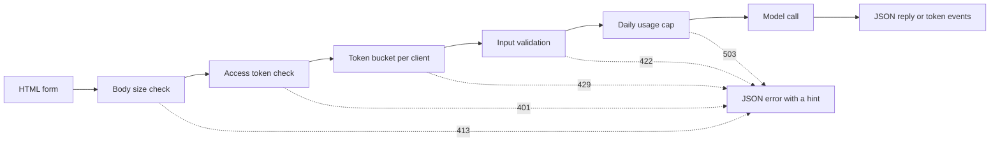

# مدل رابط های نمایش  از یک تابع به یک برنامه قابل اشتراک گذاری

> یک مدل دمو یک قرارداد دارد: یک ورودی، یک تماس مدل و یک ورودی. قبل از اینکه لینک را به اشتراک بگذارید، یک حد برای هر بخش قرار دهید.

**Type:** Build
**Languages:** Python
**Prerequisites:** Phase 11 · 13 (Building a Production LLM Application), Phase 17 · 08 (Inference Metrics), Phase 17 · 19 (AI Gateways)
**Time:** ~90 minutes

## اهداف یادگیری

- قرارداد ورودی، تماس مدل و قرارداد خروجی یک نمایش را با محدودیت در هر بخش بنویسید.
- یک برنامه HTTP کتابخانه استاندارد با یک صفحه HTML، یک نقطه پایان JSON و یک نقطه پایان رویداد های ارسال شده توسط سرور ایجاد کنید.
- ورودی را به ترتیب هزینه تأیید کنید و خطاهای JSON را که به کاربر اقدام بعدی را می گویند، بازگردانید.
- از یک نمایش عمومی با یک سطل توکن در هر مشتری، یک محدودیت استفاده روزانه و یک توکن دسترسی اختیاری محافظت کنید.
- ثبت پرونده های درخواست که هیچ متن ورودی و آدرس مشتری را نگه نمی دارند.
- نمایشگاه استاندارد کتابخانه را با دو نسخه چارچوب مقایسه کنید و سیگنال هایی را نام دهید که نشان دهنده یک نمایشگاه باید به یک محصول تبدیل شود.

## مشکل

مدل شما در یک دفترچه کار می کند. حالا یک بازرس می خواهد ده ورودی را امتحان کند، و یک مشتری می خواهد یک نتیجه را در یک تلفن ببیند. هیچ کدام از آنها دفترچه شما را باز نمی کنند.

یک سلول نوت بوک هیچ محدودیتی در ورودی ندارد و هیچ نمایش پیشرفت ندارد. خطاهای آن ردیف های دسته ای هستند که فقط شما می توانید آن را بخوانید. همچنین با اعتبارنامه های شما و بودجه شما اجرا می شود. اگر سلول را پشت یک URL عمومی بدون تغییر قرار دهید، می توانید انتظار شکست هایی مانند این را داشته باشید:

- یک کاربر یک سند ۴۰ هزار حرف را پیوند می دهد. یک دقیقه تماس می رود و بعد با ردیابی ستک شکست می خورد.
- يک اسکریپت 500 درخواست در يک دقيقه ارسال ميکنه. هر درخواست يه تماس مدل پرداخت شده است.
- صفحه هشت ثانیه هیچ چیز را نشان نمی دهد، بنابراین کاربر چهار بار دیگر روی دکمه کلیک می کند.
- دفترچه سرور هر ورودی را نگه می دارد، از جمله ورودی با شماره حساب مشتری.

یک رابط نمایش این شکست ها را با مقدار کمی کد جلوگیری می کند. این درس با کتابخانه استاندارد پایتون یک را ایجاد می کند، بنابراین شما می توانید هر بخش را ببینید. سپس یک نمایش نمایش را با دو چارچوب محبوب ایجاد می کند و آنچه هر یک از آنها به طور پیش فرض انجام می دهد را مقایسه می کند.

## مفهوم

### یه دمو یه قرارداده

هر دمو سه قسمت دارد. ورودی چیزی است که کاربر می تواند ارسال کند. تماس مدل ورودی را به یک خروجی تبدیل می کند. خروجی چیزی است که کاربر می بیند و شامل خطا است.

قبل از اينکه صفحه رو بنويسيد قرارداد رو بنويسيد:

| Part | Question to answer | Answer in this lesson |
|------|--------------------|-----------------------|
| Input | What type, what size, which characters? | A string of 1 to 500 characters, with no control characters |
| Model call | How long does one call take, and what does it cost? | A toy keyword model that runs in under a millisecond at no cost |
| Output | What does the user see on success and on failure? | A label, a score, and a reply, or a JSON error with a hint |

یک نوت بوک هیچ محدودیتی برای هر یک از سه بخش ندارد. یک دمو یک محدودیتی برای هر بخش تعیین می کند و سرور محدودیت ها را برای هر مشتری اعمال می کند.



چک ها به ترتیب هزینه اجرا می شوند. یک درخواست بد در اولین چک که شکست می خورد متوقف می شود، بنابراین تقریباً هیچ هزینه ای برای سرور ندارد. تماس مدل آخر می آید، زیرا تنها مرحله ای است که هزینه دارد.

### قبل از اجرا شدن مدل اعتبار

مرورگر قبل از ارسال چيزي ميتونه واردات رو چک کنه`maxlength`و`required`ویژگی های یک منطقه متن بدون تماس شبکه را به کاربر می دهند. این چک ها فقط به کاربران صادق کمک می کنند. هر مشتری می تواند بدون صفحه درخواست ارسال کند، بنابراین سرور هر چک را تکرار می کند.

چک های سرور را به ترتیب هزینه قرار دهید:

1. .`Content-Length`تا قبل از اينکه بخواي يه جسم رو رد کني
2. بدن JSON را تجزیه کنید. بدن دیگری که یک جسم JSON نیست را رد کنید.
3. به قسمت های زیر مراجعه کنید. متن خالی، متن بیش از حد و کنترل کاراکترها را رد کنید.
4. فقط با درخواستي که هر چک رو رد کرد، يه تماس نمونه رو خرج کن

| Failed check | HTTP status | Error code |
|--------------|-------------|------------|
| Body over 4,096 bytes | 413 Content Too Large | `body_too_large` |
| Body stops before `Content-Length` bytes arrive | 408 Request Timeout | `request_timeout` |
| Content type is not JSON | 415 Unsupported Media Type | `unsupported_media_type` |
| Body is not a JSON object | 400 Bad Request | `bad_json` |
| Text is missing, empty, too long, or has control characters | 422 Unprocessable Content | `missing_text`, `empty_text`, `text_too_long`, `control_characters` |

RFC 9110 این کد های وضعیت و نام های آنها را تعریف می کند.

مثال ها بخشی از طراحی ورودی هستند. یک مثال به کاربر نشان می دهد که ورودی خوب چگونه به نظر می رسد. همچنین به یک مرورگر با یک کلیک یک آزمون می دهد. برای هر کلاس خروجی یک مثال انتخاب کنید. این نمایش یک مثال مثبت، منفی و خنثی دارد.

### نشان بده که مدل کار می کنه

یک تماس مدل می تواند چند ثانیه طول بکشد. بدون بازخورد، کاربر نمی تواند یک مدل آهسته را از یک صفحه شکسته تشخیص دهد. کاربر که هیچ تغییری را نمی بیند می تواند دوباره کلیک کند و سپس سرور یک درخواست پرداخت دوم را دریافت می کند.

صفحه در این درس چهار نوع بازخورد را ارائه می دهد:

- دکمه ارسال را در حالی که درخواست اجرا می شود غیرفعال می کند.
- زمان گذشته را نشان می دهد و هر 100 میلی ثانیه آن را به روز می کند.
- زمان اولین علامت را نشان می دهد وقتی اولین علامت می رسد.
- زمان کل زمانی که درخواست به پایان می رسد را نشان می دهد.

وقتی مطالعه میکردی[inference metrics](../../08-inference-metrics-goodput/), زمان به اولین توکن (TTFT) یک متریک سرور بود. صفحه نمایش همان عدد را به کاربر نشان می دهد که در مرورگر اندازه گیری می شود.

### ارسال محصول به عنوان جریان

یک مدل زبان پاسخ خود را یک توکن در یک زمان تولید می کند. اگر سرور منتظر آخرین توکن باشد، کاربر منتظر نسل کامل است. اگر سرور هر توکن را هنگامی که آماده است ارسال کند، کاربر بعد از اولین توکن شروع به خواندن می کند.

رویداد های ارسال شده توسط سرور (SSE) فرمت استاندارد برای این است. پاسخ دارای نوع محتوا است `text/event-stream`هر اتفاقي يه گروه از افراد است`event:`و`data:`یک خط خالی به پایان می رسد. استاندارد HTML WHATWG فرمت را تعریف می کند.

```text
event: token
data: {"index":0,"text":"Label:"}

event: token
data: {"index":1,"text":" positive."}

event: done
data: {"label":"positive","score":1.0,"tokens":11}
```

مرورگر يه `EventSource`این نمایشگر یک درخواست POST با یک جسم JSON را به جای آن ارسال می کند. صفحه پاسخ را با `fetch()`و`response.body.getReader()`، و خود فرمت رویداد را تجزیه می کند.

یک جریان یک مشکل دارد که یک پاسخ JSON ندارد. سرور وضعیت 200 را قبل از اولین توکن ارسال می کند. اگر مدل پس از آن شکست خورده باشد، سرور نمی تواند وضعیت را تغییر دهد. بنابراین سرور یک `error`در جریان اتفاق افتاده و صفحه آن اتفاق را به عنوان یک خطا نشان می دهد.

وقتی ساختی[production LLM application](../../../11-llm-engineering/13-production-app/)این درس همان پروتکل را به دست می نویسد، بنابراین شما می توانید هر خطی که سرور ارسال می کند را ببینید.

### خطاها را بنویسید که کاربر می تواند بر روی آن عمل کند

یک پیام خطا دو کار دارد. به کاربر می گوید چه اتفاقی افتاده و به کاربر می گوید چه کاری باید انجام دهد. یک ردیابی ستک هیچ یک از کارها را برای یک غریبه انجام نمی دهد.

هر خطا در این نمایش، شکل JSON را دارد:

```json
{
  "error": {
    "code": "text_too_long",
    "message": "The text has 812 characters. The limit is 500.",
    "hint": "Shorten the text to 500 characters or fewer.",
    "request_id": "a8f3c2b435e3"
  }
}
```

- `code`کد مشتری و تست ها با آن مقایسه می شوند.
- `message`این موضوع را با شماره هایی که کاربر نیاز دارد بیان می کند.
- `hint`به کاربر یک عمل می دهد.
- `request_id`یک گزارش کاربر را به یک رکورد ثبت می کند.

RFC 9457 یک فرمت خطای استاندارد برای API های HTTP را تعریف می کند که به عنوان جزئیات مشکل نامیده می شود. این نمایش از یک شکل کوچکتر برای همان هدف استفاده می کند. هنگام تماس با API های دیگر از RFC 9457 استفاده کنید.

### به اشتراک گذاری یک نمایش عمومی به طور ایمن

یک لینک عمومی تغییر می کند که چه کسی می تواند درخواست ها را ارسال کند. برای هر خطر یک کنترل برنامه ریزی کنید:

| Risk | Control in this demo | Control for a larger audience |
|------|----------------------|-------------------------------|
| One client sends too many requests | A token bucket per client, with 429 and `Retry-After` | Per-user limits after sign-in |
| Strangers find the link | An optional access token in the `Authorization` header | Single sign-on with an identity provider |
| Total cost grows with no limit | A daily usage cap, with 503 and `Retry-After` | Spend limits and alerts at the model provider |
| Very large or unusual input | Body size limit, text length limit, control character check | Content moderation on input and output |
| Logs keep private input | Records with the input length and a keyed hash of the client | A retention period and access control on the logs |

یک سطل توکن دو عدد را استفاده می کند. ظرفیت بزرگترین انفجار است که یک مشتری می تواند ارسال کند. نرخ پر کردن مجدد نرخ درخواست طولانی مدت است. هر درخواست یک توکن را می گیرد و سطل به طور مداوم تا ظرفیت خود را پر می کند:

```text
tokens = min(capacity, tokens + refill_rate * seconds_since_last_request)
accept the request if tokens >= 1, then subtract 1
```

وقتي سطل خالي باشه، سرور جواب ميده`429 Too Many Requests`. آر ايف سي 6585 وضعیت 429 را تعریف می کند و اجازه می دهد سرور یک `Retry-After`این نمایش همیشه سر را اضافه می کند، با تعداد ثانیه تا علامت بعدی. صفحه سر را می خواند و دکمه را برای آن زمان غیرفعال می کند.

در این حالت، آدرس مشتری را از یک عنوان که توسط یک پروکسی تنظیم شده است بخوانید. به آن عنوان از هیچ منبع دیگری اعتماد نکنید، زیرا یک مشتری می تواند هر مقدار را در آن قرار دهد.

وقتی مطالعه میکردی[AI gateways](../../19-ai-gateways/)یک دمو به کنترل مشابه در مقیاس کوچکتر نیاز دارد. یک حد نرخ کنترل هر مشتری را کنترل می کند، اما کل را کنترل نمی کند. یک صد مشتری که هر یک از آنها تحت محدودیت می ماند هنوز هم می توانند از بودجه کامل استفاده کنند. یک حد استفاده تمام تماس های مدل را در یک روز شمارش می کند و تماس ها را پس از یک شماره ثابت رد می کند.

.ژغرها به اندازه ورودی ها به همان اندازه مراقبت می کنند`http.server`در این حالت، هر درخواست یک رکورد با مسیر، وضعیت، کد خطا، تاخیر و طول ورودی می نویسد. آدرس مشتری به یک هش کلید تبدیل می شود، بنابراین شما می توانید بدون ذخیره کردن آدرس، درخواست ها را بشمارید.

به کاربران بگو چه چیزی را نگه دارید. صفحه نمایش می گوید که سرور طول متن را نگه می دارد و هرگز خود متن را نگه نمی دارد.

### وقتی یک نمایشگاه به یک محصول تبدیل می شود

یک نمایشگاه به افراد شناخته شده در جلسات کوتاه از یک فرآیند خدمت می کند. این سیگنال ها به شما می گویند که نمایشگاه اکنون یک محصول است:

- افراد خارج از تیم شما هر هفته ازش استفاده می کنند.
- کسي از يه هدف زمان فعاليت ميخواد يا گزارش ميده که قطع برق هست
- کاربران از آنها می خواهند وارد شوند، نتایج را ذخیره کنند یا تاریخچه خود را ببینند.
- هزینه های هفتگی مدل یک خط در بودجه است.
- ورودی شامل داده هایی است که یک قرارداد یا قانون پوشش می دهد.

| Property | Demo | Product |
|----------|------|---------|
| Users | Known people, short sessions | Unknown people, daily use |
| State | None | Accounts, history, saved results |
| Availability | Best effort, one process | A written target, replicas, an on-call owner |
| Cost control | One daily usage cap | Per-user quotas and billing |
| Observability | One log record per request | Traces, metrics, and alerts |

وقتی این سیگنال ها را می بینید، نمایش را از درس برنامه LLM تولید به استیک تولید منتقل کنید. این استیک تأیید واقعی، مدل های عقب نشینی، ردیابی و ردیابی هزینه ها را برای هر کاربر اضافه می کند.

```figure
demo-token-bucket
```

## آن را بسازید

کد يک پرونده است`code/main.py`، بدون وابستگی های خارج از کتابخانه استاندارد.

```bash
python3 code/main.py
```

خود تست تایید کننده، سطل توکن، فرمت جریان و یک سفر برگشت HTTP واقعی را بررسی می کند. سرور را در یک پورت رایگان شروع می کند، سه درخواست ارسال می کند، سرور را متوقف می کند و خارج می شود. سرور را فقط در زمانی که به آن نیاز دارید، شروع می کند:

```bash
python3 code/main.py --serve
```

باز شد`http://127.0.0.1:8000`در مرورگر فشار كترل + سي كنيد تا سرور را متوقف كنيد

### مرحله ی اول: تماس مدل

این مدل یک شمارش کلید واژه اسباب بازی است. این متن را به عنوان مثبت، منفی یا خنثی برچسب می زند. همچنین یک پاسخ کوتاه، یک نشانه در یک زمان تولید می کند.

```python
def classify(text):
    words = WORD_RE.findall(text.lower())
    positive = sum(1 for word in words if word in POSITIVE)
    negative = sum(1 for word in words if word in NEGATIVE)
    score = (positive - negative) / max(1, positive + negative)
    if score > 0:
        label = "positive"
    elif score < 0:
        label = "negative"
    else:
        label = "neutral"
    return {"label": label, "score": round(score, 3), "positive_cues": positive,
            "negative_cues": negative, "words": len(words)}


def generate(text):
    result = classify(text)
    reply = (
        f"Label: {result['label']}. Positive cues: {result['positive_cues']}. "
        f"Negative cues: {result['negative_cues']}. Words read: {result['words']}."
    )
    parts = reply.split(" ")
    yield parts[0]
    for part in parts[1:]:
        yield " " + part
```

مدل واقعی جایگزینش می کنه`generate`و هیچ چیز دیگری. یک تماس API یا یک مدل محلی را در داخل آن قرار دهید. امضا را نگه دارید: یک رشته وارد می شود و توکن ها خارج می شوند. اعتبار دهنده، محدودیت ها و صفحه یکسان باقی می مانند.

### مرحله 2: تایید و پاسخ های خطا

یک کلاس استثناء هر خطا را حمل می کند. این دارای وضعیت HTTP، یک کد پایدار، یک پیام، یک اشاره و سرنخ پاسخ اختیاری است.

```python
class DemoError(Exception):
    def __init__(self, status, code, message, hint, headers=None):
        super().__init__(message)
        self.status = status
        self.code = code
        self.message = message
        self.hint = hint
        self.headers = dict(headers or {})


def validate_text(payload, max_chars=MAX_CHARS):
    if "text" not in payload:
        raise DemoError(422, "missing_text", 'The field "text" is missing.', 'Add a "text" field with your input.')
    text = payload["text"]
    if not isinstance(text, str):
        raise DemoError(422, "text_not_string", 'The field "text" is not a string.', "Send the input as a string.")
    text = text.strip()
    if not text:
        raise DemoError(422, "empty_text", "The text is empty.", "Type a sentence or pick an example.")
    if len(text) > max_chars:
        raise DemoError(422, "text_too_long", f"The text has {len(text)} characters. The limit is {max_chars}.",
                        f"Shorten the text to {max_chars} characters or fewer.")
    if CONTROL_RE.search(text):
        raise DemoError(422, "control_characters", "The text contains control characters.",
                        "Remove the hidden characters, then send the text again.")
    return text
```

اعتبار دهنده ابتدا فضای سفید پیش و عقب را حذف می کند. یک متن تنها با فضاهای خالی پس از آن به عنوان خالی حذف می شود و اشاره به کاربر می گوید چه چیزی را تایپ کند. `check_body_size`و`parse_json_body`برای موارد 411, 413, 415 و 400 از همان الگوی استفاده کنید. `error_body`هرکدوم رو میگردونه`DemoError`به شکل JSON از بخش مفهوم

### مرحله سوم: سطل رمز

```python
class TokenBucket:
    def __init__(self, capacity, refill_per_second, now):
        if capacity < 1:
            raise ValueError("capacity must be at least 1")
        if refill_per_second <= 0:
            raise ValueError("refill_per_second must be positive")
        self.capacity = float(capacity)
        self.refill_per_second = float(refill_per_second)
        self.tokens = float(capacity)
        self.updated = now

    def take(self, now, cost=1.0):
        elapsed = max(0.0, now - self.updated)
        self.tokens = min(self.capacity, self.tokens + elapsed * self.refill_per_second)
        self.updated = now
        if self.tokens >= cost:
            self.tokens -= cost
            return 0.0
        return (cost - self.tokens) / self.refill_per_second
```

`take`0.0 را در زمان قبول درخواست بازمی گرداند. در غیر این صورت ثانیه ها را بازمی گرداند تا سطل به اندازه کافی توکن داشته باشد. سرور آن را بالا می برد و آن را ارسال می کند `Retry-After`. .

`RateLimiter`يه سطل براي هر مشتري در يه`OrderedDict`قفل از فرهنگ لغت محافظت ميکنه چون`ThreadingHTTPServer`هر درخواست را در رشته خودش اداره می کند.`max_clients`در این حالت، محدود کننده کلائی را با قدیمی ترین درخواست حذف می کند. یک مشتری حذف شده با درخواست بعدی خود یک سطل کامل دریافت می کند. تنظیم `max_clients`از تعداد مشتريان فعالي که انتظارش رو داري بالاتر

محدودی یک`clock`بحث. تست ها از يک`FakeClock`، تا یک تست بدون صبر 10 ثانیه زمان را پیش ببرد.`UsageCap`با استفاده از همان الگوی ساعت برای کل روزانه، تماس ها را در پنجره های ثابت 86,400 ثانیه محاسبه می کند و ثانیه ها را تا پنجره بعدی، وقتی که شمارش کامل است، باز می گرداند.

### مرحله چهارم: جریان

```python
def sse_event(event, data):
    payload = json.dumps(data, separators=(",", ":"), ensure_ascii=False)
    return f"event: {event}\ndata: {payload}\n\n".encode("utf-8")


def stream_events(text, generate_fn=generate, delay=0.0, sleep=time.sleep):
    count = 0
    try:
        for token in generate_fn(text):
            yield sse_event("token", {"index": count, "text": token})
            count += 1
            if delay:
                sleep(delay)
    except Exception:
        yield sse_event("error", MODEL_ERROR)
        return
    result = classify(text)
    yield sse_event("done", {"label": result["label"], "score": result["score"], "tokens": count})
```

`json.dumps`يه خط جديد داخل يه رشته مي نويسد که دو حرف باشه`\n`بنابراین هر رویداد یک خط داده دارد که هیچ خط جدید خام در آن وجود ندارد. یک خط جدید خام در داده ها، فرمت رویداد را شکسته می کند.

ژنراتور متوجه شکست مدل می شود و یک پیام ارسال می کند`error`. به خاطر اينکه سرور قبلاً خط وضعيت رو فرستاده`delay`و`sleep`استدلال ها جریان برای مرورگر را کند می کنند و آزمایش ها را سریع نگه می دارند.

### مرحله 5: پردازش درخواست

`DemoHandler`طول می کشد`BaseHTTPRequestHandler`. مدیر POST چک ها را به ترتیب از بخش مفهوم انجام می دهد:

```python
def do_POST(self):
    app = self.server.app
    request_id = uuid.uuid4().hex[:12]
    client_id = self.client_address[0]
    started = time.perf_counter()
    route = self.path if self.path in self.routes else "other"
    status, code, chars = 200, None, 0
    try:
        declared = self.headers.get("Content-Length")
        try:
            if route == "other":
                raise DemoError(404, "not_found", "This endpoint does not exist.",
                                "Send requests to /api/predict or /api/stream.")
            size = check_body_size(declared, app.config.max_body_bytes)
        except DemoError:
            self.drain(int(declared) if declared and declared.isdigit() else 0)
            raise
        try:
            body = self.rfile.read(size)
        except TimeoutError:
            self.close_connection = True
            raise DemoError(408, "request_timeout", "The request body did not arrive in time.",
                            "Send the request again with the full body.") from None
        app.admit(client_id, self.headers.get("Authorization"))
        text = app.read_text(self.headers.get("Content-Type"), body)
        chars = len(text)
        app.charge()
        if route == "/api/predict":
            self.send_json(200, predict(text), request_id)
        else:
            code = self.send_stream(text, request_id)
    except DemoError as err:
        status, code = err.status, err.code
        self.send_error_json(err, request_id)
    except TimeoutError:
        status, code = 408, "request_timeout"
        self.close_connection = True
    except Exception:
        status, code = 500, "internal_error"
        self.send_error_json(DemoError(500, "internal_error", "The server failed on this request.",
                                       "Try again. Quote the request id if you report the problem."), request_id)
    finally:
        latency_ms = (time.perf_counter() - started) * 1000
        app.log.record(request_id, route, client_id, status, chars, latency_ms, code)
```

`admit`توکن دسترسی و سطل توکن را چک می کند.`charge`این آخرین درخواست است که در برابر آن محاسبه می شود. هر درخواست یک رکورد ثبت شده در رکورد ثبت شده است.`finally`و اين شامل درخواست هاي رد شده است.`route`، هرگز مسیر خام، چون یک مسیر می تواند یک رشته سوال با متن کاربر را حمل کند.

چهار نکته از شکست ها که به راحتی از دست می روند جلوگیری می کند:

- `timeout = 10`در کلاس دستیار، اتصال را هنگامی که مشتری ارسال را متوقف می کند، بسته می کند. بدون آن، یک مشتری که 100 بایت اعلام کرده و 10 ارسال می کند، یک موضوع سرور را برای همیشه نگه می دارد. دستیار یک خط 408 JSON با نام درخواست ارسال می کند و اتصال را می کند. یک زمان پس از شروع جریان فقط اتصال را می کند، زیرا خط وضعیت قبلا ارسال شده است.
- `log_message`بدون خروجی باز می گردد. این خط ثبت پیش فرض را با آدرس مشتری و خط درخواست حذف می کند.
- `drain`در RFC 1122 گفته می شود که TCP وقتی میزبان یک اتصال با داده های خوانده نشده را تعطیل می کند، تنظیم مجدد را ارسال می کند. پس از آن مشتری می تواند پاسخ 413 را از دست بدهد.
- `send_stream`گرفتن`BrokenPipeError`و ژنراتور را می بندد. وقتی کاربر تب را می بندد، مدل متوقف می شود و درخواست هزینه ای بیشتر ندارد.

`BaseHTTPRequestHandler`استفاده از HTTP/1.0 به طور پیش فرض. پایان یک بدن جریان پس از آن لحظه است که سرور اتصال را می کند. یک سرور که از HTTP/1.1 استفاده می کند، بدن را با کدگذاری انتقال قطعه ای برای همان هدف ارسال می کند.

### مرحله 6: صفحه

`render_page`یک سند HTML با یک سبک خط و یک اسکریپت خط را بازمی گرداند. صفحه هیچ اسکریپت، فونت یا تصویر خارجی را بار نمی کند. اسکریپت جریان را به این شکل می خواند:

```javascript
const reader = response.body.getReader();
const decoder = new TextDecoder();
let buffer = "";
while (true) {
  const chunk = await reader.read();
  if (chunk.done) { break; }
  buffer += decoder.decode(chunk.value, { stream: true });
  let cut = buffer.indexOf("\n\n");
  while (cut >= 0) {
    const frame = parseFrame(buffer.slice(0, cut));
    buffer = buffer.slice(cut + 2);
    cut = buffer.indexOf("\n\n");
    if (frame.event === "token") { output.textContent += frame.data.text; }
  }
}
```

یک بخش شبکه می تواند در وسط یک رویداد پایان یابد. خواننده بخش نامکمل را در`buffer`تا خط خالی برسد.

صفحه محصول مدل را با `textContent`و هرگز با`innerHTML`. نماد تولید متن غیرقابل اعتماد است. فرض کنید صفحه یک پاسخ را به عنوان HTML وارد می کند و پاسخ حاوی یک عنصر با یک `onerror`این ویژگی می تواند کد را در مرورگر کاربر اجرا کند.

سرور هم يه پيغام ارسال مي کنه`Content-Security-Policy`سرنخ با `default-src 'none'`این سیاست اجازه می دهد یک اسکریپت خط و یک سبک خط را، که توسط هشت های SHA-256 آنها شناسایی می شود. مرورگر هر اسکریپت دیگری را از جمله اسکریپت که یک مهاجم به صفحه تزریق می کند، رد می کند.

```python
def csp_hash(source):
    digest = hashlib.sha256(source.encode("utf-8")).digest()
    return "'sha256-" + base64.b64encode(digest).decode("ascii") + "'"
```

### مرحله 7:شویش رو اجرا کن و سعی کن شکسته بشه

سرور رو شروع کن بعد ازش استفاده کن`curl`از یک ترمینال دوم، هفت درخواست متوالی به یک سرور تازه ارسال کنید. سطل پنج توکن را در خود دارد و هر دو ثانیه یک توکن جدید دریافت می کند:

```bash
for i in 1 2 3 4 5 6 7; do
  curl -s -o /dev/null -w '%{http_code} ' -X POST http://127.0.0.1:8000/api/predict \
    -H 'Content-Type: application/json' -d '{"text": "ok"}'
done
```

```text
200 200 200 200 200 429 429
```

ده ثانیه صبر کن بعد یه متن خالی بفرست

```bash
curl -s -X POST http://127.0.0.1:8000/api/predict \
  -H 'Content-Type: application/json' -d '{"text": ""}'
```

```json
{"error": {"code": "empty_text", "message": "The text is empty.", "hint": "Type a sentence or pick an example.", "request_id": "e3e3599feaea"}}
```

به جریان رویداد نگاه کن`curl -N`, که بفر بازدهی را خاموش می کند:

```bash
curl -N -X POST http://127.0.0.1:8000/api/stream \
  -H 'Content-Type: application/json' -d '{"text": "The screen is bright."}'
```

برای نیاز به یک توکن دسترسی، مقرر کنید`DEMO_ACCESS_TOKEN`قبل از شروع سرور، صفحه بعد یک زمینه برای توکن را نشان می دهد.

```bash
export DEMO_ACCESS_TOKEN="$(python3 -c 'import secrets; print(secrets.token_urlsafe(24))')"
echo "$DEMO_ACCESS_TOKEN"
python3 code/main.py --serve
```

تست ها رو انجام بده:

```bash
python3 -m unittest discover -s code/tests -v
```

تست های HTTP سرور را در پورت 0 شروع می کنند، بنابراین سیستم عامل یک پورت رایگان را انتخاب می کند.`tearDown`سرور رو متوقف مي کنه و ميگيره که موضوعش تموم شده

## ازش استفاده کن

دو چارچوب پایتون با کد کمتری از نوع مشابهی نمایش می دهند: Gradio و Streamlit. هر دو مثال زیر قرارداد را از `main.py`، بنابراین اعتبار دهنده و مدل یکسان باقی می مانند. شما به هر دو چارچوب برای اجرا نیاز ندارید`main.py`و يا تست ها

### اجزای اطراف یک تابع

Gradio یک رابط وب را در اطراف یک تابع پایتون قرار می دهد. اجزای ورودی و خروجی قرارداد را توصیف می کنند و یک تابع ژنراتور خروجی جزئی را ارسال می کند.

```python
import os

import gradio as gr

from main import EXAMPLES, MAX_CHARS, DemoError, classify, generate, validate_text


def label_text(text):
    try:
        clean = validate_text({"text": text})
    except DemoError as err:
        raise gr.Error(f"{err.message} {err.hint}")
    label = classify(clean)["label"]
    reply = ""
    for token in generate(clean):
        reply += token
        yield reply, label


demo = gr.Interface(
    fn=label_text,
    inputs=gr.Textbox(label="Text to label", lines=5, max_length=MAX_CHARS),
    outputs=[gr.Textbox(label="Reply"), gr.Textbox(label="Label")],
    examples=list(EXAMPLES),
    flagging_mode="never",
)

if __name__ == "__main__":
    demo.queue(max_size=20).launch(auth=("demo", os.environ["DEMO_PASSWORD"]))
```

هرکدوم`yield`این تابع در هر مرحله پاسخ کامل را به دست می آورد.

تنظیم شده`flagging_mode`در حالت پیش فرض دکمه پرچم نشان داده می شود. وقتی کاربر آن را فشار می دهد، Gradio ورودی و خروجی را به یک فایل CSV در سرور می نویسد. ارزش `"never"`دکمه رو حذف ميکنه

`queue(max_size=20)`محدودیت تعداد درخواست های انتظار. محدودیت متزاد پیش فرض یک تماس در هر رویداد است. یک مدل کند سپس به یک کاربر در یک زمان خدمت می کند تا زمانی که محدودیت را افزایش دهید. Gradio همچنین نقاط انتهای API را هنگام راه اندازی برنامه ایجاد می کند، بنابراین اسکریپت ها می توانند بدون صفحه به نمایشگاه تماس بگیرند. محدودیت نرخ شما باید برای این نقاط انتهای نیز اعمال شود.

### یک اسکریپت که در هر ورودی تکرار می شود

Streamlit هر بار که کاربر یک ویجیت را تغییر دهد، کل اسکریپت شما را از بالا تا پایین اجرا می کند. یک فرم ارزش های ویجیت خود را جمع آوری می کند و آنها را در یک دسته ارسال می کند هنگامی که کاربر دکمه ارسال را فشار می دهد.

```python
import streamlit as st

from main import EXAMPLES, MAX_CHARS, DemoError, classify, generate, validate_text

st.title("Toy sentiment demo")
st.caption("Do not paste private data.")

example = st.selectbox("Start from an example", ["", *EXAMPLES])
with st.form("demo"):
    text = st.text_area("Text to label", value=example, max_chars=MAX_CHARS)
    submitted = st.form_submit_button("Run model")

if submitted:
    try:
        clean = validate_text({"text": text})
    except DemoError as err:
        st.error(f"{err.message} {err.hint}")
    else:
        st.write_stream(generate(clean))
        st.write(f"Label: {classify(clean)['label']}")
```

`st.write_stream`به طور مستقیم ژنراتور را می گیرد و هر قطعه را وقتی می رسد می نویسد.`@st.cache_resource`، چون هر بار که ارسال ميکني اسکریپت دوباره اجرا ميشه

### آنچه که هر گزینه به طور پیش فرض انجام می دهد

| Need | Standard library (this lesson) | Gradio | Streamlit |
|------|--------------------------------|--------|-----------|
| Form, examples, result area | You write the HTML | `Interface` builds them from components and `examples` | Widgets such as `st.text_area` and `st.selectbox` |
| Input length limit | `maxlength` on the page and a server check | `max_length` on `Textbox` | `max_chars` on `st.text_area` |
| Partial output | You write SSE and the stream reader | A generator function, where each `yield` replaces the output | `st.write_stream` with a generator of chunks |
| Progress display | You write the timer | A progress display on the output area, set by `show_progress` | `st.write_stream` shows each chunk when it arrives |
| Errors for the user | JSON with `code`, `message`, `hint`, `request_id` | `raise gr.Error(...)` shows the message | `st.error(...)` shows the message |
| Concurrency | One thread per request, no limit | A queue, with one running call per event by default | Each interaction runs the script again for that session |
| Public link | You run the server and the domain | `launch(share=True)` gives a link that expires after one week | You deploy the app to a server |
| Sign-in | A bearer token check | `launch(auth=...)` with user names and passwords | `st.login()` with an OpenID Connect provider |
| Rate limit and cost cap | Token bucket and daily cap | Your code, with the client address from the request | Your code |
| Input that the tool writes to disk | Only the input length, in the log | Flagged samples in a CSV file, unless `flagging_mode="never"` | Your code decides |

این فریم ورک ها بیشترین کار را در صفحه ذخیره می کنند: فرم، نمونه ها، نمایش پیشرفت و محصول جزئی. آنها کار کمتری را در مورد خطرات یک لینک عمومی ذخیره می کنند. در هر سه نسخه، محدودیت نرخ، حد هزینه و حریم خصوصی ثبت نام کار شما است. نسخه استاندارد کتابخانه هر یک از این قسمت ها را نشان می دهد، بنابراین می دانید که در یک فریم ورک چه چیزی را بررسی کنید.

## -باده

این درس به ما کمک می کند`outputs/skill-demo-interface-checklist.md`.صفحه ای از یک مدل دمو یا کد آن را ارائه دهید. آن یک مرور یا شکست از قرارداد، بازخورد، خطا ها و کنترل های یک لینک عمومی را باز می گرداند. هر شکست با یک اصلاح همراه است.

## تمرینات

1. تنظیم شده`BUCKET_CAPACITY`تا 2 و `REFILL_PER_SECOND`به ۱. پیش بینی محصول حلقه هفت درخواست. سپس آن را اجرا کنید و مقایسه کنید.
2. اضافه کنید`language`به سازمان درخواست داده شده است.`"en"`. خطا 422 را با اشاره به هر مقدار دیگری برگردانید و دو آزمایش اضافه کنید.
3. جمله ای را پیدا کنید که مدل اسباب بازی نام اشتباه را نشان دهد، مانند "اسکرین خوب نیست".
4. Demo رو پشت يه پروکسی برگشتي روي دستگاهت قرار بده.`trust_proxy`گزینه ای که می خواد`X-Forwarded-For`فقط از آدرس پروکسی. یک تست بنویس که ثابت کند مشتری نمی تواند کلید بالک خودش را انتخاب کند.
5. جایگزینش کن`generate`با تماس با یک مدل API که توکن ها را به عنوان یک جریان باز می گرداند. اعتبارگر، محدودیت ها و قالب رویداد را نگه دارید. زمان برای اولین توکن در صفحه با تاخیر در دفترچه سرور مقایسه کنید.

## اصطلاحات کلیدی

| Term | What people say | What it actually means |
|------|-----------------|------------------------|
| Demo contract | "The UI" | The input limits, the model call, and the output shape, including errors |
| Token bucket | "A rate limiter" | A per-client counter that refills at a fixed rate up to a capacity. Each request uses one token |
| Retry-After | "Try later" | A response header with the number of seconds, or a date, after which the client can try again |
| Server-Sent Events | "Streaming" | A `text/event-stream` response of `event:` and `data:` lines, with a blank line after each event |
| Time to first token | "Latency" | The time from the request to the first token on the user's screen |
| Usage cap | "The budget" | A limit on the total number of model calls in a time window, for all clients together |
| Keyed hash | "An anonymous ID" | An HMAC of the client address with a secret salt. It is a pseudonym: anyone with the salt can test a known address |
| Content Security Policy | "CSP" | A response header that tells the browser which scripts, styles, and connections the page can use |

## خواندن بیشتر

- [Python `http.server` documentation](https://docs.python.org/3/library/http.server.html): کلاس های سرور، HTTP/1.0 پیش فرض، خط ثبت پیش فرض، و هشدار که ماژول برای تولید نیست.
- [WHATWG HTML Standard, server-sent events](https://html.spec.whatwg.org/multipage/server-sent-events.html): قالب جریان رویداد و `EventSource`رابط
- [MDN, Using server-sent events](https://developer.mozilla.org/en-US/docs/Web/API/Server-sent_events/Using_server-sent_events): نمونه هایی از قالب رویداد و API مرورگر
- [MDN, Using readable streams](https://developer.mozilla.org/en-US/docs/Web/API/Streams_API/Using_readable_streams): چطوري بخوانيم`fetch()`پاسخ بدن قطعه به قطعه
- [MDN, Using the Fetch API](https://developer.mozilla.org/en-US/docs/Web/API/Fetch_API/Using_Fetch): درخواست ها با یک JSON بدن و پاسخ رسیدگی.
- [MDN, 429 Too Many Requests](https://developer.mozilla.org/en-US/docs/Web/HTTP/Reference/Status/429)و[MDN, Retry-After](https://developer.mozilla.org/en-US/docs/Web/HTTP/Reference/Headers/Retry-After): وضعیت محدودی نرخ و عنوان آن
- [MDN, Content Security Policy](https://developer.mozilla.org/en-US/docs/Web/HTTP/Guides/CSP): هاش ها برای اسکریپت های خطی و `default-src`.در نظرم اینه که
- [RFC 6585](https://www.rfc-editor.org/rfc/rfc6585.html): کد های وضعیت HTTP اضافی، از جمله 429.
- [RFC 9110](https://www.rfc-editor.org/rfc/rfc9110.html): سیمنتکس HTTP، از جمله 413, 415, و 422.
- [RFC 9457](https://www.rfc-editor.org/rfc/rfc9457.html): جزئیات مشکل، یک فرمت خطای استاندارد JSON برای API های HTTP.
- [RFC 1122](https://www.rfc-editor.org/rfc/rfc1122.html): نیاز های میزبان، از جمله تنظیم مجدد TCP در زمان بسته شدن با داده های خوانده نشده (قسم 4.2.2.13).
- [Gradio, Sharing your app](https://gradio.app/guides/sharing-your-app): اشتراک گذاری لینک ها، تأیید هویت، صفحه API و محدودیت نرخ.
- [Gradio, Streaming outputs](https://gradio.app/guides/streaming-outputs): عملکرد ژنراتور به عنوان خروجی جزئی
- [Gradio, Interface](https://gradio.app/docs/gradio/interface).`examples`،`flagging_mode`و`concurrency_limit`. .
- [Gradio, Using flagging](https://gradio.app/guides/using-flagging): جایی که نمونه های نشان داده شده به دیسک می روند.
- [Streamlit, Basic concepts](https://docs.streamlit.io/get-started/fundamentals/main-concepts): جریان داده های تکرار
- [Streamlit, st.write_stream](https://docs.streamlit.io/develop/api-reference/write-magic/st.write_stream)و[Streamlit, Caching](https://docs.streamlit.io/develop/concepts/architecture/caching): تولید جزئی و یک مدل که یک بار بار می شود.
- [Streamlit, st.login](https://docs.streamlit.io/develop/api-reference/user/st.login): با ارائه دهنده OpenID Connect وارد شوید.
