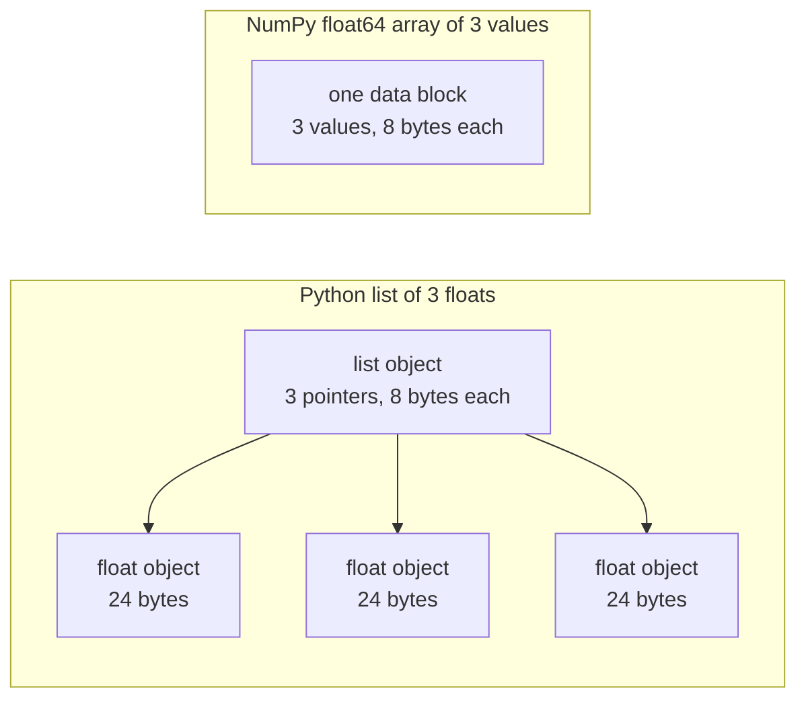

# Python pour l'ingénierie de l'IA

> La plupart des codes de ce cours utilisent le même petit ensemble d'idiomes Python. Apprenez ce ensemble ici, avant que les leçons de mathématiques et de modèles ne dépendent de lui.

**Type:** Build
**Languages:** Python
**Prerequisites:** Dev Environment, Python Environments
**Time:** ~120 minutes

## Objectifs d'apprentissage

- Lisez et écrivez les idiomes que la plupart des codes de cours utilisent, du déballage et des chaînes f aux classes de données et aux compréhensions.
- Trouvez trois erreurs Python qui donnent de mauvais résultats sans erreur: listes partagées, défauts changeables et générateurs usés.
- Construisez un chargement CSV et JSON, une fraction semée et un générateur mini-batch avec seulement la bibliothèque standard.
- Écrivez le produit des points, la moyenne et l'écart standard en Python pur, et mesurez leur vitesse et leur utilisation de mémoire.
- Expliquez pourquoi une boucle pure-Python sur les nombres est lente, et comment la diffusion NumPy déplace la boucle dans le code compilé.

## Le problème

Les cours suivants utilisent Python pour les mathématiques et les modèles.`dataclasses`- 187 dossiers de téléphone.`random.seed`ou créer un `random.Random`Si ces idiomes sont nouveaux pour vous, vous lisez la syntaxe quand vous voulez lire les mathématiques.

Python a également des comportements qui donnent de mauvais résultats sans message d'erreur. Deux noms peuvent se référer à une liste, donc un changement par un nom change également l'autre. Un argument par défaut conserve sa valeur d'un appel à l'autre. Un générateur est vide après un passage, donc une deuxième période de formation ne reçoit pas de données et la perte ne change pas.

Le dernier problème est la vitesse. Sur notre ordinateur portable, une boucle pure Python sur un million de floats a pris environ 30 millisecondes. NumPy a calculé le même produit de point en moins d'une millisecondes. Vous devez connaître la raison, afin que vous puissiez choisir entre une boucle claire et une opération d'un tableau.

## Le concept

### Ce que le code de cours utilise

Nous avons analysé tous les 541 fichiers Python dans `phases/*/*/code/`avec le `ast`Le tableau compte les fichiers qui utilisent chaque construit au moins une fois.

| Construct | Files | Share |
|-----------|-------|-------|
| Function definitions | 541 | 100% |
| `if __name__ == "__main__":` | 529 | 98% |
| f-strings | 517 | 96% |
| Tuple unpacking | 448 | 83% |
| Classes | 379 | 70% |
| List comprehensions | 375 | 69% |
| Type hints on functions | 342 | 63% |
| Generator expressions | 326 | 60% |
| Slices | 314 | 58% |
| `lambda` | 175 | 32% |
| `try` and `except` | 120 | 22% |
| `with` statements | 96 | 18% |
| Dict comprehensions | 93 | 17% |
| Generator functions with `yield` | 14 | 3% |

Les importations montrent quels modules standard sont importants.`from __future__ import annotations`, et 276 importations `dataclasses`- Le .`math`- Je suis là .`random`, et `json`Les modules figurent dans les dossiers 187, 175 et 126.`collections`Le module apparaît dans 70 fichiers, et `itertools`apparaît dans seulement 4.

Pas de cours .`map()`ou `filter()`Les compréhensions font ce travail.`sorted`- Je suis là .`min`- Je suis là .`max`ou `.sort`avec un `key=`Cette leçon passe le plus de temps sur les idiomes en haut de ces listes.

### Les noms font référence aux objets

En Python, une variable est un nom qui fait référence à un objet. L'assignation lie un nom à un objet. Il ne copie pas l'objet. Lorsque deux noms font référence à une liste, un changement par l'un des noms est visible à travers les deux. Les nombres, les chaînes et les tuples ne peuvent pas changer, de sorte que cette règle ne cause aucun problème pour eux. Les listes, les dicts et les ensembles peuvent changer, alors faites une copie lorsque vous avez besoin d'une version indépendante.

### Une liste contient des pointeurs, un tableau contient des nombres

Une liste Python ne stocke pas directement les nombres. Elle stocke les pointeurs, et chaque pointeur fait référence à un objet Python complet. Sur une construction de 64 bits de CPython, chaque pointeur prend 8 octets et chaque pointeur prend 8 octets.`float`L' objet prend 24 octets.`float64`l'ensemble stocke les valeurs de 8 octets bruts côte à côte dans un bloc de mémoire.



Une boucle sur une liste fait beaucoup de travail pour chaque élément. L'interprète exécute une instruction de code en octets à la fois. Pour chaque élément, il suit un pointeur et vérifie le type de chaque opérand.

NumPy fait la même arithmétique dans une boucle de code compilé sur les valeurs brutes. Il vérifie le type de données une fois pour l'ensemble de l'ensemble, et il ne fait pas d'objet Python pour chaque élément. Le code vectorié décrit une opération sur un ensemble entier, comme `(x - mean) / std`Les fonctions vectorielles de cette leçon suivent cette règle. chacune effectue une opération de tableau, vous pouvez donc la remplacer par un appel NumPy plus tard.

### Une liste contient tous les éléments, un générateur en contient un

Une compréhension de liste crée chaque élément avant que la ligne suivante ne s'exécute. Un générateur crée un élément à chaque fois que l'appelant demande le suivant. La mémoire d'une liste augmente avec le nombre d'éléments. La mémoire d'un générateur reste presque la même pour n'importe quel nombre d'éléments.

Un générateur ne peut fonctionner qu'une seule fois.`StopIteration`à chaque demande, donc une seconde `for`Le code de formation lit l'ensemble de données une fois par époque, il doit donc créer un nouveau générateur pour chaque époque.

Les fonctions de générateur sont rares dans le code de leçon. Les chargeurs de données que les leçons d'apprentissage profond utilisent sont réitérables en lots, de sorte que l'idée est dans chaque boucle de formation.

```figure
s0-list-vs-generator
```

## Les idiomes dont vous avez besoin

Chaque bloc de cette section fonctionne de manière autonome.`python3`Les blocs ont besoin de Python 3.11 ou plus récent, la version que nous avons installée dans la leçon de développement.

### 1. Value, collecte et déballage

Python a quatre collections intégrées. Apprenez à utiliser chacune.

| Type | Example | Ordered | Can change | Typical use in the course |
|------|---------|---------|------------|---------------------------|
| `list` | `[0.5, 1.2]` | Yes | Yes | Samples, losses, weights |
| `tuple` | `(32, 784)` | Yes | No | Shapes, fixed records, dict keys |
| `dict` | `{"lr": 0.01}` | Insertion order | Yes | Configs, vocabularies, JSON rows |
| `set` | `{"cat", "dog"}` | No | Yes | Unique tokens, overlap checks |

Ce bloc montre que la tâche ne copie pas une liste.

```python
weights = [0.5, -1.2, 3.0]
alias = weights
alias[0] = 99.0
print(weights)

independent = list(weights)
independent[1] = 0.0
print(weights, independent)

grid = [[0] * 3] * 2
grid[0][0] = 1
print(grid)

grid = [[0] * 3 for _ in range(2)]
grid[0][0] = 1
print(grid)
```

```text
[99.0, -1.2, 3.0]
[99.0, -1.2, 3.0] [99.0, 0.0, 3.0]
[[1, 0, 0], [1, 0, 0]]
[[1, 0, 0], [0, 0, 0]]
```

L' expression `[[0] * 3] * 2`La compréhension crée une nouvelle liste interne pour chaque rangée. La phase mathématique construit des matrices à partir de listes, alors utilisez la forme compréhension.

Le déballage attribue les éléments d'une séquence à plusieurs noms dans une ligne. Un nom étoilé recueille les éléments restants. Une chaîne f met la valeur d'une expression dans une chaîne, avec un format optionnel après un colon.

```python
shape = (32, 784)
batch_size, n_features = shape
first, *middle, last = [1, 2, 3, 4, 5]
x, y = 1.0, 3.0
x, y = y, x

config = {"lr": 0.01, "epochs": 5}
config["seed"] = 7
tokens = ["the", "cat", "sat", "on", "the", "mat"]
vocab = set(tokens)

print(batch_size, n_features, first, middle, last, x, y)
print(config.get("momentum", 0.9), "cat" in vocab, len(vocab))
print(f"lr={config['lr']:.0e} loss={0.123456:.3f} n={60_000:,} {batch_size=}")
```

```text
32 784 1 [2, 3, 4] 5 3.0 1.0
0.9 True 5
lr=1e-02 loss=0.123 n=60,000 batch_size=32
```

`dict.get`renvoie une valeur par défaut lorsque la clé est manquante.`in`Les tests sur un ensemble prennent environ le même temps pour toute taille d'ensemble.`{batch_size=}`le formulaire imprime le nom et la valeur, ce qui aide lorsque vous débogagez.

Une tranche .`a[start:stop:step]`inclut `start`et exclut `stop`Une tranche d'une liste est une nouvelle liste, donc une tranche d'une grande liste copie tous ses indicateurs.

```python
tokens = ["<s>", "the", "cat", "sat", "on", "the", "mat", "</s>"]
print(tokens[1:-1])
print(tokens[:3], tokens[-3:])
print(tokens[::2])
print(tokens[::-1][:2])
windows = [tokens[i:i + 3] for i in range(len(tokens) - 2)]
print(len(windows), windows[0])
```

```text
['the', 'cat', 'sat', 'on', 'the', 'mat']
['<s>', 'the', 'cat'] ['the', 'mat', '</s>']
['<s>', 'cat', 'on', 'mat']
['</s>', 'mat']
6 ['<s>', 'the', 'cat']
```

### 2. Les compréhensions

Une compréhension construit une liste, un dicté ou un ensemble à partir d'un itératif dans une expression.

```python
scores = [0.91, 0.42, 0.77, 0.15, 0.66]
labels = [1 if s >= 0.5 else 0 for s in scores]
high = [s for s in scores if s > 0.6]
squares = {i: i * i for i in range(4)}
lengths = {len(word) for word in ["a", "bb", "cc", "ddd"]}
sum_sq = sum(s * s for s in scores)

matrix = [[1, 2, 3], [4, 5, 6]]
transposed = [list(column) for column in zip(*matrix)]
flat = [v for row in matrix for v in row]

print(labels, high, squares, lengths, round(sum_sq, 4))
print(transposed, flat)
```

```text
[1, 0, 1, 0, 1] [0.91, 0.77, 0.66] {0: 0, 1: 1, 2: 4, 3: 9} {1, 2, 3} 2.0555
[[1, 4], [2, 5], [3, 6]] [1, 2, 3, 4, 5, 6]
```

Une traîne .`if`Il ne garde que quelques objets.`for`peut être une expression conditionnelle, `a if condition else b`- Deux .`for`Les clauses sont dans l'ordre des deux boucles.

Les supports ronds font une expression génératrice.`sum(s * s for s in scores)`- Je suis là .`sum`Python ne crée pas de liste.`zip(*matrix)`, l'étoile passe chaque rangée comme un argument séparé, et `zip`les paires des éléments à chaque position.

### 3. Fonctions, arguments et clôtures

Une valeur par défaut rend un argument facultatif. Un argument de mot clé nomme le paramètre à l'appel.`*`par elle-même dans la liste des paramètres fait les paramètres suivants-seulement mot clé.

```python
def clip(value, low=0.0, high=1.0):
    return max(low, min(high, value))


def train(data, *, lr=0.01, epochs=3):
    return f"{len(data)} samples, lr={lr}, epochs={epochs}"


def make_scaler(factor):
    def scale(values):
        return [v * factor for v in values]
    return scale


print(clip(1.7), clip(-3.0, low=-1.0), clip(0.4, high=0.3))
print(train([1, 2, 3], lr=0.1))
to_percent = make_scaler(100)
print(to_percent([0.25, 0.5]))
```

```text
1.0 -1.0 0.3
3 samples, lr=0.1, epochs=3
[25.0, 50.0]
```

Avec des arguments uniquement par mot clé, un appel tel que `train(data, 0.1, 3)`augmentation `TypeError`L' appelant doit écrire`lr=0.1`, donc deux nombres ne peuvent pas changer de place par accident.

La fonction intérieure `scale`utilisations `factor`Python conserve la fonction qui l'a créé.`factor`pendant tout le temps que `scale`Une fonction qui garde les variables de son créateur est une fermeture.

Une .`lambda`est une fonction d'expression unique sans nom.`key=`La fonction, comme le montre la partie 8.

Python évalue une valeur par défaut une fois, lorsqu'il exécute le `def`chaque appel qui utilise la définition par défaut obtient le même objet.

```python
def add_bad(item, bucket=[]):
    bucket.append(item)
    return bucket


def add_good(item, bucket=None):
    if bucket is None:
        bucket = []
    bucket.append(item)
    return bucket


add_bad("a")
print(add_bad("b"))
add_good("a")
print(add_good("b"))
```

```text
['a', 'b']
['b']
```

Utilisation `None`comme la valeur par défaut d'une liste, dict, ou ensemble. Créez le nouvel objet à l'intérieur de la fonction.

### 4. Classes et données

Le `@dataclass`décorateur écrit `__init__`- Je suis là .`__repr__`, et `__eq__`Les données de l'analyse de l'analyse de données sont fournies par le formulaire de référence.`frozen=True`, l'objet ne peut pas changer après la création, et vous pouvez l'utiliser comme une clé de dict ou le mettre dans un ensemble.

```python
from dataclasses import dataclass, field


@dataclass(frozen=True)
class Example:
    features: tuple[float, ...]
    label: int


@dataclass
class TrainConfig:
    lr: float = 0.01
    epochs: int = 5
    hidden: list[int] = field(default_factory=lambda: [64, 32])

    def describe(self):
        return f"lr={self.lr} epochs={self.epochs} hidden={self.hidden}"


ex = Example((1.5, 2.0), 1)
print(ex)
print(ex == Example((1.5, 2.0), 1), len({ex, Example((1.5, 2.0), 1)}))
print(TrainConfig(epochs=10).describe())
try:
    ex.label = 0
except AttributeError as err:
    print(type(err).__name__)
```

```text
Example(features=(1.5, 2.0), label=1)
True 1
lr=0.01 epochs=10 hidden=[64, 32]
FrozenInstanceError
```

`field(default_factory=...)`Il résolve le problème par défaut partagé de la partie 3 à l'intérieur d'une classe de données.

Des méthodes spéciales relient une classe à la syntaxe Python. `len(ds)`Les appels`__len__`, et `ds[2]`Les appels`__getitem__`- Je suis désolé .

```python
class SquaresDataset:
    def __init__(self, n):
        self.n = n

    def __len__(self):
        return self.n

    def __getitem__(self, index):
        if not 0 <= index < self.n:
            raise IndexError(index)
        return index, index * index


ds = SquaresDataset(4)
print(len(ds), ds[2])
print(list(ds))
```

```text
4 (2, 4)
[(0, 0), (1, 1), (2, 4), (3, 9)]
```

Le `for`boucle à l' intérieur `list(ds)`fonctionne sans un`__iter__`méthode. Python appelle`__getitem__`avec 0, 1, 2, et ainsi de suite jusqu'à ce qu'il arrive `IndexError`. Les ensembles de données de type PyTorch utilisent les mêmes deux méthodes, `__len__`et `__getitem__`- Je suis désolé .

### 5. Les générateurs et les iérateurs

Un objet iterable est tout objet qui a`for`La boucle accepte.`iter()`Il y a un itérateur, et `next()`demande à l'itérateur un élément. Quand l'itérateur n'a plus d'éléments, il soulève `StopIteration`- Je suis un .`for`appel de boucle `next()`pour vous et s' arrête à `StopIteration`- Je suis désolé .

```python
numbers = [10, 20, 30]
it = iter(numbers)
print(next(it), next(it), next(it))
try:
    next(it)
except StopIteration:
    print("no more items")


def countdown(n):
    while n > 0:
        yield n
        n -= 1


gen = countdown(3)
print(type(gen).__name__)
print(list(gen))
print(list(gen))
```

```text
10 20 30
no more items
generator
[3, 2, 1]
[]
```

Une fonction avec `yield`Une appel à elle ne fonctionne pas de son code et renvoie un objet générateur.`next()`Il conduit le corps à l' autre.`yield`et s'arrête là.`list(gen)`est vide parce que le premier a consommé le générateur.

Un générateur peut lire un fichier une ligne à la fois.

```python
import os
import tempfile


def read_rows(path):
    with open(path, encoding="utf-8") as fh:
        header = fh.readline().rstrip("\n").split(",")
        for line in fh:
            yield dict(zip(header, line.rstrip("\n").split(",")))


with tempfile.TemporaryDirectory() as tmp:
    path = os.path.join(tmp, "rows.csv")
    with open(path, "w", encoding="utf-8") as fh:
        fh.write("x,label\n")
        fh.writelines(f"{i * 0.5},{i % 2}\n" for i in range(5))
    rows = read_rows(path)
    print(next(rows))
    print(sum(1 for _ in rows))
```

```text
{'x': '0.0', 'label': '0'}
4
```

`read_rows`Il conserve une ligne du fichier en mémoire à la fois.`read_rows`Il se divise en virgules pour garder l'exemple court.`csv`le module.

```python
import sys

as_list = [i * i for i in range(1_000_000)]
as_generator = (i * i for i in range(1_000_000))
print(sys.getsizeof(as_list), sys.getsizeof(as_generator))
print(sum(as_list) == sum(as_generator))
```

Sur CPython 64 bits, la liste rapporte environ 8 Mo et le générateur environ 200 octets. `sys.getsizeof`Il ne compte que les pointeurs de la liste, et les objets entiers utilisent plus de mémoire.`tracemalloc`, que nous avons utilisé dans la leçon de débogage et de profilage.

### 6. Gestionnaires de contexte et exceptions

Une .`with`L'exécution du code de nettoyage est effectuée même si le corps fait une exception.`open()`est un gestionnaire de contexte qui ferme le fichier.

Dans la leçon de débogage et de profilage, nous avons écrit un `Timer`classe avec `__enter__`et `__exit__`- Le .`contextlib.contextmanager`Le code précédent est le code de la machine de décoration.`yield`est la configuration, et le `finally`Le bloc est le nettoyage.

```python
import time
from contextlib import contextmanager


@contextmanager
def timer(label):
    start = time.perf_counter()
    try:
        yield
    finally:
        print(f"{label}: {(time.perf_counter() - start) * 1000:.1f} ms")


def parse_label(text):
    try:
        return int(text)
    except ValueError:
        raise ValueError(f"label must be an integer, got {text!r}") from None


with timer("sum of squares"):
    total = sum(i * i for i in range(200_000))

print(parse_label("3"))
try:
    parse_label("cat")
except ValueError as err:
    print("rejected:", err)
```

```text
sum of squares: 9.4 ms
3
rejected: label must be an integer, got 'cat'
```

Le temps de votre machine sera différent.`except`clause, comme `ValueError`ou `KeyError`- Un .`except:`clause sans type d'exception traite également `KeyboardInterrupt`, de sorte que Ctrl + C ne peut pas arrêter une boucle qui la contient.`from None`lorsque votre message remplace le traceau original.

### 7. Les instructions de type, les modules et la garde principale

Les indices de type indiquent au lecteur ce qu'une fonction prend et retourne. Python ne les vérifie pas lorsque le code est exécuté. Un vérificateur de type, comme mypy, les lit avant que le code ne soit exécuté.

```python
from __future__ import annotations

from collections.abc import Iterable, Sequence


def mean(values: Sequence[float]) -> float:
    if not values:
        raise ValueError("mean() needs at least one value")
    return sum(values) / len(values)


def count_tokens(docs: Iterable[str]) -> int:
    return sum(len(doc.split()) for doc in docs)


def main() -> None:
    print(mean([1.0, 2.0, 4.0]))
    print(count_tokens(["the cat sat", "on the mat"]))
    print(mean.__annotations__)


if __name__ == "__main__":
    main()
```

```text
2.3333333333333335
6
{'values': 'Sequence[float]', 'return': 'float'}
```

Avec `from __future__ import annotations`Python stocke chaque indice comme une chaîne, comme le montre la dernière ligne.`Sequence`signifie tout objet avec `len()`et des indices, tels qu'une liste ou un tuple. `Iterable`désigne tout objet qui a`for`La plupart des fichiers de cours importent les mêmes noms de `typing`, qui fonctionne aussi.

Chaque .`.py`Le fichier est un module.`python3 file.py`, Python définit son .`__name__`à `"__main__"`. Quand un autre fichier l'importe, `__name__`C'est le nom du module.`main()`Les tests ont été effectués en raison de la surveillance.`code/tests/`peut importer `main.py`sans démarrer la démo.

### 8. Fichiers, JSON, CSV et tri

`pathlib.Path`connecte les chemins avec `/`et peut lire ou écrire un fichier entier en un seul appel.`encoding="utf-8"`, car le codage par défaut dépend du système d'exploitation.

```python
import csv
import json
import tempfile
from pathlib import Path

rows = [
    {"text": "great movie", "label": 1, "score": 0.93},
    {"text": "boring plot", "label": 0, "score": 0.12},
    {"text": "fine acting", "label": 1, "score": 0.58},
]

with tempfile.TemporaryDirectory() as tmp:
    json_path = Path(tmp) / "reviews.json"
    json_path.write_text(json.dumps(rows, indent=2), encoding="utf-8")
    from_json = json.loads(json_path.read_text(encoding="utf-8"))

    csv_path = Path(tmp) / "reviews.csv"
    with csv_path.open("w", newline="", encoding="utf-8") as fh:
        writer = csv.DictWriter(fh, fieldnames=["text", "label", "score"])
        writer.writeheader()
        writer.writerows(rows)
    with csv_path.open(newline="", encoding="utf-8") as fh:
        from_csv = list(csv.DictReader(fh))

print(from_json == rows)
print(from_csv[0])

by_score = sorted(rows, key=lambda r: r["score"], reverse=True)
print([r["text"] for r in by_score])
print(max(rows, key=lambda r: r["score"])["text"])
print([r["text"] for r in sorted(rows, key=lambda r: (-r["label"], r["text"]))])
```

```text
True
{'text': 'great movie', 'label': '1', 'score': '0.93'}
['great movie', 'fine acting', 'boring plot']
great movie
['fine acting', 'great movie', 'boring plot']
```

JSON conserve les nombres comme des nombres. CSV renvoie chaque champ en tant que chaîne, vous devez donc convertir chaque champ.`newline=""`, comme le `csv`La documentation vous le dit.

Une .`key=`La fonction renvoie la valeur que Python compare pour chaque élément. `sorted`- Je suis là .`min`, et `max`Toutes les classes acceptent une. Une clé tuple tries par la première valeur, et il utilise la deuxième valeur uniquement pour les liens. Le signe moins met l'étiquette plus grande en premier. Python tri est stable, donc les éléments avec des clés égales gardent leur ordre d'origine.

### 9. Outils de comptage, de regroupement et d'itération

Ces deux modules contiennent les structures de données et les outils d'itérateur que les listes et les dicts simples ne vous donnent pas.

```python
from collections import Counter, defaultdict, deque
from itertools import chain, islice, product

labels = ["cat", "dog", "cat", "bird", "cat", "dog"]
counts = Counter(labels)
print(counts.most_common(2))

positions = defaultdict(list)
for i, label in enumerate(labels):
    positions[label].append(i)
print(dict(positions))

recent = deque(maxlen=3)
for loss in [2.0, 1.5, 1.2, 1.1, 0.9]:
    recent.append(loss)
print(list(recent), round(sum(recent) / len(recent), 3))

print(list(product([0.1, 0.01], [16, 32])))
print(list(chain([1, 2], [3], [4, 5])))
print(list(islice(range(100), 5, 10)))
```

```text
[('cat', 3), ('dog', 2)]
{'cat': [0, 2, 4], 'dog': [1, 5], 'bird': [3]}
[1.2, 1.1, 0.9] 1.067
[(0.1, 16), (0.1, 32), (0.01, 16), (0.01, 32)]
[1, 2, 3, 4, 5]
[5, 6, 7, 8, 9]
```

`Counter`compte des éléments qui peuvent être déposés, tels que des étiquettes ou des jetons. `defaultdict(list)`crée une liste vide la première fois que vous utilisez une nouvelle clé, donc une boucle de regroupement n'a pas besoin de vérification de clé. `deque(maxlen=3)`supprime l'article le plus ancien lorsque vous ajoutez un quatrième, ce qui donne une fenêtre de mouvement sur les pertes récentes. `enumerate`donne à chaque élément son indice.

`product`donne chaque combinaison de ses entrées, ce qui est une grille d'hyperparamètres. `chain`joins des itératifs de bout en bout. `islice`Il faut une tranche de tout itérateur, y compris un générateur.`islice`- Je suis désolé .

### 10. Pourquoi les boucles sur les nombres sont lentes

Le `dis`Le module imprime les instructions de code d'octroi que l'interprète exécute pour une fonction.

```python
import dis


def dot(a, b):
    total = 0.0
    for x, y in zip(a, b):
        total += x * y
    return total


dis.dis(dot)
```

Les instructions de `FOR_ITER`C'est environ dix instructions pour chaque multiplication et addition. les noms exacts des instructions changent entre les versions Python.

Une boucle devient plus rapide lorsque moins de ses étapes sont exécutées en code octal.`sum`- Je suis là .`map`, et `zip`sont écrits en C. Build It mesure cet effet en Python pur, et Use It déplace toute la boucle en NumPy.

## Faites-le

Maintenant, construisez les pièces dont vous aurez besoin pour les cours ultérieurs.`code/main.py`, et `code/tests/test_main.py`Chaque bloc en dessous se déplace par lui-même.

### Étape 1: Type d'enregistrement et chargement de l'ensemble de données

Le chargement lit un fichier CSV ou un fichier JSON dans une forme: un tuple de fonctionnalités flottantes et une étiquette entière.

```python
import csv
import json
import tempfile
from dataclasses import dataclass
from pathlib import Path


@dataclass(frozen=True)
class Record:
    features: tuple[float, ...]
    label: int


def row_to_record(row, names, label_field="label"):
    if label_field not in row:
        raise ValueError(f"row has no {label_field!r} field: {row}")
    if set(row) != {*names, label_field}:
        raise ValueError(f"row fields {list(row)} do not match {[*names, label_field]}")
    return Record(tuple(float(row[name]) for name in names), int(row[label_field]))


def load_records(path, label_field="label"):
    path = Path(path)
    if path.suffix == ".json":
        rows = json.loads(path.read_text(encoding="utf-8"))
    elif path.suffix == ".csv":
        with path.open(newline="", encoding="utf-8") as fh:
            rows = list(csv.DictReader(fh))
    else:
        raise ValueError(f"unsupported file type: {path.suffix!r}")
    if not rows:
        return []
    names = [key for key in rows[0] if key != label_field]
    return [row_to_record(row, names, label_field) for row in rows]


with tempfile.TemporaryDirectory() as tmp:
    csv_path = Path(tmp) / "data.csv"
    csv_path.write_text("x1,x2,label\n1.5,60,1\n1.8,82.5,0\n", encoding="utf-8")
    json_path = Path(tmp) / "data.json"
    json_path.write_text('[{"x1": 1.5, "x2": 60, "label": 1}]', encoding="utf-8")
    print(load_records(csv_path))
    print(load_records(json_path))
```

```text
[Record(features=(1.5, 60.0), label=1), Record(features=(1.8, 82.5), label=0)]
[Record(features=(1.5, 60.0), label=1)]
```

La première rangée définit les noms des caractéristiques et leur ordre. `DictReader`et `json.loads`La norme JSON ne définit pas un ordre pour les clés dans un objet, donc `row_to_record`Lire chaque ligne par nom, dans l'ordre de la première ligne.`ValueError`avec un message, donc un fichier malveillant arrête la course au début. `main.py`Il a aussi`save_records`, qui écrit les mêmes deux formats.

### Étape 2: Un train semé et une fraction d'essai

```python
import random


def train_test_split(items, test_fraction=0.2, seed=0):
    if not 0.0 < test_fraction < 1.0:
        raise ValueError(f"test_fraction must be between 0 and 1, got {test_fraction}")
    if len(items) < 2:
        raise ValueError(f"need at least 2 items to split, got {len(items)}")
    order = list(range(len(items)))
    random.Random(seed).shuffle(order)
    n_test = min(max(1, round(len(items) * test_fraction)), len(items) - 1)
    test = [items[i] for i in order[:n_test]]
    train = [items[i] for i in order[n_test:]]
    return train, test


items = list(range(10))
print(train_test_split(items, seed=1))
print(train_test_split(items, seed=1) == train_test_split(items, seed=1))
print(train_test_split(items, seed=2)[1])
print(items)
```

```text
([9, 7, 5, 3, 0, 4, 1, 2], [6, 8])
True
[5, 9]
[0, 1, 2, 3, 4, 5, 6, 7, 8, 9]
```

`random.Random(seed)`crée un générateur de nombres aléatoires privé. `random.seed(seed)`Résettez le générateur global que tous les modules partagent, de sorte qu'un appel dans une autre bibliothèque peut changer votre séquence.`random.seed`et 96 créés `random.Random`Utilisez le générateur privé dans le nouveau code.

La fonction mélange une liste d'indices, de sorte que la liste d'entrée reste inchangée. Le même grain donne toujours la même fraction. Chaque côté conserve au moins un élément, donc une liste avec moins de 2 éléments augmente `ValueError`Dans la leçon de débogage et de profilage, nous avons vu que le chevauchement entre les données du train et les données des tests donne des scores de test trop élevés.

### Étape 3: Générateur mini-batch

```python
from itertools import islice


def batches(items, batch_size, drop_last=False):
    if batch_size < 1:
        raise ValueError(f"batch_size must be at least 1, got {batch_size}")
    return _batch_iter(iter(items), batch_size, drop_last)


def _batch_iter(iterator, batch_size, drop_last):
    while True:
        batch = list(islice(iterator, batch_size))
        if not batch or (drop_last and len(batch) < batch_size):
            return
        yield batch


print(list(batches(range(10), 4)))
print(list(batches(range(10), 4, drop_last=True)))
squares = (i * i for i in range(7))
print([len(b) for b in batches(squares, 3)])

for epoch in range(2):
    sizes = [len(b) for b in batches(range(10), 4)]
    print(f"epoch {epoch}: {sizes}")
```

```text
[[0, 1, 2, 3], [4, 5, 6, 7], [8, 9]]
[[0, 1, 2, 3], [4, 5, 6, 7]]
[3, 3, 1]
epoch 0: [4, 4, 2]
epoch 1: [4, 4, 2]
```

`islice`Il faut attendre `batch_size`les éléments de l'itérateur. `batches`seulement besoin `iter()`Le dernier lot est plus petit lorsque la longueur n'est pas un multiple de la taille du lot. `drop_last=True`enlève ce lot, pour un modèle qui a besoin d'une forme fixe de lot.

Le travail est en deux fonctions car une fonction génératrice ne fonctionne pas de code jusqu'à la première `next()`Avec le chèque à l'intérieur du générateur,`batches(data, 0)`La fonction externe est une fonction normale, elle vérifie l'argument immédiatement.`batches()`Il faut le faire à chaque époque, car un générateur ne donne ses éléments qu'une seule fois.

### Étape 4: mathématiques vectorielles et normalisateur

```python
import math


def dot(a, b):
    return sum(x * y for x, y in zip(a, b, strict=True))


def mean(values):
    if not values:
        raise ValueError("mean() needs at least one value")
    return sum(values) / len(values)


def std(values):
    mu = mean(values)
    return math.sqrt(sum((v - mu) ** 2 for v in values) / len(values))


def make_standardizer(rows):
    columns = list(zip(*rows))
    means = [mean(c) for c in columns]
    scales = [s if s > 0 else 1.0 for s in (std(c) for c in columns)]

    def standardize(row):
        return [(v - m) / s for v, m, s in zip(row, means, scales, strict=True)]

    return standardize


print(dot([1.0, 2.0, 3.0], [4.0, 5.0, 6.0]))
values = [2.0, 4.0, 4.0, 4.0, 5.0, 5.0, 7.0, 9.0]
print(mean(values), std(values))

train_rows = [(1.0, 100.0), (2.0, 300.0), (3.0, 500.0)]
standardize = make_standardizer(train_rows)
print([[round(v, 3) for v in standardize(r)] for r in train_rows])
print([round(v, 3) for v in standardize((4.0, 700.0))])
```

```text
32.0
5.0 2.0
[[-1.225, -1.225], [0.0, 0.0], [1.225, 1.225]]
[2.449, 2.449]
```

Avec `strict=True`- Je suis là .`zip`augmentation `ValueError`Lorsque les deux vecteurs ont des longueurs différentes.`zip`Il s'arrête à la fin de l'entrée plus courte et renvoie une réponse erronée sans erreur.`strict`L'argument a besoin de Python 3.10 ou plus récent.

`std`divisé par `n`, donc il donne à la population l'écart standard, comme `statistics.pstdev`Il le fait.`n - 1`lorsque vous estimez la propagation d'une population plus grande à partir d'un échantillon.

`make_standardizer`Il compute les moyens et les écarts standards des lignes d'entraînement une fois, et `standardize`La même fonction est appliquée aux lignes de test, de sorte que les données de test n'ont aucun effet sur les statistiques.

### Étape 5: Une course complète

`code/main.py`Il fait 400 enregistrements à partir de deux clusters, les sauvegarde sous forme de CSV et JSON, et charge les deux fichiers. Puis il divise les enregistrements, met le standardiseur sur la division d'entraînement, et calcule les centroid de classe à partir de lots de 48.

Un classifiateur de centre-moyen le plus proche stocke le vecteur de caractéristiques moyenne de chaque classe. Il prédit la classe dont la moyenne est la plus proche de l'entrée. `fit_centroids`Il ajoute les rangées par lots, de sorte qu'il n'a jamais besoin de l'entraînement complet en mémoire. `predict`utilisations `min()`avec un `key=`fonction pour trouver le centre-poids le plus proche.

```bash
python3 phases/00-setup-and-tooling/13-python-for-ai-engineering/code/main.py
```

```text
Python for AI engineering: a standard-library toolkit
data     400 records, CSV and JSON load back unchanged: True
split    320 train, 80 test, records in both: 0
batches  size 48: [48, 48, 48, 48, 48, 48, 32]
scale    train feature means after standardizing: [0.0, 0.0]
model    nearest-centroid test accuracy: raw 0.86, standardized 0.89
speed    dot product of 200,000 floats, best of 5:
           index loop         6.60 ms
           zip generator      5.93 ms
           map + mul          2.89 ms
memory   peak bytes to sum 100,000 squares:
           list              4,000,616
           generator               472
```

Les deux caractéristiques ont des échelles très différentes. La deuxième fonction a dix fois la propagation de la première, donc elle contrôle les distances brutes, et la précision brutes est moindre. Vos numéros de vitesse et de mémoire seront différents de ces numéros.

### Étape 6: Mesurer la vitesse et la mémoire

```python
import operator
import random
import time
import tracemalloc


def dot_index_loop(a, b):
    total = 0.0
    for i in range(len(a)):
        total += a[i] * b[i]
    return total


def dot_zip(a, b):
    return sum(x * y for x, y in zip(a, b, strict=True))


def dot_map(a, b):
    return sum(map(operator.mul, a, b))


def best_time(fn, *args, repeat=5):
    times = []
    for _ in range(repeat):
        start = time.perf_counter()
        fn(*args)
        times.append(time.perf_counter() - start)
    return min(times)


def peak_bytes(fn):
    tracemalloc.start()
    try:
        fn()
        return tracemalloc.get_traced_memory()[1]
    finally:
        tracemalloc.stop()


rng = random.Random(0)
a = [rng.random() for _ in range(1_000_000)]
b = [rng.random() for _ in range(1_000_000)]
for fn in (dot_index_loop, dot_zip, dot_map):
    print(f"{fn.__name__:15} {best_time(fn, a, b) * 1000:7.2f} ms")

print(peak_bytes(lambda: sum([i * i for i in range(100_000)])))
print(peak_bytes(lambda: sum(i * i for i in range(100_000))))
```

`best_time`Les programmes d'autres machines ne peuvent ajouter que du temps, le minimum étant donc le plus proche du coût réel.`timeit`Le module donne les mêmes conseils.

Sur notre ordinateur portable de test avec Python 3.11, la boucle d'index a pris environ 33 ms. La version zip a pris environ 30 ms, et le `map`Les trois font la même mathématique.`map`la version est plus rapide parce que `map`et `operator.mul`Les numéros de mémoire répètent la figure: environ 4 Mo pour la liste et moins de 1 KB pour le générateur.

## Utilisez-le

### Les versions bibliothécaires standard

La bibliothèque standard a une version testée de la plupart des pièces que vous avez construites.

| You built | Standard library | Note |
|-----------|------------------|------|
| `mean`, `std` | `statistics.fmean`, `statistics.pstdev` | The tests compare against these |
| `dot` | `math.sumprod` | Python 3.12 or newer |
| `batches` | `itertools.batched` | Python 3.12 or newer, gives tuples |
| `best_time` | `timeit.repeat` | Also turns off garbage collection during the runs |
| `peak_bytes` | `tracemalloc` | The same module, with snapshots and per-line statistics |

```python
import statistics
import sys

values = [2.0, 4.0, 4.0, 4.0, 5.0, 5.0, 7.0, 9.0]
print(statistics.fmean(values), statistics.pstdev(values))

if sys.version_info >= (3, 12):
    import math
    from itertools import batched

    print(math.sumprod([1.0, 2.0, 3.0], [4.0, 5.0, 6.0]))
    print(list(batched(range(10), 4)))
```

```text
5.0 2.0
32.0
[(0, 1, 2, 3), (4, 5, 6, 7), (8, 9)]
```

Le cours prend en charge Python 3.11, donc `main.py`utilise son propre `dot`et `batches`Sur Python 3.11, le bloc imprime seulement la première ligne.

### La même mathématiques avec des matrices compilées

Installez NumPy dans l'environnement virtuel à partir de la leçon environnements Python, par exemple avec `uv pip install numpy`Le code de leçons et les tests n'en ont pas besoin.

```python
import time

import numpy as np

n = 1_000_000
rng = np.random.default_rng(0)
a = rng.random(n)
b = rng.random(n)
a_list, b_list = a.tolist(), b.tolist()

start = time.perf_counter()
slow = sum(x * y for x, y in zip(a_list, b_list))
python_ms = (time.perf_counter() - start) * 1000

start = time.perf_counter()
fast = float(a @ b)
numpy_ms = (time.perf_counter() - start) * 1000

print(f"pure Python {python_ms:8.2f} ms")
print(f"NumPy       {numpy_ms:8.2f} ms")
print(f"difference  {abs(slow - fast):.1e}")
print(a.dtype, a.itemsize, a.nbytes)
```

Sur notre ordinateur portable de test, NumPy a pris moins de 1 ms, et la version pure-Python a pris environ 30 ms. Les deux résultats diffèrent dans les derniers chiffres, parce que les deux versions ajoutent les produits dans un ordre différent.

NumPy est plus rapide pour trois raisons:

- Le tableau stocke les matières premières `float64`Une liste de floats a besoin d'un pointeur de 8 octets et d'un objet float de 24 octets pour chaque valeur.
- La boucle fonctionne dans le code compilé. NumPy vérifie le type de données une fois pour l'ensemble du tableau et ne fait aucun objet Python pour chaque élément.
- Les valeurs qui se trouvent côte à côte dans la mémoire permettent à NumPy d'utiliser des instructions SIMD, qui traitent plusieurs valeurs avec une seule instruction.

Pour les très petits matrices, le coût fixe d'un appel NumPy peut être plus grand qu'une courte boucle Python.

### La radiodiffusion

La diffusion permet à NumPy de combiner des matrices de différentes formes sans boucle dans votre code. Ce bloc fait le même travail que `make_standardizer`à partir de l'étape 4.

```python
import numpy as np

X = np.array([[1.0, 100.0], [2.0, 300.0], [3.0, 500.0]])
mu = X.mean(axis=0)
sigma = X.std(axis=0)
Z = (X - mu) / sigma
print(X.shape, mu.shape, Z.shape)
print(Z.round(3))

norms = np.sqrt((X ** 2).sum(axis=1, keepdims=True))
print(norms.shape, (X / norms).shape)
```

```text
(3, 2) (2,) (3, 2)
[[-1.225 -1.225]
 [ 0.     0.   ]
 [ 1.225  1.225]]
(3, 1) (3, 2)
```

NumPy compare les deux formes de la dernière dimension à la première. Deux dimensions sont compatibles lorsqu'elles sont égales ou lorsqu'une d'entre elles est 1. Une dimension principale manquante est comptée comme 1.

| Shape of `X` | Shape of the other array | Result |
|--------------|--------------------------|--------|
| `(3, 2)` | `(2,)`, column means | `(3, 2)` |
| `(3, 2)` | `(3, 1)`, row norms with `keepdims=True` | `(3, 2)` |
| `(3, 2)` | `(3,)`, row norms without `keepdims` | `ValueError` |

La dernière ligne est une erreur commune. NumPy compare le trailing 2 avec 3, et aucun d'eux est 1.`keepdims=True`lorsque vous réduisez les lignes et puis combinez le résultat avec l'ensemble original.

## La faire partir

Cette leçon produit `outputs/prompt-python-review.md`Il est une requête de révision pour le code Python dans les projets d'IA et de données. Donnez-lui un fichier ou un diff. Il vérifie le code pour les idiomes et les erreurs silencieuses de cette leçon:

- Les références partagées et les arguments par défaut changeables
- Générateurs qui sont lus par une seconde époque après leur utilisation
- Numéros aléatoires sans graine, ou avec seulement la graine globale
- Statistiques provenant de la fraction de test
- Les boucles de Python pur sur de grands matrices numériques

Il rapporte chaque découverte avec un emplacement, le problème et une solution.

## Exercices

1. On court .`run_demo(seed=8)`de `main.py`Trouvez les lignes de sortie qui changent et les lignes qui restent les mêmes.
2. Écrivez`median(values)`En Python pur, testez-le contre`statistics.median`sur des listes de longueur impar et de longueur par.
3. Écrivez`stream_records(path)`, un générateur qui en donne un `Record`Il faut faire un fichier de 200 000 lignes.`stream_records`et `load_records`avec `tracemalloc`- Je suis désolé .
4. Écrivez`matvec(matrix, vector)`En Python pur et en NumPy. Mesurez les deux avec `best_time`Pour les tailles 4, 64 et 1024, trouvez la taille où NumPy devient plus rapide sur votre machine.
5. Écrivez l'analyse de la construction du concept.`ast.parse`et `ast.walk`dans chaque dossier `phases/*/*/code/*.py`- Comptez les fichiers qui contiennent`ast.ListComp`- Je suis là .`ast.Yield`, et `ast.With`, et comparer vos comptes avec la table.

## Les termes clés

| Term | What people say | What it means |
|------|----------------|----------------------|
| Iterable | "Something you can loop over" | An object that `iter()` accepts, such as a list, a file, or a generator |
| Iterator | "A cursor" | An object whose `__next__` method returns one item per call and raises `StopIteration` at the end |
| Generator | "A lazy list" | An iterator from a `yield` function or a generator expression. It makes each item on request and runs only once. |
| Comprehension | "A one-line loop" | An expression that builds a list, dict, or set from an iterable, with an optional filter |
| Closure | "A function inside a function" | A function that keeps variables from the function that created it |
| Dataclass | "A struct" | A class whose `__init__`, `__repr__`, and `__eq__` methods Python writes from the annotated fields |
| Context manager | "A with block" | An object that runs setup code at the start of a `with` block and cleanup code at the end, even after an exception |
| Seed | "The random number" | The start value of a pseudo-random generator. The same seed gives the same sequence. |
| Vectorized code | "Fast code" | Code that applies one operation to a whole array, so that compiled code runs the loop |
| Broadcasting | "Automatic shape matching" | The NumPy rules that combine arrays of different shapes by using size-1 dimensions again, with no copy |

## Pour en savoir plus

- [The Python Tutorial: Data Structures](https://docs.python.org/3/tutorial/datastructures.html)Les listes, les tuples, les ensembles, les dictes et les compréhensions.
- [The Python Tutorial: Classes](https://docs.python.org/3/tutorial/classes.html): champs, classes, itérateurs et générateurs.
- [dataclasses](https://docs.python.org/3/library/dataclasses.html): toutes les options du décorateur, y compris `frozen`et `field`- Je suis désolé .
- [collections](https://docs.python.org/3/library/collections.html)Le numéro de la liste:`Counter`- Je suis là .`defaultdict`- Je suis là .`deque`, et les autres types de conteneurs.
- [itertools](https://docs.python.org/3/library/itertools.html)Le numéro de la liste:`islice`- Je suis là .`chain`- Je suis là .`product`- Je suis là .`batched`, et des recettes qui les combinent.
- [Sorting Techniques](https://docs.python.org/3/howto/sorting.html): fonctions clés, sortes stables et sortes sur plusieurs touches.
- [timeit](https://docs.python.org/3/library/timeit.html): comment mesurer les petits morceaux de code et pourquoi faire rapport du minimum.
- [random](https://docs.python.org/3/library/random.html): le générateur mondial, `random.Random`Les cas et la reproductibilité.
- [PEP 255: Simple Generators](https://peps.python.org/pep-0255/): la proposition qui a ajouté `yield`, avec les raisons de sa conception.
- [NumPy: Broadcasting](https://numpy.org/doc/stable/user/basics.broadcasting.html): les règles de forme complète, avec des diagrammes.
- [Harris et al., Array programming with NumPy, Nature 585, 2020](https://doi.org/10.1038/s41586-020-2649-2): la conception du tableau NumPy et les raisons de sa vitesse.
