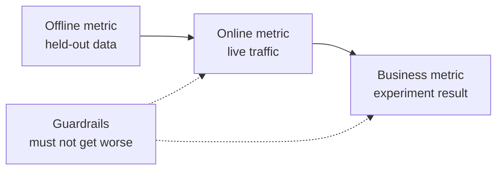

# Conception du système ML  Du problème au modèle déployé

> Un modèle est une partie d'un système. La conception décide de ce que le modèle prédit, qui agit sur lui, ce qu'il coûte et ce qui se passe quand il échoue.

**Type:** Build
**Languages:** Python
**Prerequisites:** Phase 2, Lessons 09 (Model Evaluation) and 13 (ML Pipelines)
**Time:** ~110 minutes

## Objectifs d'apprentissage

- Encadrez un problème d'entreprise comme une tâche de gestion de projet avec une prédiction, une décision qui l'utilise et une raison pour laquelle les règles ne suffisent pas
- Séparer les métriques hors ligne, en ligne, commerciales et de garde-corps, et comparer chaque modèle avec des lignes de base triviales et heuristiques
- Estimer le coût quotidien, la latence et la latence des lots et des inférences en ligne à partir des chiffres de trafic
- Choisir un modèle de déploiement (ombre, canary, test A/B) et un mode par défaut sécurisé pour chaque mode défaillance
- Identifier les boucles de rétroaction dans lesquelles le modèle modifie les données qui entraînent sa prochaine version
- Écrire un document de conception de l'outil ML et le classer par rapport à une liste de contrôle fixe

## Le problème

Une société d'abonnement demande un "modèle de churn". Un spécialiste des données entraîne un classificateur augmenté par gradient et rapporte une AUC de 0,91.

Les raisons n'ont rien à voir avec l'algorithme. Personne ne décide de l'action d'un score. Les scores arrivent une fois par semaine, mais l'équipe de rétention appelle les clients tous les jours. L'étiquette est issue d'une table d'annulation qui stocke également la raison d'annulation, donc une fonctionnalité contenait la réponse. Personne ne compare le modèle avec la règle utilisée déjà par l'équipe de support: appeler quelqu'un inactif pendant deux semaines.

Chacune de ces échecs s'est produite avant le début de la formation. Ce sont des échecs de conception, et un document de conception d'une page pose des questions sur chacun d'eux. Cette leçon enseigne les décisions de ce document. Vous construisez un kit d'outils qui prix des lots et de la livraison en ligne, compare un modèle avec ses lignes de base, et note un document de conception par rapport à une liste de contrôle.

## Le concept

### De l'objectif commercial à la tâche de l'équipe

Un objectif d'entreprise n'est pas une tâche de mécanique.

1. Qu'est-ce que le modèle prédit exactement et pour quelle entité (utilisateur, paiement, magasin, article)?
2. Quelle décision utilise la prédiction, et qui ou quoi prend cette décision?
3. Quand est- il nécessaire de faire cette prédiction, et quelles données existent à ce moment-là?
4. Comment savoir si la décision a été meilleure ?

| Business goal | Prediction | Decision that uses it | ML task |
|---|---|---|---|
| Reduce churn | Probability that a user cancels in the next 30 days | Send a save offer to the top 5 percent each night | Binary classification |
| Cut fraud losses | Probability that a payment is fraud | Approve, review, or block within 100 ms | Binary classification |
| Keep shelves stocked | Units sold per store per day next week | Order quantity for each store | Forecasting |
| Show relevant items | Relevance score for a (user, item) pair | Order of items in the feed | Ranking |

La deuxième colonne a besoin de plus de soin. " Prédiction de la réaction " laisse l'horizon, l'entité et l'action ouverts. " Prédiction de la résiliation de l'utilisateur dans les 30 prochains jours, afin que le travail de ce soir puisse choisir qui obtient une offre " résout les trois.

### Quand ne pas utiliser ML

La règle n°1 des règles de machine learning de Google dit de ne pas avoir peur de lancer un produit sans machine learning.

- Une règle courte atteint l'objectif et reste correcte.
- Vous n'avez pas d'étiquettes et aucun moyen pratique de les collecter.
- Personne ne fait selon la prédiction, donc une meilleure prédiction ne change rien.
- Les données existantes au moment de la prédiction ne contiennent pas le signal.
- Une erreur est inacceptable et personne ne peut vérifier la sortie.
- La construction et l'exploitation du système coûtent plus cher que les meilleures décisions.

Lorsque une règle devient longue et fragile, la ML commence à se révéler utile.

### Trois couches de métriques

Vous mesurez un système ML à trois couches, plus un ensemble de limites:

| Layer | When you can measure it | Churn example |
|---|---|---|
| Offline metric | Before launch, on held-out past data | F1 at the offer threshold, precision in the top 5 percent |
| Online metric | During launch, on live traffic | Offer acceptance rate, share of users scored, score distribution |
| Business metric | Weeks after launch, with an experiment | 30-day churn rate in the treated group versus a holdout group |
| Guardrail metric | All the time | Offer cost per saved user, unsubscribe rate, p99 latency |



Les couches sont souvent en désaccord. Une métrique hors ligne marque les données passées, et le passé n'a pas contenu votre modèle. Une métrique en ligne dépend de la façon dont les gens réagissent à la décision. Une métrique commerciale se déplace lentement et transporte du bruit de tout le reste de l'entreprise.

Choisissez la mesure hors ligne qui correspond à la décision. Si le travail contacte les 5% les plus performants des utilisateurs, mesurez la précision dans les 5% les plus performants. La moyenne AUC sur tous les seuils, y compris les seuils que vous n'utilisez jamais. La règle #2 du même guide dit de concevoir et de mettre en œuvre les mesures d'abord, avant de décider ce que le système ML fera.

### Lines de base

Une valeur métrique ne signifie rien seule. Une F1 de 0,56 est bonne si la meilleure alternative atteint 0,30 et mauvaise si une règle atteint 0,60.

- **Trivial baseline.**Prédire toujours la classe majoritaire ou toujours la moyenne d'entraînement.
- **Heuristic baseline.**Une règle de la connaissance du domaine, ou un seuil d'une caractéristique que vous ajoutez aux données de formation.
- **Current system.**Quelle que soit la décision prise aujourd'hui, même si c'est une personne avec une feuille de calcul.

Le lever est le score du modèle moins le score de la ligne de base la plus forte. Définissez un lever minimum avant de regarder les résultats, et faites-le assez grand pour payer le système supplémentaire. La ligne de base triviale est généralement faible. La ligne de base heuristique est la plus difficile à battre.

### Exigences relatives aux données et à l'étiquette

Répondez à ces questions avant de vous entraîner:

- **Label source.**Quelle table ou quel événement définit l'étiquette, et qui la possède?
- **Label delay.**Les fraudes peuvent arriver des semaines après le paiement.
- **Label quality.**Qui attribue l'étiquette, et combien de fois est- elle erronée?
- **Availability at prediction time.**Une caractéristique que le système écrit après le résultat, qui fuit l'étiquette dans l'entraînement.
- **Volume per class.**Combien d'exemples positifs existent ?
- **Time split.**Nous divisons les données par temps dans la leçon de la série temporelle pour la même raison.

### Délais de fonctionnement, débit et budgets de coûts

Trois chiffres liés à chaque dessin:

- **Latency budget.**La latence p99 est le temps pendant lequel 99 demandes sur 100 restent en dessous. Un chèque de paiement peut nécessiter 50 ms. Un rapport nocturne peut prendre des heures.
- **Peak throughput.**Mesurez le système pour la minute la plus fréquentée, pas pour la moyenne quotidienne.
- **Cost budget.**Exprimez-le en dollars par jour ou en dollars par 1000 prédictions, pour que vous puissiez comparer les conceptions.

La loi de Little relie les deux premières. Le nombre de demandes en cours est égal au temps de débit de latence. À 400 demandes par seconde et 50 ms chacune, 20 demandes sont en cours à tout moment.

### Inference par lots par rapport à l'inférence en ligne

Il y a deux façons de servir les prédictions:

- **Batch inference.**Un emploi programmé note chaque entité et écrit les scores dans une table ou un magasin de valeurs clés.
- **Online inference.**L'application envoie les caractéristiques à un service modèle au moment de la demande et attend le score.

| Property | Batch | Online |
|---|---|---|
| Freshness | As old as the last run, plus the run time | Uses the data of the request |
| Request latency | One key-value read, a few ms | Feature fetch plus model time |
| Cost driver | Number of entities times runs per day | Replicas sized for peak QPS |
| New entities | No score until the next run | Scored on the first request |
| When it breaks | Old scores stay readable | Requests fail or time out |

Le kit d'outils de cette leçon coûte les deux. Le coût de lot augmente avec le nombre d'entités et le nombre de courses par jour. Une limite d'arrêt plus courte signifie plus de courses. Le coût en ligne augmente avec le trafic maximum, car vous payez pour les réplices inactives entre les pics. Un travail de lot qui prend une heure ne peut pas atteindre une limite d'arrêt inférieure à une heure à tout prix.

Un projet hybride est courant. Un travail de lot nocturne note les utilisateurs connus, et un chemin en ligne note les nouveaux utilisateurs et les demandes qui nécessitent des données fraîches.

### Modèles de déploiement

Un nouveau modèle atteint les utilisateurs en étapes:

1. **Shadow.**Le nouveau modèle reçoit une copie du trafic en direct. Le système enregistre ses prédictions et ne les utilise jamais. Vous comparez la latence, le taux d'erreur et la distribution de prédiction avec le modèle actuel.
2. **Canary.**Le nouveau modèle prend des décisions réelles pour une petite part de la circulation, souvent de 1 à 5%.
3. **A/B test.**Une fraction aléatoire d'utilisateurs voit chaque modèle. Vous mesurez la métrique commerciale avec un test statistique, et vous avez besoin de suffisamment de trafic et suffisamment de temps pour voir la différence.

Chaque étape nécessite un retour en arrière qui prend des minutes. Gardez la version du modèle ancien déployée et changez de trafic avec la configuration.[shadow and canary lesson](../../../17-infrastructure-and-production/20-shadow-canary-progressive/docs/en.md)et le [A/B testing lesson](../../../17-infrastructure-and-production/21-ab-testing-llm-features/docs/en.md)- Je suis désolé .

### Les boucles de rétroaction

Une boucle de rétroaction existe lorsque les décisions du modèle modifient les données qui entraînent sa prochaine version. Sculley et al. énumèrent les boucles de rétroaction directes et cachées parmi les principales sources de dette technique dans les systèmes ML. Trois cas courants:

- **Interventions hide the label.**Un modèle churn envoie des offres, et les offres retiennent certains utilisateurs. Le mois prochain, les utilisateurs à haut risque semblent fidèles, et le modèle retrainé apprend que leurs caractéristiques ne prédisent pas le churn.
- **Blocked actions have no outcome.**Un modèle de fraude bloque un paiement, de sorte que le paiement ne reçoit jamais une étiquette de remboursement.
- **Exposure limits feedback.**Un modèle de classement montre ses principaux éléments, donc seuls ces éléments collectent des clics.

Les corrections partagent une idée: conserver certaines données que le modèle n'a pas influencées. tenir un petit groupe aléatoire qui n'obtient jamais l'intervention. donner une petite partie du trafic une décision aléatoire. enregistrer le score et la décision avec chaque exemple, de sorte que la formation ultérieure peut distinguer les données influencées des données propres.

### Mode d'échec et défauts sûrs

Chaque partie du système échoue tôt ou tard. Décidez de l'action par défaut pour chaque défaillance dans la conception, pas pendant l'incident:

| Failure | Result without a plan | Safe default |
|---|---|---|
| Model service times out | The request fails | Use the heuristic baseline |
| Nightly batch job fails | Scores go missing or get old | Serve the last good scores for a fixed time, then the rule |
| Feature is missing or out of range | The model scores bad input | Use the documented default value and log the event |
| New entity with no history | No score exists | Use the rule or the population average |
| Score distribution moves suddenly | Wrong decisions at scale | Pause automatic actions and alert a person |

La ligne de base heuristique de votre section métrique est également la norme par défaut pour la plupart des échecs, alors construisez-la d'abord.

### Le document de conception

Le document de conception enregistre chaque décision ci-dessus en un seul endroit, avant le début de la formation. Le vérificateur de cette leçon en note une version JSON. Six éléments bloquent une revue, car chacun rend le système dangereux ou inutile:

| Section | Question it answers | Blocking |
|---|---|---|
| Problem | What is predicted, which decision uses it, and why rules are not enough? | The decision |
| Metrics | Which offline, online, business, and guardrail metrics apply? | The business metric |
| Baselines | Which trivial, heuristic, and current-system baselines apply? | A heuristic or current baseline |
| Data | Where do labels come from, how late, and does each feature exist at prediction time? | No leakage |
| Budgets and serving | Which latency, peak QPS, cost, and staleness limits apply, and which serving mode fits them? | No |
| Rollout | Which shadow, canary, and A/B stages apply, and how do you roll back? | Shadow or canary, plus rollback |
| Feedback loops | How can the model change its own future data, and what keeps clean data? | No |
| Failure modes | What is the default action for each failure? | A default for every failure |
| Monitoring | What do you watch after launch? | No |

```figure
mlprod-serving-cost
```

## Faites-le

Le code dans `code/main.py`Il dispose de trois outils: un modèle de coût de service, un comparateur de base et un vérificateur de documents de conception.

### Étape 1: Décrivez la charge de travail et les prix

Une charge de travail détient les chiffres de trafic et les budgets. Un modèle de coûts détient les prix. Les prix sont des chiffres ronds pour l'exercice, pas des devis du fournisseur.

```python
@dataclass(frozen=True)
class Workload:
    name: str
    entities: int
    requests_per_day: int
    peak_qps: float
    max_staleness_hours: float
    latency_budget_ms: float


@dataclass(frozen=True)
class CostModel:
    batch_dollars_per_million: float = 0.40
    batch_job_hours: float = 1.0
    lookup_dollars_per_million: float = 0.25
    lookup_latency_ms: float = 4.0
    replica_dollars_per_hour: float = 0.50
    replica_qps: float = 200.0
    min_replicas: int = 2
    online_latency_ms: float = 35.0
```

### Étape 2: Prix par lots et livraison en ligne

Un travail de lot doit être terminé dans la limite d'arrêt. Le temps entre les courses est la limite moins le temps de travail. Chaque course marque chaque entité, que quelqu'un demande ou non ce score.

```python
def batch_plan(workload: Workload, costs: CostModel) -> ServingPlan:
    refresh_hours = workload.max_staleness_hours - costs.batch_job_hours
    if refresh_hours <= 0:
        return ServingPlan(
            "batch", False, math.inf, costs.lookup_latency_ms, math.inf, 0.0,
            "staleness limit is shorter than one batch job",
        )
    runs_per_day = 24.0 / refresh_hours
    predictions = workload.entities * runs_per_day
    dollars = (
        predictions / 1e6 * costs.batch_dollars_per_million
        + workload.requests_per_day / 1e6 * costs.lookup_dollars_per_million
    )
    ...
```

Le service en ligne paie suffisamment de réplices pour gérer le pic, avec au moins deux pour la disponibilité:

```python
def online_plan(workload: Workload, costs: CostModel) -> ServingPlan:
    replicas = max(costs.min_replicas, math.ceil(workload.peak_qps / costs.replica_qps))
    dollars = replicas * costs.replica_dollars_per_hour * 24.0
    feasible = costs.online_latency_ms <= workload.latency_budget_ms
    ...
```

`choose_serving`Il garde les plans qui respectent les limites de latence et d'arrêt et renvoie le moins cher.`None`quand aucun plan ne correspond, ce qui vous dit de changer les budgets.

### Étape 3: Comparer un modèle à ses lignes de base

Le comparateur note le modèle et chaque ligne de base avec la même métrique. Il mesure la levée contre la ligne de base la plus forte, pas la plus faible.

```python
def compare_to_baselines(
    y_true: list,
    model_pred: list,
    baselines: dict[str, list],
    metric,
    metric_name: str,
    higher_is_better: bool = True,
    min_lift: float = 0.02,
) -> BaselineReport:
    if not baselines:
        raise ValueError("a model needs at least one baseline")
    scores = {name: metric(y_true, pred) for name, pred in baselines.items()}
    pick = max if higher_is_better else min
    best_name = pick(scores, key=scores.get)
    model_score = metric(y_true, model_pred)
    lift = model_score - scores[best_name] if higher_is_better else scores[best_name] - model_score
    return BaselineReport(metric_name, {"model": model_score, **scores}, best_name, lift, min_lift)
```

La ligne de base heuristique est une règle à caractéristiques uniques. `fit_rule`La démo entraîne une petite régression logistique sur les données de rotation synthétique et la compare à trois lignes de base.

### Étape 4: Marquer un document de conception

Chaque élément de la liste de contrôle a une clé, un poids, un drapeau de blocage, un message et une fonction de contrôle.

```python
CheckItem("decision", 2, True, "name the action that uses each prediction", lambda d: _text(d, "problem.decision")),
CheckItem("baselines", 2, True, "add a heuristic or current-system baseline", check_baselines),
CheckItem("no_leakage", 2, True, "confirm every feature exists at prediction time",
          lambda d: get_path(d, "data.features_available_at_prediction_time") is True),
CheckItem("serving_fit", 1, False, "pick a serving mode that meets the staleness, latency, and cost budgets",
          check_serving_fit),
```

`check_serving_fit`réutilise le modèle de coûts. Il lit les numéros de charge de travail du document et prévoit le mode choisi. Le contrôle échoue lorsque ce mode ne respecte pas la limite de latence, le budget de latence ou le budget de coût quotidien. Un document qui dit "batch" avec une limite d'arrêt de trois minutes échoue à ce contrôle. Le modèle de coûts n'a pas de plan hybride, donc un document qui dit "hybride" échoue à ce contrôle jusqu'à ce que vous ajoutiez ce plan dans l'exercice 1.

`review_design_doc`Le verdict n'est "prêt à examen" que lorsque le score atteint 0,85 et qu'aucun élément de blocage n'échoue.

### Étape 5: Faites-le

```bash
python3 code/main.py
```

```console
nightly churn scores
  ok batch        $0.91/day      4 ms  1.0 runs per day over 2,000,000 entities
  ok online      $24.00/day     35 ms  2 replicas sized for 40 peak QPS
  choose: batch

feed ranking, 2-hour freshness
  ok batch       $48.50/day      4 ms  24.0 runs per day over 5,000,000 entities
  ok online      $24.00/day     35 ms  2 replicas sized for 120 peak QPS
  choose: online

=== Model versus baselines (churn, metric F1) ===
  model                    0.564
  days_idle > 12.8688      0.500
  random at base rate      0.232
  majority class           0.000
  model beats the strongest baseline (days_idle > 12.8688) by +0.064
```

La plupart des points de base en F1 sont 0 car il ne prédit jamais le churn. La règle adaptée est le véritable concurrent. Le modèle le bat par 0,064, de sorte que le modèle gagne sa place. Avec des caractéristiques plus faibles, la règle peut gagner, et la règle est le bon système pour déployer.

L'examen du document de conception imprime le document faible avec six éléments de blocage et le document complet avec un score de 1,00.

```bash
python3 code/main.py my_design_doc.json
```

## Utilisez-le

Chaque partie du kit d'outils présente les outils utilisés par les équipes dans la production.

**Baselines.**scikit-learn fournit les lignes de base triviales comme estimateurs, de sorte qu'elles s'intègrent dans le même pipeline que le modèle:

```python
from sklearn.dummy import DummyClassifier, DummyRegressor
from sklearn.metrics import f1_score

majority = DummyClassifier(strategy="most_frequent").fit(X_train, y_train)
base_rate = DummyClassifier(strategy="stratified", random_state=0).fit(X_train, y_train)
mean_value = DummyRegressor(strategy="mean").fit(X_train, y_reg_train)

print(f1_score(y_test, majority.predict(X_test)))
```

`most_frequent`les correspondances `majority_baseline`, et `stratified`les correspondances `base_rate_baseline`. scikit-learn n'a pas de base heuristique, parce que l'heuristique vient de votre domaine.

**Batch serving.**Un planificateur de flux de travail tel que Apache Airflow ou Dagster exécute le travail de notation.

**Online serving.**Les serveurs de modèle tels que KServe, BentoML, NVIDIA Triton et TorchServe enveloppent un modèle derrière un point d'extrémité HTTP ou gRPC.

**Rollouts.**Les outils Kubernetes tels que Argo Rollouts divisent le trafic pour les versions canaries.

**Design review.**Breck et coll. ont publié le Score de test ML, une rubrique de 28 tests et de suivi des besoins des systèmes ML de production.

## La faire partir

Cette leçon produit `outputs/skill-ml-design-review.md`. La compétence examine une section par section un document de conception ML et nomme d'abord les lacunes de blocage.

## Exercices

1. Ajouter un plan hybride à `choose_serving`.Consumer les utilisateurs connus en lot et les nouveaux utilisateurs en ligne.
2. Modifiez les données de rotation jusqu'à ce que le modèle ne bat plus la règle.
3. Ajouter un `budgets.max_dollars_per_1k_predictions`- Écrivez un test qui échoue sans.
4. Écrivez un document de conception JSON pour une vérification de fraude de paiement.
5. Simuler la boucle de rétroaction de churn. supprimer les étiquettes des utilisateurs qui ont reçu une offre, reentraîner, et mesurer le changement dans F1.

## Les termes clés

| Term | What people say | What it means |
|------|----------------|----------------------|
| ML task | "Build a churn model" | A prediction target, an entity, a horizon, and the decision that uses the prediction |
| Offline metric | "The model score" | A metric computed on held-out past data before launch |
| Online metric | "Live numbers" | A metric measured on real traffic while the model runs |
| Business metric | "The goal" | The company outcome that the decision must change, measured with an experiment |
| Guardrail metric | "Do no harm" | A metric that must not get worse when the new model launches |
| Baseline | "The dumb model" | A trivial, heuristic, or current-system predictor that the model must beat by a set margin |
| Batch inference | "Precomputed scores" | A scheduled job scores every entity and stores the results for lookup |
| Online inference | "Real-time model" | The model scores each request when it arrives |
| Shadow deployment | "Dark launch" | The new model scores live traffic, and nobody uses its output |
| Canary release | "Slow rollout" | The new model decides for a small, growing share of traffic, with a rollback ready |
| Feedback loop | "The model trains itself" | The model's decisions change the data that trains its next version |

## Pour en savoir plus

- [Sculley et al., Hidden Technical Debt in Machine Learning Systems (NeurIPS 2015)](https://papers.nips.cc/paper/2015/hash/86df7dcfd896fcaf2674f757a2463eba-Abstract.html): boucles de rétroaction, entanglement et coûts du système autour d'un modèle
- [Google, Rules of Machine Learning](https://developers.google.com/machine-learning/guides/rules-of-ml): règles pratiques pour le premier modèle, les mesures et la cohérence des formations
- [Breck et al., The ML Test Score (IEEE Big Data 2017)](https://research.google/pubs/the-ml-test-score-a-rubric-for-ml-production-readiness-and-technical-debt-reduction/): 28 essais qui mesurent la préparation de la production
- [Kohavi, Tang, and Xu, Trustworthy Online Controlled Experiments (Cambridge University Press, 2020)](https://experimentguide.com/): comment effectuer des tests A/B qui donnent des réponses correctes
- [Sato, Wider, and Windheuser, Continuous Delivery for Machine Learning (2019)](https://martinfowler.com/articles/cd4ml.html): données, modèles et pipelines de déploiement
- [Google Cloud, MLOps: Continuous delivery and automation pipelines in machine learning](https://cloud.google.com/architecture/mlops-continuous-delivery-and-automation-pipelines-in-machine-learning): trois niveaux de maturité pour l'automatisation de la formation et du service
