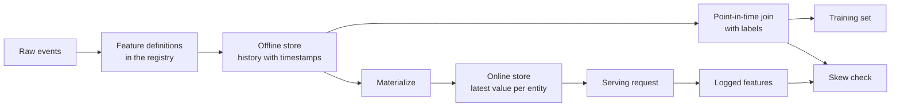

# Les magasins et les services de formation

> Une fonctionnalité a une définition et deux lecteurs. La formation lit son histoire à partir de chaque étiquette, et le service lit sa dernière valeur. Lorsque les deux lecteurs ne sont pas d'accord, le modèle voit des entrées sur lesquelles il n'a jamais été formé.

**Type:** Build
**Languages:** Python
**Prerequisites:** Phase 2, Lessons 08 (Feature Engineering), 13 (ML Pipelines), 15 (Time Series), and 19 (ML System Design)
**Time:** ~100 minutes

## Objectifs d'apprentissage

- Décrivez la boutique hors ligne, la boutique en ligne, les entités, les timestamps d'événements et les TTL, et le travail de chacun
- Mettre en œuvre une combinaison correcte en temps opportun et montrer comment une combinaison naïve copie les valeurs futures dans les données de formation
- Nommez quatre causes de la faillite des formations: deux voies de code, des fonctionnalités obsolètes, des défauts différents et des déplacements dans le temps.
- Construire un registre de fonctionnalités dans lequel une définition alimente à la fois le chemin d'entraînement et le chemin de service
- Remplissez une nouvelle fonctionnalité sur les dates précédentes sans lire les données de chaque date
- Détecter la déformation en comparant les caractéristiques de service enregistrées avec le parcours d'entraînement pour la même entité et le même temps

## Le problème

Une équipe construit un modèle de churn. Chaque étiquette indique si un utilisateur n'a pas effectué d'achat dans les 30 jours suivant une journée d'étiquette.`user_id`et entraîne une règle sur `days_since_last_purchase`La précision hors ligne est de 0,948.

Sur le trafic en direct, le modèle fonctionne moins bien qu'une version plus ancienne et plus simple. Le tableau de fonctionnalités contenait la valeur la plus récente pour chaque utilisateur, à partir de semaines après les jours d'étiquetage. Un utilisateur dont le dernier achat a été le jour 115 a montré 60 jours d'inactivité dans le jour 175, l'instant-imager, donc la fonctionnalité contenait la réponse. Pendant ce temps, une autre équipe a écrit les caractéristiques de la servie à nouveau dans un autre service. Leur fenêtre de 30 jours comprenait un jour supplémentaire, et leur défaut pour un nouvel utilisateur était -1 au lieu de 365.

Les deux défauts ont la même cause. La formation et le service ont calculé "la même fonctionnalité" de deux façons différentes. Cette leçon construit les pièces d'un magasin de fonctionnalités à partir de zéro. Vous écrivez un registre, un remplissage arrière, un point-in-time rejoindre, une boutique en ligne avec un TTL, et un contrôle de biais. La démo reproduit les deux défauts avec des chiffres.

## Le concept

### Deux lecteurs du même trait

La formation et le service demandent des caractéristiques sous différentes formes:

| Property | Training (offline) | Serving (online) |
|---|---|---|
| Question | "What was the value for each of 10 million (entity, time) pairs?" | "What is the value for this one entity now?" |
| Time | Many points in the past | The present |
| Volume | Millions of rows per job | One row per request |
| Latency | Minutes are fine | A few milliseconds |
| Storage | Offline store: full history with timestamps, in columnar files or a warehouse | Online store: the latest value per entity, in a key-value database |

Une boutique de fonctionnalités garde les deux magasins remplis d'un ensemble de définitions de fonctionnalités.



### Les entités, les timestamps et le TTL

Quatre termes décrivent chaque ligne de caractéristiques:

- **Entity.**La clé que décrit une fonctionnalité, comme `user_id`ou `card_id`- Je suis désolé .
- **Event timestamp.**Le nombre d'achats "à partir du 14e jour" comporte le jour 14 du timestamp de l'événement.
- **Created timestamp.**Un backfill qui fonctionne aujourd'hui écrit des lignes avec des timestamps d'événement anciens et un nouvel timestamp créé.
- **TTL (time to live).**L'âge maximal d'une valeur. Une valeur plus ancienne que le TTL est considérée comme manquante, de sorte que le lecteur utilise la valeur par défaut.

Un groupe de fonctionnalités avec la même entité, source et TTL est souvent appelé une vue des fonctionnalités.

### Les joints corrects en point-in-time

Une ligne d'entraînement associe une étiquette aux valeurs de fonctionnalités existantes au moment de l'étiquette.

1. Trouvez les lignes de caractéristiques de la même entité.
2. Gardez les rangées dont le timestamp de l'événement est à l'emplacement ou avant le timestamp de l'étiquette.
3. Prenez la dernière de ces rangées.
4. Laissez tomber si le timestamp de l'étiquette moins son timestamp de l'événement est supérieur au TTL.

Voici un utilisateur, une étiquette au jour 16, et des lignes de fonctionnalités hebdomadaires:

| Feature row day | `purchases_30d` | Point-in-time join | Naive join on `user_id` |
|---|---|---|---|
| 7 | 4 | | |
| 14 | 3 | Selected | |
| 21 | 1 | Future | |
| 28 | 0 | Future | Selected |

L'étiquette demande si l'utilisateur achète quelque chose dans les jours 17 à 46. Le jour 28 ligne compte déjà les jours calmes après le jour de l'étiquette. Il montre 0 achats parce que l'utilisateur a arrêté d'acheter, ce qui est l'événement que l'étiquette mesure.

Nous divisons les données par temps dans la leçon de la série temporelle pour la même raison.

### Causes de biais de formation

Les règles d'apprentissage automatique de Google définissent la faillite de la formation comme une différence entre les performances pendant la formation et les performances pendant le service. Elles nomment trois causes: une manipulation différente des données dans les deux pipelines, un changement des données entre la formation et le service et une boucle de rétroaction.

| Cause | What happens | Example from the demo |
|---|---|---|
| Two code paths | Training and serving compute the feature with different code | The serving window includes day `now - 30`, and the training window does not |
| Stale features | The value that serving reads has a different age from the value that training used | Training reads weekly snapshots, and a new service computes fresh values |
| Different defaults | The two paths fill a missing value differently | Training uses 365 for "no purchase yet", and serving uses -1 |
| Time travel | Training reads a value from after the label time | The naive join reads the newest snapshot for every label |

La règle n°32 du même guide prévoit de réutiliser le code entre le pipeline d'entraînement et le pipeline de service chaque fois que possible.

### Un registre des caractéristiques

Le registre est le catalogue des définitions de fonctionnalités. Chaque entrée contient un nom, une entité, une source, une transformation, une fenêtre, une valeur par défaut, un TTL, un propriétaire, une version et une description.

Deux règles protègent:

- Aucun service ne garde une copie privée de la transformation.
- Une modification de définition crée une nouvelle version, l'ancienne version reste, donc les anciens modèles conservent la fonctionnalité sur laquelle ils ont été formés.

### Résidus de remplissage

Une nouvelle fonctionnalité n'a pas d'histoire, mais la formation a besoin de sa valeur à chaque ancienne date d'étiquette. Un backfill exécute la définition à chaque date passée et écrit une ligne par entité et date. Chaque course ne lit que les événements avec des timestamps à sa date ou avant.

Les coût de calcul des backfills augmentent avec le nombre d'entités multiplié par le nombre de dates. Ils apportent également une fuite subtile. Un backfill qui fonctionne aujourd'hui écrit des lignes avec d'anciens timestamps d'événements, mais il peut lire les données qui sont arrivées tard ou ont été corrigées plus tard.

### Détection de la déformation

La règle n°29 du même guide dit de noter les fonctionnalités à l'heure de service et de les utiliser dans la formation. Même un petit échantillon enregistré vous permet de vérifier la cohérence. Comparer chaque valeur enregistrée avec la valeur que le parcours de formation produit pour la même entité et le même temps. Pour chaque fonctionnalité, signalez la part des déséquilibres et la différence absolue moyenne.

Pour trouver la cause, comparez trois paires:

1. Les magasins en ligne lisent contre l'entraînement.
2. Le nouveau calcul contre l'entraînement, qui isole l'étouffement.
3. Deuxième chemin de code par rapport à un nouveau calcul. Cela isole les différences de code, comme les fenêtres et les défauts.

```figure
mlprod-pit-join
```

## Faites-le

Le code dans `code/main.py`Le temps est un nombre total de jours. Un travail hebdomadaire de lot écrit des instantanés de fonctionnalités sur les jours 7, 14, et ainsi de suite jusqu'à 175.

### Étape 1: Définitions de caractéristiques et registre

Une .`FeatureDefinition`La transformation est une transformation de données: un agrégat, une fenêtre et une définition par défaut.`compute`La méthode ne lit jamais les événements après `as_of`- Je suis désolé .

```python
@dataclass(frozen=True)
class FeatureDefinition:
    name: str
    entity: str
    aggregate: str
    window_days: int | None
    default: float
    version: int = 1
    owner: str = "growth-team"
    description: str = ""

    def compute(self, events: list[Event], as_of: int) -> float:
        visible = [e for e in events if e.day <= as_of]
        if self.window_days is not None:
            visible = [e for e in visible if e.day > as_of - self.window_days]
        if self.aggregate == "count":
            return float(len(visible))
        if self.aggregate == "sum":
            return round(sum(e.amount for e in visible), 2)
        if self.aggregate == "days_since_last":
            return float(as_of - max(e.day for e in visible)) if visible else self.default
        raise ValueError(f"unknown aggregate {self.aggregate!r}")
```

`FeatureRegistry.register`Il est vrai que la Commission n'accepte pas la même définition deux fois, mais rejette une définition différente portant le même nom et la même version. `fill_defaults`donne aux deux chemins la même valeur par défaut pour une valeur manquante.

Un modèle fixe une définition avec une référence telle que `spend_30d@1`- Je suis là .`compute`et `fill_defaults`résoudre la référence, et un nom sans `@`Lire la dernière version.`@`et aucun nombre de versions ne monte `ValueError`La référence est également la clé de chaque rangée stockée, donc le remplissage, la boutique en ligne et la lecture de serveur utilisent toutes la définition fichée.

### Étape 2: Remplissez le magasin hors ligne

```python
def backfill(registry: FeatureRegistry, names: list[str], events: list[Event], days: list[int]) -> list[FeatureRow]:
    rows = []
    for entity, entity_events in sorted(group_events(events).items()):
        for day in days:
            rows.append(FeatureRow(entity, day, registry.compute(names, entity_events, day)))
    return rows
```

La démo remplit trois fonctionnalités pour 299 utilisateurs sur 25 jours d'images instantanées, ce qui donne 7475 rangées.

### Étape 3: Le point-in-time de rejoindre

Réglez les rangées de chaque entité une fois par jour.`bisect_right`Le TTL dépose une ligne trop ancienne.

```python
def point_in_time_join(labels: list[LabelRow], rows: list[FeatureRow], ttl_days: int | None = None) -> list[JoinedRow]:
    by_entity: dict[str, list[FeatureRow]] = defaultdict(list)
    for row in rows:
        by_entity[row.entity].append(row)
    days_index = {}
    for entity, entity_rows in by_entity.items():
        entity_rows.sort(key=lambda r: r.day)
        days_index[entity] = [r.day for r in entity_rows]
    joined = []
    for label in labels:
        days = days_index.get(label.entity, [])
        pos = bisect.bisect_right(days, label.day) - 1
        match = by_entity[label.entity][pos] if pos >= 0 else None
        if match is not None and ttl_days is not None and label.day - match.day > ttl_days:
            match = None
        joined.append(JoinedRow(
            label.entity, label.day, label.label,
            match.day if match else None, match.values if match else None,
        ))
    return joined
```

### Étape 4: Mesurer la fuite d'une jointure naïve

`naive_latest_join`La démo construit des étiquettes aux jours 100, 120 et 140 et s'inscrit dans chaque ensemble de formation une règle à une fonction.

```console
  naive join used a snapshot from after the label day for 100% of rows
  offline accuracy, naive join: 0.948 (rule: idle > 53 days)
  offline accuracy, PIT join:   0.893 (rule: idle > 19 days)
  accuracy on day 145, trained with naive join: 0.763
  accuracy on day 145, trained with PIT join:   0.876
```

La combinaison naïve semble mieux hors ligne, 0,948 contre 0,893. Sur les nouvelles données, c'est pire, 0,763 contre 0,876.

### Étape 5: La boutique en ligne et la matérialisation

La boutique en ligne conserve une rangée par entité et refuse les rangées plus anciennes que le TTL. `materialize`écrire uniquement des lignes dont le jour est à l'heure du travail ou avant.

```python
class OnlineStore:
    def __init__(self, ttl_days: int):
        self.ttl_days = ttl_days
        self._latest: dict[str, FeatureRow] = {}

    def write(self, row: FeatureRow) -> None:
        current = self._latest.get(row.entity)
        if current is None or row.day >= current.day:
            self._latest[row.entity] = row

    def read(self, entity: str, now: int) -> dict[str, float] | None:
        row = self._latest.get(entity)
        if row is None or row.day > now or now - row.day > self.ttl_days:
            return None
        return dict(row.values)
```

Avec un TTL de 10 jours, une lecture le jour 145 renvoie la ligne jour 140. Une lecture le jour 160, sans nouvelle matérialisation, renvoie les défauts, car la ligne est de 20 jours.

### Étape 6: vérification de la déformation

`detect_skew`Comparer deux points de vue principalement par`(entity, day)`Il indique le taux d'incohérence et la différence absolue moyenne par caractéristique et marque une caractéristique lorsque plus de 1% des valeurs diffèrent.`ValueError`Une demande manquante peut cacher la fausse couche, et un chèque sans requête ne montre rien.

```python
def detect_skew(
    training: dict[tuple[str, int], dict[str, float]],
    serving: dict[tuple[str, int], dict[str, float]],
    features: list[str],
    tolerance: float = 1e-6,
    max_mismatch_rate: float = 0.01,
) -> list[SkewReport]:
    if set(training) != set(serving):
        raise ValueError(f"{len(set(training) ^ set(serving))} keys are in only one view: log and compare the same requests")
    if not training:
        raise ValueError("no requests to compare")
    keys = sorted(training)
    reports = []
    for feature in features:
        diffs = [abs(training[k][feature] - serving[k][feature]) for k in keys]
        mismatches = sum(1 for d in diffs if d > tolerance)
        rate = mismatches / len(keys)
        mean_diff = sum(diffs) / len(keys)
        reports.append(SkewReport(feature, len(keys), rate, mean_diff, rate > max_mismatch_rate))
    return reports
```

Le démo logs les demandes sur les jours 141 à 150 et effectue les trois comparaisons de la section concept.

```bash
python3 code/main.py
```

```console
=== Skew checks on 383 logged requests, days 141 to 150 ===
  online store read  vs  training join (one definition, same snapshots)
    ok   days_since_last_purchase   mismatch   0.0%  mean |diff|    0.00
    ok   purchases_30d              mismatch   0.0%  mean |diff|    0.00
    ok   spend_30d                  mismatch   0.0%  mean |diff|    0.00
  fresh compute      vs  training join (staleness only)
    SKEW days_since_last_purchase   mismatch  83.0%  mean |diff|    2.77
    SKEW purchases_30d              mismatch  30.5%  mean |diff|    0.38
    SKEW spend_30d                  mismatch  37.1%  mean |diff|   16.77
  second code path   vs  fresh compute (code differences only)
    SKEW days_since_last_purchase   mismatch   5.5%  mean |diff|   20.07
    SKEW purchases_30d              mismatch  12.5%  mean |diff|    0.13
    SKEW spend_30d                  mismatch  12.5%  mean |diff|    5.09
```

Lisez les trois blocs dans l'ordre:

- **One definition, same snapshots.**La boutique en ligne et le train de formation lisent les mêmes lignes matérialisées, donc la biais est zéro.
- **Staleness.**Une valeur fraîche diffère de l'imagerie hebdomadaire sur la plupart des demandes.
- **Code differences.**Le deuxième chemin de code diffère sur 12,5% des comptes de fenêtres, car sa fenêtre comprend un jour supplémentaire.`days_since_last_purchase`uniquement pour les nouveaux utilisateurs, mais en grande quantité: -1 contre 365.

## Utilisez-le

Feast est un magasin de fonctionnalités open source. Chaque pièce du code à partir de zéro a une contrepartie de Feast:

| From scratch | Feast |
|---|---|
| `FeatureDefinition`, `FeatureRegistry` | `Entity`, `FeatureView`, and `Field` in a feature repository, registered with `feast apply` |
| `FeatureRow` history | An offline store, for example a `FileSource` over Parquet files or a warehouse table |
| `point_in_time_join` with a TTL | `store.get_historical_features(entity_df=..., features=[...])` |
| `materialize` | `feast materialize-incremental <end time>` |
| `OnlineStore.read` | `store.get_online_features(features=[...], entity_rows=[...])` |
| Created timestamp check | `created_timestamp_column` on the source and `filter_by_created_timestamp=True` |

Le code suit le démarrage rapide de la fête et n'est pas nécessaire pour exécuter cette leçon.

```python
from datetime import timedelta

from feast import Entity, FeatureView, Field, FileSource
from feast.types import Float32, Int64

user = Entity(name="user", join_keys=["user_id"])

user_activity_source = FileSource(
    name="user_activity_source",
    path="data/user_activity.parquet",
    timestamp_field="event_timestamp",
    created_timestamp_column="created",
)

user_activity = FeatureView(
    name="user_activity",
    entities=[user],
    ttl=timedelta(days=10),
    schema=[
        Field(name="purchases_30d", dtype=Int64),
        Field(name="spend_30d", dtype=Float32),
        Field(name="days_since_last_purchase", dtype=Int64),
    ],
    source=user_activity_source,
)
```

La formation et le service sont ensuite les mêmes:

```python
from feast import FeatureStore

store = FeatureStore(repo_path=".")

training_df = store.get_historical_features(
    entity_df=labels_df,
    features=["user_activity:purchases_30d", "user_activity:days_since_last_purchase"],
    filter_by_created_timestamp=True,
).to_df()

online = store.get_online_features(
    features=["user_activity:purchases_30d", "user_activity:days_since_last_purchase"],
    entity_rows=[{"user_id": 42}],
).to_dict()
```

`labels_df`contient une ligne par étiquette avec `user_id`- Je suis là .`event_timestamp`La documentation de Feast indique que le TTL est relatif à chaque timestamp dans le cadre de données de l'entité, et non au moment de la requête.`point_in_time_join`La même page décrit`filter_by_created_timestamp=True`Les données de formation ne sont pas toutes fournies en ligne, mais une boutique sans support génère une erreur au lieu d'ignorer l'option.

Tecton, Hopsworks et les magasins de fonctionnalités des grandes plateformes de ML dans le cloud utilisent la même fraction entre les magasins hors ligne et en ligne. Pour le contrôle de la biais, TensorFlow Data Validation peut comparer les données de formation avec les données de serveur pour détecter la biais. Breck et al. décrivent le système de validation des données dans TFX, la plateforme de ML de bout en bout de Google, y compris la biais de formation.

## La faire partir

Cette leçon produit `outputs/skill-feature-skew-audit.md`. L'audit des compétences examine un pipeline de fonctionnalités pour les déplacements dans le temps et les biais de formation.

## Exercices

1. Modifiez l'intervalle de prise de vue de 7 jours à 1 jour.
2. Réglez le TTL à 3 jours, comptez les lignes d'entraînement qui perdent leurs fonctionnalités et obtiennent des défauts.
3. Ajoutez une date créée à `FeatureRow`Faites que le joindre ignore les lignes écrites après le jour de l'étiquette.
4. Registre `spend_7d`comme version 2 de `spend_30d`Remplissez-le et imprimez les deux versions du registre.
5. Réparer`legacy_serving_features`jusqu'à ce que le troisième chèque de biais passe.

## Les termes clés

| Term | What people say | What it means |
|------|----------------|----------------------|
| Feature store | "A database for features" | A system that computes features from one set of definitions and serves them to training and to serving |
| Offline store | "The training data" | Full feature history with event timestamps, read by training jobs and backfills |
| Online store | "The feature cache" | The latest value per entity, read by the serving path in milliseconds |
| Entity | "The ID" | The key that a feature describes, such as a user or a card |
| Event timestamp | "When it happened" | The time at which a feature value became true |
| Point-in-time join | "An as-of join" | A join that pairs each label with the latest feature row at or before the label time |
| TTL | "Expiry" | The maximum age of a feature value before a reader treats it as missing |
| Materialization | "Syncing to online" | The job that copies the latest feature values from the offline store to the online store |
| Backfill | "Computing history" | Running a feature definition at past dates to create its history |
| Training-serving skew | "It worked offline" | A difference between the features or behavior in training and in serving |

## Pour en savoir plus

- [Feast, Point-in-time joins](https://docs.feast.dev/getting-started/concepts/point-in-time-joins): Sémantique TTL et filtre à timestamp créé
- [Feast documentation](https://docs.feast.dev/): visualisation des fonctionnalités, boutiques hors ligne, boutiques en ligne et matérialisation
- [Google, Rules of Machine Learning](https://developers.google.com/machine-learning/guides/rules-of-ml): les règles de biais servant à la formation, de l'article 29 à l'article 37
- [Breck et al., Data Validation for Machine Learning (SysML 2019)](https://research.google/pubs/data-validation-for-machine-learning/): validation des données chez Google, y compris les services de formation
- [TensorFlow Data Validation guide](https://www.tensorflow.org/tfx/guide/tfdv): vérification des schémas, détection des déviations et détection des dérives
- [Sculley et al., Hidden Technical Debt in Machine Learning Systems (NeurIPS 2015)](https://papers.nips.cc/paper/2015/hash/86df7dcfd896fcaf2674f757a2463eba-Abstract.html): dépendances des données et dette de pipeline autour d'un modèle
