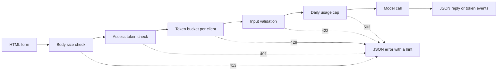

# Modèle d'interfaces de démonstration  De la fonction à l'application partagée

> Un modèle de démonstration a un contrat: une entrée, un appel modèle et une sortie.

**Type:** Build
**Languages:** Python
**Prerequisites:** Phase 11 · 13 (Building a Production LLM Application), Phase 17 · 08 (Inference Metrics), Phase 17 · 19 (AI Gateways)
**Time:** ~90 minutes

## Objectifs d'apprentissage

- Écrivez le contrat d'entrée, d'appel de modèle et de sortie d'une démonstration, avec une limite pour chaque partie.
- Construisez une application HTTP de bibliothèque standard avec une page HTML, un point d'extrémité JSON et un point d'extrémité Events envoyés par le serveur.
- Valider les entrées dans l'ordre des coûts et renvoyer les erreurs JSON qui indiquent à l'utilisateur la prochaine action.
- Protégez une démo publique avec un jeton par client, un plafond d'utilisation quotidienne et un jeton d'accès optionnel.
- Écrivez des journaux de requêtes qui ne conservent pas de texte d'entrée et d'adresse client.
- Comparez la démo bibliothèque standard avec deux versions de cadre, et nommez les signaux indiquant qu'une démo doit devenir un produit.

## Le problème

Votre modèle fonctionne dans un carnet. Maintenant, un critique veut essayer dix entrées, et un client veut voir un résultat sur un téléphone. Aucun d'eux n'ouvrira votre carnet.

Une cellule de ordinateur portable n'a pas de limites d'entrée et n'affiche pas de progrès. Ses erreurs sont des traces de pile que vous seul pouvez lire. Elle fonctionne également avec vos informations d'identification et votre budget. Si vous mettez la cellule derrière un URL public sans changement, vous pouvez vous attendre à des échecs comme ceux-ci:

- Un utilisateur colonne un document de 40 000 caractères, l'appel modèle dure une minute, puis échoue avec une trace de pile.
- Un script envoie 500 demandes en une minute.
- La page ne montre rien pendant huit secondes, alors l'utilisateur clique sur le bouton quatre fois de plus.
- Le journal du serveur conserve toutes les entrées, y compris les entrées avec un numéro de compte client.

Une interface démo prévient ces défaillances avec une petite quantité de code. Cette leçon en construit une avec la bibliothèque standard Python, de sorte que vous pouvez voir chaque partie.

## Le concept

### Une démonstration est un contrat.

Chaque démo a trois parties. L'entrée est ce que l'utilisateur peut envoyer. L'appel modèle transforme l'entrée en sortie. La sortie est ce que l'utilisateur voit, et cela inclut les erreurs.

Écrivez le contrat avant de rédiger la page:

| Part | Question to answer | Answer in this lesson |
|------|--------------------|-----------------------|
| Input | What type, what size, which characters? | A string of 1 to 500 characters, with no control characters |
| Model call | How long does one call take, and what does it cost? | A toy keyword model that runs in under a millisecond at no cost |
| Output | What does the user see on success and on failure? | A label, a score, and a reply, or a JSON error with a hint |

Un ordinateur portable n'a aucune limite sur aucune des trois parties.



Les chèques sont effectués par ordre de coût. Une mauvaise demande s'arrête au premier chèque qui échoue, donc cela ne coûte presque rien au serveur. L'appel modèle vient en dernier, car c'est la seule étape qui coûte de l'argent.

### Valider avant l' exécution du modèle

Le navigateur peut vérifier l'entrée avant d'envoyer quoi que ce soit.`maxlength`et `required`Les attributs d'un espace texte donnent à l'utilisateur des commentaires sans appel réseau. Ces contrôles aident uniquement les utilisateurs honnêtes.

Mettez les contrôles du serveur dans l'ordre des coûts:

1. Lisez le `Content-Length`Ne pas dépasser la limite avant de le lire.
2. Parser le corps JSON. Refuser un corps qui n'est pas un objet JSON.
3. Vérifiez les champs. Rejetez le texte vide, le texte au-delà de la limite et contrôlez les caractères.
4. Passer un appel modèle seulement sur une demande qui a passé chaque chèque.

| Failed check | HTTP status | Error code |
|--------------|-------------|------------|
| Body over 4,096 bytes | 413 Content Too Large | `body_too_large` |
| Body stops before `Content-Length` bytes arrive | 408 Request Timeout | `request_timeout` |
| Content type is not JSON | 415 Unsupported Media Type | `unsupported_media_type` |
| Body is not a JSON object | 400 Bad Request | `bad_json` |
| Text is missing, empty, too long, or has control characters | 422 Unprocessable Content | `missing_text`, `empty_text`, `text_too_long`, `control_characters` |

RFC 9110 définit ces codes d'état et leurs noms.

Les exemples font partie de la conception d'entrée. Un exemple montre à l'utilisateur à quoi ressemble une bonne entrée. Il donne également à un examinateur un test avec un clic. Choisissez un exemple pour chaque classe de sortie. Cette démo a un exemple positif, négatif et neutre.

### Montrez que le modèle fonctionne

Un appel de modèle peut prendre plusieurs secondes. Sans rétroaction, l'utilisateur ne peut pas distinguer un modèle lent d'une page cassée. Un utilisateur qui ne voit aucun changement peut cliquer à nouveau, et le serveur reçoit ensuite une deuxième demande payante.

La page de cette leçon donne quatre types de commentaires:

- Il désactive le bouton envoyer pendant que la demande est exécutée.
- Il montre le temps écoulé et le met à jour toutes les 100 millisecondes.
- Il indique le moment de la première marque quand la première marque arrive.
- Il indique le temps total de fin de la demande.

Quand vous étudiez .[inference metrics](../../08-inference-metrics-goodput/)La page de démonstration montre le même nombre à l'utilisateur, mesuré dans le navigateur.

### Envoyez la sortie en tant que flux

Un modèle de langage produit sa réponse un jeton à la fois. Si le serveur attend le dernier jeton, l'utilisateur attend la génération complète. Si le serveur envoie chaque jeton quand il est prêt, l'utilisateur commence à lire après le premier jeton.

Les événements envoyés par serveur (SSE) sont le format standard pour cela.`text/event-stream`Chaque événement est un groupe de`event:`et `data:`La norme HTML WHATWG définit le format.

```text
event: token
data: {"index":0,"text":"Label:"}

event: token
data: {"index":1,"text":" positive."}

event: done
data: {"label":"positive","score":1.0,"tokens":11}
```

Le navigateur a un `EventSource`Une demande GET met l'entrée dans l'URL, et les serveurs Web et les proxies écrivent des URL dans leurs journaux d'accès. Cette démo envoie une demande POST avec un corps JSON à la place. La page lit la réponse avec `fetch()`et `response.body.getReader()`, et il analyse le format de l'événement lui-même.

Un flux a un problème que n'a pas une seule réponse JSON. Le serveur envoie l'état 200 avant le premier jeton. Si le modèle échoue après cela, le serveur ne peut pas changer l'état.`error`l'événement dans le flux, et la page montre cet événement comme une erreur.

Quand vous avez construit le [production LLM application](../../../11-llm-engineering/13-production-app/)Cette leçon écrit le même protocole à la main, de sorte que vous pouvez voir chaque ligne que le serveur envoie.

### Écrire des erreurs sur lesquelles un utilisateur peut agir

Un message d'erreur a deux fonctions: il dit à l'utilisateur ce qui s'est passé et il dit à l'utilisateur ce qu'il doit faire ensuite.

Chaque erreur dans cette démo a la même forme JSON:

```json
{
  "error": {
    "code": "text_too_long",
    "message": "The text has 812 characters. The limit is 500.",
    "hint": "Shorten the text to 500 characters or fewer.",
    "request_id": "a8f3c2b435e3"
  }
}
```

- `code`Le code client et les tests comparent.
- `message`indique le fait, avec les numéros dont l'utilisateur a besoin.
- `hint`donne à l'utilisateur une action.
- `request_id`connecte un rapport d'utilisateur à un enregistrement de journal.

RFC 9457 définit un format d'erreur standard pour les API HTTP, appelé détail de problème. Cette démo utilise une forme plus petite à la même fin.

### Partager une démo en toute sécurité

Un lien public modifie qui peut envoyer des demandes.

| Risk | Control in this demo | Control for a larger audience |
|------|----------------------|-------------------------------|
| One client sends too many requests | A token bucket per client, with 429 and `Retry-After` | Per-user limits after sign-in |
| Strangers find the link | An optional access token in the `Authorization` header | Single sign-on with an identity provider |
| Total cost grows with no limit | A daily usage cap, with 503 and `Retry-After` | Spend limits and alerts at the model provider |
| Very large or unusual input | Body size limit, text length limit, control character check | Content moderation on input and output |
| Logs keep private input | Records with the input length and a keyed hash of the client | A retention period and access control on the logs |

Un seau de jetons utilise deux numéros. La capacité est la plus grande explosion qu'un client peut envoyer. Le taux de remplissage est le taux de demande à long terme. Chaque demande prend un jeton, et le seau se remplit continuellement jusqu'à sa capacité:

```text
tokens = min(capacity, tokens + refill_rate * seconds_since_last_request)
accept the request if tokens >= 1, then subtract 1
```

Quand le seau est vide, le serveur répond.`429 Too Many Requests`. RFC 6585 définit l'état 429, et il permet au serveur d'ajouter un `Retry-After`Cette démo ajoute toujours l'en-tête, avec le nombre de secondes jusqu'au jeton suivant. La page lit l'en-tête et désactive le bouton pour ce temps.

La démo utilise l'adresse IP du client comme clé de seau. Derrière un proxy inversé, chaque demande provient de l'adresse proxy, de sorte que tous les utilisateurs partagent un seau. Dans ce cas, lisez l'adresse du client à partir d'une en-tête que votre propre proxy définit. Ne faites pas confiance à cette en-tête à partir d'une autre source, car un client peut y mettre n'importe quelle valeur.

Quand vous étudiez .[AI gateways](../../19-ai-gateways/)Une démo nécessite le même contrôle à une échelle plus petite. Une limite de taux contrôle chaque client, mais elle ne contrôle pas le total. Une centaine de clients qui restent chacun sous la limite peuvent toujours utiliser le budget complet. Un plafond d'utilisation compte tous les appels de modèle en une journée et refuse les appels après un numéro fixe.

Les journaux ont besoin du même soin que les entrées.`http.server`Le gestionnaire écrit l'adresse IP du client et la ligne de demande en erreur standard. Si l'entrée est dans l'URL, l'entrée entre dans le journal. Cette démo remplace cette ligne de journal. Chaque demande écrit un enregistrement avec le chemin, l'état, le code d'erreur, la latence et la longueur de l'entrée. L'adresse du client devient un hash à clé, de sorte que vous pouvez compter les demandes par client sans stocker l'adresse.

La page démo dit que le serveur conserve la longueur du texte et jamais le texte lui-même.

### Quand une démo devient un produit

Une démo sert des personnes connues en quelques sessions à partir d'un processus.

- Les gens de l'extérieur de votre équipe l'utilisent chaque semaine.
- Quelqu'un demande une cible de disponibilité ou rapporte une panne.
- Les utilisateurs demandent de se connecter, de sauvegarder les résultats ou de voir leur historique.
- Le coût hebdomadaire du modèle est une ligne dans un budget.
- Les données de saisie comprennent les données couvertes par un contrat ou une loi.

| Property | Demo | Product |
|----------|------|---------|
| Users | Known people, short sessions | Unknown people, daily use |
| State | None | Accounts, history, saved results |
| Availability | Best effort, one process | A written target, replicas, an on-call owner |
| Cost control | One daily usage cap | Per-user quotas and billing |
| Observability | One log record per request | Traces, metrics, and alerts |

Lorsque vous voyez ces signaux, déplacer la démo sur la pile de production de la production LLM application leçon. Cette pile ajoute authentification réelle, les modèles de rétroaction, le suivi et le suivi des coûts par utilisateur.

```figure
demo-token-bucket
```

## Faites-le

Le code est un fichier,`code/main.py`, sans dépendances en dehors de la bibliothèque standard.

```bash
python3 code/main.py
```

L'auto-test vérifie le validateur, le seau de jetons, le format de flux et un véritable aller-retour HTTP. Il démarre le serveur sur un port gratuit, envoie trois demandes, arrête le serveur et sort.

```bash
python3 code/main.py --serve
```

Ouvert .`http://127.0.0.1:8000`Préciser Ctrl + C pour arrêter le serveur.

### Étape 1: L'appel modèle

Le modèle est un compteur de mots clés jouets. Il étiquette le texte comme positif, négatif ou neutre.

```python
def classify(text):
    words = WORD_RE.findall(text.lower())
    positive = sum(1 for word in words if word in POSITIVE)
    negative = sum(1 for word in words if word in NEGATIVE)
    score = (positive - negative) / max(1, positive + negative)
    if score > 0:
        label = "positive"
    elif score < 0:
        label = "negative"
    else:
        label = "neutral"
    return {"label": label, "score": round(score, 3), "positive_cues": positive,
            "negative_cues": negative, "words": len(words)}


def generate(text):
    result = classify(text)
    reply = (
        f"Label: {result['label']}. Positive cues: {result['positive_cues']}. "
        f"Negative cues: {result['negative_cues']}. Words read: {result['words']}."
    )
    parts = reply.split(" ")
    yield parts[0]
    for part in parts[1:]:
        yield " " + part
```

Un modèle réel remplace `generate`Il y a une série de fichiers qui sont utilisés pour la sélection de fichiers et rien d'autre.

### Étape 2: Validation et réponses à l'erreur

Une classe d'exception contient chaque erreur. Elle contient l'état HTTP, un code stable, un message, un indice et des en-têtes de réponse optionnelles.

```python
class DemoError(Exception):
    def __init__(self, status, code, message, hint, headers=None):
        super().__init__(message)
        self.status = status
        self.code = code
        self.message = message
        self.hint = hint
        self.headers = dict(headers or {})


def validate_text(payload, max_chars=MAX_CHARS):
    if "text" not in payload:
        raise DemoError(422, "missing_text", 'The field "text" is missing.', 'Add a "text" field with your input.')
    text = payload["text"]
    if not isinstance(text, str):
        raise DemoError(422, "text_not_string", 'The field "text" is not a string.', "Send the input as a string.")
    text = text.strip()
    if not text:
        raise DemoError(422, "empty_text", "The text is empty.", "Type a sentence or pick an example.")
    if len(text) > max_chars:
        raise DemoError(422, "text_too_long", f"The text has {len(text)} characters. The limit is {max_chars}.",
                        f"Shorten the text to {max_chars} characters or fewer.")
    if CONTROL_RE.search(text):
        raise DemoError(422, "control_characters", "The text contains control characters.",
                        "Remove the hidden characters, then send the text again.")
    return text
```

Le validateur supprime d'abord l'espace blanc avant et après. Un texte de seulement des espaces échoue ensuite comme vide, et l'indice indique à l'utilisateur ce qu'il faut taper. `check_body_size`et `parse_json_body`Utilisez le même schéma pour les cas 411, 413, 415 et 400. `error_body`- Il tourne tout .`DemoError`dans la forme JSON à partir de la section concept.

### Étape 3: Le seau de symboles

```python
class TokenBucket:
    def __init__(self, capacity, refill_per_second, now):
        if capacity < 1:
            raise ValueError("capacity must be at least 1")
        if refill_per_second <= 0:
            raise ValueError("refill_per_second must be positive")
        self.capacity = float(capacity)
        self.refill_per_second = float(refill_per_second)
        self.tokens = float(capacity)
        self.updated = now

    def take(self, now, cost=1.0):
        elapsed = max(0.0, now - self.updated)
        self.tokens = min(self.capacity, self.tokens + elapsed * self.refill_per_second)
        self.updated = now
        if self.tokens >= cost:
            self.tokens -= cost
            return 0.0
        return (cost - self.tokens) / self.refill_per_second
```

`take`Le serveur renvoie la valeur et l'envoie dans la boîte.`Retry-After`- Je suis désolé .

`RateLimiter`Il garde un seau par client dans un`OrderedDict`Une serrure protège le dictionnaire, parce que`ThreadingHTTPServer`Le dictionnaire traite chaque demande dans son propre fil.`max_clients`Les données de la requête sont définies comme étant les données de la requête de dépôt de données.`max_clients`au-delà du nombre de clients actifs que vous attendez.

Le limitateur prend une`clock`Les tests ont été validés.`FakeClock`, afin qu'un test puisse avancer le temps de dix secondes sans attendre. `UsageCap`Il compte les appels dans les fenêtres fixes de 86 400 secondes, et il renvoie les secondes jusqu'à la fenêtre suivante lorsque le compte est plein.

### Étape 4: Le courant

```python
def sse_event(event, data):
    payload = json.dumps(data, separators=(",", ":"), ensure_ascii=False)
    return f"event: {event}\ndata: {payload}\n\n".encode("utf-8")


def stream_events(text, generate_fn=generate, delay=0.0, sleep=time.sleep):
    count = 0
    try:
        for token in generate_fn(text):
            yield sse_event("token", {"index": count, "text": token})
            count += 1
            if delay:
                sleep(delay)
    except Exception:
        yield sse_event("error", MODEL_ERROR)
        return
    result = classify(text)
    yield sse_event("done", {"label": result["label"], "score": result["score"], "tokens": count})
```

`json.dumps`écrit une nouvelle ligne à l'intérieur d'une chaîne comme les deux caractères `\n`. Chaque événement a donc une ligne de données sans nouvelle ligne brute.

Le générateur détecte une panne de modèle et envoie un`error`l'événement, parce que le serveur a déjà envoyé la ligne d'état.`delay`et `sleep`Les arguments ralentissent le flux pour un navigateur, et ils maintiennent les tests rapides.

### Étape 5: Le gestionnaire de requête

`DemoHandler`s' étend `BaseHTTPRequestHandler`Le gestionnaire POST effectue les contrôles dans l'ordre suivant la section concept:

```python
def do_POST(self):
    app = self.server.app
    request_id = uuid.uuid4().hex[:12]
    client_id = self.client_address[0]
    started = time.perf_counter()
    route = self.path if self.path in self.routes else "other"
    status, code, chars = 200, None, 0
    try:
        declared = self.headers.get("Content-Length")
        try:
            if route == "other":
                raise DemoError(404, "not_found", "This endpoint does not exist.",
                                "Send requests to /api/predict or /api/stream.")
            size = check_body_size(declared, app.config.max_body_bytes)
        except DemoError:
            self.drain(int(declared) if declared and declared.isdigit() else 0)
            raise
        try:
            body = self.rfile.read(size)
        except TimeoutError:
            self.close_connection = True
            raise DemoError(408, "request_timeout", "The request body did not arrive in time.",
                            "Send the request again with the full body.") from None
        app.admit(client_id, self.headers.get("Authorization"))
        text = app.read_text(self.headers.get("Content-Type"), body)
        chars = len(text)
        app.charge()
        if route == "/api/predict":
            self.send_json(200, predict(text), request_id)
        else:
            code = self.send_stream(text, request_id)
    except DemoError as err:
        status, code = err.status, err.code
        self.send_error_json(err, request_id)
    except TimeoutError:
        status, code = 408, "request_timeout"
        self.close_connection = True
    except Exception:
        status, code = 500, "internal_error"
        self.send_error_json(DemoError(500, "internal_error", "The server failed on this request.",
                                       "Try again. Quote the request id if you report the problem."), request_id)
    finally:
        latency_ms = (time.perf_counter() - started) * 1000
        app.log.record(request_id, route, client_id, status, chars, latency_ms, code)
```

`admit`vérifie le jeton d'accès et le seau de jeton. `charge`Il est utilisé pour vérifier le plafond journalier. Il est exécuté en dernier, donc seules les demandes valides comptent contre le plafond.`finally`Le dossier est conservé.`route`, jamais le chemin brut, car un chemin peut contenir une chaîne de requête avec du texte utilisateur.

Quatre détails empêchent les échecs qui sont faciles à manquer:

- `timeout = 10`En plus de cela, un client qui déclare 100 octets et envoie 10 tient un fil serveur pour toujours. Le gestionnaire envoie une erreur 408 JSON avec l'identifiant de demande et ferme la connexion. Un délai après le démarrage du flux ne ferme la connexion que parce que la ligne d'état est déjà envoyée.
- `log_message`Retour sans sortie. Cela supprime la ligne de journaux par défaut avec l'adresse du client et la ligne de demande.
- `drain`RFC 1122 dit que TCP envoie un réinitialisateur quand un hôte ferme une connexion avec des données non lues. Le client peut alors perdre la réponse 413.
- `send_stream`les captures `BrokenPipeError`Quand l'utilisateur ferme l'onglet, le modèle s'arrête et la demande ne coûte rien de plus.

`BaseHTTPRequestHandler`Le serveur qui utilise HTTP/1.0 envoie le corps avec un code de transfert en morceaux pour le même but.

### Étape 6: La page

`render_page`Le script est un document HTML avec un style en ligne et un script en ligne. La page ne charge pas de script, de police ou d'image externes.

```javascript
const reader = response.body.getReader();
const decoder = new TextDecoder();
let buffer = "";
while (true) {
  const chunk = await reader.read();
  if (chunk.done) { break; }
  buffer += decoder.decode(chunk.value, { stream: true });
  let cut = buffer.indexOf("\n\n");
  while (cut >= 0) {
    const frame = parseFrame(buffer.slice(0, cut));
    buffer = buffer.slice(cut + 2);
    cut = buffer.indexOf("\n\n");
    if (frame.event === "token") { output.textContent += frame.data.text; }
  }
}
```

Une partie du réseau peut se terminer au milieu d'un événement.`buffer`jusqu'à ce que la ligne blanche arrive.

La page écrit la sortie du modèle avec `textContent`et jamais avec `innerHTML`. Le modèle de sortie est un texte non fiable. Supposons que la page insère une réponse sous forme HTML, et que la réponse contient un élément avec un `onerror`Cet attribut peut ensuite exécuter du code dans le navigateur de l'utilisateur.

Le serveur envoie aussi un `Content-Security-Policy`en-tête avec `default-src 'none'`La politique permet un script en ligne et un style en ligne, identifiés par leurs hash SHA-256. Le navigateur refuse tous les autres scripts, y compris un script que l'attaquant injecte dans la page.

```python
def csp_hash(source):
    digest = hashlib.sha256(source.encode("utf-8")).digest()
    return "'sha256-" + base64.b64encode(digest).decode("ascii") + "'"
```

### Étape 7: Faites-le courir et essayez de le casser

Démarrer le serveur, puis utiliser `curl`Envoyez sept demandes consécutives à un serveur frais.

```bash
for i in 1 2 3 4 5 6 7; do
  curl -s -o /dev/null -w '%{http_code} ' -X POST http://127.0.0.1:8000/api/predict \
    -H 'Content-Type: application/json' -d '{"text": "ok"}'
done
```

```text
200 200 200 200 200 429 429
```

Attends dix secondes, puis envoie un texte vide:

```bash
curl -s -X POST http://127.0.0.1:8000/api/predict \
  -H 'Content-Type: application/json' -d '{"text": ""}'
```

```json
{"error": {"code": "empty_text", "message": "The text is empty.", "hint": "Type a sentence or pick an example.", "request_id": "e3e3599feaea"}}
```

Regardez le flux d' événements avec `curl -N`, qui désactive le tampon de sortie:

```bash
curl -N -X POST http://127.0.0.1:8000/api/stream \
  -H 'Content-Type: application/json' -d '{"text": "The screen is bright."}'
```

Pour exiger un jeton d'accès, définissez `DEMO_ACCESS_TOKEN`la page montre ensuite un champ pour le jeton.

```bash
export DEMO_ACCESS_TOKEN="$(python3 -c 'import secrets; print(secrets.token_urlsafe(24))')"
echo "$DEMO_ACCESS_TOKEN"
python3 code/main.py --serve
```

Exécuter les tests:

```bash
python3 -m unittest discover -s code/tests -v
```

Les tests HTTP démarrent le serveur sur le port 0, donc le système d'exploitation choisit un port libre. `tearDown`Arrête le serveur et vérifie que son fil est terminé.

## Utilisez-le

Deux cadres Python construisent le même type de démo avec moins de code: Gradio et Streamlit.`main.py`, de sorte que le validateur et le modèle restent les mêmes.`main.py`ou les tests.

### Components autour d'une fonction

Gradio met une interface Web autour d'une fonction Python. Les composants d'entrée et de sortie décrivent le contrat, et une fonction génératrice envoie une sortie partielle.

```python
import os

import gradio as gr

from main import EXAMPLES, MAX_CHARS, DemoError, classify, generate, validate_text


def label_text(text):
    try:
        clean = validate_text({"text": text})
    except DemoError as err:
        raise gr.Error(f"{err.message} {err.hint}")
    label = classify(clean)["label"]
    reply = ""
    for token in generate(clean):
        reply += token
        yield reply, label


demo = gr.Interface(
    fn=label_text,
    inputs=gr.Textbox(label="Text to label", lines=5, max_length=MAX_CHARS),
    outputs=[gr.Textbox(label="Reply"), gr.Textbox(label="Label")],
    examples=list(EXAMPLES),
    flagging_mode="never",
)

if __name__ == "__main__":
    demo.queue(max_size=20).launch(auth=("demo", os.environ["DEMO_PASSWORD"]))
```

Chacun d' eux .`yield`La fonction remplace la valeur de sortie entière, ce qui donne la réponse complète jusqu'à présent à chaque étape.

Réglage `flagging_mode`Le mode par défaut affiche un bouton de drapeau. Lorsque l'utilisateur le presse, Gradio écrit l'entrée et la sortie dans un fichier CSV sur le serveur.`"never"`Il enlève le bouton.

`queue(max_size=20)`La limite de concurrence par défaut est un appel en cours par événement. Un modèle lent sert ensuite un utilisateur à la fois jusqu'à ce que vous augmentiez la limite. Gradio crée également des points d'extrémité API lorsque l'application est lancée, de sorte que les scripts peuvent appeler la démo sans la page. Votre limite de fréquence doit s'appliquer à ces points d'extrémité aussi.

### Un script qui se répète à chaque entrée

Streamlit exécute votre script entier de haut en bas chaque fois que l'utilisateur change un widget. Un formulaire recueille ses valeurs de widget et les envoie en un seul lot lorsque l'utilisateur appuie sur le bouton soumettre.

```python
import streamlit as st

from main import EXAMPLES, MAX_CHARS, DemoError, classify, generate, validate_text

st.title("Toy sentiment demo")
st.caption("Do not paste private data.")

example = st.selectbox("Start from an example", ["", *EXAMPLES])
with st.form("demo"):
    text = st.text_area("Text to label", value=example, max_chars=MAX_CHARS)
    submitted = st.form_submit_button("Run model")

if submitted:
    try:
        clean = validate_text({"text": text})
    except DemoError as err:
        st.error(f"{err.message} {err.hint}")
    else:
        st.write_stream(generate(clean))
        st.write(f"Label: {classify(clean)['label']}")
```

`st.write_stream`Il prend le générateur directement et écrit chaque morceau quand il arrive.`@st.cache_resource`Le décorateur garde une copie du modèle pour toutes les séances.

### Ce que chaque option fait par défaut

| Need | Standard library (this lesson) | Gradio | Streamlit |
|------|--------------------------------|--------|-----------|
| Form, examples, result area | You write the HTML | `Interface` builds them from components and `examples` | Widgets such as `st.text_area` and `st.selectbox` |
| Input length limit | `maxlength` on the page and a server check | `max_length` on `Textbox` | `max_chars` on `st.text_area` |
| Partial output | You write SSE and the stream reader | A generator function, where each `yield` replaces the output | `st.write_stream` with a generator of chunks |
| Progress display | You write the timer | A progress display on the output area, set by `show_progress` | `st.write_stream` shows each chunk when it arrives |
| Errors for the user | JSON with `code`, `message`, `hint`, `request_id` | `raise gr.Error(...)` shows the message | `st.error(...)` shows the message |
| Concurrency | One thread per request, no limit | A queue, with one running call per event by default | Each interaction runs the script again for that session |
| Public link | You run the server and the domain | `launch(share=True)` gives a link that expires after one week | You deploy the app to a server |
| Sign-in | A bearer token check | `launch(auth=...)` with user names and passwords | `st.login()` with an OpenID Connect provider |
| Rate limit and cost cap | Token bucket and daily cap | Your code, with the client address from the request | Your code |
| Input that the tool writes to disk | Only the input length, in the log | Flagged samples in a CSV file, unless `flagging_mode="never"` | Your code decides |

Les cadres économisent le plus de travail sur la page: le formulaire, les exemples, l'affichage de progression et la sortie partielle. Ils économisent moins de travail sur les risques d'un lien public. Dans les trois versions, la limite de tarification, le plafond de coûts et la confidentialité des journaux sont votre travail. La version standard de la bibliothèque montre chacune de ces parties, de sorte que vous savez ce que vous devez vérifier dans un cadre.

## La faire partir

Cette leçon produit `outputs/skill-demo-interface-checklist.md`- Donner une description d'un modèle de démonstration ou de son code. Il renvoie une révision passée ou non du contrat, les commentaires, les erreurs et les contrôles pour un lien public.

## Exercices

1. Réglage `BUCKET_CAPACITY`à 2 et `REFILL_PER_SECOND`Prédire la sortie de la boucle de 7 requêtes.
2. Ajouter un `language`Le champ à l'organisme de demande.`"en"`Retournez une erreur 422 avec une indication pour toute autre valeur, et ajoutez deux tests.
3. Trouvez une phrase que le modèle de jouet étiquette mal, comme " L'écran n'est pas bon. " Ajoutez- la comme quatrième exemple, avec une note sur la page expliquant la limite.
4. Mettez la démo derrière un proxy inverse sur votre machine.`trust_proxy`option qui dit `X-Forwarded-For`Écrivez un test qui prouve qu'un client ne peut pas choisir sa propre clé de seau.
5. Remplacez`generate`En utilisant un code de référence, vous pouvez utiliser un code de référence de type "Call to a model API" qui renvoie des jetons en tant que flux.

## Les termes clés

| Term | What people say | What it actually means |
|------|-----------------|------------------------|
| Demo contract | "The UI" | The input limits, the model call, and the output shape, including errors |
| Token bucket | "A rate limiter" | A per-client counter that refills at a fixed rate up to a capacity. Each request uses one token |
| Retry-After | "Try later" | A response header with the number of seconds, or a date, after which the client can try again |
| Server-Sent Events | "Streaming" | A `text/event-stream` response of `event:` and `data:` lines, with a blank line after each event |
| Time to first token | "Latency" | The time from the request to the first token on the user's screen |
| Usage cap | "The budget" | A limit on the total number of model calls in a time window, for all clients together |
| Keyed hash | "An anonymous ID" | An HMAC of the client address with a secret salt. It is a pseudonym: anyone with the salt can test a known address |
| Content Security Policy | "CSP" | A response header that tells the browser which scripts, styles, and connections the page can use |

## Pour en savoir plus

- [Python `http.server` documentation](https://docs.python.org/3/library/http.server.html): les classes de serveur, le protocole HTTP/1.0, la ligne de journaux par défaut et l'avertissement que le module n'est pas destiné à la production.
- [WHATWG HTML Standard, server-sent events](https://html.spec.whatwg.org/multipage/server-sent-events.html): le format du flux d'événements et le `EventSource`l'interface.
- [MDN, Using server-sent events](https://developer.mozilla.org/en-US/docs/Web/API/Server-sent_events/Using_server-sent_events): exemples du format de l'événement et de l'API du navigateur.
- [MDN, Using readable streams](https://developer.mozilla.org/en-US/docs/Web/API/Streams_API/Using_readable_streams): comment lire un `fetch()`Réponse du corps, morceau par morceau.
- [MDN, Using the Fetch API](https://developer.mozilla.org/en-US/docs/Web/API/Fetch_API/Using_Fetch): les demandes avec un corps JSON et la gestion des réponses.
- [MDN, 429 Too Many Requests](https://developer.mozilla.org/en-US/docs/Web/HTTP/Reference/Status/429)et [MDN, Retry-After](https://developer.mozilla.org/en-US/docs/Web/HTTP/Reference/Headers/Retry-After): le statut de limite de taux et son titre.
- [MDN, Content Security Policy](https://developer.mozilla.org/en-US/docs/Web/HTTP/Guides/CSP): hashes pour les scripts en ligne et le `default-src`La directive.
- [RFC 6585](https://www.rfc-editor.org/rfc/rfc6585.html): codes d'état HTTP supplémentaires, y compris 429.
- [RFC 9110](https://www.rfc-editor.org/rfc/rfc9110.html): Sémantique HTTP, y compris 413, 415, et 422.
- [RFC 9457](https://www.rfc-editor.org/rfc/rfc9457.html): détails du problème, un format d'erreur JSON standard pour les API HTTP.
- [RFC 1122](https://www.rfc-editor.org/rfc/rfc1122.html): exigences de l'hôte, y compris la réinitialisation TCP à la fermeture avec les données non lues (section 4.2.2.13).
- [Gradio, Sharing your app](https://gradio.app/guides/sharing-your-app): partage des liens, authentification, page API et limites de tarifs.
- [Gradio, Streaming outputs](https://gradio.app/guides/streaming-outputs): fonctionnalités du générateur en sortie partielle.
- [Gradio, Interface](https://gradio.app/docs/gradio/interface)Le numéro de la liste:`examples`- Je suis là .`flagging_mode`, et `concurrency_limit`- Je suis désolé .
- [Gradio, Using flagging](https://gradio.app/guides/using-flagging): où les échantillons marqués vont sur le disque.
- [Streamlit, Basic concepts](https://docs.streamlit.io/get-started/fundamentals/main-concepts): le flux de données de répétition.
- [Streamlit, st.write_stream](https://docs.streamlit.io/develop/api-reference/write-magic/st.write_stream)et [Streamlit, Caching](https://docs.streamlit.io/develop/concepts/architecture/caching): une sortie partielle et un modèle qui se charge une fois.
- [Streamlit, st.login](https://docs.streamlit.io/develop/api-reference/user/st.login): connexion avec un fournisseur OpenID Connect.
