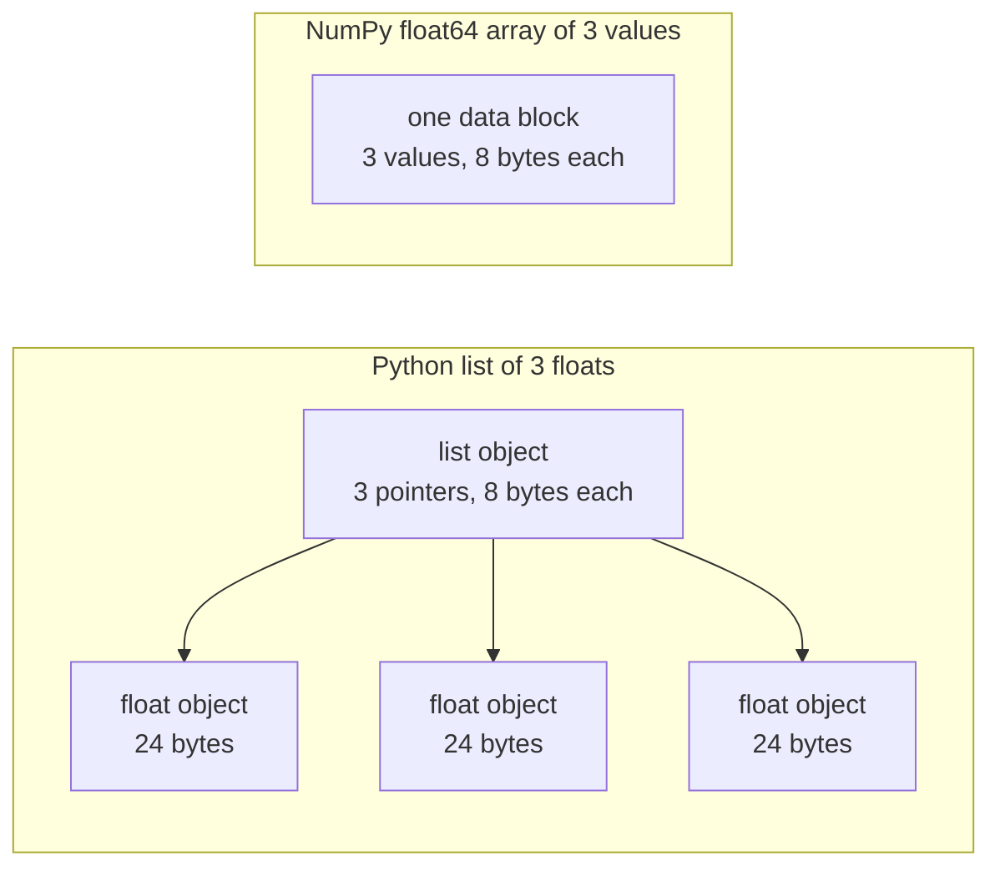

# एआई इंजीनियरिंग के लिए पायथन

> इस कोर्स में अधिकांश कोड एक ही छोटे सेट पायथन बोलियाँ का उपयोग करता है। गणित और मॉडल पाठ पर निर्भर करने से पहले, यहाँ उस सेट को जानें।

**Type:** Build
**Languages:** Python
**Prerequisites:** Dev Environment, Python Environments
**Time:** ~120 minutes

## सीखने के लक्ष्य

- अधिकांश पाठ्यक्रम कोड द्वारा उपयोग किए जाने वाले व्यंग्य को पढ़ें और लिखें, डिपैक और एफ-स्ट्रिंग से लेकर डेटाक्लास और समझ तक।
- तीन पायथन त्रुटियों को ढूंढें जो बिना किसी त्रुटि के गलत परिणाम देते हैंः साझा सूची, परिवर्तनीय डिफ़ॉल्ट और उपयोग किए जाने वाले जनरेटर।
- एक CSV और JSON लोडर, एक बीज विभाजन, और केवल मानक पुस्तकालय के साथ एक मिनी बैच जनरेटर का निर्माण करें।
- शुद्ध पायथन में डॉट उत्पाद, औसत और मानक विचलन लिखें, और उनकी गति और मेमोरी उपयोग को मापें।
- स्पष्ट करें कि संख्याओं पर शुद्ध-पायथन लूप धीमा क्यों है, और कैसे NumPy प्रसारण लूप को संकलित कोड में स्थानांतरित करता है।

## समस्या

इस चरण के बाद के पाठ गणित और मॉडल के लिए सादे पायथन का उपयोग करते हैं। पाठ में 541 पायथन फ़ाइलों में से, 276 आयातित हैं।`dataclasses`. इसके अलावा, 187 फाइल कॉल`random.seed`या एक `random.Random`यदि आप उन शब्दों को पढ़ना चाहते हैं, तो आप गणित पढ़ना चाहते हैं जब आप वाक्यविन्यास पढ़ते हैं।

पायथन में भी ऐसे व्यवहार होते हैं जो त्रुटि संदेश के बिना गलत परिणाम देते हैं। दो नाम एक सूची को संदर्भित कर सकते हैं, इसलिए एक नाम के माध्यम से परिवर्तन दूसरे को भी बदलता है। डिफ़ॉल्ट तर्क एक कॉल से दूसरे कॉल तक अपना मूल्य रखता है। एक पास के बाद एक जनरेटर खाली होता है, इसलिए एक दूसरे प्रशिक्षण युग में कोई डेटा नहीं मिलता है और नुकसान नहीं बदलता है।

अंतिम समस्या गति है. हमारे परीक्षण लैपटॉप पर, एक लाख फ्लोट पर एक शुद्ध पायथन लूप लगभग 30 मिलीसेकंड लेता है. NumPy एक मिलीसेकंड से भी कम समय में एक ही डॉट उत्पाद की गणना की. आपको कारण जानना होगा, ताकि आप एक स्पष्ट लूप और एक सरणी ऑपरेशन के बीच चुन सकें।

## अवधारणा

### पाठ्यक्रम कोड का उपयोग क्या है

हमने सभी 541 पायथन फ़ाइलों को विश्लेषण किया `phases/*/*/code/`के साथ `ast`तालिका उन फ़ाइलों की गिनती करती है जो प्रत्येक निर्माण को कम से कम एक बार उपयोग करती हैं। गिनती उस दिन से है जब हमने यह पाठ लिखा है, और वे बदलते हैं जैसे-जैसे पाठ जोड़े जाते हैं।

| Construct | Files | Share |
|-----------|-------|-------|
| Function definitions | 541 | 100% |
| `if __name__ == "__main__":` | 529 | 98% |
| f-strings | 517 | 96% |
| Tuple unpacking | 448 | 83% |
| Classes | 379 | 70% |
| List comprehensions | 375 | 69% |
| Type hints on functions | 342 | 63% |
| Generator expressions | 326 | 60% |
| Slices | 314 | 58% |
| `lambda` | 175 | 32% |
| `try` and `except` | 120 | 22% |
| `with` statements | 96 | 18% |
| Dict comprehensions | 93 | 17% |
| Generator functions with `yield` | 14 | 3% |

आयात यह दर्शाता है कि कौन से मानक मॉड्यूल मायने रखते हैं। 541 फ़ाइलों में से 340 से शुरू होते हैं `from __future__ import annotations`, और 276 आयात `dataclasses`. . .`math`,`random`और `json`मॉड्यूल 187, 175 और 126 फाइलों में दिखाई देते हैं।`collections`मॉड्यूल 70 फ़ाइलों में दिखाई देता है, और `itertools`केवल 4 में दिखाई देता है।

कोई पाठ कॉल नहीं`map()`या `filter()`समझें कि यह काम करता है।`sorted`,`min`,`max`या `.sort`एक के साथ `key=`इस पाठ में सबसे अधिक समय इन सूचियों के शीर्ष पर बोलने पर खर्च किया जाता है।

### वस्तुओं को नामित करें

पायथन में, एक चर एक नाम है जो किसी वस्तु को संदर्भित करता है। असाइनमेंट किसी वस्तु से एक नाम को बांधता है। यह वस्तु की प्रतिलिपि नहीं करता है। जब दो नाम एक सूची को संदर्भित करते हैं, तो किसी भी नाम के माध्यम से एक परिवर्तन दोनों के माध्यम से दिखाई देता है। संख्या, स्ट्रिंग और टूपल नहीं बदल सकते हैं, इसलिए यह नियम उनके लिए कोई समस्या नहीं पैदा करता है। सूचियों, डिक्ट और सेट बदल सकते हैं, इसलिए जब आपको स्वतंत्र संस्करण की आवश्यकता हो तो एक प्रतिलिपि बनाएं।

### एक सूची में सूचक हैं, एक सरणी में संख्याएं हैं

एक पायथन सूची सीधे संख्याओं को संग्रहीत नहीं करती है। यह पॉइंटर को संग्रहीत करती है, और प्रत्येक पॉइंटर एक पूर्ण पायथन ऑब्जेक्ट को संदर्भित करता है। CPython के 64-बिट बिल्ड पर, प्रत्येक पॉइंटर 8 बाइट्स लेता है और प्रत्येक `float`वस्तु 24 बाइट्स लेता है. एक NumPy `float64`array एक मेमोरी ब्लॉक में कच्चे 8 बाइट मानों को एक साथ संग्रहीत करता है।



एक सूची पर लूप प्रत्येक तत्व के लिए बहुत काम करता है। व्याख्याता एक बार में एक बाइटकोड निर्देश चलाता है। प्रत्येक तत्व के लिए, यह एक पॉइंटर का पालन करता है और प्रत्येक ऑपरेंड के प्रकार की जांच करता है। फिर यह फ्लोट गुणन कोड को बुलाता है और परिणाम को रखने के लिए एक पायथन फ्लोट ऑब्जेक्ट बनाता है।

NumPy कच्चे मूल्यों पर संकलित कोड के लूप में एक ही अंकगणित करता है। यह पूरे सरणी के लिए डेटा प्रकार को एक बार जांचता है, और यह प्रत्येक तत्व के लिए कोई पायथन ऑब्जेक्ट नहीं बनाता है। वेक्टरिज़ेड कोड पूरे सरणी पर एक ऑपरेशन का वर्णन करता है, जैसे `(x - mean) / std`, और एक पुस्तकालय लूप चलाता है. वेक्टर कार्यों इस पाठ में उस नियम का पालन करें. प्रत्येक एक सरणी ऑपरेशन करता है, तो आप इसे एक NumPy कॉल के साथ बाद में बदल सकते हैं.

### एक सूची में हर आइटम है, एक जनरेटर में एक है

एक सूची समझ अगली पंक्ति चलाने से पहले प्रत्येक आइटम का निर्माण करती है। एक जनरेटर प्रत्येक बार एक आइटम का निर्माण करता है जब भी कॉल करने वाला अगले के लिए पूछता है। एक सूची के लिए स्मृति आइटम की संख्या के साथ बढ़ती है। किसी भी संख्या में आइटम के लिए जनरेटर की स्मृति लगभग समान रहती है।

एक जनरेटर केवल एक बार चलाया जा सकता है. अंतिम आइटम के बाद, यह ऊपर उठता है`StopIteration`प्रत्येक अनुरोध पर, तो एक सेकंड `for`प्रशिक्षण कोड डेटासेट को प्रत्येक युग में एक बार पढ़ता है, इसलिए यह प्रत्येक युग के लिए एक नया जनरेटर बनाना चाहिए।

जेनरेटर फ़ंक्शन पाठ कोड में दुर्लभ हैं। गहन सीखने के पाठों में उपयोग किए जाने वाले डेटा लोडर बैच के पुनरावर्ती हैं, इसलिए विचार प्रत्येक प्रशिक्षण लूप में है। आंकड़ा दोनों दृष्टिकोणों को एक ही आठ पंक्तियों पर दिखाता है।

```figure
s0-list-vs-generator
```

## आपको जिन भाषाओं की आवश्यकता है

इस खंड में प्रत्येक ब्लॉक अपने आप चलता है. इसे एक फ़ाइल में सहेजें और इसे चलाते हैं के साथ`python3`ब्लॉक को पायथन 3.11 या बाद के संस्करण की आवश्यकता है, जिसे हमने डेवलपर वातावरण पाठ में स्थापित किया है।

### 1. मूल्य, संग्रह और अनपैक

पायथन में चार अंतर्निहित संग्रह हैं. प्रत्येक का उपयोग कब करना है सीखें।

| Type | Example | Ordered | Can change | Typical use in the course |
|------|---------|---------|------------|---------------------------|
| `list` | `[0.5, 1.2]` | Yes | Yes | Samples, losses, weights |
| `tuple` | `(32, 784)` | Yes | No | Shapes, fixed records, dict keys |
| `dict` | `{"lr": 0.01}` | Insertion order | Yes | Configs, vocabularies, JSON rows |
| `set` | `{"cat", "dog"}` | No | Yes | Unique tokens, overlap checks |

इस खंड में यह दर्शाया गया है कि असाइनमेंट सूची को कॉपी नहीं करता है।

```python
weights = [0.5, -1.2, 3.0]
alias = weights
alias[0] = 99.0
print(weights)

independent = list(weights)
independent[1] = 0.0
print(weights, independent)

grid = [[0] * 3] * 2
grid[0][0] = 1
print(grid)

grid = [[0] * 3 for _ in range(2)]
grid[0][0] = 1
print(grid)
```

```text
[99.0, -1.2, 3.0]
[99.0, -1.2, 3.0] [99.0, 0.0, 3.0]
[[1, 0, 0], [1, 0, 0]]
[[1, 0, 0], [0, 0, 0]]
```

अभिव्यक्ति `[[0] * 3] * 2`एक आंतरिक सूची के लिए दो संदर्भों के साथ एक बाहरी सूची बनाता है। समझ प्रत्येक पंक्ति के लिए एक नई आंतरिक सूची बनाता है। गणित चरण सूचियों से मैट्रिक्स बनाता है, इसलिए समझ फॉर्म का उपयोग करें।

अनपैकिंग एक पंक्ति में कई नामों के लिए अनुक्रम के आइटम को सौंपता है। एक सितारा नाम शेष आइटम एकत्र करता है। एक एफ स्ट्रिंग एक स्ट्रिंग में अभिव्यक्ति का मूल्य डालती है, जिसमें एक कॉलम के बाद एक वैकल्पिक प्रारूप होता है।

```python
shape = (32, 784)
batch_size, n_features = shape
first, *middle, last = [1, 2, 3, 4, 5]
x, y = 1.0, 3.0
x, y = y, x

config = {"lr": 0.01, "epochs": 5}
config["seed"] = 7
tokens = ["the", "cat", "sat", "on", "the", "mat"]
vocab = set(tokens)

print(batch_size, n_features, first, middle, last, x, y)
print(config.get("momentum", 0.9), "cat" in vocab, len(vocab))
print(f"lr={config['lr']:.0e} loss={0.123456:.3f} n={60_000:,} {batch_size=}")
```

```text
32 784 1 [2, 3, 4] 5 3.0 1.0
0.9 True 5
lr=1e-02 loss=0.123 n=60,000 batch_size=32
```

`dict.get`कुंजी गायब होने पर डिफ़ॉल्ट मान लौटाता है।`in`सेट पर परीक्षण किसी भी सेट आकार के लिए लगभग एक ही समय लेता है।`{batch_size=}`फॉर्म नाम और मूल्य प्रिंट करता है, जो डिबग करने में मदद करता है।

एक स्लाइस `a[start:stop:step]`शामिल है `start`और बाधित करता है `stop`एक सूची का एक टुकड़ा एक नई सूची है, इसलिए एक बड़ी सूची का एक टुकड़ा उसके सभी संकेतों को कॉपी करता है।

```python
tokens = ["<s>", "the", "cat", "sat", "on", "the", "mat", "</s>"]
print(tokens[1:-1])
print(tokens[:3], tokens[-3:])
print(tokens[::2])
print(tokens[::-1][:2])
windows = [tokens[i:i + 3] for i in range(len(tokens) - 2)]
print(len(windows), windows[0])
```

```text
['the', 'cat', 'sat', 'on', 'the', 'mat']
['<s>', 'the', 'cat'] ['the', 'mat', '</s>']
['<s>', 'cat', 'on', 'mat']
['</s>', 'mat']
6 ['<s>', 'the', 'cat']
```

### 2. समझें

एक समझ एक अभिव्यक्ति में पुनरावर्ती से एक सूची, डिक्ट या सेट बनाता है। यह उस गणित की तरह पढ़ता है जिसे यह वर्णन करता है।

```python
scores = [0.91, 0.42, 0.77, 0.15, 0.66]
labels = [1 if s >= 0.5 else 0 for s in scores]
high = [s for s in scores if s > 0.6]
squares = {i: i * i for i in range(4)}
lengths = {len(word) for word in ["a", "bb", "cc", "ddd"]}
sum_sq = sum(s * s for s in scores)

matrix = [[1, 2, 3], [4, 5, 6]]
transposed = [list(column) for column in zip(*matrix)]
flat = [v for row in matrix for v in row]

print(labels, high, squares, lengths, round(sum_sq, 4))
print(transposed, flat)
```

```text
[1, 0, 1, 0, 1] [0.91, 0.77, 0.66] {0: 0, 1: 1, 2: 4, 3: 9} {1, 2, 3} 2.0555
[[1, 4], [2, 5], [3, 6]] [1, 2, 3, 4, 5, 6]
```

एक पछाड़ `if`केवल कुछ वस्तुओं को रखता है।`for`एक सशर्त अभिव्यक्ति हो सकती है,`a if condition else b`दो .`for`दो घोंसले हुए लूप के समान क्रम में खंड चलते हैं।

गोल ब्रैकेट एक जनरेटर अभिव्यक्ति बनाते हैं।`sum(s * s for s in scores)`,`sum`एक समय में एक वर्ग पढ़ता है, और पायथन कोई सूची नहीं बनाता है।`zip(*matrix)`, सितारा प्रत्येक पंक्ति को अलग तर्क के रूप में पारित करता है, और `zip`प्रत्येक स्थिति में वस्तुओं को जोड़ा जाता है।

### 3. कार्य, तर्क और समापन

एक डिफ़ॉल्ट मान एक तर्क वैकल्पिक बनाता है। एक कीवर्ड तर्क कॉल पर पैरामीटर का नाम देता है।`*`पैरामीटर सूची में स्वयं अगले पैरामीटर केवल कीवर्ड बनाता है।

```python
def clip(value, low=0.0, high=1.0):
    return max(low, min(high, value))


def train(data, *, lr=0.01, epochs=3):
    return f"{len(data)} samples, lr={lr}, epochs={epochs}"


def make_scaler(factor):
    def scale(values):
        return [v * factor for v in values]
    return scale


print(clip(1.7), clip(-3.0, low=-1.0), clip(0.4, high=0.3))
print(train([1, 2, 3], lr=0.1))
to_percent = make_scaler(100)
print(to_percent([0.25, 0.5]))
```

```text
1.0 -1.0 0.3
3 samples, lr=0.1, epochs=3
[25.0, 50.0]
```

केवल कीवर्ड तर्क के साथ, एक कॉल जैसे `train(data, 0.1, 3)`बढ़ता है `TypeError`. . . कॉल करने वाले को लिखना चाहिए`lr=0.1`, तो दो संख्याएं गलती से जगह नहीं बदल सकती हैं।

आंतरिक कार्य`scale`उपयोग`factor`जो इसे बनाया गया था. पायथन रखता है `factor`जब तक `scale`एक समारोह जो अपने निर्माता से चर रखता है एक बंद है। निर्माण यह में मानकीकरण प्रशिक्षण के आंकड़े रखने के लिए एक बंद का उपयोग करता है।

ए `lambda`एक नाम के बिना एक अभिव्यक्ति फ़ंक्शन है। पाठ्यक्रम कोड इसे ज्यादातर एक के रूप में उपयोग करता है `key=`कार्य, जो भाग 8 में दिखाया गया है।

पायथन एक बार डिफ़ॉल्ट मान का मूल्यांकन करता है, जब यह `def`प्रत्येक कॉल जो डिफ़ॉल्ट का उपयोग करता है एक ही वस्तु प्राप्त करता है.

```python
def add_bad(item, bucket=[]):
    bucket.append(item)
    return bucket


def add_good(item, bucket=None):
    if bucket is None:
        bucket = []
    bucket.append(item)
    return bucket


add_bad("a")
print(add_bad("b"))
add_good("a")
print(add_good("b"))
```

```text
['a', 'b']
['b']
```

उपयोग करें`None`एक सूची, dict, या सेट के लिए डिफ़ॉल्ट के रूप में। समारोह के अंदर नया ऑब्जेक्ट बनाएं।

### 4. वर्ग और डेटा वर्ग

`@dataclass`सजावटकार लिखता है `__init__`,`__repr__`और `__eq__`टिप्पणी किए गए क्षेत्रों से।`frozen=True`, वस्तु निर्माण के बाद नहीं बदल सकता है, और आप इसे एक dict कुंजी के रूप में उपयोग कर सकते हैं या इसे एक सेट में डाल सकते हैं.

```python
from dataclasses import dataclass, field


@dataclass(frozen=True)
class Example:
    features: tuple[float, ...]
    label: int


@dataclass
class TrainConfig:
    lr: float = 0.01
    epochs: int = 5
    hidden: list[int] = field(default_factory=lambda: [64, 32])

    def describe(self):
        return f"lr={self.lr} epochs={self.epochs} hidden={self.hidden}"


ex = Example((1.5, 2.0), 1)
print(ex)
print(ex == Example((1.5, 2.0), 1), len({ex, Example((1.5, 2.0), 1)}))
print(TrainConfig(epochs=10).describe())
try:
    ex.label = 0
except AttributeError as err:
    print(type(err).__name__)
```

```text
Example(features=(1.5, 2.0), label=1)
True 1
lr=0.01 epochs=10 hidden=[64, 32]
FrozenInstanceError
```

`field(default_factory=...)`यह एक डेटा वर्ग के भीतर भाग 3 से साझा डिफ़ॉल्ट समस्या को हल करता है।

विशेष विधियां एक वर्ग को पायथन सिंटैक्स से जोड़ती हैं। `len(ds)`कॉल`__len__`और `ds[2]`कॉल`__getitem__`. .

```python
class SquaresDataset:
    def __init__(self, n):
        self.n = n

    def __len__(self):
        return self.n

    def __getitem__(self, index):
        if not 0 <= index < self.n:
            raise IndexError(index)
        return index, index * index


ds = SquaresDataset(4)
print(len(ds), ds[2])
print(list(ds))
```

```text
4 (2, 4)
[(0, 0), (1, 1), (2, 4), (3, 9)]
```

`for`अंदर लूप `list(ds)`बिना किसी `__iter__`विधि. पायथन कॉल `__getitem__`0, 1, 2 के साथ और इतने पर जब तक यह मिलता है `IndexError`. पाइटॉर्च मानचित्र शैली के डेटासेट एक ही दो तरीकों का उपयोग करते हैं, `__len__`और `__getitem__`. .

### 5. इटरेटर और जनरेटर

एक पुनरावर्ती किसी भी वस्तु है कि एक `for`लूप स्वीकार करता है।`iter()`यह एक पुनरावर्तक प्राप्त करता है, और `next()`पुनरावर्तक के लिए एक आइटम के लिए पूछता है। जब पुनरावर्तक के पास अधिक आइटम नहीं हैं, यह ऊपर उठता है `StopIteration`.`for`लूप कॉल`next()`तुम्हारे लिए और पर रुकता है `StopIteration`. .

```python
numbers = [10, 20, 30]
it = iter(numbers)
print(next(it), next(it), next(it))
try:
    next(it)
except StopIteration:
    print("no more items")


def countdown(n):
    while n > 0:
        yield n
        n -= 1


gen = countdown(3)
print(type(gen).__name__)
print(list(gen))
print(list(gen))
```

```text
10 20 30
no more items
generator
[3, 2, 1]
[]
```

 के साथ एक फ़ंक्शन`yield`उसके शरीर में एक जनरेटर फ़ंक्शन है. उसे कॉल करने के लिए उसके कोड का कोई भी नहीं चलाता है और एक जनरेटर वस्तु वापस आ जाता है. प्रत्येक `next()`शरीर को अगले पर चलाता है `yield`और वहाँ रुकता है।`list(gen)`खाली है क्योंकि पहले जनरेटर को इस्तेमाल किया।

एक जनरेटर एक समय में एक पंक्ति में एक फ़ाइल पढ़ सकता है।

```python
import os
import tempfile


def read_rows(path):
    with open(path, encoding="utf-8") as fh:
        header = fh.readline().rstrip("\n").split(",")
        for line in fh:
            yield dict(zip(header, line.rstrip("\n").split(",")))


with tempfile.TemporaryDirectory() as tmp:
    path = os.path.join(tmp, "rows.csv")
    with open(path, "w", encoding="utf-8") as fh:
        fh.write("x,label\n")
        fh.writelines(f"{i * 0.5},{i % 2}\n" for i in range(5))
    rows = read_rows(path)
    print(next(rows))
    print(sum(1 for _ in rows))
```

```text
{'x': '0.0', 'label': '0'}
4
```

`read_rows`एक समय में फ़ाइल की एक पंक्ति को स्मृति में रखता है। यह है `read_rows`यह उदाहरण को छोटा रखने के लिए अल्पविरामों पर विभाजित है. वास्तविक CSV फ़ाइलों को उद्धृत क्षेत्रों के अंदर अल्पविरामों हो सकते हैं, तो निर्माण यह उपयोग करता है `csv`मॉड्यूल।

```python
import sys

as_list = [i * i for i in range(1_000_000)]
as_generator = (i * i for i in range(1_000_000))
print(sys.getsizeof(as_list), sys.getsizeof(as_generator))
print(sum(as_list) == sum(as_generator))
```

64-बिट CPython पर, सूची लगभग 8 MB और जनरेटर लगभग 200 बाइट्स की रिपोर्ट करता है। `sys.getsizeof`केवल सूची के पॉइंटरों की गणना करता है, और पूर्णांक वस्तुओं अधिक स्मृति का उपयोग करते हैं।`tracemalloc`, जिसका उपयोग हमने डिबगिंग और प्रोफाइलिंग पाठ में किया।

### 6. संदर्भ प्रबंधक और अपवाद

ए `with`बयान सेटअप कोड चलाता है, उसके बाद उसके शरीर, और फिर सफाई कोड. सफाई चलता है जब शरीर एक अपवाद उठाता है. फ़ाइल ऑब्जेक्ट से`open()`एक संदर्भ प्रबंधक है जो फ़ाइल को बंद करता है।

डिबगिंग और प्रोफाइलिंग पाठ में, हमने एक लिखा `Timer`कक्षा के साथ `__enter__`और `__exit__`. . .`contextlib.contextmanager`सजावट एक जनरेटर से एक ही प्रकार की वस्तु बनाता है।`yield`है सेटअप, और `finally`ब्लॉक सफाई है।

```python
import time
from contextlib import contextmanager


@contextmanager
def timer(label):
    start = time.perf_counter()
    try:
        yield
    finally:
        print(f"{label}: {(time.perf_counter() - start) * 1000:.1f} ms")


def parse_label(text):
    try:
        return int(text)
    except ValueError:
        raise ValueError(f"label must be an integer, got {text!r}") from None


with timer("sum of squares"):
    total = sum(i * i for i in range(200_000))

print(parse_label("3"))
try:
    parse_label("cat")
except ValueError as err:
    print("rejected:", err)
```

```text
sum of squares: 9.4 ms
3
rejected: label must be an integer, got 'cat'
```

आपके मशीन पर समय अलग होगा. आप जिस अपवाद की उम्मीद करते हैं उसे सही नाम दें।`except`खंड, जैसे `ValueError`या `KeyError`. एक `except:`कोई अपवाद प्रकार के बिना खंड भी संभालता है `KeyboardInterrupt`, तो Ctrl + C एक लूप है कि यह शामिल है को रोकने में विफल रह सकता है. एक स्पष्ट संदेश के साथ एक अपवाद उठाएं जब इनपुट गलत है। जोड़ `from None`जब आपका संदेश मूल ट्रैकबैक की जगह लेता है।

### 7. टाइप संकेत, मॉड्यूल और मुख्य सुरक्षा

टाइप संकेत पाठक को बताते हैं कि कोई फ़ंक्शन क्या लेता है और क्या लौटाता है। पायथन कोड चलाने पर उन्हें नहीं जांचता है। एक टाइप चेकर, जैसे कि माइपी, कोड चलाने से पहले उन्हें पढ़ता है।

```python
from __future__ import annotations

from collections.abc import Iterable, Sequence


def mean(values: Sequence[float]) -> float:
    if not values:
        raise ValueError("mean() needs at least one value")
    return sum(values) / len(values)


def count_tokens(docs: Iterable[str]) -> int:
    return sum(len(doc.split()) for doc in docs)


def main() -> None:
    print(mean([1.0, 2.0, 4.0]))
    print(count_tokens(["the cat sat", "on the mat"]))
    print(mean.__annotations__)


if __name__ == "__main__":
    main()
```

```text
2.3333333333333335
6
{'values': 'Sequence[float]', 'return': 'float'}
```

के साथ`from __future__ import annotations`, पायथन हर संकेत को एक स्ट्रिंग के रूप में संग्रहीत करता है, जैसा कि अंतिम पंक्ति से पता चलता है। `Sequence` के साथ किसी भी वस्तु का अर्थ है`len()`और सूचकांक, जैसे कि एक सूची या एक ट्यूपल। `Iterable`किसी भी वस्तु का अर्थ है जो `for`कई पाठ्यक्रम फ़ाइलें से एक ही नाम आयात`typing`, जो भी काम करता है.

हर `.py`फ़ाइल एक मॉड्यूल है. जब आप एक फ़ाइल के साथ चलाते हैं `python3 file.py`, पायथन सेट करता है अपने `__name__``"__main__"`. जब दूसरी फाइल इसे आयात करती है,`__name__`यह मॉड्यूल का नाम है.`main()`केवल पहले मामले में।`code/tests/`आयात कर सकते हैं `main.py`डेमो शुरू करने के बिना.

### 8. फ़ाइलें, JSON, CSV, और सॉर्टिंग

`pathlib.Path` के साथ मार्गों को जोड़ता है`/`और एक कॉल में एक पूरी फ़ाइल पढ़ या लिख सकते हैं. हमेशा दे`encoding="utf-8"`, क्योंकि डिफ़ॉल्ट एन्कोडिंग ऑपरेटिंग सिस्टम पर निर्भर करता है।

```python
import csv
import json
import tempfile
from pathlib import Path

rows = [
    {"text": "great movie", "label": 1, "score": 0.93},
    {"text": "boring plot", "label": 0, "score": 0.12},
    {"text": "fine acting", "label": 1, "score": 0.58},
]

with tempfile.TemporaryDirectory() as tmp:
    json_path = Path(tmp) / "reviews.json"
    json_path.write_text(json.dumps(rows, indent=2), encoding="utf-8")
    from_json = json.loads(json_path.read_text(encoding="utf-8"))

    csv_path = Path(tmp) / "reviews.csv"
    with csv_path.open("w", newline="", encoding="utf-8") as fh:
        writer = csv.DictWriter(fh, fieldnames=["text", "label", "score"])
        writer.writeheader()
        writer.writerows(rows)
    with csv_path.open(newline="", encoding="utf-8") as fh:
        from_csv = list(csv.DictReader(fh))

print(from_json == rows)
print(from_csv[0])

by_score = sorted(rows, key=lambda r: r["score"], reverse=True)
print([r["text"] for r in by_score])
print(max(rows, key=lambda r: r["score"])["text"])
print([r["text"] for r in sorted(rows, key=lambda r: (-r["label"], r["text"]))])
```

```text
True
{'text': 'great movie', 'label': '1', 'score': '0.93'}
['great movie', 'fine acting', 'boring plot']
great movie
['fine acting', 'great movie', 'boring plot']
```

JSON संख्याओं को संख्याओं के रूप में रखता है। CSV प्रत्येक क्षेत्र को स्ट्रिंग के रूप में वापस देता है, इसलिए आपको प्रत्येक क्षेत्र को परिवर्तित करना होगा।`newline=""`, जैसे `csv`दस्तावेज आपको बताता है.

ए `key=`फ़ंक्शन प्रत्येक आइटम के लिए पायथन तुलना मान लौटाता है। `sorted`,`min`और `max`सभी एक स्वीकार करते हैं। एक ट्यूपल कुंजी पहले मान द्वारा क्रमबद्ध करती है, और यह केवल बंधन के लिए दूसरे मान का उपयोग करती है। माइनस साइन पहले बड़े लेबल को रखता है। पायथन का क्रम स्थिर है, इसलिए समान कुंजी वाले आइटम अपने मूल क्रम को बनाए रखते हैं।

### 9. गिनती, समूहीकरण और पुनरावर्तन उपकरण

इन दो मॉड्यूल में डेटा संरचनाएं और पुनरावर्तक उपकरण हैं जो सादे सूचियों और डिक्ट्स आपको नहीं देते हैं।

```python
from collections import Counter, defaultdict, deque
from itertools import chain, islice, product

labels = ["cat", "dog", "cat", "bird", "cat", "dog"]
counts = Counter(labels)
print(counts.most_common(2))

positions = defaultdict(list)
for i, label in enumerate(labels):
    positions[label].append(i)
print(dict(positions))

recent = deque(maxlen=3)
for loss in [2.0, 1.5, 1.2, 1.1, 0.9]:
    recent.append(loss)
print(list(recent), round(sum(recent) / len(recent), 3))

print(list(product([0.1, 0.01], [16, 32])))
print(list(chain([1, 2], [3], [4, 5])))
print(list(islice(range(100), 5, 10)))
```

```text
[('cat', 3), ('dog', 2)]
{'cat': [0, 2, 4], 'dog': [1, 5], 'bird': [3]}
[1.2, 1.1, 0.9] 1.067
[(0.1, 16), (0.1, 32), (0.01, 16), (0.01, 32)]
[1, 2, 3, 4, 5]
[5, 6, 7, 8, 9]
```

`Counter`लेबल या टोकन जैसे हश करने योग्य वस्तुओं की गणना करता है। `defaultdict(list)`एक नया कुंजी का उपयोग करने की पहली बार एक खाली सूची बनाता है, इसलिए एक समूह लूप कुंजी जांच की जरूरत नहीं है। `deque(maxlen=3)`जब आप एक चौथा जोड़ते हैं तो सबसे पुरानी वस्तु को हटा देता है, जो हालिया नुकसान के बारे में एक गतिशील खिड़की देता है। `enumerate`प्रत्येक वस्तु को उसका सूचकांक देता है।

`product`अपने इनपुट के प्रत्येक संयोजन देता है, जो एक हाइपरपरमैटर ग्रिड है। `chain`अंत से अंत तक पुनरावर्ती जोड़ता है। `islice`एक जनरेटर सहित किसी भी पुनरावर्तक का एक स्लाइस लेता है। निर्माण में मिनी बैच जनरेटर का उपयोग करता है`islice`. .

### 10. संख्याओं पर लूप धीमी क्यों होती है

`dis`मॉड्यूल बाइटकोड निर्देशों को प्रिंट करता है कि अनुवादक किसी फ़ंक्शन के लिए चलाता है।

```python
import dis


def dot(a, b):
    total = 0.0
    for x, y in zip(a, b):
        total += x * y
    return total


dis.dis(dot)
```

`FOR_ITER`यह प्रत्येक तत्व के लिए एक बार चलाता है. यह प्रत्येक गुणा और जोड़ने के लिए लगभग दस निर्देश है. सटीक निर्देश नाम पायथन संस्करणों के बीच बदलते हैं.

एक लूप तेजी से जब उसके चरणों में से कम बाइटकोड के रूप में चलाया जाता है। अंतर्निहित कार्य जैसे `sum`,`map`और `zip`यह शुद्ध पायथन में इस प्रभाव को मापता है, और उपयोग यह NumPy में पूरे लूप को स्थानांतरित करता है।

## इसे बनाओ

अब उन टुकड़ों को बनाओ जो बाद के पाठों की जरूरत है। पूर्ण संस्करण है`code/main.py`और `code/tests/test_main.py`नीचे प्रत्येक ब्लॉक अपने आप चलता है।

### चरण 1: रिकॉर्ड प्रकार और डेटासेट लोडर

लोडर एक CSV फ़ाइल या JSON फ़ाइल को एक आकार में पढ़ता हैः फ्लोट सुविधाओं का एक ट्यूपल और एक पूर्णांक लेबल।

```python
import csv
import json
import tempfile
from dataclasses import dataclass
from pathlib import Path


@dataclass(frozen=True)
class Record:
    features: tuple[float, ...]
    label: int


def row_to_record(row, names, label_field="label"):
    if label_field not in row:
        raise ValueError(f"row has no {label_field!r} field: {row}")
    if set(row) != {*names, label_field}:
        raise ValueError(f"row fields {list(row)} do not match {[*names, label_field]}")
    return Record(tuple(float(row[name]) for name in names), int(row[label_field]))


def load_records(path, label_field="label"):
    path = Path(path)
    if path.suffix == ".json":
        rows = json.loads(path.read_text(encoding="utf-8"))
    elif path.suffix == ".csv":
        with path.open(newline="", encoding="utf-8") as fh:
            rows = list(csv.DictReader(fh))
    else:
        raise ValueError(f"unsupported file type: {path.suffix!r}")
    if not rows:
        return []
    names = [key for key in rows[0] if key != label_field]
    return [row_to_record(row, names, label_field) for row in rows]


with tempfile.TemporaryDirectory() as tmp:
    csv_path = Path(tmp) / "data.csv"
    csv_path.write_text("x1,x2,label\n1.5,60,1\n1.8,82.5,0\n", encoding="utf-8")
    json_path = Path(tmp) / "data.json"
    json_path.write_text('[{"x1": 1.5, "x2": 60, "label": 1}]', encoding="utf-8")
    print(load_records(csv_path))
    print(load_records(json_path))
```

```text
[Record(features=(1.5, 60.0), label=1), Record(features=(1.8, 82.5), label=0)]
[Record(features=(1.5, 60.0), label=1)]
```

पहली पंक्ति में विशेषताओं के नाम और उनके क्रम निर्धारित होते हैं। `DictReader`और `json.loads`फ़ाइल क्रम में कुंजी बनाए रखें, और एक dict क्रम में कुंजी जोड़ा गया है जो क्रम बनाए रखता है। JSON मानक किसी वस्तु में कुंजी के लिए एक क्रम को परिभाषित नहीं करता है, इसलिए `row_to_record`प्रत्येक पंक्ति को नाम से, पहली पंक्ति के क्रम में पढ़ता है। एक गायब लेबल, एक गायब या अतिरिक्त सुविधा, या एक अज्ञात फ़ाइल प्रकार उठता है `ValueError`एक संदेश के साथ, तो एक खराब फ़ाइल शुरू में रन को रोकता है। `main.py`भी है`save_records`, जो एक ही दो प्रारूपों लिखता है।

### चरण 2: एक बीजदार ट्रेन और परीक्षण विभाजन

```python
import random


def train_test_split(items, test_fraction=0.2, seed=0):
    if not 0.0 < test_fraction < 1.0:
        raise ValueError(f"test_fraction must be between 0 and 1, got {test_fraction}")
    if len(items) < 2:
        raise ValueError(f"need at least 2 items to split, got {len(items)}")
    order = list(range(len(items)))
    random.Random(seed).shuffle(order)
    n_test = min(max(1, round(len(items) * test_fraction)), len(items) - 1)
    test = [items[i] for i in order[:n_test]]
    train = [items[i] for i in order[n_test:]]
    return train, test


items = list(range(10))
print(train_test_split(items, seed=1))
print(train_test_split(items, seed=1) == train_test_split(items, seed=1))
print(train_test_split(items, seed=2)[1])
print(items)
```

```text
([9, 7, 5, 3, 0, 4, 1, 2], [6, 8])
True
[5, 9]
[0, 1, 2, 3, 4, 5, 6, 7, 8, 9]
```

`random.Random(seed)`एक निजी यादृच्छिक संख्या जनरेटर बनाता है।`random.seed(seed)`एक वैश्विक जनरेटर को रीसेट करता है कि सभी मॉड्यूल साझा करते हैं, ताकि एक कॉल में एक अन्य पुस्तकालय अपने अनुक्रम बदल सकते हैं. पाठ्यक्रम में, 100 पाठ फ़ाइलें कॉल`random.seed`और 96 बनाने `random.Random`. नए कोड में निजी जनरेटर का उपयोग करें.

फ़ंक्शन सूचकांक की सूची को मिलाता है, इसलिए इनपुट सूची अपरिवर्तित रहती है। एक ही बीज हमेशा एक ही विभाजन देता है। प्रत्येक पक्ष कम से कम एक आइटम रखता है, इसलिए 2 से कम आइटम वाली सूची बढ़ जाती है `ValueError`. किसी भी कदम से पहले डेटा को विभाजित करें जो इससे सीखता है, जैसे कि मानकीकरण. डिबगिंग और प्रोफाइलिंग पाठ में, हमने देखा कि ट्रेन और परीक्षण डेटा के बीच ओवरलैप परीक्षण स्कोर बहुत अधिक देता है।

### चरण 3: एक मिनी बैच जनरेटर

```python
from itertools import islice


def batches(items, batch_size, drop_last=False):
    if batch_size < 1:
        raise ValueError(f"batch_size must be at least 1, got {batch_size}")
    return _batch_iter(iter(items), batch_size, drop_last)


def _batch_iter(iterator, batch_size, drop_last):
    while True:
        batch = list(islice(iterator, batch_size))
        if not batch or (drop_last and len(batch) < batch_size):
            return
        yield batch


print(list(batches(range(10), 4)))
print(list(batches(range(10), 4, drop_last=True)))
squares = (i * i for i in range(7))
print([len(b) for b in batches(squares, 3)])

for epoch in range(2):
    sizes = [len(b) for b in batches(range(10), 4)]
    print(f"epoch {epoch}: {sizes}")
```

```text
[[0, 1, 2, 3], [4, 5, 6, 7], [8, 9]]
[[0, 1, 2, 3], [4, 5, 6, 7]]
[3, 3, 1]
epoch 0: [4, 4, 2]
epoch 1: [4, 4, 2]
```

`islice``batch_size`पुनरावर्तक से आइटम। `batches`केवल आवश्यकताएँ `iter()`, तो यह सूची, फ़ाइलों, और अन्य जनरेटर स्वीकार करता है। अंतिम बैच छोटे है जब लंबाई बैच आकार का गुणक नहीं है। `drop_last=True`उस बैच को हटा देता है, एक मॉडल के लिए जिसे एक निश्चित बैच आकार की आवश्यकता होती है।

काम दो कार्यों में है क्योंकि एक जनरेटर समारोह पहले तक कोई कोड चलाता है `next()`. जनरेटर के अंदर चेक के साथ,`batches(data, 0)`यह एक सामान्य फ़ंक्शन है, इसलिए यह तुरंत तर्क की जांच करता है। युग लूप कॉल करता है`batches()`प्रत्येक युग के लिए फिर से, क्योंकि एक जनरेटर अपनी वस्तुओं को केवल एक बार देता है।

### चरण 4: वेक्टर गणित और एक मानकीकरण

```python
import math


def dot(a, b):
    return sum(x * y for x, y in zip(a, b, strict=True))


def mean(values):
    if not values:
        raise ValueError("mean() needs at least one value")
    return sum(values) / len(values)


def std(values):
    mu = mean(values)
    return math.sqrt(sum((v - mu) ** 2 for v in values) / len(values))


def make_standardizer(rows):
    columns = list(zip(*rows))
    means = [mean(c) for c in columns]
    scales = [s if s > 0 else 1.0 for s in (std(c) for c in columns)]

    def standardize(row):
        return [(v - m) / s for v, m, s in zip(row, means, scales, strict=True)]

    return standardize


print(dot([1.0, 2.0, 3.0], [4.0, 5.0, 6.0]))
values = [2.0, 4.0, 4.0, 4.0, 5.0, 5.0, 7.0, 9.0]
print(mean(values), std(values))

train_rows = [(1.0, 100.0), (2.0, 300.0), (3.0, 500.0)]
standardize = make_standardizer(train_rows)
print([[round(v, 3) for v in standardize(r)] for r in train_rows])
print([round(v, 3) for v in standardize((4.0, 700.0))])
```

```text
32.0
5.0 2.0
[[-1.225, -1.225], [0.0, 0.0], [1.225, 1.225]]
[2.449, 2.449]
```

के साथ`strict=True`,`zip`बढ़ता है `ValueError`जब दो वेक्टर अलग लंबाई है. इसके बिना, `zip`  `strict`तर्क के लिए पायथन 3.10 या बाद की आवश्यकता है।

`std` द्वारा विभाजित`n`, तो यह जनसंख्या मानक विचलन देता है, के रूप में `statistics.pstdev`करता है. विभाजित करें `n - 1`जब आप एक नमूना से एक बड़ी आबादी के प्रसार का अनुमान लगाते हैं।

`make_standardizer`यह प्रशिक्षण पंक्तियों से साधनों और मानक विचलनों की गणना एक बार करता है, और `standardize`आप परीक्षण पंक्तियों पर एक ही समारोह लागू करते हैं, तो परीक्षण डेटा के आंकड़ों पर कोई प्रभाव नहीं है. एक निरंतर स्तंभ में एक मानक विचलन है 0, तो मानकीकरण इसके लिए एक पैमाने का उपयोग करता है 1

### चरण 5: पूर्ण दौड़

`code/main.py`यह दो क्लस्टर से 400 रिकॉर्ड बनाता है, उन्हें CSV और JSON के रूप में सहेजता है, और दोनों फ़ाइलों को वापस लोड करता है। फिर यह रिकॉर्ड को विभाजित करता है, प्रशिक्षण विभाजन पर मानकीकरण फिट बैठता है, और 48 बैच से कक्षा केंद्रों की गणना करता है।

निकटतम-सेंट्रोइड वर्गीकरण प्रत्येक वर्ग के औसत विशेषता वेक्टर को संग्रहीत करता है। यह उस वर्ग की भविष्यवाणी करता है जिसका औसत इनपुट के सबसे करीब है। `fit_centroids`एक बार में एक बैच में पंक्तियों को जोड़ता है, इसलिए उसे कभी भी पूरी प्रशिक्षण स्मृति सेट की आवश्यकता नहीं होती है। `predict`उपयोग`min()`एक के साथ `key=`निकटतम केंद्रबिन्दु को खोजने के लिए कार्य करता है।

```bash
python3 phases/00-setup-and-tooling/13-python-for-ai-engineering/code/main.py
```

```text
Python for AI engineering: a standard-library toolkit
data     400 records, CSV and JSON load back unchanged: True
split    320 train, 80 test, records in both: 0
batches  size 48: [48, 48, 48, 48, 48, 48, 32]
scale    train feature means after standardizing: [0.0, 0.0]
model    nearest-centroid test accuracy: raw 0.86, standardized 0.89
speed    dot product of 200,000 floats, best of 5:
           index loop         6.60 ms
           zip generator      5.93 ms
           map + mul          2.89 ms
memory   peak bytes to sum 100,000 squares:
           list              4,000,616
           generator               472
```

दोनों सुविधाओं के पैमाने बहुत अलग हैं. दूसरी सुविधा में पहले की संख्या का दस गुना प्रसार है, इसलिए यह कच्चे दूरी को नियंत्रित करता है, और कच्चे सटीकता कम है। आपकी गति और मेमोरी संख्या इन संख्याओं से भिन्न होगी।

### चरण 6: गति और स्मृति का मापन करें

```python
import operator
import random
import time
import tracemalloc


def dot_index_loop(a, b):
    total = 0.0
    for i in range(len(a)):
        total += a[i] * b[i]
    return total


def dot_zip(a, b):
    return sum(x * y for x, y in zip(a, b, strict=True))


def dot_map(a, b):
    return sum(map(operator.mul, a, b))


def best_time(fn, *args, repeat=5):
    times = []
    for _ in range(repeat):
        start = time.perf_counter()
        fn(*args)
        times.append(time.perf_counter() - start)
    return min(times)


def peak_bytes(fn):
    tracemalloc.start()
    try:
        fn()
        return tracemalloc.get_traced_memory()[1]
    finally:
        tracemalloc.stop()


rng = random.Random(0)
a = [rng.random() for _ in range(1_000_000)]
b = [rng.random() for _ in range(1_000_000)]
for fn in (dot_index_loop, dot_zip, dot_map):
    print(f"{fn.__name__:15} {best_time(fn, a, b) * 1000:7.2f} ms")

print(peak_bytes(lambda: sum([i * i for i in range(100_000)])))
print(peak_bytes(lambda: sum(i * i for i in range(100_000))))
```

`best_time`अन्य कार्यक्रमों पर मशीन केवल समय जोड़ सकते हैं, इसलिए न्यूनतम वास्तविक लागत के सबसे करीब है।`timeit`मॉड्यूल वही सलाह देता है।

हमारे परीक्षण लैपटॉप पर पायथन 3.11, सूचकांक लूप लगभग 33 ms लिया। ज़िप संस्करण लगभग 30 ms लिया, और `map`वे तीनों एक ही अंकगणित करते हैं।`map`संस्करण तेजी से है क्योंकि `map`और `operator.mul`मेमोरी संख्याओं के आंकड़े दोहराएँः सूची के लिए लगभग 4 एमबी और जनरेटर के लिए 1 केबी से कम।

## इसका प्रयोग करें

### मानक पुस्तकालय संस्करण

मानक पुस्तकालय में आपके द्वारा बनाए गए अधिकांश टुकड़ों का एक परीक्षण संस्करण है।

| You built | Standard library | Note |
|-----------|------------------|------|
| `mean`, `std` | `statistics.fmean`, `statistics.pstdev` | The tests compare against these |
| `dot` | `math.sumprod` | Python 3.12 or newer |
| `batches` | `itertools.batched` | Python 3.12 or newer, gives tuples |
| `best_time` | `timeit.repeat` | Also turns off garbage collection during the runs |
| `peak_bytes` | `tracemalloc` | The same module, with snapshots and per-line statistics |

```python
import statistics
import sys

values = [2.0, 4.0, 4.0, 4.0, 5.0, 5.0, 7.0, 9.0]
print(statistics.fmean(values), statistics.pstdev(values))

if sys.version_info >= (3, 12):
    import math
    from itertools import batched

    print(math.sumprod([1.0, 2.0, 3.0], [4.0, 5.0, 6.0]))
    print(list(batched(range(10), 4)))
```

```text
5.0 2.0
32.0
[(0, 1, 2, 3), (4, 5, 6, 7), (8, 9)]
```

पाठ्यक्रम पायथन 3.11, तो समर्थन करता है `main.py`अपने स्वयं के उपयोग करता है `dot`और `batches`पायथन 3.11, ब्लॉक केवल पहली पंक्ति प्रिंट करता है।

### संकलित सरणी के साथ एक ही गणित

Python वातावरण पाठ से वर्चुअल वातावरण में NumPy स्थापित करें, उदाहरण के लिए `uv pip install numpy`पाठ कोड और परीक्षणों की जरूरत नहीं है।

```python
import time

import numpy as np

n = 1_000_000
rng = np.random.default_rng(0)
a = rng.random(n)
b = rng.random(n)
a_list, b_list = a.tolist(), b.tolist()

start = time.perf_counter()
slow = sum(x * y for x, y in zip(a_list, b_list))
python_ms = (time.perf_counter() - start) * 1000

start = time.perf_counter()
fast = float(a @ b)
numpy_ms = (time.perf_counter() - start) * 1000

print(f"pure Python {python_ms:8.2f} ms")
print(f"NumPy       {numpy_ms:8.2f} ms")
print(f"difference  {abs(slow - fast):.1e}")
print(a.dtype, a.itemsize, a.nbytes)
```

हमारे परीक्षण लैपटॉप पर, NumPy ने 1 एमएस से कम समय लिया, और शुद्ध-पायथन संस्करण ने लगभग 30 एमएस लिया। अंतिम अंकों में दोनों परिणाम अलग हैं, क्योंकि दोनों संस्करणों ने उत्पादों को एक अलग क्रम में जोड़ा है। फ्लोटिंग पॉइंट जोड़ने से एक अलग क्रम में थोड़ा अलग परिणाम मिलता है।

तीन कारणों से NumPy तेज़ हैः

- सरणी कच्चे भंडारण `float64`एक सूची में फ्लोट के लिए एक 8-बाइट पॉइंटर और एक 24-बाइट फ्लोट ऑब्जेक्ट की आवश्यकता होती है प्रत्येक मूल्य के लिए।
- लूप संकलित कोड में चलता है। NumPy पूरे सरणी के लिए डेटा प्रकार की एक बार जांच करता है और प्रत्येक तत्व के लिए कोई पायथन ऑब्जेक्ट नहीं बनाता है।
- मेमोरी में एक साथ बैठने वाले मानों से NumPy SIMD निर्देशों का उपयोग कर सकता है, जो एक निर्देश के साथ कई मानों को संसाधित करता है।

बहुत छोटे सरणी के लिए, एक NumPy कॉल की निश्चित लागत एक छोटे पायथन लूप से अधिक हो सकती है। व्यायाम 4 आपके मशीन पर आकार का पता लगाता है जहां NumPy तेजी से हो जाता है।

### प्रसारण

प्रसारण NumPy विभिन्न आकारों के सरणी को जोड़ने के लिए अनुमति देता है अपने कोड में एक लूप के बिना. यह ब्लॉक काम करता है के रूप में एक ही काम करता है`make_standardizer`चरण 4 से।

```python
import numpy as np

X = np.array([[1.0, 100.0], [2.0, 300.0], [3.0, 500.0]])
mu = X.mean(axis=0)
sigma = X.std(axis=0)
Z = (X - mu) / sigma
print(X.shape, mu.shape, Z.shape)
print(Z.round(3))

norms = np.sqrt((X ** 2).sum(axis=1, keepdims=True))
print(norms.shape, (X / norms).shape)
```

```text
(3, 2) (2,) (3, 2)
[[-1.225 -1.225]
 [ 0.     0.   ]
 [ 1.225  1.225]]
(3, 1) (3, 2)
```

NumPy पिछले आयाम से पहले आयाम तक दो आकारों की तुलना करता है। दो आयाम तब संगत होते हैं जब वे बराबर होते हैं या जब उनमें से एक 1 होता है। एक गायब अग्रणी आयाम 1 के रूप में गिना जाता है। बड़े आयाम के साथ फिर से आकार 1 का उपयोग किया जाता है, और NumPy डेटा की कोई प्रति नहीं बनाता है।

| Shape of `X` | Shape of the other array | Result |
|--------------|--------------------------|--------|
| `(3, 2)` | `(2,)`, column means | `(3, 2)` |
| `(3, 2)` | `(3, 1)`, row norms with `keepdims=True` | `(3, 2)` |
| `(3, 2)` | `(3,)`, row norms without `keepdims` | `ValueError` |

अंतिम पंक्ति एक आम त्रुटि है। NumPy 3 के साथ ट्रेलिंग 2 की तुलना करता है, और कोई भी 1 नहीं है।`keepdims=True`जब आप पंक्तियों पर कम और फिर मूल सरणी के साथ परिणाम संयुक्त.

## इसे भेजें

यह सबक हमें फल देता है`outputs/prompt-python-review.md`. यह एआई और डेटा प्रोजेक्ट्स में पायथन कोड के लिए एक समीक्षा प्रम्प्ट है. इसे एक फ़ाइल या एक अंतर दें. यह इस पाठ से बोली और चुप त्रुटियों के लिए कोड की जांच करता हैः

- साझा संदर्भ और परिवर्तनीय डिफ़ॉल्ट तर्क
- जेनरेटर जो उपयोग होने के बाद दूसरे युग को पढ़ते हैं
- बीज के बिना या केवल वैश्विक बीज के साथ यादृच्छिक संख्याएं
- परीक्षण विभाजन से आने वाले आंकड़े
- बड़े संख्यात्मक सरणी पर शुद्ध-पाइटन लूप

यह प्रत्येक खोज को एक स्थान, समस्या और समाधान के साथ रिपोर्ट करता है।

## व्यायाम

1. दौड़ें`run_demo(seed=8)`से`main.py`. आउटपुट लाइनों को खोजें जो बदलते हैं और लाइनें जो समान रहती हैं. समझाएं कि विभाजन आकार समान क्यों रहते हैं.
2. लिखें `median(values)`शुद्ध पायथन में. यह परीक्षण के खिलाफ.`statistics.median`अनूठी लंबाई और सम लंबाई के सूचियों पर।
3. लिखें `stream_records(path)`, एक जनरेटर जो एक उत्पन्न करता है `Record`एक CSV फ़ाइल से एक समय में एक फ़ाइल बनाएं 200,000 पंक्तियों. तुलना पीक मेमोरी के`stream_records`और `load_records`के साथ`tracemalloc`. .
4. लिखें `matvec(matrix, vector)`शुद्ध पायथन और NumPy में. दोनों को मापें`best_time`आकार 4, 64 और 1024 के लिए आकार खोजें जहां NumPy आपके मशीन पर तेजी से हो जाता है।
5. अवधारणा से निर्माण स्कैन लिखें. उपयोग `ast.parse`और `ast.walk``phases/*/*/code/*.py`. उन फ़ाइलों को गिनें जो शामिल हैं`ast.ListComp`,`ast.Yield`और `ast.With`, और टेबल के साथ अपनी गिनती की तुलना करें.

## प्रमुख शर्तें

| Term | What people say | What it means |
|------|----------------|----------------------|
| Iterable | "Something you can loop over" | An object that `iter()` accepts, such as a list, a file, or a generator |
| Iterator | "A cursor" | An object whose `__next__` method returns one item per call and raises `StopIteration` at the end |
| Generator | "A lazy list" | An iterator from a `yield` function or a generator expression. It makes each item on request and runs only once. |
| Comprehension | "A one-line loop" | An expression that builds a list, dict, or set from an iterable, with an optional filter |
| Closure | "A function inside a function" | A function that keeps variables from the function that created it |
| Dataclass | "A struct" | A class whose `__init__`, `__repr__`, and `__eq__` methods Python writes from the annotated fields |
| Context manager | "A with block" | An object that runs setup code at the start of a `with` block and cleanup code at the end, even after an exception |
| Seed | "The random number" | The start value of a pseudo-random generator. The same seed gives the same sequence. |
| Vectorized code | "Fast code" | Code that applies one operation to a whole array, so that compiled code runs the loop |
| Broadcasting | "Automatic shape matching" | The NumPy rules that combine arrays of different shapes by using size-1 dimensions again, with no copy |

## आगे पढ़ना

- [The Python Tutorial: Data Structures](https://docs.python.org/3/tutorial/datastructures.html): सूचियाँ, ट्यूपल, सेट, डिक्ट और समझें।
- [The Python Tutorial: Classes](https://docs.python.org/3/tutorial/classes.html): स्कोप, वर्ग, पुनरावर्तन और जनरेटर।
- [dataclasses](https://docs.python.org/3/library/dataclasses.html): सजावट के सभी विकल्प, सहित `frozen`और `field`. .
- [collections](https://docs.python.org/3/library/collections.html)`Counter`,`defaultdict`,`deque`, और अन्य कंटेनर प्रकार।
- [itertools](https://docs.python.org/3/library/itertools.html)`islice`,`chain`,`product`,`batched`, और नुस्खा जो उन्हें जोड़ते हैं.
- [Sorting Techniques](https://docs.python.org/3/howto/sorting.html): कुंजी कार्य, स्थिर प्रकार, और कई कुंजी पर प्रकार।
- [timeit](https://docs.python.org/3/library/timeit.html): छोटे कोड के टुकड़ों को कैसे मापा जाए और न्यूनतम रिपोर्ट क्यों दी जाए।
- [random](https://docs.python.org/3/library/random.html): वैश्विक जनरेटर, `random.Random`उदाहरण, और पुनरुत्पादकता।
- [PEP 255: Simple Generators](https://peps.python.org/pep-0255/): प्रस्ताव जोड़ा `yield`, इसके डिजाइन के कारणों के साथ।
- [NumPy: Broadcasting](https://numpy.org/doc/stable/user/basics.broadcasting.html): पूर्ण आकार नियम, चित्रों के साथ।
- [Harris et al., Array programming with NumPy, Nature 585, 2020](https://doi.org/10.1038/s41586-020-2649-2): NumPy सरणी का डिजाइन और इसकी गति के कारण।
