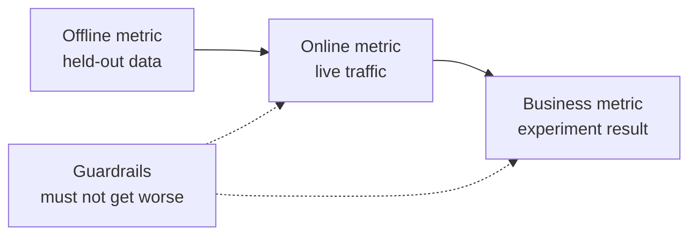

# एमएल सिस्टम डिजाइन  समस्या से लागू मॉडल तक

> एक मॉडल एक प्रणाली का एक हिस्सा है। डिजाइन तय करता है कि मॉडल क्या भविष्यवाणी करता है, किसने इसके आधार पर कार्य किया है, इसकी लागत क्या है, और जब यह विफल हो जाता है तो क्या होता है।

**Type:** Build
**Languages:** Python
**Prerequisites:** Phase 2, Lessons 09 (Model Evaluation) and 13 (ML Pipelines)
**Time:** ~110 minutes

## सीखने के लक्ष्य

- एक व्यावसायिक समस्या को एक भविष्यवाणी, एक निर्णय के साथ एक एमएल कार्य के रूप में ढालें जो इसका उपयोग करता है, और एक कारण है कि नियम पर्याप्त नहीं हैं
- ऑफ़लाइन, ऑनलाइन, बिजनेस और गार्डरेल मेट्रिक्स को अलग करें, और हर मॉडल की तुलना तुच्छ और हेरिस्टिक बेसलाइन के साथ करें
- ट्रैफ़िक संख्याओं से बैच और ऑनलाइन निष्कर्ष की दैनिक लागत, विलंबता और स्थिरीकरण का अनुमान लगाएं
- प्रत्येक विफलता मोड के लिए एक रोलआउट पैटर्न (छाया, कैनरी, ए/बी परीक्षण) और एक सुरक्षित डिफ़ॉल्ट चुनें
- प्रतिक्रिया लूपों की पहचान करें जिसमें मॉडल अपने अगले संस्करण को प्रशिक्षित करने वाले डेटा को बदलता है
- एक एमएल डिजाइन दस्तावेज़ लिखें और इसे एक निश्चित चेकलिस्ट के साथ अंकित करें

## समस्या

एक सदस्यता कंपनी "चर्न मॉडल" के लिए पूछती है। एक डेटा वैज्ञानिक एक ग्रेडिएंट-बढ़ता वर्गीकरण को प्रशिक्षित करता है और 0.91 का एयूसी रिपोर्ट करता है। तीन महीने बाद, कोई भी इसका उपयोग नहीं करता है।

कारणों का एल्गोरिथ्म से कोई लेना-देना नहीं है। कोई भी यह तय नहीं करता है कि स्कोर किस कार्रवाई से शुरू होता है। स्कोर सप्ताह में एक बार आते हैं, लेकिन प्रतिधारण टीम हर दिन ग्राहकों को कॉल करती है। लेबल एक रद्द करने की तालिका से आया था जिसमें रद्द करने का कारण भी संग्रहीत था, इसलिए एक सुविधा में उत्तर था। किसी ने मॉडल की तुलना पहले से ही उपयोग किए गए समर्थन टीम के नियम के साथ नहीं कीः किसी को दो सप्ताह के लिए निष्क्रिय बुलाओ।

इन सभी विफलताओं में से प्रत्येक प्रशिक्षण शुरू होने से पहले ही हुई थी। ये डिजाइन विफलताओं हैं, और एक पृष्ठ का डिज़ाइन दस्तावेज़ उनमें से प्रत्येक के बारे में पूछता है। यह सबक उस दस्तावेज़ में निर्णयों को सिखाता है। आप एक टूलकिट बनाते हैं जो बैच और ऑनलाइन सेवा की कीमतों की तुलना करता है, मॉडल की तुलना उसके आधार रेखाओं के साथ करता है, और एक चेकलिस्ट के खिलाफ एक डिजाइन दस्तावेज़ को स्कोर करता है।

## अवधारणा

### एक व्यावसायिक लक्ष्य से एक एमएल कार्य तक

एक व्यावसायिक लक्ष्य एक एमएल कार्य नहीं है. आप इसे चार प्रश्नों के साथ एक में बदल देते हैंः

1. मॉडल में क्या सटीक रूप से भविष्यवाणी की जाती है, और किस इकाई (उपयोगकर्ता, भुगतान, स्टोर, आइटम) के लिए?
2. भविष्यवाणी का उपयोग किस निर्णय से किया जाता है, और कौन या क्या उस निर्णय को करता है?
3. भविष्यवाणी की आवश्यकता कब है, और उस समय कौन से डेटा मौजूद हैं?
4. आप कैसे जानते हैं कि निर्णय बेहतर हो गया है?

| Business goal | Prediction | Decision that uses it | ML task |
|---|---|---|---|
| Reduce churn | Probability that a user cancels in the next 30 days | Send a save offer to the top 5 percent each night | Binary classification |
| Cut fraud losses | Probability that a payment is fraud | Approve, review, or block within 100 ms | Binary classification |
| Keep shelves stocked | Units sold per store per day next week | Order quantity for each store | Forecasting |
| Show relevant items | Relevance score for a (user, item) pair | Order of items in the feed | Ranking |

"प्रोडिक्शन चर्न" से क्षितिज, संस्था और कार्रवाई खुली रहती है। "प्रोडिक्शन करें कि क्या यह उपयोगकर्ता अगले 30 दिनों में रद्द करता है, ताकि आज रात की नौकरी यह तय कर सके कि कौन प्रस्ताव प्राप्त करता है" तीनों को ठीक करता है।

### ML का उपयोग कब नहीं करना चाहिए

गूगल के मशीन लर्निंग के नियमों में नियम 1 में कहा गया है कि मशीन लर्निंग के बिना किसी उत्पाद को लॉन्च करने से डरना नहीं चाहिए। मशीन लर्निंग को डेटा की आवश्यकता होती है, और एक सरल हेरिस्टिक अक्सर आपको रास्ते का हिस्सा देती है। इन मामलों में एमएल का उपयोग न करेंः

- एक छोटा नियम लक्ष्य तक पहुंचता है और सही रहता है। एक नियम को चलाने, परीक्षण करने और समझाए जाने में सस्ता होता है।
- आपके पास कोई लेबल नहीं है और उन्हें इकट्ठा करने का कोई व्यावहारिक तरीका नहीं है।
- भविष्यवाणी पर कोई भी कार्रवाई नहीं करता है, इसलिए बेहतर भविष्यवाणी कुछ भी नहीं बदलती है।
- भविष्यवाणी के समय मौजूद डेटा में संकेत नहीं होता है।
- एक त्रुटि अस्वीकार्य है और कोई भी व्यक्ति आउटपुट की जांच नहीं कर सकता है।
- सिस्टम का निर्माण और संचालन करने के लिए बेहतर निर्णय लेने से अधिक खर्च होता है।

जब एक नियम लंबा और नाजुक हो जाता है, तो एमएल फल देना शुरू कर देता है। उसी गाइड का नियम #3 जटिल हेरिस्टिक से एमएल को पसंद करता है, क्योंकि एक सीखा मॉडल को अपडेट करना और बनाए रखना आसान है।

### मेट्रिक्स की तीन परतें

आप तीन परतों पर एक एमएल प्रणाली को मापते हैं, प्लस सीमाओं का एक सेटः

| Layer | When you can measure it | Churn example |
|---|---|---|
| Offline metric | Before launch, on held-out past data | F1 at the offer threshold, precision in the top 5 percent |
| Online metric | During launch, on live traffic | Offer acceptance rate, share of users scored, score distribution |
| Business metric | Weeks after launch, with an experiment | 30-day churn rate in the treated group versus a holdout group |
| Guardrail metric | All the time | Offer cost per saved user, unsubscribe rate, p99 latency |



एक ऑफ़लाइन मीट्रिक पिछले डेटा को स्कोर करता है, और अतीत में आपका मॉडल नहीं था। एक ऑनलाइन मीट्रिक इस बात पर निर्भर करता है कि लोग निर्णय पर कैसे प्रतिक्रिया करते हैं। एक व्यावसायिक मीट्रिक धीरे-धीरे चलता है और कंपनी में बाकी सब कुछ से शोर ले जाता है।

यदि आप अपने काम के लिए शीर्ष 5 प्रतिशत उपयोगकर्ताओं से संपर्क करते हैं, तो शीर्ष 5 प्रतिशत में सटीकता मापें। एयूसी प्रत्येक सीमा के ऊपर औसत है, जिसमें सीमाएं शामिल हैं जिनका आप कभी उपयोग नहीं करते हैं। उसी गाइड का नियम #2 कहता है कि आप पहले मैट्रिक्स को डिजाइन और लागू करें, इससे पहले कि आप तय करें कि एमएल सिस्टम क्या करेगा।

### आधार रेखा

एक मीट्रिक मूल्य अकेले कुछ भी नहीं है। 0.56 का F1 अच्छा है यदि सबसे अच्छा विकल्प 0.30 तक पहुंचता है और खराब है यदि एक नियम 0.60 तक पहुंचता है। प्रत्येक मॉडल की तुलना तीन प्रकार के बेसलाइन के साथ करेंः

- **Trivial baseline.**हमेशा बहुमत वर्ग की भविष्यवाणी करें, या हमेशा प्रशिक्षण औसत की भविष्यवाणी करें. हमने मॉडल मूल्यांकन पाठ में इस जांच का उपयोग किया।
- **Heuristic baseline.**डोमेन ज्ञान से एक नियम, या एक विशेषता की सीमा जो आप प्रशिक्षण डेटा पर फिट करते हैं।
- **Current system.**आज जो भी निर्णय लेता है, भले ही वह व्यक्ति हो जिसके पास एक स्प्रिडशीट हो।

लिफ्ट मॉडल स्कोर है सबसे मजबूत बेसलाइन के स्कोर को घटाकर। परिणामों को देखने से पहले एक न्यूनतम लिफ्ट सेट करें, और इसे अतिरिक्त प्रणाली के लिए भुगतान करने के लिए पर्याप्त बड़ा बनाएं। तुच्छ बेसलाइन आमतौर पर कमजोर होती है। हेउरिस्टिक बेसलाइन को हराया जाना सबसे कठिन होता है।

### डेटा और लेबल की आवश्यकताएँ

प्रशिक्षण से पहले इन सवालों के जवाब देंः

- **Label source.**कौन सी मेज या घटना लेबल को परिभाषित करती है, और इसका मालिक कौन है?
- **Label delay.**भविष्यवाणी के बाद वास्तविक परिणाम कब तक आएगा? भुगतान के कुछ हफ्तों बाद धोखाधड़ी रिचार्ज आ सकती है। 30 दिनों के क्षितिज के अंत में चर्न लेबल पहुंचते हैं।
- **Label quality.**कौन इस लेबल को सौंपता है, और यह कितनी बार गलत है?
- **Availability at prediction time.**क्या भविष्यवाणी के समय प्रत्येक विशेषता मौजूद है? एक विशेषता जो प्रणाली परिणाम के बाद लिखती है प्रशिक्षण में लेबल लीक।
- **Volume per class.**कितने सकारात्मक उदाहरण हैं? 200 सकारात्मक आपको सरल मॉडल तक सीमित करते हैं।
- **Time split.**हम समय श्रृंखला पाठ में समय के अनुसार डेटा विभाजित करते हैं उसी कारण से।

### विलंबता, आउटपुट और लागत बजट

प्रत्येक सेवा डिजाइन को तीन संख्याओं से जोड़करः

- **Latency budget.**p99 विलंबता वह समय है जब 100 में से 99 अनुरोध नीचे रहते हैं। भुगतान चेक के लिए 50 एमएस की आवश्यकता हो सकती है। एक रात की रिपोर्ट में घंटों का समय लग सकता है।
- **Peak throughput.**सबसे व्यस्त मिनट के लिए सिस्टम का आकार दें, दैनिक औसत के लिए नहीं। पीक क्यूपीएस अक्सर औसत से कई गुना अधिक होता है।
- **Cost budget.**इसे प्रति दिन डॉलर या प्रति 1000 भविष्यवाणियों के रूप में व्यक्त करें, ताकि आप डिजाइनों की तुलना कर सकें।

लिटल का नियम पहले दो को जोड़ता है। प्रगतिशील अनुरोधों की संख्या पारगमन समय विलंबता के बराबर है। प्रति सेकंड 400 अनुरोधों और प्रत्येक 50 एमएस पर, 20 अनुरोध किसी भी समय प्रगतिशील हैं।

### बैच इन्फेरेंस बनाम ऑनलाइन इन्फेरेंस

भविष्यवाणियों को सेवा करने के दो बुनियादी तरीके हैंः

- **Batch inference.**एक अनुसूचित कार्य प्रत्येक इकाई को स्कोर करता है और स्कोर को एक तालिका या कुंजी-मूल्य भंडार में लिखता है। एप्लिकेशन अनुरोध के समय संग्रहीत स्कोर को पढ़ता है।
- **Online inference.**आवेदन अनुरोध के समय सुविधाओं को एक मॉडल सेवा को भेजता है और स्कोर का इंतजार करता है।

| Property | Batch | Online |
|---|---|---|
| Freshness | As old as the last run, plus the run time | Uses the data of the request |
| Request latency | One key-value read, a few ms | Feature fetch plus model time |
| Cost driver | Number of entities times runs per day | Replicas sized for peak QPS |
| New entities | No score until the next run | Scored on the first request |
| When it breaks | Old scores stay readable | Requests fail or time out |

इस पाठ में टूलकिट दोनों की कीमतें हैं। बैच लागत प्रति दिन संस्थाओं की संख्या और रन की संख्या के साथ बढ़ती है। एक छोटी गति सीमा का मतलब अधिक रन होता है। ऑनलाइन लागत पीक ट्रैफ़िक के साथ बढ़ जाती है, क्योंकि आप शिखर के बीच निष्क्रिय प्रतिकृतियों के लिए भुगतान करते हैं। एक बैच काम जो एक घंटे लेता है, किसी भी कीमत पर एक घंटे से कम गति सीमा को पूरा नहीं कर सकता है।

एक हाइब्रिड डिजाइन आम है। एक रात बैच जॉब ज्ञात उपयोगकर्ताओं को स्कोर करता है, और एक ऑनलाइन पथ नए उपयोगकर्ताओं और ताजा डेटा की आवश्यकता वाले अनुरोधों को स्कोर करता है।

### तैनाती के पैटर्न

एक नया मॉडल चरणों में उपयोगकर्ताओं तक पहुंचता हैः

1. **Shadow.**नए मॉडल को लाइव ट्रैफ़िक की एक प्रति प्राप्त होती है। सिस्टम अपनी भविष्यवाणियों को लॉग करता है और उनका उपयोग कभी नहीं करता है। आप वर्तमान मॉडल के साथ विलंबता, त्रुटि दर और भविष्यवाणी वितरण की तुलना करते हैं।
2. **Canary.**नए मॉडल में ट्रैफ़िक के एक छोटे हिस्से के लिए वास्तविक निर्णय लिए जाते हैं, अक्सर 1 से 5 प्रतिशत। आप कदमों में हिस्से को बढ़ाते हैं और जब एक गार्डरेल टूट जाता है तो वापस रोल करते हैं।
3. **A/B test.**उपयोगकर्ताओं के एक यादृच्छिक विभाजन प्रत्येक मॉडल को देखता है. आप एक सांख्यिकीय परीक्षण के साथ व्यापार मीट्रिक मापते हैं, और आप पर्याप्त यातायात और अंतर देखने के लिए पर्याप्त समय की जरूरत है.

प्रत्येक चरण में मिनटों का समय लगता है। पुराने मॉडल संस्करण को तैनात रखें और कॉन्फ़िगरेशन के साथ ट्रैफ़िक स्विच करें। एलएलएम सेवा चरण भाषा मॉडल के लिए एक ही तीन पैटर्न को कवर करता है।[shadow and canary lesson](../../../17-infrastructure-and-production/20-shadow-canary-progressive/docs/en.md)और [A/B testing lesson](../../../17-infrastructure-and-production/21-ab-testing-llm-features/docs/en.md). .

### प्रतिक्रिया लूप

एक प्रतिक्रिया लूप तब मौजूद है जब मॉडल के निर्णय उसके अगले संस्करण को प्रशिक्षित करने वाले डेटा को बदलते हैं। स्कली एट एल्स एमएल सिस्टम में तकनीकी ऋण के मुख्य स्रोतों में प्रत्यक्ष और छिपे हुए प्रतिक्रिया लूपों की सूची देते हैं। तीन आम मामलेः

- **Interventions hide the label.**एक चर्न मॉडल ऑफर भेजता है, और ऑफर कुछ उपयोगकर्ताओं को बनाए रखते हैं। अगले महीने, उच्च जोखिम वाले उपयोगकर्ता वफादार दिखते हैं, और फिर से प्रशिक्षित मॉडल सीखता है कि उनकी विशेषताएं चर्न की भविष्यवाणी नहीं करती हैं।
- **Blocked actions have no outcome.**एक धोखाधड़ी मॉडल एक भुगतान को ब्लॉक करता है, ताकि भुगतान को कभी भी चार्जबैक लेबल नहीं मिलता है। प्रशिक्षित मॉडल ब्लॉक क्षेत्र से कम धोखाधड़ी के उदाहरण देखते हैं।
- **Exposure limits feedback.**रैंकिंग मॉडल में शीर्ष वस्तुएँ दिखाई देती हैं, इसलिए केवल उन वस्तुओं को क्लिक एकत्रित किए जाते हैं।

फिक्स एक विचार साझा करते हैंः कुछ डेटा रखें जो मॉडल ने प्रभावित नहीं किया। एक छोटे से यादृच्छिक समूह को बाहर रखें जो कभी हस्तक्षेप नहीं करता है। ट्रैफ़िक के एक छोटे हिस्से को यादृच्छिक निर्णय दें। प्रत्येक उदाहरण के साथ स्कोर और निर्णय को रिकॉर्ड करें, ताकि बाद में प्रशिक्षण प्रभावित डेटा को साफ डेटा से बता सके।

### विफलता मोड और सुरक्षित डिफ़ॉल्ट

सिस्टम के हर हिस्से में जल्दी या बाद में विफलता होती है. प्रत्येक विफलता के लिए डिफ़ॉल्ट कार्रवाई का निर्णय लें, घटना के दौरान नहींः

| Failure | Result without a plan | Safe default |
|---|---|---|
| Model service times out | The request fails | Use the heuristic baseline |
| Nightly batch job fails | Scores go missing or get old | Serve the last good scores for a fixed time, then the rule |
| Feature is missing or out of range | The model scores bad input | Use the documented default value and log the event |
| New entity with no history | No score exists | Use the rule or the population average |
| Score distribution moves suddenly | Wrong decisions at scale | Pause automatic actions and alert a person |

आपके मीट्रिक अनुभाग से heuristic बेसलाइन भी अधिकांश विफलताओं के लिए डिफ़ॉल्ट है, तो इसे पहले निर्माण.

### डिजाइन दस्तावेज

डिजाइन दस्तावेज़ प्रशिक्षण शुरू होने से पहले एक ही स्थान पर ऊपर दिए गए प्रत्येक निर्णय को रिकॉर्ड करता है। इस पाठ में चेकर इसका JSON संस्करण स्कोर करता है। छह आइटम समीक्षा को ब्लॉक करते हैं, क्योंकि प्रत्येक प्रणाली को असुरक्षित या बेकार बनाता हैः

| Section | Question it answers | Blocking |
|---|---|---|
| Problem | What is predicted, which decision uses it, and why rules are not enough? | The decision |
| Metrics | Which offline, online, business, and guardrail metrics apply? | The business metric |
| Baselines | Which trivial, heuristic, and current-system baselines apply? | A heuristic or current baseline |
| Data | Where do labels come from, how late, and does each feature exist at prediction time? | No leakage |
| Budgets and serving | Which latency, peak QPS, cost, and staleness limits apply, and which serving mode fits them? | No |
| Rollout | Which shadow, canary, and A/B stages apply, and how do you roll back? | Shadow or canary, plus rollback |
| Feedback loops | How can the model change its own future data, and what keeps clean data? | No |
| Failure modes | What is the default action for each failure? | A default for every failure |
| Monitoring | What do you watch after launch? | No |

```figure
mlprod-serving-cost
```

## इसे बनाओ

कोड में `code/main.py`इसमें तीन उपकरण हैंः सेवा लागत मॉडल, एक बेसलाइन तुलनाकर्ता और एक डिजाइन-दस्तावेज जांचकर्ता।

### चरण 1: कार्यभार और कीमतों का वर्णन करें

एक कार्यभार ट्रैफ़िक संख्याओं और बजटों को रखता है। एक लागत मॉडल कीमतों को रखता है। कीमतें अभ्यास के लिए गोल संख्याएं हैं, विक्रेता उद्धरण नहीं।

```python
@dataclass(frozen=True)
class Workload:
    name: str
    entities: int
    requests_per_day: int
    peak_qps: float
    max_staleness_hours: float
    latency_budget_ms: float


@dataclass(frozen=True)
class CostModel:
    batch_dollars_per_million: float = 0.40
    batch_job_hours: float = 1.0
    lookup_dollars_per_million: float = 0.25
    lookup_latency_ms: float = 4.0
    replica_dollars_per_hour: float = 0.50
    replica_qps: float = 200.0
    min_replicas: int = 2
    online_latency_ms: float = 35.0
```

### चरण 2: बैच मूल्य और ऑनलाइन सेवा

एक बैच काम को स्टेननेस सीमा के भीतर समाप्त करना चाहिए। रन के बीच का समय सीमा है। प्रत्येक रन प्रत्येक इकाई को स्कोर करता है, चाहे कोई उस स्कोर के लिए पूछता हो या नहीं।

```python
def batch_plan(workload: Workload, costs: CostModel) -> ServingPlan:
    refresh_hours = workload.max_staleness_hours - costs.batch_job_hours
    if refresh_hours <= 0:
        return ServingPlan(
            "batch", False, math.inf, costs.lookup_latency_ms, math.inf, 0.0,
            "staleness limit is shorter than one batch job",
        )
    runs_per_day = 24.0 / refresh_hours
    predictions = workload.entities * runs_per_day
    dollars = (
        predictions / 1e6 * costs.batch_dollars_per_million
        + workload.requests_per_day / 1e6 * costs.lookup_dollars_per_million
    )
    ...
```

ऑनलाइन सेवा के लिए पर्याप्त प्रतिकृति का भुगतान किया जाता है ताकि शिखर को संभाला जा सके, उपलब्धता के लिए न्यूनतम दोः

```python
def online_plan(workload: Workload, costs: CostModel) -> ServingPlan:
    replicas = max(costs.min_replicas, math.ceil(workload.peak_qps / costs.replica_qps))
    dollars = replicas * costs.replica_dollars_per_hour * 24.0
    feasible = costs.online_latency_ms <= workload.latency_budget_ms
    ...
```

`choose_serving`यह योजनाओं को बनाए रखता है जो विलंबता और स्थिरीकरण सीमाओं को पूरा करते हैं और सबसे सस्ता वापस करता है। यह वापस करता है `None`जब कोई योजना नहीं फिट बैठती है, जो आपको बजट बदलने के लिए कहता है।

### चरण 3: मॉडल की आधार रेखाओं के साथ तुलना करें

तुलनाकर्ता मॉडल और प्रत्येक बेसलाइन को एक ही मीट्रिक के साथ स्कोर करता है। यह सबसे मजबूत बेसलाइन के खिलाफ लिफ्ट को मापता है, सबसे कमजोर नहीं।

```python
def compare_to_baselines(
    y_true: list,
    model_pred: list,
    baselines: dict[str, list],
    metric,
    metric_name: str,
    higher_is_better: bool = True,
    min_lift: float = 0.02,
) -> BaselineReport:
    if not baselines:
        raise ValueError("a model needs at least one baseline")
    scores = {name: metric(y_true, pred) for name, pred in baselines.items()}
    pick = max if higher_is_better else min
    best_name = pick(scores, key=scores.get)
    model_score = metric(y_true, model_pred)
    lift = model_score - scores[best_name] if higher_is_better else scores[best_name] - model_score
    return BaselineReport(metric_name, {"model": model_score, **scores}, best_name, lift, min_lift)
```

हेउरिस्टिक बेसलाइन एक विशेषता नियम है। `fit_rule`प्रशिक्षण डेटा पर एक सीमा के रूप में सुविधा के प्रत्येक मूल्य का परीक्षण करता है और सबसे अच्छा F1 के साथ सीमा बनाए रखता है। डेमो सिंथेटिक चर्न डेटा पर एक छोटी लॉजिस्टिक प्रतिगमन को प्रशिक्षित करता है और इसे तीन बेसलाइनों के साथ तुलना करता है।

### चरण 4: एक डिजाइन दस्तावेज़ स्कोर करें

प्रत्येक चेकलिस्ट आइटम में एक कुंजी, एक वजन, एक ब्लॉक फ्लैग, एक संदेश और एक चेक फ़ंक्शन होता है। एक ब्लॉक आइटम का वजन 2 होता है।

```python
CheckItem("decision", 2, True, "name the action that uses each prediction", lambda d: _text(d, "problem.decision")),
CheckItem("baselines", 2, True, "add a heuristic or current-system baseline", check_baselines),
CheckItem("no_leakage", 2, True, "confirm every feature exists at prediction time",
          lambda d: get_path(d, "data.features_available_at_prediction_time") is True),
CheckItem("serving_fit", 1, False, "pick a serving mode that meets the staleness, latency, and cost budgets",
          check_serving_fit),
```

`check_serving_fit`लागत मॉडल का पुनः उपयोग करता है। यह दस्तावेज़ से कार्यभार संख्याओं को पढ़ता है और चयनित मोड की कीमत देता है। यह जाँच तब विफल होती है जब यह मोड स्थिरीकरण सीमा, विलंबता बजट या दैनिक लागत बजट से चूक जाता है। तीन मिनट की गति सीमा के साथ "बैच" लिखा हुआ दस्तावेज इस जांच में विफल रहता है। लागत मॉडल में कोई हाइब्रिड योजना नहीं है, इसलिए एक दस्तावेज जो कहता है "हाइब्रिड" इस जाँच में विफल रहता है जब तक आप उस योजना को अभ्यास 1 में जोड़ते हैं।

`review_design_doc`निर्णय केवल तभी "पुनरावलोकन के लिए तैयार" होता है जब स्कोर 0.85 तक पहुंचता है और कोई भी ब्लॉक करने वाला आइटम विफल नहीं होता है।

### चरण 5: इसे चलाएँ

```bash
python3 code/main.py
```

```console
nightly churn scores
  ok batch        $0.91/day      4 ms  1.0 runs per day over 2,000,000 entities
  ok online      $24.00/day     35 ms  2 replicas sized for 40 peak QPS
  choose: batch

feed ranking, 2-hour freshness
  ok batch       $48.50/day      4 ms  24.0 runs per day over 5,000,000 entities
  ok online      $24.00/day     35 ms  2 replicas sized for 120 peak QPS
  choose: online

=== Model versus baselines (churn, metric F1) ===
  model                    0.564
  days_idle > 12.8688      0.500
  random at base rate      0.232
  majority class           0.000
  model beats the strongest baseline (days_idle > 12.8688) by +0.064
```

अधिकांश बेसलाइन F1 पर 0 स्कोर करती है, क्योंकि यह कभी भी चर्न की भविष्यवाणी नहीं करती है। फिट नियम वास्तविक प्रतियोगी है। मॉडल इसे 0.064 से हराता है, इसलिए मॉडल अपनी जगह अर्जित करता है। कमजोर सुविधाओं के साथ नियम जीत सकता है, और फिर नियम लागू करने के लिए सही प्रणाली है।

डिजाइन-दस्तावेज़ समीक्षा में छह ब्लॉक करने वाली वस्तुओं के साथ कमजोर दस्तावेज़ और 1.00 के स्कोर के साथ पूरा दस्तावेज़ प्रिंट किया जाता है। अपने स्वयं के दस्तावेज़ की समीक्षा करने के लिए एक पथ पारित करेंः

```bash
python3 code/main.py my_design_doc.json
```

## इसका प्रयोग करें

टूलकिट के प्रत्येक भाग में उन उपकरणों का नक्शा होता है जिनका उपयोग उत्पादन में टीमों द्वारा किया जाता है।

**Baselines.**scikit-learn अनुमानकों के रूप में तुच्छ मूल रेखा प्रदान करता है, इसलिए वे मॉडल के समान पाइपलाइन में फिट होते हैंः

```python
from sklearn.dummy import DummyClassifier, DummyRegressor
from sklearn.metrics import f1_score

majority = DummyClassifier(strategy="most_frequent").fit(X_train, y_train)
base_rate = DummyClassifier(strategy="stratified", random_state=0).fit(X_train, y_train)
mean_value = DummyRegressor(strategy="mean").fit(X_train, y_reg_train)

print(f1_score(y_test, majority.predict(X_test)))
```

`most_frequent`मिलान `majority_baseline`और `stratified`मिलान `base_rate_baseline`. scikit-learn के पास कोई heuristic आधार नहीं है, क्योंकि heuristic आपके डोमेन से आता है.

**Batch serving.**एक वर्कफ़्लो शेड्यूलर जैसे कि अपाचे एयरफ्लो या डैगस्टर स्कोरिंग जॉब चलाता है। जॉब एक गोदाम तालिका या रेडिस या डायनामोडीबी जैसे कुंजी-मूल्य स्टोर में स्कोरिंग लिखता है।

**Online serving.**KServe, BentoML, NVIDIA Triton और TorchServe जैसे मॉडल सर्वर HTTP या gRPC एंडपॉइंट के पीछे एक मॉडल को लपेटते हैं। एक लोड मॉडल के साथ एक साधारण वेब सेवा भी छोटे मॉडल के लिए काम करती है।

**Rollouts.**कुबेरनेट्स उपकरण जैसे कि अर्गो रोलआउट कैनरी रिलीज के लिए ट्रैफ़िक को विभाजित करते हैं। ग्रोथबुक और स्टेट्सग जैसे प्रयोग प्लेटफॉर्म उपयोगकर्ताओं को ए / बी समूहों में असाइन करते हैं और आंकड़ों की गणना करते हैं।

**Design review.**ब्रेक एट एल्स ने एमएल टेस्ट स्कोर प्रकाशित किया, जो उत्पादन एमएल सिस्टम के लिए 28 परीक्षणों और निगरानी आवश्यकताओं का एक अनुभाग है। हमारा चेकर छोटा है। यह उन परीक्षणों से पहले आने वाले डिजाइन प्रश्नों को पूछता है।

## इसे भेजें

यह सबक हमें फल देता है`outputs/skill-ml-design-review.md`. कौशल एक ML डिजाइन दस्तावेज़ अनुभाग से अनुभाग की समीक्षा करता है और पहले ब्लॉकिंग अंतराल का नाम देता है। यह इस पाठ से बैच और ऑनलाइन लागत अंकगणित के साथ सेवा विकल्प की भी जांच करता है।

## व्यायाम

1.  में एक हाइब्रिड योजना जोड़ें`choose_serving`. बैच में ज्ञात उपयोगकर्ताओं और ऑनलाइन नए उपयोगकर्ताओं को स्कोर करें. इसकी दैनिक लागत की तुलना करें.
2. जब तक मॉडल नियम को नहीं हराता तब तक चर्न डेटा बदलें। लिफ्ट को हटाने वाले सबसे छोटे गुणांक परिवर्तन की रिपोर्ट करें।
3. एक जोड़ें `budgets.max_dollars_per_1k_predictions`चेकलिस्ट में एक आइटम लिखें जो इसके बिना असफल हो।
4. भुगतान धोखाधड़ी जांच के लिए एक JSON डिजाइन दस्तावेज़ लिखें. जांचकर्ता चलाएं और प्रत्येक अवरोधित आइटम को ठीक करें.
5. Churn प्रतिक्रिया लूप का अनुकरण करें, उन उपयोगकर्ताओं के लेबल को हटाएं जिन्हें एक प्रस्ताव मिला, फिर से प्रशिक्षित करें और F1 में परिवर्तन को मापें।

## प्रमुख शर्तें

| Term | What people say | What it means |
|------|----------------|----------------------|
| ML task | "Build a churn model" | A prediction target, an entity, a horizon, and the decision that uses the prediction |
| Offline metric | "The model score" | A metric computed on held-out past data before launch |
| Online metric | "Live numbers" | A metric measured on real traffic while the model runs |
| Business metric | "The goal" | The company outcome that the decision must change, measured with an experiment |
| Guardrail metric | "Do no harm" | A metric that must not get worse when the new model launches |
| Baseline | "The dumb model" | A trivial, heuristic, or current-system predictor that the model must beat by a set margin |
| Batch inference | "Precomputed scores" | A scheduled job scores every entity and stores the results for lookup |
| Online inference | "Real-time model" | The model scores each request when it arrives |
| Shadow deployment | "Dark launch" | The new model scores live traffic, and nobody uses its output |
| Canary release | "Slow rollout" | The new model decides for a small, growing share of traffic, with a rollback ready |
| Feedback loop | "The model trains itself" | The model's decisions change the data that trains its next version |

## आगे पढ़ना

- [Sculley et al., Hidden Technical Debt in Machine Learning Systems (NeurIPS 2015)](https://papers.nips.cc/paper/2015/hash/86df7dcfd896fcaf2674f757a2463eba-Abstract.html): प्रतिक्रिया लूप, उलझन, और एक मॉडल के आसपास प्रणाली लागत
- [Google, Rules of Machine Learning](https://developers.google.com/machine-learning/guides/rules-of-ml): पहले मॉडल के लिए व्यावहारिक नियम, माप और प्रशिक्षण सेवा करने वाली स्थिरता
- [Breck et al., The ML Test Score (IEEE Big Data 2017)](https://research.google/pubs/the-ml-test-score-a-rubric-for-ml-production-readiness-and-technical-debt-reduction/): 28 परीक्षण जो उत्पादन की तत्परता को मापते हैं
- [Kohavi, Tang, and Xu, Trustworthy Online Controlled Experiments (Cambridge University Press, 2020)](https://experimentguide.com/): सही उत्तर देने वाले ए/बी परीक्षण कैसे करें
- [Sato, Wider, and Windheuser, Continuous Delivery for Machine Learning (2019)](https://martinfowler.com/articles/cd4ml.html): संस्करणित डेटा, मॉडल और तैनाती पाइपलाइन
- [Google Cloud, MLOps: Continuous delivery and automation pipelines in machine learning](https://cloud.google.com/architecture/mlops-continuous-delivery-and-automation-pipelines-in-machine-learning)प्रशिक्षण और सेवा स्वचालन के लिए तीन परिपक्वता स्तर
