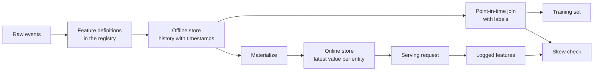

# फीचर स्टोर और प्रशिक्षण सेवा स्केव

> एक विशेषता की एक परिभाषा और दो पाठक होते हैं। प्रशिक्षण प्रत्येक लेबल समय के अनुसार इसका इतिहास पढ़ता है, और सेवा इसके नवीनतम मूल्य को पढ़ती है। जब दो पाठक असहमत होते हैं, तो मॉडल इनपुट देखता है जिस पर उसने कभी प्रशिक्षण नहीं किया था।

**Type:** Build
**Languages:** Python
**Prerequisites:** Phase 2, Lessons 08 (Feature Engineering), 13 (ML Pipelines), 15 (Time Series), and 19 (ML System Design)
**Time:** ~100 minutes

## सीखने के लक्ष्य

- ऑफ़लाइन स्टोर, ऑनलाइन स्टोर, संस्थाओं, घटना समय टिकट, और TTL का वर्णन करें, और प्रत्येक का काम
- समय पर सही संयोजन को लागू करें और दिखाएं कि एक साफ़ संयोजन भविष्य के मानों को प्रशिक्षण डेटा में कैसे कॉपी करता है
- प्रशिक्षण सेवा में विकृति के चार कारणों का नाम देंः दो कोड पथ, पुरानी सुविधाएं, विभिन्न डिफ़ॉल्ट और समय यात्रा
- एक विशेषता रजिस्ट्री बनाएं जिसमें एक परिभाषा प्रशिक्षण पथ और सेवा पथ दोनों को खिलाती है
- प्रत्येक तिथि के बाद से डेटा पढ़ने के बिना पिछले तिथियों से एक नई सुविधा को बैकफिल करें
- उसी इकाई और समय के लिए प्रशिक्षण पथ के साथ लॉग किए गए सेवा सुविधाओं की तुलना करके विकृति का पता लगाएं

## समस्या

एक टीम एक चर्न मॉडल बनाता है। प्रत्येक लेबल बताता है कि एक लेबल दिन के बाद 30 दिनों के भीतर एक उपयोगकर्ता ने कोई खरीद नहीं की है। टीम लेबल को उपयोगकर्ता सुविधा तालिका में जोड़ती है।`user_id`और एक नियम को प्रशिक्षित करता है`days_since_last_purchase`. ऑफ़लाइन सटीकता 0.948 है.

लाइव ट्रैफ़िक पर, मॉडल पुराने और सरल संस्करण से भी बदतर प्रदर्शन करता है। विशेषता तालिका में प्रत्येक उपयोगकर्ता के लिए नवीनतम मूल्य था, जो कि लेबल दिनों के बाद के हफ्तों से था। एक उपयोगकर्ता जिसका अंतिम खरीद 115 दिन पर था, दिन 175 में 60 निष्क्रिय दिनों का स्नैपशॉट दिखाया, इसलिए सुविधा में उत्तर था। इस बीच, एक अन्य टीम ने एक अलग सेवा में सेवा सुविधाओं को फिर से लिखा। उनके 30 दिनों के विंडो में एक अतिरिक्त दिन शामिल था, और नए उपयोगकर्ता के लिए उनका डिफ़ॉल्ट 365 के बजाय -1 था।

दोनों दोषों का एक ही कारण है। प्रशिक्षण और सेवा दो अलग-अलग तरीकों से "एक ही सुविधा" की गणना की। यह पाठ खरोंच से सुविधा स्टोर के टुकड़े बनाता है। आप एक रजिस्ट्री लिखते हैं, एक बैकफिल, एक बिंदु-इन-टाइम जुड़ाव, एक TTL के साथ एक ऑनलाइन स्टोर और एक विकृत चेक। डेमो संख्याओं के साथ दोनों दोषों को पुनः प्रस्तुत करता है।

## अवधारणा

### एक ही विशेषता के दो पाठक

प्रशिक्षण और सेवा विभिन्न रूपों में विशेषताएं मांगते हैंः

| Property | Training (offline) | Serving (online) |
|---|---|---|
| Question | "What was the value for each of 10 million (entity, time) pairs?" | "What is the value for this one entity now?" |
| Time | Many points in the past | The present |
| Volume | Millions of rows per job | One row per request |
| Latency | Minutes are fine | A few milliseconds |
| Storage | Offline store: full history with timestamps, in columnar files or a warehouse | Online store: the latest value per entity, in a key-value database |

एक फीचर स्टोर दोनों स्टोर को एक सेट फीचर परिभाषाओं से भरा रखता है। सामग्रीकरण वह काम है जो ऑफलाइन स्टोर से ऑनलाइन स्टोर में नवीनतम मानों की प्रतिलिपि बनाता है।



### संस्थाएं, समय टिकट और TTL

चार शब्द प्रत्येक विशेषता पंक्ति का वर्णन करते हैंः

- **Entity.**एक विशेषता द्वारा वर्णित कुंजी, जैसे `user_id`या `card_id`. .
- **Event timestamp.**"दिन 14 से" की खरीद गणना में घटना समयशीर्षक दिन 14 होता है।
- **Created timestamp.**एक बैकफिल जो आज चलाया जाता है, पुराने घटना समयशीर्षक और एक नया समयशीर्षक के साथ पंक्तियां लिखता है।
- **TTL (time to live).**किसी मान की अधिकतम आयु। TTL से अधिक पुराना मान अनुपलब्ध माना जाता है, इसलिए पाठक डिफ़ॉल्ट का उपयोग करता है।

एक ही इकाई, स्रोत और टीटीएल वाली सुविधाओं के समूह को अक्सर सुविधा दृश्य कहा जाता है।

### समय में सही जोड़ें

एक प्रशिक्षण पंक्ति लेबल के साथ विशेषता मान जो लेबल के समय मौजूद थे जोड़ती है। बिंदु-इन-टाइम जोड़ प्रत्येक लेबल के लिए ऐसा करता हैः

1. उसी इकाई की विशेषता पंक्तियों को खोजें।
2. उन पंक्तियों को रखें जिनकी घटना समयशीर्षक लेबल समयशीर्षक पर या उससे पहले है।
3. उन पंक्तियों में से नवीनतम ले लो।
4. यदि लेबल समयशीर्षक घटाकर घटना समयशीर्षक TTL से अधिक है तो इसे छोड़ दें।

यहाँ एक उपयोगकर्ता, दिन 16 पर एक लेबल और साप्ताहिक विशेषता पंक्तियों हैः

| Feature row day | `purchases_30d` | Point-in-time join | Naive join on `user_id` |
|---|---|---|---|
| 7 | 4 | | |
| 14 | 3 | Selected | |
| 21 | 1 | Future | |
| 28 | 0 | Future | Selected |

लेबल पूछता है कि क्या उपयोगकर्ता 17 से 46 दिनों में कुछ भी खरीदता है। दिन 28 पंक्ति पहले से ही लेबल दिन के बाद शांत दिनों की गणना करती है। यह 0 खरीदारी दिखाता है क्योंकि उपयोगकर्ता ने खरीदना बंद कर दिया है, जो घटना है कि लेबल मापता है। साफ़ सा जोड़ने वाले उत्तर को इनपुट में कॉपी करता है।

हम समय श्रृंखला पाठ में समय के अनुसार डेटा विभाजित करते हैं उसी कारण के लिए। एक बिंदु में समय जोड़ प्रत्येक पंक्ति पर एक विभाजन बिंदु के बजाय लागू होता है।

### प्रशिक्षण सेवा में विकृति के कारण

गूगल के मशीन लर्निंग के नियम प्रशिक्षण-सेवा विकृति को प्रशिक्षण के दौरान प्रदर्शन और सेवा के दौरान प्रदर्शन के बीच अंतर के रूप में परिभाषित करते हैं। वे तीन कारणों का नाम देते हैंः दो पाइपलाइनों में अलग-अलग डेटा हैंडलिंग, प्रशिक्षण और सेवा के बीच डेटा में परिवर्तन, और एक प्रतिक्रिया लूप। सुविधा पाइपलाइन में, चार ठोस कारण बार-बार दिखाई देते हैंः

| Cause | What happens | Example from the demo |
|---|---|---|
| Two code paths | Training and serving compute the feature with different code | The serving window includes day `now - 30`, and the training window does not |
| Stale features | The value that serving reads has a different age from the value that training used | Training reads weekly snapshots, and a new service computes fresh values |
| Different defaults | The two paths fill a missing value differently | Training uses 365 for "no purchase yet", and serving uses -1 |
| Time travel | Training reads a value from after the label time | The naive join reads the newest snapshot for every label |

उसी गाइड का नियम #32 कहता है कि जब भी संभव हो प्रशिक्षण पाइपलाइन और सेवा पाइपलाइन के बीच कोड का पुनः उपयोग किया जाए। एक फीचर स्टोर उस नियम का पालन एक परिभाषा के साथ करता है जो दोनों पथों को बुलाता है।

### सुविधाओं की सूची

रजिस्ट्री सुविधा परिभाषाओं की सूची है। प्रत्येक प्रविष्टि में एक नाम, एक इकाई, एक स्रोत, एक परिवर्तन, एक विंडो, एक डिफ़ॉल्ट मान, एक TTL, एक मालिक, एक संस्करण और एक विवरण होता है।

दो नियम इसे सुरक्षित रखते हैंः

- दोनों पथों में रजिस्ट्री से परिभाषा पढ़ी जाती है। कोई भी सेवा परिवर्तन की निजी प्रति नहीं रखती है।
- परिभाषा में बदलाव से नया संस्करण बनता है, पुराना संस्करण रहता है, इसलिए पुराने मॉडल उस सुविधा को बनाए रखते हैं जिस पर उन्होंने प्रशिक्षण लिया था।

### बैकफिल

एक नई सुविधा का कोई इतिहास नहीं है, लेकिन प्रशिक्षण को हर पुराने लेबल समय पर अपना मूल्य चाहिए। एक बैकफिल प्रत्येक पिछली तारीख पर परिभाषा चलाता है और प्रति इकाई और तारीख एक पंक्ति लिखता है। प्रत्येक रन केवल अपनी तारीख पर या उससे पहले के समय के साथ घटनाओं को पढ़ता है।

बैकफिल लागत गणना है कि संस्थाओं की संख्या के साथ बढ़ता है समय की संख्या. वे भी एक सूक्ष्म रिसाव लाता है. एक बैकफिल जो आज चलाता है पुराने घटना समय टिकट के साथ पंक्तियों लिखता है, लेकिन यह डेटा पढ़ सकता है जो देर से आया या बाद में सुधार किया गया था. एक सख्त बिंदु में समय जोड़ भी जांचता है कि बनाया समय टिकट लेबल समय पर या से पहले है.

### विकृति का पता लगाना

उसी गाइड के नियम #29 में विशेषताएं सेवा समय पर लॉग करने और प्रशिक्षण में उनका उपयोग करने के लिए कहा गया है। यहां तक कि एक छोटे से लॉग किए गए नमूने में भी आप सुसंगतता की जांच कर सकते हैं। प्रत्येक लॉग किए गए मूल्य की तुलना उसी इकाई और समय के लिए प्रशिक्षण पथ द्वारा उत्पादित मूल्य के साथ करें। प्रत्येक विशेषता के लिए, असंगतताओं का हिस्सा और औसत पूर्ण अंतर की रिपोर्ट करें।

कारण जानने के लिए तीन जोड़े की तुलना करें:

1. ऑनलाइन स्टोर पढ़ने बनाम प्रशिक्षण शामिल करें. यह पूरे प्रणाली का परीक्षण करता है और शून्य विकृति दिखाना चाहिए.
2. ताजा गणना बनाम प्रशिक्षण जोड़ें. यह गतिरोध को अलग करता है.
3. दूसरा कोड पथ बनाम ताजा गणना। यह कोड अंतर को अलग करता है, जैसे विंडोज और डिफ़ॉल्ट।

```figure
mlprod-pit-join
```

## इसे बनाओ

कोड में `code/main.py`एक साप्ताहिक बैच जॉब में दिन 7, 14, और इतने पर 175 तक फीचर स्नैपशॉट लिखे जाते हैं।

### चरण 1: विशेषता परिभाषाएँ और रजिस्ट्री

ए `FeatureDefinition`परिवर्तन डेटा के रूप में रखता हैः एक संश्लेषण, एक खिड़की, और एक डिफ़ॉल्ट।`compute`विधि कभी घटनाओं के बाद पढ़ता है `as_of`. .

```python
@dataclass(frozen=True)
class FeatureDefinition:
    name: str
    entity: str
    aggregate: str
    window_days: int | None
    default: float
    version: int = 1
    owner: str = "growth-team"
    description: str = ""

    def compute(self, events: list[Event], as_of: int) -> float:
        visible = [e for e in events if e.day <= as_of]
        if self.window_days is not None:
            visible = [e for e in visible if e.day > as_of - self.window_days]
        if self.aggregate == "count":
            return float(len(visible))
        if self.aggregate == "sum":
            return round(sum(e.amount for e in visible), 2)
        if self.aggregate == "days_since_last":
            return float(as_of - max(e.day for e in visible)) if visible else self.default
        raise ValueError(f"unknown aggregate {self.aggregate!r}")
```

`FeatureRegistry.register`एक ही परिभाषा को दो बार स्वीकार करता है, लेकिन एक ही नाम और संस्करण के साथ एक अलग परिभाषा को अस्वीकार करता है। `fill_defaults`दोनों पथों को एक गायब मूल्य के लिए एक ही डिफ़ॉल्ट देता है।

एक मॉडल एक परिभाषा को संदर्भ के साथ चिपकाता है जैसे `spend_30d@1`. .`compute`और `fill_defaults`संदर्भ को हल करें, और बिना नाम के `@`नवीनतम संस्करण पढ़ता है।`@`और कोई संस्करण संख्या बढ़ता है `ValueError`संदर्भ प्रत्येक संग्रहीत पंक्ति में कुंजी भी है, इसलिए बैकफिल, ऑनलाइन स्टोर और सर्विस रीड सभी पिन परिभाषा का उपयोग करते हैं।

### चरण 2: ऑफ़लाइन स्टोर को बैकफिल करें

```python
def backfill(registry: FeatureRegistry, names: list[str], events: list[Event], days: list[int]) -> list[FeatureRow]:
    rows = []
    for entity, entity_events in sorted(group_events(events).items()):
        for day in days:
            rows.append(FeatureRow(entity, day, registry.compute(names, entity_events, day)))
    return rows
```

डेमो 25 स्नैपशॉट दिनों में 299 उपयोगकर्ताओं के लिए तीन सुविधाओं को बैकफिल करता है, जो 7475 पंक्तियों को देता है।

### चरण 3: समय में बिंदु में जोड़

प्रत्येक इकाई की पंक्तियों को दिन में एक बार क्रमबद्ध करें। प्रत्येक लेबल के लिए, `bisect_right`TTL चेक एक पंक्ति को छोड़ देता है जो बहुत पुराना है।

```python
def point_in_time_join(labels: list[LabelRow], rows: list[FeatureRow], ttl_days: int | None = None) -> list[JoinedRow]:
    by_entity: dict[str, list[FeatureRow]] = defaultdict(list)
    for row in rows:
        by_entity[row.entity].append(row)
    days_index = {}
    for entity, entity_rows in by_entity.items():
        entity_rows.sort(key=lambda r: r.day)
        days_index[entity] = [r.day for r in entity_rows]
    joined = []
    for label in labels:
        days = days_index.get(label.entity, [])
        pos = bisect.bisect_right(days, label.day) - 1
        match = by_entity[label.entity][pos] if pos >= 0 else None
        if match is not None and ttl_days is not None and label.day - match.day > ttl_days:
            match = None
        joined.append(JoinedRow(
            label.entity, label.day, label.label,
            match.day if match else None, match.values if match else None,
        ))
    return joined
```

### चरण 4: एक साफ़ जोड़ से रिसाव को मापें

`naive_latest_join`डेमो में प्रत्येक दिन 100, 120 और 140 पर लेबल बनाए जाते हैं और प्रत्येक प्रशिक्षण सेट पर एक विशेषता नियम फिट बैठता है। इसके बाद यह दोनों नियमों को लेबल पर दिन 145 से परीक्षण करता है, जिसमें बिंदु-इन-टाइम विशेषताएं हैंः

```console
  naive join used a snapshot from after the label day for 100% of rows
  offline accuracy, naive join: 0.948 (rule: idle > 53 days)
  offline accuracy, PIT join:   0.893 (rule: idle > 19 days)
  accuracy on day 145, trained with naive join: 0.763
  accuracy on day 145, trained with PIT join:   0.876
```

यह साफ़ सा जोड़ ऑफ़लाइन बेहतर दिखता है, 0.948 0.893 के मुकाबले। नए डेटा पर यह बदतर है, 0.763 0.876 के मुकाबले। लीक फीचर ने फिट किए गए सीमा को 19 से 53 निष्क्रिय दिनों में स्थानांतरित कर दिया।

### चरण 5: ऑनलाइन स्टोर और भौतिककरण

ऑनलाइन स्टोर प्रति इकाई एक पंक्ति रखता है और TTL से अधिक पुरानी पंक्तियों को अस्वीकार करता है। `materialize`केवल पंक्तियाँ लिखता है जिनका दिन कार्य समय पर या उससे पहले है।

```python
class OnlineStore:
    def __init__(self, ttl_days: int):
        self.ttl_days = ttl_days
        self._latest: dict[str, FeatureRow] = {}

    def write(self, row: FeatureRow) -> None:
        current = self._latest.get(row.entity)
        if current is None or row.day >= current.day:
            self._latest[row.entity] = row

    def read(self, entity: str, now: int) -> dict[str, float] | None:
        row = self._latest.get(entity)
        if row is None or row.day > now or now - row.day > self.ttl_days:
            return None
        return dict(row.values)
```

10 दिनों के TTL के साथ, दिन 145 पर एक रीड दिन 140 पंक्ति को लौटाता है। दिन 160 पर एक रीड, बिना किसी नए भौतिककरण के, डिफ़ॉल्ट वापस देता है, क्योंकि पंक्ति 20 दिन पुरानी है।

### चरण 6: पूर्वाग्रह जांच

`detect_skew` द्वारा की गई दो राय की तुलना करता है`(entity, day)`. यह असंगति दर और प्रति विशेषता औसत पूर्ण अंतर की रिपोर्ट करता है और एक विशेषता को चिह्नित करता है जब 1 प्रतिशत से अधिक मान भिन्न होते हैं। यह बढ़ता है `ValueError`जब दो विचारों में अलग-अलग कुंजी होती है या कोई कुंजी नहीं होती है। एक गायब अनुरोध विकृति को छिपा सकता है, और बिना अनुरोध के चेक में कुछ भी नहीं दिखाया जाता है।

```python
def detect_skew(
    training: dict[tuple[str, int], dict[str, float]],
    serving: dict[tuple[str, int], dict[str, float]],
    features: list[str],
    tolerance: float = 1e-6,
    max_mismatch_rate: float = 0.01,
) -> list[SkewReport]:
    if set(training) != set(serving):
        raise ValueError(f"{len(set(training) ^ set(serving))} keys are in only one view: log and compare the same requests")
    if not training:
        raise ValueError("no requests to compare")
    keys = sorted(training)
    reports = []
    for feature in features:
        diffs = [abs(training[k][feature] - serving[k][feature]) for k in keys]
        mismatches = sum(1 for d in diffs if d > tolerance)
        rate = mismatches / len(keys)
        mean_diff = sum(diffs) / len(keys)
        reports.append(SkewReport(feature, len(keys), rate, mean_diff, rate > max_mismatch_rate))
    return reports
```

डेमो लॉग 141 से 150 दिनों पर अनुरोध करता है और अवधारणा अनुभाग से तीन तुलनाओं को चलाता है। अनुरोध पूल में 20 नए उपयोगकर्ता शामिल हैं जिनके पास कोई इतिहास नहीं है।

```bash
python3 code/main.py
```

```console
=== Skew checks on 383 logged requests, days 141 to 150 ===
  online store read  vs  training join (one definition, same snapshots)
    ok   days_since_last_purchase   mismatch   0.0%  mean |diff|    0.00
    ok   purchases_30d              mismatch   0.0%  mean |diff|    0.00
    ok   spend_30d                  mismatch   0.0%  mean |diff|    0.00
  fresh compute      vs  training join (staleness only)
    SKEW days_since_last_purchase   mismatch  83.0%  mean |diff|    2.77
    SKEW purchases_30d              mismatch  30.5%  mean |diff|    0.38
    SKEW spend_30d                  mismatch  37.1%  mean |diff|   16.77
  second code path   vs  fresh compute (code differences only)
    SKEW days_since_last_purchase   mismatch   5.5%  mean |diff|   20.07
    SKEW purchases_30d              mismatch  12.5%  mean |diff|    0.13
    SKEW spend_30d                  mismatch  12.5%  mean |diff|    5.09
```

तीनों ब्लॉक क्रम में पढ़ें:

- **One definition, same snapshots.**ऑनलाइन स्टोर और प्रशिक्षण संयुक्त एक ही भौतिक पंक्तियों को पढ़ते हैं, तो विकृति शून्य है।
- **Staleness.**अधिकांश अनुरोधों पर एक ताजा मूल्य साप्ताहिक स्नैपशॉट से भिन्न होता है। ताजा डेटा स्वचालित रूप से बेहतर नहीं है, क्योंकि मॉडल छह दिन तक के मूल्यों से सीखा गया है।
- **Code differences.**दूसरा कोड पथ विंडो गिनती के 12.5 प्रतिशत पर भिन्न होता है, क्योंकि इसकी विंडो में एक अतिरिक्त दिन शामिल होता है। यह भिन्न होता है `days_since_last_purchase`केवल नए उपयोगकर्ताओं के लिए, लेकिन बड़ी मात्रा मेंः -1 बनाम 365.

## इसका प्रयोग करें

Feast एक ओपन सोर्स फीचर स्टोर है। स्क्रैच कोड के प्रत्येक टुकड़े में एक Feast समकक्ष हैः

| From scratch | Feast |
|---|---|
| `FeatureDefinition`, `FeatureRegistry` | `Entity`, `FeatureView`, and `Field` in a feature repository, registered with `feast apply` |
| `FeatureRow` history | An offline store, for example a `FileSource` over Parquet files or a warehouse table |
| `point_in_time_join` with a TTL | `store.get_historical_features(entity_df=..., features=[...])` |
| `materialize` | `feast materialize-incremental <end time>` |
| `OnlineStore.read` | `store.get_online_features(features=[...], entity_rows=[...])` |
| Created timestamp check | `created_timestamp_column` on the source and `filter_by_created_timestamp=True` |

परिभाषाएं इस तरह दिखती हैं कोड उत्सव की त्वरित शुरुआत का अनुसरण करता है और इस पाठ को चलाने के लिए आवश्यक नहीं है।

```python
from datetime import timedelta

from feast import Entity, FeatureView, Field, FileSource
from feast.types import Float32, Int64

user = Entity(name="user", join_keys=["user_id"])

user_activity_source = FileSource(
    name="user_activity_source",
    path="data/user_activity.parquet",
    timestamp_field="event_timestamp",
    created_timestamp_column="created",
)

user_activity = FeatureView(
    name="user_activity",
    entities=[user],
    ttl=timedelta(days=10),
    schema=[
        Field(name="purchases_30d", dtype=Int64),
        Field(name="spend_30d", dtype=Float32),
        Field(name="days_since_last_purchase", dtype=Int64),
    ],
    source=user_activity_source,
)
```

प्रशिक्षण और सेवा के बाद एक ही विशेषता दृश्य पढ़ेंः

```python
from feast import FeatureStore

store = FeatureStore(repo_path=".")

training_df = store.get_historical_features(
    entity_df=labels_df,
    features=["user_activity:purchases_30d", "user_activity:days_since_last_purchase"],
    filter_by_created_timestamp=True,
).to_df()

online = store.get_online_features(
    features=["user_activity:purchases_30d", "user_activity:days_since_last_purchase"],
    entity_rows=[{"user_id": 42}],
).to_dict()
```

`labels_df` के साथ प्रति लेबल एक पंक्ति रखता है`user_id`,`event_timestamp`, और लेबल. Feast प्रलेखन में कहा गया है कि TTL इकाई डेटा फ्रेम में प्रत्येक समय टिकट के सापेक्ष है, न कि क्वेरी के समय के साथ। यह TTL चेक इन से मेल खाता है `point_in_time_join`. उसी पृष्ठ पर वर्णन किया गया है `filter_by_created_timestamp=True`सभी ऑफ़लाइन स्टोर इस विकल्प का समर्थन नहीं करते हैं। समर्थन के बिना एक स्टोर विकल्प को अनदेखा करने के बजाय एक त्रुटि पैदा करता है।

टेक्टन, हॉप्सवर्क्स और बड़े क्लाउड एमएल प्लेटफार्मों में फीचर स्टोर ऑफलाइन और ऑनलाइन स्टोर के बीच एक ही विभाजन का उपयोग करते हैं। विकृति जांच के लिए, TensorFlow डेटा सत्यापन विकृति का पता लगाने के लिए सेवा डेटा के साथ प्रशिक्षण डेटा की तुलना कर सकता है। ब्रेक एट अल. टीएफएक्स में डेटा सत्यापन प्रणाली का वर्णन करते हैं, Google का एंड-टू-एंड एमएल प्लेटफॉर्म, जिसमें प्रशिक्षण सेवा करने वाला विकृति शामिल है।

## इसे भेजें

यह सबक हमें फल देता है`outputs/skill-feature-skew-audit.md`. कौशल समय यात्रा और प्रशिक्षण सेवा करने वाले पूर्वाग्रह के लिए एक सुविधा पाइपलाइन का ऑडिट करता है। यह जोड़, परिभाषाओं, डिफ़ॉल्ट, प्रत्येक पथ की ताज़ापन और पूर्वाग्रह जांच के लिए आवश्यक लॉगिंग के माध्यम से चलता है।

## व्यायाम

1. स्नैपशॉट अंतराल को 7 दिनों से 1 दिन में बदलें। स्थिरीकरण तुलना को दोहराएं और परिणाम की व्याख्या करें।
2. टीटीएल को 3 दिनों पर सेट करें, प्रशिक्षण पंक्तियों की गणना करें जो अपनी सुविधाओं को खो देते हैं और डिफ़ॉल्ट प्राप्त करते हैं।
3. एक बनाया गया दिन जोड़ें `FeatureRow`. लेबल दिन के बाद लिखी गई पंक्तियों को अनदेखा करने के लिए जोड़ें।
4. रजिस्टर करें`spend_7d` के संस्करण 2 के रूप में`spend_30d`इसे बैकफिल करें और रजिस्ट्री से दोनों संस्करणों को प्रिंट करें।
5. ठीक करें`legacy_serving_features`जब तक तीसरा विकृति चेक पारित नहीं होता. प्रत्येक परिवर्तन की सूची दें।

## प्रमुख शर्तें

| Term | What people say | What it means |
|------|----------------|----------------------|
| Feature store | "A database for features" | A system that computes features from one set of definitions and serves them to training and to serving |
| Offline store | "The training data" | Full feature history with event timestamps, read by training jobs and backfills |
| Online store | "The feature cache" | The latest value per entity, read by the serving path in milliseconds |
| Entity | "The ID" | The key that a feature describes, such as a user or a card |
| Event timestamp | "When it happened" | The time at which a feature value became true |
| Point-in-time join | "An as-of join" | A join that pairs each label with the latest feature row at or before the label time |
| TTL | "Expiry" | The maximum age of a feature value before a reader treats it as missing |
| Materialization | "Syncing to online" | The job that copies the latest feature values from the offline store to the online store |
| Backfill | "Computing history" | Running a feature definition at past dates to create its history |
| Training-serving skew | "It worked offline" | A difference between the features or behavior in training and in serving |

## आगे पढ़ना

- [Feast, Point-in-time joins](https://docs.feast.dev/getting-started/concepts/point-in-time-joins): टीटीएल अर्थशास्त्र और बनाया गया टाइमस्टैम्प फ़िल्टर
- [Feast documentation](https://docs.feast.dev/): फीचर व्यू, ऑफलाइन स्टोर, ऑनलाइन स्टोर, और सामग्रीकरण
- [Google, Rules of Machine Learning](https://developers.google.com/machine-learning/guides/rules-of-ml): प्रशिक्षण सेवा करने वाले विकृति नियम, नियम #29 से नियम #37 तक
- [Breck et al., Data Validation for Machine Learning (SysML 2019)](https://research.google/pubs/data-validation-for-machine-learning/): Google में डेटा सत्यापन, प्रशिक्षण सेवा करने वाले विकृति सहित
- [TensorFlow Data Validation guide](https://www.tensorflow.org/tfx/guide/tfdv): स्कीम जांच, विकृति का पता लगाना और बहाव का पता लगाना
- [Sculley et al., Hidden Technical Debt in Machine Learning Systems (NeurIPS 2015)](https://papers.nips.cc/paper/2015/hash/86df7dcfd896fcaf2674f757a2463eba-Abstract.html): डेटा निर्भरता और एक मॉडल के आसपास पाइपलाइन ऋण
