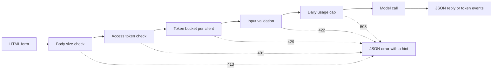

# मॉडल डेमो इंटरफेस  फ़ंक्शन से साझा करने योग्य ऐप तक

> एक मॉडल डेमो में एक अनुबंध होता हैः एक इनपुट, एक मॉडल कॉल और एक आउटपुट। लिंक साझा करने से पहले प्रत्येक भाग पर एक सीमा निर्धारित करें।

**Type:** Build
**Languages:** Python
**Prerequisites:** Phase 11 · 13 (Building a Production LLM Application), Phase 17 · 08 (Inference Metrics), Phase 17 · 19 (AI Gateways)
**Time:** ~90 minutes

## सीखने के लक्ष्य

- डेमो के इनपुट, मॉडल कॉल और आउटपुट कॉन्ट्रैक्ट लिखें, प्रत्येक भाग पर एक सीमा के साथ।
- एक HTML पृष्ठ, एक JSON अंत बिंदु और एक सर्वर-सेंड इवेंट्स अंत बिंदु के साथ एक मानक पुस्तकालय HTTP ऐप बनाएं।
- लागत के क्रम में इनपुट को मान्य करें, और JSON त्रुटियों को लौटाएं जो उपयोगकर्ता को अगली कार्रवाई बताती हैं।
- प्रति ग्राहक टोकन बाल्ट, दैनिक उपयोग सीमा और एक वैकल्पिक एक्सेस टोकन के साथ सार्वजनिक डेमो की रक्षा करें।
- अनुरोध लॉग लिखें जो कोई इनपुट पाठ और कोई क्लाइंट पता न रखें।
- दो फ्रेमवर्क संस्करणों के साथ मानक पुस्तकालय डेमो की तुलना करें, और संकेतों का नाम दें कि डेमो एक उत्पाद बनना चाहिए।

## समस्या

आपका मॉडल नोटबुक में काम करता है. अब एक समीक्षक दस इनपुट का प्रयास करना चाहता है, और एक ग्राहक एक परिणाम को फोन पर देखना चाहता है. उनमें से कोई भी आपकी नोटबुक नहीं खोलता है.

नोटबुक सेल में कोई इनपुट सीमा नहीं है और कोई प्रगति प्रदर्शन नहीं है। इसकी त्रुटियां स्टैक ट्रैक हैं जो केवल आप पढ़ सकते हैं। यह आपके क्रेडेंशियल और आपके बजट के साथ भी चलता है। यदि आप सेल को बिना किसी बदलाव के सार्वजनिक URL के पीछे रखते हैं, तो आप इस तरह की विफलताओं की उम्मीद कर सकते हैंः

- एक उपयोगकर्ता 40,000 वर्णों के दस्तावेज़ को पेस्ट करता है। मॉडल कॉल एक मिनट के लिए चलता है और फिर स्टैक ट्रैस के साथ विफल रहता है।
- एक स्क्रिप्ट एक मिनट में 500 अनुरोध भेजता है। प्रत्येक अनुरोध एक भुगतान मॉडल कॉल है।
- पृष्ठ आठ सेकंड तक कुछ नहीं दिखाता है, इसलिए उपयोगकर्ता बटन पर चार बार और क्लिक करता है।
- सर्वर लॉग में ग्राहक खाते के नंबर के साथ इनपुट सहित प्रत्येक इनपुट को रखा जाता है।

एक डेमो इंटरफ़ेस इन विफलताओं को कोड की एक छोटी मात्रा के साथ रोकता है। यह पाठ पायथन मानक पुस्तकालय के साथ एक बनाता है, ताकि आप हर भाग देख सकें। फिर यह दो लोकप्रिय फ्रेमवर्क के साथ एक ही डेमो बनाता है और डिफ़ॉल्ट रूप से तुलना करता है कि प्रत्येक क्या करता है।

## अवधारणा

### एक डेमो एक अनुबंध है

प्रत्येक डेमो में तीन भाग होते हैं. इनपुट वह है जो उपयोगकर्ता भेज सकता है. मॉडल कॉल इनपुट को आउटपुट में बदल देता है. आउटपुट वह है जो उपयोगकर्ता देखता है, और इसमें त्रुटियां शामिल हैं।

पृष्ठ लिखने से पहले अनुबंध लिखेंः

| Part | Question to answer | Answer in this lesson |
|------|--------------------|-----------------------|
| Input | What type, what size, which characters? | A string of 1 to 500 characters, with no control characters |
| Model call | How long does one call take, and what does it cost? | A toy keyword model that runs in under a millisecond at no cost |
| Output | What does the user see on success and on failure? | A label, a score, and a reply, or a JSON error with a hint |

नोटबुक में तीनों भागों में से किसी एक पर कोई सीमा नहीं होती है। डेमो में प्रत्येक भाग पर सीमा निर्धारित होती है, और सर्वर प्रत्येक क्लाइंट पर सीमा लागू करता है।



चेक लागत के क्रम में चलते हैं. एक खराब अनुरोध विफल होने के पहले चेक पर रुक जाता है, इसलिए सर्वर को लगभग कुछ भी लागत नहीं है. मॉडल कॉल आखिरी है, क्योंकि यह एकमात्र कदम है जो पैसे खर्च करता है।

### मॉडल चलाने से पहले मान्य करें

ब्राउज़र कुछ भी भेजने से पहले इनपुट की जांच कर सकता है।`maxlength`और `required`किसी पाठ क्षेत्र पर विशेषताएं उपयोगकर्ता को नेटवर्क कॉल के बिना प्रतिक्रिया देती हैं। ये जांच केवल ईमानदार उपयोगकर्ताओं की मदद करती हैं। कोई भी क्लाइंट पृष्ठ के बिना अनुरोध भेज सकता है, इसलिए सर्वर प्रत्येक जांच को दोहराता है।

सर्वर चेक को लागत के क्रम में रखेंः

1. `Content-Length`सिर. आप इसे पढ़ने से पहले सीमा से अधिक एक शरीर से इनकार.
2. JSON शरीर को पार्स करें. एक शरीर को अस्वीकार करें जो एक JSON वस्तु नहीं है.
3. फ़ील्ड की जाँच करें। खाली पाठ, सीमा से अधिक पाठ और वर्ण नियंत्रण से इनकार करें।
4. केवल एक अनुरोध पर एक मॉडल कॉल खर्च करें जो प्रत्येक चेक को पारित करता है।

| Failed check | HTTP status | Error code |
|--------------|-------------|------------|
| Body over 4,096 bytes | 413 Content Too Large | `body_too_large` |
| Body stops before `Content-Length` bytes arrive | 408 Request Timeout | `request_timeout` |
| Content type is not JSON | 415 Unsupported Media Type | `unsupported_media_type` |
| Body is not a JSON object | 400 Bad Request | `bad_json` |
| Text is missing, empty, too long, or has control characters | 422 Unprocessable Content | `missing_text`, `empty_text`, `text_too_long`, `control_characters` |

आरएफसी 9110 इन स्थिति कोडों और उनके नामों को परिभाषित करता है।

उदाहरण इनपुट डिजाइन का हिस्सा हैं। एक उदाहरण उपयोगकर्ता को दिखाता है कि एक अच्छा इनपुट कैसा दिखता है। यह एक क्लिक के साथ एक परीक्षक को एक परीक्षण भी देता है। प्रत्येक आउटपुट वर्ग के लिए एक उदाहरण चुनें। इस डेमो में एक सकारात्मक, नकारात्मक और एक तटस्थ उदाहरण है।

### दिखाएं कि मॉडल काम कर रहा है

एक मॉडल कॉल में कई सेकंड लग सकते हैं। बिना कोई प्रतिक्रिया के, उपयोगकर्ता एक धीमी मॉडल को एक टूटे हुए पृष्ठ से नहीं बता सकता है। कोई परिवर्तन नहीं देखने वाला उपयोगकर्ता फिर से क्लिक कर सकता है, और फिर सर्वर को दूसरा भुगतान अनुरोध मिलता है।

इस पाठ में पृष्ठ चार प्रकार की प्रतिक्रिया देता हैः

- यह अनुरोध चल रहा है जब सबमिट बटन निष्क्रिय करता है.
- यह समय को दिखाता है और हर 100 मिलीसेकंड में इसे अपडेट करता है।
- यह पहली टोकन के आने का समय दिखाता है।
- इसमें अनुरोध समाप्त होने का कुल समय दिखाया गया है।

जब आप अध्ययन करते थे [inference metrics](../../08-inference-metrics-goodput/), समय से पहले टोकन (TTFT) एक सर्वर मीट्रिक था। डेमो पृष्ठ उपयोगकर्ता को वही संख्या दिखाता है, ब्राउज़र में मापा गया।

### आउटपुट को एक धारा के रूप में भेजें

एक भाषा मॉडल एक समय में एक टोकन का जवाब देता है। यदि सर्वर अंतिम टोकन का इंतजार करता है, तो उपयोगकर्ता पूरी पीढ़ी का इंतजार करता है। यदि सर्वर प्रत्येक टोकन को तैयार होने पर भेजता है, तो उपयोगकर्ता पहले टोकन के बाद पढ़ना शुरू कर देता है।

सर्वर-सेन्ट इवेंट्स (SSE) इसके लिए मानक प्रारूप है। प्रतिक्रिया में सामग्री प्रकार होता है `text/event-stream`. प्रत्येक घटना एक समूह है `event:`और `data:`WHATWG HTML मानक प्रारूप को परिभाषित करता है।

```text
event: token
data: {"index":0,"text":"Label:"}

event: token
data: {"index":1,"text":" positive."}

event: done
data: {"label":"positive","score":1.0,"tokens":11}
```

ब्राउज़र में एक `EventSource`एक GET अनुरोध URL में इनपुट डालता है, और वेब सर्वर और प्रॉक्सी अपने एक्सेस लॉग में URL लिखते हैं। यह डेमो इसके बजाय JSON शरीर के साथ एक POST अनुरोध भेजता है। पृष्ठ प्रतिक्रिया को पढ़ता है `fetch()`और `response.body.getReader()`, और यह घटना प्रारूप स्वयं को विश्लेषण करता है.

एक स्ट्रीम में एक समस्या है कि एक एकल JSON उत्तर में नहीं है। सर्वर पहले टोकन से पहले स्थिति 200 भेजता है। यदि मॉडल उसके बाद विफल होता है, तो सर्वर स्थिति नहीं बदल सकता है। इसलिए सर्वर एक `error`घटना स्ट्रीम में, और पृष्ठ उस घटना को त्रुटि के रूप में दिखाता है.

जब आप बनाया [production LLM application](../../../11-llm-engineering/13-production-app/)इस पाठ को उसी प्रोटोकॉल को हाथ से लिखता है, ताकि आप प्रत्येक पंक्ति देख सकें जो सर्वर भेजता है।

### उन त्रुटियों को लिखें जिन पर उपयोगकर्ता कार्रवाई कर सकता है

एक त्रुटि संदेश में दो कार्य होते हैं. यह उपयोगकर्ता को बताता है कि क्या हुआ है, और यह उपयोगकर्ता को बताता है कि आगे क्या करना है। एक स्टैक ट्रैक किसी अजनबी के लिए कोई भी काम नहीं करता है।

इस डेमो में प्रत्येक त्रुटि एक ही JSON आकार हैः

```json
{
  "error": {
    "code": "text_too_long",
    "message": "The text has 812 characters. The limit is 500.",
    "hint": "Shorten the text to 500 characters or fewer.",
    "request_id": "a8f3c2b435e3"
  }
}
```

- `code`ग्राहक कोड और परीक्षणों की तुलना इसके साथ करें।
- `message`उपयोगकर्ता को आवश्यक संख्याओं के साथ तथ्य को दर्शाता है।
- `hint`उपयोगकर्ता को एक क्रिया देता है।
- `request_id`एक उपयोगकर्ता रिपोर्ट को एक लॉग रिकॉर्ड से जोड़ता है।

RFC 9457 HTTP API के लिए एक मानक त्रुटि प्रारूप को परिभाषित करता है, जिसे समस्या विवरण कहा जाता है। यह डेमो उसी उद्देश्य के लिए एक छोटा आकार का उपयोग करता है। अन्य टीमों द्वारा अपने API को कॉल करने पर RFC 9457 का उपयोग करें।

### सार्वजनिक डेमो सुरक्षित रूप से साझा करें

एक सार्वजनिक लिंक परिवर्तन करता है कि कौन अनुरोध भेज सकता है. प्रत्येक जोखिम के लिए एक नियंत्रण योजनाः

| Risk | Control in this demo | Control for a larger audience |
|------|----------------------|-------------------------------|
| One client sends too many requests | A token bucket per client, with 429 and `Retry-After` | Per-user limits after sign-in |
| Strangers find the link | An optional access token in the `Authorization` header | Single sign-on with an identity provider |
| Total cost grows with no limit | A daily usage cap, with 503 and `Retry-After` | Spend limits and alerts at the model provider |
| Very large or unusual input | Body size limit, text length limit, control character check | Content moderation on input and output |
| Logs keep private input | Records with the input length and a keyed hash of the client | A retention period and access control on the logs |

एक टोकन बाल्ट में दो संख्याएं होती हैं। क्षमता सबसे बड़ी फटकार है जो एक ग्राहक भेज सकता है। रिफिल दर लंबी अवधि के अनुरोध दर है। प्रत्येक अनुरोध एक टोकन लेता है, और बाल्ट अपनी क्षमता तक लगातार रिफिल करता हैः

```text
tokens = min(capacity, tokens + refill_rate * seconds_since_last_request)
accept the request if tokens >= 1, then subtract 1
```

जब बाल्टी खाली है, सर्वर जवाब देता है `429 Too Many Requests`. आरएफसी 6585 स्थिति 429 को परिभाषित करता है, और यह सर्वर को एक जोड़ने देता है `Retry-After`हेडर. यह डेमो हमेशा हेडर जोड़ता है, अगले टोकन तक सेकंड की संख्या के साथ. पृष्ठ हेडर पढ़ता है और उस समय के लिए बटन को अक्षम करता है.

डेमो में क्लाइंट आईपी पता बाल्टी कुंजी के रूप में उपयोग किया जाता है। रिवर्स प्रॉक्सी के पीछे, प्रत्येक अनुरोध प्रॉक्सी पते से आता है, इसलिए सभी उपयोगकर्ता एक बाल्टी साझा करते हैं। इस मामले में, क्लाइंट पते को एक हेडर से पढ़ें जो आपके स्वयं के प्रॉक्सी सेट करता है। उस हेडर पर किसी अन्य स्रोत से भरोसा न करें, क्योंकि एक क्लाइंट इसमें कोई भी मूल्य डाल सकता है।

जब आप अध्ययन करते थे [AI gateways](../../19-ai-gateways/)डेमो को एक छोटे पैमाने पर एक ही नियंत्रण की आवश्यकता होती है। एक दर सीमा प्रत्येक ग्राहक को नियंत्रित करती है, लेकिन यह कुल को नियंत्रित नहीं करती है। एक सौ ग्राहक जो प्रत्येक सीमा के नीचे रहते हैं, वे अभी भी पूरे बजट का उपयोग कर सकते हैं। एक उपयोग सीमा एक दिन में सभी मॉडल कॉल की गणना करती है और एक निश्चित संख्या के बाद कॉल से इनकार करती है।

लॉग इनपुट के रूप में एक ही देखभाल की जरूरत है।`http.server`प्रसंस्करणकर्ता क्लाइंट आईपी पते और अनुरोध पंक्ति को मानक त्रुटि में लिखता है। यदि इनपुट URL में है, तो इनपुट लॉग में जाता है। यह डेमो उस लॉग पंक्ति को बदल देता है। प्रत्येक अनुरोध मार्ग, स्थिति, त्रुटि कोड, विलंबता और इनपुट लंबाई के साथ एक रिकॉर्ड लिखता है। क्लाइंट पता एक कुंजीबद्ध हैश बन जाता है, इसलिए आप प्रति क्लाइंट अनुरोधों को गिन सकते हैं, बिना पते को संग्रहीत किए।

डेमो पेज में कहा गया है कि सर्वर पाठ की लंबाई को रखता है और कभी भी स्वयं पाठ को नहीं।

### जब एक डेमो एक उत्पाद बन जाता है

एक डेमो एक प्रक्रिया से संक्षिप्त सत्रों में ज्ञात लोगों की सेवा करता है। ये संकेत आपको बताते हैं कि डेमो अब एक उत्पाद हैः

- आपकी टीम के बाहर के लोग हर हफ्ते इसका इस्तेमाल करते हैं।
- कोई अपटाइम लक्ष्य के लिए पूछता है, या एक आउटेज की सूचना देता है।
- उपयोगकर्ता साइन इन करने, परिणाम सहेजने या अपने इतिहास को देखने के लिए कहते हैं।
- साप्ताहिक मॉडल लागत बजट में एक रेखा है।
- इनपुट में ऐसे डेटा शामिल हैं जो किसी अनुबंध या कानून द्वारा कवर किए जाते हैं।

| Property | Demo | Product |
|----------|------|---------|
| Users | Known people, short sessions | Unknown people, daily use |
| State | None | Accounts, history, saved results |
| Availability | Best effort, one process | A written target, replicas, an on-call owner |
| Cost control | One daily usage cap | Per-user quotas and billing |
| Observability | One log record per request | Traces, metrics, and alerts |

जब आप इन संकेतों को देखते हैं, तो उत्पादन एलएलएम आवेदन पाठ से डेमो स्टैक पर ले जाएं। उस स्टैक में वास्तविक प्रमाणीकरण, बैकअप मॉडल, ट्रैकिंग और प्रति उपयोगकर्ता लागत ट्रैकिंग शामिल हैं।

```figure
demo-token-bucket
```

## इसे बनाओ

कोड एक फ़ाइल है, `code/main.py`पहले स्वयं परीक्षण चलाएंः

```bash
python3 code/main.py
```

स्व-परीक्षण सत्यापनकर्ता, टोकन बाल्ट, स्ट्रीम प्रारूप और एक वास्तविक HTTP राउंड-ट्रिप की जांच करता है। यह एक मुफ्त पोर्ट पर सर्वर को शुरू करता है, तीन अनुरोध भेजता है, सर्वर को रोकता है, और बाहर निकलता है। ब्राउज़र के लिए सर्वर को केवल तभी शुरू करें जब आपको इसकी आवश्यकता होती हैः

```bash
python3 code/main.py --serve
```

खुला `http://127.0.0.1:8000`ब्राउज़र में. सर्वर को रोकने के लिए Ctrl + C दबाएं.

### चरण 1: मॉडल कॉल

यह मॉडल एक खिलौना कीवर्ड काउंटर है। यह पाठ को सकारात्मक, नकारात्मक या तटस्थ के रूप में लेबल करता है। यह एक समय में एक टोकन के रूप में एक छोटा जवाब भी उत्पन्न करता है।

```python
def classify(text):
    words = WORD_RE.findall(text.lower())
    positive = sum(1 for word in words if word in POSITIVE)
    negative = sum(1 for word in words if word in NEGATIVE)
    score = (positive - negative) / max(1, positive + negative)
    if score > 0:
        label = "positive"
    elif score < 0:
        label = "negative"
    else:
        label = "neutral"
    return {"label": label, "score": round(score, 3), "positive_cues": positive,
            "negative_cues": negative, "words": len(words)}


def generate(text):
    result = classify(text)
    reply = (
        f"Label: {result['label']}. Positive cues: {result['positive_cues']}. "
        f"Negative cues: {result['negative_cues']}. Words read: {result['words']}."
    )
    parts = reply.split(" ")
    yield parts[0]
    for part in parts[1:]:
        yield " " + part
```

एक वास्तविक मॉडल प्रतिस्थापित करता है `generate`और कुछ नहीं. एक एपीआई कॉल या एक स्थानीय मॉडल अंदर डाल. हस्ताक्षर रखेंः एक स्ट्रिंग में प्रवेश करता है, और टोकन बाहर आते हैं. सत्यापनकर्ता, सीमाओं, और पृष्ठ एक ही रहते हैं.

### चरण 2: सत्यापन और त्रुटि प्रतिक्रिया

एक अपवाद वर्ग में हर त्रुटि होती है। इसमें HTTP स्थिति, एक स्थिर कोड, एक संदेश, एक संकेत और वैकल्पिक प्रतिक्रिया हेडर होते हैं।

```python
class DemoError(Exception):
    def __init__(self, status, code, message, hint, headers=None):
        super().__init__(message)
        self.status = status
        self.code = code
        self.message = message
        self.hint = hint
        self.headers = dict(headers or {})


def validate_text(payload, max_chars=MAX_CHARS):
    if "text" not in payload:
        raise DemoError(422, "missing_text", 'The field "text" is missing.', 'Add a "text" field with your input.')
    text = payload["text"]
    if not isinstance(text, str):
        raise DemoError(422, "text_not_string", 'The field "text" is not a string.', "Send the input as a string.")
    text = text.strip()
    if not text:
        raise DemoError(422, "empty_text", "The text is empty.", "Type a sentence or pick an example.")
    if len(text) > max_chars:
        raise DemoError(422, "text_too_long", f"The text has {len(text)} characters. The limit is {max_chars}.",
                        f"Shorten the text to {max_chars} characters or fewer.")
    if CONTROL_RE.search(text):
        raise DemoError(422, "control_characters", "The text contains control characters.",
                        "Remove the hidden characters, then send the text again.")
    return text
```

वैधकर्ता पहले अग्रणी और पीछे के सफेद स्थान को हटा देता है। केवल रिक्त स्थानों का पाठ फिर खाली के रूप में विफल रहता है, और संकेत उपयोगकर्ता को बताता है कि क्या टाइप करना है। `check_body_size`और `parse_json_body`411, 413, 415 और 400 मामलों के लिए एक ही पैटर्न का उपयोग करें। `error_body`किसी भी बदल जाता है `DemoError`अवधारणा अनुभाग से JSON आकार में।

### चरण 3: टोकन बाल्ट

```python
class TokenBucket:
    def __init__(self, capacity, refill_per_second, now):
        if capacity < 1:
            raise ValueError("capacity must be at least 1")
        if refill_per_second <= 0:
            raise ValueError("refill_per_second must be positive")
        self.capacity = float(capacity)
        self.refill_per_second = float(refill_per_second)
        self.tokens = float(capacity)
        self.updated = now

    def take(self, now, cost=1.0):
        elapsed = max(0.0, now - self.updated)
        self.tokens = min(self.capacity, self.tokens + elapsed * self.refill_per_second)
        self.updated = now
        if self.tokens >= cost:
            self.tokens -= cost
            return 0.0
        return (cost - self.tokens) / self.refill_per_second
```

`take`यह अनुरोध स्वीकार करने पर 0.0 लौटाता है. अन्यथा यह बकेट पर्याप्त टोकन तक सेकंड वापस करता है. सर्वर राउंड्स जो मूल्य ऊपर और भेजता है`Retry-After`. .

`RateLimiter`एक ग्राहक पर एक बाल्टी रखता है `OrderedDict`एक ताला शब्दकोश की रक्षा करता है, क्योंकि`ThreadingHTTPServer`जब शब्दकोश में अधिक से अधिक प्रश्न हैं तो`max_clients`प्रविष्टियों, सीमाकर्ता सबसे पुराने अनुरोध के साथ क्लाइंट को हटा देता है. एक हटाए गए क्लाइंट को उसके अगले अनुरोध पर एक पूर्ण बाल्टी मिलता है। सेट `max_clients`सक्रिय ग्राहकों की संख्या से अधिक जो आप उम्मीद करते हैं।

सीमांक एक लेता है `clock`परीक्षण एक पास`FakeClock`, तो एक परीक्षण बिना किसी प्रतीक्षा के दस सेकंड आगे समय ले जा सकता है। `UsageCap`यह दैनिक कुल के लिए एक ही घड़ी पैटर्न का उपयोग करता है। यह 86,400 सेकंड की निश्चित खिड़कियों में कॉल गिनती करता है, और यह अगली खिड़की तक सेकंड वापस करता है जब गिनती पूरी हो जाती है।

### चरण 4: धारा

```python
def sse_event(event, data):
    payload = json.dumps(data, separators=(",", ":"), ensure_ascii=False)
    return f"event: {event}\ndata: {payload}\n\n".encode("utf-8")


def stream_events(text, generate_fn=generate, delay=0.0, sleep=time.sleep):
    count = 0
    try:
        for token in generate_fn(text):
            yield sse_event("token", {"index": count, "text": token})
            count += 1
            if delay:
                sleep(delay)
    except Exception:
        yield sse_event("error", MODEL_ERROR)
        return
    result = classify(text)
    yield sse_event("done", {"label": result["label"], "score": result["score"], "tokens": count})
```

`json.dumps`एक स्ट्रिंग के अंदर एक नई रेखा लिखता है दो वर्णों के रूप में `\n`. इसलिए प्रत्येक घटना में एक डेटा लाइन होती है जिसमें कोई कच्ची नई लाइन नहीं होती है। डेटा में कच्ची नई लाइन घटना प्रारूप को तोड़ देगी।

जनरेटर एक मॉडल विफलता को पकड़ता है और एक भेजता है `error`घटना, क्योंकि सर्वर पहले से ही स्थिति लाइन भेजा है।`delay`और `sleep`तर्क ब्राउज़र के लिए प्रवाह को धीमा करते हैं, और वे परीक्षणों को तेज रखते हैं।

### चरण 5: अनुरोध संसाधित

`DemoHandler`विस्तारित करता है `BaseHTTPRequestHandler`. POST handler अवधारणा अनुभाग से क्रम में चेक चलाता हैः

```python
def do_POST(self):
    app = self.server.app
    request_id = uuid.uuid4().hex[:12]
    client_id = self.client_address[0]
    started = time.perf_counter()
    route = self.path if self.path in self.routes else "other"
    status, code, chars = 200, None, 0
    try:
        declared = self.headers.get("Content-Length")
        try:
            if route == "other":
                raise DemoError(404, "not_found", "This endpoint does not exist.",
                                "Send requests to /api/predict or /api/stream.")
            size = check_body_size(declared, app.config.max_body_bytes)
        except DemoError:
            self.drain(int(declared) if declared and declared.isdigit() else 0)
            raise
        try:
            body = self.rfile.read(size)
        except TimeoutError:
            self.close_connection = True
            raise DemoError(408, "request_timeout", "The request body did not arrive in time.",
                            "Send the request again with the full body.") from None
        app.admit(client_id, self.headers.get("Authorization"))
        text = app.read_text(self.headers.get("Content-Type"), body)
        chars = len(text)
        app.charge()
        if route == "/api/predict":
            self.send_json(200, predict(text), request_id)
        else:
            code = self.send_stream(text, request_id)
    except DemoError as err:
        status, code = err.status, err.code
        self.send_error_json(err, request_id)
    except TimeoutError:
        status, code = 408, "request_timeout"
        self.close_connection = True
    except Exception:
        status, code = 500, "internal_error"
        self.send_error_json(DemoError(500, "internal_error", "The server failed on this request.",
                                       "Try again. Quote the request id if you report the problem."), request_id)
    finally:
        latency_ms = (time.perf_counter() - started) * 1000
        app.log.record(request_id, route, client_id, status, chars, latency_ms, code)
```

`admit`प्रवेश टोकन और टोकन बाल्ट की जांच करता है। `charge`दैनिक कैप की जांच करता है. यह अंतिम चलता है, इसलिए केवल वैध अनुरोध कैप के खिलाफ गिनती करते हैं. प्रत्येक अनुरोध एक लॉग रिकॉर्ड में लिखता है `finally`ब्लॉक, और इसमें अस्वीकृत अनुरोध शामिल हैं। रिकॉर्ड रखता है`route`, कभी कच्चे पथ नहीं, क्योंकि एक पथ उपयोगकर्ता पाठ के साथ एक क्वेरी स्ट्रिंग ले जा सकता है.

चार विवरण विफलताओं को रोकते हैं जो आसानी से चूक जाते हैंः

- `timeout = 10`प्रसंस्करणकर्ता वर्ग पर प्रसंस्करणकर्ता क्लाइंट भेजने को बंद करता है जब क्लाइंट भेजना बंद कर देता है। इसके बिना, एक क्लाइंट जो 100 बाइट्स घोषित करता है और 10 भेजता है, वह हमेशा के लिए सर्वर थ्रेड रखता है। प्रसंस्करणकर्ता अनुरोध आईडी के साथ 408 JSON त्रुटि भेजता है और कनेक्शन को बंद करता है। स्ट्रीम शुरू होने के बाद एक टाइमआउट केवल कनेक्शन को बंद करता है, क्योंकि स्थिति रेखा पहले से ही भेजी गई है।
- `log_message`आउटपुट के बिना लौटता है. यह क्लाइंट पते और अनुरोध पंक्ति के साथ डिफ़ॉल्ट लॉग लाइन को हटा देता है.
- `drain`RFC 1122 कहता है कि TCP एक रीसेट भेजता है जब एक मेजबान अनपढ़ डेटा के साथ एक कनेक्शन बंद करता है। क्लाइंट तब 413 उत्तर खो सकता है।
- `send_stream`पकड़े `BrokenPipeError`जब उपयोगकर्ता टैब बंद करता है, मॉडल बंद हो जाता है, और अनुरोध अधिक लागत नहीं है।

`BaseHTTPRequestHandler`HTTP/1.0 डिफ़ॉल्ट रूप से उपयोग करता है। स्ट्रीम किए गए शरीर का अंत तब होता है जब सर्वर कनेक्शन बंद करता है। HTTP/1.1 का उपयोग करने वाला सर्वर शरीर को उसी उद्देश्य के लिए टुकड़े टुकड़े हस्तांतरण कोडिंग के साथ भेजता है।

### चरण 6: पृष्ठ

`render_page`एक HTML दस्तावेज़ को इनलाइन शैली और इनलाइन स्क्रिप्ट के साथ लौटाता है। पृष्ठ कोई बाहरी स्क्रिप्ट, फ़ॉन्ट या छवि लोड नहीं करता है। स्क्रिप्ट धारा को इस तरह पढ़ता हैः

```javascript
const reader = response.body.getReader();
const decoder = new TextDecoder();
let buffer = "";
while (true) {
  const chunk = await reader.read();
  if (chunk.done) { break; }
  buffer += decoder.decode(chunk.value, { stream: true });
  let cut = buffer.indexOf("\n\n");
  while (cut >= 0) {
    const frame = parseFrame(buffer.slice(0, cut));
    buffer = buffer.slice(cut + 2);
    cut = buffer.indexOf("\n\n");
    if (frame.event === "token") { output.textContent += frame.data.text; }
  }
}
```

एक नेटवर्क का हिस्सा एक घटना के बीच में समाप्त हो सकता है। पाठक अपूर्ण भाग को अंदर रखता है।`buffer`जब तक रिक्त रेखा नहीं आती।

पृष्ठ पर  के साथ मॉडल आउटपुट लिखता है`textContent`और कभी नहीं के साथ`innerHTML`. मॉडल आउटपुट असत्यापित पाठ है. मान लीजिए पृष्ठ HTML के रूप में एक उत्तर सम्मिलित करता है, और उत्तर में एक तत्व होता है जिसमें एक `onerror`उस विशेषता को फिर उपयोगकर्ता के ब्राउज़र में कोड चला सकते हैं।

सर्वर भी एक भेजता है `Content-Security-Policy` के साथ शीर्ष`default-src 'none'`. नीति एक इनलाइन स्क्रिप्ट और एक इनलाइन शैली की अनुमति देती है, जो उनके SHA-256 हैश द्वारा पहचानी जाती है. ब्राउज़र किसी अन्य स्क्रिप्ट को अस्वीकार करता है, जिसमें हमलावर द्वारा पृष्ठ में इंजेक्ट की गई स्क्रिप्ट भी शामिल है।

```python
def csp_hash(source):
    digest = hashlib.sha256(source.encode("utf-8")).digest()
    return "'sha256-" + base64.b64encode(digest).decode("ascii") + "'"
```

### चरण 7: इसे चलाएं और इसे तोड़ने की कोशिश करें

सर्वर को प्रारंभ करें, फिर उपयोग करें `curl`एक नए सर्वर पर सात अनुरोध भेजें. बाल्ट में पांच टोकन हैं और हर दो सेकंड में एक नया टोकन मिलता हैः

```bash
for i in 1 2 3 4 5 6 7; do
  curl -s -o /dev/null -w '%{http_code} ' -X POST http://127.0.0.1:8000/api/predict \
    -H 'Content-Type: application/json' -d '{"text": "ok"}'
done
```

```text
200 200 200 200 200 429 429
```

दस सेकंड प्रतीक्षा करें, फिर एक खाली पाठ भेजेंः

```bash
curl -s -X POST http://127.0.0.1:8000/api/predict \
  -H 'Content-Type: application/json' -d '{"text": ""}'
```

```json
{"error": {"code": "empty_text", "message": "The text is empty.", "hint": "Type a sentence or pick an example.", "request_id": "e3e3599feaea"}}
```

घटना प्रवाह को देखें `curl -N`, जो आउटपुट बफरिंग को बंद करता हैः

```bash
curl -N -X POST http://127.0.0.1:8000/api/stream \
  -H 'Content-Type: application/json' -d '{"text": "The screen is bright."}'
```

एक एक्सेस टोकन की आवश्यकता करने के लिए, सेट `DEMO_ACCESS_TOKEN`पृष्ठ फिर टोकन के लिए एक क्षेत्र दिखाता है.

```bash
export DEMO_ACCESS_TOKEN="$(python3 -c 'import secrets; print(secrets.token_urlsafe(24))')"
echo "$DEMO_ACCESS_TOKEN"
python3 code/main.py --serve
```

परीक्षण करेंः

```bash
python3 -m unittest discover -s code/tests -v
```

HTTP परीक्षण सर्वर को पोर्ट 0 पर शुरू करते हैं, इसलिए ऑपरेटिंग सिस्टम एक मुक्त पोर्ट चुनता है। `tearDown`सर्वर को रोकता है और जांचता है कि उसके धागे समाप्त हो गया है।

## इसका प्रयोग करें

दो पायथन फ्रेमवर्क कम कोड के साथ एक ही तरह के डेमो बनाते हैंः ग्रेडियो और स्ट्रीमलाइट। नीचे दिए गए दोनों उदाहरण अनुबंध को आयात करते हैं `main.py`, तो सत्यापनकर्ता और मॉडल एक ही रहते हैं. आप दोनों फ्रेमवर्क के लिए काम करने की जरूरत नहीं है`main.py`या परीक्षणों.

### एक फ़ंक्शन के आसपास के घटक

ग्रेडियो एक पायथन फ़ंक्शन के चारों ओर एक वेब इंटरफ़ेस रखता है। इनपुट और आउटपुट घटक अनुबंध का वर्णन करते हैं, और एक जनरेटर फ़ंक्शन आंशिक आउटपुट भेजता है।

```python
import os

import gradio as gr

from main import EXAMPLES, MAX_CHARS, DemoError, classify, generate, validate_text


def label_text(text):
    try:
        clean = validate_text({"text": text})
    except DemoError as err:
        raise gr.Error(f"{err.message} {err.hint}")
    label = classify(clean)["label"]
    reply = ""
    for token in generate(clean):
        reply += token
        yield reply, label


demo = gr.Interface(
    fn=label_text,
    inputs=gr.Textbox(label="Text to label", lines=5, max_length=MAX_CHARS),
    outputs=[gr.Textbox(label="Reply"), gr.Textbox(label="Label")],
    examples=list(EXAMPLES),
    flagging_mode="never",
)

if __name__ == "__main__":
    demo.queue(max_size=20).launch(auth=("demo", os.environ["DEMO_PASSWORD"]))
```

प्रत्येक `yield`इस प्रकार प्रत्येक चरण में अब तक का पूरा उत्तर देता है।

सेट `flagging_mode`डिफ़ॉल्ट मोड में एक फ्लैग बटन दिखाई देता है. जब कोई उपयोगकर्ता इसे दबाता है, तो ग्रेडियो सर्वर पर एक CSV फ़ाइल में इनपुट और आउटपुट लिखता है। मान `"never"`बटन हटा देता है।

`queue(max_size=20)`एक धीमी मॉडल एक समय में एक उपयोगकर्ता की सेवा करता है जब तक आप सीमा को नहीं बढ़ाते। ग्रेडियो ऐप लॉन्च होने पर एपीआई एंडपॉइंट भी बनाता है, इसलिए स्क्रिप्ट पृष्ठ के बिना डेमो कॉल कर सकते हैं। आपकी दर सीमा उन एंडपॉइंट्स पर भी लागू होनी चाहिए।

### एक स्क्रिप्ट जो प्रत्येक इनपुट पर दोहराता है

Streamlit उपयोगकर्ता द्वारा विजेट को बदलने के प्रत्येक बार ऊपर से नीचे तक आपकी पूरी स्क्रिप्ट चलाता है। एक फॉर्म अपने विजेट मान एकत्र करता है और उन्हें एक बैच में भेजता है जब उपयोगकर्ता सबमिट बटन दबाता है।

```python
import streamlit as st

from main import EXAMPLES, MAX_CHARS, DemoError, classify, generate, validate_text

st.title("Toy sentiment demo")
st.caption("Do not paste private data.")

example = st.selectbox("Start from an example", ["", *EXAMPLES])
with st.form("demo"):
    text = st.text_area("Text to label", value=example, max_chars=MAX_CHARS)
    submitted = st.form_submit_button("Run model")

if submitted:
    try:
        clean = validate_text({"text": text})
    except DemoError as err:
        st.error(f"{err.message} {err.hint}")
    else:
        st.write_stream(generate(clean))
        st.write(f"Label: {classify(clean)['label']}")
```

`st.write_stream`सीधे जनरेटर लेता है और प्रत्येक टुकड़ा लिखता है जब यह आता है. एक असली मॉडल लोड के साथ`@st.cache_resource`सजावटी डिजाइनर सभी सत्रों के लिए मॉडल की एक प्रति रखता है।

### प्रत्येक विकल्प डिफ़ॉल्ट रूप से क्या करता है

| Need | Standard library (this lesson) | Gradio | Streamlit |
|------|--------------------------------|--------|-----------|
| Form, examples, result area | You write the HTML | `Interface` builds them from components and `examples` | Widgets such as `st.text_area` and `st.selectbox` |
| Input length limit | `maxlength` on the page and a server check | `max_length` on `Textbox` | `max_chars` on `st.text_area` |
| Partial output | You write SSE and the stream reader | A generator function, where each `yield` replaces the output | `st.write_stream` with a generator of chunks |
| Progress display | You write the timer | A progress display on the output area, set by `show_progress` | `st.write_stream` shows each chunk when it arrives |
| Errors for the user | JSON with `code`, `message`, `hint`, `request_id` | `raise gr.Error(...)` shows the message | `st.error(...)` shows the message |
| Concurrency | One thread per request, no limit | A queue, with one running call per event by default | Each interaction runs the script again for that session |
| Public link | You run the server and the domain | `launch(share=True)` gives a link that expires after one week | You deploy the app to a server |
| Sign-in | A bearer token check | `launch(auth=...)` with user names and passwords | `st.login()` with an OpenID Connect provider |
| Rate limit and cost cap | Token bucket and daily cap | Your code, with the client address from the request | Your code |
| Input that the tool writes to disk | Only the input length, in the log | Flagged samples in a CSV file, unless `flagging_mode="never"` | Your code decides |

फ्रेमवर्क पृष्ठ पर सबसे अधिक काम बचाता हैः फॉर्म, उदाहरण, प्रगति प्रदर्शन और आंशिक आउटपुट। वे सार्वजनिक लिंक के जोखिमों पर कम काम बचाते हैं। तीनों संस्करणों में, दर सीमा, लागत सीमा और लॉग गोपनीयता आपका काम है। मानक पुस्तकालय संस्करण इन भागों में से प्रत्येक को दिखाता है, इसलिए आप जानते हैं कि फ्रेमवर्क में क्या जांचना है।

## इसे भेजें

यह सबक हमें फल देता है`outputs/skill-demo-interface-checklist.md`. इसे एक मॉडल डेमो या इसके कोड का विवरण दें. यह अनुबंध, प्रतिक्रिया, त्रुटियों और सार्वजनिक लिंक के लिए नियंत्रण की एक पास या विफलता समीक्षा देता है. प्रत्येक विफलता एक फिक्स के साथ आती है।

## व्यायाम

1. सेट `BUCKET_CAPACITY`2 और `REFILL_PER_SECOND`1. सात अनुरोध लूप के आउटपुट की भविष्यवाणी करें. फिर इसे चलाएं और तुलना करें.
2. एक जोड़ें `language`केवल स्वीकार करें`"en"`. किसी अन्य मान के लिए संकेत के साथ एक 422 त्रुटि लौटाएं, और दो परीक्षण जोड़ें.
3. एक वाक्य ढूंढें जिसे खिलौना मॉडल ने गलत लेबल दिया है, जैसे "स्क्रीन अच्छी नहीं है।" इसे चौथे उदाहरण के रूप में जोड़ें, पृष्ठ पर एक नोट के साथ जो सीमा की व्याख्या करता है।
4. अपने मशीन पर एक रिवर्स प्रॉक्सी के पीछे डेमो डाल. एक जोड़ें `trust_proxy`विकल्प जो पढ़ता है `X-Forwarded-For`एक परीक्षण लिखें जो साबित करता है कि एक ग्राहक अपनी स्वयं की बाल्टी कुंजी नहीं चुन सकता है।
5. प्रतिस्थापन`generate`एक मॉडल एपीआई को कॉल करने के साथ जो टोकन को स्ट्रीम के रूप में लौटाता है। सत्यापनकर्ता, सीमाओं और घटना प्रारूप को रखें। पृष्ठ में पहले टोकन के समय की तुलना सर्वर लॉग में विलंबता के साथ करें।

## प्रमुख शर्तें

| Term | What people say | What it actually means |
|------|-----------------|------------------------|
| Demo contract | "The UI" | The input limits, the model call, and the output shape, including errors |
| Token bucket | "A rate limiter" | A per-client counter that refills at a fixed rate up to a capacity. Each request uses one token |
| Retry-After | "Try later" | A response header with the number of seconds, or a date, after which the client can try again |
| Server-Sent Events | "Streaming" | A `text/event-stream` response of `event:` and `data:` lines, with a blank line after each event |
| Time to first token | "Latency" | The time from the request to the first token on the user's screen |
| Usage cap | "The budget" | A limit on the total number of model calls in a time window, for all clients together |
| Keyed hash | "An anonymous ID" | An HMAC of the client address with a secret salt. It is a pseudonym: anyone with the salt can test a known address |
| Content Security Policy | "CSP" | A response header that tells the browser which scripts, styles, and connections the page can use |

## आगे पढ़ना

- [Python `http.server` documentation](https://docs.python.org/3/library/http.server.html): सर्वर वर्गों, HTTP/1.0 डिफ़ॉल्ट, डिफ़ॉल्ट लॉग लाइन, और चेतावनी कि मॉड्यूल उत्पादन के लिए नहीं है।
- [WHATWG HTML Standard, server-sent events](https://html.spec.whatwg.org/multipage/server-sent-events.html): घटना प्रवाह प्रारूप और `EventSource`इंटरफेस।
- [MDN, Using server-sent events](https://developer.mozilla.org/en-US/docs/Web/API/Server-sent_events/Using_server-sent_events): घटना प्रारूप और ब्राउज़र एपीआई के उदाहरण।
- [MDN, Using readable streams](https://developer.mozilla.org/en-US/docs/Web/API/Streams_API/Using_readable_streams): कैसे पढ़ें `fetch()`शरीर के प्रति प्रतिक्रिया टुकड़ा टुकड़ा।
- [MDN, Using the Fetch API](https://developer.mozilla.org/en-US/docs/Web/API/Fetch_API/Using_Fetch): JSON निकाय के साथ अनुरोध, और प्रतिक्रिया संभाल।
- [MDN, 429 Too Many Requests](https://developer.mozilla.org/en-US/docs/Web/HTTP/Reference/Status/429)और [MDN, Retry-After](https://developer.mozilla.org/en-US/docs/Web/HTTP/Reference/Headers/Retry-After): दर सीमा की स्थिति और इसके शीर्षक।
- [MDN, Content Security Policy](https://developer.mozilla.org/en-US/docs/Web/HTTP/Guides/CSP): इनलाइन स्क्रिप्ट के लिए हैश और `default-src`निर्देश।
- [RFC 6585](https://www.rfc-editor.org/rfc/rfc6585.html): अतिरिक्त HTTP स्थिति कोड, जिसमें 429 शामिल हैं।
- [RFC 9110](https://www.rfc-editor.org/rfc/rfc9110.html): HTTP अर्थशास्त्र, जिसमें 413, 415, और 422 शामिल हैं।
- [RFC 9457](https://www.rfc-editor.org/rfc/rfc9457.html): समस्या विवरण, HTTP एपीआई के लिए एक मानक JSON त्रुटि प्रारूप।
- [RFC 1122](https://www.rfc-editor.org/rfc/rfc1122.html): होस्ट आवश्यकताएं, जिसमें अनपढ़ डेटा के साथ बंद TCP रीसेट शामिल है (धारा 4.2.2.13).
- [Gradio, Sharing your app](https://gradio.app/guides/sharing-your-app): साझा लिंक, प्रमाणीकरण, एपीआई पृष्ठ, और दर सीमाओं।
- [Gradio, Streaming outputs](https://gradio.app/guides/streaming-outputs): जनरेटर आंशिक आउटपुट के रूप में कार्य करता है।
- [Gradio, Interface](https://gradio.app/docs/gradio/interface)`examples`,`flagging_mode`और `concurrency_limit`. .
- [Gradio, Using flagging](https://gradio.app/guides/using-flagging): जहां चिह्नित नमूने डिस्क पर जाते हैं।
- [Streamlit, Basic concepts](https://docs.streamlit.io/get-started/fundamentals/main-concepts): पुनरावृत्ति डेटा प्रवाह।
- [Streamlit, st.write_stream](https://docs.streamlit.io/develop/api-reference/write-magic/st.write_stream)और [Streamlit, Caching](https://docs.streamlit.io/develop/concepts/architecture/caching): आंशिक आउटपुट और एक बार लोड मॉडल।
- [Streamlit, st.login](https://docs.streamlit.io/develop/api-reference/user/st.login): ओपनआईडी कनेक्ट प्रदाता के साथ साइन इन करें।
