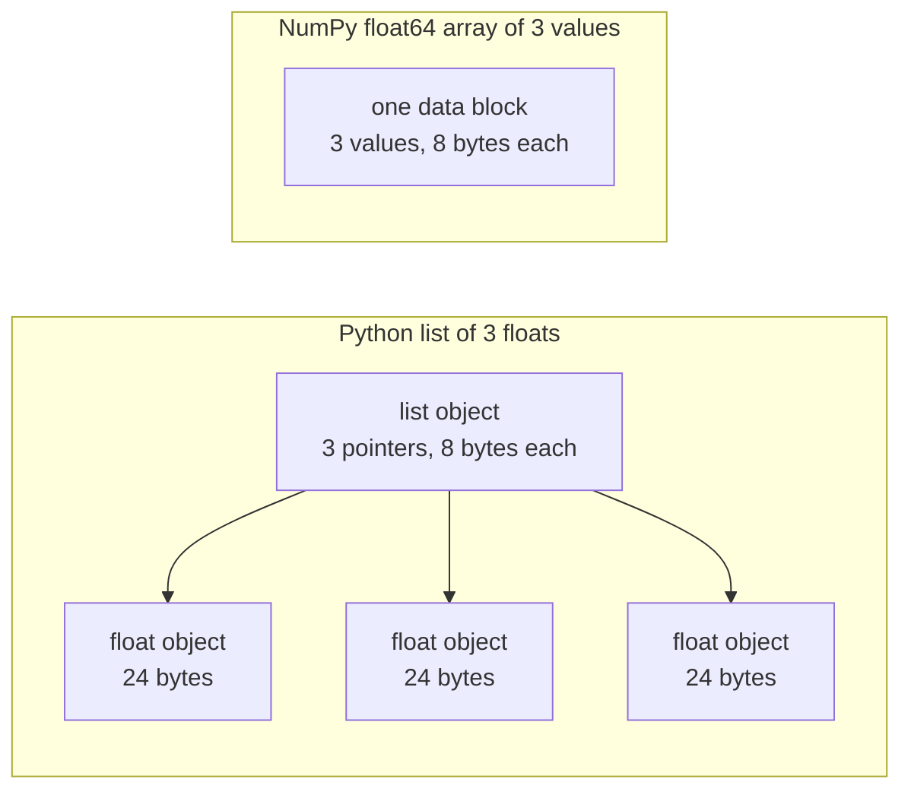

# Python para Engenharia de IA

> A maioria dos códigos neste curso usa o mesmo pequeno conjunto de idiomas Python. Aprenda esse conjunto aqui, antes que as lições de matemática e modelo dependam dele.

**Type:** Build
**Languages:** Python
**Prerequisites:** Dev Environment, Python Environments
**Time:** ~120 minutes

## Objetivos de aprendizagem

- Leia e escreva os idiomas que a maioria dos códigos de curso usa, desde desembaçamento e f-strings até aulas de dados e compreensões.
- Encontre três erros Python que dão resultados errados sem erro: listas compartilhadas, padrões mutáveis e geradores usados.
- Construa um carregador CSV e JSON, uma divisão sementeada e um gerador de mini-parcela com apenas a biblioteca padrão.
- Escreva produto de pontos, média e desvio padrão em Python puro, e mede sua velocidade e uso de memória.
- Explique por que um ciclo de Python puro sobre números é lento, e como a transmissão NumPy move o ciclo para o código compilado.

## O problema

As aulas após esta fase usam Python simples para a matemática e os modelos.`dataclasses`Também, 187 arquivos chamam.`random.seed`ou criar um `random.Random`Se esses idiomas são novos para si, você lê a sintaxe quando quer ler a matemática.

Python também tem comportamentos que dão resultados errados sem mensagem de erro. Dois nomes podem se referir a uma lista, então uma mudança através de um nome também muda o outro. Um argumento padrão mantém seu valor de uma chamada para a próxima. Um gerador está vazio após uma passagem, então uma segunda época de treinamento não recebe dados e a perda não muda.

O último problema é a velocidade. No nosso laptop de teste, um ciclo de Python puro com mais de um milhão de flutuantes levou cerca de 30 milissegundos. NumPy calculou o mesmo produto de pontos em menos de um milissegundo. Você precisa saber a razão, para que você possa escolher entre um ciclo claro e uma operação de matriz.

## O conceito

### O que o código do curso usa

Nós analisamos todos os 541 arquivos Python em `phases/*/*/code/`com o `ast`A tabela conta os arquivos que usam cada construção pelo menos uma vez. As contagens são do dia em que escrevemos esta lição, e elas mudam à medida que as lições são adicionadas.

| Construct | Files | Share |
|-----------|-------|-------|
| Function definitions | 541 | 100% |
| `if __name__ == "__main__":` | 529 | 98% |
| f-strings | 517 | 96% |
| Tuple unpacking | 448 | 83% |
| Classes | 379 | 70% |
| List comprehensions | 375 | 69% |
| Type hints on functions | 342 | 63% |
| Generator expressions | 326 | 60% |
| Slices | 314 | 58% |
| `lambda` | 175 | 32% |
| `try` and `except` | 120 | 22% |
| `with` statements | 96 | 18% |
| Dict comprehensions | 93 | 17% |
| Generator functions with `yield` | 14 | 3% |

As importações mostram quais são os módulos padrão.`from __future__ import annotations`, e 276 importações `dataclasses`- O .`math`- Não .`random`, e `json`Os módulos aparecem nos ficheiros 187, 175 e 126.`collections`O módulo aparece em 70 arquivos e `itertools`Aparece em apenas 4.

Sem aulas .`map()`ou `filter()`As compreensões fazem esse trabalho.`sorted`- Não .`min`- Não .`max`, ou `.sort`com um `key=`Esta lição passa a maior parte do tempo nas idiomas no topo destas listas.

### Os nomes referem-se a objetos

Em Python, uma variável é um nome que se refere a um objeto. Assignment liga um nome a um objeto. Não copia o objeto. Quando dois nomes se referem a uma lista, uma mudança através de qualquer nome é visível através de ambos. Números, cordas e tuples não podem mudar, então esta regra não causa problemas para eles. Listas, dicts e conjuntos podem mudar, então faça uma cópia quando você precisar de uma versão independente.

### Uma lista tem indicadores, uma matriz tem números

Uma lista Python não armazena números diretamente. Armazena ponteiros, e cada ponteiro refere-se a um objeto Python completo. Em uma construção de 64 bits de CPython, cada ponteiro leva 8 bytes e cada `float`O objeto leva 24 bytes.`float64`array armazena os valores de 8 bytes em bruto lado a lado em um bloco de memória.



Um loop sobre uma lista faz muito trabalho para cada elemento. O intérprete executa uma instrução de código de byte de cada vez. Para cada elemento, ele segue um ponteiro e verifica o tipo de cada operando.

NumPy faz a mesma aritmética em um ciclo de código compilado sobre os valores brutos. Ele verifica o tipo de dados uma vez para toda a matriz, e não faz nenhum objeto Python para cada elemento. Código vectorizado descreve uma operação sobre uma matriz inteira, como `(x - mean) / std`As funções vetoriais nesta lição seguem essa regra. cada uma faz uma operação de matriz, para que você possa substituí-la por uma chamada NumPy mais tarde.

### Uma lista contém todos os itens, um gerador contém um.

Uma compreensão de lista cria cada item antes da próxima linha correr. Um gerador cria um item cada vez que o chamador pede o próximo. A memória para uma lista cresce com o número de itens. A memória para um gerador permanece quase a mesma para qualquer número de itens.

Um gerador só pode funcionar uma vez.`StopIteration`Em cada pedido, por isso, um segundo `for`O código de treinamento lê o conjunto de dados uma vez por época, por isso, ele deve criar um novo gerador para cada época.

As funções de gerador são raras no código da lição. Os carregadores de dados que as lições de aprendizagem profunda usam são iteráveis de lotes, então a ideia está em cada ciclo de treinamento.

```figure
s0-list-vs-generator
```

## Os idiomas que você precisa

Cada bloco nesta seção funciona por conta própria. Salve-o para um arquivo e execute-o com `python3`Os blocos precisam do Python 3.11 ou mais recente, a versão que instalamos na aula de ambiente de desenvolvimento.

### 1. Valores, colecções e desembalagens

O Python tem quatro colecções incorporadas. Aprenda quando usar cada uma.

| Type | Example | Ordered | Can change | Typical use in the course |
|------|---------|---------|------------|---------------------------|
| `list` | `[0.5, 1.2]` | Yes | Yes | Samples, losses, weights |
| `tuple` | `(32, 784)` | Yes | No | Shapes, fixed records, dict keys |
| `dict` | `{"lr": 0.01}` | Insertion order | Yes | Configs, vocabularies, JSON rows |
| `set` | `{"cat", "dog"}` | No | Yes | Unique tokens, overlap checks |

Este bloco mostra que a atribuição não copia uma lista.

```python
weights = [0.5, -1.2, 3.0]
alias = weights
alias[0] = 99.0
print(weights)

independent = list(weights)
independent[1] = 0.0
print(weights, independent)

grid = [[0] * 3] * 2
grid[0][0] = 1
print(grid)

grid = [[0] * 3 for _ in range(2)]
grid[0][0] = 1
print(grid)
```

```text
[99.0, -1.2, 3.0]
[99.0, -1.2, 3.0] [99.0, 0.0, 3.0]
[[1, 0, 0], [1, 0, 0]]
[[1, 0, 0], [0, 0, 0]]
```

A expressão`[[0] * 3] * 2`A compreensão faz uma nova lista interna para cada linha. A fase matemática constrói matrizes a partir de listas, então use a forma compreensão.

O desembaçamento atribui os itens de uma sequência a vários nomes em uma linha. Um nome estrelado coleta os itens restantes. Uma cadeia f coloca o valor de uma expressão em uma cadeia, com um formato opcional após um colon.

```python
shape = (32, 784)
batch_size, n_features = shape
first, *middle, last = [1, 2, 3, 4, 5]
x, y = 1.0, 3.0
x, y = y, x

config = {"lr": 0.01, "epochs": 5}
config["seed"] = 7
tokens = ["the", "cat", "sat", "on", "the", "mat"]
vocab = set(tokens)

print(batch_size, n_features, first, middle, last, x, y)
print(config.get("momentum", 0.9), "cat" in vocab, len(vocab))
print(f"lr={config['lr']:.0e} loss={0.123456:.3f} n={60_000:,} {batch_size=}")
```

```text
32 784 1 [2, 3, 4] 5 3.0 1.0
0.9 True 5
lr=1e-02 loss=0.123 n=60,000 batch_size=32
```

`dict.get`Retorna um valor padrão quando a chave está faltando.`in`O teste num conjunto leva aproximadamente o mesmo tempo para qualquer tamanho do conjunto.`{batch_size=}`O formulário imprime o nome e o valor, o que ajuda quando você depurar.

Uma fatia .`a[start:stop:step]`inclui`start`e exclui `stop`Os índices negativos contam a partir do final. Uma fatia de uma lista é uma nova lista, então uma fatia de uma grande lista copia todos os seus indicadores.

```python
tokens = ["<s>", "the", "cat", "sat", "on", "the", "mat", "</s>"]
print(tokens[1:-1])
print(tokens[:3], tokens[-3:])
print(tokens[::2])
print(tokens[::-1][:2])
windows = [tokens[i:i + 3] for i in range(len(tokens) - 2)]
print(len(windows), windows[0])
```

```text
['the', 'cat', 'sat', 'on', 'the', 'mat']
['<s>', 'the', 'cat'] ['the', 'mat', '</s>']
['<s>', 'cat', 'on', 'mat']
['</s>', 'mat']
6 ['<s>', 'the', 'cat']
```

### 2. Compreensões

Uma compreensão constrói uma lista, dicta ou conjunto a partir de um iterável em uma expressão.

```python
scores = [0.91, 0.42, 0.77, 0.15, 0.66]
labels = [1 if s >= 0.5 else 0 for s in scores]
high = [s for s in scores if s > 0.6]
squares = {i: i * i for i in range(4)}
lengths = {len(word) for word in ["a", "bb", "cc", "ddd"]}
sum_sq = sum(s * s for s in scores)

matrix = [[1, 2, 3], [4, 5, 6]]
transposed = [list(column) for column in zip(*matrix)]
flat = [v for row in matrix for v in row]

print(labels, high, squares, lengths, round(sum_sq, 4))
print(transposed, flat)
```

```text
[1, 0, 1, 0, 1] [0.91, 0.77, 0.66] {0: 0, 1: 1, 2: 4, 3: 9} {1, 2, 3} 2.0555
[[1, 4], [2, 5], [3, 6]] [1, 2, 3, 4, 5, 6]
```

Um trail .`if`A expressão anterior.`for`Pode ser uma expressão condicional,`a if condition else b`- Dois .`for`As cláusulas executam-se na mesma ordem que dois loops aninhados.

Os suportes redondos fazem uma expressão geradora.`sum(s * s for s in scores)`- Não .`sum`lê um quadrado por vez, e Python não constrói nenhuma lista.`zip(*matrix)`, a estrela passa cada linha como um argumento separado, e `zip`Emparelha os itens em cada posição.

### 3. Funções, argumentos e fechamentos

Um valor padrão torna um argumento opcional. Um argumento de palavra-chave nomeia o parâmetro na chamada.`*`por si só na lista de parâmetros faz os próximos parâmetros apenas palavras-chave.

```python
def clip(value, low=0.0, high=1.0):
    return max(low, min(high, value))


def train(data, *, lr=0.01, epochs=3):
    return f"{len(data)} samples, lr={lr}, epochs={epochs}"


def make_scaler(factor):
    def scale(values):
        return [v * factor for v in values]
    return scale


print(clip(1.7), clip(-3.0, low=-1.0), clip(0.4, high=0.3))
print(train([1, 2, 3], lr=0.1))
to_percent = make_scaler(100)
print(to_percent([0.25, 0.5]))
```

```text
1.0 -1.0 0.3
3 samples, lr=0.1, epochs=3
[25.0, 50.0]
```

Com argumentos apenas de palavras-chave, uma chamada como `train(data, 0.1, 3)`- Elevação .`TypeError`O que está a chamar deve escrever .`lr=0.1`, então dois números não podem mudar de lugar por acaso.

A função interna .`scale`utilizações `factor`Python mantém a função que a criou.`factor`- por enquanto`scale`A função que mantém as variáveis do seu criador é um fechamento. o padronizador em Construir utiliza um fechamento para manter as estatísticas de treinamento.

A.`lambda`é uma função de uma expressão sem nome.`key=`A função, que mostra a parte 8.

Python avalia um valor padrão uma vez, quando executar o `def`Cada chamada que usa a definição padrão recebe o mesmo objeto.

```python
def add_bad(item, bucket=[]):
    bucket.append(item)
    return bucket


def add_good(item, bucket=None):
    if bucket is None:
        bucket = []
    bucket.append(item)
    return bucket


add_bad("a")
print(add_bad("b"))
add_good("a")
print(add_good("b"))
```

```text
['a', 'b']
['b']
```

Utilização`None`como o padrão para uma lista, dit ou conjunto. Crie o novo objeto dentro da função.

### 4. Classificações e datas

O `@dataclass`O decorador escreve`__init__`- Não .`__repr__`, e `__eq__`Os campos com anotações`frozen=True`, o objeto não pode mudar após a criação, e você pode usá-lo como uma chave de dit ou colocá-lo em um conjunto.

```python
from dataclasses import dataclass, field


@dataclass(frozen=True)
class Example:
    features: tuple[float, ...]
    label: int


@dataclass
class TrainConfig:
    lr: float = 0.01
    epochs: int = 5
    hidden: list[int] = field(default_factory=lambda: [64, 32])

    def describe(self):
        return f"lr={self.lr} epochs={self.epochs} hidden={self.hidden}"


ex = Example((1.5, 2.0), 1)
print(ex)
print(ex == Example((1.5, 2.0), 1), len({ex, Example((1.5, 2.0), 1)}))
print(TrainConfig(epochs=10).describe())
try:
    ex.label = 0
except AttributeError as err:
    print(type(err).__name__)
```

```text
Example(features=(1.5, 2.0), label=1)
True 1
lr=0.01 epochs=10 hidden=[64, 32]
FrozenInstanceError
```

`field(default_factory=...)`dá a cada instância uma nova lista. Resolve o problema de partilha de padrão da parte 3 dentro de uma classe de dados.

Métodos especiais conectam uma classe à sintaxe Python. `len(ds)`chamadas`__len__`, e `ds[2]`chamadas`__getitem__`- Não .

```python
class SquaresDataset:
    def __init__(self, n):
        self.n = n

    def __len__(self):
        return self.n

    def __getitem__(self, index):
        if not 0 <= index < self.n:
            raise IndexError(index)
        return index, index * index


ds = SquaresDataset(4)
print(len(ds), ds[2])
print(list(ds))
```

```text
4 (2, 4)
[(0, 0), (1, 1), (2, 4), (3, 9)]
```

O `for`Loop dentro`list(ds)`funciona sem um`__iter__`Python ligações`__getitem__`com 0, 1, 2 e assim por diante até que ele se torne `IndexError`. Os conjuntos de dados de estilo PyTorch usam os mesmos dois métodos, `__len__`E ...`__getitem__`- Não .

### 5. Iteradores e geradores

Um iterável é qualquer objeto que um `for`O loop aceita.`iter()`e obtém um iterador dele, e `next()`Quando o iterador não tem mais itens, ele aumenta `StopIteration`- A.`for`chamadas de loop`next()`Para ti e para em `StopIteration`- Não .

```python
numbers = [10, 20, 30]
it = iter(numbers)
print(next(it), next(it), next(it))
try:
    next(it)
except StopIteration:
    print("no more items")


def countdown(n):
    while n > 0:
        yield n
        n -= 1


gen = countdown(3)
print(type(gen).__name__)
print(list(gen))
print(list(gen))
```

```text
10 20 30
no more items
generator
[3, 2, 1]
[]
```

Uma função com `yield`Uma chamada para ele não executa nenhum de seus códigos e retorna um objeto gerador.`next()`- Vai levar o corpo para o outro .`yield`E faz pausas ali.`list(gen)`Está vazio porque o primeiro usou o gerador.

Um gerador pode ler um arquivo uma linha por vez.

```python
import os
import tempfile


def read_rows(path):
    with open(path, encoding="utf-8") as fh:
        header = fh.readline().rstrip("\n").split(",")
        for line in fh:
            yield dict(zip(header, line.rstrip("\n").split(",")))


with tempfile.TemporaryDirectory() as tmp:
    path = os.path.join(tmp, "rows.csv")
    with open(path, "w", encoding="utf-8") as fh:
        fh.write("x,label\n")
        fh.writelines(f"{i * 0.5},{i % 2}\n" for i in range(5))
    rows = read_rows(path)
    print(next(rows))
    print(sum(1 for _ in rows))
```

```text
{'x': '0.0', 'label': '0'}
4
```

`read_rows`mantém uma linha do arquivo na memória de cada vez.`read_rows`Os arquivos CSV reais podem conter vírgulas dentro dos campos citados, então, o Build It usa o `csv`Modulo.

```python
import sys

as_list = [i * i for i in range(1_000_000)]
as_generator = (i * i for i in range(1_000_000))
print(sys.getsizeof(as_list), sys.getsizeof(as_generator))
print(sum(as_list) == sum(as_generator))
```

No CPython de 64 bits, a lista relata cerca de 8 MB e o gerador cerca de 200 bytes. `sys.getsizeof`Conta apenas os ponteiros da lista, e os objetos inteiros usam mais memória.`tracemalloc`, que usamos na aula de depuração e perfil.

### 6. Gestores de contexto e exceções

A.`with`A instrução executa o código de configuração, depois o seu corpo e depois o código de limpeza.`open()`é um gerenciador de contexto que fecha o arquivo.

Na aula de depuração e perfil, escrevemos um`Timer`classe com `__enter__`E ...`__exit__`- O .`contextlib.contextmanager`O código anterior é o código de um gerador.`yield`é a configuração, e o `finally`O bloco é a limpeza.

```python
import time
from contextlib import contextmanager


@contextmanager
def timer(label):
    start = time.perf_counter()
    try:
        yield
    finally:
        print(f"{label}: {(time.perf_counter() - start) * 1000:.1f} ms")


def parse_label(text):
    try:
        return int(text)
    except ValueError:
        raise ValueError(f"label must be an integer, got {text!r}") from None


with timer("sum of squares"):
    total = sum(i * i for i in range(200_000))

print(parse_label("3"))
try:
    parse_label("cat")
except ValueError as err:
    print("rejected:", err)
```

```text
sum of squares: 9.4 ms
3
rejected: label must be an integer, got 'cat'
```

A hora na sua máquina será diferente.`except`cláusula, como `ValueError`ou `KeyError`- Um .`except:`cláusula sem tipo de exceção também lida `KeyboardInterrupt`, para que o Ctrl+C não possa parar um loop que o contém. Leve uma exceção com uma mensagem clara quando a entrada é errada. Adicionar `from None`Quando a sua mensagem substituir o rastreamento original.

### 7. Indicações de tipo, módulos e a guarda principal

As dicas de tipo dizem ao leitor o que uma função leva e retorna. Python não as verifica quando o código é executado. Um verificador de tipo, como mypy, as lê antes do código ser executado.

```python
from __future__ import annotations

from collections.abc import Iterable, Sequence


def mean(values: Sequence[float]) -> float:
    if not values:
        raise ValueError("mean() needs at least one value")
    return sum(values) / len(values)


def count_tokens(docs: Iterable[str]) -> int:
    return sum(len(doc.split()) for doc in docs)


def main() -> None:
    print(mean([1.0, 2.0, 4.0]))
    print(count_tokens(["the cat sat", "on the mat"]))
    print(mean.__annotations__)


if __name__ == "__main__":
    main()
```

```text
2.3333333333333335
6
{'values': 'Sequence[float]', 'return': 'float'}
```

Com o`from __future__ import annotations`, Python armazena cada sugestão como uma cadeia, como mostra a última linha. `Sequence`significa qualquer objeto com `len()`e índices, como uma lista ou um tuple. `Iterable`significa qualquer objeto que um `for`Muitos arquivos de curso importam os mesmos nomes de`typing`, que também funciona.

Todos .`.py`Quando executar um arquivo com `python3 file.py`, Python define o seu`__name__`- Não .`"__main__"`Quando outro ficheiro o importa,`__name__`É o nome do módulo.`main()`O primeiro caso, por causa do guarda, os testes em`code/tests/`pode importar`main.py`Sem o início da demonstração.

### 8. Arquivos, JSON, CSV e classificação

`pathlib.Path`liga caminhos com `/`E pode ler ou escrever um arquivo inteiro em uma chamada.`encoding="utf-8"`, porque a codificação padrão depende do sistema operacional.

```python
import csv
import json
import tempfile
from pathlib import Path

rows = [
    {"text": "great movie", "label": 1, "score": 0.93},
    {"text": "boring plot", "label": 0, "score": 0.12},
    {"text": "fine acting", "label": 1, "score": 0.58},
]

with tempfile.TemporaryDirectory() as tmp:
    json_path = Path(tmp) / "reviews.json"
    json_path.write_text(json.dumps(rows, indent=2), encoding="utf-8")
    from_json = json.loads(json_path.read_text(encoding="utf-8"))

    csv_path = Path(tmp) / "reviews.csv"
    with csv_path.open("w", newline="", encoding="utf-8") as fh:
        writer = csv.DictWriter(fh, fieldnames=["text", "label", "score"])
        writer.writeheader()
        writer.writerows(rows)
    with csv_path.open(newline="", encoding="utf-8") as fh:
        from_csv = list(csv.DictReader(fh))

print(from_json == rows)
print(from_csv[0])

by_score = sorted(rows, key=lambda r: r["score"], reverse=True)
print([r["text"] for r in by_score])
print(max(rows, key=lambda r: r["score"])["text"])
print([r["text"] for r in sorted(rows, key=lambda r: (-r["label"], r["text"]))])
```

```text
True
{'text': 'great movie', 'label': '1', 'score': '0.93'}
['great movie', 'fine acting', 'boring plot']
great movie
['fine acting', 'great movie', 'boring plot']
```

JSON mantém números como números. CSV dá cada campo de volta como uma cadeia, então você deve converter cada campo. Abra arquivos CSV com `newline=""`, como o `csv`A documentação diz-lhe que sim.

A.`key=`Função retorna o valor que Python compara para cada item. `sorted`- Não .`min`, e `max`Todos aceitam uma. Uma chave tupla classifica pelo primeiro valor, e usa o segundo valor apenas para laços. O sinal menos coloca o rótulo maior primeiro. A classificação do Python é estável, então itens com chaves iguais mantêm sua ordem original.

### 9. Ferramentas de contagem, agrupamento e iteração

Estes dois módulos contêm as estruturas de dados e as ferramentas de iteração que as listas e dicts simples não lhe dão.

```python
from collections import Counter, defaultdict, deque
from itertools import chain, islice, product

labels = ["cat", "dog", "cat", "bird", "cat", "dog"]
counts = Counter(labels)
print(counts.most_common(2))

positions = defaultdict(list)
for i, label in enumerate(labels):
    positions[label].append(i)
print(dict(positions))

recent = deque(maxlen=3)
for loss in [2.0, 1.5, 1.2, 1.1, 0.9]:
    recent.append(loss)
print(list(recent), round(sum(recent) / len(recent), 3))

print(list(product([0.1, 0.01], [16, 32])))
print(list(chain([1, 2], [3], [4, 5])))
print(list(islice(range(100), 5, 10)))
```

```text
[('cat', 3), ('dog', 2)]
{'cat': [0, 2, 4], 'dog': [1, 5], 'bird': [3]}
[1.2, 1.1, 0.9] 1.067
[(0.1, 16), (0.1, 32), (0.01, 16), (0.01, 32)]
[1, 2, 3, 4, 5]
[5, 6, 7, 8, 9]
```

`Counter`Conta os itens que podem ser roubados, tais como etiquetas ou tokens. `defaultdict(list)`cria uma lista vazia a primeira vez que você usa uma nova chave, então um ciclo de agrupamento não precisa de verificação de chave. `deque(maxlen=3)`Remove o item mais antigo quando adicionar um quarto, o que dá uma janela de mudança sobre perdas recentes. `enumerate`dá a cada item o seu índice.

`product`dá cada combinação de suas entradas, que é uma grade de hiperparâmetros. `chain`Junta iteráveis de ponta a ponta. `islice`O gerador de mini-batch em Construir utiliza `islice`- Não .

### 10. Por que os ciclos sobre números são lentos

O `dis`O módulo imprime as instruções de código de byte que o intérprete executa para uma função.

```python
import dis


def dot(a, b):
    total = 0.0
    for x, y in zip(a, b):
        total += x * y
    return total


dis.dis(dot)
```

As instruções de `FOR_ITER`O que significa que as instruções são diferentes, mas o que é preciso é que as instruções sejam diferentes, e que as instruções sejam diferentes.

Um loop fica mais rápido quando menos de seus passos são executados como código de byte.`sum`- Não .`map`, e `zip`são escritas em C. Construir isso mede este efeito em Python puro, e Use It move todo o ciclo para NumPy.

## Construí-lo

Agora, construam as peças que as aulas posteriores precisam.`code/main.py`, e `code/tests/test_main.py`Cada bloco abaixo corre por conta própria.

### Passo 1: Tipo de registro e carregador de conjuntos de dados

O carregador lê um arquivo CSV ou um arquivo JSON em uma forma: um tuple de características flutuantes e um rótulo de números inteiros.

```python
import csv
import json
import tempfile
from dataclasses import dataclass
from pathlib import Path


@dataclass(frozen=True)
class Record:
    features: tuple[float, ...]
    label: int


def row_to_record(row, names, label_field="label"):
    if label_field not in row:
        raise ValueError(f"row has no {label_field!r} field: {row}")
    if set(row) != {*names, label_field}:
        raise ValueError(f"row fields {list(row)} do not match {[*names, label_field]}")
    return Record(tuple(float(row[name]) for name in names), int(row[label_field]))


def load_records(path, label_field="label"):
    path = Path(path)
    if path.suffix == ".json":
        rows = json.loads(path.read_text(encoding="utf-8"))
    elif path.suffix == ".csv":
        with path.open(newline="", encoding="utf-8") as fh:
            rows = list(csv.DictReader(fh))
    else:
        raise ValueError(f"unsupported file type: {path.suffix!r}")
    if not rows:
        return []
    names = [key for key in rows[0] if key != label_field]
    return [row_to_record(row, names, label_field) for row in rows]


with tempfile.TemporaryDirectory() as tmp:
    csv_path = Path(tmp) / "data.csv"
    csv_path.write_text("x1,x2,label\n1.5,60,1\n1.8,82.5,0\n", encoding="utf-8")
    json_path = Path(tmp) / "data.json"
    json_path.write_text('[{"x1": 1.5, "x2": 60, "label": 1}]', encoding="utf-8")
    print(load_records(csv_path))
    print(load_records(json_path))
```

```text
[Record(features=(1.5, 60.0), label=1), Record(features=(1.8, 82.5), label=0)]
[Record(features=(1.5, 60.0), label=1)]
```

A primeira linha define os nomes das características e a sua ordem. `DictReader`E ...`json.loads`mantém as chaves na ordem do arquivo, e um dict mantém a ordem na qual as chaves foram adicionadas. O padrão JSON não define uma ordem para as chaves em um objeto, então `row_to_record`Leia cada linha pelo nome, na ordem da primeira linha. Um rótulo faltante, uma característica ou um recurso extra ou um tipo de arquivo desconhecido aumenta `ValueError`com uma mensagem, então um arquivo ruim para o início.`main.py`Também tem`save_records`, que escreve os mesmos dois formatos.

### Passo 2: Trem sementeado e teste dividido

```python
import random


def train_test_split(items, test_fraction=0.2, seed=0):
    if not 0.0 < test_fraction < 1.0:
        raise ValueError(f"test_fraction must be between 0 and 1, got {test_fraction}")
    if len(items) < 2:
        raise ValueError(f"need at least 2 items to split, got {len(items)}")
    order = list(range(len(items)))
    random.Random(seed).shuffle(order)
    n_test = min(max(1, round(len(items) * test_fraction)), len(items) - 1)
    test = [items[i] for i in order[:n_test]]
    train = [items[i] for i in order[n_test:]]
    return train, test


items = list(range(10))
print(train_test_split(items, seed=1))
print(train_test_split(items, seed=1) == train_test_split(items, seed=1))
print(train_test_split(items, seed=2)[1])
print(items)
```

```text
([9, 7, 5, 3, 0, 4, 1, 2], [6, 8])
True
[5, 9]
[0, 1, 2, 3, 4, 5, 6, 7, 8, 9]
```

`random.Random(seed)`cria um gerador de números aleatórios privado.`random.seed(seed)`Resete o gerador global que todos os módulos compartilham, para que uma chamada em outra biblioteca possa alterar a sua sequência.`random.seed`e 96 criam .`random.Random`Use o gerador privado em novo código.

A função mistura uma lista de índices, de modo que a lista de entrada permanece inalterada. A mesma semente dá sempre a mesma divisão. Cada lado mantém pelo menos um item, de modo que uma lista com menos de 2 itens aumenta `ValueError`A aprendizagem de dados é uma forma de fazer a aprendizagem de dados, como a padronização.

### Passo 3: Um gerador de mini-parcela

```python
from itertools import islice


def batches(items, batch_size, drop_last=False):
    if batch_size < 1:
        raise ValueError(f"batch_size must be at least 1, got {batch_size}")
    return _batch_iter(iter(items), batch_size, drop_last)


def _batch_iter(iterator, batch_size, drop_last):
    while True:
        batch = list(islice(iterator, batch_size))
        if not batch or (drop_last and len(batch) < batch_size):
            return
        yield batch


print(list(batches(range(10), 4)))
print(list(batches(range(10), 4, drop_last=True)))
squares = (i * i for i in range(7))
print([len(b) for b in batches(squares, 3)])

for epoch in range(2):
    sizes = [len(b) for b in batches(range(10), 4)]
    print(f"epoch {epoch}: {sizes}")
```

```text
[[0, 1, 2, 3], [4, 5, 6, 7], [8, 9]]
[[0, 1, 2, 3], [4, 5, 6, 7]]
[3, 3, 1]
epoch 0: [4, 4, 2]
epoch 1: [4, 4, 2]
```

`islice`- O que é ?`batch_size`elementos do iterador. `batches`necessidades só `iter()`O último lote é menor quando o comprimento não é um múltiplo do tamanho do lote. `drop_last=True`remove o lote, para um modelo que precisa de uma forma fixa do lote.

O trabalho é em duas funções porque uma função geradora não executa código até a primeira `next()`Com o cheque dentro do gerador,`batches(data, 0)`O erro viria mais tarde, do interior do loop de treinamento. A função externa é uma função normal, então verifica o argumento de uma vez.`batches()`O gerador dá os seus itens apenas uma vez.

### Passo 4: Matemática de vetores e padronização

```python
import math


def dot(a, b):
    return sum(x * y for x, y in zip(a, b, strict=True))


def mean(values):
    if not values:
        raise ValueError("mean() needs at least one value")
    return sum(values) / len(values)


def std(values):
    mu = mean(values)
    return math.sqrt(sum((v - mu) ** 2 for v in values) / len(values))


def make_standardizer(rows):
    columns = list(zip(*rows))
    means = [mean(c) for c in columns]
    scales = [s if s > 0 else 1.0 for s in (std(c) for c in columns)]

    def standardize(row):
        return [(v - m) / s for v, m, s in zip(row, means, scales, strict=True)]

    return standardize


print(dot([1.0, 2.0, 3.0], [4.0, 5.0, 6.0]))
values = [2.0, 4.0, 4.0, 4.0, 5.0, 5.0, 7.0, 9.0]
print(mean(values), std(values))

train_rows = [(1.0, 100.0), (2.0, 300.0), (3.0, 500.0)]
standardize = make_standardizer(train_rows)
print([[round(v, 3) for v in standardize(r)] for r in train_rows])
print([round(v, 3) for v in standardize((4.0, 700.0))])
```

```text
32.0
5.0 2.0
[[-1.225, -1.225], [0.0, 0.0], [1.225, 1.225]]
[2.449, 2.449]
```

Com o`strict=True`- Não .`zip`- Elevação .`ValueError`Quando os dois vetores têm comprimentos diferentes.`zip`O sistema de correcção de dados é um sistema de correcção de dados que é utilizado para determinar a posição de um sistema de correcção de dados.`strict`O argumento precisa do Python 3.10 ou mais recente.

`std`Divide por `n`, por isso dá a desvio padrão da população, como `statistics.pstdev`Divide por `n - 1`Quando se estima a propagação de uma população maior a partir de uma amostra.

`make_standardizer`O sistema de formação é um sistema de conclusão que calcula os meios e os desvios padrão das linhas de formação uma vez, e `standardize`A função é igual às linhas de teste, então os dados de teste não têm efeito sobre as estatísticas.

### Passo 5: Completar a corrida

`code/main.py`Ele faz 400 registros a partir de dois clusters, salva-os como CSV e JSON, e carrega os dois arquivos de volta.

Um classificador de centro-estrada mais próximo armazena o vetor de características médias de cada classe. Prevê a classe cuja média é mais próxima da entrada. `fit_centroids`Adiciona as fileiras um lote por vez, de modo que nunca precisa de um treinamento completo na memória. `predict`utilizações `min()`com um `key=`Função para encontrar o centroide mais próximo.

```bash
python3 phases/00-setup-and-tooling/13-python-for-ai-engineering/code/main.py
```

```text
Python for AI engineering: a standard-library toolkit
data     400 records, CSV and JSON load back unchanged: True
split    320 train, 80 test, records in both: 0
batches  size 48: [48, 48, 48, 48, 48, 48, 32]
scale    train feature means after standardizing: [0.0, 0.0]
model    nearest-centroid test accuracy: raw 0.86, standardized 0.89
speed    dot product of 200,000 floats, best of 5:
           index loop         6.60 ms
           zip generator      5.93 ms
           map + mul          2.89 ms
memory   peak bytes to sum 100,000 squares:
           list              4,000,616
           generator               472
```

As duas características têm escalas muito diferentes. A segunda característica tem dez vezes a propagação da primeira, por isso controla as distâncias brutas, e a precisão brutas é menor.

### Passo 6: Messa a velocidade e a memória

```python
import operator
import random
import time
import tracemalloc


def dot_index_loop(a, b):
    total = 0.0
    for i in range(len(a)):
        total += a[i] * b[i]
    return total


def dot_zip(a, b):
    return sum(x * y for x, y in zip(a, b, strict=True))


def dot_map(a, b):
    return sum(map(operator.mul, a, b))


def best_time(fn, *args, repeat=5):
    times = []
    for _ in range(repeat):
        start = time.perf_counter()
        fn(*args)
        times.append(time.perf_counter() - start)
    return min(times)


def peak_bytes(fn):
    tracemalloc.start()
    try:
        fn()
        return tracemalloc.get_traced_memory()[1]
    finally:
        tracemalloc.stop()


rng = random.Random(0)
a = [rng.random() for _ in range(1_000_000)]
b = [rng.random() for _ in range(1_000_000)]
for fn in (dot_index_loop, dot_zip, dot_map):
    print(f"{fn.__name__:15} {best_time(fn, a, b) * 1000:7.2f} ms")

print(peak_bytes(lambda: sum([i * i for i in range(100_000)])))
print(peak_bytes(lambda: sum(i * i for i in range(100_000))))
```

`best_time`O programa de execução de um computador é o mais rápido de vários programas.`timeit`O módulo dá o mesmo conselho.

No nosso laptop de teste com Python 3.11, o loop de índice levou cerca de 33 ms. A versão zip levou cerca de 30 ms, e o `map`As três fazem a mesma aritmética.`map`A versão é mais rápida porque `map`E ...`operator.mul`Os números de memória repetem a figura: cerca de 4 MB para a lista e menos de 1 KB para o gerador.

## Usá-lo

### As versões de biblioteca padrão

A biblioteca padrão tem uma versão testada da maioria das peças que construíram.

| You built | Standard library | Note |
|-----------|------------------|------|
| `mean`, `std` | `statistics.fmean`, `statistics.pstdev` | The tests compare against these |
| `dot` | `math.sumprod` | Python 3.12 or newer |
| `batches` | `itertools.batched` | Python 3.12 or newer, gives tuples |
| `best_time` | `timeit.repeat` | Also turns off garbage collection during the runs |
| `peak_bytes` | `tracemalloc` | The same module, with snapshots and per-line statistics |

```python
import statistics
import sys

values = [2.0, 4.0, 4.0, 4.0, 5.0, 5.0, 7.0, 9.0]
print(statistics.fmean(values), statistics.pstdev(values))

if sys.version_info >= (3, 12):
    import math
    from itertools import batched

    print(math.sumprod([1.0, 2.0, 3.0], [4.0, 5.0, 6.0]))
    print(list(batched(range(10), 4)))
```

```text
5.0 2.0
32.0
[(0, 1, 2, 3), (4, 5, 6, 7), (8, 9)]
```

O curso suporta Python 3.11, por isso `main.py`utiliza o seu próprio `dot`E ...`batches`No Python 3.11, o bloco imprime apenas a primeira linha.

### A mesma matemática com matrizes compiladas

Instalar NumPy no ambiente virtual a partir da lição de ambientes Python, por exemplo com `uv pip install numpy`O código de lição e os testes não precisam dele.

```python
import time

import numpy as np

n = 1_000_000
rng = np.random.default_rng(0)
a = rng.random(n)
b = rng.random(n)
a_list, b_list = a.tolist(), b.tolist()

start = time.perf_counter()
slow = sum(x * y for x, y in zip(a_list, b_list))
python_ms = (time.perf_counter() - start) * 1000

start = time.perf_counter()
fast = float(a @ b)
numpy_ms = (time.perf_counter() - start) * 1000

print(f"pure Python {python_ms:8.2f} ms")
print(f"NumPy       {numpy_ms:8.2f} ms")
print(f"difference  {abs(slow - fast):.1e}")
print(a.dtype, a.itemsize, a.nbytes)
```

No nosso laptop de teste, o NumPy levou menos de 1 ms, e a versão de Python puro levou cerca de 30 ms. Os dois resultados diferem nos últimos dígitos, porque as duas versões adicionam os produtos em uma ordem diferente.

NumPy é mais rápido por três razões:

- O arquivamento armazena o produto bruto .`float64`Uma lista de floats precisa de um ponteiro de 8 bytes e um objeto float de 24 bytes para cada valor.
- O loop é executado em código compilado. NumPy verifica o tipo de dados uma vez para toda a matriz e não faz nenhum objeto Python para cada elemento.
- Valores que se sentam lado a lado na memória permitem que o NumPy use instruções SIMD, que processam vários valores com uma instrução.

Para matrizes muito pequenas, o custo fixo de uma chamada NumPy pode ser maior do que um curto ciclo Python.

### Transmissão

A transmissão permite que o NumPy combine matrizes de diferentes formas sem um loop no seu código.`make_standardizer`do passo 4.

```python
import numpy as np

X = np.array([[1.0, 100.0], [2.0, 300.0], [3.0, 500.0]])
mu = X.mean(axis=0)
sigma = X.std(axis=0)
Z = (X - mu) / sigma
print(X.shape, mu.shape, Z.shape)
print(Z.round(3))

norms = np.sqrt((X ** 2).sum(axis=1, keepdims=True))
print(norms.shape, (X / norms).shape)
```

```text
(3, 2) (2,) (3, 2)
[[-1.225 -1.225]
 [ 0.     0.   ]
 [ 1.225  1.225]]
(3, 1) (3, 2)
```

NumPy compara as duas formas da última dimensão para a primeira. Duas dimensões são compatíveis quando são iguais ou quando uma delas é 1. Uma dimensão principal faltante conta como 1. Uma dimensão de tamanho 1 é usada novamente ao longo da dimensão maior, e NumPy não faz cópia dos dados.

| Shape of `X` | Shape of the other array | Result |
|--------------|--------------------------|--------|
| `(3, 2)` | `(2,)`, column means | `(3, 2)` |
| `(3, 2)` | `(3, 1)`, row norms with `keepdims=True` | `(3, 2)` |
| `(3, 2)` | `(3,)`, row norms without `keepdims` | `ValueError` |

A última linha é um erro comum. NumPy compara o seguimento 2 com 3, e nenhum dos dois é 1.`keepdims=True`Quando você reduzir sobre linhas e, em seguida, combinar o resultado com a matriz original.

## Envia-o

Esta lição produz`outputs/prompt-python-review.md`É um prompt de revisão para código Python em IA e projetos de dados. Dê-lhe um arquivo ou uma diferença. Verifica o código para idiomas e erros silenciosos desta lição:

- Referências compartilhadas e argumentos de padrão mutáveis
- Geradores que uma segunda época lê depois de serem usados
- Números aleatórios sem semente, ou com apenas a semente global
- Estatísticas provenientes da divisão de teste
- Loops de Python puro em grandes matrizes numéricas

Relata cada descoberta com um local, o problema e uma solução.

## Exercícios

1. Corra .`run_demo(seed=8)`de`main.py`Encontre as linhas de saída que mudam e as linhas que permanecem iguais. Explique por que os tamanhos divididos permanecem iguais.
2. Escreva .`median(values)`Testá-lo contra o Python.`statistics.median`Em listas de comprimento ímpar e de comprimento par.
3. Escreva .`stream_records(path)`, um gerador que produz um `Record`Comparar a memória máxima de`stream_records`E ...`load_records`com`tracemalloc`- Não .
4. Escreva .`matvec(matrix, vector)`Em Python puro e em NumPy.`best_time`Para tamanhos 4, 64 e 1024. Encontre o tamanho onde NumPy se torna mais rápido na sua máquina.
5. Escreva a imagem do Concept.`ast.parse`E ...`ast.walk`em cada arquivo em `phases/*/*/code/*.py`Contar os ficheiros que contêm`ast.ListComp`- Não .`ast.Yield`, e `ast.With`, e comparar as suas contagens com a mesa.

## Termos-chave

| Term | What people say | What it means |
|------|----------------|----------------------|
| Iterable | "Something you can loop over" | An object that `iter()` accepts, such as a list, a file, or a generator |
| Iterator | "A cursor" | An object whose `__next__` method returns one item per call and raises `StopIteration` at the end |
| Generator | "A lazy list" | An iterator from a `yield` function or a generator expression. It makes each item on request and runs only once. |
| Comprehension | "A one-line loop" | An expression that builds a list, dict, or set from an iterable, with an optional filter |
| Closure | "A function inside a function" | A function that keeps variables from the function that created it |
| Dataclass | "A struct" | A class whose `__init__`, `__repr__`, and `__eq__` methods Python writes from the annotated fields |
| Context manager | "A with block" | An object that runs setup code at the start of a `with` block and cleanup code at the end, even after an exception |
| Seed | "The random number" | The start value of a pseudo-random generator. The same seed gives the same sequence. |
| Vectorized code | "Fast code" | Code that applies one operation to a whole array, so that compiled code runs the loop |
| Broadcasting | "Automatic shape matching" | The NumPy rules that combine arrays of different shapes by using size-1 dimensions again, with no copy |

## Mais leitura

- [The Python Tutorial: Data Structures](https://docs.python.org/3/tutorial/datastructures.html)As informações sobre o processo de elaboração de um documento de informação são:
- [The Python Tutorial: Classes](https://docs.python.org/3/tutorial/classes.html): escopo, classes, iterações e geradores.
- [dataclasses](https://docs.python.org/3/library/dataclasses.html): todas as opções do decorador, incluindo `frozen`E ...`field`- Não .
- [collections](https://docs.python.org/3/library/collections.html)- Não .`Counter`- Não .`defaultdict`- Não .`deque`, e os outros tipos de recipientes.
- [itertools](https://docs.python.org/3/library/itertools.html)- Não .`islice`- Não .`chain`- Não .`product`- Não .`batched`, e receitas que as combinam.
- [Sorting Techniques](https://docs.python.org/3/howto/sorting.html): funções-chave, tipos estáveis e tipos em várias teclas.
- [timeit](https://docs.python.org/3/library/timeit.html)Como medir pequenos pedaços de código e por que relatar o mínimo.
- [random](https://docs.python.org/3/library/random.html)O gerador global.`random.Random`casos e reproducibilidade.
- [PEP 255: Simple Generators](https://peps.python.org/pep-0255/): a proposta que acrescenta `yield`, com as razões do seu design.
- [NumPy: Broadcasting](https://numpy.org/doc/stable/user/basics.broadcasting.html)A definição de um sistema de controlo é:
- [Harris et al., Array programming with NumPy, Nature 585, 2020](https://doi.org/10.1038/s41586-020-2649-2)A definição da matriz NumPy e as razões para a sua velocidade.
