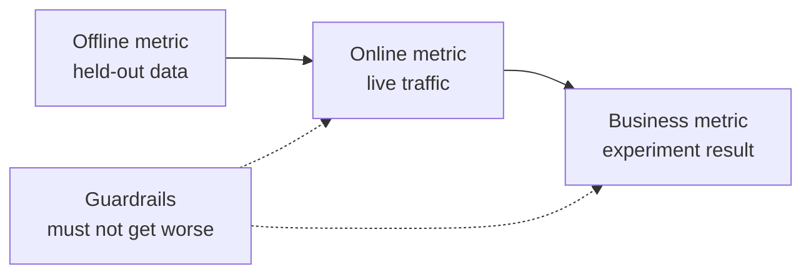

# Projeto de sistema ML  Do problema ao modelo implementado

> Um modelo é uma parte de um sistema. O design decide o que o modelo prevê, quem age sobre ele, o que custa e o que acontece quando falha.

**Type:** Build
**Languages:** Python
**Prerequisites:** Phase 2, Lessons 09 (Model Evaluation) and 13 (ML Pipelines)
**Time:** ~110 minutes

## Objetivos de aprendizagem

- Enfrente um problema de negócios como uma tarefa de ML com uma previsão, uma decisão que o usa e uma razão para as regras não serem suficientes
- Separar as métricas offline, online, de negócios e de guardrail, e comparar cada modelo com linhas de base triviais e heurísticas
- Estimar o custo diário, a latência e a atraso do lote e inferências on-line a partir dos números de tráfego
- Escolha um padrão de implantação (sombra, canário, teste A/B) e um padrão seguro para cada modo de falha
- Identificar os circuitos de feedback em que o modelo altera os dados que treinam sua próxima versão
- Escreva um documento de projeto ML e pontua-o contra uma lista fixa de verificação

## O problema

Uma empresa de assinatura pede um "modelo de churn". Um cientista de dados treina um classificador aumentado de gradiente e relata uma AUC de 0,91.

As razões não têm nada a ver com o algoritmo. Ninguém decidiu qual a ação uma pontuação começa. As pontuações chegam uma vez por semana, mas a equipe de retenção liga aos clientes todos os dias. O rótulo veio de uma tabela de cancelamento que também armazenou a razão de cancelamento, então uma característica continha a resposta. Ninguém comparou o modelo com a regra que a equipe de suporte já usou: chamar alguém ocioso por duas semanas.

Cada uma dessas falhas ocorreu antes do início do treinamento. São falhas de design, e um documento de design de uma página pergunta sobre cada uma delas. Esta lição ensina as decisões nesse documento. Você constrói um kit de ferramentas que preceira lote e entrega on-line, compara um modelo com suas linhas de base e classifica um documento de design contra uma lista de verificação.

## O conceito

### De um objetivo de negócios para uma tarefa de ML

Um objetivo de negócios não é uma tarefa de inteligência artificial.

1. O que exatamente prevê o modelo e para que entidade (usuário, pagamento, loja, item)?
2. Que decisão utiliza a previsão, e quem ou o que toma essa decisão?
3. Quando é necessária a previsão e quais dados existem nesse momento?
4. Como é que saberás que a decisão foi melhor?

| Business goal | Prediction | Decision that uses it | ML task |
|---|---|---|---|
| Reduce churn | Probability that a user cancels in the next 30 days | Send a save offer to the top 5 percent each night | Binary classification |
| Cut fraud losses | Probability that a payment is fraud | Approve, review, or block within 100 ms | Binary classification |
| Keep shelves stocked | Units sold per store per day next week | Order quantity for each store | Forecasting |
| Show relevant items | Relevance score for a (user, item) pair | Order of items in the feed | Ranking |

A segunda coluna precisa de mais cuidado. "Predict churn" deixa o horizonte, a entidade e a ação aberta. "Predicta se esse usuário cancela nos próximos 30 dias, para que o trabalho de hoje possa escolher quem recebe uma oferta" corrige as três.

### Quando não utilizar ML

A regra número 1 das Regras do Machine Learning do Google diz que não tenha medo de lançar um produto sem machine learning.

- Uma regra curta atinge o objetivo e permanece correta.
- Não tem rótulos e não há forma prática de coletá-los.
- Ninguém age na previsão, por isso uma melhor previsão não muda nada.
- Os dados existentes no momento da previsão não contêm o sinal.
- Um erro é inaceitável e ninguém pode verificar a saída.
- Construir e gerir o sistema custa mais do que as melhores decisões valem.

Quando uma regra se torna longa e frágil, a ML começa a dar frutos. A regra #3 da mesma guia prefere a ML a uma heurística complexa, porque um modelo aprendido é mais fácil de atualizar e manter.

### Três camadas de métricas

Mita um sistema de ML em três camadas, mais um conjunto de limites:

| Layer | When you can measure it | Churn example |
|---|---|---|
| Offline metric | Before launch, on held-out past data | F1 at the offer threshold, precision in the top 5 percent |
| Online metric | During launch, on live traffic | Offer acceptance rate, share of users scored, score distribution |
| Business metric | Weeks after launch, with an experiment | 30-day churn rate in the treated group versus a holdout group |
| Guardrail metric | All the time | Offer cost per saved user, unsubscribe rate, p99 latency |



As camadas muitas vezes discordam. Uma métrica offline marca dados passados, e o passado não continha o seu modelo. Uma métrica online depende de como as pessoas reagem à decisão. Uma métrica de negócios se move lentamente e transporta ruído de tudo o mais na empresa.

Escolha a métrica offline que corresponda à decisão. Se o trabalho contata os 5% mais importantes dos usuários, mensure a precisão nos 5% mais altos. AUC média sobre todos os limiares, incluindo limiares que você nunca usa. Regra #2 do mesmo guia diz para projetar e implementar métricas primeiro, antes de decidir o que o sistema ML vai fazer.

### Linhas de base

Um valor métrico não significa nada sozinho. Uma F1 de 0,56 é boa se a melhor alternativa atinge 0,30 e pobre se uma regra atinge 0,60.

- **Trivial baseline.**Sempre prever a classe majoritária, ou sempre prever a média de treinamento.
- **Heuristic baseline.**Uma regra de conhecimento de domínio, ou um limiar de uma característica que você encaixa nos dados de treinamento.
- **Current system.**Qualquer que seja a decisão hoje, mesmo quando seja uma pessoa com uma planilha.

O elevador é a pontuação do modelo menos a pontuação da linha de base mais forte. Defina uma pontuação mínima antes de olhar para os resultados, e faça-o grande o suficiente para pagar pelo sistema extra. A linha de base trivial é geralmente fraca. A linha de base heurística é a mais difícil de superar.

### Requisitos de dados e de rótulos

Responda a estas perguntas antes de treinar:

- **Label source.**Que mesa ou evento define o rótulo, e quem é o dono dele?
- **Label delay.**O que é que se passa com o pagamento? - O pagamento é feito com o pagamento de um cartão de crédito.
- **Label quality.**Quem atribui a etiqueta, e com que frequência é errada?
- **Availability at prediction time.**Uma característica que o sistema escreve depois do resultado e que vai vazando o rótulo para o treinamento.
- **Volume per class.**Quantos exemplos positivos existem? Duzentos positivos limitam-nos a modelos simples.
- **Time split.**Nós dividimos os dados por tempo na aula de séries de tempo pela mesma razão.

### O orçamento de latência, de capacidade e de custos

Três números ligados a cada design de porção:

- **Latency budget.**A latência p99 é o tempo em que 99 de 100 solicitações permanecem abaixo. Um cheque de pagamento pode precisar de 50 ms. Um relatório noturno pode levar horas.
- **Peak throughput.**A medida do sistema é para o minuto mais movimentado, não para a média diária.
- **Cost budget.**Exprime-o em dólares por dia ou dólares por 1000 previsões, para que possa comparar os desenhos.

A lei de Little conecta as duas primeiras. O número de solicitações em andamento é igual a tempo de transmissão e latência. A 400 solicitações por segundo e 50 ms cada, 20 solicitações estão em andamento em qualquer momento.

### Inferência de lote versus inferência online

Há duas formas básicas de servir as previsões:

- **Batch inference.**Um trabalho programado marca cada entidade e escreve as pontuações em uma tabela ou em um armazém de valores-chave.
- **Online inference.**O aplicativo envia os recursos a um modelo de serviço no momento do pedido e aguarda a pontuação.

| Property | Batch | Online |
|---|---|---|
| Freshness | As old as the last run, plus the run time | Uses the data of the request |
| Request latency | One key-value read, a few ms | Feature fetch plus model time |
| Cost driver | Number of entities times runs per day | Replicas sized for peak QPS |
| New entities | No score until the next run | Scored on the first request |
| When it breaks | Old scores stay readable | Requests fail or time out |

O conjunto de ferramentas nesta lição custa ambos. O custo de lote aumenta com o número de entidades e com o número de corridas por dia. Um limite de atraso mais curto significa mais corridas. O custo online cresce com o tráfego máximo, porque você paga por réplicas ociosas entre picos. Um trabalho de lote que leva uma hora não pode atender um limite de atraso abaixo de uma hora a qualquer preço.

Um projeto híbrido é comum. Um trabalho de lote noturno marca usuários conhecidos, e um caminho online marca novos usuários e solicitações que precisam de dados frescos.

### Padrões de implantação

Um novo modelo chega aos utilizadores em fases:

1. **Shadow.**O novo modelo recebe uma cópia do tráfego ao vivo. O sistema registra suas previsões e nunca as usa. Você compara a latência, taxa de erro e distribuição de previsão com o modelo atual.
2. **Canary.**O novo modelo toma decisões reais para uma pequena parte do tráfego, muitas vezes de 1 a 5 por cento.
3. **A/B test.**Uma divisão aleatória de usuários vê cada modelo. Você mede a métrica de negócios com um teste estatístico, e você precisa de tráfego suficiente e tempo suficiente para ver a diferença.

A fase de serviço LLM abrange os mesmos três padrões para os modelos de linguagem no mundo.[shadow and canary lesson](../../../17-infrastructure-and-production/20-shadow-canary-progressive/docs/en.md)e o [A/B testing lesson](../../../17-infrastructure-and-production/21-ab-testing-llm-features/docs/en.md)- Não .

### Loops de feedback

Um ciclo de feedback existe quando as decisões do modelo alteram os dados que treinam sua próxima versão. Sculley et al. listam os circuitos de feedback diretos e ocultos entre as principais fontes de dívida técnica em sistemas ML. Três casos comuns:

- **Interventions hide the label.**Um modelo de churn envia ofertas e as ofertas mantêm alguns usuários. No mês seguinte, os usuários de alto risco parecem leais, e o modelo retratado aprende que seus recursos não predizem churn.
- **Blocked actions have no outcome.**Um modelo de fraude bloqueia um pagamento, de modo que o pagamento nunca recebe um rótulo de recarga.
- **Exposure limits feedback.**Um modelo de classificação mostra os seus principais itens, então apenas esses itens coletam cliques.

As correções compartilham uma ideia: manter alguns dados que o modelo não influenciou. manter um pequeno grupo aleatório que nunca recebe a intervenção. Dar uma pequena parte do tráfego uma decisão aleatória. registrar a pontuação e a decisão com cada exemplo, para que o treinamento posterior possa dizer dados influenciados de dados limpos.

### Modos de falha e defeitos seguros

Decidir a ação padrão para cada falha no projeto, não durante o incidente:

| Failure | Result without a plan | Safe default |
|---|---|---|
| Model service times out | The request fails | Use the heuristic baseline |
| Nightly batch job fails | Scores go missing or get old | Serve the last good scores for a fixed time, then the rule |
| Feature is missing or out of range | The model scores bad input | Use the documented default value and log the event |
| New entity with no history | No score exists | Use the rule or the population average |
| Score distribution moves suddenly | Wrong decisions at scale | Pause automatic actions and alert a person |

A linha de base heurística da sua seção métrica também é o padrão para a maioria das falhas, então construí-la primeiro.

### O documento de projeto

O documento de projeto registra todas as decisões acima em um só lugar, antes do início do treinamento. O verificador nesta lição marca uma versão JSON dela. Seis itens bloqueiam uma revisão, porque cada um torna o sistema inseguro ou inútil:

| Section | Question it answers | Blocking |
|---|---|---|
| Problem | What is predicted, which decision uses it, and why rules are not enough? | The decision |
| Metrics | Which offline, online, business, and guardrail metrics apply? | The business metric |
| Baselines | Which trivial, heuristic, and current-system baselines apply? | A heuristic or current baseline |
| Data | Where do labels come from, how late, and does each feature exist at prediction time? | No leakage |
| Budgets and serving | Which latency, peak QPS, cost, and staleness limits apply, and which serving mode fits them? | No |
| Rollout | Which shadow, canary, and A/B stages apply, and how do you roll back? | Shadow or canary, plus rollback |
| Feedback loops | How can the model change its own future data, and what keeps clean data? | No |
| Failure modes | What is the default action for each failure? | A default for every failure |
| Monitoring | What do you watch after launch? | No |

```figure
mlprod-serving-cost
```

## Construí-lo

O código está em `code/main.py`O sistema de informação é um sistema de informação que utiliza apenas a biblioteca padrão.

### Passo 1: Descreva a carga de trabalho e os preços

Uma carga de trabalho detém os números de tráfego e os orçamentos. Um modelo de custo detém os preços. Os preços são números redondos para o exercício, não as cotações do fornecedor.

```python
@dataclass(frozen=True)
class Workload:
    name: str
    entities: int
    requests_per_day: int
    peak_qps: float
    max_staleness_hours: float
    latency_budget_ms: float


@dataclass(frozen=True)
class CostModel:
    batch_dollars_per_million: float = 0.40
    batch_job_hours: float = 1.0
    lookup_dollars_per_million: float = 0.25
    lookup_latency_ms: float = 4.0
    replica_dollars_per_hour: float = 0.50
    replica_qps: float = 200.0
    min_replicas: int = 2
    online_latency_ms: float = 35.0
```

### Passo 2: Preço de lote e entrega online

Uma tarefa de lote deve terminar dentro do limite de atraso. O tempo entre corridas é o limite menos o tempo de trabalho. Cada corrida marca cada entidade, quer alguém peça essa pontuação ou não.

```python
def batch_plan(workload: Workload, costs: CostModel) -> ServingPlan:
    refresh_hours = workload.max_staleness_hours - costs.batch_job_hours
    if refresh_hours <= 0:
        return ServingPlan(
            "batch", False, math.inf, costs.lookup_latency_ms, math.inf, 0.0,
            "staleness limit is shorter than one batch job",
        )
    runs_per_day = 24.0 / refresh_hours
    predictions = workload.entities * runs_per_day
    dollars = (
        predictions / 1e6 * costs.batch_dollars_per_million
        + workload.requests_per_day / 1e6 * costs.lookup_dollars_per_million
    )
    ...
```

O serviço online paga por réplicas suficientes para lidar com o pico, com um mínimo de duas para disponibilidade:

```python
def online_plan(workload: Workload, costs: CostModel) -> ServingPlan:
    replicas = max(costs.min_replicas, math.ceil(workload.peak_qps / costs.replica_qps))
    dollars = replicas * costs.replica_dollars_per_hour * 24.0
    feasible = costs.online_latency_ms <= workload.latency_budget_ms
    ...
```

`choose_serving`mantém os planos que cumprem os limites de latência e atraso e retorna o mais barato.`None`Quando não há um plano adequado, o que te diz para mudares os orçamentos.

### Passo 3: Comparar um modelo com as suas linhas de base

O comparador marca o modelo e cada linha de base com a mesma métrica.

```python
def compare_to_baselines(
    y_true: list,
    model_pred: list,
    baselines: dict[str, list],
    metric,
    metric_name: str,
    higher_is_better: bool = True,
    min_lift: float = 0.02,
) -> BaselineReport:
    if not baselines:
        raise ValueError("a model needs at least one baseline")
    scores = {name: metric(y_true, pred) for name, pred in baselines.items()}
    pick = max if higher_is_better else min
    best_name = pick(scores, key=scores.get)
    model_score = metric(y_true, model_pred)
    lift = model_score - scores[best_name] if higher_is_better else scores[best_name] - model_score
    return BaselineReport(metric_name, {"model": model_score, **scores}, best_name, lift, min_lift)
```

A linha de base heurística é uma regra de uma característica. `fit_rule`A demonstração apresenta um pequeno regresso logístico em dados de rotação sintética e compara-o com três linhas de base.

### Passo 4: Marque um documento de projeto

Cada item da lista de verificação tem uma chave, um peso, uma bandeira de bloqueio, uma mensagem e uma função de verificação.

```python
CheckItem("decision", 2, True, "name the action that uses each prediction", lambda d: _text(d, "problem.decision")),
CheckItem("baselines", 2, True, "add a heuristic or current-system baseline", check_baselines),
CheckItem("no_leakage", 2, True, "confirm every feature exists at prediction time",
          lambda d: get_path(d, "data.features_available_at_prediction_time") is True),
CheckItem("serving_fit", 1, False, "pick a serving mode that meets the staleness, latency, and cost budgets",
          check_serving_fit),
```

`check_serving_fit`reutiliza o modelo de custo. Ele lê os números de carga de trabalho do documento e prece o modo escolhido. O cheque falha quando esse modo não atinge o limite de atraso, o orçamento de latência ou o orçamento de custos diários. Um documento que diz "batch" com um limite de atraso de três minutos falha neste controlo. O modelo de custo não tem plano híbrido, por isso um documento que diz "híbrido" falha neste cheque até adicionar esse plano no Exercício 1.

`review_design_doc`A decisão é "pronta para revisão" apenas quando a pontuação chega a 0,85 e nenhum item bloqueador falha.

### Passo 5: Executa

```bash
python3 code/main.py
```

```console
nightly churn scores
  ok batch        $0.91/day      4 ms  1.0 runs per day over 2,000,000 entities
  ok online      $24.00/day     35 ms  2 replicas sized for 40 peak QPS
  choose: batch

feed ranking, 2-hour freshness
  ok batch       $48.50/day      4 ms  24.0 runs per day over 5,000,000 entities
  ok online      $24.00/day     35 ms  2 replicas sized for 120 peak QPS
  choose: online

=== Model versus baselines (churn, metric F1) ===
  model                    0.564
  days_idle > 12.8688      0.500
  random at base rate      0.232
  majority class           0.000
  model beats the strongest baseline (days_idle > 12.8688) by +0.064
```

A linha de base da maioria marca 0 na F1, porque nunca prevê o churn. A regra adequada é o concorrente real. O modelo bate 0,064, então o modelo ganha seu lugar. Com características mais fracas a regra pode ganhar, e então a regra é o sistema certo para implantar.

A revisão do documento de projeto imprime o documento fraco com seis itens de bloqueio e o documento completo com uma pontuação de 1.00. Passe um caminho para revisar o seu próprio documento:

```bash
python3 code/main.py my_design_doc.json
```

## Usá-lo

Cada parte do kit de ferramentas mapeia as ferramentas que as equipes usam na produção.

**Baselines.**a scikit-learn fornece as linhas de base triviais como estimadoras, por isso elas se encaixam no mesmo pipeline que o modelo:

```python
from sklearn.dummy import DummyClassifier, DummyRegressor
from sklearn.metrics import f1_score

majority = DummyClassifier(strategy="most_frequent").fit(X_train, y_train)
base_rate = DummyClassifier(strategy="stratified", random_state=0).fit(X_train, y_train)
mean_value = DummyRegressor(strategy="mean").fit(X_train, y_reg_train)

print(f1_score(y_test, majority.predict(X_test)))
```

`most_frequent`- Correntes`majority_baseline`, e `stratified`- Correntes`base_rate_baseline`O scikit-learn não tem linha de base heurística, porque a heurística vem do seu domínio.

**Batch serving.**Um cronógrafo de fluxo de trabalho como Apache Airflow ou Dagster executa o trabalho de pontuação.

**Online serving.**Servidores de modelo como KServe, BentoML, NVIDIA Triton e TorchServe envolvem um modelo por trás de um endpoint HTTP ou gRPC.

**Rollouts.**Ferramentas Kubernetes como Argo Rollouts dividem o tráfego para lançamentos canários.

**Design review.**Breck et al. publicou o Score de Teste de ML, uma rubrica de 28 testes e necessidades de monitorização para os sistemas de ML de produção.

## Envia-o

Esta lição produz`outputs/skill-ml-design-review.md`A habilidade revisa um documento de projeto ML secção por secção e nomeia primeiro as lacunas de bloqueio.

## Exercícios

1. Adicionar um plano híbrido para `choose_serving`.Corre os utilizadores conhecidos em lote e os novos utilizadores online.
2. Mudar os dados de viragem até que o modelo não ultrapasse mais a regra.
3. Adicionar um`budgets.max_dollars_per_1k_predictions`Escreva um teste que falhe sem ele.
4. Escreva um documento de design JSON para uma verificação de fraude de pagamento.
5. Simula o ciclo de feedback de churn, remova as etiquetas dos usuários que receberam uma oferta, retrain e mede a mudança na F1.

## Termos-chave

| Term | What people say | What it means |
|------|----------------|----------------------|
| ML task | "Build a churn model" | A prediction target, an entity, a horizon, and the decision that uses the prediction |
| Offline metric | "The model score" | A metric computed on held-out past data before launch |
| Online metric | "Live numbers" | A metric measured on real traffic while the model runs |
| Business metric | "The goal" | The company outcome that the decision must change, measured with an experiment |
| Guardrail metric | "Do no harm" | A metric that must not get worse when the new model launches |
| Baseline | "The dumb model" | A trivial, heuristic, or current-system predictor that the model must beat by a set margin |
| Batch inference | "Precomputed scores" | A scheduled job scores every entity and stores the results for lookup |
| Online inference | "Real-time model" | The model scores each request when it arrives |
| Shadow deployment | "Dark launch" | The new model scores live traffic, and nobody uses its output |
| Canary release | "Slow rollout" | The new model decides for a small, growing share of traffic, with a rollback ready |
| Feedback loop | "The model trains itself" | The model's decisions change the data that trains its next version |

## Mais leitura

- [Sculley et al., Hidden Technical Debt in Machine Learning Systems (NeurIPS 2015)](https://papers.nips.cc/paper/2015/hash/86df7dcfd896fcaf2674f757a2463eba-Abstract.html): circuitos de feedback, entrelaçamento e custos do sistema em torno de um modelo
- [Google, Rules of Machine Learning](https://developers.google.com/machine-learning/guides/rules-of-ml): regras práticas para o primeiro modelo, métricas e coerência no que diz respeito à formação
- [Breck et al., The ML Test Score (IEEE Big Data 2017)](https://research.google/pubs/the-ml-test-score-a-rubric-for-ml-production-readiness-and-technical-debt-reduction/): 28 testes que medem a prontidão de produção
- [Kohavi, Tang, and Xu, Trustworthy Online Controlled Experiments (Cambridge University Press, 2020)](https://experimentguide.com/)Como executar testes A/B que dão respostas corretas
- [Sato, Wider, and Windheuser, Continuous Delivery for Machine Learning (2019)](https://martinfowler.com/articles/cd4ml.html): dados, modelos e canais de implantação em versões
- [Google Cloud, MLOps: Continuous delivery and automation pipelines in machine learning](https://cloud.google.com/architecture/mlops-continuous-delivery-and-automation-pipelines-in-machine-learning): três níveis de maturidade para formação e automação de serviços
