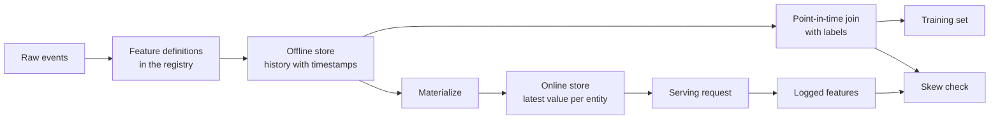

# Lojas de Features e Skew Servindo de Formação

> Um recurso tem uma definição e dois leitores. O treinamento lê sua história a partir de cada tempo de etiqueta, e servir lê seu valor mais recente. Quando os dois leitores discordam, o modelo vê entradas que nunca treinou.

**Type:** Build
**Languages:** Python
**Prerequisites:** Phase 2, Lessons 08 (Feature Engineering), 13 (ML Pipelines), 15 (Time Series), and 19 (ML System Design)
**Time:** ~100 minutes

## Objetivos de aprendizagem

- Descreva a loja offline, a loja online, as entidades, as timestamps de eventos e os TTLs, e o trabalho de cada uma delas
- Implementar uma combinação correta no ponto em tempo e mostrar como uma combinação ingênua copia valores futuros em dados de treinamento
- Cite quatro causas de distorção de serviço de treinamento: dois caminhos de código, características obsoletas, diferentes padrões e viagens no tempo
- Construir um registo de características em que uma definição alimenta tanto o caminho de treinamento quanto o caminho de serviço
- Reemplenha um novo recurso em datas anteriores sem ler dados de após cada data
- Detectar distorção comparando características de serviço registradas com o caminho de treinamento para a mesma entidade e tempo

## O problema

Uma equipe constrói um modelo de churn. Cada rótulo indica se um usuário não fez nenhuma compra nos 30 dias após um dia de rótulo.`user_id`e treina uma regra sobre `days_since_last_purchase`A precisão offline é de 0,948.

No tráfego ao vivo, o modelo faz pior do que uma versão mais antiga e simples. A tabela de características continha o valor mais recente para cada utilizador, a partir de semanas após os dias de etiqueta. Um usuário cuja última compra foi no dia 115 mostrou 60 dias inativos no dia 175, por isso o recurso continha a resposta. Enquanto isso, outra equipe escreveu novamente os recursos de servir em um serviço diferente. A janela de 30 dias incluiu um dia extra, e o padrão para um novo usuário foi -1 em vez de 365.

As duas falhas têm a mesma causa. O treinamento e a prestação de serviços computaram "a mesma característica" de duas maneiras diferentes. Esta lição constrói as peças de uma loja de recursos a partir do zero. Você escreve um registo, um backfill, um ponto-in-time join, uma loja online com um TTL e um cheque de distorção. A demonstração reproduz ambos os defeitos com números.

## O conceito

### Dois leitores do mesmo recurso

O treino e o serviço exigem características de diferentes formas:

| Property | Training (offline) | Serving (online) |
|---|---|---|
| Question | "What was the value for each of 10 million (entity, time) pairs?" | "What is the value for this one entity now?" |
| Time | Many points in the past | The present |
| Volume | Millions of rows per job | One row per request |
| Latency | Minutes are fine | A few milliseconds |
| Storage | Offline store: full history with timestamps, in columnar files or a warehouse | Online store: the latest value per entity, in a key-value database |

Uma loja de recursos mantém ambas as lojas preenchidas a partir de um conjunto de definições de recursos.



### As entidades, as timestamps e o TTL

Quatro termos descrevem cada linha de características:

- **Entity.**A chave que um recurso descreve, como `user_id`ou `card_id`- Não .
- **Event timestamp.**A data em que o valor se tornou verdadeiro.
- **Created timestamp.**Um backfill que funciona hoje escreve linhas com velhas marcas de tempo de eventos e uma nova marca de tempo criada.
- **TTL (time to live).**Um valor mais velho do que o TTL é considerado como faltante, então o leitor usa o padrão.

Um grupo de recursos com a mesma entidade, fonte e TTL é muitas vezes chamado de visão de recursos.

### Junções corretas em ponto em tempo

Uma linha de treinamento combina um rótulo com os valores de características que existiam no momento do rótulo.

1. Encontre as filas de características da mesma entidade.
2. Mantenha as filas cujo timestamp do evento está no ou antes do timestamp do rótulo.
3. Tome a última das filas.
4. Deixe-o cair se o timestamp da etiqueta menos o timestamp do evento for superior ao TTL.

Aqui está um usuário, um rótulo no dia 16, e linhas de características semanais:

| Feature row day | `purchases_30d` | Point-in-time join | Naive join on `user_id` |
|---|---|---|---|
| 7 | 4 | | |
| 14 | 3 | Selected | |
| 21 | 1 | Future | |
| 28 | 0 | Future | Selected |

O rótulo pergunta se o usuário compra alguma coisa nos dias 17 a 46. O dia 28 linha já conta os dias quietos após o dia do rótulo.

Dividimos os dados por tempo na lição de série de tempo pela mesma razão. Uma junção de ponto em tempo aplica essa regra a cada linha em vez de um ponto de divisão.

### Causas de desvio de formação

As Regras de Aprendizagem de Máquina do Google definem a distorção de serviço de treinamento como a diferença entre o desempenho durante o treinamento e o desempenho durante a prestação. Eles nomeam três causas: diferentes manejo de dados nas duas linhas de serviço, uma mudança nos dados entre o treinamento e a prestação, e um loop de feedback.

| Cause | What happens | Example from the demo |
|---|---|---|
| Two code paths | Training and serving compute the feature with different code | The serving window includes day `now - 30`, and the training window does not |
| Stale features | The value that serving reads has a different age from the value that training used | Training reads weekly snapshots, and a new service computes fresh values |
| Different defaults | The two paths fill a missing value differently | Training uses 365 for "no purchase yet", and serving uses -1 |
| Time travel | Training reads a value from after the label time | The naive join reads the newest snapshot for every label |

A regra #32 do mesmo guia diz para reutilizar o código entre o pipeline de treinamento e o pipeline de serviço sempre que possível.

### Um registo de características

O registro é o catálogo de definições de características. Cada entrada contém um nome, uma entidade, uma fonte, uma transformação, uma janela, um valor padrão, um TTL, um proprietário, uma versão e uma descrição.

Duas regras protegem a situação:

- Ambos os caminhos lêem a definição do registo.
- Uma mudança de definição cria uma nova versão, a versão antiga permanece, então os modelos antigos mantêm a característica que treinaram.

### Recheados

Uma nova característica não tem história, mas o treinamento precisa de seu valor em cada tempo de etiqueta antiga. Um backfill executa a definição em cada data passada e escreve uma linha por entidade e data.

Um backfill que é executado hoje escreve linhas com antigos timestamps de eventos, mas pode ler dados que chegaram tarde ou foram corrigidos mais tarde. Um ponto-em-tempo rigoroso também verifica que o timestamp criado está no ou antes do tempo de etiqueta.

### Detecção de desvio

A regra #29 do mesmo guia diz para registrar as características no tempo de serviço e usá-las no treinamento. Mesmo uma pequena amostra registrada permite verificar a consistência. Compare cada valor registrado com o valor que o caminho de treinamento produz para a mesma entidade e tempo. Para cada característica, informe a proporção de desajustes e a diferença absoluta média.

Para encontrar a causa, compare três pares:

1. A loja online de leitura versus treinamento, que testa todo o sistema e deve mostrar zero sesgo.
2. Computação versus treinamento, isolamento de atraso.
3. Segundo caminho de código versus computação nova. Isso isola diferenças de código, como janelas e padrões.

```figure
mlprod-pit-join
```

## Construí-lo

O código está em `code/main.py`O tempo é um número inteiro de dias. Um trabalho de lote semanal escreve instantâneos de recursos em dias 7, 14, e assim por diante até 175.

### Passo 1: Definições de características e registro

A.`FeatureDefinition`mantém a transformação como dados: um agregado, uma janela e um padrão.`compute`O método nunca lê eventos depois .`as_of`- Não .

```python
@dataclass(frozen=True)
class FeatureDefinition:
    name: str
    entity: str
    aggregate: str
    window_days: int | None
    default: float
    version: int = 1
    owner: str = "growth-team"
    description: str = ""

    def compute(self, events: list[Event], as_of: int) -> float:
        visible = [e for e in events if e.day <= as_of]
        if self.window_days is not None:
            visible = [e for e in visible if e.day > as_of - self.window_days]
        if self.aggregate == "count":
            return float(len(visible))
        if self.aggregate == "sum":
            return round(sum(e.amount for e in visible), 2)
        if self.aggregate == "days_since_last":
            return float(as_of - max(e.day for e in visible)) if visible else self.default
        raise ValueError(f"unknown aggregate {self.aggregate!r}")
```

`FeatureRegistry.register`O Conselho Europeu de Ministros da Agricultura e do Meio Ambiente (CEM) aceita duas vezes a mesma definição, mas rejeita uma definição diferente com o mesmo nome e a mesma versão. `fill_defaults`dá aos dois caminhos o mesmo padrão para um valor faltante.

Um modelo fixa uma definição com uma referência como `spend_30d@1`- Não .`compute`E ...`fill_defaults`Resolver a referência e um nome sem `@`- uma referência com `@`E nenhum número de versões aumenta `ValueError`A referência também é a chave em cada linha armazenada, então o backfill, a loja online e a leitura de serviço usam a definição fixa.

### Passo 2: Reemplenha a loja offline

```python
def backfill(registry: FeatureRegistry, names: list[str], events: list[Event], days: list[int]) -> list[FeatureRow]:
    rows = []
    for entity, entity_events in sorted(group_events(events).items()):
        for day in days:
            rows.append(FeatureRow(entity, day, registry.compute(names, entity_events, day)))
    return rows
```

A demonstração completa três recursos para 299 usuários em 25 dias de instantâneo, o que dá 7475 linhas.

### Passo 3: A junção de ponto em tempo

Escolha as filas de cada entidade uma vez por dia.`bisect_right`O TTL deixa cair uma linha que é muito antiga.

```python
def point_in_time_join(labels: list[LabelRow], rows: list[FeatureRow], ttl_days: int | None = None) -> list[JoinedRow]:
    by_entity: dict[str, list[FeatureRow]] = defaultdict(list)
    for row in rows:
        by_entity[row.entity].append(row)
    days_index = {}
    for entity, entity_rows in by_entity.items():
        entity_rows.sort(key=lambda r: r.day)
        days_index[entity] = [r.day for r in entity_rows]
    joined = []
    for label in labels:
        days = days_index.get(label.entity, [])
        pos = bisect.bisect_right(days, label.day) - 1
        match = by_entity[label.entity][pos] if pos >= 0 else None
        if match is not None and ttl_days is not None and label.day - match.day > ttl_days:
            match = None
        joined.append(JoinedRow(
            label.entity, label.day, label.label,
            match.day if match else None, match.values if match else None,
        ))
    return joined
```

### Passo 4: Messa a fuga de uma junção ingênua

`naive_latest_join`A demonstração constrói rótulos nos dias 100, 120 e 140 e encaixa uma regra de uma característica em cada conjunto de treinamento.

```console
  naive join used a snapshot from after the label day for 100% of rows
  offline accuracy, naive join: 0.948 (rule: idle > 53 days)
  offline accuracy, PIT join:   0.893 (rule: idle > 19 days)
  accuracy on day 145, trained with naive join: 0.763
  accuracy on day 145, trained with PIT join:   0.876
```

A combinação ingênua parece melhor offline, 0,948 contra 0,893. Em novos dados é pior, 0,763 contra 0,876.

### Passo 5: A loja online e a materialização

A loja online mantém uma fila por entidade e recusa filas mais antigas do que o TTL. `materialize`escreve apenas as linhas cujo dia é no horário de trabalho ou antes dele.

```python
class OnlineStore:
    def __init__(self, ttl_days: int):
        self.ttl_days = ttl_days
        self._latest: dict[str, FeatureRow] = {}

    def write(self, row: FeatureRow) -> None:
        current = self._latest.get(row.entity)
        if current is None or row.day >= current.day:
            self._latest[row.entity] = row

    def read(self, entity: str, now: int) -> dict[str, float] | None:
        row = self._latest.get(entity)
        if row is None or row.day > now or now - row.day > self.ttl_days:
            return None
        return dict(row.values)
```

Com um TTL de 10 dias, uma leitura no dia 145 retorna a linha de 140 dias. Uma leitura no dia 160, sem nova materialização, retorna os padrões, porque a linha é de 20 dias.

### Passo 6: Verificação da inclinação

`detect_skew`Comparar duas opiniões fundamentais de `(entity, day)`. Relata a taxa de desajuste e a diferença absoluta média por característica e sinaliza uma característica quando mais de 1% dos valores diferem.`ValueError`Quando as duas visões têm chaves diferentes ou não têm chaves, uma solicitação faltante pode esconder distorção, e um cheque sem solicitações não mostra nada.

```python
def detect_skew(
    training: dict[tuple[str, int], dict[str, float]],
    serving: dict[tuple[str, int], dict[str, float]],
    features: list[str],
    tolerance: float = 1e-6,
    max_mismatch_rate: float = 0.01,
) -> list[SkewReport]:
    if set(training) != set(serving):
        raise ValueError(f"{len(set(training) ^ set(serving))} keys are in only one view: log and compare the same requests")
    if not training:
        raise ValueError("no requests to compare")
    keys = sorted(training)
    reports = []
    for feature in features:
        diffs = [abs(training[k][feature] - serving[k][feature]) for k in keys]
        mismatches = sum(1 for d in diffs if d > tolerance)
        rate = mismatches / len(keys)
        mean_diff = sum(diffs) / len(keys)
        reports.append(SkewReport(feature, len(keys), rate, mean_diff, rate > max_mismatch_rate))
    return reports
```

O registro de demonstração registra as solicitações nos dias 141 a 150 e realiza as três comparações da seção conceito.

```bash
python3 code/main.py
```

```console
=== Skew checks on 383 logged requests, days 141 to 150 ===
  online store read  vs  training join (one definition, same snapshots)
    ok   days_since_last_purchase   mismatch   0.0%  mean |diff|    0.00
    ok   purchases_30d              mismatch   0.0%  mean |diff|    0.00
    ok   spend_30d                  mismatch   0.0%  mean |diff|    0.00
  fresh compute      vs  training join (staleness only)
    SKEW days_since_last_purchase   mismatch  83.0%  mean |diff|    2.77
    SKEW purchases_30d              mismatch  30.5%  mean |diff|    0.38
    SKEW spend_30d                  mismatch  37.1%  mean |diff|   16.77
  second code path   vs  fresh compute (code differences only)
    SKEW days_since_last_purchase   mismatch   5.5%  mean |diff|   20.07
    SKEW purchases_30d              mismatch  12.5%  mean |diff|    0.13
    SKEW spend_30d                  mismatch  12.5%  mean |diff|    5.09
```

Leia os três blocos em ordem:

- **One definition, same snapshots.**A loja online e a formação juntam-se a ler as mesmas linhas materializadas, então a distorção é zero.
- **Staleness.**Um valor novo difere da instantânea semanal na maioria das solicitações.
- **Code differences.**O segundo caminho de código difere em 12,5% das contas de janelas, porque sua janela inclui um dia extra.`days_since_last_purchase`Apenas para novos utilizadores, mas em grande quantidade: -1 contra 365.

## Usá-lo

Feast é uma loja de recursos de código aberto. Cada peça do código do zero tem uma contraparte Feast:

| From scratch | Feast |
|---|---|
| `FeatureDefinition`, `FeatureRegistry` | `Entity`, `FeatureView`, and `Field` in a feature repository, registered with `feast apply` |
| `FeatureRow` history | An offline store, for example a `FileSource` over Parquet files or a warehouse table |
| `point_in_time_join` with a TTL | `store.get_historical_features(entity_df=..., features=[...])` |
| `materialize` | `feast materialize-incremental <end time>` |
| `OnlineStore.read` | `store.get_online_features(features=[...], entity_rows=[...])` |
| Created timestamp check | `created_timestamp_column` on the source and `filter_by_created_timestamp=True` |

O código segue o Faststart da Festa e não é necessário para executar esta lição.

```python
from datetime import timedelta

from feast import Entity, FeatureView, Field, FileSource
from feast.types import Float32, Int64

user = Entity(name="user", join_keys=["user_id"])

user_activity_source = FileSource(
    name="user_activity_source",
    path="data/user_activity.parquet",
    timestamp_field="event_timestamp",
    created_timestamp_column="created",
)

user_activity = FeatureView(
    name="user_activity",
    entities=[user],
    ttl=timedelta(days=10),
    schema=[
        Field(name="purchases_30d", dtype=Int64),
        Field(name="spend_30d", dtype=Float32),
        Field(name="days_since_last_purchase", dtype=Int64),
    ],
    source=user_activity_source,
)
```

O treinamento e o serviço são os mesmos:

```python
from feast import FeatureStore

store = FeatureStore(repo_path=".")

training_df = store.get_historical_features(
    entity_df=labels_df,
    features=["user_activity:purchases_30d", "user_activity:days_since_last_purchase"],
    filter_by_created_timestamp=True,
).to_df()

online = store.get_online_features(
    features=["user_activity:purchases_30d", "user_activity:days_since_last_purchase"],
    entity_rows=[{"user_id": 42}],
).to_dict()
```

`labels_df`contém uma linha por rótulo com `user_id`- Não .`event_timestamp`A documentação do Feast afirma que o TTL é relativo a cada marca de tempo no quadro de dados da entidade, não ao tempo da consulta.`point_in_time_join`A mesma página descreve`filter_by_created_timestamp=True`A loja sem suporte gera um erro em vez de ignorar a opção.

Tecton, Hopsworks e as lojas de recursos das grandes plataformas de ML em nuvem usam a mesma divisão entre lojas offline e online. Para a verificação de sesgo, TensorFlow Data Validation pode comparar dados de treinamento com dados de serviço para detectar sesgo. Breck et al. descreve o sistema de validação de dados no TFX, plataforma de ML de ponta a ponta do Google, incluindo sesgo de treinamento.

## Envia-o

Esta lição produz`outputs/skill-feature-skew-audit.md`A competência audita um conjunto de características para viagens no tempo e para a formação de preconceitos, através da ligação, das definições, dos padrões, da frescura de cada caminho e da registros que uma verificação de preconceitos requer.

## Exercícios

1. Alterar o intervalo de instantâneo de 7 dias para 1 dia. Repetir a comparação de atraso e explicar o resultado.
2. Configure o TTL para 3 dias, conte as filas de treinamento que perdem as suas características e recebem padrões.
3. Adicionar um dia criado para `FeatureRow`Faça com que a junção ignore as linhas escritas após o dia da etiqueta.
4. Registo .`spend_7d`como versão 2 de `spend_30d`Repleta-o e imprima as duas versões do registo.
5. - Correção .`legacy_serving_features`Até o terceiro cheque de preconceito passar.

## Termos-chave

| Term | What people say | What it means |
|------|----------------|----------------------|
| Feature store | "A database for features" | A system that computes features from one set of definitions and serves them to training and to serving |
| Offline store | "The training data" | Full feature history with event timestamps, read by training jobs and backfills |
| Online store | "The feature cache" | The latest value per entity, read by the serving path in milliseconds |
| Entity | "The ID" | The key that a feature describes, such as a user or a card |
| Event timestamp | "When it happened" | The time at which a feature value became true |
| Point-in-time join | "An as-of join" | A join that pairs each label with the latest feature row at or before the label time |
| TTL | "Expiry" | The maximum age of a feature value before a reader treats it as missing |
| Materialization | "Syncing to online" | The job that copies the latest feature values from the offline store to the online store |
| Backfill | "Computing history" | Running a feature definition at past dates to create its history |
| Training-serving skew | "It worked offline" | A difference between the features or behavior in training and in serving |

## Mais leitura

- [Feast, Point-in-time joins](https://docs.feast.dev/getting-started/concepts/point-in-time-joins): Semântica TTL e o filtro de timestamp criado
- [Feast documentation](https://docs.feast.dev/): visualizações de recursos, lojas offline, lojas online e materialização
- [Google, Rules of Machine Learning](https://developers.google.com/machine-learning/guides/rules-of-ml): as regras de distorção que servem a formação, da regra n° 29 à regra n° 37
- [Breck et al., Data Validation for Machine Learning (SysML 2019)](https://research.google/pubs/data-validation-for-machine-learning/): validação de dados no Google, incluindo a inclinação dos serviços de formação
- [TensorFlow Data Validation guide](https://www.tensorflow.org/tfx/guide/tfdv): verificações de esquemas, detecção de distorções e detecção de deriva
- [Sculley et al., Hidden Technical Debt in Machine Learning Systems (NeurIPS 2015)](https://papers.nips.cc/paper/2015/hash/86df7dcfd896fcaf2674f757a2463eba-Abstract.html): dependências de dados e dívida de pipeline em torno de um modelo
