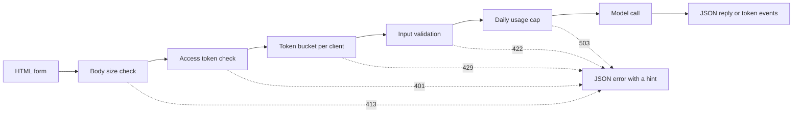

# Modelo de Interfaces Demo  De uma função para um aplicativo compartilhável

> Uma demonstração de modelo tem um contrato: uma entrada, uma chamada de modelo e uma saída. Coloque um limite em cada parte antes de compartilhar o link.

**Type:** Build
**Languages:** Python
**Prerequisites:** Phase 11 · 13 (Building a Production LLM Application), Phase 17 · 08 (Inference Metrics), Phase 17 · 19 (AI Gateways)
**Time:** ~90 minutes

## Objetivos de aprendizagem

- Escreva o contrato de entrada, chamada de modelo e saída de uma demonstração, com um limite em cada parte.
- Construa um aplicativo HTTP de biblioteca padrão com uma página HTML, um ponto final JSON e um ponto final Eventos enviados pelo servidor.
- Validar a entrada em ordem de custo e retornar erros JSON que informam ao usuário a próxima ação.
- Proteja uma demonstração pública com um balde de tokens por cliente, um limite de uso diário e um token de acesso opcional.
- Escreva registos de solicitações que não guardam texto de entrada e nenhum endereço do cliente.
- Compare a demonstração de biblioteca padrão com duas versões de framework e nomeie os sinais de que uma demonstração deve se tornar um produto.

## O problema

O seu modelo funciona num caderno, agora um revisor quer tentar dez entradas e um cliente quer ver um resultado num telefone, nenhum deles abre o seu caderno.

Uma célula de notebook não tem limites de entrada e não apresenta progressos. Seus erros são rastros em pilha que apenas você pode ler. Também funciona com suas credenciais e seu orçamento. Se você colocar a célula atrás de um URL público sem alterações, você pode esperar falhas como estas:

- Um usuário pega um documento de 40.000 caracteres, o modelo de chamada dura um minuto e depois falha com um rastreamento de pilha.
- Um script envia 500 pedidos em um minuto.
- A página não mostra nada por oito segundos, então o usuário clica no botão mais quatro vezes.
- O registro do servidor mantém todas as entradas, incluindo as entradas com um número de conta do cliente.

Uma interface demo previne essas falhas com uma pequena quantidade de código. Esta lição constrói uma com a biblioteca padrão Python, para que você possa ver todas as partes.

## O conceito

### Uma demonstração é um contrato.

Cada demo tem três partes. A entrada é o que o usuário pode enviar. A chamada modelo transforma a entrada em uma saída. A saída é o que o usuário vê, e isso inclui erros.

Escreva o contrato antes de escrever a página:

| Part | Question to answer | Answer in this lesson |
|------|--------------------|-----------------------|
| Input | What type, what size, which characters? | A string of 1 to 500 characters, with no control characters |
| Model call | How long does one call take, and what does it cost? | A toy keyword model that runs in under a millisecond at no cost |
| Output | What does the user see on success and on failure? | A label, a score, and a reply, or a JSON error with a hint |

Um notebook não tem limite para nenhuma das três partes. Uma demonstração define um limite para cada parte, e o servidor aplica os limites a cada cliente.



Os cheques são executados em ordem de custo. Um pedido ruim termina na primeira verificação que falha, então custa quase nada ao servidor. A chamada modelo é a última, porque é o único passo que custa dinheiro.

### Validação antes da execução do modelo

O navegador pode verificar a entrada antes de enviar qualquer coisa.`maxlength`E ...`required`Os atributos em uma área de texto dão feedback ao usuário sem nenhuma chamada de rede. Essas verificações ajudam apenas usuários honestos. Qualquer cliente pode enviar uma solicitação sem a página, então o servidor repete cada verificação.

Colocar os cheques do servidor em ordem de custo:

1. Leia o `Content-Length`Rejeita um corpo acima do limite antes de lê-lo.
2. Parse o corpo JSON. Rejeitar um corpo que não é um objeto JSON.
3. Verifique os campos. Rejeitar texto vazio, texto acima do limite e controlar caracteres.
4. Passa uma chamada modelo apenas com um pedido que tenha passado por todos os cheques.

| Failed check | HTTP status | Error code |
|--------------|-------------|------------|
| Body over 4,096 bytes | 413 Content Too Large | `body_too_large` |
| Body stops before `Content-Length` bytes arrive | 408 Request Timeout | `request_timeout` |
| Content type is not JSON | 415 Unsupported Media Type | `unsupported_media_type` |
| Body is not a JSON object | 400 Bad Request | `bad_json` |
| Text is missing, empty, too long, or has control characters | 422 Unprocessable Content | `missing_text`, `empty_text`, `text_too_long`, `control_characters` |

A RFC 9110 define estes códigos de status e os seus nomes.

Exemplos fazem parte do design de entrada. Um exemplo mostra ao usuário como é uma boa entrada. Também dá ao revisor um teste com um clique. Escolha um exemplo para cada classe de saída. Esta demonstração tem um exemplo positivo, negativo e neutro.

### Mostrar que o modelo está a funcionar

Uma chamada de modelo pode levar vários segundos. Sem feedback, o usuário não pode distinguir um modelo lento de uma página quebrada. Um usuário que não vê nenhuma mudança pode clicar novamente, e então o servidor recebe um segundo pedido pago.

A página desta lição dá quatro tipos de feedback:

- Desativar o botão enviar enquanto um pedido é executado.
- Mostra o tempo passado e atualiza-o a cada 100 milissegundos.
- Mostra a hora do primeiro token quando o primeiro token chega.
- Indica o tempo total de expiração do pedido.

Quando estudavas .[inference metrics](../../08-inference-metrics-goodput/)A página demo mostra o mesmo número para o usuário, medido no navegador.

### Enviar a saída como um fluxo

Um modelo de linguagem produz sua resposta um token por vez. Se o servidor espera pelo último token, o usuário espera pela geração completa. Se o servidor envia cada token quando está pronto, o usuário começa a ler após o primeiro token.

Os eventos enviados por servidor (SSE) são o formato padrão para isso.`text/event-stream`Cada evento é um grupo de`event:`E ...`data:`O padrão HTML WHATWG define o formato.

```text
event: token
data: {"index":0,"text":"Label:"}

event: token
data: {"index":1,"text":" positive."}

event: done
data: {"label":"positive","score":1.0,"tokens":11}
```

O navegador tem um `EventSource`interface para SSE, mas ele só envia solicitações GET. Uma solicitação GET coloca a entrada no URL, e servidores web e proxies escrevem URLs em seus logs de acesso. Esta demonstração envia uma solicitação POST com um corpo JSON em vez disso. A página lê a resposta com `fetch()`E ...`response.body.getReader()`, e analisa o próprio formato do evento.

Um fluxo tem um problema que uma única resposta JSON não tem. O servidor envia o status 200 antes do primeiro token. Se o modelo falhar depois disso, o servidor não pode alterar o status. Então o servidor envia um `error`evento no fluxo, e a página mostra que o evento como um erro.

Quando construíste o[production LLM application](../../../11-llm-engineering/13-production-app/)Esta lição escreve o mesmo protocolo à mão, para que você possa ver cada linha que o servidor envia.

### Escreva erros que um usuário pode agir sobre

Uma mensagem de erro tem duas funções: diz ao usuário o que aconteceu e diz ao usuário o que fazer a seguir.

Cada erro nesta demonstração tem a mesma forma JSON:

```json
{
  "error": {
    "code": "text_too_long",
    "message": "The text has 812 characters. The limit is 500.",
    "hint": "Shorten the text to 500 characters or fewer.",
    "request_id": "a8f3c2b435e3"
  }
}
```

- `code`O código do cliente e os testes comparam-se com ele.
- `message`O número de dados que o utilizador precisa é o número de dados que o utilizador precisa.
- `hint`dá ao utilizador uma ação.
- `request_id`liga um relatório de utilizador a um registro de registro.

RFC 9457 define um formato de erro padrão para API HTTP, chamado detalhes de problema. Esta demonstração usa uma forma menor para o mesmo propósito. Use RFC 9457 quando outras equipes chamam sua API.

### Compartilhar uma demonstração pública com segurança

Um link público muda quem pode enviar pedidos. Planejar um controle para cada risco:

| Risk | Control in this demo | Control for a larger audience |
|------|----------------------|-------------------------------|
| One client sends too many requests | A token bucket per client, with 429 and `Retry-After` | Per-user limits after sign-in |
| Strangers find the link | An optional access token in the `Authorization` header | Single sign-on with an identity provider |
| Total cost grows with no limit | A daily usage cap, with 503 and `Retry-After` | Spend limits and alerts at the model provider |
| Very large or unusual input | Body size limit, text length limit, control character check | Content moderation on input and output |
| Logs keep private input | Records with the input length and a keyed hash of the client | A retention period and access control on the logs |

Um balde de tokens usa dois números. A capacidade é a maior explosão que um cliente pode enviar. A taxa de reabastecimento é a taxa de solicitação a longo prazo. Cada solicitação leva um token, e o balde reabastece continuamente até sua capacidade:

```text
tokens = min(capacity, tokens + refill_rate * seconds_since_last_request)
accept the request if tokens >= 1, then subtract 1
```

Quando o balde está vazio, o servidor responde.`429 Too Many Requests`. RFC 6585 define o status 429, e permite que o servidor adicione um `Retry-After`Esta demonstração sempre adiciona o cabeçalho, com o número de segundos até o próximo token. A página lê o cabeçalho e desativar o botão para esse tempo.

A demonstração usa o endereço IP do cliente como chave de balde. Por trás de um proxy inverso, cada solicitação vem do endereço do proxy, então todos os usuários compartilham um balde. Nesse caso, leia o endereço do cliente a partir de um cabeçalho que seu próprio proxy define. Não confie nesse cabeçalho de qualquer outra fonte, porque um cliente pode colocar qualquer valor nele.

Quando estudavas .[AI gateways](../../19-ai-gateways/)O limite de taxa controla cada cliente, mas não controla o total. Centenas de clientes que ficam abaixo do limite ainda podem usar o orçamento completo. Um limite de uso conta todas as chamadas de modelo em um dia e recusa chamadas após um número fixo.

Os registos precisam do mesmo cuidado que as entradas.`http.server`O processador escreve o endereço IP do cliente e a linha de solicitação para erro padrão. Se a entrada estiver no URL, a entrada vai para o log. Esta demonstração substitui essa linha de log. Cada solicitação escreve um registro com a rota, o status, o código de erro, a latência e o comprimento da entrada. O endereço do cliente se torna um hash teclado, para que você possa contar as solicitações por cliente sem armazenar o endereço.

A página demo diz que o servidor guarda o comprimento do texto e nunca o texto em si.

### Quando uma demonstração se torna um produto

Uma demonstração serve pessoas conhecidas em sessões curtas de um processo.

- Pessoas fora da sua equipa usam-na todas as semanas.
- Alguém pede um alvo de tempo de funcionamento ou relata uma interrupção.
- Os usuários pedem para entrar, salvar resultados ou ver o histórico.
- O custo semanal do modelo é uma linha no orçamento.
- A entrada inclui dados que um contrato ou uma lei abrange.

| Property | Demo | Product |
|----------|------|---------|
| Users | Known people, short sessions | Unknown people, daily use |
| State | None | Accounts, history, saved results |
| Availability | Best effort, one process | A written target, replicas, an on-call owner |
| Cost control | One daily usage cap | Per-user quotas and billing |
| Observability | One log record per request | Traces, metrics, and alerts |

Quando você ver esses sinais, mover a demonstração para a pilha de produção da lição de aplicação LLM de produção. Essa pilha adiciona autenticação real, modelos de retrocesso, rastreamento e rastreamento de custos por usuário.

```figure
demo-token-bucket
```

## Construí-lo

O código é um arquivo.`code/main.py`, sem dependências fora da biblioteca padrão.

```bash
python3 code/main.py
```

O auto-teste verifica o validador, o balde de tokens, o formato do fluxo e uma viagem HTTP de ida e volta real. Ele inicia o servidor em uma porta livre, envia três solicitações, parou o servidor e sai.

```bash
python3 code/main.py --serve
```

Abre .`http://127.0.0.1:8000`Em um navegador. Aplique Ctrl + C para parar o servidor.

### Passo 1: A chamada modelo

O modelo é um contador de palavras-chave de brinquedo. É etiquetado como positivo, negativo ou neutro.

```python
def classify(text):
    words = WORD_RE.findall(text.lower())
    positive = sum(1 for word in words if word in POSITIVE)
    negative = sum(1 for word in words if word in NEGATIVE)
    score = (positive - negative) / max(1, positive + negative)
    if score > 0:
        label = "positive"
    elif score < 0:
        label = "negative"
    else:
        label = "neutral"
    return {"label": label, "score": round(score, 3), "positive_cues": positive,
            "negative_cues": negative, "words": len(words)}


def generate(text):
    result = classify(text)
    reply = (
        f"Label: {result['label']}. Positive cues: {result['positive_cues']}. "
        f"Negative cues: {result['negative_cues']}. Words read: {result['words']}."
    )
    parts = reply.split(" ")
    yield parts[0]
    for part in parts[1:]:
        yield " " + part
```

Um modelo real substitui .`generate`Coloque uma chamada de API ou um modelo local dentro dele. Mantenha a assinatura: uma cadeia entra e tokens saem. O validador, os limites e a página permanecem os mesmos.

### Passo 2: Validação e respostas de erro

Uma classe de exceção carrega todos os erros. Ele possui o status HTTP, um código estável, uma mensagem, uma sugestão e cabeçalhos de resposta opcionais.

```python
class DemoError(Exception):
    def __init__(self, status, code, message, hint, headers=None):
        super().__init__(message)
        self.status = status
        self.code = code
        self.message = message
        self.hint = hint
        self.headers = dict(headers or {})


def validate_text(payload, max_chars=MAX_CHARS):
    if "text" not in payload:
        raise DemoError(422, "missing_text", 'The field "text" is missing.', 'Add a "text" field with your input.')
    text = payload["text"]
    if not isinstance(text, str):
        raise DemoError(422, "text_not_string", 'The field "text" is not a string.', "Send the input as a string.")
    text = text.strip()
    if not text:
        raise DemoError(422, "empty_text", "The text is empty.", "Type a sentence or pick an example.")
    if len(text) > max_chars:
        raise DemoError(422, "text_too_long", f"The text has {len(text)} characters. The limit is {max_chars}.",
                        f"Shorten the text to {max_chars} characters or fewer.")
    if CONTROL_RE.search(text):
        raise DemoError(422, "control_characters", "The text contains control characters.",
                        "Remove the hidden characters, then send the text again.")
    return text
```

O validador remove primeiro o espaço branco anterior e posterior. Um texto de apenas espaços, em seguida, falha como vazio, e a sugestão diz ao usuário o que digitar. `check_body_size`E ...`parse_json_body`Usar o mesmo padrão para os casos 411, 413, 415 e 400. `error_body`- Não .`DemoError`na forma JSON da seção conceito.

### Passo 3: O balde de símbolo

```python
class TokenBucket:
    def __init__(self, capacity, refill_per_second, now):
        if capacity < 1:
            raise ValueError("capacity must be at least 1")
        if refill_per_second <= 0:
            raise ValueError("refill_per_second must be positive")
        self.capacity = float(capacity)
        self.refill_per_second = float(refill_per_second)
        self.tokens = float(capacity)
        self.updated = now

    def take(self, now, cost=1.0):
        elapsed = max(0.0, now - self.updated)
        self.tokens = min(self.capacity, self.tokens + elapsed * self.refill_per_second)
        self.updated = now
        if self.tokens >= cost:
            self.tokens -= cost
            return 0.0
        return (cost - self.tokens) / self.refill_per_second
```

`take`Retorna 0,0 quando aceita a solicitação. caso contrário, retorna os segundos até que o balde tenha tokens suficientes. O servidor rodea que valor e envia `Retry-After`- Não .

`RateLimiter`mantém um balde por cliente em um`OrderedDict`Uma fechadura protege o dicionário, porque`ThreadingHTTPServer`Quando o dicionário tem mais de`max_clients`Quando o limiteiro remove o cliente com a solicitação mais antiga, o cliente removido recebe um balde completo com a sua próxima solicitação.`max_clients`Mais do que o número de clientes ativos que espera.

O limitador leva um `clock`Os testes passam um`FakeClock`, para que um teste possa avançar o tempo em dez segundos sem esperar. `UsageCap`Ele conta chamadas em janelas fixas de 86.400 segundos, e retorna os segundos até a próxima janela quando a contagem estiver cheia.

### Passo 4: A corrente

```python
def sse_event(event, data):
    payload = json.dumps(data, separators=(",", ":"), ensure_ascii=False)
    return f"event: {event}\ndata: {payload}\n\n".encode("utf-8")


def stream_events(text, generate_fn=generate, delay=0.0, sleep=time.sleep):
    count = 0
    try:
        for token in generate_fn(text):
            yield sse_event("token", {"index": count, "text": token})
            count += 1
            if delay:
                sleep(delay)
    except Exception:
        yield sse_event("error", MODEL_ERROR)
        return
    result = classify(text)
    yield sse_event("done", {"label": result["label"], "score": result["score"], "tokens": count})
```

`json.dumps`escreve uma linha nova dentro de uma cadeia como os dois caracteres `\n`Cada evento tem, portanto, uma linha de dados sem nova linha bruta.

O gerador detecta uma falha do modelo e envia um `error`O servidor já enviou a linha de status.`delay`E ...`sleep`Os argumentos retardam o fluxo para um navegador e mantêm os testes rápidos.

### Passo 5: O processador de solicitações

`DemoHandler`Extensões `BaseHTTPRequestHandler`O processador POST executa as verificações na ordem da secção conceito:

```python
def do_POST(self):
    app = self.server.app
    request_id = uuid.uuid4().hex[:12]
    client_id = self.client_address[0]
    started = time.perf_counter()
    route = self.path if self.path in self.routes else "other"
    status, code, chars = 200, None, 0
    try:
        declared = self.headers.get("Content-Length")
        try:
            if route == "other":
                raise DemoError(404, "not_found", "This endpoint does not exist.",
                                "Send requests to /api/predict or /api/stream.")
            size = check_body_size(declared, app.config.max_body_bytes)
        except DemoError:
            self.drain(int(declared) if declared and declared.isdigit() else 0)
            raise
        try:
            body = self.rfile.read(size)
        except TimeoutError:
            self.close_connection = True
            raise DemoError(408, "request_timeout", "The request body did not arrive in time.",
                            "Send the request again with the full body.") from None
        app.admit(client_id, self.headers.get("Authorization"))
        text = app.read_text(self.headers.get("Content-Type"), body)
        chars = len(text)
        app.charge()
        if route == "/api/predict":
            self.send_json(200, predict(text), request_id)
        else:
            code = self.send_stream(text, request_id)
    except DemoError as err:
        status, code = err.status, err.code
        self.send_error_json(err, request_id)
    except TimeoutError:
        status, code = 408, "request_timeout"
        self.close_connection = True
    except Exception:
        status, code = 500, "internal_error"
        self.send_error_json(DemoError(500, "internal_error", "The server failed on this request.",
                                       "Try again. Quote the request id if you report the problem."), request_id)
    finally:
        latency_ms = (time.perf_counter() - started) * 1000
        app.log.record(request_id, route, client_id, status, chars, latency_ms, code)
```

`admit`Verifica o token de acesso e o balde de token. `charge`Verifica o limite diário. Ele é executado em último, então apenas solicitações válidas contam contra o limite.`finally`O processo de reestruturação da União Europeia é um processo de reestruturação.`route`, nunca o caminho bruto, porque um caminho pode levar uma cadeia de consulta com texto do usuário.

Quatro detalhes prevêem falhas que são fáceis de perder:

- `timeout = 10`Em um sistema de processamento, um cliente que declara 100 bytes e envia 10 mantém um fio de servidor para sempre. O processador envia um erro de 408 JSON com o id da solicitação e fecha a conexão. Um timeout após o início do stream apenas fecha a conexão, porque a linha de status já é enviada.
- `log_message`Retorna sem saída. Isto remove a linha de registro padrão com o endereço do cliente e a linha de solicitação.
- `drain`RFC 1122 diz que TCP envia um reset quando um host fecha uma conexão com dados não lidos.
- `send_stream`Captura`BrokenPipeError`Quando o usuário fecha a guia, o modelo para e o pedido não custa mais nada.

`BaseHTTPRequestHandler`O final de um corpo streamed é então o momento em que o servidor fecha a conexão. Um servidor que usa HTTP/1.1 envia o corpo com codificação de transferência em pedaços para o mesmo propósito.

### Passo 6: A página

`render_page`Retorna um documento HTML com um estilo inline e um script inline. A página não carrega nenhum script externo, fonte ou imagem. O script lê o fluxo assim:

```javascript
const reader = response.body.getReader();
const decoder = new TextDecoder();
let buffer = "";
while (true) {
  const chunk = await reader.read();
  if (chunk.done) { break; }
  buffer += decoder.decode(chunk.value, { stream: true });
  let cut = buffer.indexOf("\n\n");
  while (cut >= 0) {
    const frame = parseFrame(buffer.slice(0, cut));
    buffer = buffer.slice(cut + 2);
    cut = buffer.indexOf("\n\n");
    if (frame.event === "token") { output.textContent += frame.data.text; }
  }
}
```

Uma parte da rede pode terminar no meio de um evento.`buffer`Até chegar a linha em branco.

A página escreve o modelo de saída com `textContent`E nunca com `innerHTML`. O modelo de saída é texto não confiável. Suponha que a página inserta uma resposta como HTML, e a resposta contém um elemento com um `onerror`Esse atributo pode então executar código no navegador do usuário.

O servidor também envia um `Content-Security-Policy`cabeçalho com `default-src 'none'`A política permite um script inline e um estilo inline, identificados por seus hashes SHA-256. O navegador recusa todos os outros script, incluindo um script que um atacante injeta na página.

```python
def csp_hash(source):
    digest = hashlib.sha256(source.encode("utf-8")).digest()
    return "'sha256-" + base64.b64encode(digest).decode("ascii") + "'"
```

### Passo 7: Corra e tente quebrar

Inicie o servidor, depois use `curl`O balde tem cinco tokens e recebe um novo token a cada dois segundos:

```bash
for i in 1 2 3 4 5 6 7; do
  curl -s -o /dev/null -w '%{http_code} ' -X POST http://127.0.0.1:8000/api/predict \
    -H 'Content-Type: application/json' -d '{"text": "ok"}'
done
```

```text
200 200 200 200 200 429 429
```

Espera dez segundos, e depois manda um texto vazio:

```bash
curl -s -X POST http://127.0.0.1:8000/api/predict \
  -H 'Content-Type: application/json' -d '{"text": ""}'
```

```json
{"error": {"code": "empty_text", "message": "The text is empty.", "hint": "Type a sentence or pick an example.", "request_id": "e3e3599feaea"}}
```

Assista ao fluxo de eventos com `curl -N`, que desliga o amortização de saída:

```bash
curl -N -X POST http://127.0.0.1:8000/api/stream \
  -H 'Content-Type: application/json' -d '{"text": "The screen is bright."}'
```

Para exigir um token de acesso, definido `DEMO_ACCESS_TOKEN`A página mostra um campo para o token.

```bash
export DEMO_ACCESS_TOKEN="$(python3 -c 'import secrets; print(secrets.token_urlsafe(24))')"
echo "$DEMO_ACCESS_TOKEN"
python3 code/main.py --serve
```

Fazer os testes:

```bash
python3 -m unittest discover -s code/tests -v
```

Os testes HTTP iniciam o servidor no porto 0, então o sistema operacional escolhe um porto livre. `tearDown`parou o servidor e verificou que o seu fio terminou.

## Usá-lo

Dois frameworks Python construem o mesmo tipo de demo com menos código: Gradio e Streamlit.`main.py`O sistema de verificação não é necessário para executar o sistema de verificação.`main.py`Ou os testes.

### Componentes em torno de uma função

Gradio coloca uma interface web em torno de uma função Python. Componentes de entrada e saída descrevem o contrato, e uma função geradora envia saída parcial.

```python
import os

import gradio as gr

from main import EXAMPLES, MAX_CHARS, DemoError, classify, generate, validate_text


def label_text(text):
    try:
        clean = validate_text({"text": text})
    except DemoError as err:
        raise gr.Error(f"{err.message} {err.hint}")
    label = classify(clean)["label"]
    reply = ""
    for token in generate(clean):
        reply += token
        yield reply, label


demo = gr.Interface(
    fn=label_text,
    inputs=gr.Textbox(label="Text to label", lines=5, max_length=MAX_CHARS),
    outputs=[gr.Textbox(label="Reply"), gr.Textbox(label="Label")],
    examples=list(EXAMPLES),
    flagging_mode="never",
)

if __name__ == "__main__":
    demo.queue(max_size=20).launch(auth=("demo", os.environ["DEMO_PASSWORD"]))
```

Cada um .`yield`A função, portanto, produz a resposta completa até agora em cada passo.

Set `flagging_mode`O modo padrão mostra um botão de bandeira. Quando um usuário pressionar, Gradio escreve a entrada e saída para um arquivo CSV no servidor. O valor `"never"`Remove o botão.

`queue(max_size=20)`O Gradio também cria endpoints API quando o aplicativo é lançado, para que os scripts possam chamar a demo sem a página. Seu limite de taxa deve aplicar-se a esses endpoints também.

### Um roteiro que se repete em cada entrada

O Streamlit executa todo o script de cima para baixo cada vez que o usuário muda um widget. Um formulário coleta os valores do widget e os envia em um lote quando o usuário pulsa no botão enviar.

```python
import streamlit as st

from main import EXAMPLES, MAX_CHARS, DemoError, classify, generate, validate_text

st.title("Toy sentiment demo")
st.caption("Do not paste private data.")

example = st.selectbox("Start from an example", ["", *EXAMPLES])
with st.form("demo"):
    text = st.text_area("Text to label", value=example, max_chars=MAX_CHARS)
    submitted = st.form_submit_button("Run model")

if submitted:
    try:
        clean = validate_text({"text": text})
    except DemoError as err:
        st.error(f"{err.message} {err.hint}")
    else:
        st.write_stream(generate(clean))
        st.write(f"Label: {classify(clean)['label']}")
```

`st.write_stream`Leva o gerador diretamente e escreve cada pedaço quando ele chega.`@st.cache_resource`O decorador mantém uma cópia do modelo para todas as sessões.

### O que cada opção faz por padrão

| Need | Standard library (this lesson) | Gradio | Streamlit |
|------|--------------------------------|--------|-----------|
| Form, examples, result area | You write the HTML | `Interface` builds them from components and `examples` | Widgets such as `st.text_area` and `st.selectbox` |
| Input length limit | `maxlength` on the page and a server check | `max_length` on `Textbox` | `max_chars` on `st.text_area` |
| Partial output | You write SSE and the stream reader | A generator function, where each `yield` replaces the output | `st.write_stream` with a generator of chunks |
| Progress display | You write the timer | A progress display on the output area, set by `show_progress` | `st.write_stream` shows each chunk when it arrives |
| Errors for the user | JSON with `code`, `message`, `hint`, `request_id` | `raise gr.Error(...)` shows the message | `st.error(...)` shows the message |
| Concurrency | One thread per request, no limit | A queue, with one running call per event by default | Each interaction runs the script again for that session |
| Public link | You run the server and the domain | `launch(share=True)` gives a link that expires after one week | You deploy the app to a server |
| Sign-in | A bearer token check | `launch(auth=...)` with user names and passwords | `st.login()` with an OpenID Connect provider |
| Rate limit and cost cap | Token bucket and daily cap | Your code, with the client address from the request | Your code |
| Input that the tool writes to disk | Only the input length, in the log | Flagged samples in a CSV file, unless `flagging_mode="never"` | Your code decides |

Os frameworks economizam mais trabalho na página: o formulário, os exemplos, a exibição de progressos e a saída parcial. Eles economizam menos trabalho sobre os riscos de um link público. Em todas as três versões, o limite de taxa, o limite de custo e a privacidade de log são o seu trabalho. A versão padrão da biblioteca mostra cada uma dessas partes, para que você saiba o que verificar em um framework.

## Envia-o

Esta lição produz`outputs/skill-demo-interface-checklist.md`. Dê-lhe uma descrição de um modelo demo ou seu código. Ele retorna uma revisão passada ou falha do contrato, os feedback, os erros e os controles para um link público.

## Exercícios

1. Set `BUCKET_CAPACITY`para 2 e `REFILL_PER_SECOND`Previr a saída do ciclo de sete solicitações.
2. Adicionar um`language`O pedido de autorização é enviado ao organismo de solicitação.`"en"`Retorna um erro 422 com uma sugestão para qualquer outro valor, e adicione dois testes.
3. Encontre uma frase que o modelo de brinquedo etiquete erradamente, como "A tela não é boa". Adicione-a como um quarto exemplo, com uma nota na página que explica o limite.
4. Coloque a demonstração atrás de um proxy inverso na sua máquina.`trust_proxy`Opção que diz:`X-Forwarded-For`Escreva um teste que prova que um cliente não pode escolher a sua própria chave de balde.
5. Substitui`generate`Com uma chamada para uma API modelo que retorna tokens como um fluxo. Mantenha o validador, os limites e o formato do evento. Compare o tempo para primeiro token na página com a latência no registro do servidor.

## Termos-chave

| Term | What people say | What it actually means |
|------|-----------------|------------------------|
| Demo contract | "The UI" | The input limits, the model call, and the output shape, including errors |
| Token bucket | "A rate limiter" | A per-client counter that refills at a fixed rate up to a capacity. Each request uses one token |
| Retry-After | "Try later" | A response header with the number of seconds, or a date, after which the client can try again |
| Server-Sent Events | "Streaming" | A `text/event-stream` response of `event:` and `data:` lines, with a blank line after each event |
| Time to first token | "Latency" | The time from the request to the first token on the user's screen |
| Usage cap | "The budget" | A limit on the total number of model calls in a time window, for all clients together |
| Keyed hash | "An anonymous ID" | An HMAC of the client address with a secret salt. It is a pseudonym: anyone with the salt can test a known address |
| Content Security Policy | "CSP" | A response header that tells the browser which scripts, styles, and connections the page can use |

## Mais leitura

- [Python `http.server` documentation](https://docs.python.org/3/library/http.server.html): as classes de servidor, o HTTP/1.0 padrão, a linha de log padrão e o aviso de que o módulo não é para produção.
- [WHATWG HTML Standard, server-sent events](https://html.spec.whatwg.org/multipage/server-sent-events.html): o formato do fluxo de eventos e o `EventSource`Interface.
- [MDN, Using server-sent events](https://developer.mozilla.org/en-US/docs/Web/API/Server-sent_events/Using_server-sent_events): exemplos do formato do evento e da API do navegador.
- [MDN, Using readable streams](https://developer.mozilla.org/en-US/docs/Web/API/Streams_API/Using_readable_streams): como ler um `fetch()`Resposta corporal, pedaço por pedaço.
- [MDN, Using the Fetch API](https://developer.mozilla.org/en-US/docs/Web/API/Fetch_API/Using_Fetch): pedidos com um corpo JSON e tratamento de respostas.
- [MDN, 429 Too Many Requests](https://developer.mozilla.org/en-US/docs/Web/HTTP/Reference/Status/429)E ...[MDN, Retry-After](https://developer.mozilla.org/en-US/docs/Web/HTTP/Reference/Headers/Retry-After)O Estado-Membro de aplicação do direito comunitário é o Estado-Membro de aplicação do direito comunitário.
- [MDN, Content Security Policy](https://developer.mozilla.org/en-US/docs/Web/HTTP/Guides/CSP): hashes para scripts de linha e o `default-src`Direcção-Geral.
- [RFC 6585](https://www.rfc-editor.org/rfc/rfc6585.html): códigos de status HTTP adicionais, incluindo 429.
- [RFC 9110](https://www.rfc-editor.org/rfc/rfc9110.html): Semântica HTTP, incluindo 413, 415, e 422.
- [RFC 9457](https://www.rfc-editor.org/rfc/rfc9457.html): detalhes do problema, um formato de erro JSON padrão para APIs HTTP.
- [RFC 1122](https://www.rfc-editor.org/rfc/rfc1122.html): requisitos de hospedagem, incluindo a redefinição TCP em fechamento com dados não lidos (secção 4.2.2.13).
- [Gradio, Sharing your app](https://gradio.app/guides/sharing-your-app): partilhar links, autenticação, página da API e limites de taxa.
- [Gradio, Streaming outputs](https://gradio.app/guides/streaming-outputs)A função do gerador é de saída parcial.
- [Gradio, Interface](https://gradio.app/docs/gradio/interface)- Não .`examples`- Não .`flagging_mode`, e `concurrency_limit`- Não .
- [Gradio, Using flagging](https://gradio.app/guides/using-flagging): onde as amostras marcadas vão para o disco.
- [Streamlit, Basic concepts](https://docs.streamlit.io/get-started/fundamentals/main-concepts): o fluxo de dados de reestruturação.
- [Streamlit, st.write_stream](https://docs.streamlit.io/develop/api-reference/write-magic/st.write_stream)E ...[Streamlit, Caching](https://docs.streamlit.io/develop/concepts/architecture/caching): saída parcial e um modelo que carrega uma vez.
- [Streamlit, st.login](https://docs.streamlit.io/develop/api-reference/user/st.login): fazer login com um provedor OpenID Connect.
