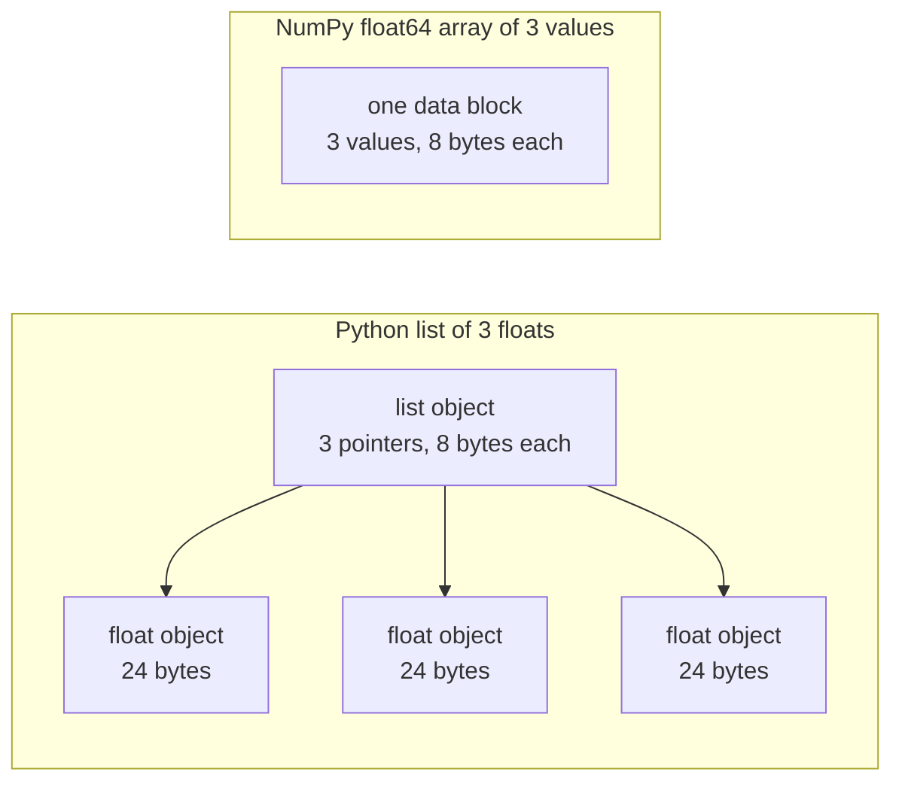

# AI Mühendisliği için Python

> Bu kursta kodun çoğu aynı Python dillerinin küçük bir setini kullanıyor.

**Type:** Build
**Languages:** Python
**Prerequisites:** Dev Environment, Python Environments
**Time:** ~120 minutes

## Öğrenme Hedefleri

- Çoğu kurs kodunun kullandığı dilsellikleri oku ve yaz, paketleme ve f-satırlardan veri sınıflarına ve anlayışlarına kadar.
- Hata olmadan yanlış sonuçlar veren üç Python hatasını bul: paylaşılan listeler, değişen öntanımlılar ve kullanılmış jeneratörler.
- CSV ve JSON yükleyici, bir tohum bölümü ve sadece standart kütüphaneden ibaret bir mini-batch jeneratörü oluşturun.
- Temiz Python'da nokta ürünü, ortalama ve standart sapma yazın ve hızlarını ve bellek kullanımını ölçün.
- Sayılar üzerinde saf Python döngüsünün neden yavaş olduğunu ve NumPy yayınının döngüyü nasıl bir kod oluşturmaya yönelttiğini açıklayın.

## Sorun

Bu aşamalı dersler matematik ve modeller için basit Python kullanır.`dataclasses`Ayrıca 187 dosya da çağrıda bulunmuş.`random.seed`veya bir `random.Random`Eğer bu dillerin sizin için yeniyse, matematik okumak istediğinizde sentax okuyabilirsiniz.

Python'da hata mesajı olmadan yanlış sonuçlar veren davranışlar da vardır. İki isim bir listeye atıfta bulunabilir, bu nedenle bir isimle yapılan değişiklik diğerini de değiştirebilir. Varsayılan bir argüman değeri bir çağrıdan diğerine kadar tutar. Bir geçitten sonra bir jeneratör boştur, bu nedenle ikinci bir eğitim dönemi verileri almaz ve kayıp değişmez.

Son sorun hızdır. Test dizüstü bilgisayarımızda, saf Python döngüsü bir milyon yüzen üzerinde yaklaşık 30 milisaniye sürdü. NumPy aynı nokta ürünü bir milisaniye daha az sürede hesapladı. Sebebini bilmen gerekir, böylece açık bir döngü ve bir dizi işlevi arasında seçim yapabilirsiniz.

## Anlaşım

### Kurs kodunun neyi kullanması

Tüm 541 Python dosyasını analiz ettik .`phases/*/*/code/`- ... ...`ast`Bu dersler, dersler eklendiği gibi değişir.

| Construct | Files | Share |
|-----------|-------|-------|
| Function definitions | 541 | 100% |
| `if __name__ == "__main__":` | 529 | 98% |
| f-strings | 517 | 96% |
| Tuple unpacking | 448 | 83% |
| Classes | 379 | 70% |
| List comprehensions | 375 | 69% |
| Type hints on functions | 342 | 63% |
| Generator expressions | 326 | 60% |
| Slices | 314 | 58% |
| `lambda` | 175 | 32% |
| `try` and `except` | 120 | 22% |
| `with` statements | 96 | 18% |
| Dict comprehensions | 93 | 17% |
| Generator functions with `yield` | 14 | 3% |

İhracat, hangi standart modüllerin önemli olduğunu gösterir.`from __future__ import annotations`, ve 276 ithalat`dataclasses`- Ne ?`math`- Evet .`random`ve`json`Modüller 187, 175 ve 126 dosyalarda yer alıyor.`collections`Modül 70 dosyada görünür ve `itertools`Sadece 4'te ortaya çıkıyor.

Ders çağrıları yok .`map()`veya `filter()`Anlaşmalar bu işi yapar.`sorted`- Evet .`min`- Evet .`max`veya`.sort`bir `key=`Bu ders, bu listelerin en üstündeki dilsel konuşmalara en çok zaman ayırır.

### Adlar nesnelere atfeder

Python'da değişken, bir nesneyi ifade eden bir isimdir. Görev bir nesneye bir isim bağlar. Nesneyi kopyalamaz. İki isim bir listeye atfederken, her iki isimden birinden birinde bir değişiklik görünür. Sayılar, ipler ve tupler değişemez, bu nedenle bu kural onlar için hiçbir sorun yaratmaz.

### Bir liste işaretleri, bir dizi sayıları içerir.

Python listesi doğrudan sayıları saklamaz. İpucuları saklar ve her ipucu tam bir Python nesnesine atfeder. CPython'un 64 bitli bir yapısında her ipucu 8 byte alır ve her `float`nesne 24 byte alır.`float64`Array, çiğ 8 bayt değerlerini bir bellek bloğunda yan yana saklar.



Bir listede bir döngü, her bir element için çok fazla iş yapar. Anlatıcı bir seferde bir baytkod talimatını çalıştırır. Her bir element için bir işaretçiyi takip eder ve her operandın türünü kontrol eder.

NumPy, çiğ değerler üzerinde bir döngü oluşturulan kodda aynı aritmetik yapmaktadır. Tüm dizide bir kez veri türünü kontrol eder ve her bir öğe için Python nesnesini oluşturmaz. Vektörlü kod, tüm dizide bir işlem tanımlar, örneğin `(x - mean) / std`Bu dersdeki vektör fonksiyonları bu kuralı izler. Her biri bir dizi işlevi yapar, böylece onu bir NumPy çağrısı ile değiştirebilirsiniz.

### Bir liste her şeyi, bir jeneratör de bir tane tutuyor.

Bir listede bir listede bir listede bir listede bir listede bir listede bir listede bir listede bir listede bir listede bir listede bir listede bir listede bir listede bir listede bir listede bir listede bir listede bir listede bir listede bir listede bir listede bir listede bir listede bir listede bir listede bir listede bir listede bir listede bir listede bir listede bir listede bir listede bir listede bir listede bir listede bir listede bir listede bir listede bir listede bir listede bir listede bir listede bir listede bir listede bir listede bir listede bir listede bir listede bir listede bir listede bir listede bir listede bir listede bir listede bir listede bir listede bir listede bir listede bir listede bir listede bir listede bir listede bir listede bir listede bir listede bir listede bir listede bir listede bir listede bir listede bir listede bir listede bir listede bir listede bir listede bir listede bir listede bir listede bir listede bir listede bir listede bir listede bir listede bir listede bir listede bir listede bir listede bir listede bir listede bir listede bir listede bir listede bir listede bir listede bir listede bir listede bir listede bir listede bir listede bir listede bir listede bir listede bir listede bir listede bir listede bir listede bir listede bir listede bir listede bir listede bir listede bir listede bir listede bir listede bir listede bir listede bir listede bir listede bir listede bir listede bir listede bir listede bir listede bir listede bir listede bir listede bir listede bir listede bir listede bir listede bir listede bir listede bir listede bir listede bir listede bir listede bir listede bir listede bir listede bir listede bir listede bir listede bir listede bir listede bir listede bir listede bir listede bir listede bir listede bir listede bir listede bir listede bir listede bir listede bir listede bir listede bir listede bir listede bir listede bir listede bir listede bir listede bir listede bir listede bir listede bir listede bir listede bir listede bir listede

Bir jeneratör sadece bir kez çalıştırılabilir.`StopIteration`Her istek üzerine bir saniye.`for`Epokon için yeni bir jeneratör oluşturmak zorunda.

Generatör fonksiyonları ders kodunda nadirdir. Derin öğrenme derslerinde kullanılan veri yükleyicileri serilerin tekrarlanabilirleri olduğundan fikir her eğitim döngüsünde bulunur. Şekil aynı sekiz satırda her iki yaklaşımı gösterir.

```figure
s0-list-vs-generator
```

## İhtiyacınız olan İdiler

Bu bölümdeki her blok kendiliğinden çalışır.`python3`Bloklar Python 3.11 veya daha yeni bir versiyona ihtiyaç duyar.

### 1. Değerler, toplamalar ve paketleme

Python'da dört içe gömülü koleksiyon var. Her birini ne zaman kullanacağınızı öğrenin.

| Type | Example | Ordered | Can change | Typical use in the course |
|------|---------|---------|------------|---------------------------|
| `list` | `[0.5, 1.2]` | Yes | Yes | Samples, losses, weights |
| `tuple` | `(32, 784)` | Yes | No | Shapes, fixed records, dict keys |
| `dict` | `{"lr": 0.01}` | Insertion order | Yes | Configs, vocabularies, JSON rows |
| `set` | `{"cat", "dog"}` | No | Yes | Unique tokens, overlap checks |

Bu blok, görevin bir listeyi kopyalamadığını gösterir.

```python
weights = [0.5, -1.2, 3.0]
alias = weights
alias[0] = 99.0
print(weights)

independent = list(weights)
independent[1] = 0.0
print(weights, independent)

grid = [[0] * 3] * 2
grid[0][0] = 1
print(grid)

grid = [[0] * 3 for _ in range(2)]
grid[0][0] = 1
print(grid)
```

```text
[99.0, -1.2, 3.0]
[99.0, -1.2, 3.0] [99.0, 0.0, 3.0]
[[1, 0, 0], [1, 0, 0]]
[[1, 0, 0], [0, 0, 0]]
```

Bu ifade`[[0] * 3] * 2`Bu sayede, bir listeden iki referans ile bir listeden bir listesi oluşturur. Anlayış her satır için yeni bir iç listesi oluşturur. Matematik aşaması listelerden matrisler oluşturur, bu yüzden anlama formunu kullanın.

Çıkartma bir dizi öğelerini bir satırdaki birkaç adlara tahsis eder. Bir yıldızlı isim kalan öğeleri toplar. Bir f-satır bir ifade değerini bir satır içine koyar, bir kolon sonrasında bir seçmeli biçim ile.

```python
shape = (32, 784)
batch_size, n_features = shape
first, *middle, last = [1, 2, 3, 4, 5]
x, y = 1.0, 3.0
x, y = y, x

config = {"lr": 0.01, "epochs": 5}
config["seed"] = 7
tokens = ["the", "cat", "sat", "on", "the", "mat"]
vocab = set(tokens)

print(batch_size, n_features, first, middle, last, x, y)
print(config.get("momentum", 0.9), "cat" in vocab, len(vocab))
print(f"lr={config['lr']:.0e} loss={0.123456:.3f} n={60_000:,} {batch_size=}")
```

```text
32 784 1 [2, 3, 4] 5 3.0 1.0
0.9 True 5
lr=1e-02 loss=0.123 n=60,000 batch_size=32
```

`dict.get`Anahtar eksikken varsayılan değer gönderir.`in`Bir set üzerinde test yapmak, herhangi bir set boyutu için yaklaşık aynı zamana sürer.`{batch_size=}`form isim ve değer yazdırır, bu da debugging yaparken yardımcı olur.

Bir parça .`a[start:stop:step]`içerir .`start`ve dışı bırakır `stop`Bir liste parçası yeni bir liste, yani büyük bir liste parçası tüm işaretlerini kopyalar.

```python
tokens = ["<s>", "the", "cat", "sat", "on", "the", "mat", "</s>"]
print(tokens[1:-1])
print(tokens[:3], tokens[-3:])
print(tokens[::2])
print(tokens[::-1][:2])
windows = [tokens[i:i + 3] for i in range(len(tokens) - 2)]
print(len(windows), windows[0])
```

```text
['the', 'cat', 'sat', 'on', 'the', 'mat']
['<s>', 'the', 'cat'] ['the', 'mat', '</s>']
['<s>', 'cat', 'on', 'mat']
['</s>', 'mat']
6 ['<s>', 'the', 'cat']
```

### 2. Anlamalar

Anlama bir ifade içinde tekrarlanabilir bir liste, dikt veya set oluşturur.

```python
scores = [0.91, 0.42, 0.77, 0.15, 0.66]
labels = [1 if s >= 0.5 else 0 for s in scores]
high = [s for s in scores if s > 0.6]
squares = {i: i * i for i in range(4)}
lengths = {len(word) for word in ["a", "bb", "cc", "ddd"]}
sum_sq = sum(s * s for s in scores)

matrix = [[1, 2, 3], [4, 5, 6]]
transposed = [list(column) for column in zip(*matrix)]
flat = [v for row in matrix for v in row]

print(labels, high, squares, lengths, round(sum_sq, 4))
print(transposed, flat)
```

```text
[1, 0, 1, 0, 1] [0.91, 0.77, 0.66] {0: 0, 1: 1, 2: 4, 3: 9} {1, 2, 3} 2.0555
[[1, 4], [2, 5], [3, 6]] [1, 2, 3, 4, 5, 6]
```

Bir izleme .`if`Sadece bazı eşyaları saklıyor.`for`Şartlı bir ifade olabilir.`a if condition else b`- İki .`for`İki yuva gibi aynı sırada çalışacak.

Yüklü perdeler bir jeneratör ifadesini oluşturur.`sum(s * s for s in scores)`- Evet .`sum`Python'da bir liste oluşturulmaz.`zip(*matrix)`, yıldız her satırdan ayrı bir argüman olarak geçer ve`zip`her pozisyonda eşleştirilen öğeler.

### 3. İşlevler, argümanlar ve kapanışlar

Öntanımlı bir değer bir argümanı seçmeli yapar. Anahtar kelime argümanı çağrıda parametrenin adını verir.`*`parametre listesi içinde kendiliğinden, sonraki parametreleri anahtar kelime ile yapar.

```python
def clip(value, low=0.0, high=1.0):
    return max(low, min(high, value))


def train(data, *, lr=0.01, epochs=3):
    return f"{len(data)} samples, lr={lr}, epochs={epochs}"


def make_scaler(factor):
    def scale(values):
        return [v * factor for v in values]
    return scale


print(clip(1.7), clip(-3.0, low=-1.0), clip(0.4, high=0.3))
print(train([1, 2, 3], lr=0.1))
to_percent = make_scaler(100)
print(to_percent([0.25, 0.5]))
```

```text
1.0 -1.0 0.3
3 samples, lr=0.1, epochs=3
[25.0, 50.0]
```

Sadece anahtar kelime argümanları ile, bir çağrı gibi `train(data, 0.1, 3)`yükseltir .`TypeError`Arayan yazmalı .`lr=0.1`Yani iki sayı tesadüfen yer değiştiremez.

İç fonksiyon .`scale`kullanımı `factor`Python'un bu fonksiyonun oluşturduğu fonksiyonun`factor`Ne kadar sürece`scale`Bu, bir değişkenin yaratıcısından uzak tutulan bir fonksiyonun kapatılmasıdır. Build It'deki standartlayıcı, eğitim istatistiklerini tutmak için kapatmayı kullanır.

A.`lambda`Kursu kodu çoğunlukla bir `key=`Bu, 8. bölümde gösterildiği gibi.

Python, bir defa varsayılan değerleri değerlendirir.`def`Öntanımlı olan her çağrı aynı nesneyi alır.

```python
def add_bad(item, bucket=[]):
    bucket.append(item)
    return bucket


def add_good(item, bucket=None):
    if bucket is None:
        bucket = []
    bucket.append(item)
    return bucket


add_bad("a")
print(add_bad("b"))
add_good("a")
print(add_good("b"))
```

```text
['a', 'b']
['b']
```

Kullanım`None`Bir liste, dikt veya set için öntanımlı olarak.

### 4. Sınıflar ve veri sınıfları

- Evet .`@dataclass`Dekorasyoncı yazıyor `__init__`- Evet .`__repr__`ve`__eq__`Not alanlarından.`frozen=True`Bu nesne yaratıldıktan sonra değişemez ve onu bir dikte anahtarı olarak kullanabilir veya bir setiye koyabilirsiniz.

```python
from dataclasses import dataclass, field


@dataclass(frozen=True)
class Example:
    features: tuple[float, ...]
    label: int


@dataclass
class TrainConfig:
    lr: float = 0.01
    epochs: int = 5
    hidden: list[int] = field(default_factory=lambda: [64, 32])

    def describe(self):
        return f"lr={self.lr} epochs={self.epochs} hidden={self.hidden}"


ex = Example((1.5, 2.0), 1)
print(ex)
print(ex == Example((1.5, 2.0), 1), len({ex, Example((1.5, 2.0), 1)}))
print(TrainConfig(epochs=10).describe())
try:
    ex.label = 0
except AttributeError as err:
    print(type(err).__name__)
```

```text
Example(features=(1.5, 2.0), label=1)
True 1
lr=0.01 epochs=10 hidden=[64, 32]
FrozenInstanceError
```

`field(default_factory=...)`Bu, bir veri sınıfı içinde 3. bölümden paylaşılan öntanımlı sorununu çözüyor.

Özel yöntemler bir sınıfı Python sentaksına bağlar. `len(ds)`Çağrılar`__len__`ve`ds[2]`Çağrılar`__getitem__`- Evet .

```python
class SquaresDataset:
    def __init__(self, n):
        self.n = n

    def __len__(self):
        return self.n

    def __getitem__(self, index):
        if not 0 <= index < self.n:
            raise IndexError(index)
        return index, index * index


ds = SquaresDataset(4)
print(len(ds), ds[2])
print(list(ds))
```

```text
4 (2, 4)
[(0, 0), (1, 1), (2, 4), (3, 9)]
```

- Evet .`for`İçeride bir döngü`list(ds)`bir `__iter__`Python çağrıları.`__getitem__`0, 1, 2 ile ve böylece elde edene kadar `IndexError`PyTorch harita tarzındaki veri kümeleri aynı iki yöntem kullanır.`__len__`ve `__getitem__`- Evet .

### 5. Iteratorlar ve jeneratörler

Bir tekrarlanabilir bir nesne`for`Çubuk kabul eder.`iter()`Bu bir iteratör alır ve `next()`İteratör bir öğe için iteratörden soruyor. İteratörde daha fazla öğe olmadığı zaman, `StopIteration`- A.`for`Çaplık çağrıları`next()`Senin için ve duracaklar `StopIteration`- Evet .

```python
numbers = [10, 20, 30]
it = iter(numbers)
print(next(it), next(it), next(it))
try:
    next(it)
except StopIteration:
    print("no more items")


def countdown(n):
    while n > 0:
        yield n
        n -= 1


gen = countdown(3)
print(type(gen).__name__)
print(list(gen))
print(list(gen))
```

```text
10 20 30
no more items
generator
[3, 2, 1]
[]
```

Bir fonksiyon `yield`Bu sistemin içinde bir jeneratör fonksiyonu vardır.`next()`Vücudunu bir sonrakiye götürür.`yield`Ve orada durur.`list(gen)`İlk jeneratörü tükettiği için boş.

Bir jeneratör bir dosyayı bir satırdan birine okuyabilir.

```python
import os
import tempfile


def read_rows(path):
    with open(path, encoding="utf-8") as fh:
        header = fh.readline().rstrip("\n").split(",")
        for line in fh:
            yield dict(zip(header, line.rstrip("\n").split(",")))


with tempfile.TemporaryDirectory() as tmp:
    path = os.path.join(tmp, "rows.csv")
    with open(path, "w", encoding="utf-8") as fh:
        fh.write("x,label\n")
        fh.writelines(f"{i * 0.5},{i % 2}\n" for i in range(5))
    rows = read_rows(path)
    print(next(rows))
    print(sum(1 for _ in rows))
```

```text
{'x': '0.0', 'label': '0'}
4
```

`read_rows`Dosyanın bir satırını bir seferde bellekte tutar.`read_rows`Bu, örnekleri kısa tutmak için komaya bölünür. Gerçek CSV dosyaları alıntılanan alanlar içinde komaya da sahip olabilir, bu nedenle Build It kullanır `csv`Modül.

```python
import sys

as_list = [i * i for i in range(1_000_000)]
as_generator = (i * i for i in range(1_000_000))
print(sys.getsizeof(as_list), sys.getsizeof(as_generator))
print(sum(as_list) == sum(as_generator))
```

64-bit CPython'da, listede yaklaşık 8 MB ve jeneratörde yaklaşık 200 byte rapor edilir. `sys.getsizeof`Bu sayı, listedeki işaretleri sayarak, tam sayı nesneleri daha fazla bellek kullanır.`tracemalloc`, ki biz debugging ve profilleme dersinde kullandık.

### 6. Konekst yöneticileri ve istisnalar

A.`with`Bu, bir sistemin kurulum kodunu, sonra da bir sistemin kurulum kodunu ve temizleme kodunu içerir.`open()`dosyayı kapatan bir bağlam yöneticisi.

Debugging ve profilleme dersi'nde bir yazı yazdık.`Timer`sınıfı `__enter__`ve `__exit__`- Ne ?`contextlib.contextmanager`Bir dekorator aynı tür bir nesneyi bir jeneratörden yapar.`yield`Bu ayarlama ve `finally`- Blok temizlik.

```python
import time
from contextlib import contextmanager


@contextmanager
def timer(label):
    start = time.perf_counter()
    try:
        yield
    finally:
        print(f"{label}: {(time.perf_counter() - start) * 1000:.1f} ms")


def parse_label(text):
    try:
        return int(text)
    except ValueError:
        raise ValueError(f"label must be an integer, got {text!r}") from None


with timer("sum of squares"):
    total = sum(i * i for i in range(200_000))

print(parse_label("3"))
try:
    parse_label("cat")
except ValueError as err:
    print("rejected:", err)
```

```text
sum of squares: 9.4 ms
3
rejected: label must be an integer, got 'cat'
```

Makine üzerindeki zaman farklı olacak.`except`gibi maddeler`ValueError`veya `KeyError`- Bir .`except:`istisna olmayan madde de işlemi yapar `KeyboardInterrupt`, böylece Ctrl + C içerdiği bir döngüyü durduramadı. Girişi yanlış olduğunda açık bir mesajla bir istisna oluşturun. Ekle `from None`Mesajınız orijinal izlenimi değiştirdiğinde.

### 7. Tipik ipuçları, modüller ve ana güvenlik

Bir fonksiyonun ne aldığını ve ne döndüğünü okuyucuya bildirir. Python kod çalıştırıldığında onları kontrol etmez. Mypy gibi bir tip kontrolcü, kod çalıştırılmadan önce onları okuyor.

```python
from __future__ import annotations

from collections.abc import Iterable, Sequence


def mean(values: Sequence[float]) -> float:
    if not values:
        raise ValueError("mean() needs at least one value")
    return sum(values) / len(values)


def count_tokens(docs: Iterable[str]) -> int:
    return sum(len(doc.split()) for doc in docs)


def main() -> None:
    print(mean([1.0, 2.0, 4.0]))
    print(count_tokens(["the cat sat", "on the mat"]))
    print(mean.__annotations__)


if __name__ == "__main__":
    main()
```

```text
2.3333333333333335
6
{'values': 'Sequence[float]', 'return': 'float'}
```

- Evet .`from __future__ import annotations`Python, her ipucu bir dizil olarak kaydediyor, son satır gösterdiği gibi.`Sequence` ile ilgili herhangi bir nesne anlamına gelir.`len()`Bir liste veya bir tuple gibi indeksler. `Iterable`bir nesne anlamına gelir.`for`Birçok ders dosyası aynı isimleri içeriyor `typing`Bu da işe yarıyor.

Her zaman .`.py`Dosya bir modül.`python3 file.py`Python , `__name__`- ...`"__main__"`Başka bir dosya onu içeri aldığında,`__name__`Bu modül adı.`main()`Sadece ilk durumda.`code/tests/`İçebilir `main.py`Demo başlamadan.

### 8. Dosyalar, JSON, CSV ve sıralama

`pathlib.Path`yolları  ile birleştirir`/`Ve bir çağrıda tüm bir dosyayı okuyabilir ya da yazabilir.`encoding="utf-8"`, çünkü varsayılan kodlama işletim sistemine bağlıdır.

```python
import csv
import json
import tempfile
from pathlib import Path

rows = [
    {"text": "great movie", "label": 1, "score": 0.93},
    {"text": "boring plot", "label": 0, "score": 0.12},
    {"text": "fine acting", "label": 1, "score": 0.58},
]

with tempfile.TemporaryDirectory() as tmp:
    json_path = Path(tmp) / "reviews.json"
    json_path.write_text(json.dumps(rows, indent=2), encoding="utf-8")
    from_json = json.loads(json_path.read_text(encoding="utf-8"))

    csv_path = Path(tmp) / "reviews.csv"
    with csv_path.open("w", newline="", encoding="utf-8") as fh:
        writer = csv.DictWriter(fh, fieldnames=["text", "label", "score"])
        writer.writeheader()
        writer.writerows(rows)
    with csv_path.open(newline="", encoding="utf-8") as fh:
        from_csv = list(csv.DictReader(fh))

print(from_json == rows)
print(from_csv[0])

by_score = sorted(rows, key=lambda r: r["score"], reverse=True)
print([r["text"] for r in by_score])
print(max(rows, key=lambda r: r["score"])["text"])
print([r["text"] for r in sorted(rows, key=lambda r: (-r["label"], r["text"]))])
```

```text
True
{'text': 'great movie', 'label': '1', 'score': '0.93'}
['great movie', 'fine acting', 'boring plot']
great movie
['fine acting', 'great movie', 'boring plot']
```

JSON, sayıları sayılar olarak saklar. CSV her alanı bir dizilme olarak geri verir, bu yüzden her alanı dönüştürmelisiniz.`newline=""`, tıpkı `csv`Belge bunu söylüyor.

A.`key=`fonksiyon, Python'un her öğe için karşılaştırdığı değeri gönderir. `sorted`- Evet .`min`ve`max`Bu nedenle, Python'un türü sabitdir, bu nedenle eşit anahtarlı öğeler orijinal sırasını korur.

### 9. Sayım, gruplama ve tekrarlayıcı araçları

Bu iki modül, basit listeler ve diktlerin size vermediği veri yapılarını ve tekrarlayıcı araçlarını tutar.

```python
from collections import Counter, defaultdict, deque
from itertools import chain, islice, product

labels = ["cat", "dog", "cat", "bird", "cat", "dog"]
counts = Counter(labels)
print(counts.most_common(2))

positions = defaultdict(list)
for i, label in enumerate(labels):
    positions[label].append(i)
print(dict(positions))

recent = deque(maxlen=3)
for loss in [2.0, 1.5, 1.2, 1.1, 0.9]:
    recent.append(loss)
print(list(recent), round(sum(recent) / len(recent), 3))

print(list(product([0.1, 0.01], [16, 32])))
print(list(chain([1, 2], [3], [4, 5])))
print(list(islice(range(100), 5, 10)))
```

```text
[('cat', 3), ('dog', 2)]
{'cat': [0, 2, 4], 'dog': [1, 5], 'bird': [3]}
[1.2, 1.1, 0.9] 1.067
[(0.1, 16), (0.1, 32), (0.01, 16), (0.01, 32)]
[1, 2, 3, 4, 5]
[5, 6, 7, 8, 9]
```

`Counter`Etiket veya simgeler gibi kullanılabilir eşyaları sayır. `defaultdict(list)`yeni bir anahtar kullanıldığında boş bir liste oluşturur, bu yüzden gruplama döngüsü anahtar kontrolü gerektirmez. `deque(maxlen=3)`Dördüncü bir madde eklediğinizde en eski öğeyi çıkarır. Bu da son kayıplara karşı hareketli bir pencere verir. `enumerate`her bir maddeye indeksini verir.

`product`Girişlerinin her kombinasyonunu verir, bu da hiperparametre bir ağdır. `chain`Sonundan sonuna kadar tekrarlanabilirleri birleştirir.`islice`Bu arada, Build It'deki mini seri jeneratör kullanıyor.`islice`- Evet .

### 10. Sayılardaki döngüler neden yavaş

- Evet .`dis`Modül, bir fonksiyon için tercümanın çalıştığı byte kod talimatlarını basar.

```python
import dis


def dot(a, b):
    total = 0.0
    for x, y in zip(a, b):
        total += x * y
    return total


dis.dis(dot)
```

`FOR_ITER`Bu, her bir çarpma ve ekleme için yaklaşık on talimat.

Bir döngü, daha az adımları bytecode olarak çalıştırıldığında daha hızlı hale gelir.`sum`- Evet .`map`ve`zip`Bu etkiyi saf Python'da ölçer ve kullanın tüm döngüyü NumPy'ye taşıyor.

## Yapın

Şimdi daha sonraki derslerde gerekli olan parçaları yapın.`code/main.py`ve`code/tests/test_main.py`Aşağıdaki blokların her biri kendi başına çalışır.

### Adım 1: Kayıt tipi ve veri kümesi yükleyici

Kayıtlayıcı bir CSV dosyası veya JSON dosyasını tek bir şekle okuyor: bir sürü yüzen özellik ve tam sayı etiket.

```python
import csv
import json
import tempfile
from dataclasses import dataclass
from pathlib import Path


@dataclass(frozen=True)
class Record:
    features: tuple[float, ...]
    label: int


def row_to_record(row, names, label_field="label"):
    if label_field not in row:
        raise ValueError(f"row has no {label_field!r} field: {row}")
    if set(row) != {*names, label_field}:
        raise ValueError(f"row fields {list(row)} do not match {[*names, label_field]}")
    return Record(tuple(float(row[name]) for name in names), int(row[label_field]))


def load_records(path, label_field="label"):
    path = Path(path)
    if path.suffix == ".json":
        rows = json.loads(path.read_text(encoding="utf-8"))
    elif path.suffix == ".csv":
        with path.open(newline="", encoding="utf-8") as fh:
            rows = list(csv.DictReader(fh))
    else:
        raise ValueError(f"unsupported file type: {path.suffix!r}")
    if not rows:
        return []
    names = [key for key in rows[0] if key != label_field]
    return [row_to_record(row, names, label_field) for row in rows]


with tempfile.TemporaryDirectory() as tmp:
    csv_path = Path(tmp) / "data.csv"
    csv_path.write_text("x1,x2,label\n1.5,60,1\n1.8,82.5,0\n", encoding="utf-8")
    json_path = Path(tmp) / "data.json"
    json_path.write_text('[{"x1": 1.5, "x2": 60, "label": 1}]', encoding="utf-8")
    print(load_records(csv_path))
    print(load_records(json_path))
```

```text
[Record(features=(1.5, 60.0), label=1), Record(features=(1.8, 82.5), label=0)]
[Record(features=(1.5, 60.0), label=1)]
```

İlk satır özellik isimlerini ve sırasını belirler. `DictReader`ve `json.loads`JSON standardı bir nesne anahtarları için bir sıralama tanımlamaz, bu nedenle `row_to_record`Bir kaçan etiket, eksik bir özellik veya ek bir dosya tipi yükseltir `ValueError`Bir mesajla, kötü bir dosya başlangıçta çalışmayı durdurur.`main.py`- Evet .`save_records`, aynı iki biçimi yazıyor.

### Adım 2: Tohumlu tren ve test bölünmesi

```python
import random


def train_test_split(items, test_fraction=0.2, seed=0):
    if not 0.0 < test_fraction < 1.0:
        raise ValueError(f"test_fraction must be between 0 and 1, got {test_fraction}")
    if len(items) < 2:
        raise ValueError(f"need at least 2 items to split, got {len(items)}")
    order = list(range(len(items)))
    random.Random(seed).shuffle(order)
    n_test = min(max(1, round(len(items) * test_fraction)), len(items) - 1)
    test = [items[i] for i in order[:n_test]]
    train = [items[i] for i in order[n_test:]]
    return train, test


items = list(range(10))
print(train_test_split(items, seed=1))
print(train_test_split(items, seed=1) == train_test_split(items, seed=1))
print(train_test_split(items, seed=2)[1])
print(items)
```

```text
([9, 7, 5, 3, 0, 4, 1, 2], [6, 8])
True
[5, 9]
[0, 1, 2, 3, 4, 5, 6, 7, 8, 9]
```

`random.Random(seed)`Özel rastgele sayı jeneratörü oluşturur.`random.seed(seed)`Tüm modüllerin paylaştığı bir küresel jeneratörü yeniden ayarlayın, böylece başka bir kütüphanede bir çağrı sıralamayı değiştirebilir.`random.seed`ve 96 yaratmak `random.Random`Özel jeneratörü yeni kodla kullan.

Bu işlev bir indeks listesini karıştırır, böylece giriş listesinin değişmemesi gerekir. Aynı tohum her zaman aynı bölünmeyi verir. Her taraf en az bir öğe tutar, bu nedenle 2 öğeden daha az olan bir liste yükselter.`ValueError`Standartlama gibi bir adımdan önce verileri bölün. Debug ve profilleme dersi'nde, tren ve test verileri arasındaki örtüşmenin test puanlarının çok yüksek olduğunu gördük.

### Adım 3: Mini seri jeneratörü

```python
from itertools import islice


def batches(items, batch_size, drop_last=False):
    if batch_size < 1:
        raise ValueError(f"batch_size must be at least 1, got {batch_size}")
    return _batch_iter(iter(items), batch_size, drop_last)


def _batch_iter(iterator, batch_size, drop_last):
    while True:
        batch = list(islice(iterator, batch_size))
        if not batch or (drop_last and len(batch) < batch_size):
            return
        yield batch


print(list(batches(range(10), 4)))
print(list(batches(range(10), 4, drop_last=True)))
squares = (i * i for i in range(7))
print([len(b) for b in batches(squares, 3)])

for epoch in range(2):
    sizes = [len(b) for b in batches(range(10), 4)]
    print(f"epoch {epoch}: {sizes}")
```

```text
[[0, 1, 2, 3], [4, 5, 6, 7], [8, 9]]
[[0, 1, 2, 3], [4, 5, 6, 7]]
[3, 3, 1]
epoch 0: [4, 4, 2]
epoch 1: [4, 4, 2]
```

`islice`- ... ... ... ... ... ... ... ... ... ... ... ... ... ... ... ... ... ... ... ... ... ... ... ... ... ... ... ... ... ... ... ... ... ... ... ... ... ... ... ... ... ... ... ... ... ... ... ... ... ... ... ... ... ... ... ... ... ... ... ... ... ... ... ... ... ... ... ... ... ... ... ... ... ... ... ... ... ... ... ... ... ... ... ... ... ... ... ... ... ... ... ... ... ... ... ... ... ... ... ... ... ... ... ... ... ... ... ... ... ... ... ... ... ... ... ... ... ... ... ... ... ... ... ... ... ... ... ... ... ... ... ... ... ... ... ... ... ... ... ... ... ... ... ... ... ... ... ... ... ... ... ... ... ... ... ... ... ... ... ... ... ... ... ... ... ... ... ... ... ... ... ... ... ... ... ... ... ... ... ... ... ... ... ... ... ... ... ... ... ... ... ... ... ... ... ... ... ... ... ... ... ... ... ... ... ... ... ... ... ... ... ... ... ... ... ... ... ... ... ... ... ... ... ... ... ... ... ... ... ... ... ... ... ... ... ... ... ... ... ... ... ... ... ... ... ... ... ... ... ... ... ... ... ... ... ... ... ... ... ... ... ... ... ... ... ... ... ... ... ... ... ... ... ... ... ... ... ... ... ... ... ... ... ... ... ... ... ... ... ... ... ... ... ... ... ... ... ... ... ... ... ... ... ... ... ... ... ... ... ... ... ... ... ... ... ... ... ... ... ... ... ... ... ... ... ... ... ... ... ... ... ... ... ... ... ... ... ... ... ... ... ... ... ... ... ... ... ... ... ... ... ... ... ... ... ... ... ... ... ... ... ... ... ... ... ... ... ... ... ... ... ... ... ... ... ... ... ... ... ... ... ... ... ... ... ... ... ... ... ... ... ... ... ... ... ... ... ... ... ... ... ... ... ... ... ... ... ... ... ... ... ... ... ... ... ... ... ... ... ... ... ... ... ... ... ... ... ... ... ... ... ... ... ... ... ... ... ... ... ... ... ... ... ... ... ... ... ... ... ... ... ... ... ... ... ... ... ... ... ... ... ... ... ... ... ... ... ... ... ... ... ... ... ... ... ... ... ... ... ... ... ... ... ... ... ... ... ... ... ... ... ... ... ... ... ... ... ... ... ... ... ... ... ... ... ... ... ... ...`batch_size`İteratörden öğeler. `batches`Sadece ihtiyaçları var.`iter()`Son parti uzunluğu parti boyutunun katı değilse daha küçüktür. `drop_last=True`Bu partiyi çıkarır, sabit bir parti şekline ihtiyacı olan bir model için.

İş iki fonksiyonda yapılır çünkü bir jeneratör fonksiyonu ilk fonksiyona kadar kod çalıştırmaz.`next()`- Çekle jeneratörün içinde.`batches(data, 0)`Bu da bir diğer yöntemdir. Bu da bir diğer yöntemdir. Bu da bir diğer yöntemdir.`batches()`Her dönem için tekrar yapılır çünkü bir jeneratör sadece bir kez ürünlerini verir.

### Adım 4: vektör matematik ve standartlayıcı

```python
import math


def dot(a, b):
    return sum(x * y for x, y in zip(a, b, strict=True))


def mean(values):
    if not values:
        raise ValueError("mean() needs at least one value")
    return sum(values) / len(values)


def std(values):
    mu = mean(values)
    return math.sqrt(sum((v - mu) ** 2 for v in values) / len(values))


def make_standardizer(rows):
    columns = list(zip(*rows))
    means = [mean(c) for c in columns]
    scales = [s if s > 0 else 1.0 for s in (std(c) for c in columns)]

    def standardize(row):
        return [(v - m) / s for v, m, s in zip(row, means, scales, strict=True)]

    return standardize


print(dot([1.0, 2.0, 3.0], [4.0, 5.0, 6.0]))
values = [2.0, 4.0, 4.0, 4.0, 5.0, 5.0, 7.0, 9.0]
print(mean(values), std(values))

train_rows = [(1.0, 100.0), (2.0, 300.0), (3.0, 500.0)]
standardize = make_standardizer(train_rows)
print([[round(v, 3) for v in standardize(r)] for r in train_rows])
print([round(v, 3) for v in standardize((4.0, 700.0))])
```

```text
32.0
5.0 2.0
[[-1.225, -1.225], [0.0, 0.0], [1.225, 1.225]]
[2.449, 2.449]
```

- Evet .`strict=True`- Evet .`zip`yükseltir .`ValueError`İki vektörün farklı uzunlukları olduğunda.`zip`En kısa giriş sonunda durur ve hata olmadan yanlış bir cevap verir.`strict`Bu argüman için Python 3.10 veya daha yeni bir program gereklidir.

`std`bölünür `n`, yani nüfus standart sapma gösterir,`statistics.pstdev`Evet.`n - 1`Bir örnekten daha büyük bir popülasyonun yayılmasını tahmin ettiğinizde.

`make_standardizer`Bu, eğitim sırasından bir kez araç ve standart sapmaları hesaplar ve `standardize`Bu sayede test verileri istatistiklere hiçbir etkisi yoktur. sabit bir sütunun standart sapması 0, yani standartlayıcı bunun için 1 ölçeği kullanır.

### Adım 5: Tam bir koş

`code/main.py`Bu sistem, iki kümeden 400 kayıt yapar, CSV ve JSON olarak kaydediyor ve her iki dosyayı da geri yüklüyor.

En yakın merkez sınıflandırıcısı her sınıfın ortalama özellik vektörünü kaydeder. Ortalama en yakın giride olan sınıfı tahmin eder. `fit_centroids`Bir sıra sıra sıra sıra sıra sıra sıra sıra sıra sıra sıra sıra sıra sıra sıra sıra sıra sıra sıra sıra sıra sıra sıra sıra sıra sıra sıra sıra sıra sıra sıra sıra sıra sıra sıra sıra sıra sıra sıra sıra sıra sıra sıra sıra sıra sıra sıra sıra sıra sıra sıra sıra sıra sıra sıra sıra sıra sıra sıra sıra sıra sıra sıra sıra sıra sıra sıra sıra sıra sıra sıra sıra sıra sıra sıra sıra sıra sıra sıra sıra sıra sıra sıra sıra sıra sıra sıra sıra sıra sıra sıra sıra sıra sıra sıra sıra sıra sıra sıra sıra sıra sıra sıra sıra sıra sıra sıra sıra sıra sıra sıra sıra sıra sıra sıra sıra sıra sıra sıra sıra sıra sıra sıra sıra sıra sıra sıra sıra sıra sıra sıra sıra sıra sıra sıra sıra sıra sıra sıra sıra sıra sıra sıra sıra sıra sıra sıra sıra sıra sıra sıra sıra sıra sıra sıra sıra sıra sıra sıra sıra sıra sıra sıra sıra sıra sıra sıra sıra sıra sıra sıra sıra sıra sıra sıra sıra sıra sıra sıra sıra sıra sıra sıra sıra sıra sıra sıra sıra sıra sıra sıra sıra sıra sıra sıra sıra sıra sıra sıra sıra sıra sıra sıra sıra sıra sıra sıra sıra sıra sıralar yapmalama çalışmaları bir sürece de hiç hafızda hafızda hafızda hafızda hafızda hafızda tüm eğitimin tüm eğitimin tüm eğitimin tümü eğitimin gereği gerek yoktur.`predict`kullanımı `min()`bir `key=`En yakın merkez bölgeyi bulmak için.

```bash
python3 phases/00-setup-and-tooling/13-python-for-ai-engineering/code/main.py
```

```text
Python for AI engineering: a standard-library toolkit
data     400 records, CSV and JSON load back unchanged: True
split    320 train, 80 test, records in both: 0
batches  size 48: [48, 48, 48, 48, 48, 48, 32]
scale    train feature means after standardizing: [0.0, 0.0]
model    nearest-centroid test accuracy: raw 0.86, standardized 0.89
speed    dot product of 200,000 floats, best of 5:
           index loop         6.60 ms
           zip generator      5.93 ms
           map + mul          2.89 ms
memory   peak bytes to sum 100,000 squares:
           list              4,000,616
           generator               472
```

İki özellik çok farklı ölçeklere sahiptir. İkinci özellik ilkinin on katı yayılmasına sahiptir, bu nedenle çiğ mesafeleri kontrol eder ve çiğ doğruluk daha düşüktür.

### Adım 6: Hız ve hafıza ölçümleri

```python
import operator
import random
import time
import tracemalloc


def dot_index_loop(a, b):
    total = 0.0
    for i in range(len(a)):
        total += a[i] * b[i]
    return total


def dot_zip(a, b):
    return sum(x * y for x, y in zip(a, b, strict=True))


def dot_map(a, b):
    return sum(map(operator.mul, a, b))


def best_time(fn, *args, repeat=5):
    times = []
    for _ in range(repeat):
        start = time.perf_counter()
        fn(*args)
        times.append(time.perf_counter() - start)
    return min(times)


def peak_bytes(fn):
    tracemalloc.start()
    try:
        fn()
        return tracemalloc.get_traced_memory()[1]
    finally:
        tracemalloc.stop()


rng = random.Random(0)
a = [rng.random() for _ in range(1_000_000)]
b = [rng.random() for _ in range(1_000_000)]
for fn in (dot_index_loop, dot_zip, dot_map):
    print(f"{fn.__name__:15} {best_time(fn, a, b) * 1000:7.2f} ms")

print(peak_bytes(lambda: sum([i * i for i in range(100_000)])))
print(peak_bytes(lambda: sum(i * i for i in range(100_000))))
```

`best_time`Makine üzerinde diğer programlar sadece zaman ekleyebilir, bu nedenle en az gerçek maliyetlere en yakın olanıdır.`timeit`Modül aynı tavsiyede bulunur.

Python 3.11, test dizüstü bilgisayarımızda, indeks döngüsü yaklaşık 33 ms sürdü.`map`Bu üçü de aynı aritmetik yapıyorlar.`map`Versiyon daha hızlı çünkü `map`ve `operator.mul`Bu nedenle, her element için daha az baytkod talimatı çalıştırılır. bellek numaraları rakamı tekrarlar: listede yaklaşık 4 MB ve jeneratörde 1 KB'den az.

## Kullan

### Standart kütüphane sürümleri

Standart kütüphanede, inşa ettiğiniz parçaların çoğu test edilmiş bir versiyon var.

| You built | Standard library | Note |
|-----------|------------------|------|
| `mean`, `std` | `statistics.fmean`, `statistics.pstdev` | The tests compare against these |
| `dot` | `math.sumprod` | Python 3.12 or newer |
| `batches` | `itertools.batched` | Python 3.12 or newer, gives tuples |
| `best_time` | `timeit.repeat` | Also turns off garbage collection during the runs |
| `peak_bytes` | `tracemalloc` | The same module, with snapshots and per-line statistics |

```python
import statistics
import sys

values = [2.0, 4.0, 4.0, 4.0, 5.0, 5.0, 7.0, 9.0]
print(statistics.fmean(values), statistics.pstdev(values))

if sys.version_info >= (3, 12):
    import math
    from itertools import batched

    print(math.sumprod([1.0, 2.0, 3.0], [4.0, 5.0, 6.0]))
    print(list(batched(range(10), 4)))
```

```text
5.0 2.0
32.0
[(0, 1, 2, 3), (4, 5, 6, 7), (8, 9)]
```

Bu kurs Python 3.11, bu yüzden `main.py`Kendi kullanıyor.`dot`ve `batches`Python 3.11, blok sadece ilk satırı basıyor.

### Aynı matematikle oluşturulan diziler

NumPy'yi Python ortamları dersi'nden sanal ortamda kur, örneğin `uv pip install numpy`Ders kodu ve testlere gerek yok.

```python
import time

import numpy as np

n = 1_000_000
rng = np.random.default_rng(0)
a = rng.random(n)
b = rng.random(n)
a_list, b_list = a.tolist(), b.tolist()

start = time.perf_counter()
slow = sum(x * y for x, y in zip(a_list, b_list))
python_ms = (time.perf_counter() - start) * 1000

start = time.perf_counter()
fast = float(a @ b)
numpy_ms = (time.perf_counter() - start) * 1000

print(f"pure Python {python_ms:8.2f} ms")
print(f"NumPy       {numpy_ms:8.2f} ms")
print(f"difference  {abs(slow - fast):.1e}")
print(a.dtype, a.itemsize, a.nbytes)
```

NumPy'nin test dizüstü bilgisayarımızda 1 ms'den az sürdü ve saf Python sürümü yaklaşık 30 ms sürdü. İki sonuç son rakamlarda farklıdır, çünkü iki versiyon ürünleri farklı bir sırada ekler.

NumPy üç nedenden dolayı daha hızlı:

- Array çiğ depolar `float64`Bir float listesi için her değer için 8 byet bir işaretçi ve 24 byet bir float nesne gerekir.
- Loop, oluşturulan kodla çalışır. NumPy tüm dizide veri türünü bir kez kontrol eder ve her öğe için Python nesnesini oluşturmaz.
- Hatırlada yan yana duran değerler NumPy'nin bir talimat ile birkaç değer işleyen SIMD talimatlarını kullanmasına izin verir.

Çok küçük dizinler için, bir NumPy çağrısının sabit maliyeti kısa bir Python döngüsünden daha büyük olabilir. 4 Egzersiz NumPy'nin makinenizde daha hızlı hale geldiği boyutu bulur.

### Yayınlama

NumPy'nin yayınlama programı, kodunuzdaki bir döngü olmadan farklı şekillerdeki dizilerini birleştirmesine izin verir.`make_standardizer`4. Adımdan.

```python
import numpy as np

X = np.array([[1.0, 100.0], [2.0, 300.0], [3.0, 500.0]])
mu = X.mean(axis=0)
sigma = X.std(axis=0)
Z = (X - mu) / sigma
print(X.shape, mu.shape, Z.shape)
print(Z.round(3))

norms = np.sqrt((X ** 2).sum(axis=1, keepdims=True))
print(norms.shape, (X / norms).shape)
```

```text
(3, 2) (2,) (3, 2)
[[-1.225 -1.225]
 [ 0.     0.   ]
 [ 1.225  1.225]]
(3, 1) (3, 2)
```

NumPy, son boyuttan ilk boyutuna kadar iki şekli karşılaştırır. İki boyut eşit olduğunda veya onlardan biri 1 olduğunda uyumludur. Kayıp bir ön boyut 1 olarak sayılır.

| Shape of `X` | Shape of the other array | Result |
|--------------|--------------------------|--------|
| `(3, 2)` | `(2,)`, column means | `(3, 2)` |
| `(3, 2)` | `(3, 1)`, row norms with `keepdims=True` | `(3, 2)` |
| `(3, 2)` | `(3,)`, row norms without `keepdims` | `ValueError` |

Son satır yaygın bir hatadır. NumPy, arka 2 ile 3 arasındaki farkı karşılaştırır ve hiçbirisi 1 değildir.`keepdims=True`- - - - - - - - - - - - - - - - - - - - - - - - - - - - - - - - - - - - - - - - - - - - - - - - - - - - - - - - - - - - - - - - - - - - - - - - - - - - - - - - - - - - - - - - - - - - - - - - - - - - - - - - - - - - - - - - - - - - - - - - - - - - - - - - - - - - - - - - - - - - - - - - - - - - - - - - - - - - - - - - - - - - - - - - - - - - - - - - - - - - - - - - - - - - - - - - - - - - - - - - - - - - - - - - - - - - - - - - - - - - - - - - - - - - - - - - - - - - - - - - - - - - - - - - - - - - - - - - - - - - - - - - - - - - - - - - - - - - - - - - - - - - - - - - - - - - - - - - - - - - - - - - - - - - - - - - - - - - - - - - - - - - - - - - - - - - - - - - - - - - - - - - - - - - - - - - - - - - - - - - - - - - - - - - - - - - - - - - - - - - - - - - - - - - - - - - - - - - - - - - - - - - - - - - - - - - - - - - - - - - - - - - - - - - - - - - - - - - - - - - - - - - - - - - - - - - - - - - - - - - - - - - - - - - - - - - - - - - - - - - - - - - - - - - - - - - - - - - - - - - - - - - - - - - - -

## Gönder

Bu ders bize çok yararlı .`outputs/prompt-python-review.md`Bu, AI ve veri projelerindeki Python kodu için bir inceleme sorgulamasıdır. Ona bir dosya veya bir farklılık verin. Bu dersten alınan dillerin ve sessiz hataların kodunu kontrol eder:

- Paylaşılan referanslar ve değişken özür argümanları
- İkinci bir dönem kullanıldıktan sonra okuyacakları jeneratörler
- Bir tohumsuz veya sadece küresel tohumlu rastgele sayılar
- Test bölümü ile ilgili istatistikler
- Büyük sayısal diziler üzerinde saf Python döngüleri

Her bulguyu bir yer, sorun ve çözümle rapor eder.

## Egzersizler

1. Çık .`run_demo(seed=8)`-`main.py`Değişen çıkış çizgilerini ve aynı kalmış çizgileri bul.
2. Yazmın .`median(values)`Temiz Python'da test edin.`statistics.median`Çift ve çift uzunluklu listeler üzerinde.
3. Yazmın .`stream_records(path)`, bir jeneratör üretir `Record`CSV dosyasından bir anda 200.000 satırlık bir dosya oluşturun.`stream_records`ve `load_records`- Evet .`tracemalloc`- Evet .
4. Yazmın .`matvec(matrix, vector)`Temiz Python ve NumPy'de.`best_time`NumPy'nin makinenizde daha hızlı hale geldiği boyutu bul.
5. Konsept'ten yapı taramasını yaz.`ast.parse`ve `ast.walk`her dosyada `phases/*/*/code/*.py`İçinde bulunan dosyaları say .`ast.ListComp`- Evet .`ast.Yield`ve`ast.With`, ve sayımlarını masanın karşılaştır.

## Anahtar Terimler

| Term | What people say | What it means |
|------|----------------|----------------------|
| Iterable | "Something you can loop over" | An object that `iter()` accepts, such as a list, a file, or a generator |
| Iterator | "A cursor" | An object whose `__next__` method returns one item per call and raises `StopIteration` at the end |
| Generator | "A lazy list" | An iterator from a `yield` function or a generator expression. It makes each item on request and runs only once. |
| Comprehension | "A one-line loop" | An expression that builds a list, dict, or set from an iterable, with an optional filter |
| Closure | "A function inside a function" | A function that keeps variables from the function that created it |
| Dataclass | "A struct" | A class whose `__init__`, `__repr__`, and `__eq__` methods Python writes from the annotated fields |
| Context manager | "A with block" | An object that runs setup code at the start of a `with` block and cleanup code at the end, even after an exception |
| Seed | "The random number" | The start value of a pseudo-random generator. The same seed gives the same sequence. |
| Vectorized code | "Fast code" | Code that applies one operation to a whole array, so that compiled code runs the loop |
| Broadcasting | "Automatic shape matching" | The NumPy rules that combine arrays of different shapes by using size-1 dimensions again, with no copy |

## Daha Fazla Okumak

- [The Python Tutorial: Data Structures](https://docs.python.org/3/tutorial/datastructures.html): listeler, tuples, setler, diktler ve anlayışlar.
- [The Python Tutorial: Classes](https://docs.python.org/3/tutorial/classes.html): kapsamlar, sınıflar, iteratörler ve jeneratörler.
- [dataclasses](https://docs.python.org/3/library/dataclasses.html): dekorasyonun tüm seçenekleri,`frozen`ve `field`- Evet .
- [collections](https://docs.python.org/3/library/collections.html)- Evet .`Counter`- Evet .`defaultdict`- Evet .`deque`, ve diğer konteyner türleri.
- [itertools](https://docs.python.org/3/library/itertools.html)- Evet .`islice`- Evet .`chain`- Evet .`product`- Evet .`batched`, ve bunları birleştiren tarifler.
- [Sorting Techniques](https://docs.python.org/3/howto/sorting.html): anahtar fonksiyonları, sabit türleri ve çeşitli anahtarlarda türleri.
- [timeit](https://docs.python.org/3/library/timeit.html): küçük kod parçalarını nasıl ölçülecek ve neden minimum rapor edilecek.
- [random](https://docs.python.org/3/library/random.html): küresel jeneratör,`random.Random`Bu durumlar ve yeniden üretilebilirlik.
- [PEP 255: Simple Generators](https://peps.python.org/pep-0255/): önerisi eklenmiştir `yield`, tasarımının nedenleri ile birlikte.
- [NumPy: Broadcasting](https://numpy.org/doc/stable/user/basics.broadcasting.html)Şekillerle birlikte, tam şekil kuralları.
- [Harris et al., Array programming with NumPy, Nature 585, 2020](https://doi.org/10.1038/s41586-020-2649-2)NumPy dizisinin tasarımı ve hızının nedenleri.
