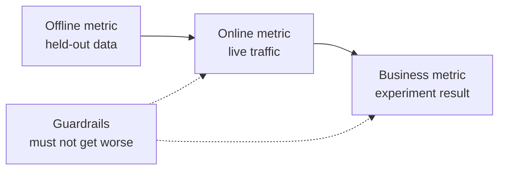

# ML Sistem Tasarımı  Sorundan Kullanılan Modelle

> Bir model bir sistemin bir parçasıdır. tasarım, modelin neyi tahmin ettiğini, kimlerin ona göre hareket ettiğini, maliyetlerini ve başarısız olduğunda ne olacağını belirler.

**Type:** Build
**Languages:** Python
**Prerequisites:** Phase 2, Lessons 09 (Model Evaluation) and 13 (ML Pipelines)
**Time:** ~110 minutes

## Öğrenme Hedefleri

- Bir iş sorunu bir tahmin, onu kullanan bir karar ve kuralların neden yeterli olmadığını gösteren bir bir ML görevi olarak çerçeveleyin
- Çevrimiçi, çevrimiçi, iş ve koruma metriklerini ayırın ve her modeli önemsiz ve heuristik temel çizgilerle karşılaştırın
- Satış sayısından günlük maliyetin, gecikmenin ve batch ve çevrimiçi sonuçların gecikme sürelerini tahmin edin
- Her başarısızlık modunda bir çıkış örneği (gölge, kanarya, A/B testi) ve güvenli bir varsayım seçin
- Modelin bir sonraki sürümünü eğiten verileri değiştirdiği geri bildirim döngüleri tanımlayın
- Bir ML tasarım belgesini yazın ve sabit bir kontrol listesine karşı değerlendirin

## Sorun

Bir abonelik şirketi "bir çurn modeli" istiyor. Veriler bilimcisi bir gradient artmış sınıflandırıcıyı eğitir ve 0.91'in AUC'sini rapor eder.

Bu nedenlerin algoritma ile bir ilgisi yok. Kimse bir skorun hangi eylemde başlatıldığını belirlemedi. Notlar haftada bir kez gelir, ancak tutma ekibi her gün müşterileri arıyor. Etiket, iptal nedenini de saklayan bir iptal masasından geldi, bu yüzden bir özelliğin cevabı vardı. Kimse modeli destek ekibi tarafından zaten kullanılan kural ile karşılaştırmadı: birini iki hafta boyunca çalışmayan olarak çağırın.

Bu hataların her biri eğitim başlamadan önce meydana geldi. Bunlar tasarım hatalarıdır ve bir sayfa tasarım belgesi her biri hakkında soru sorar. Bu ders, bu belgedeki kararları öğretiyor.

## Anlaşım

### İş hedefinden ML görevine

Bir iş hedefi bir ML görevi değil.

1. Model tam olarak neyi öngörüyor ve hangi işletme için (kullanıcı, ödeme, depo, madde)?
2. Hangi karar önceden bildirilen olayı kullanır?
3. Tahminin ne zaman yapılması gerekiyor ve o anda hangi veriler var?
4. Kararın daha iyi olduğunu nereden bileceksin?

| Business goal | Prediction | Decision that uses it | ML task |
|---|---|---|---|
| Reduce churn | Probability that a user cancels in the next 30 days | Send a save offer to the top 5 percent each night | Binary classification |
| Cut fraud losses | Probability that a payment is fraud | Approve, review, or block within 100 ms | Binary classification |
| Keep shelves stocked | Units sold per store per day next week | Order quantity for each store | Forecasting |
| Show relevant items | Relevance score for a (user, item) pair | Order of items in the feed | Ranking |

İkinci sütun en çok dikkatli olmalıdır. "Önümüze kadar tahmin yap" ufku, varlık ve eylemleri açık bırakır. "Önümüzdeki 30 gün içinde bu kullanıcının iptal olup olmadığını tahmin et, böylece bu gece iş kimin teklif aldığını seçebilir" üçünü de düzeltir.

### ML'yi kullanmamak için ne zaman

Google'ın Makine Öğrenimi Kuralları'ndaki 1. Kural, makine öğrenimi olmadan bir ürün başlatmaktan korkmamayı söyler. Makine öğrenimi verilere ihtiyaç duyar ve basit bir heuristik genellikle yolun bir kısmını alır.

- Kısa bir kural hedefe ulaşır ve doğru kalır.
- Etiketlerin yok ve onları toplamanın pratik bir yolu yok.
- Kimse tahmin üzerine hareket etmez, bu yüzden daha iyi bir tahmin hiçbir şeyi değiştirmez.
- Tahmin zamanı mevcut olan veriler sinyal içermez.
- Bir hata kabul edilemez ve kimse çıkışı kontrol edemez.
- Sistemin inşası ve çalıştırılması daha iyi kararların değeriyle karşılaştırıldığında daha pahalı olur.

Bir kural uzun ve kırılgan olduğunda, ML ödemek başlar. Aynı rehberin #3 kuralının karmaşık bir heuristikten ML'yi tercih ettiği için, öğrenilen bir model güncelleştirilmesi ve korunması daha kolay.

### Üç katman metrik

Bir ML sistemini üç katmanla ölçersiniz, bir dizi sınırla:

| Layer | When you can measure it | Churn example |
|---|---|---|
| Offline metric | Before launch, on held-out past data | F1 at the offer threshold, precision in the top 5 percent |
| Online metric | During launch, on live traffic | Offer acceptance rate, share of users scored, score distribution |
| Business metric | Weeks after launch, with an experiment | 30-day churn rate in the treated group versus a holdout group |
| Guardrail metric | All the time | Offer cost per saved user, unsubscribe rate, p99 latency |



Bu nedenle, bir iş metrikası, bir şirketin diğer tüm işlerinden gelen gürültüyi taşıyor.

Bu nedenle, bu iş için kullanıcının en iyi yüzde 5'i ile iletişim kurması gerekiyorsa, en iyi yüzde 5'te doğruluk ölçülmelidir. AUC, hiçbir zaman kullanmadığınız eşikler dahil olmak üzere her eşiğin üzerinde ortalama değerler belirler. Aynı rehberin 2. kuralı, ML sistemi ne yapacağına karar vermeden önce ölçümleri önce tasarlamanı ve uygulamayı söyler.

### Temel hatlar

Bir metrik değeri tek başına hiçbir şey ifade etmez. 0.56'nin F1'i en iyi alternatif 0.30'a ulaşırsa iyi ve bir kural 0.60'a ulaşırsa kötüdür.

- **Trivial baseline.**Her zaman çoğunluk sınıfını veya her zaman eğitim ortalamasını tahmin edin.
- **Heuristic baseline.**Alan bilgisiyle ilgili bir kural veya eğitim verilerine uygun bir özellik eşiği.
- **Current system.**Bugün karar verecek olan ne olursa olsun, hatta hesap sayfası olan biri bile olsa.

Asansör, en güçlü temel çizginin puanı eksik olan model puanıdır. Sonuçlara bakmadan önce en az bir asansör belirleyin ve ekstra sistemi ödemek için yeterince büyük yapın. Ufak temel çizgi genellikle zayıfdır. Heuristik temel çizgi yenilmek en zor.

### Veriler ve etiket gereksinimleri

Eğitim yapmadan önce şu soruları cevaplayın:

- **Label source.**Etiketi hangi masa veya etkinlik belirler ve kim sahip?
- **Label delay.**Tahminin gerçek sonucu ne kadar süre sonra gelir? dolandırıcılık geri ödeme ödeme haftalar sonra gelebilir. Churn etiketler 30 günlük ufkun sonunda gelir.
- **Label quality.**Etiketi kim verir ve ne sıklıkla yanlış yapılır?
- **Availability at prediction time.**Sonucun ardından sistemin yazdığı bir özellik, etiketleri eğitime sızdırır.
- **Volume per class.**200 olumlu örnek basit modellerle sınırlı.
- **Time split.**En son dönemi bekleyin. Verileri zaman aralığında aynı sebepten dolayı zaman aralığında bölüyoruz.

### Gecikme, geçiş ve maliyet bütçeleri

Her servis tasarımını üç sayı bağlıyor:

- **Latency budget.**P99 gecikme, 100 istekten 99'unun altında kalmasıdır. Bir ödeme kontrolü 50 ms gerekebilir. Gece rapor saatler alabilir.
- **Peak throughput.**Sistemin ölçümünü günlük ortalama için değil, en yoğun dakikaya göre yapın.
- **Cost budget.**Bunu günde dolar veya 1000 tahmin için dolar olarak ifade edin, böylece tasarımları karşılaştırabilirsiniz.

Little'ın yasası ilk ikisini birleştirir. Gelişmekte olan isteklerin sayısı, geçiş süresiyle aynıdır.

### Satır sonucu vs. çevrimiçi sonucu

Önceden tahminleri yapmanın iki temel yolu vardır:

- **Batch inference.**Bir programlı iş, her birimi puanlar ve puanları bir tabloya veya anahtar değerleri depolarına yazar. Uygulama, talep sırasında kaydedilen puanları okuyor.
- **Online inference.**Başvuru, özellikleri talep edilen zamanda bir model hizmetine gönderir ve puan bekler.

| Property | Batch | Online |
|---|---|---|
| Freshness | As old as the last run, plus the run time | Uses the data of the request |
| Request latency | One key-value read, a few ms | Feature fetch plus model time |
| Cost driver | Number of entities times runs per day | Replicas sized for peak QPS |
| New entities | No score until the next run | Scored on the first request |
| When it breaks | Old scores stay readable | Requests fail or time out |

Bu dersdeki araç kümesi her iki şeye de fiyat verir. Birim sayısı ve günde koşuşturma sayısı ile birlikte seri maliyeti büyür. Daha kısa bir durgunluk sınırı daha fazla koşuşturma anlamına gelir. Online maliyeti zirve trafiği ile birlikte büyür, çünkü zirveler arasında boş replikler için ödeme yapılır. Bir saat süren bir seri işi herhangi bir fiyata bir saatten daha az durgunluk sınırı karşılayamaz.

Bir gecelik seri işi bilinen kullanıcıları puanlar ve bir çevrimiçi yol yeni kullanıcıları ve taze verilere ihtiyaç duyan istekleri puanlar.

### Gösterim kalıpları

Yeni bir model kullanıcılara aşamalar halinde ulaşır:

1. **Shadow.**Yeni model canlı trafiğin bir kopyasını alır. Sistem tahminlerini kaydeder ve asla kullanmaz. Gecikme, hata oranı ve tahmin dağılımını mevcut modelle karşılaştırırsınız.
2. **Canary.**Yeni model trafikin küçük bir payı için gerçek kararlar verir, genellikle yüzde 1 ila 5.
3. **A/B test.**Her modelini rastgele bir kullanıcı bölümü görür. İş metriklerini istatistik bir testle ölçerseniz, farkı görmek için yeterli trafiğe ve yeterli zamana ihtiyacınız var.

Her aşamada birkaç dakika süren bir geri dönüş gerekebilir. Eski model versiyonunu kullanın ve trafikü yapılandırma ile değiştirin. LLM servis aşamasında dil modelleri için aynı üç örneği kapsar [shadow and canary lesson](../../../17-infrastructure-and-production/20-shadow-canary-progressive/docs/en.md)ve [A/B testing lesson](../../../17-infrastructure-and-production/21-ab-testing-llm-features/docs/en.md)- Evet .

### İsteğe bağlılık döngüleri

Bir modelin kararları bir sonraki sürümünü eğiten verileri değiştirdiğinde bir geri bildirim döngüsü vardır. Sculley et al.

- **Interventions hide the label.**Bir churn modeli teklifler gönderir ve teklifler bazı kullanıcıları tutar. Önümüzdeki ay, yüksek riskli kullanıcılar sadık görünür ve yeniden eğitilmiş model özelliklerinin churn'u tahmin edemediğini öğrenir.
- **Blocked actions have no outcome.**Sahtelik modeli bir ödemeyi engeller, böylece ödeme asla geri ödeme etiketi almaz.
- **Exposure limits feedback.**Bir sıralama modeli en önemli öğeleri gösterir, bu yüzden sadece bu öğeler tıklamaları toplar.

Düzeltmeler bir fikir paylaşır: modelin etkilemediği bazı verileri tutun. Hiç müdahale edilmeyen küçük bir rastgele grubu tutun. Trafikten küçük bir payı rastgele bir karar verin. puanı ve kararı her örnekle kaydetin, böylece daha sonra eğitim etkilenen verileri temiz verilerden ayırt edebilir.

### Başarısızlık modları ve güvenli öntanımlı durumlar

Sistemin her parçası er ya da geç başarısız olur.

| Failure | Result without a plan | Safe default |
|---|---|---|
| Model service times out | The request fails | Use the heuristic baseline |
| Nightly batch job fails | Scores go missing or get old | Serve the last good scores for a fixed time, then the rule |
| Feature is missing or out of range | The model scores bad input | Use the documented default value and log the event |
| New entity with no history | No score exists | Use the rule or the population average |
| Score distribution moves suddenly | Wrong decisions at scale | Pause automatic actions and alert a person |

Metrik bölümünüzden gelen heuristik temel çizgi de çoğu başarısızlık için varsayılan bir çizgi, bu yüzden önce onu oluşturun.

### Tasarım belgesi

Tasarım belgesi, eğitim başlamadan önce yukarıdaki her kararı tek bir yerde kaydeder. Bu dersdeki kontrol cihazı, JSON sürümünü puanlar.

| Section | Question it answers | Blocking |
|---|---|---|
| Problem | What is predicted, which decision uses it, and why rules are not enough? | The decision |
| Metrics | Which offline, online, business, and guardrail metrics apply? | The business metric |
| Baselines | Which trivial, heuristic, and current-system baselines apply? | A heuristic or current baseline |
| Data | Where do labels come from, how late, and does each feature exist at prediction time? | No leakage |
| Budgets and serving | Which latency, peak QPS, cost, and staleness limits apply, and which serving mode fits them? | No |
| Rollout | Which shadow, canary, and A/B stages apply, and how do you roll back? | Shadow or canary, plus rollback |
| Feedback loops | How can the model change its own future data, and what keeps clean data? | No |
| Failure modes | What is the default action for each failure? | A default for every failure |
| Monitoring | What do you watch after launch? | No |

```figure
mlprod-serving-cost
```

## Yapın

Kodun içinde .`code/main.py`Sadece standart kütüphaneden yararlanır. Üç araç vardır: bir servis maliyeti modeli, bir temel karşılaştırıcı ve bir tasarım belge kontrolcisi.

### Adım 1: Çalışma yükünü ve fiyatlarını açıkla

Bir iş yükü trafik sayısını ve bütçelerini tutar. Bir maliyet modeli fiyatları tutar. Fiyatlar, satıcı teklifleri değil, egzersiz için yuvarlak numaralar.

```python
@dataclass(frozen=True)
class Workload:
    name: str
    entities: int
    requests_per_day: int
    peak_qps: float
    max_staleness_hours: float
    latency_budget_ms: float


@dataclass(frozen=True)
class CostModel:
    batch_dollars_per_million: float = 0.40
    batch_job_hours: float = 1.0
    lookup_dollars_per_million: float = 0.25
    lookup_latency_ms: float = 4.0
    replica_dollars_per_hour: float = 0.50
    replica_qps: float = 200.0
    min_replicas: int = 2
    online_latency_ms: float = 35.0
```

### Adım 2: Satış fiyatı ve çevrimiçi servis

Bir seri işi, durgunluk sınırı içinde bitmelidir. Çıkışlar arasındaki zaman, iş süresi eksik olan sınırıdır. Her çıkış, bu puanı isteyen veya istemeyen her bir kuruluş için puanlar verir.

```python
def batch_plan(workload: Workload, costs: CostModel) -> ServingPlan:
    refresh_hours = workload.max_staleness_hours - costs.batch_job_hours
    if refresh_hours <= 0:
        return ServingPlan(
            "batch", False, math.inf, costs.lookup_latency_ms, math.inf, 0.0,
            "staleness limit is shorter than one batch job",
        )
    runs_per_day = 24.0 / refresh_hours
    predictions = workload.entities * runs_per_day
    dollars = (
        predictions / 1e6 * costs.batch_dollars_per_million
        + workload.requests_per_day / 1e6 * costs.lookup_dollars_per_million
    )
    ...
```

Online servis, zirveyi ele geçirmek için yeterli kopya ödüyor ve en az iki tane kullanılabilirlik için:

```python
def online_plan(workload: Workload, costs: CostModel) -> ServingPlan:
    replicas = max(costs.min_replicas, math.ceil(workload.peak_qps / costs.replica_qps))
    dollars = replicas * costs.replica_dollars_per_hour * 24.0
    feasible = costs.online_latency_ms <= workload.latency_budget_ms
    ...
```

`choose_serving`Gecikme ve gecikme sınırlarını karşılayan planları tutar ve en ucuz olanı iade eder.`None`Planın uygun olmadığı zaman, bu da bütçeleri değiştirmenizi söyler.

### Adım 3: Bir modeli temel çizgilerle karşılaştırın

Karşılaştırıcı, model ve her başlangıç çizgisini aynı metrikle değerlendirir.

```python
def compare_to_baselines(
    y_true: list,
    model_pred: list,
    baselines: dict[str, list],
    metric,
    metric_name: str,
    higher_is_better: bool = True,
    min_lift: float = 0.02,
) -> BaselineReport:
    if not baselines:
        raise ValueError("a model needs at least one baseline")
    scores = {name: metric(y_true, pred) for name, pred in baselines.items()}
    pick = max if higher_is_better else min
    best_name = pick(scores, key=scores.get)
    model_score = metric(y_true, model_pred)
    lift = model_score - scores[best_name] if higher_is_better else scores[best_name] - model_score
    return BaselineReport(metric_name, {"model": model_score, **scores}, best_name, lift, min_lift)
```

Heuristik temel çizgi tek bir özellik kuralıdır. `fit_rule`Bu test, özelliklerin her değerini eğitim verileri üzerinde bir eşiği olarak test eder ve en iyi F1 ile eşiği tutar.

### Dördüncü adım: Bir tasarım belgesini çiz

Her kontrol listesinin anahtarı, ağırlığı, engelleme bayrağı, mesajı ve kontrol işlevi vardır.

```python
CheckItem("decision", 2, True, "name the action that uses each prediction", lambda d: _text(d, "problem.decision")),
CheckItem("baselines", 2, True, "add a heuristic or current-system baseline", check_baselines),
CheckItem("no_leakage", 2, True, "confirm every feature exists at prediction time",
          lambda d: get_path(d, "data.features_available_at_prediction_time") is True),
CheckItem("serving_fit", 1, False, "pick a serving mode that meets the staleness, latency, and cost budgets",
          check_serving_fit),
```

`check_serving_fit`maliyet modelini tekrar kullanır. Belgeden iş yükü numaralarını okuyor ve seçilen modun fiyatlarını belirliyor. Bu mod, gecikme sınırı, gecikme bütçesi veya günlük maliyet bütçesi geçince kontrol başarısız olur. Üç dakikalık bir durgunluk sınırı olan "batch" yazılı bir belge bu kontrolü başarısız eder. Masraf modeli hibrit planı yoktur, bu yüzden "hibrit" diyen bir belge, 1. Egzersiz'te planı eklemeyinceye kadar bu kontrolden geçerli olmaz.

`review_design_doc`Ödül sadece puan 0,85'e ulaştığında ve hiçbir bloklama öğesi başarısız olduğunda "düşünmeye hazır" olur.

### Adım 5: Çalıştır

```bash
python3 code/main.py
```

```console
nightly churn scores
  ok batch        $0.91/day      4 ms  1.0 runs per day over 2,000,000 entities
  ok online      $24.00/day     35 ms  2 replicas sized for 40 peak QPS
  choose: batch

feed ranking, 2-hour freshness
  ok batch       $48.50/day      4 ms  24.0 runs per day over 5,000,000 entities
  ok online      $24.00/day     35 ms  2 replicas sized for 120 peak QPS
  choose: online

=== Model versus baselines (churn, metric F1) ===
  model                    0.564
  days_idle > 12.8688      0.500
  random at base rate      0.232
  majority class           0.000
  model beats the strongest baseline (days_idle > 12.8688) by +0.064
```

Çoğu temel çizgi F1'de 0 puan alır, çünkü asla dönüm tahmin etmez. Uygun kural gerçek rakiptir. Model onu 0.064'e yener, bu nedenle model yerini kazanır. Daha zayıf özelliklerle kural kazanabilir ve o zaman kural uygulamak için doğru sistemdir.

Tasarım belgesinin incelemesi, zayıf belgeyi altı engelleme öğesi ile ve tamamı belgeyi 1.00 puanla basar. Kendi belgenizi incelemek için bir yol geçin:

```bash
python3 code/main.py my_design_doc.json
```

## Kullan

Araç kitinin her kısmı ekiplerin üretiminde kullandığı araçları haritasına yerleştirir.

**Baselines.**scikit-learn, önemsiz temel çizgileri tahminciler olarak sağlar, bu yüzden modelle aynı boru hattına uyarlar:

```python
from sklearn.dummy import DummyClassifier, DummyRegressor
from sklearn.metrics import f1_score

majority = DummyClassifier(strategy="most_frequent").fit(X_train, y_train)
base_rate = DummyClassifier(strategy="stratified", random_state=0).fit(X_train, y_train)
mean_value = DummyRegressor(strategy="mean").fit(X_train, y_reg_train)

print(f1_score(y_test, majority.predict(X_test)))
```

`most_frequent`Düzleşmeler`majority_baseline`ve`stratified`Düzleşmeler`base_rate_baseline`.skit-learn heuristik bir temel çizgi yok, çünkü heuristik sizin alanınızdan geliyor.

**Batch serving.**Apache Airflow veya Dagster gibi bir iş akışı programcısı puanlama işini yürütür. İş bir depo masasına veya Redis veya DynamoDB gibi bir anahtar değer mağazasına puanlar yazar.

**Online serving.**KServe, BentoML, NVIDIA Triton ve TorchServe gibi model sunucular HTTP veya gRPC son noktasının arkasında bir model sarar.

**Rollouts.**Kubernetes'in Argo Rollouts gibi araçları, kanarya yayınları için trafiği bölüyor. GrowthBook ve Statsig gibi deney platformları kullanıcıları A/B gruplarına ayırır ve istatistikleri hesaplar.

**Design review.**Breck et al. ML Test Score'yu yayınladı. Bu 28 test ve üretim ML sistemlerinin izleme ihtiyaçlarını kapsayan bir bölümdür.

## Gönder

Bu ders bize çok yararlı .`outputs/skill-ml-design-review.md`. Yetenek, bir ML tasarım belgesini bölümden bölüm olarak inceliyor ve önce bloklama boşluklarını belirliyor.

## Egzersizler

1.  Bir hibrit plan ekle`choose_serving`.Bilinen kullanıcıları online olarak bir seri olarak ve yeni kullanıcılarla karşılaştırın.
2. Model kuralları yenene kadar dönüş verilerini değiştirin.
3. Bir ekle`budgets.max_dollars_per_1k_predictions`Kontrol listesine bir madde koyun.
4. Ödeme sahtekarlığı kontrolü için bir JSON tasarım belgesini yazın. Kontrol cihazını çalıştırın ve her bloklama öğesini düzeltin.
5. Çürük geri bildirim döngüsünü simüle et, teklif alan kullanıcıların etiketlerini çıkar, yeniden eğit ve F1'deki değişimi ölç.

## Anahtar Terimler

| Term | What people say | What it means |
|------|----------------|----------------------|
| ML task | "Build a churn model" | A prediction target, an entity, a horizon, and the decision that uses the prediction |
| Offline metric | "The model score" | A metric computed on held-out past data before launch |
| Online metric | "Live numbers" | A metric measured on real traffic while the model runs |
| Business metric | "The goal" | The company outcome that the decision must change, measured with an experiment |
| Guardrail metric | "Do no harm" | A metric that must not get worse when the new model launches |
| Baseline | "The dumb model" | A trivial, heuristic, or current-system predictor that the model must beat by a set margin |
| Batch inference | "Precomputed scores" | A scheduled job scores every entity and stores the results for lookup |
| Online inference | "Real-time model" | The model scores each request when it arrives |
| Shadow deployment | "Dark launch" | The new model scores live traffic, and nobody uses its output |
| Canary release | "Slow rollout" | The new model decides for a small, growing share of traffic, with a rollback ready |
| Feedback loop | "The model trains itself" | The model's decisions change the data that trains its next version |

## Daha Fazla Okumak

- [Sculley et al., Hidden Technical Debt in Machine Learning Systems (NeurIPS 2015)](https://papers.nips.cc/paper/2015/hash/86df7dcfd896fcaf2674f757a2463eba-Abstract.html): geri bildirim döngüleri, karışıklık ve bir model etrafında sistem maliyetleri
- [Google, Rules of Machine Learning](https://developers.google.com/machine-learning/guides/rules-of-ml): İlk model için pratik kurallar, ölçümler ve eğitim hizmetleri tutarlılığı
- [Breck et al., The ML Test Score (IEEE Big Data 2017)](https://research.google/pubs/the-ml-test-score-a-rubric-for-ml-production-readiness-and-technical-debt-reduction/): 28 üretim hazırlığını ölçen test
- [Kohavi, Tang, and Xu, Trustworthy Online Controlled Experiments (Cambridge University Press, 2020)](https://experimentguide.com/)Doğru cevaplar veren A/B testlerini nasıl yapılır
- [Sato, Wider, and Windheuser, Continuous Delivery for Machine Learning (2019)](https://martinfowler.com/articles/cd4ml.html): versiyonlu veriler, modeller ve dağıtım boru hattı
- [Google Cloud, MLOps: Continuous delivery and automation pipelines in machine learning](https://cloud.google.com/architecture/mlops-continuous-delivery-and-automation-pipelines-in-machine-learning): eğitim ve hizmet otomasyonu için üç olgunluk seviyesi
