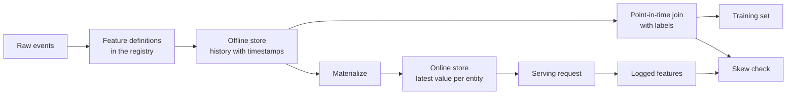

# Özellikleri ve Eğitim Hizmetleri

> Bir özellik bir tanım ve iki okuyucuya sahiptir. Eğitim her etiket zamanından itibaren tarihini okuyor ve servis son değerini okuyor. İki okuyucu anlaşmazlık halinde, model asla eğitilmemiş girişleri görür.

**Type:** Build
**Languages:** Python
**Prerequisites:** Phase 2, Lessons 08 (Feature Engineering), 13 (ML Pipelines), 15 (Time Series), and 19 (ML System Design)
**Time:** ~100 minutes

## Öğrenme Hedefleri

- Çevrimiçi mağaza, çevrimiçi mağaza, varlıklar, etkinlik zaman damgaları ve TTL'leri ve her birinin işini açıklayın
- Zamanında doğru bir birleştirme uygulayın ve bir saf birleştirmenin gelecekteki değerleri eğitim verilerine nasıl kopyaladığını gösterin
- Eğitim hizmetinde eğilime nedenlerinin dört nedenini söyleyin: iki kod yolu, eski özellikler, farklı varsayılanlar ve zaman yolculuğu
- Tek tanımlama hem eğitim yolu hem de hizmet yolu besleyen bir özellik kayıt yapın
- Her tarihten sonra verileri okumadan önceki tarihlerden yeni bir özelliği geri doldurun
- Aynı varlık ve zaman için kayıtlı servis özelliklerini eğitim yoluna karşılaştırarak eğilimi tespit etmek

## Sorun

Bir ekip bir çurn modeli oluşturur. Her etiket, bir etiket gününden sonraki 30 gün içinde bir kullanıcı tarafından satın alınmadığını belirtir. Ekip etiketleri kullanıcı özellikleri tablosuna ekler.`user_id`ve bir kural eğitimi `days_since_last_purchase`- Oturumsuzluk doğruluğu 0.948.

Canlı trafikte, model daha eski ve basit bir versiyondan daha kötü bir performans sergiliyor. Özellik tablosu, etiket günlerinden sonraki haftalardan itibaren her kullanıcı için en yeni değeri içeriyordu. Son satın aldığı kullanıcı, gün 115'te 60 gün boş bir fotoğraf gösterdi. Bu yüzden bu özellik cevap içeriyordu. Bu arada başka bir ekip, servis özelliklerini başka bir hizmette tekrar yazdı. 30 günlük pencerelerinde bir gün daha vardı ve yeni bir kullanıcı için varsayılanlar 365 yerine -1 idi.

Bu ders, bir özellik mağazasının parçalarını sıfırdan oluşturur. Bir kayıt, bir geri doldurma, bir zaman içinde birleştirme, TTL ile bir çevrimiçi mağaza ve bir eğilime kontrolü yazırsınız. Demo her iki kusuru da numaralarla yeniden üretir.

## Anlaşım

### Aynı karakterin iki okuyucu

Eğitim ve servis farklı şekillerde özellikler talep eder:

| Property | Training (offline) | Serving (online) |
|---|---|---|
| Question | "What was the value for each of 10 million (entity, time) pairs?" | "What is the value for this one entity now?" |
| Time | Many points in the past | The present |
| Volume | Millions of rows per job | One row per request |
| Latency | Minutes are fine | A few milliseconds |
| Storage | Offline store: full history with timestamps, in columnar files or a warehouse | Online store: the latest value per entity, in a key-value database |

Bir özellik mağazası, her iki mağazayı da tek bir özellik tanımlamasıyla doldurur.



### Yönetici, zaman damgaları ve TTL

Dört terim her özellik satırını tanımlar:

- **Entity.**Bir özelliğin tanımladığı anahtar, örneğin `user_id`veya `card_id`- Evet .
- **Event timestamp.**Satın alma sayısında "14'ten itibaren" olay zaman damgası 14'e ait.
- **Created timestamp.**Sistemin satırı yazdığı zaman. Bugün çalışmakta olan bir geri doldurma eski olay zaman damgaları ve yeni oluşturulan zaman damgası ile satırlar yazıyor.
- **TTL (time to live).**Bir değerin en büyük yaşı. TTL'den daha eski bir değer kayıp sayılır, bu nedenle okuyucu varsayılanı kullanır.

Aynı varlık, kaynak ve TTL'ye sahip bir grup özellik genellikle özellik görünümü olarak adlandırılır.

### Zamanında doğru birleştirmeler

Bir eğitim satırı, etiket zamanında var olan özellik değerleriyle bir etiket çiftleştirir.

1. Aynı varlığın özellik satırlarını bul.
2. Olay zaman damgasının etiket zaman damgasının yanında veya öncesinde olduğu sıraları tutun.
3. Bu sıralardan sonunu alın.
4. Etiket zaman damgası eksi etkinlik zaman damgası TTL'den daha fazlasa bırakın.

İşte bir kullanıcı, 16. gün etiket ve haftalık özellik satırları:

| Feature row day | `purchases_30d` | Point-in-time join | Naive join on `user_id` |
|---|---|---|---|
| 7 | 4 | | |
| 14 | 3 | Selected | |
| 21 | 1 | Future | |
| 28 | 0 | Future | Selected |

Etiket, kullanıcının 17 ila 46 gün içinde bir şey satın aldığını soruyor. 28 günlük sıra zaten etiket gününden sonraki sessiz günleri sayıyor. Kullanıcı satın almayı bıraktığı için 0 satın almayı gösterir, bu da etiketin ölçdüğü bir olaydır. Saçma birleştirme cevabı girişine kopyalar.

Zaman dizisi dersi'nde verileri zamanla bölüyoruz aynı sebepten dolayı. Bir nokta zaman birliği, bu kuralı bir bölünme noktasına değil, her satır için uyguluyor.

### Eğitim hizmetinde eğilime nedenleri

Google'ın Makine Öğrenme Kuralları, eğitim ve servis sırasında performans arasındaki fark olarak eğitim hizmetinde eğilimi tanımlar. İki boruda farklı veri işleme nedenlerini belirler.

| Cause | What happens | Example from the demo |
|---|---|---|
| Two code paths | Training and serving compute the feature with different code | The serving window includes day `now - 30`, and the training window does not |
| Stale features | The value that serving reads has a different age from the value that training used | Training reads weekly snapshots, and a new service computes fresh values |
| Different defaults | The two paths fill a missing value differently | Training uses 365 for "no purchase yet", and serving uses -1 |
| Time travel | Training reads a value from after the label time | The naive join reads the newest snapshot for every label |

Aynı rehberin 32. kuralı, eğitim boru hattı ve servis boru hattı arasında kodun mümkün olduğunda tekrar kullanılmasını söyler.

### Özellik Kayıtları

Kayıt, özellik tanımlarının kataloğudur. Her giriş bir isim, bir varlık, bir kaynak, bir dönüşüm, bir pencere, bir varsayılan değer, bir TTL, bir sahibi, bir sürüm ve bir açıklama içerir.

İki kural onu korur:

- Her iki yol da kayıttan tanımlanmayı okuyor.
- Defini değiştirmek yeni bir versiyon yaratır. Eski versiyon kalır, bu yüzden eski modeller eğitim aldığı özelliği korur.

### Sırt dolguları

Yeni bir özelliğin tarihi yoktur, ancak eğitim her eski etiket zamanında değerine ihtiyaç duyar. Bir geri doldurma, tanımlamayı her geçmiş tarihte çalıştırır ve her bir varlık ve tarihe bir satır yazar. Her çalışmanın sadece tarihine veya öncesine ait zaman damgaları olan olayları okuduğu için kullanılır.

Backfills, gün sayısına katılan birtakım nesneler ile birlikte artan hesaplama maliyetini hesaplar. Ayrıca ince bir sızıntı getirirler. Bugün çalıştırılan bir backfill eski etkinlik zaman damgaları ile satırlar yazar, ancak daha sonra gelen veya düzeltilen verileri okuyabilir.

### Bozukluk tespit edilmesi

Aynı rehberin 29. kuralı, özellikleri servis zamanında kaydetmeni ve eğitimde kullanmanızı söyler. Küçük kaydedilen örnek bile tutarlılığı kontrol etmenizi sağlar. Kaydedilen her değerin aynı kuruluş ve zaman için eğitim yolunun ürettiği değerle karşılaştırın. Her özellik için eşleşme oranını ve ortalama mutlak farkı bildirin.

Sebebini bulmak için üç çiftle karşılaştırın:

1. Online mağazada okuma karşı eğitim birleştirme. Bu tüm sistemi test ve sıfır eğilimi göstermek gerekir.
2. Yeni hesaplama ve eğitim birleşimi.
3. İkinci kod yolu yeni hesaplama ile karşılaştırıldığında, bu, pencereler ve varsayılanlar gibi kod farklılıklarını izole eder.

```figure
mlprod-pit-join
```

## Yapın

Kodun içinde .`code/main.py`Bu sayede, her hafta bir seri iş, 7., 14. ve 175. günlerde fotoğraflar yazıyor.

### Adım 1: Özellik tanımları ve kayıt

A.`FeatureDefinition`Değişimi veriler olarak tutar: bir toplam, bir pencere ve varsayılan.`compute`Metod , olayları asla okumamıştır .`as_of`- Evet .

```python
@dataclass(frozen=True)
class FeatureDefinition:
    name: str
    entity: str
    aggregate: str
    window_days: int | None
    default: float
    version: int = 1
    owner: str = "growth-team"
    description: str = ""

    def compute(self, events: list[Event], as_of: int) -> float:
        visible = [e for e in events if e.day <= as_of]
        if self.window_days is not None:
            visible = [e for e in visible if e.day > as_of - self.window_days]
        if self.aggregate == "count":
            return float(len(visible))
        if self.aggregate == "sum":
            return round(sum(e.amount for e in visible), 2)
        if self.aggregate == "days_since_last":
            return float(as_of - max(e.day for e in visible)) if visible else self.default
        raise ValueError(f"unknown aggregate {self.aggregate!r}")
```

`FeatureRegistry.register`Aynı tanımı iki kez kabul eder, ama aynı isim ve versiyonla farklı bir tanımı reddeder. `fill_defaults`Kayıp bir değer için her iki yol da aynı varsayılan değer verir.

Bir model , tanımlama bir referans ile bir çizer .`spend_30d@1`- Evet .`compute`ve `fill_defaults`İsimsiz bir isimle referansı çözün.`@`En son versiyonu okuyor.`@`Ve hiçbir versiyon sayısı artmıyor `ValueError`Referans aynı zamanda her kaydedilen satırdaki anahtartır, bu nedenle geri doldurma, çevrimiçi mağaza ve servis okuma hepsi sabit tanım kullanır.

### Adım 2: OFFLINE mağazayı geri doldurun

```python
def backfill(registry: FeatureRegistry, names: list[str], events: list[Event], days: list[int]) -> list[FeatureRow]:
    rows = []
    for entity, entity_events in sorted(group_events(events).items()):
        for day in days:
            rows.append(FeatureRow(entity, day, registry.compute(names, entity_events, day)))
    return rows
```

Demo 25 gün boyunca 299 kullanıcı için üç özellik içerir. Bu da 7475 satır verir.

### Adım 3: Zamanında birleştirme

Her bir varlığın sırasını günde bir kez sıralayın.`bisect_right`TTL kontrolü, çok eski bir satır düşürür.

```python
def point_in_time_join(labels: list[LabelRow], rows: list[FeatureRow], ttl_days: int | None = None) -> list[JoinedRow]:
    by_entity: dict[str, list[FeatureRow]] = defaultdict(list)
    for row in rows:
        by_entity[row.entity].append(row)
    days_index = {}
    for entity, entity_rows in by_entity.items():
        entity_rows.sort(key=lambda r: r.day)
        days_index[entity] = [r.day for r in entity_rows]
    joined = []
    for label in labels:
        days = days_index.get(label.entity, [])
        pos = bisect.bisect_right(days, label.day) - 1
        match = by_entity[label.entity][pos] if pos >= 0 else None
        if match is not None and ttl_days is not None and label.day - match.day > ttl_days:
            match = None
        joined.append(JoinedRow(
            label.entity, label.day, label.label,
            match.day if match else None, match.values if match else None,
        ))
    return joined
```

### 4. Adım: Saf bir birleşimden sızıntı ölç

`naive_latest_join`Bu uygulama, her etiket için en yeni satırı gönderir. Demo etiketleri gün 100, 120 ve 140'da oluşturur ve her eğitim seti üzerinde bir özellik kuralı uyguluyor.

```console
  naive join used a snapshot from after the label day for 100% of rows
  offline accuracy, naive join: 0.948 (rule: idle > 53 days)
  offline accuracy, PIT join:   0.893 (rule: idle > 19 days)
  accuracy on day 145, trained with naive join: 0.763
  accuracy on day 145, trained with PIT join:   0.876
```

Yeni verilerde daha kötü, 0.763 0.876. Sızan özellik, ayarlanmış eşiği 19'dan 53 boş güne taşıdı.

### Adım 5: İnternet mağazası ve maddileşme

İnternet mağazası, her bir kuruluş için bir satır tutar ve TTL'den daha eski satırları reddeder. `materialize`Sadece iş saatinde veya iş saatinden önce olan sıraları yazıyor.

```python
class OnlineStore:
    def __init__(self, ttl_days: int):
        self.ttl_days = ttl_days
        self._latest: dict[str, FeatureRow] = {}

    def write(self, row: FeatureRow) -> None:
        current = self._latest.get(row.entity)
        if current is None or row.day >= current.day:
            self._latest[row.entity] = row

    def read(self, entity: str, now: int) -> dict[str, float] | None:
        row = self._latest.get(entity)
        if row is None or row.day > now or now - row.day > self.ttl_days:
            return None
        return dict(row.values)
```

10 günlük TTL ile, gün 145'te bir okuma, gün 140 satırını geri verir. gün 160'da bir okuma, yeni bir maddeleşme olmadan, varsayılanları geri verir, çünkü satır 20 gün eski.

### Adım 6: Bozukluk kontrolü

`detect_skew``(entity, day)`. O, eşleşme oranını ve özellik başına ortalama mutlak farkı bildirir ve değerlerin yüzde 1'den fazla farklı olduğunda bir özelliği işaretler.`ValueError`Eğer iki görüşün anahtarları farklı veya anahtarları yoksa, eksik bir istek eğriliği saklayabilir ve isteksiz bir kontrol hiçbir şey göstermez.

```python
def detect_skew(
    training: dict[tuple[str, int], dict[str, float]],
    serving: dict[tuple[str, int], dict[str, float]],
    features: list[str],
    tolerance: float = 1e-6,
    max_mismatch_rate: float = 0.01,
) -> list[SkewReport]:
    if set(training) != set(serving):
        raise ValueError(f"{len(set(training) ^ set(serving))} keys are in only one view: log and compare the same requests")
    if not training:
        raise ValueError("no requests to compare")
    keys = sorted(training)
    reports = []
    for feature in features:
        diffs = [abs(training[k][feature] - serving[k][feature]) for k in keys]
        mismatches = sum(1 for d in diffs if d > tolerance)
        rate = mismatches / len(keys)
        mean_diff = sum(diffs) / len(keys)
        reports.append(SkewReport(feature, len(keys), rate, mean_diff, rate > max_mismatch_rate))
    return reports
```

Demo kayıtları 141 ila 150 gün boyunca istekleri kaydeder ve konsept bölümünden üç karşılaştırmayı yürütür.

```bash
python3 code/main.py
```

```console
=== Skew checks on 383 logged requests, days 141 to 150 ===
  online store read  vs  training join (one definition, same snapshots)
    ok   days_since_last_purchase   mismatch   0.0%  mean |diff|    0.00
    ok   purchases_30d              mismatch   0.0%  mean |diff|    0.00
    ok   spend_30d                  mismatch   0.0%  mean |diff|    0.00
  fresh compute      vs  training join (staleness only)
    SKEW days_since_last_purchase   mismatch  83.0%  mean |diff|    2.77
    SKEW purchases_30d              mismatch  30.5%  mean |diff|    0.38
    SKEW spend_30d                  mismatch  37.1%  mean |diff|   16.77
  second code path   vs  fresh compute (code differences only)
    SKEW days_since_last_purchase   mismatch   5.5%  mean |diff|   20.07
    SKEW purchases_30d              mismatch  12.5%  mean |diff|    0.13
    SKEW spend_30d                  mismatch  12.5%  mean |diff|    5.09
```

Üç blokları sırayla oku:

- **One definition, same snapshots.**İnternet mağazası ve eğitim birliği aynı maddeci satırları okuyor, yani eğilimi sıfır.
- **Staleness.**Yeni bir değer, çoğu istek için haftalık anlık görüntünün farklı olduğunu gösterir.
- **Code differences.**İkinci kod yolu, pencerenin sayımının %12.5'inde farklıdır, çünkü penceresinde bir gün daha vardır.`days_since_last_purchase`Sadece yeni kullanıcılar için, ama büyük bir miktarda: -1 karşı 365.

## Kullan

Feast açık kaynaklı bir özellik dükkanı.

| From scratch | Feast |
|---|---|
| `FeatureDefinition`, `FeatureRegistry` | `Entity`, `FeatureView`, and `Field` in a feature repository, registered with `feast apply` |
| `FeatureRow` history | An offline store, for example a `FileSource` over Parquet files or a warehouse table |
| `point_in_time_join` with a TTL | `store.get_historical_features(entity_df=..., features=[...])` |
| `materialize` | `feast materialize-incremental <end time>` |
| `OnlineStore.read` | `store.get_online_features(features=[...], entity_rows=[...])` |
| Created timestamp check | `created_timestamp_column` on the source and `filter_by_created_timestamp=True` |

Bu kod, Bayramı hızlı başlatmaya uyar ve bu dersi çalıştırmak için gerekli değildir.

```python
from datetime import timedelta

from feast import Entity, FeatureView, Field, FileSource
from feast.types import Float32, Int64

user = Entity(name="user", join_keys=["user_id"])

user_activity_source = FileSource(
    name="user_activity_source",
    path="data/user_activity.parquet",
    timestamp_field="event_timestamp",
    created_timestamp_column="created",
)

user_activity = FeatureView(
    name="user_activity",
    entities=[user],
    ttl=timedelta(days=10),
    schema=[
        Field(name="purchases_30d", dtype=Int64),
        Field(name="spend_30d", dtype=Float32),
        Field(name="days_since_last_purchase", dtype=Int64),
    ],
    source=user_activity_source,
)
```

Eğitim ve hizmet aynı özellik görünümünü okuyun:

```python
from feast import FeatureStore

store = FeatureStore(repo_path=".")

training_df = store.get_historical_features(
    entity_df=labels_df,
    features=["user_activity:purchases_30d", "user_activity:days_since_last_purchase"],
    filter_by_created_timestamp=True,
).to_df()

online = store.get_online_features(
    features=["user_activity:purchases_30d", "user_activity:days_since_last_purchase"],
    entity_rows=[{"user_id": 42}],
).to_dict()
```

`labels_df`etiket başına bir satır tutar `user_id`- Evet .`event_timestamp`TTL'nin, birim veri çerçevesindeki her zaman damgasına göre, sorgu zamanına değil, TTL'nin, TTL kontrolüne göre olduğu belirtilmektedir.`point_in_time_join`Aynı sayfada anlatılıyor .`filter_by_created_timestamp=True`Bu seçenek, tüm çevrimdışı mağazaların desteklemediği bir seçenek değil.

Tecton, Hopsworks ve büyük bulut ML platformlarında bulunan özellik mağazeleri çevrimiçi ve çevrimiçi mağazeler arasında aynı bölümü kullanır. Tender kontrolü için TensorFlow Data Validation, eğilimi tespit etmek için eğitim verilerini servis verileri ile karşılaştırabilir. Breck et al.

## Gönder

Bu ders bize çok yararlı .`outputs/skill-feature-skew-audit.md`. Yetenek, zaman yolculuğu ve eğitim hizmetleri için bir özellik borusunu denetlemektedir.

## Egzersizler

1. Anlık çekim aralığını 7 günden 1 güne değiştirin.
2. TTL'yi 3 güne ayarlayın ve özelliklerini kaybeden ve varsayılan tren satırlarını sayın.
3. Yaratılan gün ekle `FeatureRow`- Birleştirme etiket gününden sonra yazılan satırları görmezden gelmesini sağla.
4. Kayıt`spend_7d`2 versiyonu olarak `spend_30d`Geri doldur ve kayıttan her iki versiyonu da yazdır.
5. Düzelt .`legacy_serving_features`Üçüncü tarafsızlık kontrolü geçene kadar.

## Anahtar Terimler

| Term | What people say | What it means |
|------|----------------|----------------------|
| Feature store | "A database for features" | A system that computes features from one set of definitions and serves them to training and to serving |
| Offline store | "The training data" | Full feature history with event timestamps, read by training jobs and backfills |
| Online store | "The feature cache" | The latest value per entity, read by the serving path in milliseconds |
| Entity | "The ID" | The key that a feature describes, such as a user or a card |
| Event timestamp | "When it happened" | The time at which a feature value became true |
| Point-in-time join | "An as-of join" | A join that pairs each label with the latest feature row at or before the label time |
| TTL | "Expiry" | The maximum age of a feature value before a reader treats it as missing |
| Materialization | "Syncing to online" | The job that copies the latest feature values from the offline store to the online store |
| Backfill | "Computing history" | Running a feature definition at past dates to create its history |
| Training-serving skew | "It worked offline" | A difference between the features or behavior in training and in serving |

## Daha Fazla Okumak

- [Feast, Point-in-time joins](https://docs.feast.dev/getting-started/concepts/point-in-time-joins): TTL semantik ve oluşturulan zaman damgası filtresi
- [Feast documentation](https://docs.feast.dev/): özellik görüntülemeleri, çevrimdışı mağazalar, çevrimiçi mağazalar ve gerçekleşme
- [Google, Rules of Machine Learning](https://developers.google.com/machine-learning/guides/rules-of-ml): eğitim hizmetinde eğilime kuralları, 29. Kural'dan 37. Kural'a kadar
- [Breck et al., Data Validation for Machine Learning (SysML 2019)](https://research.google/pubs/data-validation-for-machine-learning/): Google'da veri doğrulama, eğitim hizmetleri için eğilimi dahil
- [TensorFlow Data Validation guide](https://www.tensorflow.org/tfx/guide/tfdv): Şema kontrolleri, sapıklık tespitleri ve akıntı tespitleri
- [Sculley et al., Hidden Technical Debt in Machine Learning Systems (NeurIPS 2015)](https://papers.nips.cc/paper/2015/hash/86df7dcfd896fcaf2674f757a2463eba-Abstract.html): verilere bağımlılık ve bir model etrafında borcu borcu
