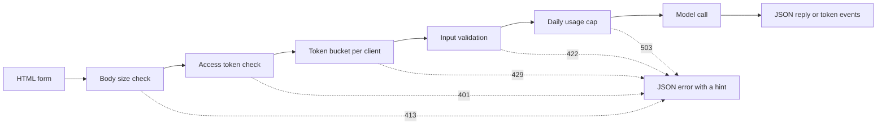

# Modelle Demo Arabirleri  Bir fonksiyondan Paylaşılabilir Bir Uygulama

> Bir demo modelinin tek bir sözleşmesi vardır: bir giriş, bir model çağrı ve bir çıkış. Bağlantıyı paylaşmadan önce her bir bölümde bir sınır koyun.

**Type:** Build
**Languages:** Python
**Prerequisites:** Phase 11 · 13 (Building a Production LLM Application), Phase 17 · 08 (Inference Metrics), Phase 17 · 19 (AI Gateways)
**Time:** ~90 minutes

## Öğrenme Hedefleri

- Bir demo'nun giriş, model çağrısı ve çıkış sözleşmesini yazın, her bir bölüm için bir sınır.
- Bir HTML sayfası, bir JSON son noktası ve bir Server-Send Events son noktası ile standart bir kütüphane HTTP uygulaması oluşturun.
- Girişi maliyet sırasıyla doğrulayın ve kullanıcıya bir sonraki eylemini söyleyen JSON hatalarını gönderin.
- Müşteri başına bir token kova, günlük kullanım limiti ve bir seçenek olarak erişim token ile kamuoyu göstergesini koruyun.
- Girdi metni ve müşteri adresini saklayan istek günlüğünü yazın.
- Standart kütüphane demo'sunu iki çerçeve sürümü ile karşılaştırın ve bir demo'nun bir ürün olması gerektiği sinyallerini isimlendirin.

## Sorun

Modeliniz bir defterde çalışır. Şimdi bir eleştirmen 10 giriş denemek istiyor, bir müşteri bir telefonda bir sonuç görmek istiyor.

Bir notbuk hücresi giriş sınırları yoktur ve ilerleme gösterisi yoktur. Hataları sadece siz okuyabileceğiniz yığın izleri. Ayrıca yetenekleriniz ve bütçenizle de çalışır. Hücreyi değişiklik yapmadan kamu bir URL'nin arkasına koyarsanız, aşağıdaki gibi hatalar bekleyebilirsiniz:

- Kullanıcı 40.000 karakterlik bir belge yapıştırır. Model çağrı bir dakika sürer ve sonra bir yığın izleyerek başarısız olur.
- Bir senaryo bir dakikada 500 istek gönderir.
- Sayfa sekiz saniye boyunca hiçbir şey göstermiyor, bu yüzden kullanıcı düğmeye dört kez daha basıyor.
- Sunucu günlüğü, müşteri hesabı numarası ile girilen girişi de dahil olmak üzere her girişi tutar.

Bir demo arayüzü bu başarısızlıkları küçük miktarda kodla önler. Bu ders Python standart kütüphanesi ile bir oluşturur, böylece her parçayı görebilirsiniz. Sonra iki popüler çerçeve ile aynı demo oluşturur ve her birinin varsayılan olarak ne yaptığını karşılaştırır.

## Anlaşım

### Demo bir sözleşmedir.

Her demo üç parçadan oluşur. Giriş kullanıcı tarafından gönderilebilir. Model çağrısı girişi çıkışa dönüştürür. Çıkış kullanıcı tarafından görülen şeydir ve bu hataları içerir.

Sayfayı yazmadan önce sözleşmeyi yaz:

| Part | Question to answer | Answer in this lesson |
|------|--------------------|-----------------------|
| Input | What type, what size, which characters? | A string of 1 to 500 characters, with no control characters |
| Model call | How long does one call take, and what does it cost? | A toy keyword model that runs in under a millisecond at no cost |
| Output | What does the user see on success and on failure? | A label, a score, and a reply, or a JSON error with a hint |

Bir notbukta üç bölümden herhangi birinde sınır yoktur. Bir demo her bölümde bir sınır belirler ve sunucu sınırları her müşteriye uyguluyor.



Çekler maliyet sırasıyla çalışır. Bir kötü talebin başarısız olduğu ilk kontrolde durduğu için sunucuyu neredeyse hiçbir şeyle karşılaştırmaz.

### Modelle çalıştırmadan önce geçerli hale getirilsin

Tarayıcı bir şey göndermeden önce giriş kontrol edebilir.`maxlength`ve `required`Bu özellikler, ağ çağrısı olmadan kullanıcıya geri bildirim verir. Bu kontroller sadece dürüst kullanıcılara yardımcı olur. Her müşteri sayfadan bağımsız bir şekilde bir istek gönderebilir, bu nedenle sunucu her kontrolü tekrarlar.

Server kontrollerini maliyet sırasıyla koyun:

1. Oku `Content-Length`Bir cesedi okumadan önce sınırdan fazla reddet.
2. JSON nesnesini incelemek. JSON nesnesi olmayan bir nesneyi reddetmek.
3. Alanları kontrol edin. Boş metin, sınırdan fazla metin ve karakterleri kontrol edin.
4. Sadece her çekten geçerli olan bir talebe göre model bir arama yapın.

| Failed check | HTTP status | Error code |
|--------------|-------------|------------|
| Body over 4,096 bytes | 413 Content Too Large | `body_too_large` |
| Body stops before `Content-Length` bytes arrive | 408 Request Timeout | `request_timeout` |
| Content type is not JSON | 415 Unsupported Media Type | `unsupported_media_type` |
| Body is not a JSON object | 400 Bad Request | `bad_json` |
| Text is missing, empty, too long, or has control characters | 422 Unprocessable Content | `missing_text`, `empty_text`, `text_too_long`, `control_characters` |

RFC 9110 bu durum kodlarını ve isimlerini tanımlar.

Örnekler giriş tasarımının bir parçasıdır. Bir örnek kullanıcıya iyi bir giriş nasıl göründüğünü gösterir. Aynı zamanda bir tıkla bir test verir. Her çıkış sınıfı için bir örnek seçin. Bu demo pozitif, negatif ve tarafsız bir örneğe sahiptir.

### Modelin çalışmadığını göster

Bir model çağrısı birkaç saniye sürebilir. Geri bildirim olmadan, kullanıcı yavaş bir modeli kırık bir sayfadan ayırt edemez. Bir değişiklik görmeyen kullanıcı tekrar tıklayabilir ve ardından sunucu ikinci bir ücretli talep alır.

Bu dersin sayfasında dört tür geri bildirim veriliyor:

- Bir istek çalışırken gönder düğmesini devre dışı bırakır.
- Geçmiş zamanı gösterir ve her 100 milisaniyede güncelleştirir.
- İlk simge geldiğinde ilk simge zamanı gösterir.
- İstek sona erdikten sonra toplam zaman gösterir.

Okuduğunuz zaman[inference metrics](../../08-inference-metrics-goodput/), Time to First Token (TTFT) bir sunucu metrikti.

### Çıktı akış olarak gönder

Bir dil modeli, cevaplarını bir seferde bir token üretir. Eğer sunucu son token için beklerse, kullanıcı tam jenerasyonu bekler.

Server-Send Events (SSE) bunun için standart biçimdir.`text/event-stream`Her olay bir grup .`event:`ve `data:`WHATWG HTML standardı biçimi tanımlar.

```text
event: token
data: {"index":0,"text":"Label:"}

event: token
data: {"index":1,"text":" positive."}

event: done
data: {"label":"positive","score":1.0,"tokens":11}
```

Tarayıcıda bir `EventSource`GET istekleri, girişleri URL'ye koyar ve web sunucuları ve vekiller erişim güncellerine URL'leri yazar. Bu demo yerine JSON bir vücut ile bir POST istek gönderir. Sayfa cevapları okur `fetch()`ve `response.body.getReader()`, ve olay biçimini kendiliğinden analiz eder.

Bir akışta tek bir JSON cevabının olmadığı bir sorun vardır. Sunucu ilk jetondan önce 200 durum gönderir. Eğer model bundan sonra başarısız olursa, sunucu durumunu değiştiremez.`error`akıştaki olay ve sayfa bu olayı bir hata olarak gösterir.

Sen inşa ettiğin zaman[production LLM application](../../../11-llm-engineering/13-production-app/)Bu ders aynı protokolü elden yazıyor, böylece sunucu gönderdiği her satırı görebilirsiniz.

### Kullanıcıya göre hataları yaz

Bir hata mesajının iki işi vardır. Kullanıcıya ne olduğunu ve ne yapacağını söyler. Bir yığın izleme yabancı için hiçbir iş yapmaz.

Bu demo'daki her hatanın JSON şekli aynı:

```json
{
  "error": {
    "code": "text_too_long",
    "message": "The text has 812 characters. The limit is 500.",
    "hint": "Shorten the text to 500 characters or fewer.",
    "request_id": "a8f3c2b435e3"
  }
}
```

- `code`Müşteri kodu ve testler karşılaştırıldığında.
- `message`Kullanıcının ihtiyaç duyduğu numaralarla gerçeği belirtir.
- `hint`Kullanıcıya bir eylem verir.
- `request_id`Kullanıcı raporunu bir günlük kaydına bağlar.

RFC 9457 HTTP API'ler için sorun detayları olarak adlandırılan standart bir hata biçimi tanımlar. Bu demo aynı amaç için daha küçük bir şekil kullanır. Diğer ekipler API'ni çağırdığında RFC 9457 kullanın.

### Kamu gösterisini güvenli bir şekilde paylaşın

İletişimleri gönderebilecekleri bir bağlantı değişir.

| Risk | Control in this demo | Control for a larger audience |
|------|----------------------|-------------------------------|
| One client sends too many requests | A token bucket per client, with 429 and `Retry-After` | Per-user limits after sign-in |
| Strangers find the link | An optional access token in the `Authorization` header | Single sign-on with an identity provider |
| Total cost grows with no limit | A daily usage cap, with 503 and `Retry-After` | Spend limits and alerts at the model provider |
| Very large or unusual input | Body size limit, text length limit, control character check | Content moderation on input and output |
| Logs keep private input | Records with the input length and a keyed hash of the client | A retention period and access control on the logs |

Bir token kova iki sayı kullanır. Kapasite bir müşteri gönderebileceği en büyük patlama. Doldurma oranı uzun vadeli talep oranıdır. Her talep bir token alır ve kova sürekli olarak kapasitesine kadar dolduruyor:

```text
tokens = min(capacity, tokens + refill_rate * seconds_since_last_request)
accept the request if tokens >= 1, then subtract 1
```

Kürek boş olduğunda, sunucu cevap verir.`429 Too Many Requests`RFC 6585 429 durumu tanımlar ve sunucu bir `Retry-After`Bu demo her zaman başlık ekler, sonraki simgeye kadar saniyeler sayısıyla. Sayfa başlığı okuyor ve düğmeyi bu süre için devre dışı bırakır.

Demo, istemci IP adresini bir kova anahtarı olarak kullanır. Ters bir vekil arkasında, her talep vekil adresinden gelir, bu nedenle tüm kullanıcılar bir kova paylaşıyor. Bu durumda, istemci adresini kendi vekil tarafından belirlenen bir başlıktan okuyun. Bu başlık başka bir kaynaktan güvenmeyin, çünkü bir istemci içine herhangi bir değer koyabilir.

Okuduğunuz zaman[AI gateways](../../19-ai-gateways/)Bu nedenle, bir demo, daha küçük bir ölçekte aynı kontrolü gerektirir. Bir tarif sınırı her müşteriyi kontrol eder, ancak toplamı kontrol etmez. Her birinin sınır altında kaldığı yüz müşteri hala tüm bütçeni kullanabilir. Bir kullanım limiti tüm model aramaları bir günde sayır ve sabit bir numarayla görüşmelerden sonra reddeder.

Günlükler girme gibi bakım gerektirir.`http.server`Bu işlemci, istemci IP adresi ve istek satırını standart hataya yazar. Giriş URL'de ise, girişi günlükte geçer. Bu demo o günlük satırı değiştirir. Her istek, rota, durum, hata kodu, gecikme ve giriş uzunluğu ile bir kayıt yazar. istemci adresi bir anahtarlı bir hash olur, böylece adresyi saklamadan her istemci için istekleri sayabilirsiniz.

Demo sayfasında sunucunun metnin uzunluğunu ve asla metnin kendisini sakladığını söyler.

### Bir demo bir ürüne dönüştüğünde

Bir demo, bir süreçten kısa süre içinde bilinen insanlara hizmet eder. Bu sinyaller demo'nun artık bir ürün olduğunu söyler:

- Takımın dışında insanlar her hafta kullanıyor.
- Birisi işlev süresi hedefi sorar veya bir kesinti rapor eder.
- Kullanıcılar giriş yapmayı, sonuçları kaydetmeyi veya geçmişlerini görmek için rica ediyorlar.
- Haftalık model maliyeti bütçede bir çizgi.
- Giriş, bir sözleşmenin veya bir kanunun kapsamına giren verileri içerir.

| Property | Demo | Product |
|----------|------|---------|
| Users | Known people, short sessions | Unknown people, daily use |
| State | None | Accounts, history, saved results |
| Availability | Best effort, one process | A written target, replicas, an on-call owner |
| Cost control | One daily usage cap | Per-user quotas and billing |
| Observability | One log record per request | Traces, metrics, and alerts |

Bu sinyalleri gördüğünüzde, demo'yu LLM uygulama dersi'nden üretim yığınına taşıyın. Bu yığın kullanıcı başına gerçek kimlik doğrulama, geri dönüş modelleri, izleme ve maliyet izleme ekler.

```figure
demo-token-bucket
```

## Yapın

Kod bir dosyadır.`code/main.py`Önce kendi testini yap:

```bash
python3 code/main.py
```

Self test, onaylayıcıyı, token kovalarını, akış biçimini ve bir gerçek HTTP geri dönüş yolculuğunu kontrol eder. Serveri ücretsiz bir limanda başlatır, üç talep gönderir, sunucuyu durdurur ve çıkıyor.

```bash
python3 code/main.py --serve
```

Açık .`http://127.0.0.1:8000`Bir tarayıcıda. Sunucuyu durdurmak için Ctrl + C tıklayın.

### Adım 1: Model çağrı

Bu model bir oyuncak anahtar kelime sayıcısıdır. Metni olumlu, negatif veya tarafsız olarak etikete alır.

```python
def classify(text):
    words = WORD_RE.findall(text.lower())
    positive = sum(1 for word in words if word in POSITIVE)
    negative = sum(1 for word in words if word in NEGATIVE)
    score = (positive - negative) / max(1, positive + negative)
    if score > 0:
        label = "positive"
    elif score < 0:
        label = "negative"
    else:
        label = "neutral"
    return {"label": label, "score": round(score, 3), "positive_cues": positive,
            "negative_cues": negative, "words": len(words)}


def generate(text):
    result = classify(text)
    reply = (
        f"Label: {result['label']}. Positive cues: {result['positive_cues']}. "
        f"Negative cues: {result['negative_cues']}. Words read: {result['words']}."
    )
    parts = reply.split(" ")
    yield parts[0]
    for part in parts[1:]:
        yield " " + part
```

Gerçek bir model değiştirir `generate`Bu sayede, bir API çağrısı veya yerel bir model yerleştirin. İmza tutun: bir dizilme girdi ve jetonlar çıktı.

### Adım 2: Doğrulama ve hata cevapları

Bir istisna sınıfı her hatayı taşır. HTTP durumunu, sabit bir kodu, bir mesajı, bir ipucu ve seçmeli cevap başlıklarını içerir.

```python
class DemoError(Exception):
    def __init__(self, status, code, message, hint, headers=None):
        super().__init__(message)
        self.status = status
        self.code = code
        self.message = message
        self.hint = hint
        self.headers = dict(headers or {})


def validate_text(payload, max_chars=MAX_CHARS):
    if "text" not in payload:
        raise DemoError(422, "missing_text", 'The field "text" is missing.', 'Add a "text" field with your input.')
    text = payload["text"]
    if not isinstance(text, str):
        raise DemoError(422, "text_not_string", 'The field "text" is not a string.', "Send the input as a string.")
    text = text.strip()
    if not text:
        raise DemoError(422, "empty_text", "The text is empty.", "Type a sentence or pick an example.")
    if len(text) > max_chars:
        raise DemoError(422, "text_too_long", f"The text has {len(text)} characters. The limit is {max_chars}.",
                        f"Shorten the text to {max_chars} characters or fewer.")
    if CONTROL_RE.search(text):
        raise DemoError(422, "control_characters", "The text contains control characters.",
                        "Remove the hidden characters, then send the text again.")
    return text
```

Validatör önce ön ve arka beyaz alanı kaldırır. Sadece boşluklardan oluşan bir metin daha sonra boş olarak başarısız olur ve ipucu kullanıcıya ne yazması gerektiğini söyler. `check_body_size`ve `parse_json_body`411, 413, 415 ve 400 vaka için aynı örneği kullanın. `error_body`Herhangi bir dönüştürür.`DemoError`konsept bölümünden JSON şekline.

### Adım 3: İşaret kova

```python
class TokenBucket:
    def __init__(self, capacity, refill_per_second, now):
        if capacity < 1:
            raise ValueError("capacity must be at least 1")
        if refill_per_second <= 0:
            raise ValueError("refill_per_second must be positive")
        self.capacity = float(capacity)
        self.refill_per_second = float(refill_per_second)
        self.tokens = float(capacity)
        self.updated = now

    def take(self, now, cost=1.0):
        elapsed = max(0.0, now - self.updated)
        self.tokens = min(self.capacity, self.tokens + elapsed * self.refill_per_second)
        self.updated = now
        if self.tokens >= cost:
            self.tokens -= cost
            return 0.0
        return (cost - self.tokens) / self.refill_per_second
```

`take`Bu durumda, bucket'ın yeterince token olması için saniye geri gönderir.`Retry-After`- Evet .

`RateLimiter`Bir müşteri için bir kova tutar.`OrderedDict`Bir kilit sözlüğü korur çünkü`ThreadingHTTPServer`Sözlükte daha fazla bilgi varsa,`max_clients`Girişler, limitör en eski istek ile istemci kaldırır.`max_clients`Beklediğiniz aktif müşterilerin sayısından fazla.

Sınırlayıcı bir `clock`Testler bir sınavdan geçti.`FakeClock`Bu yüzden bir test, beklemeden 10 saniye ileriye doğru ilerleyebilir.`UsageCap`Günlük toplam için aynı saat kalıbını kullanır. 86.400 saniye sabit pencerelerde aramalar sayır ve sayım dolduğunda bir sonraki pencerede saniyeyi geri verir.

### Dördüncü adım: Akıntı

```python
def sse_event(event, data):
    payload = json.dumps(data, separators=(",", ":"), ensure_ascii=False)
    return f"event: {event}\ndata: {payload}\n\n".encode("utf-8")


def stream_events(text, generate_fn=generate, delay=0.0, sleep=time.sleep):
    count = 0
    try:
        for token in generate_fn(text):
            yield sse_event("token", {"index": count, "text": token})
            count += 1
            if delay:
                sleep(delay)
    except Exception:
        yield sse_event("error", MODEL_ERROR)
        return
    result = classify(text)
    yield sse_event("done", {"label": result["label"], "score": result["score"], "tokens": count})
```

`json.dumps`Bir dizinin içinde yeni bir satır yazıyor .`\n`Bu nedenle her olayda bir veri satırı vardır ve içindeki çiğ yeni satır yoktur.

Generatör model arızasını tespit eder ve bir mesaj gönderir .`error`Çünkü sunucu zaten durum satırı gönderdi.`delay`ve `sleep`Argumentler bir tarayıcı için akışı yavaşlatır ve testleri hızlı tutar.

### Adım 5: İstek İşlemcisi

`DemoHandler`Uzaklaştırılır `BaseHTTPRequestHandler`POST işletimci kontrolleri konsept bölümünden sırayla yürütür:

```python
def do_POST(self):
    app = self.server.app
    request_id = uuid.uuid4().hex[:12]
    client_id = self.client_address[0]
    started = time.perf_counter()
    route = self.path if self.path in self.routes else "other"
    status, code, chars = 200, None, 0
    try:
        declared = self.headers.get("Content-Length")
        try:
            if route == "other":
                raise DemoError(404, "not_found", "This endpoint does not exist.",
                                "Send requests to /api/predict or /api/stream.")
            size = check_body_size(declared, app.config.max_body_bytes)
        except DemoError:
            self.drain(int(declared) if declared and declared.isdigit() else 0)
            raise
        try:
            body = self.rfile.read(size)
        except TimeoutError:
            self.close_connection = True
            raise DemoError(408, "request_timeout", "The request body did not arrive in time.",
                            "Send the request again with the full body.") from None
        app.admit(client_id, self.headers.get("Authorization"))
        text = app.read_text(self.headers.get("Content-Type"), body)
        chars = len(text)
        app.charge()
        if route == "/api/predict":
            self.send_json(200, predict(text), request_id)
        else:
            code = self.send_stream(text, request_id)
    except DemoError as err:
        status, code = err.status, err.code
        self.send_error_json(err, request_id)
    except TimeoutError:
        status, code = 408, "request_timeout"
        self.close_connection = True
    except Exception:
        status, code = 500, "internal_error"
        self.send_error_json(DemoError(500, "internal_error", "The server failed on this request.",
                                       "Try again. Quote the request id if you report the problem."), request_id)
    finally:
        latency_ms = (time.perf_counter() - started) * 1000
        app.log.record(request_id, route, client_id, status, chars, latency_ms, code)
```

`admit`Erişim simgesi ve simge kovalarını kontrol eder.`charge`Günlük limitin kontrol edilmesi. Sonuncu olarak çalışmaktadır, bu nedenle sadece geçerli istekler limitin karşısında sayılır. Her istek bir günlük kayıt yazır.`finally`blok, ve bu reddedilen talepleri de içerir.`route`, asla çiğ yol, çünkü bir yol kullanıcı metni ile bir sorgu hattı taşıyabilir.

Kaybetmek kolay olan dört detay başarısızlığı önler:

- `timeout = 10`Bu işlemci, istemci göndermeyi durdurduğunda bir bağlantı kapatır. Bu işlem olmadan, 100 byte ilan eden ve 10 gönderen bir istemci, bir sunucu dizini sonsuza dek tutar. İşlemci, 408 JSON hatası ile talep kimliği ile bağlantıyı kapatır. Akış başladıktan sonra bir zaman çıkışı sadece bağlantıyı kapatır, çünkü durum satırı zaten gönderilmiştir.
- `log_message`Bu, istemci adresini ve talep satırını içeren varsayılan günlük satırını kaldırır.
- `drain`RFC 1122'de TCP, bir host okunmamış verilerle bağlantı kapattığında bir sıfırlama gönderdiğini söyler.
- `send_stream`yakalamalar`BrokenPipeError`Kullanıcı sekmeyi kapatırken model durur ve talep daha fazla maliyet etmez.

`BaseHTTPRequestHandler`HTTP/1.0'u varsayılan olarak kullanır. Akışlı bir vücuduzun sonu, sunucu bağlantıyı kapatırken olur. HTTP/1.1'i kullanan bir sunucu aynı amaç için parçalanmış transfer kodlaması ile vücudu gönderir.

### Adım 6: Sayfa

`render_page`Bu sayfa, bir HTML belgesini inline stili ve inline skripti ile gönderir. Sayfa herhangi bir dış skripti, yazı tipi veya resimi yüklemiyor.

```javascript
const reader = response.body.getReader();
const decoder = new TextDecoder();
let buffer = "";
while (true) {
  const chunk = await reader.read();
  if (chunk.done) { break; }
  buffer += decoder.decode(chunk.value, { stream: true });
  let cut = buffer.indexOf("\n\n");
  while (cut >= 0) {
    const frame = parseFrame(buffer.slice(0, cut));
    buffer = buffer.slice(cut + 2);
    cut = buffer.indexOf("\n\n");
    if (frame.event === "token") { output.textContent += frame.data.text; }
  }
}
```

Bir ağ parçası bir olayın ortasında sona erebilir.`buffer`Blank line gelene kadar.

Sayfa  ile model çıkışı yazıyor`textContent`Ve asla `innerHTML`. Model çıkışı güvenilmeyen metindir. Sayfa bir cevap HTML olarak ekler ve cevap bir `onerror`Bu özelliği daha sonra kullanıcı tarayıcısında kod çalıştırır.

Sunucu da bir `Content-Security-Policy`başlık `default-src 'none'`Bu politika, SHA-256 hashleri ile tanımlanan bir inline script ve bir inline stiline izin verir. Tarayıcı, saldırganın sayfaya enjekte ettiği bir script dahil olmak üzere diğer tüm scriptleri reddeder.

```python
def csp_hash(source):
    digest = hashlib.sha256(source.encode("utf-8")).digest()
    return "'sha256-" + base64.b64encode(digest).decode("ascii") + "'"
```

### Adım 7: Çalıştır ve kırmaya çalış

Sunucuyu başlatın, sonra kullanın `curl`Yeni bir sunucuya yedi kez sorgu gönderin.

```bash
for i in 1 2 3 4 5 6 7; do
  curl -s -o /dev/null -w '%{http_code} ' -X POST http://127.0.0.1:8000/api/predict \
    -H 'Content-Type: application/json' -d '{"text": "ok"}'
done
```

```text
200 200 200 200 200 429 429
```

10 saniye bekle, sonra boş bir mesaj gönder:

```bash
curl -s -X POST http://127.0.0.1:8000/api/predict \
  -H 'Content-Type: application/json' -d '{"text": ""}'
```

```json
{"error": {"code": "empty_text", "message": "The text is empty.", "hint": "Type a sentence or pick an example.", "request_id": "e3e3599feaea"}}
```

`curl -N`, çıkış tamponu kapatır:

```bash
curl -N -X POST http://127.0.0.1:8000/api/stream \
  -H 'Content-Type: application/json' -d '{"text": "The screen is bright."}'
```

Bir erişim simgesi gerektirmek için, set `DEMO_ACCESS_TOKEN`Bu sayfada, simge için bir alan gösterilmiştir.

```bash
export DEMO_ACCESS_TOKEN="$(python3 -c 'import secrets; print(secrets.token_urlsafe(24))')"
echo "$DEMO_ACCESS_TOKEN"
python3 code/main.py --serve
```

Testleri yapın:

```bash
python3 -m unittest discover -s code/tests -v
```

HTTP testleri sunucuyu port 0'da başlatır, bu yüzden işletim sistemi serbest bir port seçer. `tearDown`sunucuyu durdurur ve onun dizisinin bittiğini kontrol eder.

## Kullan

İki Python çerçevesinin aynı türü daha az kodla demo oluşturması: Gradio ve Streamlit.`main.py`Bu nedenle, validator ve model aynı kalır.`main.py`Ya da testler.

### Bir fonksiyon etrafındaki bileşenler

Gradio, bir Python fonksiyonunun etrafında bir web arayüzü koyar. Giriş ve çıkış bileşenleri sözleşmeyi tanımlar ve bir jeneratör fonksiyonu kısmi çıkış gönderir.

```python
import os

import gradio as gr

from main import EXAMPLES, MAX_CHARS, DemoError, classify, generate, validate_text


def label_text(text):
    try:
        clean = validate_text({"text": text})
    except DemoError as err:
        raise gr.Error(f"{err.message} {err.hint}")
    label = classify(clean)["label"]
    reply = ""
    for token in generate(clean):
        reply += token
        yield reply, label


demo = gr.Interface(
    fn=label_text,
    inputs=gr.Textbox(label="Text to label", lines=5, max_length=MAX_CHARS),
    outputs=[gr.Textbox(label="Reply"), gr.Textbox(label="Label")],
    examples=list(EXAMPLES),
    flagging_mode="never",
)

if __name__ == "__main__":
    demo.queue(max_size=20).launch(auth=("demo", os.environ["DEMO_PASSWORD"]))
```

Her biri .`yield`Bu işlevi, her aşamada şimdiye kadarki tam cevabı verir.

Yapıştır `flagging_mode`Bu nedenle, bir bağlantı paylaşmadan önce, bir bağlantı paylaşmadan önce amaçlı olarak. Öntanımlı mod bir bayrak düğmesi gösterir. Kullanıcı basınca, Gradio giriş ve çıkışları sunucuda bir CSV dosyasına yazar. Değer `"never"`düğmeyi çıkarır.

`queue(max_size=20)`Bu nedenle, programın kullanımı için kullanılan programlar, programın kullanımı için kullanılan programların kullanımı için kullanılabilir.

### Her girişde tekrarlanan bir senaryo

Streamlit, kullanıcı bir widget değiştirdiğinde tüm senaryoyu üstten aşağıya doğru çalıştırır. Bir form widget değerlerini toplar ve kullanıcı gönder düğmesine basınca onları bir parti olarak gönderir.

```python
import streamlit as st

from main import EXAMPLES, MAX_CHARS, DemoError, classify, generate, validate_text

st.title("Toy sentiment demo")
st.caption("Do not paste private data.")

example = st.selectbox("Start from an example", ["", *EXAMPLES])
with st.form("demo"):
    text = st.text_area("Text to label", value=example, max_chars=MAX_CHARS)
    submitted = st.form_submit_button("Run model")

if submitted:
    try:
        clean = validate_text({"text": text})
    except DemoError as err:
        st.error(f"{err.message} {err.hint}")
    else:
        st.write_stream(generate(clean))
        st.write(f"Label: {classify(clean)['label']}")
```

`st.write_stream`Doğrudan jeneratörü alır ve geldiğinde her parçayı yazar.`@st.cache_resource`Çünkü senaryo her gönderimde tekrar çalıştırılır. Dekoratör tüm seanslar için modelin bir kopyasını tutar.

### Her seçenek varsayılan olarak ne yapar

| Need | Standard library (this lesson) | Gradio | Streamlit |
|------|--------------------------------|--------|-----------|
| Form, examples, result area | You write the HTML | `Interface` builds them from components and `examples` | Widgets such as `st.text_area` and `st.selectbox` |
| Input length limit | `maxlength` on the page and a server check | `max_length` on `Textbox` | `max_chars` on `st.text_area` |
| Partial output | You write SSE and the stream reader | A generator function, where each `yield` replaces the output | `st.write_stream` with a generator of chunks |
| Progress display | You write the timer | A progress display on the output area, set by `show_progress` | `st.write_stream` shows each chunk when it arrives |
| Errors for the user | JSON with `code`, `message`, `hint`, `request_id` | `raise gr.Error(...)` shows the message | `st.error(...)` shows the message |
| Concurrency | One thread per request, no limit | A queue, with one running call per event by default | Each interaction runs the script again for that session |
| Public link | You run the server and the domain | `launch(share=True)` gives a link that expires after one week | You deploy the app to a server |
| Sign-in | A bearer token check | `launch(auth=...)` with user names and passwords | `st.login()` with an OpenID Connect provider |
| Rate limit and cost cap | Token bucket and daily cap | Your code, with the client address from the request | Your code |
| Input that the tool writes to disk | Only the input length, in the log | Flagged samples in a CSV file, unless `flagging_mode="never"` | Your code decides |

Çerçeve sayfadaki en fazla iş tasarruf eder: form, örnekler, ilerleme gösterisi ve kısmi çıkış. Halk bağlantısı riskleri üzerinde daha az iş tasarruf eder. Üç versiyonda da, ücret sınırı, maliyet limiti ve günlük gizliliği işinizdir. Standart kütüphane sürümü bu parçaların her birini gösterir, böylece bir çerçeve içinde ne kontrol edeceğinizi biliyorsunuz.

## Gönder

Bu ders bize çok yararlı .`outputs/skill-demo-interface-checklist.md`.Bu, bir demo modelinin veya kodunun bir açıklamasını ver. Sözleşmenin geçiş veya başarısızlık incelemesini, geri bildirimleri, hataları ve kamu bağlantısı kontrollerini gönderir.Her başarısızlık bir düzeltme ile birlikte gelir.

## Egzersizler

1. Yapıştır `BUCKET_CAPACITY`2 ve `REFILL_PER_SECOND`7. istek döngüsünün çıkışını tahmin edin.
2. Bir ekle`language`Tekrar kabul edin.`"en"`. Başka bir değer için bir ipucu olan 422 hatasını geri gönderin ve iki test ekleyin.
3. Oyuncak modelinin yanlış etiketlediği bir cümleyi bul, örneğin "Ekrân iyi değil".
4. Demo'yu makineye geri vekil arkasına koy.`trust_proxy`Oturduğu seçenek`X-Forwarded-For`Bir müşteri kendi çöp anahtarını seçemiyormuş gibi kanıtlayan bir test yaz.
5. Değiştir `generate`Token'leri akış olarak iade eden bir API modeline çağrı yaparak. Validatörü, sınırları ve olay biçimini tutun. Sayfadaki ilk token zamanını sunucu günlüğündeki gecikme ile karşılaştırın.

## Anahtar Terimler

| Term | What people say | What it actually means |
|------|-----------------|------------------------|
| Demo contract | "The UI" | The input limits, the model call, and the output shape, including errors |
| Token bucket | "A rate limiter" | A per-client counter that refills at a fixed rate up to a capacity. Each request uses one token |
| Retry-After | "Try later" | A response header with the number of seconds, or a date, after which the client can try again |
| Server-Sent Events | "Streaming" | A `text/event-stream` response of `event:` and `data:` lines, with a blank line after each event |
| Time to first token | "Latency" | The time from the request to the first token on the user's screen |
| Usage cap | "The budget" | A limit on the total number of model calls in a time window, for all clients together |
| Keyed hash | "An anonymous ID" | An HMAC of the client address with a secret salt. It is a pseudonym: anyone with the salt can test a known address |
| Content Security Policy | "CSP" | A response header that tells the browser which scripts, styles, and connections the page can use |

## Daha Fazla Okumak

- [Python `http.server` documentation](https://docs.python.org/3/library/http.server.html): sunucu sınıfları, varsayılan HTTP/1.0, varsayılan günlük satırı ve modülün üretim için olmadığını uyarmak.
- [WHATWG HTML Standard, server-sent events](https://html.spec.whatwg.org/multipage/server-sent-events.html): etkinlik akışı biçimi ve `EventSource`- Ara yüzü.
- [MDN, Using server-sent events](https://developer.mozilla.org/en-US/docs/Web/API/Server-sent_events/Using_server-sent_events): etkinlik biçimi ve tarayıcı API örnekleri.
- [MDN, Using readable streams](https://developer.mozilla.org/en-US/docs/Web/API/Streams_API/Using_readable_streams): nasıl okuyabilirsiniz `fetch()`Vücut yanıtı parça parça.
- [MDN, Using the Fetch API](https://developer.mozilla.org/en-US/docs/Web/API/Fetch_API/Using_Fetch): JSON birimi ile yapılan istekler ve yanıt işleme.
- [MDN, 429 Too Many Requests](https://developer.mozilla.org/en-US/docs/Web/HTTP/Reference/Status/429)ve [MDN, Retry-After](https://developer.mozilla.org/en-US/docs/Web/HTTP/Reference/Headers/Retry-After): oran sınırının durumu ve başlığı.
- [MDN, Content Security Policy](https://developer.mozilla.org/en-US/docs/Web/HTTP/Guides/CSP): inline senaryoları için hashler ve `default-src`Bu bir uyarı.
- [RFC 6585](https://www.rfc-editor.org/rfc/rfc6585.html): 429 dahil olmak üzere ek HTTP durum kodları.
- [RFC 9110](https://www.rfc-editor.org/rfc/rfc9110.html): HTTP semantikleri, 413, 415, ve 422 dahil.
- [RFC 9457](https://www.rfc-editor.org/rfc/rfc9457.html): sorun detayları, HTTP API'ler için standart bir JSON hata biçimi.
- [RFC 1122](https://www.rfc-editor.org/rfc/rfc1122.html): host gereksinimleri, TCP'yi okunan olmayan verilerle kapatmak için yeniden ayarlama da dahil olmak üzere (bölüm 4.2.2.13).
- [Gradio, Sharing your app](https://gradio.app/guides/sharing-your-app): paylaşım bağlantıları, kimlik doğrulama, API sayfası ve oran sınırları.
- [Gradio, Streaming outputs](https://gradio.app/guides/streaming-outputs): jeneratör kısmi çıkış olarak çalışır.
- [Gradio, Interface](https://gradio.app/docs/gradio/interface)- Evet .`examples`- Evet .`flagging_mode`ve`concurrency_limit`- Evet .
- [Gradio, Using flagging](https://gradio.app/guides/using-flagging): işaretli örneklerin disk üzerinde yer aldığı yer.
- [Streamlit, Basic concepts](https://docs.streamlit.io/get-started/fundamentals/main-concepts): tekrarlanan veri akışı.
- [Streamlit, st.write_stream](https://docs.streamlit.io/develop/api-reference/write-magic/st.write_stream)ve [Streamlit, Caching](https://docs.streamlit.io/develop/concepts/architecture/caching): kısmi çıkış ve bir kez yüklenen bir model.
- [Streamlit, st.login](https://docs.streamlit.io/develop/api-reference/user/st.login): OpenID Connect sağlayıcısı ile giriş yapın.
