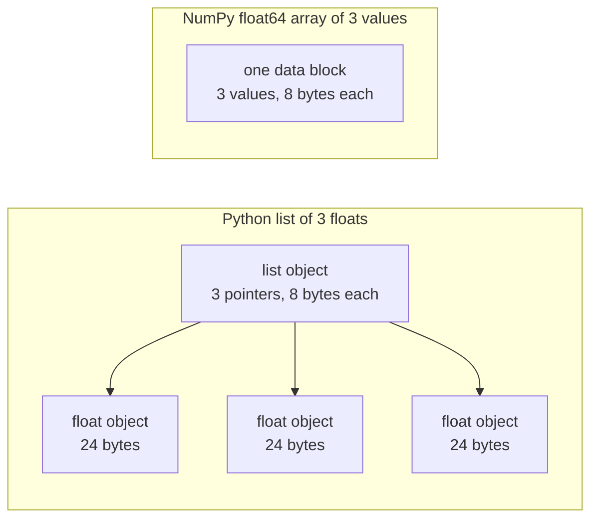

# Python cho Kỹ thuật AI

> Hầu hết các mã trong khóa học này sử dụng cùng một bộ nhỏ của ngôn ngữ Python. Hãy học tập tập tập đó ở đây, trước khi các bài học toán và mô hình phụ thuộc vào nó.

**Type:** Build
**Languages:** Python
**Prerequisites:** Dev Environment, Python Environments
**Time:** ~120 minutes

## Mục tiêu học tập

- Đọc và viết các ngôn ngữ mà hầu hết các mã khóa học sử dụng, từ giải gói và các chuỗi f đến các lớp dữ liệu và hiểu biết.
- Tìm ba lỗi Python cho kết quả sai mà không có lỗi: danh sách chia sẻ, mặc định thay đổi và máy phát điện đã sử dụng.
- Xây dựng một bộ tải CSV và JSON, một phân chia hạt giống, và một máy phát điện mini-batch chỉ có thư viện tiêu chuẩn.
- Viết sản phẩm điểm, trung bình và lệch tiêu chuẩn bằng Python tinh khiết, và đo tốc độ và sử dụng bộ nhớ của chúng.
- Giải thích tại sao một vòng lặp Python thuần khiết trên số là chậm, và làm thế nào phát sóng NumPy di chuyển vòng lặp vào mã biên soạn.

## Vấn đề

Các bài học sau giai đoạn này sử dụng Python đơn giản cho toán học và các mô hình.`dataclasses`Ngoài ra, 187 hồ sơ gọi`random.seed`hoặc tạo ra một `random.Random`Nếu những ngôn ngữ đó mới lạ với bạn, bạn đọc tổng hợp khi bạn muốn đọc toán học.

Python cũng có hành vi đưa ra kết quả sai mà không có thông báo lỗi. Hai tên có thể đề cập đến một danh sách, vì vậy một thay đổi thông qua một tên cũng thay đổi tên khác. Một lập luận mặc định giữ giá trị của nó từ một cuộc gọi đến một cuộc gọi tiếp theo. Một bộ phát điện trống sau một lần vượt qua, vì vậy một thời kỳ đào tạo thứ hai không nhận được dữ liệu và mất mát không thay đổi.

Vấn đề cuối cùng là tốc độ. trên máy tính xách tay thử nghiệm của chúng tôi, một vòng Python thuần túy trên một triệu float mất khoảng 30 millisecond. NumPy tính toán cùng một sản phẩm điểm trong chưa đầy một millisecond. Bạn cần biết lý do, để bạn có thể chọn giữa một vòng tròn rõ ràng và một hoạt động mảng.

## Khái niệm

### Điều gì mà mã khóa học sử dụng

Chúng tôi đã phân tích tất cả 541 file Python trong `phases/*/*/code/`với `ast`bảng tính các tập tin sử dụng mỗi cấu trúc ít nhất một lần. số lượng là từ ngày chúng tôi viết bài học này, và chúng thay đổi khi các bài học được thêm vào.

| Construct | Files | Share |
|-----------|-------|-------|
| Function definitions | 541 | 100% |
| `if __name__ == "__main__":` | 529 | 98% |
| f-strings | 517 | 96% |
| Tuple unpacking | 448 | 83% |
| Classes | 379 | 70% |
| List comprehensions | 375 | 69% |
| Type hints on functions | 342 | 63% |
| Generator expressions | 326 | 60% |
| Slices | 314 | 58% |
| `lambda` | 175 | 32% |
| `try` and `except` | 120 | 22% |
| `with` statements | 96 | 18% |
| Dict comprehensions | 93 | 17% |
| Generator functions with `yield` | 14 | 3% |

Các nhập khẩu cho thấy các mô-đun tiêu chuẩn quan trọng.`from __future__ import annotations`, và 276 nhập khẩu`dataclasses`- `math`- `random`, và`json`Các mô-đun xuất hiện trong các tệp 187, 175 và 126.`collections`mô-đun xuất hiện trong 70 tập tin, và `itertools`xuất hiện chỉ trong 4.

Không có cuộc gọi học `map()`hoặc `filter()`Sự hiểu biết làm việc đó.`sorted`- `min`- `max`, hoặc`.sort`với một `key=`bài học này dành nhiều thời gian nhất cho các ngôn ngữ ở đầu danh sách này.

### Tên đề cập đến các đối tượng

Trong Python, một biến là một tên gọi liên quan đến một đối tượng. Cổ phần liên kết một tên với một đối tượng. Nó không sao chép đối tượng. Khi hai tên liên quan đến một danh sách, một thay đổi thông qua một tên đều có thể nhìn thấy thông qua cả hai. Số, chuỗi và tuples không thể thay đổi, vì vậy quy tắc này không gây ra vấn đề cho họ.

### Một danh sách chứa các chỉ dẫn, một mảng chứa các số

Một danh sách Python không lưu trữ các con số trực tiếp. Nó lưu trữ các pointer, và mỗi pointer đề cập đến một đối tượng Python đầy đủ.`float`đối tượng mất 24 byte.`float64`array lưu trữ các giá trị 8 byte nguyên liệu bên cạnh nhau trong một khối bộ nhớ.



Một vòng lặp trên một danh sách làm rất nhiều công việc cho mỗi yếu tố. Người giải thích chạy một lệnh bytecode một lúc. Đối với mỗi yếu tố, nó theo một chỉ số và kiểm tra loại của mỗi operand. Sau đó nó gọi float nhân mã và làm cho một đối tượng float Python để giữ kết quả.

NumPy thực hiện toán học tương tự trong một vòng lặp của mã được biên soạn trên các giá trị thô. Nó kiểm tra kiểu dữ liệu một lần cho toàn bộ mảng, và nó không tạo ra đối tượng Python cho mỗi yếu tố. Mã vector hóa mô tả một hoạt động trên toàn bộ mảng, chẳng hạn như `(x - mean) / std`, và một thư viện chạy vòng lặp. các hàm vector trong bài học này theo quy tắc đó. mỗi người thực hiện một hoạt động array, vì vậy bạn có thể thay thế nó bằng một cuộc gọi NumPy sau đó.

### Một danh sách chứa mọi thứ, một máy phát điện chứa một

Một danh sách hiểu biết xây dựng mỗi mục trước khi dòng tiếp theo chạy. Một máy phát điện xây dựng một mục mỗi khi người gọi yêu cầu một mục tiếp theo. Khoảnh khắc cho một danh sách tăng lên với số lượng các mục. Khoảnh khắc cho một máy phát điện vẫn giống nhau cho bất kỳ số lượng các mục nào.

Một máy phát điện chỉ chạy một lần.`StopIteration`trên mỗi yêu cầu, vì vậy một giây `for`khóa trên nó không có các mục. mã đào tạo đọc bộ dữ liệu một lần mỗi thời đại, vì vậy nó phải tạo ra một máy phát điện mới cho mỗi thời đại.

Các chức năng tạo máy phát điện hiếm trong mã bài học. Các bộ tải dữ liệu mà các bài học học sâu sử dụng là lặp lại của các lô, vì vậy ý tưởng là trong mỗi vòng tròn đào tạo.

```figure
s0-list-vs-generator
```

## Những ngôn ngữ bạn cần

Mỗi khối trong phần này chạy tự động.`python3`Các khối cần Python 3.11 hoặc mới hơn, phiên bản mà chúng tôi cài đặt trong bài học môi trường phát triển.

### 1. Giá trị, thu thập và tháo bọc

Python có bốn bộ sưu tập tích hợp. Hãy học khi nào để sử dụng mỗi bộ.

| Type | Example | Ordered | Can change | Typical use in the course |
|------|---------|---------|------------|---------------------------|
| `list` | `[0.5, 1.2]` | Yes | Yes | Samples, losses, weights |
| `tuple` | `(32, 784)` | Yes | No | Shapes, fixed records, dict keys |
| `dict` | `{"lr": 0.01}` | Insertion order | Yes | Configs, vocabularies, JSON rows |
| `set` | `{"cat", "dog"}` | No | Yes | Unique tokens, overlap checks |

Khung này cho thấy rằng nhiệm vụ không sao chép danh sách.

```python
weights = [0.5, -1.2, 3.0]
alias = weights
alias[0] = 99.0
print(weights)

independent = list(weights)
independent[1] = 0.0
print(weights, independent)

grid = [[0] * 3] * 2
grid[0][0] = 1
print(grid)

grid = [[0] * 3 for _ in range(2)]
grid[0][0] = 1
print(grid)
```

```text
[99.0, -1.2, 3.0]
[99.0, -1.2, 3.0] [99.0, 0.0, 3.0]
[[1, 0, 0], [1, 0, 0]]
[[1, 0, 0], [0, 0, 0]]
```

Sự biểu hiện này`[[0] * 3] * 2`làm ra một danh sách bên ngoài với hai tham chiếu đến một danh sách bên trong. sự hiểu biết tạo ra một danh sách bên trong mới cho mỗi hàng. giai đoạn toán học xây dựng các số liệu từ danh sách, vì vậy sử dụng hình thức hiểu biết.

Unpacking gán các mục của một chuỗi cho một số tên trong một dòng. Một tên sao thu thập các mục còn lại. Một chuỗi f đặt giá trị của một biểu hiện vào một chuỗi, với định dạng tùy chọn sau một cột.

```python
shape = (32, 784)
batch_size, n_features = shape
first, *middle, last = [1, 2, 3, 4, 5]
x, y = 1.0, 3.0
x, y = y, x

config = {"lr": 0.01, "epochs": 5}
config["seed"] = 7
tokens = ["the", "cat", "sat", "on", "the", "mat"]
vocab = set(tokens)

print(batch_size, n_features, first, middle, last, x, y)
print(config.get("momentum", 0.9), "cat" in vocab, len(vocab))
print(f"lr={config['lr']:.0e} loss={0.123456:.3f} n={60_000:,} {batch_size=}")
```

```text
32 784 1 [2, 3, 4] 5 3.0 1.0
0.9 True 5
lr=1e-02 loss=0.123 n=60,000 batch_size=32
```

`dict.get`trả lại giá trị mặc định khi khóa bị thiếu.`in`thử nghiệm trên một bộ mất khoảng thời gian tương tự cho bất kỳ kích thước tập hợp nào.`{batch_size=}`hình in tên và giá trị, giúp khi bạn gỡ lỗi.

Một miếng `a[start:stop:step]`bao gồm `start`và không bao gồm`stop`Một mảnh danh sách là một danh sách mới, vì vậy một mảnh danh sách lớn sao chép tất cả các chỉ số của nó.

```python
tokens = ["<s>", "the", "cat", "sat", "on", "the", "mat", "</s>"]
print(tokens[1:-1])
print(tokens[:3], tokens[-3:])
print(tokens[::2])
print(tokens[::-1][:2])
windows = [tokens[i:i + 3] for i in range(len(tokens) - 2)]
print(len(windows), windows[0])
```

```text
['the', 'cat', 'sat', 'on', 'the', 'mat']
['<s>', 'the', 'cat'] ['the', 'mat', '</s>']
['<s>', 'cat', 'on', 'mat']
['</s>', 'mat']
6 ['<s>', 'the', 'cat']
```

### 2. Những hiểu biết

Một sự hiểu biết xây dựng một danh sách, dict, hoặc tập hợp từ một biểu thức lặp lại trong một biểu thức. Nó đọc giống như toán học mà nó mô tả.

```python
scores = [0.91, 0.42, 0.77, 0.15, 0.66]
labels = [1 if s >= 0.5 else 0 for s in scores]
high = [s for s in scores if s > 0.6]
squares = {i: i * i for i in range(4)}
lengths = {len(word) for word in ["a", "bb", "cc", "ddd"]}
sum_sq = sum(s * s for s in scores)

matrix = [[1, 2, 3], [4, 5, 6]]
transposed = [list(column) for column in zip(*matrix)]
flat = [v for row in matrix for v in row]

print(labels, high, squares, lengths, round(sum_sq, 4))
print(transposed, flat)
```

```text
[1, 0, 1, 0, 1] [0.91, 0.77, 0.66] {0: 0, 1: 1, 2: 4, 3: 9} {1, 2, 3} 2.0555
[[1, 4], [2, 5], [3, 6]] [1, 2, 3, 4, 5, 6]
```

Một cái lưng `if`Chỉ giữ một số mặt hàng.`for`có thể là một biểu hiện có điều kiện, `a if condition else b`Hai .`for`Các điều khoản chạy theo thứ tự giống như hai vòng tròn.

Các vòng đệm làm cho một biểu hiện máy phát điện.`sum(s * s for s in scores)`- `sum`đọc một hình vuông tại một thời điểm, và Python không xây dựng danh sách.`zip(*matrix)`, sao đi qua mỗi hàng như một lập luận riêng biệt, và `zip`cặp các mục ở mỗi vị trí.

### 3. Các chức năng, lập luận và kết thúc

Một giá trị mặc định làm cho một lập luận tùy chọn. Một lập luận từ khóa đặt tên tham số tại cuộc gọi.`*`tự trong danh sách các tham số làm cho các tham số tiếp theo chỉ từ khóa.

```python
def clip(value, low=0.0, high=1.0):
    return max(low, min(high, value))


def train(data, *, lr=0.01, epochs=3):
    return f"{len(data)} samples, lr={lr}, epochs={epochs}"


def make_scaler(factor):
    def scale(values):
        return [v * factor for v in values]
    return scale


print(clip(1.7), clip(-3.0, low=-1.0), clip(0.4, high=0.3))
print(train([1, 2, 3], lr=0.1))
to_percent = make_scaler(100)
print(to_percent([0.25, 0.5]))
```

```text
1.0 -1.0 0.3
3 samples, lr=0.1, epochs=3
[25.0, 50.0]
```

Với các lập luận chỉ có từ khóa, một cuộc gọi như `train(data, 0.1, 3)`tăng `TypeError`Người gọi phải viết`lr=0.1`, vì vậy hai số không thể thay đổi vị trí bằng cách ngẫu nhiên.

chức năng bên trong `scale`sử dụng `factor`từ chức năng tạo ra nó. Python giữ `factor`cho đến khi `scale`Một hàm giữ các biến từ người tạo ra nó là một đóng cửa.

A `lambda`là một hàm một biểu hiện mà không có tên. mã khóa học sử dụng nó chủ yếu như một `key=`chức năng, như phần 8 cho thấy.

Python đánh giá giá một giá trị mặc định một lần, khi nó chạy `def`mỗi cuộc gọi sử dụng mặc định nhận được cùng một đối tượng.

```python
def add_bad(item, bucket=[]):
    bucket.append(item)
    return bucket


def add_good(item, bucket=None):
    if bucket is None:
        bucket = []
    bucket.append(item)
    return bucket


add_bad("a")
print(add_bad("b"))
add_good("a")
print(add_good("b"))
```

```text
['a', 'b']
['b']
```

Sử dụng `None`như là mặc định cho một danh sách, dict, hoặc set. Tạo đối tượng mới bên trong hàm.

### 4. Các lớp và lớp dữ liệu

- `@dataclass`Nhà trang trí viết `__init__`- `__repr__`, và`__eq__`từ các trường ghi chú.`frozen=True`, đối tượng không thể thay đổi sau khi tạo, và bạn có thể sử dụng nó như một phím lệnh hoặc đặt nó trong một tập hợp.

```python
from dataclasses import dataclass, field


@dataclass(frozen=True)
class Example:
    features: tuple[float, ...]
    label: int


@dataclass
class TrainConfig:
    lr: float = 0.01
    epochs: int = 5
    hidden: list[int] = field(default_factory=lambda: [64, 32])

    def describe(self):
        return f"lr={self.lr} epochs={self.epochs} hidden={self.hidden}"


ex = Example((1.5, 2.0), 1)
print(ex)
print(ex == Example((1.5, 2.0), 1), len({ex, Example((1.5, 2.0), 1)}))
print(TrainConfig(epochs=10).describe())
try:
    ex.label = 0
except AttributeError as err:
    print(type(err).__name__)
```

```text
Example(features=(1.5, 2.0), label=1)
True 1
lr=0.01 epochs=10 hidden=[64, 32]
FrozenInstanceError
```

`field(default_factory=...)`cho mỗi trường hợp một danh sách mới. Nó giải quyết vấn đề chung mặc định từ phần 3 bên trong một lớp dữ liệu.

Các phương pháp đặc biệt kết nối một lớp với tổng hợp Python. `len(ds)`gọi`__len__`, và`ds[2]`gọi`__getitem__`- Tôi không biết.

```python
class SquaresDataset:
    def __init__(self, n):
        self.n = n

    def __len__(self):
        return self.n

    def __getitem__(self, index):
        if not 0 <= index < self.n:
            raise IndexError(index)
        return index, index * index


ds = SquaresDataset(4)
print(len(ds), ds[2])
print(list(ds))
```

```text
4 (2, 4)
[(0, 0), (1, 1), (2, 4), (3, 9)]
```

- `for`vòng bên trong `list(ds)`làm việc mà không có một `__iter__`Phương pháp. Python gọi `__getitem__`với 0, 1, 2, và như vậy cho đến khi nó được `IndexError`. Các tập hợp dữ liệu kiểu bản đồ PyTorch sử dụng hai phương pháp tương tự, `__len__`và `__getitem__`- Tôi không biết.

### 5. Máy biến đổi và máy phát điện

Một iterable là bất kỳ đối tượng nào mà một `for`vòng chấp nhận. `iter()`lấy một bộ lặp từ nó, và `next()`yêu cầu trình lặp cho một mục. Khi trình lặp không còn các mục nữa, nó tăng `StopIteration`. A `for`gọi vòng lặp `next()`cho anh và dừng lại ở `StopIteration`- Tôi không biết.

```python
numbers = [10, 20, 30]
it = iter(numbers)
print(next(it), next(it), next(it))
try:
    next(it)
except StopIteration:
    print("no more items")


def countdown(n):
    while n > 0:
        yield n
        n -= 1


gen = countdown(3)
print(type(gen).__name__)
print(list(gen))
print(list(gen))
```

```text
10 20 30
no more items
generator
[3, 2, 1]
[]
```

Một chức năng với `yield`trong cơ thể của nó là một chức năng máy phát điện. một cuộc gọi cho nó chạy không có mã của nó và trả về một đối tượng máy phát điện.`next()`chạy cơ thể sang người khác `yield`Và dừng lại ở đó.`list(gen)`là trống vì chiếc đầu tiên đã sử dụng máy phát điện.

Một máy phát điện có thể đọc một tập tin một dòng một lần.

```python
import os
import tempfile


def read_rows(path):
    with open(path, encoding="utf-8") as fh:
        header = fh.readline().rstrip("\n").split(",")
        for line in fh:
            yield dict(zip(header, line.rstrip("\n").split(",")))


with tempfile.TemporaryDirectory() as tmp:
    path = os.path.join(tmp, "rows.csv")
    with open(path, "w", encoding="utf-8") as fh:
        fh.write("x,label\n")
        fh.writelines(f"{i * 0.5},{i % 2}\n" for i in range(5))
    rows = read_rows(path)
    print(next(rows))
    print(sum(1 for _ in rows))
```

```text
{'x': '0.0', 'label': '0'}
4
```

`read_rows`giữ một dòng của tệp trong bộ nhớ tại một thời điểm.`read_rows`Nó chia thành dấu ngoặc để giữ cho ví dụ ngắn. Các tệp CSV thực có thể chứa dấu ngoặc bên trong các trường được trích dẫn, vì vậy Build It sử dụng `csv`mô-đun.

```python
import sys

as_list = [i * i for i in range(1_000_000)]
as_generator = (i * i for i in range(1_000_000))
print(sys.getsizeof(as_list), sys.getsizeof(as_generator))
print(sum(as_list) == sum(as_generator))
```

Trên 64-bit CPython, danh sách báo cáo khoảng 8 MB và bộ phát điện khoảng 200 byte. `sys.getsizeof`Chỉ tính chỉ các chỉ số trong danh sách, và các đối tượng số nguyên sử dụng nhiều bộ nhớ hơn.`tracemalloc`, mà chúng tôi đã sử dụng trong bài học debugging và tạo hồ sơ.

### 6. Quản lý ngữ cảnh và ngoại lệ

A `with`lệnh chạy mã thiết lập, sau đó là thân thể của nó, và sau đó là mã dọn dẹp.`open()`là một người quản lý ngữ cảnh đóng tập tin.

Trong bài học debugging và tạo hồ sơ, chúng tôi đã viết một `Timer`lớp với `__enter__`và `__exit__`- `contextlib.contextmanager`Bộ trang trí tạo ra cùng một loại vật từ một máy phát điện.`yield`là thiết lập, và `finally`Phòng là việc dọn dẹp.

```python
import time
from contextlib import contextmanager


@contextmanager
def timer(label):
    start = time.perf_counter()
    try:
        yield
    finally:
        print(f"{label}: {(time.perf_counter() - start) * 1000:.1f} ms")


def parse_label(text):
    try:
        return int(text)
    except ValueError:
        raise ValueError(f"label must be an integer, got {text!r}") from None


with timer("sum of squares"):
    total = sum(i * i for i in range(200_000))

print(parse_label("3"))
try:
    parse_label("cat")
except ValueError as err:
    print("rejected:", err)
```

```text
sum of squares: 9.4 ms
3
rejected: label must be an integer, got 'cat'
```

Thời gian trên máy tính của bạn sẽ khác nhau.`except`Điều khoản, chẳng hạn như `ValueError`hoặc `KeyError`- Một `except:`Điều khoản không có loại ngoại lệ cũng xử lý `KeyboardInterrupt`, vì vậy Ctrl + C không thể dừng một vòng lặp chứa nó. Tạo một ngoại lệ với một thông báo rõ ràng khi đầu vào là sai.`from None`khi tin nhắn của bạn thay thế các phát hiện gốc.

### 7. Các gợi ý, mô-đun và bảo vệ chính

Các gợi ý kiểu chữ cho người đọc biết một chức năng lấy và trả về gì. Python không kiểm tra chúng khi mã chạy. Một kiểm tra kiểu chữ, chẳng hạn như mypy, đọc chúng trước khi mã chạy.

```python
from __future__ import annotations

from collections.abc import Iterable, Sequence


def mean(values: Sequence[float]) -> float:
    if not values:
        raise ValueError("mean() needs at least one value")
    return sum(values) / len(values)


def count_tokens(docs: Iterable[str]) -> int:
    return sum(len(doc.split()) for doc in docs)


def main() -> None:
    print(mean([1.0, 2.0, 4.0]))
    print(count_tokens(["the cat sat", "on the mat"]))
    print(mean.__annotations__)


if __name__ == "__main__":
    main()
```

```text
2.3333333333333335
6
{'values': 'Sequence[float]', 'return': 'float'}
```

Với `from __future__ import annotations`, Python lưu trữ mỗi gợi ý như một chuỗi, như dòng cuối cùng cho thấy. `Sequence`nghĩa là bất kỳ đối tượng nào với `len()`và chỉ số, chẳng hạn như một danh sách hoặc một tuple. `Iterable`nghĩa là bất kỳ đối tượng nào mà a `for`nhiều tập tin khóa học nhập cùng tên từ `typing`, cũng có hiệu quả.

Mỗi người`.py`file là một module. khi bạn chạy một file với `python3 file.py`, Python đặt ra nó `__name__`đến`"__main__"`Khi một tập tin khác nhập khẩu nó,`__name__`Đó là tên của mô-đun.`main()`Chỉ trong trường hợp đầu tiên.`code/tests/`có thể nhập khẩu `main.py`mà không bắt đầu demo.

### 8. Các tập tin, JSON, CSV và sắp xếp

`pathlib.Path`kết nối con đường với `/`và có thể đọc hoặc viết toàn bộ tập tin trong một cuộc gọi.`encoding="utf-8"`, bởi vì mã hóa mặc định phụ thuộc vào hệ điều hành.

```python
import csv
import json
import tempfile
from pathlib import Path

rows = [
    {"text": "great movie", "label": 1, "score": 0.93},
    {"text": "boring plot", "label": 0, "score": 0.12},
    {"text": "fine acting", "label": 1, "score": 0.58},
]

with tempfile.TemporaryDirectory() as tmp:
    json_path = Path(tmp) / "reviews.json"
    json_path.write_text(json.dumps(rows, indent=2), encoding="utf-8")
    from_json = json.loads(json_path.read_text(encoding="utf-8"))

    csv_path = Path(tmp) / "reviews.csv"
    with csv_path.open("w", newline="", encoding="utf-8") as fh:
        writer = csv.DictWriter(fh, fieldnames=["text", "label", "score"])
        writer.writeheader()
        writer.writerows(rows)
    with csv_path.open(newline="", encoding="utf-8") as fh:
        from_csv = list(csv.DictReader(fh))

print(from_json == rows)
print(from_csv[0])

by_score = sorted(rows, key=lambda r: r["score"], reverse=True)
print([r["text"] for r in by_score])
print(max(rows, key=lambda r: r["score"])["text"])
print([r["text"] for r in sorted(rows, key=lambda r: (-r["label"], r["text"]))])
```

```text
True
{'text': 'great movie', 'label': '1', 'score': '0.93'}
['great movie', 'fine acting', 'boring plot']
great movie
['fine acting', 'great movie', 'boring plot']
```

JSON giữ số như số. CSV trả lại mỗi trường như một chuỗi, vì vậy bạn phải chuyển đổi mỗi trường.`newline=""`, như `csv`tài liệu cho thấy.

A `key=`hàm trả lại giá trị mà Python so sánh cho mỗi mục. `sorted`- `min`, và`max`tất cả chấp nhận một. một khóa tuple sort theo giá trị đầu tiên, và nó chỉ sử dụng giá trị thứ hai cho các mối liên kết. dấu trừ đặt nhãn lớn hơn trước. Python sort ổn định, do đó các mục có cùng các khóa giữ thứ tự ban đầu của họ.

### 9. Công cụ đếm, nhóm và lặp

Hai mô-đun này chứa các cấu trúc dữ liệu và công cụ lặp lại mà danh sách đơn giản và các lệnh không cung cấp cho bạn.

```python
from collections import Counter, defaultdict, deque
from itertools import chain, islice, product

labels = ["cat", "dog", "cat", "bird", "cat", "dog"]
counts = Counter(labels)
print(counts.most_common(2))

positions = defaultdict(list)
for i, label in enumerate(labels):
    positions[label].append(i)
print(dict(positions))

recent = deque(maxlen=3)
for loss in [2.0, 1.5, 1.2, 1.1, 0.9]:
    recent.append(loss)
print(list(recent), round(sum(recent) / len(recent), 3))

print(list(product([0.1, 0.01], [16, 32])))
print(list(chain([1, 2], [3], [4, 5])))
print(list(islice(range(100), 5, 10)))
```

```text
[('cat', 3), ('dog', 2)]
{'cat': [0, 2, 4], 'dog': [1, 5], 'bird': [3]}
[1.2, 1.1, 0.9] 1.067
[(0.1, 16), (0.1, 32), (0.01, 16), (0.01, 32)]
[1, 2, 3, 4, 5]
[5, 6, 7, 8, 9]
```

`Counter`đếm các mặt hàng có thể bị đánh dấu, chẳng hạn như nhãn hoặc mã thông báo. `defaultdict(list)`tạo ra một danh sách trống khi bạn sử dụng một khóa mới lần đầu tiên, vì vậy một vòng lặp nhóm không cần kiểm tra khóa. `deque(maxlen=3)`loại bỏ mục cũ nhất khi bạn thêm một thứ tư, cho thấy một cửa sổ di chuyển trên các khoản lỗ gần đây. `enumerate`cho mỗi mục với chỉ số của nó.

`product`cho mỗi kết hợp đầu vào của nó, đó là một lưới siêu tham số. `chain`kết hợp các lặp lặp từ cuối đến cuối. `islice`- Bộ máy phát điện mini-batch trong Build It sử dụng `islice`- Tôi không biết.

### 10. Tại sao vòng lặp trên số là chậm

- `dis`Module in các hướng dẫn mã byte mà người giải thích chạy cho một hàm.

```python
import dis


def dot(a, b):
    total = 0.0
    for x, y in zip(a, b):
        total += x * y
    return total


dis.dis(dot)
```

Các hướng dẫn từ `FOR_ITER`để nhảy trở lại nó chạy một lần cho mỗi yếu tố. đó là khoảng mười hướng dẫn cho mỗi nhân và thêm. tên chỉ dẫn chính xác thay đổi giữa các phiên bản Python.

Một vòng lặp trở nên nhanh hơn khi ít bước của nó chạy như bytecode.`sum`- `map`, và`zip`Build It đo hiệu ứng này bằng Python tinh khiết, và Use It di chuyển toàn bộ vòng lặp vào NumPy.

## Hãy xây dựng nó

Bây giờ hãy xây dựng những mảnh mà các bài học sau đó cần.`code/main.py`, và`code/tests/test_main.py`mỗi khối dưới đó tự chạy.

### Bước 1: Một loại bản ghi và bộ tải tập dữ liệu

Loader đọc một tập tin CSV hoặc tập tin JSON thành một hình dạng: một tuple của các tính năng nổi và một nhãn số nguyên.

```python
import csv
import json
import tempfile
from dataclasses import dataclass
from pathlib import Path


@dataclass(frozen=True)
class Record:
    features: tuple[float, ...]
    label: int


def row_to_record(row, names, label_field="label"):
    if label_field not in row:
        raise ValueError(f"row has no {label_field!r} field: {row}")
    if set(row) != {*names, label_field}:
        raise ValueError(f"row fields {list(row)} do not match {[*names, label_field]}")
    return Record(tuple(float(row[name]) for name in names), int(row[label_field]))


def load_records(path, label_field="label"):
    path = Path(path)
    if path.suffix == ".json":
        rows = json.loads(path.read_text(encoding="utf-8"))
    elif path.suffix == ".csv":
        with path.open(newline="", encoding="utf-8") as fh:
            rows = list(csv.DictReader(fh))
    else:
        raise ValueError(f"unsupported file type: {path.suffix!r}")
    if not rows:
        return []
    names = [key for key in rows[0] if key != label_field]
    return [row_to_record(row, names, label_field) for row in rows]


with tempfile.TemporaryDirectory() as tmp:
    csv_path = Path(tmp) / "data.csv"
    csv_path.write_text("x1,x2,label\n1.5,60,1\n1.8,82.5,0\n", encoding="utf-8")
    json_path = Path(tmp) / "data.json"
    json_path.write_text('[{"x1": 1.5, "x2": 60, "label": 1}]', encoding="utf-8")
    print(load_records(csv_path))
    print(load_records(json_path))
```

```text
[Record(features=(1.5, 60.0), label=1), Record(features=(1.8, 82.5), label=0)]
[Record(features=(1.5, 60.0), label=1)]
```

Dòng đầu tiên xác định tên của các tính năng và thứ tự của chúng. `DictReader`và `json.loads`giữ các khóa theo thứ tự tệp, và một dict giữ thứ tự mà các khóa được thêm vào.`row_to_record`đọc từng hàng theo tên, theo thứ tự của hàng đầu. Một nhãn bị thiếu, một tính năng bị thiếu hoặc bổ sung, hoặc một loại tệp không rõ được tăng `ValueError`với một tin nhắn, vì vậy một tập tin xấu dừng chạy ngay từ đầu. `main.py`cũng có `save_records`, viết hai định dạng tương tự.

### Bước 2: Một chuyến tàu được đậu và thử nghiệm chia

```python
import random


def train_test_split(items, test_fraction=0.2, seed=0):
    if not 0.0 < test_fraction < 1.0:
        raise ValueError(f"test_fraction must be between 0 and 1, got {test_fraction}")
    if len(items) < 2:
        raise ValueError(f"need at least 2 items to split, got {len(items)}")
    order = list(range(len(items)))
    random.Random(seed).shuffle(order)
    n_test = min(max(1, round(len(items) * test_fraction)), len(items) - 1)
    test = [items[i] for i in order[:n_test]]
    train = [items[i] for i in order[n_test:]]
    return train, test


items = list(range(10))
print(train_test_split(items, seed=1))
print(train_test_split(items, seed=1) == train_test_split(items, seed=1))
print(train_test_split(items, seed=2)[1])
print(items)
```

```text
([9, 7, 5, 3, 0, 4, 1, 2], [6, 8])
True
[5, 9]
[0, 1, 2, 3, 4, 5, 6, 7, 8, 9]
```

`random.Random(seed)`tạo ra một máy phát điện số ngẫu nhiên riêng. `random.seed(seed)`Set lại một bộ phát điện toàn cầu mà tất cả các mô-đun chia sẻ, để một cuộc gọi trong thư viện khác có thể thay đổi chuỗi của bạn. Trong khóa học, 100 tập tin bài học gọi `random.seed`và 96 tạo ra `random.Random`Sử dụng máy phát điện riêng trong mã mới.

Chức năng này trộn một danh sách các chỉ số, vì vậy danh sách nhập vẫn không thay đổi. giống nhau luôn cho ra cùng một phân chia. Mỗi bên giữ ít nhất một mục, vì vậy một danh sách với ít hơn 2 mục tăng lên `ValueError`. chia dữ liệu trước khi bất kỳ bước nào học hỏi từ nó, chẳng hạn như chuẩn hóa. Trong bài học debugging và lập hồ sơ, chúng tôi thấy rằng sự chồng chéo giữa dữ liệu tàu và thử nghiệm mang lại điểm kiểm tra quá cao.

### Bước 3: Một máy phát điện mini-batch

```python
from itertools import islice


def batches(items, batch_size, drop_last=False):
    if batch_size < 1:
        raise ValueError(f"batch_size must be at least 1, got {batch_size}")
    return _batch_iter(iter(items), batch_size, drop_last)


def _batch_iter(iterator, batch_size, drop_last):
    while True:
        batch = list(islice(iterator, batch_size))
        if not batch or (drop_last and len(batch) < batch_size):
            return
        yield batch


print(list(batches(range(10), 4)))
print(list(batches(range(10), 4, drop_last=True)))
squares = (i * i for i in range(7))
print([len(b) for b in batches(squares, 3)])

for epoch in range(2):
    sizes = [len(b) for b in batches(range(10), 4)]
    print(f"epoch {epoch}: {sizes}")
```

```text
[[0, 1, 2, 3], [4, 5, 6, 7], [8, 9]]
[[0, 1, 2, 3], [4, 5, 6, 7]]
[3, 3, 1]
epoch 0: [4, 4, 2]
epoch 1: [4, 4, 2]
```

`islice`mất đến `batch_size`các mục từ trình lặp. `batches`chỉ cần `iter()`, vì vậy nó chấp nhận danh sách, tập tin và các bộ phát điện khác.`drop_last=True`loại bỏ lô, cho một mô hình cần hình dạng lô cố định.

Công việc được thực hiện trong hai hàm vì một hàm máy phát điện không chạy mã cho đến khi đầu tiên `next()`Với tờ kiểm tra bên trong máy phát điện,`batches(data, 0)`sẽ trở lại mà không có lỗi. lỗi sẽ xảy ra sau đó, từ bên trong vòng lặp đào tạo. hàm bên ngoài là một hàm bình thường, vì vậy nó kiểm tra lập luận ngay lập tức. vòng lặp thời gian gọi `batches()`một lần nữa cho mỗi thời đại, bởi vì một máy phát điện chỉ đưa ra các mục của nó một lần.

### Bước 4: toán học vector và một tiêu chuẩn hóa

```python
import math


def dot(a, b):
    return sum(x * y for x, y in zip(a, b, strict=True))


def mean(values):
    if not values:
        raise ValueError("mean() needs at least one value")
    return sum(values) / len(values)


def std(values):
    mu = mean(values)
    return math.sqrt(sum((v - mu) ** 2 for v in values) / len(values))


def make_standardizer(rows):
    columns = list(zip(*rows))
    means = [mean(c) for c in columns]
    scales = [s if s > 0 else 1.0 for s in (std(c) for c in columns)]

    def standardize(row):
        return [(v - m) / s for v, m, s in zip(row, means, scales, strict=True)]

    return standardize


print(dot([1.0, 2.0, 3.0], [4.0, 5.0, 6.0]))
values = [2.0, 4.0, 4.0, 4.0, 5.0, 5.0, 7.0, 9.0]
print(mean(values), std(values))

train_rows = [(1.0, 100.0), (2.0, 300.0), (3.0, 500.0)]
standardize = make_standardizer(train_rows)
print([[round(v, 3) for v in standardize(r)] for r in train_rows])
print([round(v, 3) for v in standardize((4.0, 700.0))])
```

```text
32.0
5.0 2.0
[[-1.225, -1.225], [0.0, 0.0], [1.225, 1.225]]
[2.449, 2.449]
```

Với `strict=True`- `zip`tăng `ValueError`Khi hai vector có chiều dài khác nhau.`zip`dừng lại ở cuối đầu vào ngắn hơn và trả lời sai mà không có lỗi.`strict`lập luận cần Python 3.10 hoặc mới hơn.

`std`chia bằng `n`, vì vậy nó cho phép sự lệch tiêu chuẩn của dân số, như `statistics.pstdev`Đúng vậy. Chia bằng `n - 1`khi bạn ước tính sự lan rộng của một dân số lớn hơn từ một mẫu.

`make_standardizer`là một kết thúc. Nó tính toán các phương tiện và lệch tiêu chuẩn từ các hàng đào tạo một lần, và`standardize`bạn áp dụng cùng một hàm cho các hàng thử nghiệm, vì vậy dữ liệu thử nghiệm không ảnh hưởng đến thống kê. Một cột liên tục có một lệch tiêu chuẩn 0, vì vậy tiêu chuẩn hóa sử dụng thang đo 1 cho nó.

### Bước 5: Đi chạy hoàn chỉnh

`code/main.py`kết nối các mảnh. Nó tạo ra 400 bản ghi từ hai cluster, lưu chúng dưới dạng CSV và JSON, và tải lại cả hai tập tin. Sau đó nó chia các bản ghi, gắn tiêu chuẩn trên chia tập, và tính toán các lớp trung tâm từ các lô 48.

Một phân loại trung tâm gần nhất lưu trữ đường dẫn tính chất trung bình của mỗi lớp. Nó dự đoán lớp có trung bình gần nhất với đầu vào. `fit_centroids`cộng các hàng một loạt tại một thời điểm, vì vậy nó không bao giờ cần bộ nhớ tập luyện đầy đủ. `predict`sử dụng `min()`với một `key=`chức năng để tìm ra trung tâm gần nhất.

```bash
python3 phases/00-setup-and-tooling/13-python-for-ai-engineering/code/main.py
```

```text
Python for AI engineering: a standard-library toolkit
data     400 records, CSV and JSON load back unchanged: True
split    320 train, 80 test, records in both: 0
batches  size 48: [48, 48, 48, 48, 48, 48, 32]
scale    train feature means after standardizing: [0.0, 0.0]
model    nearest-centroid test accuracy: raw 0.86, standardized 0.89
speed    dot product of 200,000 floats, best of 5:
           index loop         6.60 ms
           zip generator      5.93 ms
           map + mul          2.89 ms
memory   peak bytes to sum 100,000 squares:
           list              4,000,616
           generator               472
```

Hai tính năng này có quy mô rất khác nhau. tính năng thứ hai có sự lan rộng gấp mười lần lần của tính năng đầu tiên, vì vậy nó kiểm soát khoảng cách nguyên thô, và độ chính xác nguyên thô thấp hơn.

### Bước 6: đo tốc độ và bộ nhớ

```python
import operator
import random
import time
import tracemalloc


def dot_index_loop(a, b):
    total = 0.0
    for i in range(len(a)):
        total += a[i] * b[i]
    return total


def dot_zip(a, b):
    return sum(x * y for x, y in zip(a, b, strict=True))


def dot_map(a, b):
    return sum(map(operator.mul, a, b))


def best_time(fn, *args, repeat=5):
    times = []
    for _ in range(repeat):
        start = time.perf_counter()
        fn(*args)
        times.append(time.perf_counter() - start)
    return min(times)


def peak_bytes(fn):
    tracemalloc.start()
    try:
        fn()
        return tracemalloc.get_traced_memory()[1]
    finally:
        tracemalloc.stop()


rng = random.Random(0)
a = [rng.random() for _ in range(1_000_000)]
b = [rng.random() for _ in range(1_000_000)]
for fn in (dot_index_loop, dot_zip, dot_map):
    print(f"{fn.__name__:15} {best_time(fn, a, b) * 1000:7.2f} ms")

print(peak_bytes(lambda: sum([i * i for i in range(100_000)])))
print(peak_bytes(lambda: sum(i * i for i in range(100_000))))
```

`best_time`Các chương trình khác trên máy chỉ có thể thêm thời gian, vì vậy tối thiểu là gần nhất với chi phí thực tế.`timeit`mô-đun đưa ra những lời khuyên tương tự.

Trên máy tính xách tay thử nghiệm của chúng tôi với Python 3.11, vòng tròn chỉ số mất khoảng 33 ms. Phiên bản zip mất khoảng 30 ms, và `map`3 người đều làm toán học tương tự.`map`phiên bản nhanh hơn vì `map`và `operator.mul`Các số bộ nhớ lặp lại con số này: khoảng 4 MB cho danh sách và ít hơn 1 KB cho máy phát.

## Sử dụng nó

### Các phiên bản thư viện tiêu chuẩn

Thư viện tiêu chuẩn có phiên bản thử nghiệm của hầu hết các mảnh mà bạn đã xây dựng.

| You built | Standard library | Note |
|-----------|------------------|------|
| `mean`, `std` | `statistics.fmean`, `statistics.pstdev` | The tests compare against these |
| `dot` | `math.sumprod` | Python 3.12 or newer |
| `batches` | `itertools.batched` | Python 3.12 or newer, gives tuples |
| `best_time` | `timeit.repeat` | Also turns off garbage collection during the runs |
| `peak_bytes` | `tracemalloc` | The same module, with snapshots and per-line statistics |

```python
import statistics
import sys

values = [2.0, 4.0, 4.0, 4.0, 5.0, 5.0, 7.0, 9.0]
print(statistics.fmean(values), statistics.pstdev(values))

if sys.version_info >= (3, 12):
    import math
    from itertools import batched

    print(math.sumprod([1.0, 2.0, 3.0], [4.0, 5.0, 6.0]))
    print(list(batched(range(10), 4)))
```

```text
5.0 2.0
32.0
[(0, 1, 2, 3), (4, 5, 6, 7), (8, 9)]
```

Khóa học hỗ trợ Python 3.11, vì vậy `main.py`sử dụng của riêng mình `dot`và `batches`Trong Python 3.11, khối chỉ in dòng đầu tiên.

### Giống như toán học với các mảng được biên soạn

Thiết lập NumPy trong môi trường ảo từ bài học môi trường Python, ví dụ như với `uv pip install numpy`- Các bài học và bài kiểm tra không cần nó.

```python
import time

import numpy as np

n = 1_000_000
rng = np.random.default_rng(0)
a = rng.random(n)
b = rng.random(n)
a_list, b_list = a.tolist(), b.tolist()

start = time.perf_counter()
slow = sum(x * y for x, y in zip(a_list, b_list))
python_ms = (time.perf_counter() - start) * 1000

start = time.perf_counter()
fast = float(a @ b)
numpy_ms = (time.perf_counter() - start) * 1000

print(f"pure Python {python_ms:8.2f} ms")
print(f"NumPy       {numpy_ms:8.2f} ms")
print(f"difference  {abs(slow - fast):.1e}")
print(a.dtype, a.itemsize, a.nbytes)
```

Trên máy tính xách tay thử nghiệm của chúng tôi, NumPy mất ít hơn 1 ms, và phiên bản Python thuần túy mất khoảng 30 ms. Hai kết quả khác nhau trong các chữ số cuối cùng, bởi vì hai phiên bản thêm các sản phẩm theo một thứ tự khác nhau.

NumPy nhanh hơn vì ba lý do:

- Bộ sưu tập lưu trữ nguyên liệu`float64`một danh sách floats cần một chỉ số 8 byte và một đối tượng float 24 byte cho mỗi giá trị.
- Loop chạy trong mã biên soạn. NumPy kiểm tra kiểu dữ liệu một lần cho toàn bộ mảng và không tạo ra đối tượng Python cho mỗi yếu tố.
- Các giá trị nằm cạnh nhau trong bộ nhớ cho phép NumPy sử dụng các hướng dẫn SIMD, xử lý nhiều giá trị với một hướng dẫn.

Đối với các mảng rất nhỏ, chi phí cố định của một cuộc gọi NumPy có thể lớn hơn một vòng lặp Python ngắn.

### Truyền thông

Truyền hình cho phép NumPy kết hợp các mảng hình dạng khác nhau mà không có vòng lặp trong mã của bạn.`make_standardizer`từ bước 4.

```python
import numpy as np

X = np.array([[1.0, 100.0], [2.0, 300.0], [3.0, 500.0]])
mu = X.mean(axis=0)
sigma = X.std(axis=0)
Z = (X - mu) / sigma
print(X.shape, mu.shape, Z.shape)
print(Z.round(3))

norms = np.sqrt((X ** 2).sum(axis=1, keepdims=True))
print(norms.shape, (X / norms).shape)
```

```text
(3, 2) (2,) (3, 2)
[[-1.225 -1.225]
 [ 0.     0.   ]
 [ 1.225  1.225]]
(3, 1) (3, 2)
```

NumPy so sánh hai hình dạng từ chiều cuối cùng trở lại chiều đầu tiên. Hai chiều tương thích khi chúng bằng hoặc khi một trong số đó là 1.

| Shape of `X` | Shape of the other array | Result |
|--------------|--------------------------|--------|
| `(3, 2)` | `(2,)`, column means | `(3, 2)` |
| `(3, 2)` | `(3, 1)`, row norms with `keepdims=True` | `(3, 2)` |
| `(3, 2)` | `(3,)`, row norms without `keepdims` | `ValueError` |

Dòng cuối là một lỗi phổ biến. NumPy so sánh trailing 2 với 3, và không một trong hai là 1. Keep `keepdims=True`khi bạn giảm trên hàng và sau đó kết hợp kết quả với mảng ban đầu.

## Chuyển nó

Bài học này sẽ mang lại kết quả `outputs/prompt-python-review.md`Nó là một yêu cầu xem xét mã Python trong AI và các dự án dữ liệu. Cho nó một tệp hoặc một sự khác biệt. Nó kiểm tra mã cho các ngôn ngữ và các lỗi im từ bài học này:

- Các tham chiếu chung và các lập luận mặc định thay đổi
- Máy phát điện mà một kỷ nguyên thứ hai đọc sau khi chúng đã sử dụng
- Số ngẫu nhiên mà không có hạt giống, hoặc chỉ có hạt giống toàn cầu
- Thống kê từ phân chia thử nghiệm
- Pure-Python vòng trên các mảng số lớn

Nó báo cáo mỗi phát hiện với một vị trí, vấn đề, và một sửa chữa.

## Các bài tập

1. Đi chạy`run_demo(seed=8)`từ `main.py`Tìm các đường dẫn xuất thay đổi và các đường dẫn vẫn giữ nguyên. Giải thích tại sao các kích thước chia vẫn giữ nguyên.
2. Hãy viết`median(values)`bằng Python tinh khiết.`statistics.median`trên các danh sách dài lẻ và dài bằng nhau.
3. Hãy viết`stream_records(path)`, một máy phát điện tạo ra một `Record`tạo ra một tập tin 200.000 hàng so sánh bộ nhớ đỉnh của`stream_records`và `load_records`với `tracemalloc`- Tôi không biết.
4. Hãy viết`matvec(matrix, vector)`trong Python tinh khiết và trong NumPy.`best_time`cho kích thước 4, 64, và 1024. Tìm kích thước mà NumPy trở nên nhanh hơn trên máy của bạn.
5. Viết quét cấu trúc từ Concept.`ast.parse`và `ast.walk`trên mỗi tập tin trong `phases/*/*/code/*.py`- Đếm các tệp chứa`ast.ListComp`- `ast.Yield`, và`ast.With`, và so sánh số lượng của bạn với bảng.

## Các điều khoản chính

| Term | What people say | What it means |
|------|----------------|----------------------|
| Iterable | "Something you can loop over" | An object that `iter()` accepts, such as a list, a file, or a generator |
| Iterator | "A cursor" | An object whose `__next__` method returns one item per call and raises `StopIteration` at the end |
| Generator | "A lazy list" | An iterator from a `yield` function or a generator expression. It makes each item on request and runs only once. |
| Comprehension | "A one-line loop" | An expression that builds a list, dict, or set from an iterable, with an optional filter |
| Closure | "A function inside a function" | A function that keeps variables from the function that created it |
| Dataclass | "A struct" | A class whose `__init__`, `__repr__`, and `__eq__` methods Python writes from the annotated fields |
| Context manager | "A with block" | An object that runs setup code at the start of a `with` block and cleanup code at the end, even after an exception |
| Seed | "The random number" | The start value of a pseudo-random generator. The same seed gives the same sequence. |
| Vectorized code | "Fast code" | Code that applies one operation to a whole array, so that compiled code runs the loop |
| Broadcasting | "Automatic shape matching" | The NumPy rules that combine arrays of different shapes by using size-1 dimensions again, with no copy |

## Đọc thêm

- [The Python Tutorial: Data Structures](https://docs.python.org/3/tutorial/datastructures.html): danh sách, tuples, tập hợp, dicts, và hiểu biết.
- [The Python Tutorial: Classes](https://docs.python.org/3/tutorial/classes.html): phạm vi, lớp, lặp và máy phát.
- [dataclasses](https://docs.python.org/3/library/dataclasses.html): mọi tùy chọn của nhà trang trí, bao gồm `frozen`và `field`- Tôi không biết.
- [collections](https://docs.python.org/3/library/collections.html)`Counter`- `defaultdict`- `deque`, và các loại thùng chứa khác.
- [itertools](https://docs.python.org/3/library/itertools.html)`islice`- `chain`- `product`- `batched`, và các công thức kết hợp chúng.
- [Sorting Techniques](https://docs.python.org/3/howto/sorting.html): các chức năng chính, các loại ổn định và các loại trên một số phím.
- [timeit](https://docs.python.org/3/library/timeit.html): cách đo các đoạn mã nhỏ và lý do tại sao phải báo cáo tối thiểu.
- [random](https://docs.python.org/3/library/random.html): máy phát điện toàn cầu,`random.Random`các trường hợp và khả năng tái tạo.
- [PEP 255: Simple Generators](https://peps.python.org/pep-0255/): đề xuất bổ sung `yield`, với lý do thiết kế của nó.
- [NumPy: Broadcasting](https://numpy.org/doc/stable/user/basics.broadcasting.html): các quy tắc hình dạng đầy đủ, với các sơ đồ.
- [Harris et al., Array programming with NumPy, Nature 585, 2020](https://doi.org/10.1038/s41586-020-2649-2): thiết kế của hệ thống NumPy và lý do cho tốc độ của nó.
