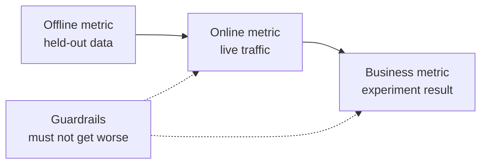

# Thiết kế hệ thống ML  Từ vấn đề đến mô hình được triển khai

> Một mô hình là một phần của một hệ thống. Thiết kế quyết định mô hình dự đoán gì, ai hành động theo nó, chi phí, và điều gì xảy ra khi nó thất bại.

**Type:** Build
**Languages:** Python
**Prerequisites:** Phase 2, Lessons 09 (Model Evaluation) and 13 (ML Pipelines)
**Time:** ~110 minutes

## Mục tiêu học tập

- Xây dựng một vấn đề kinh doanh như một nhiệm vụ ML với một dự đoán, một quyết định sử dụng nó, và một lý do tại sao các quy tắc không đủ
- Chia tách các métrics offline, online, kinh doanh và guardrail, và so sánh từng mô hình với các đường cơ sở tầm thường và heuristic
- Đếm chi phí hàng ngày, độ trễ và thời gian trễ của lô hàng và suy luận trực tuyến từ số lượng giao thông
- Chọn mô hình triển khai (thống bóng, canary, thử nghiệm A / B) và mặc định an toàn cho mỗi chế độ thất bại
- Xác định các vòng phản hồi mà trong đó mô hình thay đổi dữ liệu đào tạo phiên bản tiếp theo của nó
- Viết một tài liệu thiết kế ML và đánh giá nó so với một danh sách kiểm tra cố định

## Vấn đề

Một công ty đăng ký yêu cầu "một mô hình churn". Một nhà khoa học dữ liệu đào tạo một phân loại tăng gradient và báo cáo AUC 0,91. Ba tháng sau, không ai sử dụng nó.

Những lý do này không liên quan đến thuật toán. Không ai quyết định được một số điểm bắt đầu hành động nào. Số điểm đến một lần một tuần, nhưng nhóm giữ lại gọi cho khách hàng hàng mỗi ngày. nhãn xuất phát từ một bảng hủy bỏ cũng lưu trữ lý do hủy bỏ, vì vậy một tính năng chứa câu trả lời. Không ai so sánh mô hình với quy tắc mà nhóm hỗ trợ đã sử dụng: gọi bất cứ ai làm việc lơ lửng trong hai tuần.

Mỗi lỗi này xảy ra trước khi bắt đầu đào tạo. Chúng là lỗi thiết kế, và một tài liệu thiết kế một trang hỏi về mỗi lỗi. Bài học này dạy cho bạn những quyết định trong tài liệu đó. Bạn xây dựng một bộ công cụ giá hàng loạt và dịch vụ trực tuyến, so sánh một mô hình với đường cơ sở của nó, và đánh giá một tài liệu thiết kế so với danh sách kiểm tra.

## Khái niệm

### Từ mục tiêu kinh doanh đến nhiệm vụ ML

Một mục tiêu kinh doanh không phải là một nhiệm vụ ML. Bạn biến nó thành một với bốn câu hỏi:

1. Mô hình dự đoán chính xác gì, và đối với thực thể nào (người dùng, thanh toán, cửa hàng, mục)?
2. Quyết định nào được sử dụng trong lời tiên tri, và ai hay gì đưa ra quyết định đó?
3. Khi nào dự đoán là cần thiết, và dữ liệu nào tồn tại tại tại thời điểm đó?
4. Làm sao anh biết quyết định đã tốt hơn?

| Business goal | Prediction | Decision that uses it | ML task |
|---|---|---|---|
| Reduce churn | Probability that a user cancels in the next 30 days | Send a save offer to the top 5 percent each night | Binary classification |
| Cut fraud losses | Probability that a payment is fraud | Approve, review, or block within 100 ms | Binary classification |
| Keep shelves stocked | Units sold per store per day next week | Order quantity for each store | Forecasting |
| Show relevant items | Relevance score for a (user, item) pair | Order of items in the feed | Ranking |

Cột thứ hai cần sự chăm sóc nhất. "Tự đoán churn" để lại chân trời, thực thể, và hành động mở. "Tự đoán liệu người dùng này hủy trong 30 ngày tới, để công việc tối nay có thể chọn ai nhận được một đề nghị" sửa chữa cả ba.

### Khi nào không nên sử dụng ML

Quy tắc # 1 trong Quy tắc học máy của Google nói rằng bạn không nên sợ để khởi động một sản phẩm mà không cần học máy. Học máy cần dữ liệu, và một sự hiểu biết đơn giản thường giúp bạn đi một phần của con đường.

- Một quy tắc ngắn đạt được mục tiêu và vẫn đúng.
- Bạn không có nhãn và không có cách thực tế để thu thập chúng.
- Không ai hành động theo dự đoán, vì vậy dự đoán tốt hơn không thay đổi gì cả.
- Dữ liệu hiện có tại thời điểm dự đoán không chứa tín hiệu.
- Một lỗi là không thể chấp nhận và không ai có thể kiểm tra đầu ra.
- Xây dựng và vận hành hệ thống tốn kém hơn những quyết định tốt hơn.

Khi một quy tắc trở nên dài và yếu, ML bắt đầu trả giá. quy tắc #3 của cùng một hướng dẫn thích ML hơn một mô hình heuristic phức tạp, bởi vì một mô hình được học dễ dàng cập nhật và duy trì hơn.

### Ba lớp métrics

Bạn đo một hệ thống ML ở ba lớp, cộng với một tập hợp giới hạn:

| Layer | When you can measure it | Churn example |
|---|---|---|
| Offline metric | Before launch, on held-out past data | F1 at the offer threshold, precision in the top 5 percent |
| Online metric | During launch, on live traffic | Offer acceptance rate, share of users scored, score distribution |
| Business metric | Weeks after launch, with an experiment | 30-day churn rate in the treated group versus a holdout group |
| Guardrail metric | All the time | Offer cost per saved user, unsubscribe rate, p99 latency |



Các lớp thường không đồng ý. Một số liệu offline ghi điểm dữ liệu trước, và quá khứ không chứa mô hình của bạn. Một số liệu trực tuyến phụ thuộc vào cách mọi người phản ứng với quyết định. Một số liệu kinh doanh di chuyển chậm và mang theo tiếng ồn từ mọi thứ khác trong công ty.

Chọn số liệu không liên quan đến quyết định. Nếu công việc liên lạc với 5% người dùng hàng đầu, hãy đo độ chính xác trong 5% hàng đầu. AUC trung bình trên mọi ngưỡng, bao gồm cả ngưỡng mà bạn không bao giờ sử dụng. Quy tắc #2 của cùng hướng dẫn nói rằng thiết kế và thực hiện số liệu trước khi bạn quyết định hệ thống ML sẽ làm gì.

### Đường cơ sở

Một giá trị métric không có nghĩa là gì một mình. Một F1 0,56 là tốt nếu lựa chọn tốt nhất đạt 0,30 và kém nếu một quy tắc đạt 0,60. So sánh mọi mô hình với ba loại đường cơ sở:

- **Trivial baseline.**Luôn dự đoán lớp học đa số, hoặc luôn dự đoán trung bình đào tạo.
- **Heuristic baseline.**Một quy tắc từ kiến thức lĩnh vực, hoặc một ngưỡng tính năng mà bạn phù hợp với dữ liệu đào tạo.
- **Current system.**Bất cứ ai đưa ra quyết định ngày nay, ngay cả khi đó là một người có bảng tính.

Lượng nâng là điểm số của mô hình trừ điểm điểm điểm điểm điểm mạnh nhất. Đặt điểm nâng tối thiểu trước khi bạn xem kết quả, và làm cho nó đủ lớn để trả tiền cho hệ thống bổ sung. Điểm điểm điểm điểm thường yếu. Điểm điểm điểm điểm điểm điểm là khó khăn nhất để đánh bại.

### Yêu cầu về dữ liệu và nhãn

Hãy trả lời những câu hỏi sau đây trước khi tập luyện:

- **Label source.**Bảng hay sự kiện nào xác định nhãn hiệu, và nó thuộc về ai?
- **Label delay.**Những khoản tiền trộm lại có thể đến vài tuần sau khi thanh toán.
- **Label quality.**Ai gán nhãn hiệu, và nó thường sai bao nhiêu lần?
- **Availability at prediction time.**Có phải mọi tính năng tồn tại tại tại thời điểm dự đoán? Một tính năng mà hệ thống viết sau khi kết quả rò rỉ nhãn vào đào tạo.
- **Volume per class.**Có bao nhiêu ví dụ tích cực tồn tại? 200 ví dụ tích cực giới hạn bạn với các mô hình đơn giản.
- **Time split.**Chúng tôi chia dữ liệu theo thời gian trong bài học chuỗi thời gian vì cùng một lý do.

### Tiền ngân sách về độ trễ, thông qua và chi phí

Ba số kết nối mỗi thiết kế phục vụ:

- **Latency budget.**Thời gian trễ p99 là thời gian mà 99 trong 100 yêu cầu vẫn ở dưới. Một kiểm tra thanh toán có thể cần 50 ms. Một báo cáo hàng đêm có thể mất nhiều giờ.
- **Peak throughput.**Hãy đo hệ thống cho phút bận rộn nhất, chứ không phải là trung bình hàng ngày.
- **Cost budget.**Hãy thể hiện nó bằng đô la mỗi ngày hoặc đô la mỗi 1000 dự đoán, để bạn có thể so sánh các thiết kế.

Luật Little kết nối hai thứ đầu tiên. Số lượng yêu cầu đang tiến hành bằng với thời gian trôi qua. Với 400 yêu cầu mỗi giây và 50 ms mỗi, 20 yêu cầu đang tiến hành bất cứ lúc nào.

### Kết luận hàng loạt so với kết luận trực tuyến

Có hai cách cơ bản để phục vụ dự đoán:

- **Batch inference.**Một công việc được lên lịch đánh giá từng thực thể và ghi điểm vào một bảng hoặc kho lưu trữ giá trị khóa. Ứng dụng đọc điểm lưu trữ tại thời điểm yêu cầu.
- **Online inference.**Ứng dụng gửi các tính năng đến một dịch vụ mô hình tại thời điểm yêu cầu và chờ điểm số.

| Property | Batch | Online |
|---|---|---|
| Freshness | As old as the last run, plus the run time | Uses the data of the request |
| Request latency | One key-value read, a few ms | Feature fetch plus model time |
| Cost driver | Number of entities times runs per day | Replicas sized for peak QPS |
| New entities | No score until the next run | Scored on the first request |
| When it breaks | Old scores stay readable | Requests fail or time out |

Các công cụ trong bài học này giá cả cả cả hai. Chi phí hàng loạt tăng lên với số lượng các thực thể và với số lượng chạy mỗi ngày. giới hạn trì hoãn ngắn hơn có nghĩa là nhiều chạy hơn. Chi phí trực tuyến tăng lên với lưu lượng truy cập cao nhất, bởi vì bạn trả tiền cho các bản sao trống giữa các đỉnh. Một công việc hàng loạt mất một giờ không thể đáp ứng giới hạn trì hoãn dưới một giờ với bất kỳ giá nào.

Một thiết kế lai là phổ biến. Một công việc hàng loạt hàng đêm đánh giá người dùng quen thuộc, và một con đường trực tuyến đánh giá người dùng mới và yêu cầu cần dữ liệu mới.

### Các mô hình triển khai

Một mô hình mới tiếp cận người dùng theo các giai đoạn:

1. **Shadow.**Mô hình mới nhận được một bản sao lưu lượng truy cập trực tiếp. Hệ thống ghi lại dự đoán của mình và không bao giờ sử dụng chúng. Bạn so sánh độ trễ, tỷ lệ lỗi và phân phối dự đoán với mô hình hiện tại.
2. **Canary.**Mô hình mới đưa ra quyết định thực sự cho một tỷ lệ nhỏ giao thông, thường là 1 đến 5 phần trăm. Bạn mở rộng tỷ lệ này bằng các bước và quay lại khi một rào bảo vệ bị vỡ.
3. **A/B test.**Một nhóm người dùng ngẫu nhiên nhìn thấy từng mô hình. Bạn đo lường métrics kinh doanh bằng một bài kiểm tra thống kê, và bạn cần đủ lưu lượng truy cập và đủ thời gian để thấy sự khác biệt.

Mỗi giai đoạn cần một sự xoay ngược mất vài phút. Giữ phiên bản mô hình cũ được triển khai và chuyển giao thông theo cấu hình.[shadow and canary lesson](../../../17-infrastructure-and-production/20-shadow-canary-progressive/docs/en.md)và [A/B testing lesson](../../../17-infrastructure-and-production/21-ab-testing-llm-features/docs/en.md)- Tôi không biết.

### Các vòng phản hồi

Một vòng lặp phản hồi tồn tại khi các quyết định của mô hình thay đổi dữ liệu đào tạo phiên bản tiếp theo của nó. Sculley et al. liệt kê các vòng lặp phản hồi trực tiếp và ẩn trong số các nguồn chính của nợ kỹ thuật trong hệ thống ML. Ba trường hợp phổ biến:

- **Interventions hide the label.**Một mô hình churn gửi các đề nghị, và các đề nghị giữ một số người dùng. Tháng tới, người dùng có nguy cơ cao trông trung thành, và mô hình được đào tạo lại học được rằng các tính năng của họ không dự đoán churn.
- **Blocked actions have no outcome.**Một mô hình gian lận chặn một khoản thanh toán, vì vậy khoản thanh toán không bao giờ nhận được nhãn trả lại.
- **Exposure limits feedback.**Một mô hình xếp hạng cho thấy các mục hàng đầu của nó, vì vậy chỉ những mục đó thu thập các nhấp chuột.

Các sửa chữa chia sẻ một ý tưởng: giữ một số dữ liệu mà mô hình không ảnh hưởng. Giữ một nhóm ngẫu nhiên nhỏ mà không bao giờ nhận được sự can thiệp. Cho một phần nhỏ của lưu lượng truy cập một quyết định ngẫu nhiên. ghi điểm và quyết định với mỗi ví dụ, để sau đó đào tạo có thể phân biệt dữ liệu bị ảnh hưởng từ dữ liệu sạch.

### Các chế độ thất bại và các mặc định an toàn

Mỗi phần của hệ thống thất bại sớm hay muộn.

| Failure | Result without a plan | Safe default |
|---|---|---|
| Model service times out | The request fails | Use the heuristic baseline |
| Nightly batch job fails | Scores go missing or get old | Serve the last good scores for a fixed time, then the rule |
| Feature is missing or out of range | The model scores bad input | Use the documented default value and log the event |
| New entity with no history | No score exists | Use the rule or the population average |
| Score distribution moves suddenly | Wrong decisions at scale | Pause automatic actions and alert a person |

Hình cơ sở heuristic từ phần metric của bạn cũng là mặc định cho hầu hết các thất bại, vì vậy hãy xây dựng nó trước.

### Tài liệu thiết kế

Tài liệu thiết kế ghi lại mọi quyết định trên ở một nơi, trước khi bắt đầu đào tạo.

| Section | Question it answers | Blocking |
|---|---|---|
| Problem | What is predicted, which decision uses it, and why rules are not enough? | The decision |
| Metrics | Which offline, online, business, and guardrail metrics apply? | The business metric |
| Baselines | Which trivial, heuristic, and current-system baselines apply? | A heuristic or current baseline |
| Data | Where do labels come from, how late, and does each feature exist at prediction time? | No leakage |
| Budgets and serving | Which latency, peak QPS, cost, and staleness limits apply, and which serving mode fits them? | No |
| Rollout | Which shadow, canary, and A/B stages apply, and how do you roll back? | Shadow or canary, plus rollback |
| Feedback loops | How can the model change its own future data, and what keeps clean data? | No |
| Failure modes | What is the default action for each failure? | A default for every failure |
| Monitoring | What do you watch after launch? | No |

```figure
mlprod-serving-cost
```

## Hãy xây dựng nó

Mã trong `code/main.py`sử dụng chỉ thư viện tiêu chuẩn. Nó có ba công cụ: mô hình chi phí phục vụ, so sánh đường cơ sở và kiểm tra tài liệu thiết kế.

### Bước 1: Mô tả khối lượng công việc và giá cả

Một khối lượng công việc chứa số lượng giao thông và ngân sách. Một mô hình chi phí chứa giá cả. Giá cả là số vòng cho việc thực hiện, không phải giá cả nhà cung cấp.

```python
@dataclass(frozen=True)
class Workload:
    name: str
    entities: int
    requests_per_day: int
    peak_qps: float
    max_staleness_hours: float
    latency_budget_ms: float


@dataclass(frozen=True)
class CostModel:
    batch_dollars_per_million: float = 0.40
    batch_job_hours: float = 1.0
    lookup_dollars_per_million: float = 0.25
    lookup_latency_ms: float = 4.0
    replica_dollars_per_hour: float = 0.50
    replica_qps: float = 200.0
    min_replicas: int = 2
    online_latency_ms: float = 35.0
```

### Bước 2: Giá hàng và giao hàng trực tuyến

Một công việc hàng loạt phải hoàn thành trong giới hạn trì hoãn. Thời gian giữa các chạy là giới hạn trừ thời gian làm việc. Mỗi chạy ghi điểm cho mỗi thực thể, cho dù ai đó có yêu cầu điểm đó hay không.

```python
def batch_plan(workload: Workload, costs: CostModel) -> ServingPlan:
    refresh_hours = workload.max_staleness_hours - costs.batch_job_hours
    if refresh_hours <= 0:
        return ServingPlan(
            "batch", False, math.inf, costs.lookup_latency_ms, math.inf, 0.0,
            "staleness limit is shorter than one batch job",
        )
    runs_per_day = 24.0 / refresh_hours
    predictions = workload.entities * runs_per_day
    dollars = (
        predictions / 1e6 * costs.batch_dollars_per_million
        + workload.requests_per_day / 1e6 * costs.lookup_dollars_per_million
    )
    ...
```

Dịch vụ trực tuyến trả tiền cho đủ bản sao để xử lý đỉnh, với tối thiểu hai cho khả dụng:

```python
def online_plan(workload: Workload, costs: CostModel) -> ServingPlan:
    replicas = max(costs.min_replicas, math.ceil(workload.peak_qps / costs.replica_qps))
    dollars = replicas * costs.replica_dollars_per_hour * 24.0
    feasible = costs.online_latency_ms <= workload.latency_budget_ms
    ...
```

`choose_serving`giữ cho các kế hoạch đáp ứng giới hạn thời gian trễ và trì hoãn và trả lại giá rẻ nhất.`None`khi không có kế hoạch phù hợp, đó là nói với bạn để thay đổi ngân sách.

### Bước 3: So sánh mô hình với đường cơ sở của nó

Máy so sánh đánh giá mô hình và mỗi đường cơ sở với cùng một số liệu. Nó đo lường nâng lên so với đường cơ sở mạnh nhất, không phải yếu nhất.

```python
def compare_to_baselines(
    y_true: list,
    model_pred: list,
    baselines: dict[str, list],
    metric,
    metric_name: str,
    higher_is_better: bool = True,
    min_lift: float = 0.02,
) -> BaselineReport:
    if not baselines:
        raise ValueError("a model needs at least one baseline")
    scores = {name: metric(y_true, pred) for name, pred in baselines.items()}
    pick = max if higher_is_better else min
    best_name = pick(scores, key=scores.get)
    model_score = metric(y_true, model_pred)
    lift = model_score - scores[best_name] if higher_is_better else scores[best_name] - model_score
    return BaselineReport(metric_name, {"model": model_score, **scores}, best_name, lift, min_lift)
```

Hình cơ sở của heuristic là một quy tắc tính năng. `fit_rule`thử nghiệm mỗi giá trị của tính năng như một ngưỡng trên dữ liệu đào tạo và giữ ngưỡng với F1 tốt nhất.

### Bước 4: Điểm một tài liệu thiết kế

Mỗi mục trong danh sách kiểm tra có một chìa khóa, trọng lượng, cờ chặn, thông điệp và chức năng kiểm tra.

```python
CheckItem("decision", 2, True, "name the action that uses each prediction", lambda d: _text(d, "problem.decision")),
CheckItem("baselines", 2, True, "add a heuristic or current-system baseline", check_baselines),
CheckItem("no_leakage", 2, True, "confirm every feature exists at prediction time",
          lambda d: get_path(d, "data.features_available_at_prediction_time") is True),
CheckItem("serving_fit", 1, False, "pick a serving mode that meets the staleness, latency, and cost budgets",
          check_serving_fit),
```

`check_serving_fit`tái sử dụng mô hình chi phí. Nó đọc số lượng tải công việc từ tài liệu và giá của chế độ được chọn. Việc kiểm tra thất bại khi chế độ đó không đạt giới hạn thời gian trì hoãn, ngân sách thời gian trễ hoặc ngân sách chi phí hàng ngày. Một tài liệu nói "chất" với giới hạn trì hoãn 3 phút không kiểm tra. Mô hình chi phí không có kế hoạch lai, vì vậy một tài liệu nói "liên lai" không kiểm tra cho đến khi bạn thêm kế hoạch đó trong Tập 1.

`review_design_doc`kết án chỉ "sẵn sàng xem xét" khi điểm đạt 0,85 và không có mục chặn nào thất bại.

### Bước 5: Đi

```bash
python3 code/main.py
```

```console
nightly churn scores
  ok batch        $0.91/day      4 ms  1.0 runs per day over 2,000,000 entities
  ok online      $24.00/day     35 ms  2 replicas sized for 40 peak QPS
  choose: batch

feed ranking, 2-hour freshness
  ok batch       $48.50/day      4 ms  24.0 runs per day over 5,000,000 entities
  ok online      $24.00/day     35 ms  2 replicas sized for 120 peak QPS
  choose: online

=== Model versus baselines (churn, metric F1) ===
  model                    0.564
  days_idle > 12.8688      0.500
  random at base rate      0.232
  majority class           0.000
  model beats the strongest baseline (days_idle > 12.8688) by +0.064
```

Phần lớn điểm cơ sở đạt 0 trên F1, bởi vì nó không bao giờ dự đoán churn. Quy tắc phù hợp là đối thủ cạnh tranh thực sự. Mô hình đánh bại nó bằng 0.064, vì vậy mô hình giành được vị trí của nó. Với các tính năng yếu hơn quy tắc có thể thắng, và sau đó quy tắc là hệ thống phù hợp để triển khai.

Phân tích tài liệu thiết kế in các tài liệu yếu với sáu mục chặn và tài liệu hoàn chỉnh với điểm số 1.00.

```bash
python3 code/main.py my_design_doc.json
```

## Sử dụng nó

Mỗi phần của bộ công cụ lập bản đồ đến các công cụ mà các nhóm sử dụng trong sản xuất.

**Baselines.**scikit-learn cung cấp các đường cơ sở tầm thường như các ước tính, vì vậy chúng phù hợp với cùng một đường ống như mô hình:

```python
from sklearn.dummy import DummyClassifier, DummyRegressor
from sklearn.metrics import f1_score

majority = DummyClassifier(strategy="most_frequent").fit(X_train, y_train)
base_rate = DummyClassifier(strategy="stratified", random_state=0).fit(X_train, y_train)
mean_value = DummyRegressor(strategy="mean").fit(X_train, y_reg_train)

print(f1_score(y_test, majority.predict(X_test)))
```

`most_frequent``majority_baseline`, và`stratified``base_rate_baseline`Scikit-learn không có cơ sở học thuyết, bởi vì học thuyết đến từ lĩnh vực của bạn.

**Batch serving.**Một trình lập trình workflow như Apache Airflow hoặc Dagster chạy công việc ghi điểm. Công việc viết điểm vào một bảng kho hoặc vào một cửa hàng giá trị chính như Redis hoặc DynamoDB.

**Online serving.**Các máy chủ mô hình như KServe, BentoML, NVIDIA Triton và TorchServe bao bọc một mô hình phía sau điểm cuối HTTP hoặc gRPC.

**Rollouts.**Các công cụ Kubernetes như Argo Rollouts phân chia lưu lượng truy cập cho các bản phát hành của các loài cá nhân.

**Design review.**Breck et al. đã xuất bản Điểm kiểm tra ML, một mục gồm 28 thử nghiệm và giám sát nhu cầu cho hệ thống ML sản xuất.

## Chuyển nó

Bài học này sẽ mang lại kết quả `outputs/skill-ml-design-review.md`. Kỹ năng xem xét một phần của tài liệu thiết kế ML theo phần và đặt tên các khoảng trống chặn trước. Nó cũng kiểm tra lựa chọn phục vụ với lô và toán học chi phí trực tuyến từ bài học này.

## Các bài tập

1. Thêm một kế hoạch lai vào `choose_serving`. Điểm số người dùng đã biết trong loạt và người dùng mới trực tuyến. So sánh chi phí hàng ngày của nó.
2. Thay đổi dữ liệu xoay cho đến khi mô hình không còn đánh bại quy tắc. báo cáo sự thay đổi hợp đồng nhỏ nhất làm mất thang máy.
3. Thêm một `budgets.max_dollars_per_1k_predictions`bài kiểm tra, viết một bài kiểm tra không thành công mà không có nó.
4. Viết một tài liệu thiết kế JSON để kiểm tra gian lận thanh toán.
5. Tạo giả bộ vòng lặp phản hồi churn, loại bỏ nhãn của người dùng nhận được đề nghị, đào tạo lại và đo lường sự thay đổi trong F1.

## Các điều khoản chính

| Term | What people say | What it means |
|------|----------------|----------------------|
| ML task | "Build a churn model" | A prediction target, an entity, a horizon, and the decision that uses the prediction |
| Offline metric | "The model score" | A metric computed on held-out past data before launch |
| Online metric | "Live numbers" | A metric measured on real traffic while the model runs |
| Business metric | "The goal" | The company outcome that the decision must change, measured with an experiment |
| Guardrail metric | "Do no harm" | A metric that must not get worse when the new model launches |
| Baseline | "The dumb model" | A trivial, heuristic, or current-system predictor that the model must beat by a set margin |
| Batch inference | "Precomputed scores" | A scheduled job scores every entity and stores the results for lookup |
| Online inference | "Real-time model" | The model scores each request when it arrives |
| Shadow deployment | "Dark launch" | The new model scores live traffic, and nobody uses its output |
| Canary release | "Slow rollout" | The new model decides for a small, growing share of traffic, with a rollback ready |
| Feedback loop | "The model trains itself" | The model's decisions change the data that trains its next version |

## Đọc thêm

- [Sculley et al., Hidden Technical Debt in Machine Learning Systems (NeurIPS 2015)](https://papers.nips.cc/paper/2015/hash/86df7dcfd896fcaf2674f757a2463eba-Abstract.html): vòng phản hồi, sự dính líu, và chi phí hệ thống xung quanh mô hình
- [Google, Rules of Machine Learning](https://developers.google.com/machine-learning/guides/rules-of-ml): các quy tắc thực tế cho mô hình đầu tiên, số liệu và sự nhất quán phục vụ đào tạo
- [Breck et al., The ML Test Score (IEEE Big Data 2017)](https://research.google/pubs/the-ml-test-score-a-rubric-for-ml-production-readiness-and-technical-debt-reduction/): 28 thử nghiệm đo lường độ sẵn sàng sản xuất
- [Kohavi, Tang, and Xu, Trustworthy Online Controlled Experiments (Cambridge University Press, 2020)](https://experimentguide.com/): làm thế nào để chạy thử nghiệm A / B cho ra những câu trả lời chính xác
- [Sato, Wider, and Windheuser, Continuous Delivery for Machine Learning (2019)](https://martinfowler.com/articles/cd4ml.html): dữ liệu phiên bản, mô hình và đường ống triển khai
- [Google Cloud, MLOps: Continuous delivery and automation pipelines in machine learning](https://cloud.google.com/architecture/mlops-continuous-delivery-and-automation-pipelines-in-machine-learning): ba mức độ trưởng thành cho việc đào tạo và tự động hóa dịch vụ
