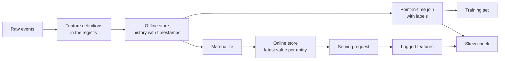

# Các cửa hàng đặc trưng và Skew phục vụ đào tạo

> Một tính năng có một định nghĩa và hai người đọc. Đào tạo đọc lịch sử của nó từ mỗi thời điểm nhãn, và phục vụ đọc giá trị mới nhất của nó. Khi hai người đọc không đồng ý, mô hình thấy đầu vào mà nó chưa bao giờ được đào tạo.

**Type:** Build
**Languages:** Python
**Prerequisites:** Phase 2, Lessons 08 (Feature Engineering), 13 (ML Pipelines), 15 (Time Series), and 19 (ML System Design)
**Time:** ~100 minutes

## Mục tiêu học tập

- Mô tả cửa hàng ngoại tuyến, cửa hàng trực tuyến, các thực thể, dấu thời gian sự kiện và TTL, và công việc của mỗi một
- Thực hiện một điểm trong thời gian hợp nhất chính xác và cho thấy cách một hợp nhất ngây thơ sao chép các giá trị tương lai vào dữ liệu đào tạo
- Hãy nêu tên bốn nguyên nhân gây ra sự ngây thơ trong việc đào tạo: hai đường mã, các tính năng lỗi thời, các mặc định khác nhau và du lịch thời gian
- Xây dựng một danh sách tính năng trong đó một định nghĩa cung cấp cả đường đào tạo và đường phục vụ
- Lập lại một tính năng mới trên các ngày trước mà không đọc dữ liệu từ sau mỗi ngày
- Khám phá sự ngây thơ bằng cách so sánh các tính năng phục vụ được ghi lại với con đường đào tạo cho cùng một thực thể và thời gian

## Vấn đề

Một nhóm xây dựng một mô hình churn. Mỗi nhãn cho biết liệu người dùng đã không mua trong 30 ngày sau ngày nhãn.`user_id`và đào tạo một quy tắc về `days_since_last_purchase`Độ chính xác offline là 0,948.

Trong giao thông trực tiếp, mô hình này hoạt động tệ hơn so với phiên bản cũ và đơn giản hơn. Bảng tính năng có giá trị mới nhất cho mỗi người dùng, từ những tuần sau ngày nhãn. Một người dùng mua hàng cuối cùng vào ngày 115 cho thấy 60 ngày không hoạt động trong ngày 175, vì vậy tính năng này chứa câu trả lời. Trong khi đó, một nhóm khác lại viết lại các tính năng phục vụ trong một dịch vụ khác. Thư 30 ngày của họ bao gồm một ngày thêm, và mặc định của họ cho một người dùng mới là -1 thay vì 365.

Cả hai lỗi đều có cùng nguyên nhân. Trình luyện và phục vụ tính toán "các tính năng tương tự" theo hai cách khác nhau. Bài học này xây dựng các mảnh của một cửa hàng tính năng từ đầu. Bạn viết một sổ đăng ký, một backfill, một điểm trong thời gian kết hợp, một cửa hàng trực tuyến với một TTL, và một kiểm tra lệch.

## Khái niệm

### Hai người đọc cùng một tính năng

Việc đào tạo và phục vụ đòi hỏi các tính năng trong các hình dạng khác nhau:

| Property | Training (offline) | Serving (online) |
|---|---|---|
| Question | "What was the value for each of 10 million (entity, time) pairs?" | "What is the value for this one entity now?" |
| Time | Many points in the past | The present |
| Volume | Millions of rows per job | One row per request |
| Latency | Minutes are fine | A few milliseconds |
| Storage | Offline store: full history with timestamps, in columnar files or a warehouse | Online store: the latest value per entity, in a key-value database |

Một cửa hàng tính năng giữ cả hai cửa hàng được lấp đầy từ một bộ định nghĩa tính năng.



### Các đơn vị, dấu thời gian và TTL

Bốn thuật ngữ mô tả mỗi hàng tính năng:

- **Entity.**Chìa khóa mà một tính năng mô tả, chẳng hạn như `user_id`hoặc `card_id`- Tôi không biết.
- **Event timestamp.**Thời gian giá trị trở thành đúng. Một số lượng mua hàng "trên ngày 14" có dấu thời gian sự kiện ngày 14.
- **Created timestamp.**Thời gian mà hệ thống viết hàng. Một backfill chạy ngày nay viết hàng với dấu thời gian sự kiện cũ và một dấu thời gian mới được tạo ra.
- **TTL (time to live).**Độ tuổi tối đa của một giá trị. Một giá trị lớn hơn TTL được tính là thiếu, vì vậy người đọc sử dụng mặc định.

Một nhóm các tính năng với cùng một thực thể, nguồn và TTL thường được gọi là một dạng xem tính năng.

### Các kết hợp chính xác tại thời điểm

Một hàng huấn luyện kết hợp một nhãn với các giá trị tính năng tồn tại tại tại thời điểm nhãn.

1. Tìm các hàng tính năng của cùng một thực thể.
2. Giữ các hàng có dấu thời gian sự kiện ở hoặc trước dấu thời gian nhãn.
3. Hãy lấy thứ mới nhất trong số đó.
4. Thả nó nếu dấu thời gian nhãn trừ dấu thời gian sự kiện của nó là nhiều hơn TTL.

Dưới đây là một người dùng, một nhãn vào ngày 16, và hàng tính năng hàng tuần:

| Feature row day | `purchases_30d` | Point-in-time join | Naive join on `user_id` |
|---|---|---|---|
| 7 | 4 | | |
| 14 | 3 | Selected | |
| 21 | 1 | Future | |
| 28 | 0 | Future | Selected |

Đèn nhãn hỏi liệu người dùng có mua bất cứ thứ gì trong ngày 17 đến 46. Ngày 28 hàng đã tính những ngày yên tĩnh sau ngày nhãn. Nó cho thấy 0 mua hàng vì người dùng ngừng mua, đó là sự kiện mà nhãn đo lường. Người vô lý tham gia sao chép câu trả lời vào đầu vào.

Chúng ta chia dữ liệu theo thời gian trong bài học chuỗi thời gian vì cùng một lý do.

### Nguyên nhân của sự khuyết điểm phục vụ đào tạo

Quy tắc học máy của Google xác định sự khuyết điểm phục vụ đào tạo là sự khác biệt giữa hiệu suất trong đào tạo và hiệu suất trong phục vụ. Họ nêu tên ba nguyên nhân: xử lý dữ liệu khác nhau trong hai đường ống, thay đổi dữ liệu giữa đào tạo và phục vụ, và vòng lặp phản hồi. Trong đường ống tính năng, bốn nguyên nhân cụ thể xuất hiện liên tục:

| Cause | What happens | Example from the demo |
|---|---|---|
| Two code paths | Training and serving compute the feature with different code | The serving window includes day `now - 30`, and the training window does not |
| Stale features | The value that serving reads has a different age from the value that training used | Training reads weekly snapshots, and a new service computes fresh values |
| Different defaults | The two paths fill a missing value differently | Training uses 365 for "no purchase yet", and serving uses -1 |
| Time travel | Training reads a value from after the label time | The naive join reads the newest snapshot for every label |

Quy tắc #32 của cùng hướng dẫn nói rằng phải tái sử dụng mã giữa đường ống đào tạo và đường ống phục vụ khi có thể.

### Một sổ đăng ký tính năng

Registry là danh mục của các định nghĩa tính năng. Mỗi mục chứa một tên, một thực thể, một nguồn, một chuyển đổi, một cửa sổ, một giá trị mặc định, một TTL, một chủ sở hữu, một phiên bản và một mô tả.

Có hai quy tắc bảo vệ nó:

- Cả hai con đường đều đọc định nghĩa từ registry.
- Một thay đổi định nghĩa tạo ra một phiên bản mới. phiên bản cũ vẫn còn, vì vậy các mô hình cũ vẫn giữ lại tính năng mà họ được đào tạo.

### Lớp lưng

Một tính năng mới không có lịch sử, nhưng đào tạo cần giá trị của nó tại mỗi thời gian nhãn cũ. Một backfill chạy định nghĩa tại mỗi ngày qua và viết một hàng cho mỗi thực thể và ngày. Mỗi chạy chỉ đọc các sự kiện với dấu thời gian tại hoặc trước ngày của nó.

Backfills tính toán chi phí tăng lên với số lượng các thực thể nhân số ngày. Chúng cũng mang lại một rò rỉ tinh tế. Một backfill chạy ngày nay viết hàng với dấu thời gian sự kiện cũ, nhưng nó có thể đọc dữ liệu đến muộn hoặc đã được sửa chữa sau đó.

### Khám phá sự lệch

Quy tắc #29 của cùng hướng dẫn nói rằng phải ghi lại các tính năng trong thời gian phục vụ và sử dụng chúng trong đào tạo. Ngay cả một mẫu ghi nhỏ cũng cho phép bạn kiểm tra sự phù hợp. So sánh mỗi giá trị ghi với giá trị mà con đường đào tạo tạo tạo cho cùng một thực thể và thời gian. Đối với mỗi tính năng, báo cáo tỷ lệ không phù hợp và sự khác biệt tuyệt đối trung bình.

Để tìm nguyên nhân, hãy so sánh ba cặp:

1. Đọc trên cửa hàng trực tuyến so với tập hợp. Điều này kiểm tra toàn bộ hệ thống và nên cho thấy không có khuynh hướng.
2. Phân tính mới so với tập luyện kết hợp.
3. Hướng dẫn mã thứ hai so với tính toán mới. Điều này cô lập các khác biệt mã, chẳng hạn như cửa sổ và mặc định.

```figure
mlprod-pit-join
```

## Hãy xây dựng nó

Mã trong `code/main.py`Một công việc hàng tuần viết các ảnh chụp tính năng vào ngày 7, 14, vv lên đến 175.

### Bước 1: Định nghĩa tính năng và sổ đăng ký

A `FeatureDefinition`giữ sự chuyển đổi như dữ liệu: một tổng hợp, một cửa sổ, và một mặc định.`compute`Phương pháp không bao giờ đọc các sự kiện sau đó `as_of`- Tôi không biết.

```python
@dataclass(frozen=True)
class FeatureDefinition:
    name: str
    entity: str
    aggregate: str
    window_days: int | None
    default: float
    version: int = 1
    owner: str = "growth-team"
    description: str = ""

    def compute(self, events: list[Event], as_of: int) -> float:
        visible = [e for e in events if e.day <= as_of]
        if self.window_days is not None:
            visible = [e for e in visible if e.day > as_of - self.window_days]
        if self.aggregate == "count":
            return float(len(visible))
        if self.aggregate == "sum":
            return round(sum(e.amount for e in visible), 2)
        if self.aggregate == "days_since_last":
            return float(as_of - max(e.day for e in visible)) if visible else self.default
        raise ValueError(f"unknown aggregate {self.aggregate!r}")
```

`FeatureRegistry.register`chấp nhận cùng một định nghĩa hai lần, nhưng nó từ chối một định nghĩa khác với cùng tên và phiên bản. `fill_defaults`cho cả hai đường dẫn cùng một mặc định cho một giá trị bị thiếu.

Một mô hình pin một định nghĩa với một tham chiếu như `spend_30d@1`- `compute`và `fill_defaults`giải quyết đề xuất, và một tên mà không `@`đọc phiên bản mới nhất.`@`và không có số phiên bản tăng `ValueError`, vì vậy một lỗi gõ không thể đọc phiên bản mới nhất mà không có cảnh báo. Khúc đề cũng là chìa khóa trong mỗi hàng được lưu trữ, vì vậy backfill, cửa hàng trực tuyến và đọc dịch vụ đều sử dụng định nghĩa được gắn.

### Bước 2: Đền lại cửa hàng offline

```python
def backfill(registry: FeatureRegistry, names: list[str], events: list[Event], days: list[int]) -> list[FeatureRow]:
    rows = []
    for entity, entity_events in sorted(group_events(events).items()):
        for day in days:
            rows.append(FeatureRow(entity, day, registry.compute(names, entity_events, day)))
    return rows
```

Demo này bổ sung 3 tính năng cho 299 người dùng trong 25 ngày chụp nhanh, tạo ra 7475 hàng.

### Bước 3: Kết nối thời điểm

Đặt hàng của mỗi thực thể một lần mỗi ngày.`bisect_right`tìm thấy hàng cuối cùng vào hoặc trước ngày nhãn. kiểm tra TTL bỏ một hàng quá cũ.

```python
def point_in_time_join(labels: list[LabelRow], rows: list[FeatureRow], ttl_days: int | None = None) -> list[JoinedRow]:
    by_entity: dict[str, list[FeatureRow]] = defaultdict(list)
    for row in rows:
        by_entity[row.entity].append(row)
    days_index = {}
    for entity, entity_rows in by_entity.items():
        entity_rows.sort(key=lambda r: r.day)
        days_index[entity] = [r.day for r in entity_rows]
    joined = []
    for label in labels:
        days = days_index.get(label.entity, [])
        pos = bisect.bisect_right(days, label.day) - 1
        match = by_entity[label.entity][pos] if pos >= 0 else None
        if match is not None and ttl_days is not None and label.day - match.day > ttl_days:
            match = None
        joined.append(JoinedRow(
            label.entity, label.day, label.label,
            match.day if match else None, match.values if match else None,
        ))
    return joined
```

### Bước 4: đo rò rỉ từ một kết hợp ngây thơ

`naive_latest_join`kết hợp chỉ với thực thể, do đó nó trả lại hàng mới nhất cho mỗi nhãn. Demo xây dựng nhãn vào ngày 100, 120, và 140 và phù hợp với một quy tắc tính năng trên mỗi bộ đào tạo. Sau đó nó kiểm tra cả hai quy tắc trên nhãn từ ngày 145, với các tính năng điểm trong thời gian:

```console
  naive join used a snapshot from after the label day for 100% of rows
  offline accuracy, naive join: 0.948 (rule: idle > 53 days)
  offline accuracy, PIT join:   0.893 (rule: idle > 19 days)
  accuracy on day 145, trained with naive join: 0.763
  accuracy on day 145, trained with PIT join:   0.876
```

Các kết hợp ngây thơ trông tốt hơn ngoài khơi, 0,948 so với 0,893. trên dữ liệu mới nó tồi tệ hơn, 0,763 so với 0,876.

### Bước 5: cửa hàng trực tuyến và hiện vật hóa

Cửa hàng trực tuyến giữ một hàng cho mỗi đơn vị và từ chối hàng lớn hơn TTL. `materialize`chỉ viết các hàng ngày của họ là vào hoặc trước giờ làm việc.

```python
class OnlineStore:
    def __init__(self, ttl_days: int):
        self.ttl_days = ttl_days
        self._latest: dict[str, FeatureRow] = {}

    def write(self, row: FeatureRow) -> None:
        current = self._latest.get(row.entity)
        if current is None or row.day >= current.day:
            self._latest[row.entity] = row

    def read(self, entity: str, now: int) -> dict[str, float] | None:
        row = self._latest.get(entity)
        if row is None or row.day > now or now - row.day > self.ttl_days:
            return None
        return dict(row.values)
```

Với TTL 10 ngày, một đọc vào ngày 145 trả lại ngày 140 hàng. Một đọc vào ngày 160, mà không có sự hiện thực hóa mới, trả lại các mặc định, bởi vì hàng là 20 ngày.

### Bước 6: Kiểm tra sự thiên vị

`detect_skew`so sánh hai quan điểm được chia sẻ bởi `(entity, day)`Nó báo cáo tỷ lệ không phù hợp và sự khác biệt tuyệt đối trung bình cho mỗi tính năng và đánh dấu một tính năng khi hơn 1% các giá trị khác nhau. Nó tăng `ValueError`khi hai quan điểm có các khóa khác nhau hoặc không có các khóa. Một yêu cầu bị thiếu có thể che giấu sự ngơ, và một kiểm tra mà không có yêu cầu cho thấy không có gì.

```python
def detect_skew(
    training: dict[tuple[str, int], dict[str, float]],
    serving: dict[tuple[str, int], dict[str, float]],
    features: list[str],
    tolerance: float = 1e-6,
    max_mismatch_rate: float = 0.01,
) -> list[SkewReport]:
    if set(training) != set(serving):
        raise ValueError(f"{len(set(training) ^ set(serving))} keys are in only one view: log and compare the same requests")
    if not training:
        raise ValueError("no requests to compare")
    keys = sorted(training)
    reports = []
    for feature in features:
        diffs = [abs(training[k][feature] - serving[k][feature]) for k in keys]
        mismatches = sum(1 for d in diffs if d > tolerance)
        rate = mismatches / len(keys)
        mean_diff = sum(diffs) / len(keys)
        reports.append(SkewReport(feature, len(keys), rate, mean_diff, rate > max_mismatch_rate))
    return reports
```

Các bản đăng ký demo ghi lại yêu cầu trong ngày 141 đến 150 và chạy ba so sánh từ phần khái niệm.

```bash
python3 code/main.py
```

```console
=== Skew checks on 383 logged requests, days 141 to 150 ===
  online store read  vs  training join (one definition, same snapshots)
    ok   days_since_last_purchase   mismatch   0.0%  mean |diff|    0.00
    ok   purchases_30d              mismatch   0.0%  mean |diff|    0.00
    ok   spend_30d                  mismatch   0.0%  mean |diff|    0.00
  fresh compute      vs  training join (staleness only)
    SKEW days_since_last_purchase   mismatch  83.0%  mean |diff|    2.77
    SKEW purchases_30d              mismatch  30.5%  mean |diff|    0.38
    SKEW spend_30d                  mismatch  37.1%  mean |diff|   16.77
  second code path   vs  fresh compute (code differences only)
    SKEW days_since_last_purchase   mismatch   5.5%  mean |diff|   20.07
    SKEW purchases_30d              mismatch  12.5%  mean |diff|    0.13
    SKEW spend_30d                  mismatch  12.5%  mean |diff|    5.09
```

Hãy đọc 3 khối theo thứ tự:

- **One definition, same snapshots.**Cửa hàng trực tuyến và tập đoàn đọc cùng một hàng hóa, do đó, sự thiên vị là không.
- **Staleness.**Một giá trị mới khác với ảnh chụp hàng tuần trên hầu hết các yêu cầu. Dữ liệu mới không tự động tốt hơn ở đây, bởi vì mô hình học được từ các giá trị lên đến sáu ngày.
- **Code differences.**Hướng dẫn mã thứ hai khác nhau trên 12,5% số lượng cửa sổ, bởi vì cửa sổ của nó bao gồm một ngày thêm.`days_since_last_purchase`Chỉ dành cho người dùng mới, nhưng với một số lượng lớn: -1 so với 365.

## Sử dụng nó

Feast là một cửa hàng tính năng nguồn mở. Mỗi phần mã từ đầu có một đối tác Feast:

| From scratch | Feast |
|---|---|
| `FeatureDefinition`, `FeatureRegistry` | `Entity`, `FeatureView`, and `Field` in a feature repository, registered with `feast apply` |
| `FeatureRow` history | An offline store, for example a `FileSource` over Parquet files or a warehouse table |
| `point_in_time_join` with a TTL | `store.get_historical_features(entity_df=..., features=[...])` |
| `materialize` | `feast materialize-incremental <end time>` |
| `OnlineStore.read` | `store.get_online_features(features=[...], entity_rows=[...])` |
| Created timestamp check | `created_timestamp_column` on the source and `filter_by_created_timestamp=True` |

Các định nghĩa trông như thế này. mã theo sau lễ hội khởi động nhanh và không cần thiết để chạy bài học này.

```python
from datetime import timedelta

from feast import Entity, FeatureView, Field, FileSource
from feast.types import Float32, Int64

user = Entity(name="user", join_keys=["user_id"])

user_activity_source = FileSource(
    name="user_activity_source",
    path="data/user_activity.parquet",
    timestamp_field="event_timestamp",
    created_timestamp_column="created",
)

user_activity = FeatureView(
    name="user_activity",
    entities=[user],
    ttl=timedelta(days=10),
    schema=[
        Field(name="purchases_30d", dtype=Int64),
        Field(name="spend_30d", dtype=Float32),
        Field(name="days_since_last_purchase", dtype=Int64),
    ],
    source=user_activity_source,
)
```

Trình huấn luyện và phục vụ sau đó đọc cùng một quan điểm tính năng:

```python
from feast import FeatureStore

store = FeatureStore(repo_path=".")

training_df = store.get_historical_features(
    entity_df=labels_df,
    features=["user_activity:purchases_30d", "user_activity:days_since_last_purchase"],
    filter_by_created_timestamp=True,
).to_df()

online = store.get_online_features(
    features=["user_activity:purchases_30d", "user_activity:days_since_last_purchase"],
    entity_rows=[{"user_id": 42}],
).to_dict()
```

`labels_df`chứa một hàng trên mỗi nhãn với `user_id`- `event_timestamp`, và nhãn. Tài liệu Feast nói rằng TTL tương đối với mỗi dấu thời gian trong khung dữ liệu thực thể, chứ không phải với thời gian truy vấn.`point_in_time_join`. cùng một trang mô tả `filter_by_created_timestamp=True`, ngăn chặn các giá trị được ghi lại lại khỏi rò rỉ vào dữ liệu đào tạo. Không phải tất cả các cửa hàng ngoại tuyến đều hỗ trợ tùy chọn này.

Tecton, Hopsworks và các cửa hàng tính năng trong các nền tảng ML đám mây lớn sử dụng phân chia tương tự giữa các cửa hàng ngoại tuyến và trực tuyến. Đối với kiểm tra lệch, TensorFlow Data Validation có thể so sánh dữ liệu đào tạo với dữ liệu phục vụ để phát hiện lệch. Breck et al. mô tả hệ thống xác thực dữ liệu trong TFX, nền tảng ML đầu đến cuối của Google, bao gồm cả lệch phục vụ đào tạo.

## Chuyển nó

Bài học này sẽ mang lại kết quả `outputs/skill-feature-skew-audit.md`. Các kỹ năng kiểm tra một đường ống tính năng cho du lịch thời gian và đào tạo phục vụ sự phân biệt. Nó đi qua kết nối, các định nghĩa, các mặc định, độ tươi của mỗi con đường, và ghi chép mà một kiểm tra phân biệt cần.

## Các bài tập

1. Thay đổi khoảng thời gian chụp nhanh từ 7 ngày thành 1 ngày.
2. Đặt TTL lên 3 ngày, đếm các hàng huấn luyện bị mất tính năng và bị mặc định.
3. Thêm một ngày được tạo vào `FeatureRow`Làm cho các liên kết bỏ qua các hàng được viết sau ngày nhãn.
4. Đăng ký `spend_7d`như phiên bản 2 của `spend_30d`Đánh lại và in cả hai phiên bản từ sổ đăng ký.
5. Đặt lại `legacy_serving_features`Cho đến khi kiểm tra phân tích thứ ba qua.

## Các điều khoản chính

| Term | What people say | What it means |
|------|----------------|----------------------|
| Feature store | "A database for features" | A system that computes features from one set of definitions and serves them to training and to serving |
| Offline store | "The training data" | Full feature history with event timestamps, read by training jobs and backfills |
| Online store | "The feature cache" | The latest value per entity, read by the serving path in milliseconds |
| Entity | "The ID" | The key that a feature describes, such as a user or a card |
| Event timestamp | "When it happened" | The time at which a feature value became true |
| Point-in-time join | "An as-of join" | A join that pairs each label with the latest feature row at or before the label time |
| TTL | "Expiry" | The maximum age of a feature value before a reader treats it as missing |
| Materialization | "Syncing to online" | The job that copies the latest feature values from the offline store to the online store |
| Backfill | "Computing history" | Running a feature definition at past dates to create its history |
| Training-serving skew | "It worked offline" | A difference between the features or behavior in training and in serving |

## Đọc thêm

- [Feast, Point-in-time joins](https://docs.feast.dev/getting-started/concepts/point-in-time-joins): TTL ngữ nghĩa và bộ lọc dấu thời gian được tạo ra
- [Feast documentation](https://docs.feast.dev/): xem tính năng, cửa hàng ngoại tuyến, cửa hàng trực tuyến và hiện thực hóa
- [Google, Rules of Machine Learning](https://developers.google.com/machine-learning/guides/rules-of-ml): các quy tắc lệch lệch phục vụ đào tạo, từ Điều 29 đến Điều 37
- [Breck et al., Data Validation for Machine Learning (SysML 2019)](https://research.google/pubs/data-validation-for-machine-learning/): xác thực dữ liệu tại Google, bao gồm cả sự phân biệt đối xử về đào tạo
- [TensorFlow Data Validation guide](https://www.tensorflow.org/tfx/guide/tfdv): kiểm tra sơ đồ, phát hiện sự lệch lạc và phát hiện drift
- [Sculley et al., Hidden Technical Debt in Machine Learning Systems (NeurIPS 2015)](https://papers.nips.cc/paper/2015/hash/86df7dcfd896fcaf2674f757a2463eba-Abstract.html): phụ thuộc dữ liệu và nợ đường ống xung quanh mô hình
