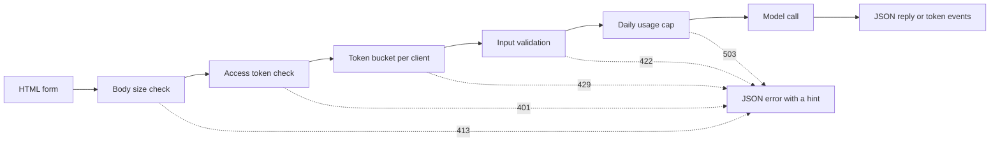

# Mô hình giao diện demo  Từ một chức năng đến một ứng dụng có thể chia sẻ

> Một bản demo mô hình có một hợp đồng: một đầu vào, một cuộc gọi mô hình và một đầu ra. Đặt một giới hạn cho mỗi phần trước khi bạn chia sẻ liên kết.

**Type:** Build
**Languages:** Python
**Prerequisites:** Phase 11 · 13 (Building a Production LLM Application), Phase 17 · 08 (Inference Metrics), Phase 17 · 19 (AI Gateways)
**Time:** ~90 minutes

## Mục tiêu học tập

- Viết vào, mô hình gọi, và hợp đồng đầu ra của một bản demo, với một giới hạn cho mỗi phần.
- Xây dựng ứng dụng HTTP thư viện tiêu chuẩn với một trang HTML, điểm cuối JSON và điểm cuối Server-Send Events.
- Thiết lập đầu vào theo thứ tự chi phí, và trả lại lỗi JSON cho người dùng biết hành động tiếp theo.
- Bảo vệ một bản demo công cộng với một cái rắc token mỗi khách hàng, một mức sử dụng hàng ngày và một token truy cập tùy chọn.
- Viết nhật ký yêu cầu không lưu trữ văn bản nhập và không có địa chỉ khách hàng.
- So sánh bản demo thư viện tiêu chuẩn với hai phiên bản khung, và đặt tên các tín hiệu rằng một bản demo phải trở thành sản phẩm.

## Vấn đề

Mô hình của bạn hoạt động trong sổ ghi chép. Bây giờ một nhà đánh giá muốn thử mười đầu vào, và một khách hàng muốn xem một kết quả trên điện thoại. Không ai trong số họ sẽ mở sổ ghi chép của bạn.

Một tế bào ghi chép không có giới hạn nhập và không hiển thị tiến bộ. Các lỗi của nó là dấu vết xếp chồng mà chỉ bạn có thể đọc. Nó cũng chạy với các thông tin tín dụng và ngân sách của bạn. Nếu bạn đặt tế bào sau một URL công cộng mà không thay đổi, bạn có thể mong đợi thất bại như sau:

- Người dùng dán một tài liệu 40.000 ký tự, mô hình gọi chạy trong một phút và sau đó thất bại với một dấu vết hàng đống.
- Một script gửi 500 yêu cầu trong một phút.
- Trang không hiển thị gì trong tám giây, vì vậy người dùng nhấp vào nút thêm bốn lần.
- Lập nhật ký máy chủ lưu giữ mọi đầu vào, bao gồm cả đầu vào với số tài khoản khách hàng.

Một giao diện demo ngăn chặn những lỗi này với một lượng nhỏ mã. Bài học này xây dựng một với thư viện tiêu chuẩn Python, để bạn có thể xem mọi phần. Sau đó nó xây dựng cùng một demo với hai khung phổ biến và so sánh những gì mỗi người làm theo mặc định.

## Khái niệm

### Một bản demo là một hợp đồng

Mỗi demo có ba phần. đầu vào là những gì người dùng có thể gửi. Model call biến đầu vào thành một đầu ra. đầu ra là những gì người dùng thấy, và đó bao gồm các lỗi.

Hãy viết hợp đồng trước khi viết trang:

| Part | Question to answer | Answer in this lesson |
|------|--------------------|-----------------------|
| Input | What type, what size, which characters? | A string of 1 to 500 characters, with no control characters |
| Model call | How long does one call take, and what does it cost? | A toy keyword model that runs in under a millisecond at no cost |
| Output | What does the user see on success and on failure? | A label, a score, and a reply, or a JSON error with a hint |

Một sổ ghi chép không có giới hạn cho bất kỳ ba phần nào. Một bản demo đặt giới hạn cho mỗi phần, và máy chủ áp dụng giới hạn cho mỗi khách hàng.



Các kiểm tra chạy theo thứ tự chi phí. Một yêu cầu xấu dừng lại ở kiểm tra đầu tiên mà nó thất bại, do đó nó chi phí máy chủ hầu như không có gì.

### Thiết lập trước khi mô hình chạy

Các trình duyệt có thể kiểm tra đầu vào trước khi nó gửi bất cứ điều gì.`maxlength`và `required`các thuộc tính trên một khu vực văn bản cung cấp cho người dùng phản hồi mà không cần gọi mạng. Những kiểm tra này chỉ giúp người dùng trung thực. Bất kỳ khách hàng nào có thể gửi yêu cầu mà không cần trang, vì vậy máy chủ lặp lại mỗi kiểm tra.

Đặt kiểm tra máy chủ theo thứ tự chi phí:

1. Đọc `Content-Length`Đưa một cái xác ra ngoài giới hạn trước khi đọc nó.
2. Phân tích cơ thể JSON. Khước từ một cơ thể không phải là một đối tượng JSON.
3. Kiểm tra các trường. Không muốn viết văn bản trống, văn bản vượt quá giới hạn và kiểm soát ký tự.
4. Đăng một cuộc gọi mẫu chỉ theo yêu cầu đã vượt qua mọi kiểm tra.

| Failed check | HTTP status | Error code |
|--------------|-------------|------------|
| Body over 4,096 bytes | 413 Content Too Large | `body_too_large` |
| Body stops before `Content-Length` bytes arrive | 408 Request Timeout | `request_timeout` |
| Content type is not JSON | 415 Unsupported Media Type | `unsupported_media_type` |
| Body is not a JSON object | 400 Bad Request | `bad_json` |
| Text is missing, empty, too long, or has control characters | 422 Unprocessable Content | `missing_text`, `empty_text`, `text_too_long`, `control_characters` |

RFC 9110 xác định các mã trạng thái này và tên của chúng.

Ví dụ là một phần của thiết kế đầu vào. Ví dụ cho người dùng thấy đầu vào tốt trông như thế nào. Nó cũng cho một nhà phê bình một bài kiểm tra với một nhấp chuột. Chọn một ví dụ cho mỗi lớp đầu ra.

### Cho thấy mô hình đang hoạt động

Một cuộc gọi mô hình có thể mất vài giây. Không có phản hồi, người dùng không thể phân biệt mô hình chậm từ một trang bị hỏng. Người dùng không thấy thay đổi có thể nhấp lại, và sau đó máy chủ nhận được yêu cầu trả tiền thứ hai.

Trang trong bài học này cung cấp bốn loại phản hồi:

- Nó vô hiệu hóa nút gửi khi yêu cầu chạy.
- Nó cho thấy thời gian đã qua và cập nhật nó mỗi 100 millisecond.
- Nó cho thấy thời gian để token đầu tiên khi token đầu tiên đến.
- Nó cho thấy tổng thời gian khi yêu cầu kết thúc.

Khi học [inference metrics](../../08-inference-metrics-goodput/), thời gian để token đầu tiên (TTFT) là một métric máy chủ.

### Gửi đầu ra như một dòng

Một mô hình ngôn ngữ tạo ra câu trả lời một token một lần. Nếu máy chủ chờ đợi token cuối cùng, người dùng chờ đợi toàn bộ thế hệ. Nếu máy chủ gửi mỗi token khi nó sẵn sàng, người dùng bắt đầu đọc sau token đầu tiên.

Server-Sent Events (SSE) là định dạng tiêu chuẩn cho điều này.`text/event-stream`Mỗi sự kiện là một nhóm`event:`và `data:`Các tiêu chuẩn HTML WHATWG xác định định định dạng.

```text
event: token
data: {"index":0,"text":"Label:"}

event: token
data: {"index":1,"text":" positive."}

event: done
data: {"label":"positive","score":1.0,"tokens":11}
```

Tải duyệt có một `EventSource`giao diện cho SSE, nhưng nó chỉ gửi yêu cầu GET. Một yêu cầu GET đặt đầu vào vào URL, và các máy chủ web và proxy viết URL vào nhật ký truy cập của họ.`fetch()`và `response.body.getReader()`, và nó phân tích định dạng của sự kiện chính nó.

Một dòng có một vấn đề mà một câu trả lời JSON duy nhất không có. máy chủ gửi trạng thái 200 trước token đầu tiên. Nếu mô hình thất bại sau đó, máy chủ không thể thay đổi trạng thái. Vì vậy máy chủ gửi một `error`sự kiện trong dòng, và trang hiển thị sự kiện đó như một lỗi.

Khi anh xây dựng [production LLM application](../../../11-llm-engineering/13-production-app/)Bài học này viết cùng một giao thức bằng tay, để bạn có thể xem mỗi dòng mà máy chủ gửi.

### Viết lỗi mà người dùng có thể hành động trên

Thông báo lỗi có hai công việc: nó cho người dùng biết chuyện gì đã xảy ra, và nó cho người dùng biết phải làm gì tiếp theo.

Mỗi lỗi trong demo này có cùng một hình dạng JSON:

```json
{
  "error": {
    "code": "text_too_long",
    "message": "The text has 812 characters. The limit is 500.",
    "hint": "Shorten the text to 500 characters or fewer.",
    "request_id": "a8f3c2b435e3"
  }
}
```

- `code`là một tên ổn định. Mã khách hàng và các thử nghiệm so sánh với nó.
- `message`cho biết sự thật, với số mà người dùng cần.
- `hint`cho người dùng một hành động.
- `request_id`kết nối một báo cáo người dùng với một hồ sơ đăng ký.

RFC 9457 xác định định định dạng lỗi tiêu chuẩn cho các API HTTP, được gọi là chi tiết vấn đề.

### Chia sẻ một bản demo công cộng một cách an toàn

Một liên kết công cộng thay đổi ai có thể gửi yêu cầu.

| Risk | Control in this demo | Control for a larger audience |
|------|----------------------|-------------------------------|
| One client sends too many requests | A token bucket per client, with 429 and `Retry-After` | Per-user limits after sign-in |
| Strangers find the link | An optional access token in the `Authorization` header | Single sign-on with an identity provider |
| Total cost grows with no limit | A daily usage cap, with 503 and `Retry-After` | Spend limits and alerts at the model provider |
| Very large or unusual input | Body size limit, text length limit, control character check | Content moderation on input and output |
| Logs keep private input | Records with the input length and a keyed hash of the client | A retention period and access control on the logs |

Một cái thùng token sử dụng hai số. Khả năng là sự nổ lớn nhất mà một khách hàng có thể gửi. Tỷ lệ lấp đầy là tỷ lệ yêu cầu dài hạn. Mỗi yêu cầu lấy một token, và cái thùng này liên tục lấp đầy đến khả năng của nó:

```text
tokens = min(capacity, tokens + refill_rate * seconds_since_last_request)
accept the request if tokens >= 1, then subtract 1
```

Khi cái thùng trống, máy chủ trả lời.`429 Too Many Requests`RFC 6585 xác định trạng thái 429, và nó cho phép máy chủ thêm một `Retry-After`Header. Demo này luôn thêm header, với số giây cho đến token tiếp theo. Trang đọc header và vô hiệu hóa nút cho thời gian đó.

Trong bản demo, bạn sẽ sử dụng địa chỉ IP của khách hàng như là chìa khóa rác. Bên sau một proxy ngược, mỗi yêu cầu sẽ được thực hiện từ địa chỉ proxy, vì vậy tất cả người dùng sẽ chia sẻ một rác. Trong trường hợp đó, hãy đọc địa chỉ khách hàng từ một tiêu đề mà proxy của bạn đặt ra. Đừng tin vào tiêu đề đó từ bất kỳ nguồn nào khác, bởi vì một khách hàng có thể đặt bất kỳ giá trị nào vào nó.

Khi học [AI gateways](../../19-ai-gateways/)Một giới hạn giá trị kiểm soát mỗi khách hàng, nhưng nó không kiểm soát tổng. Một trăm khách hàng mà mỗi khách hàng ở dưới giới hạn vẫn có thể sử dụng toàn bộ ngân sách. Một giới hạn sử dụng đếm tất cả các cuộc gọi mô hình trong một ngày và từ chối cuộc gọi sau một số cố định.

Các nhật ký cần sự chăm sóc như đầu vào.`http.server`trình xử lý viết địa chỉ IP của khách hàng và dòng yêu cầu thành lỗi tiêu chuẩn. Nếu đầu vào là trong URL, đầu vào vào vào nhật ký. Demo này thay thế dòng đăng ký đó. Mỗi yêu cầu viết một bản ghi với đường, trạng thái, mã lỗi, độ trễ và chiều dài đầu vào.

Nói cho người dùng biết bạn giữ gì. Trang demo nói rằng máy chủ giữ chiều dài của văn bản và không bao giờ bản văn bản chính nó.

### Khi một bản demo trở thành một sản phẩm

Một bản demo phục vụ những người quen thuộc trong các phiên ngắn từ một quá trình. Những tín hiệu này cho bạn biết rằng bản demo hiện là một sản phẩm:

- Những người ngoài nhóm của bạn sử dụng nó mỗi tuần.
- Ai đó hỏi về thời gian hoạt động, hoặc báo cáo sự cố.
- Người dùng yêu cầu đăng nhập, lưu kết quả hoặc xem lịch sử của họ.
- Chi phí mô hình hàng tuần là một dòng trong ngân sách.
- Các dữ liệu nhập bao gồm dữ liệu mà một hợp đồng hoặc luật pháp bao gồm.

| Property | Demo | Product |
|----------|------|---------|
| Users | Known people, short sessions | Unknown people, daily use |
| State | None | Accounts, history, saved results |
| Availability | Best effort, one process | A written target, replicas, an on-call owner |
| Cost control | One daily usage cap | Per-user quotas and billing |
| Observability | One log record per request | Traces, metrics, and alerts |

Khi bạn thấy các tín hiệu này, di chuyển demo vào đống sản xuất từ bài học ứng dụng LLM sản xuất. đống đó thêm xác thực thực, mô hình trở lại, theo dõi và theo dõi chi phí cho mỗi người dùng.

```figure
demo-token-bucket
```

## Hãy xây dựng nó

Mã chỉ là một tập tin.`code/main.py`, không có phụ thuộc ngoài thư viện tiêu chuẩn.

```bash
python3 code/main.py
```

Self-test kiểm tra xác thực, hộp token, định dạng dòng chảy và một chuyến đi HTTP thực sự. Nó khởi động máy chủ trên một cổng miễn phí, gửi ba yêu cầu, dừng máy chủ và thoát. khởi động máy chủ cho trình duyệt chỉ khi bạn cần nó:

```bash
python3 code/main.py --serve
```

Mở ra`http://127.0.0.1:8000`trong trình duyệt. Nhấn Ctrl + C để dừng máy chủ.

### Bước 1: Cuộc gọi mô hình

Mô hình này là một máy tính đếm từ khóa đồ chơi. Nó dán nhãn văn bản là tích cực, tiêu cực hoặc trung lập. Nó cũng tạo ra một câu trả lời ngắn, một token một lần.

```python
def classify(text):
    words = WORD_RE.findall(text.lower())
    positive = sum(1 for word in words if word in POSITIVE)
    negative = sum(1 for word in words if word in NEGATIVE)
    score = (positive - negative) / max(1, positive + negative)
    if score > 0:
        label = "positive"
    elif score < 0:
        label = "negative"
    else:
        label = "neutral"
    return {"label": label, "score": round(score, 3), "positive_cues": positive,
            "negative_cues": negative, "words": len(words)}


def generate(text):
    result = classify(text)
    reply = (
        f"Label: {result['label']}. Positive cues: {result['positive_cues']}. "
        f"Negative cues: {result['negative_cues']}. Words read: {result['words']}."
    )
    parts = reply.split(" ")
    yield parts[0]
    for part in parts[1:]:
        yield " " + part
```

Một mô hình thực sự thay thế `generate`và không có gì khác. Đặt một API gọi hoặc một mô hình địa phương bên trong nó. Giữ chữ ký: một chuỗi đi vào, và mã thông báo ra.

### Bước 2: Định giá và phản ứng lỗi

Một lớp ngoại lệ mang mọi lỗi. Nó chứa trạng thái HTTP, mã ổn định, tin nhắn, gợi ý và tiêu đề phản ứng tùy chọn.

```python
class DemoError(Exception):
    def __init__(self, status, code, message, hint, headers=None):
        super().__init__(message)
        self.status = status
        self.code = code
        self.message = message
        self.hint = hint
        self.headers = dict(headers or {})


def validate_text(payload, max_chars=MAX_CHARS):
    if "text" not in payload:
        raise DemoError(422, "missing_text", 'The field "text" is missing.', 'Add a "text" field with your input.')
    text = payload["text"]
    if not isinstance(text, str):
        raise DemoError(422, "text_not_string", 'The field "text" is not a string.', "Send the input as a string.")
    text = text.strip()
    if not text:
        raise DemoError(422, "empty_text", "The text is empty.", "Type a sentence or pick an example.")
    if len(text) > max_chars:
        raise DemoError(422, "text_too_long", f"The text has {len(text)} characters. The limit is {max_chars}.",
                        f"Shorten the text to {max_chars} characters or fewer.")
    if CONTROL_RE.search(text):
        raise DemoError(422, "control_characters", "The text contains control characters.",
                        "Remove the hidden characters, then send the text again.")
    return text
```

Các xác thực viên loại bỏ không gian trắng dẫn và sau trước trước. Một văn bản chỉ có không gian sau đó thất bại như trống, và gợi ý cho người dùng biết phải gõ gì. `check_body_size`và `parse_json_body`sử dụng mô hình tương tự cho các trường hợp 411, 413, 415, và 400. `error_body`quay bất cứ `DemoError`vào hình dạng JSON từ phần khái niệm.

### Bước 3: Bàn biểu tượng

```python
class TokenBucket:
    def __init__(self, capacity, refill_per_second, now):
        if capacity < 1:
            raise ValueError("capacity must be at least 1")
        if refill_per_second <= 0:
            raise ValueError("refill_per_second must be positive")
        self.capacity = float(capacity)
        self.refill_per_second = float(refill_per_second)
        self.tokens = float(capacity)
        self.updated = now

    def take(self, now, cost=1.0):
        elapsed = max(0.0, now - self.updated)
        self.tokens = min(self.capacity, self.tokens + elapsed * self.refill_per_second)
        self.updated = now
        if self.tokens >= cost:
            self.tokens -= cost
            return 0.0
        return (cost - self.tokens) / self.refill_per_second
```

`take`trả lại 0.0 khi nó chấp nhận yêu cầu. nếu không nó trả lại giây cho đến khi vỏ có đủ token. máy chủ vòng lên giá trị và gửi nó vào `Retry-After`- Tôi không biết.

`RateLimiter`giữ một cái thùng cho mỗi khách hàng trong một `OrderedDict`Một khóa bảo vệ từ điển, bởi vì`ThreadingHTTPServer`xử lý mỗi yêu cầu theo chủ đề riêng của nó.`max_clients`khi nhập, giới hạn loại bỏ khách hàng với yêu cầu cũ nhất. Một khách hàng bị loại bỏ nhận được một cái tủ đầy đủ với yêu cầu tiếp theo của nó.`max_clients`hơn số lượng khách hàng hoạt động mà bạn mong đợi.

Người giới hạn lấy một `clock`Các bài kiểm tra vượt qua một`FakeClock`, để một bài kiểm tra có thể di chuyển thời gian lên 10 giây mà không cần phải chờ đợi. `UsageCap`Nó đếm các cuộc gọi trong cửa sổ cố định 86,400 giây, và nó trả lại các giây cho đến cửa sổ tiếp theo khi đếm đầy.

### Bước 4: dòng chảy

```python
def sse_event(event, data):
    payload = json.dumps(data, separators=(",", ":"), ensure_ascii=False)
    return f"event: {event}\ndata: {payload}\n\n".encode("utf-8")


def stream_events(text, generate_fn=generate, delay=0.0, sleep=time.sleep):
    count = 0
    try:
        for token in generate_fn(text):
            yield sse_event("token", {"index": count, "text": token})
            count += 1
            if delay:
                sleep(delay)
    except Exception:
        yield sse_event("error", MODEL_ERROR)
        return
    result = classify(text)
    yield sse_event("done", {"label": result["label"], "score": result["score"], "tokens": count})
```

`json.dumps`viết một dòng mới bên trong một chuỗi như hai ký tự `\n`. Vì vậy, mỗi sự kiện có một dòng dữ liệu mà không có dòng mới thô trong đó.

Máy phát điện phát hiện ra một lỗi mô hình và gửi một `error`sự kiện, bởi vì máy chủ đã gửi dòng trạng thái.`delay`và `sleep`các lập luận làm chậm dòng chảy cho trình duyệt, và chúng giữ cho các bài kiểm tra nhanh.

### Bước 5: Người xử lý yêu cầu

`DemoHandler`mở rộng `BaseHTTPRequestHandler`. Người xử lý POST chạy các kiểm tra theo thứ tự từ phần khái niệm:

```python
def do_POST(self):
    app = self.server.app
    request_id = uuid.uuid4().hex[:12]
    client_id = self.client_address[0]
    started = time.perf_counter()
    route = self.path if self.path in self.routes else "other"
    status, code, chars = 200, None, 0
    try:
        declared = self.headers.get("Content-Length")
        try:
            if route == "other":
                raise DemoError(404, "not_found", "This endpoint does not exist.",
                                "Send requests to /api/predict or /api/stream.")
            size = check_body_size(declared, app.config.max_body_bytes)
        except DemoError:
            self.drain(int(declared) if declared and declared.isdigit() else 0)
            raise
        try:
            body = self.rfile.read(size)
        except TimeoutError:
            self.close_connection = True
            raise DemoError(408, "request_timeout", "The request body did not arrive in time.",
                            "Send the request again with the full body.") from None
        app.admit(client_id, self.headers.get("Authorization"))
        text = app.read_text(self.headers.get("Content-Type"), body)
        chars = len(text)
        app.charge()
        if route == "/api/predict":
            self.send_json(200, predict(text), request_id)
        else:
            code = self.send_stream(text, request_id)
    except DemoError as err:
        status, code = err.status, err.code
        self.send_error_json(err, request_id)
    except TimeoutError:
        status, code = 408, "request_timeout"
        self.close_connection = True
    except Exception:
        status, code = 500, "internal_error"
        self.send_error_json(DemoError(500, "internal_error", "The server failed on this request.",
                                       "Try again. Quote the request id if you report the problem."), request_id)
    finally:
        latency_ms = (time.perf_counter() - started) * 1000
        app.log.record(request_id, route, client_id, status, chars, latency_ms, code)
```

`admit`kiểm tra token truy cập và hộp token. `charge`kiểm tra giới hạn hàng ngày. Nó chạy cuối cùng, vì vậy chỉ có yêu cầu hợp lệ đếm với giới hạn. Mỗi yêu cầu ghi một hồ sơ đăng ký trong `finally`Và đó bao gồm các yêu cầu bị từ chối.`route`, không bao giờ là con đường nguyên liệu, bởi vì một con đường có thể mang một chuỗi truy vấn với văn bản người dùng.

Bốn chi tiết ngăn chặn thất bại mà dễ bị bỏ lỡ:

- `timeout = 10`trong lớp xử lý đóng kết nối khi khách hàng ngừng gửi. Nếu không có nó, một khách hàng tuyên bố 100 byte và gửi 10 sẽ giữ một chuỗi máy chủ mãi mãi. Người xử lý gửi lỗi 408 JSON với ID yêu cầu và đóng kết nối. Một thời gian nghỉ sau khi dòng bắt đầu chỉ đóng kết nối, vì dòng trạng thái đã được gửi.
- `log_message`trả về mà không có đầu ra. Điều này loại bỏ dòng ghi mặc định với địa chỉ khách hàng và dòng yêu cầu.
- `drain`RFC 1122 nói rằng TCP gửi một reset khi một máy chủ đóng kết nối với dữ liệu chưa đọc.
- `send_stream`bắt `BrokenPipeError`Khi người dùng đóng tab, mô hình dừng lại, và yêu cầu không tốn thêm gì.

`BaseHTTPRequestHandler`sử dụng HTTP/1.0 mặc định. Kết thúc của một bộ phận được phát trực tuyến là thời điểm máy chủ đóng kết nối. Một máy chủ sử dụng HTTP/1.1 gửi bộ phận với mã chuyển giao chia nhỏ cho cùng mục đích.

### Bước 6: Trang

`render_page`trả về một tài liệu HTML với phong cách inline và một kịch bản inline. Trang không tải bất kỳ kịch bản, phông chữ hoặc hình ảnh bên ngoài. kịch bản đọc dòng như sau:

```javascript
const reader = response.body.getReader();
const decoder = new TextDecoder();
let buffer = "";
while (true) {
  const chunk = await reader.read();
  if (chunk.done) { break; }
  buffer += decoder.decode(chunk.value, { stream: true });
  let cut = buffer.indexOf("\n\n");
  while (cut >= 0) {
    const frame = parseFrame(buffer.slice(0, cut));
    buffer = buffer.slice(cut + 2);
    cut = buffer.indexOf("\n\n");
    if (frame.event === "token") { output.textContent += frame.data.text; }
  }
}
```

Một phần mạng có thể kết thúc giữa một sự kiện. Người đọc giữ phần chưa đầy trong`buffer`cho đến khi đường trống đến.

Trang viết mô hình đầu ra với `textContent`Và không bao giờ với `innerHTML`. Model đầu ra là văn bản không đáng tin cậy. giả sử trang đưa vào một câu trả lời như HTML, và câu trả lời chứa một yếu tố với một `onerror`thuộc tính đó sau đó có thể chạy mã trong trình duyệt của người dùng.

Máy chủ cũng gửi một `Content-Security-Policy`tiêu đề với `default-src 'none'`Chính sách cho phép một kịch bản inline và một kiểu inline, được xác định bằng sục hash SHA-256 của họ.

```python
def csp_hash(source):
    digest = hashlib.sha256(source.encode("utf-8")).digest()
    return "'sha256-" + base64.b64encode(digest).decode("ascii") + "'"
```

### Bước 7: Cứ chạy nó và cố gắng phá vỡ nó

Bắt đầu máy chủ, sau đó sử dụng `curl`gửi 7 yêu cầu liên tiếp đến một máy chủ mới.

```bash
for i in 1 2 3 4 5 6 7; do
  curl -s -o /dev/null -w '%{http_code} ' -X POST http://127.0.0.1:8000/api/predict \
    -H 'Content-Type: application/json' -d '{"text": "ok"}'
done
```

```text
200 200 200 200 200 429 429
```

Chờ 10 giây, rồi gửi một tin nhắn trống:

```bash
curl -s -X POST http://127.0.0.1:8000/api/predict \
  -H 'Content-Type: application/json' -d '{"text": ""}'
```

```json
{"error": {"code": "empty_text", "message": "The text is empty.", "hint": "Type a sentence or pick an example.", "request_id": "e3e3599feaea"}}
```

Xem các sự kiện dòng với `curl -N`, tắt bộ đệm đầu ra:

```bash
curl -N -X POST http://127.0.0.1:8000/api/stream \
  -H 'Content-Type: application/json' -d '{"text": "The screen is bright."}'
```

Để yêu cầu một token truy cập, đặt `DEMO_ACCESS_TOKEN`trước khi bạn khởi động máy chủ. trang sau đó cho thấy một trường cho token.

```bash
export DEMO_ACCESS_TOKEN="$(python3 -c 'import secrets; print(secrets.token_urlsafe(24))')"
echo "$DEMO_ACCESS_TOKEN"
python3 code/main.py --serve
```

Thực hiện các xét nghiệm:

```bash
python3 -m unittest discover -s code/tests -v
```

Các thử nghiệm HTTP bắt đầu máy chủ trên cổng 0, vì vậy hệ điều hành chọn một cổng miễn phí. `tearDown`dừng máy chủ và kiểm tra rằng thread của nó đã kết thúc.

## Sử dụng nó

Hai framework Python xây dựng cùng một loại demo với ít mã hơn: Gradio và Streamlit.`main.py`, để xác nhận và mô hình vẫn giống nhau. Bạn không cần cả hai khung để chạy `main.py`hoặc các xét nghiệm.

### Các thành phần xung quanh một hàm

Gradio đặt một giao diện web xung quanh một chức năng Python. Các thành phần đầu vào và đầu ra mô tả hợp đồng, và một chức năng máy phát xuất gửi một phần đầu ra.

```python
import os

import gradio as gr

from main import EXAMPLES, MAX_CHARS, DemoError, classify, generate, validate_text


def label_text(text):
    try:
        clean = validate_text({"text": text})
    except DemoError as err:
        raise gr.Error(f"{err.message} {err.hint}")
    label = classify(clean)["label"]
    reply = ""
    for token in generate(clean):
        reply += token
        yield reply, label


demo = gr.Interface(
    fn=label_text,
    inputs=gr.Textbox(label="Text to label", lines=5, max_length=MAX_CHARS),
    outputs=[gr.Textbox(label="Reply"), gr.Textbox(label="Label")],
    examples=list(EXAMPLES),
    flagging_mode="never",
)

if __name__ == "__main__":
    demo.queue(max_size=20).launch(auth=("demo", os.environ["DEMO_PASSWORD"]))
```

Mỗi người`yield`thay thế toàn bộ giá trị đầu ra.

Đặt `flagging_mode`khi bạn cố ý trước khi chia sẻ một liên kết. chế độ mặc định hiển thị một nút cờ. Khi một người dùng nhấn nó, Gradio viết đầu vào và đầu ra vào một tệp CSV trên máy chủ. Giá trị `"never"`lấy nút.

`queue(max_size=20)`giới hạn số lượng yêu cầu chờ đợi. giới hạn đồng thời mặc định là một cuộc gọi chạy mỗi sự kiện. mô hình chậm sau đó phục vụ một người dùng một lần cho đến khi bạn nâng giới hạn. Gradio cũng tạo ra các điểm cuối API khi ứng dụng khởi động, vì vậy các kịch bản có thể gọi demo mà không cần trang. giới hạn tốc độ của bạn phải áp dụng cho các điểm cuối đó cũng vậy.

### Một kịch bản lặp lại trên mỗi đầu vào

Streamlit chạy toàn bộ kịch bản của bạn từ trên xuống mỗi khi người dùng thay đổi widget. Một biểu mẫu thu thập các giá trị widget của nó và gửi chúng trong một lô khi người dùng nhấn nút gửi.

```python
import streamlit as st

from main import EXAMPLES, MAX_CHARS, DemoError, classify, generate, validate_text

st.title("Toy sentiment demo")
st.caption("Do not paste private data.")

example = st.selectbox("Start from an example", ["", *EXAMPLES])
with st.form("demo"):
    text = st.text_area("Text to label", value=example, max_chars=MAX_CHARS)
    submitted = st.form_submit_button("Run model")

if submitted:
    try:
        clean = validate_text({"text": text})
    except DemoError as err:
        st.error(f"{err.message} {err.hint}")
    else:
        st.write_stream(generate(clean))
        st.write(f"Label: {classify(clean)['label']}")
```

`st.write_stream`lấy máy phát điện trực tiếp và viết mỗi phần khi nó đến.`@st.cache_resource`, bởi vì kịch bản chạy lại trên mỗi bài đăng.

### Những gì mỗi tùy chọn làm theo mặc định

| Need | Standard library (this lesson) | Gradio | Streamlit |
|------|--------------------------------|--------|-----------|
| Form, examples, result area | You write the HTML | `Interface` builds them from components and `examples` | Widgets such as `st.text_area` and `st.selectbox` |
| Input length limit | `maxlength` on the page and a server check | `max_length` on `Textbox` | `max_chars` on `st.text_area` |
| Partial output | You write SSE and the stream reader | A generator function, where each `yield` replaces the output | `st.write_stream` with a generator of chunks |
| Progress display | You write the timer | A progress display on the output area, set by `show_progress` | `st.write_stream` shows each chunk when it arrives |
| Errors for the user | JSON with `code`, `message`, `hint`, `request_id` | `raise gr.Error(...)` shows the message | `st.error(...)` shows the message |
| Concurrency | One thread per request, no limit | A queue, with one running call per event by default | Each interaction runs the script again for that session |
| Public link | You run the server and the domain | `launch(share=True)` gives a link that expires after one week | You deploy the app to a server |
| Sign-in | A bearer token check | `launch(auth=...)` with user names and passwords | `st.login()` with an OpenID Connect provider |
| Rate limit and cost cap | Token bucket and daily cap | Your code, with the client address from the request | Your code |
| Input that the tool writes to disk | Only the input length, in the log | Flagged samples in a CSV file, unless `flagging_mode="never"` | Your code decides |

Các framework tiết kiệm nhiều công việc trên trang: biểu mẫu, ví dụ, trình hiển thị tiến bộ và sản xuất một phần. Chúng tiết kiệm ít công việc hơn về rủi ro của một liên kết công cộng. Trong cả ba phiên bản, giới hạn tỷ lệ, giới hạn chi phí và quyền riêng tư nhật ký là công việc của bạn. Phiên bản thư viện tiêu chuẩn cho thấy từng phần này, vì vậy bạn biết phải kiểm tra gì trong framework.

## Chuyển nó

Bài học này sẽ mang lại kết quả `outputs/skill-demo-interface-checklist.md`. Đưa cho nó một mô tả về mô hình demo hoặc mã của nó. Nó trả lại một đánh giá thông qua hoặc thất bại về hợp đồng, phản hồi, lỗi và kiểm soát cho một liên kết công cộng. Mỗi thất bại đi kèm với một sửa chữa.

## Các bài tập

1. Đặt `BUCKET_CAPACITY`đến 2 và `REFILL_PER_SECOND`dự đoán đầu ra của vòng lặp bảy yêu cầu. Sau đó chạy nó và so sánh.
2. Thêm một `language`trường cho cơ quan yêu cầu.`"en"`Trả lại lỗi 422 với một gợi ý cho bất kỳ giá trị nào khác, và thêm hai thử nghiệm.
3. Tìm câu mà mẫu đồ chơi ghi sai, chẳng hạn như "Màn hình không tốt". Hãy thêm nó vào ví dụ thứ tư, với một chú ý trên trang giải thích giới hạn.
4. Đặt demo sau một đại diện ngược trên máy của bạn.`trust_proxy`tùy chọn đọc `X-Forwarded-For`Chỉ từ địa chỉ đại diện. viết một bài kiểm tra chứng minh khách hàng không thể chọn khóa rác của riêng mình.
5. Thay thế `generate`với một cuộc gọi đến một API mô hình trả về token như một dòng chảy. Giữ xác thực, giới hạn và định dạng sự kiện. So sánh thời gian để token đầu tiên trong trang với thời gian trễ trong nhật ký máy chủ.

## Các điều khoản chính

| Term | What people say | What it actually means |
|------|-----------------|------------------------|
| Demo contract | "The UI" | The input limits, the model call, and the output shape, including errors |
| Token bucket | "A rate limiter" | A per-client counter that refills at a fixed rate up to a capacity. Each request uses one token |
| Retry-After | "Try later" | A response header with the number of seconds, or a date, after which the client can try again |
| Server-Sent Events | "Streaming" | A `text/event-stream` response of `event:` and `data:` lines, with a blank line after each event |
| Time to first token | "Latency" | The time from the request to the first token on the user's screen |
| Usage cap | "The budget" | A limit on the total number of model calls in a time window, for all clients together |
| Keyed hash | "An anonymous ID" | An HMAC of the client address with a secret salt. It is a pseudonym: anyone with the salt can test a known address |
| Content Security Policy | "CSP" | A response header that tells the browser which scripts, styles, and connections the page can use |

## Đọc thêm

- [Python `http.server` documentation](https://docs.python.org/3/library/http.server.html): các lớp máy chủ, HTTP/1.0 mặc định, dòng ghi nhật ký mặc định, và cảnh báo rằng mô-đun không dành cho sản xuất.
- [WHATWG HTML Standard, server-sent events](https://html.spec.whatwg.org/multipage/server-sent-events.html): định dạng của dòng sự kiện và `EventSource`giao diện.
- [MDN, Using server-sent events](https://developer.mozilla.org/en-US/docs/Web/API/Server-sent_events/Using_server-sent_events): ví dụ về định dạng sự kiện và API trình duyệt.
- [MDN, Using readable streams](https://developer.mozilla.org/en-US/docs/Web/API/Streams_API/Using_readable_streams): làm thế nào để đọc một `fetch()`Phản ứng cơ thể từng mảnh.
- [MDN, Using the Fetch API](https://developer.mozilla.org/en-US/docs/Web/API/Fetch_API/Using_Fetch): yêu cầu với một cơ thể JSON, và xử lý phản ứng.
- [MDN, 429 Too Many Requests](https://developer.mozilla.org/en-US/docs/Web/HTTP/Reference/Status/429)và [MDN, Retry-After](https://developer.mozilla.org/en-US/docs/Web/HTTP/Reference/Headers/Retry-After): trạng thái giới hạn lãi suất và tiêu đề của nó.
- [MDN, Content Security Policy](https://developer.mozilla.org/en-US/docs/Web/HTTP/Guides/CSP): hash cho các script inline và các `default-src`Đạo luật.
- [RFC 6585](https://www.rfc-editor.org/rfc/rfc6585.html): thêm mã trạng thái HTTP, bao gồm 429.
- [RFC 9110](https://www.rfc-editor.org/rfc/rfc9110.html): Hình ngữ HTTP, bao gồm 413, 415, và 422.
- [RFC 9457](https://www.rfc-editor.org/rfc/rfc9457.html): chi tiết vấn đề, định dạng lỗi JSON tiêu chuẩn cho các API HTTP.
- [RFC 1122](https://www.rfc-editor.org/rfc/rfc1122.html): yêu cầu máy chủ, bao gồm cả thiết lập lại TCP khi kết thúc với dữ liệu chưa đọc (giới 4.2.2.13).
- [Gradio, Sharing your app](https://gradio.app/guides/sharing-your-app): chia sẻ liên kết, xác thực, trang API và giới hạn tỷ lệ.
- [Gradio, Streaming outputs](https://gradio.app/guides/streaming-outputs): chức năng máy phát như một phần đầu ra.
- [Gradio, Interface](https://gradio.app/docs/gradio/interface)`examples`- `flagging_mode`, và`concurrency_limit`- Tôi không biết.
- [Gradio, Using flagging](https://gradio.app/guides/using-flagging): nơi các mẫu được đánh dấu đi trên đĩa.
- [Streamlit, Basic concepts](https://docs.streamlit.io/get-started/fundamentals/main-concepts): dòng dữ liệu tái phát.
- [Streamlit, st.write_stream](https://docs.streamlit.io/develop/api-reference/write-magic/st.write_stream)và [Streamlit, Caching](https://docs.streamlit.io/develop/concepts/architecture/caching): sản xuất một phần và mô hình tải một lần.
- [Streamlit, st.login](https://docs.streamlit.io/develop/api-reference/user/st.login): đăng nhập với một nhà cung cấp OpenID Connect.
