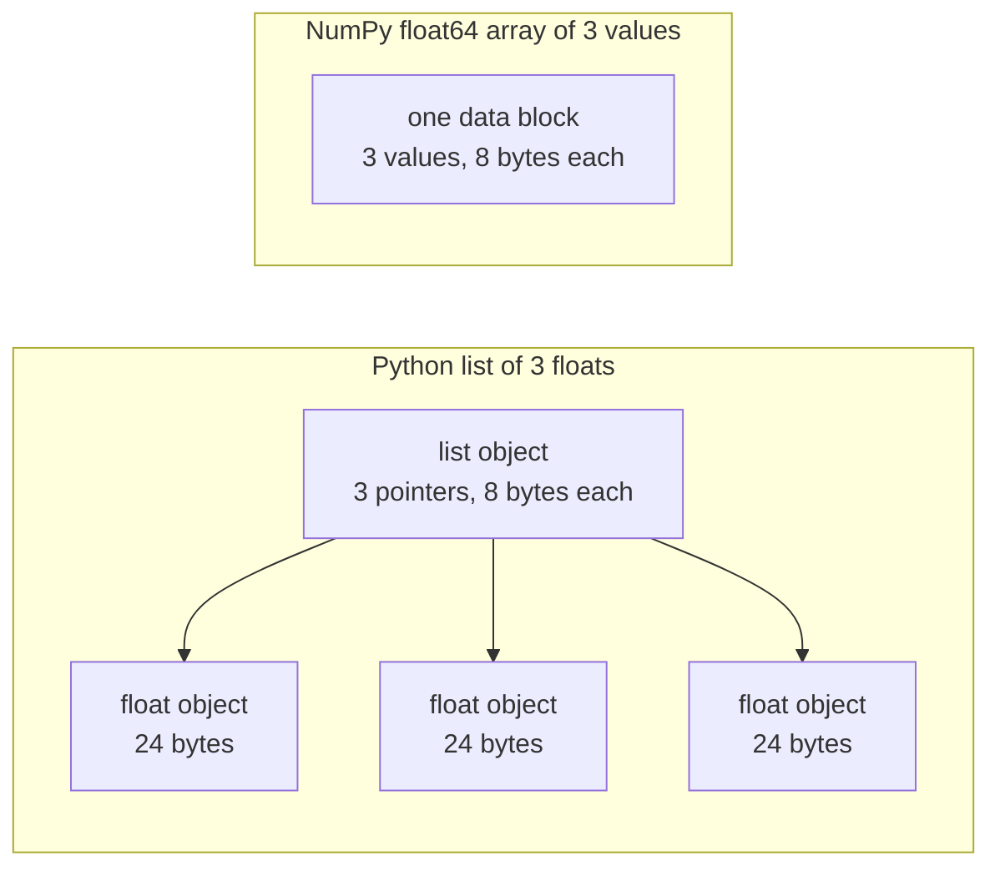

# 基于AI工程的Python

> 在这个课程中,大多数代码都使用相同的小小的Python语法. 在数学和模型课程取决于它之前,请在这里学习这个集合.

**Type:** Build
**Languages:** Python
**Prerequisites:** Dev Environment, Python Environments
**Time:** ~120 minutes

## 学习目标

- 阅读和写出大多数课程代码使用的语法,从解包和f字符串到数据类和理解.
- 找出三个错误的Python结果,没有错误:共享列表,可变的默认和使用式生成器.
- 建立一个CSV和JSON加载器,一个种子分区,以及一个只有标准库的迷你批量生成器.
- 在纯Python中写点产量,平均值和标准偏差,并测量它们的速度和内存使用.
- 解释为什么纯字thon循环在数字上是缓慢的,以及NumPy广播如何将循环转化为编译代码.

## 问题

在此阶段之后的课程中,使用平凡的Python来进行数学和模型.`dataclasses`另外,187个文件的电话`random.seed`或创建一个`random.Random`如果你对这些语法不太了解,你需要读数学时就读语法.

字符串也具有没有错误信息的错误结果行为.两个名称可以指向一个列表,因此通过一个名称的变化也会改变另一个.默认参数将其值从一个调用到另一个调用.一个传输后,生成器是空的,因此第二次训练时代没有数据,损失不会改变.

最后一个问题是速度.在我们的测试笔记本电脑上,一个纯Python循环超过百万个浮动的时间约为30毫秒.NumPy在不到一毫秒内计算出了相同的点产品.你需要知道原因,这样你就可以选择一个清晰的循环和一个阵列操作.

## 概念

### 课程代码所使用的内容

我们分析了所有541个Python文件.`phases/*/*/code/`随着`ast`计算时间是从我们写这门课程的那一天起,随着课程的增加而变化.

| Construct | Files | Share |
|-----------|-------|-------|
| Function definitions | 541 | 100% |
| `if __name__ == "__main__":` | 529 | 98% |
| f-strings | 517 | 96% |
| Tuple unpacking | 448 | 83% |
| Classes | 379 | 70% |
| List comprehensions | 375 | 69% |
| Type hints on functions | 342 | 63% |
| Generator expressions | 326 | 60% |
| Slices | 314 | 58% |
| `lambda` | 175 | 32% |
| `try` and `except` | 120 | 22% |
| `with` statements | 96 | 18% |
| Dict comprehensions | 93 | 17% |
| Generator functions with `yield` | 14 | 3% |

进口显示了哪些标准模块是重要的.`from __future__ import annotations`其他国家`dataclasses`现在,我们要去.`math`现在`random`其他`json`模块出现在187,175和126文件中.`collections`模块出现在70个文件中,`itertools`只有4个.

没有课程的电话`map()`或`filter()`了解是这样的.`sorted`现在`min`现在`max`其他`.sort`具有一个`key=`课程中最多的时间都花在这些名单上头的语法上.

### 名称指对象

在Python中,一个变量是指对象的名称.分配将一个名称绑定到对象.它不会复制对象.当两个名称指一个列表时,通过任何一个名称的变化都可通过两者来看出.数字,字符串和组不能改变,因此这个规则不会给它们带来任何问题.列表,字符串和集合可以改变,所以当你需要独立版本时,请复制.

### 一个列包含指针,一个数组包含数字

字符串列表不会直接存储数字.它存储指针,每个指针指的是一个完整的字符串对象.在CPython的64位构建中,每个指针需要8字节,每个指针需要8字节.`float`需要24字节的对象.`float64`列存储原始8字节值,并存在一个内存区块中.



一个单单的循环对每个元素进行了很多工作.解释器一次运行一个字节码说明.对于每个元素,它遵循一个指针,检查每个操作符的类型.然后它调用浮动乘码,并使一个字节字节对象保持结果.

NumPy 在编译代码的循环中对原始值进行相同的算术.它检查整个数组的数据类型一次,并且不会为每个元素构建任何Python对象.向量化代码描述整个数组上的一个操作,例如`(x - mean) / std`它们都会执行一个数组操作,所以你可以以一个NumPy调用后.

### 一个列表包含每个项目,一个发电机包含一个

一个列表理解程序在下一行运行之前构建每个项目.一个发电机每次调用者要求下一个项目时构建一个项目.一列表的内存随着项目数量增加而增长.一个发电机的内存对任何项目保持不变.

发电机只能运行一次,最后一项后,它会升级`StopIteration`在每一个请求上,所以一个秒`for`训练代码每时代读取数据集一次,因此必须为每时代创建一个新的生成器.

发电机功能在课程代码中很少存在.深度学习课程使用的数据加载器是批次的可反复性,因此这个想法在每个训练循环中.图表显示了两个方法在同一八行上.

```figure
s0-list-vs-generator
```

## 你需要的语句

按此节目中的每个块自行运行.`python3`区块需要Python 3.11或更新的版本,我们在开发环境课程中安装的版本.

### 1. 价值,收藏和解包

 Python 有四个集,请学习何时使用每一个集.

| Type | Example | Ordered | Can change | Typical use in the course |
|------|---------|---------|------------|---------------------------|
| `list` | `[0.5, 1.2]` | Yes | Yes | Samples, losses, weights |
| `tuple` | `(32, 784)` | Yes | No | Shapes, fixed records, dict keys |
| `dict` | `{"lr": 0.01}` | Insertion order | Yes | Configs, vocabularies, JSON rows |
| `set` | `{"cat", "dog"}` | No | Yes | Unique tokens, overlap checks |

列表中的列表

```python
weights = [0.5, -1.2, 3.0]
alias = weights
alias[0] = 99.0
print(weights)

independent = list(weights)
independent[1] = 0.0
print(weights, independent)

grid = [[0] * 3] * 2
grid[0][0] = 1
print(grid)

grid = [[0] * 3 for _ in range(2)]
grid[0][0] = 1
print(grid)
```

```text
[99.0, -1.2, 3.0]
[99.0, -1.2, 3.0] [99.0, 0.0, 3.0]
[[1, 0, 0], [1, 0, 0]]
[[1, 0, 0], [0, 0, 0]]
```

字体`[[0] * 3] * 2`对于每一行,理解构建一个新的内部列表.数学阶段从列表中构建矩阵,所以使用理解形式.

解包将序列的项目分配给一个行中的几个名称.一个明星名收集剩余的项目.一个f字符串将表达式的值放入一个字符串中,在长之后,一个可选格式.

```python
shape = (32, 784)
batch_size, n_features = shape
first, *middle, last = [1, 2, 3, 4, 5]
x, y = 1.0, 3.0
x, y = y, x

config = {"lr": 0.01, "epochs": 5}
config["seed"] = 7
tokens = ["the", "cat", "sat", "on", "the", "mat"]
vocab = set(tokens)

print(batch_size, n_features, first, middle, last, x, y)
print(config.get("momentum", 0.9), "cat" in vocab, len(vocab))
print(f"lr={config['lr']:.0e} loss={0.123456:.3f} n={60_000:,} {batch_size=}")
```

```text
32 784 1 [2, 3, 4] 5 3.0 1.0
0.9 True 5
lr=1e-02 loss=0.123 n=60,000 batch_size=32
```

`dict.get`返回默认值,当键缺失时.`in`测试在一个集体上需要大约同样的时间,`{batch_size=}`打印名称和值,帮助你调试.

一片`a[start:stop:step]`包括`start`并且不包括`stop`负指数从最后开始计算. 一个单单的片段是新的单单,所以一个大单单单的片段复制了所有指针.

```python
tokens = ["<s>", "the", "cat", "sat", "on", "the", "mat", "</s>"]
print(tokens[1:-1])
print(tokens[:3], tokens[-3:])
print(tokens[::2])
print(tokens[::-1][:2])
windows = [tokens[i:i + 3] for i in range(len(tokens) - 2)]
print(len(windows), windows[0])
```

```text
['the', 'cat', 'sat', 'on', 'the', 'mat']
['<s>', 'the', 'cat'] ['the', 'mat', '</s>']
['<s>', 'cat', 'on', 'mat']
['</s>', 'mat']
6 ['<s>', 'the', 'cat']
```

### 2. 了解

理解从一个单词中构建一个单词,一个单词,一个单词,一个单词.

```python
scores = [0.91, 0.42, 0.77, 0.15, 0.66]
labels = [1 if s >= 0.5 else 0 for s in scores]
high = [s for s in scores if s > 0.6]
squares = {i: i * i for i in range(4)}
lengths = {len(word) for word in ["a", "bb", "cc", "ddd"]}
sum_sq = sum(s * s for s in scores)

matrix = [[1, 2, 3], [4, 5, 6]]
transposed = [list(column) for column in zip(*matrix)]
flat = [v for row in matrix for v in row]

print(labels, high, squares, lengths, round(sum_sq, 4))
print(transposed, flat)
```

```text
[1, 0, 1, 0, 1] [0.91, 0.77, 0.66] {0: 0, 1: 1, 2: 4, 3: 9} {1, 2, 3} 2.0555
[[1, 4], [2, 5], [3, 6]] [1, 2, 3, 4, 5, 6]
```

后续的路径`if`现在,我们只能把一些东西留下来.`for`能是条件式的表达式,`a if condition else b`两个`for`条款的顺序与两个嵌套循环相同.

圆子形成一个发电表达.`sum(s * s for s in scores)`现在`sum`字符串的编程是从一个字符串中读到一个字符串,而Python则没有构建任何列表.`zip(*matrix)`星球通过每一行作为一个独立的参数,`zip`在每个位置对物.

### 3. 函数,参数和关闭

默认值使参数可选.一个关键字参数在调用时命名参数.`*`只有关键字才能使用下一个参数.

```python
def clip(value, low=0.0, high=1.0):
    return max(low, min(high, value))


def train(data, *, lr=0.01, epochs=3):
    return f"{len(data)} samples, lr={lr}, epochs={epochs}"


def make_scaler(factor):
    def scale(values):
        return [v * factor for v in values]
    return scale


print(clip(1.7), clip(-3.0, low=-1.0), clip(0.4, high=0.3))
print(train([1, 2, 3], lr=0.1))
to_percent = make_scaler(100)
print(to_percent([0.25, 0.5]))
```

```text
1.0 -1.0 0.3
3 samples, lr=0.1, epochs=3
[25.0, 50.0]
```

通过单独关键字的参数,`train(data, 0.1, 3)`增加`TypeError`呼叫者必须写下`lr=0.1`两个数字不能偶然地换位.

内部功能`scale`使用`factor`根据它所创建的函数.`factor`长时间`scale`构建它中的标准化器使用一个关闭来保存训练统计数据.

`lambda`课程代码主要用它作为一个`key=`部分8显示的功能.

 Python 评估一个默认值,当它运行了`def`每次使用默认的电话都会得到相同的对象.

```python
def add_bad(item, bucket=[]):
    bucket.append(item)
    return bucket


def add_good(item, bucket=None):
    if bucket is None:
        bucket = []
    bucket.append(item)
    return bucket


add_bad("a")
print(add_bad("b"))
add_good("a")
print(add_good("b"))
```

```text
['a', 'b']
['b']
```

使用`None`创建函数内部的新对象.

### 4. 类和数据类

其他`@dataclass`装饰师写道`__init__`现在`__repr__`其他`__eq__`通过 `frozen=True`创建后,对象不能改变,你可以用它作为一个键或将它放在一个集合中.

```python
from dataclasses import dataclass, field


@dataclass(frozen=True)
class Example:
    features: tuple[float, ...]
    label: int


@dataclass
class TrainConfig:
    lr: float = 0.01
    epochs: int = 5
    hidden: list[int] = field(default_factory=lambda: [64, 32])

    def describe(self):
        return f"lr={self.lr} epochs={self.epochs} hidden={self.hidden}"


ex = Example((1.5, 2.0), 1)
print(ex)
print(ex == Example((1.5, 2.0), 1), len({ex, Example((1.5, 2.0), 1)}))
print(TrainConfig(epochs=10).describe())
try:
    ex.label = 0
except AttributeError as err:
    print(type(err).__name__)
```

```text
Example(features=(1.5, 2.0), label=1)
True 1
lr=0.01 epochs=10 hidden=[64, 32]
FrozenInstanceError
```

`field(default_factory=...)`解决了数据类内部的共享默认问题.

特殊方法将一个类连接到Python语法. `len(ds)`电话`__len__`其他`ds[2]`电话`__getitem__`现在,我们要去.

```python
class SquaresDataset:
    def __init__(self, n):
        self.n = n

    def __len__(self):
        return self.n

    def __getitem__(self, index):
        if not 0 <= index < self.n:
            raise IndexError(index)
        return index, index * index


ds = SquaresDataset(4)
print(len(ds), ds[2])
print(list(ds))
```

```text
4 (2, 4)
[(0, 0), (1, 1), (2, 4), (3, 9)]
```

其他`for`内部的循环`list(ds)`没有工作`__iter__`通过Python来调用`__getitem__`只有一个,一个,两个,等等等.`IndexError`皮托尔奇地图类数据集使用相同的两种方法,`__len__`其他`__getitem__`现在,我们要去.

### 5. 电动电源

可循环是任何对象的`for`循环接受.`iter()`它们可以得到一个反复发射器,`next()`并且在一个代代码中,它会增加一个代码.`StopIteration` `for`环节调用`next()`为了你,我们在`StopIteration`现在,我们要去.

```python
numbers = [10, 20, 30]
it = iter(numbers)
print(next(it), next(it), next(it))
try:
    next(it)
except StopIteration:
    print("no more items")


def countdown(n):
    while n > 0:
        yield n
        n -= 1


gen = countdown(3)
print(type(gen).__name__)
print(list(gen))
print(list(gen))
```

```text
10 20 30
no more items
generator
[3, 2, 1]
[]
```

具有一个函数`yield`电话给它运行没有它的代码,然后返回一个电源对象.`next()`运行身体到下一个`yield`接着,第二个`list(gen)`由于第一台用了发电机,所以它是空的.

发电机可以读取一个文件一行一行.

```python
import os
import tempfile


def read_rows(path):
    with open(path, encoding="utf-8") as fh:
        header = fh.readline().rstrip("\n").split(",")
        for line in fh:
            yield dict(zip(header, line.rstrip("\n").split(",")))


with tempfile.TemporaryDirectory() as tmp:
    path = os.path.join(tmp, "rows.csv")
    with open(path, "w", encoding="utf-8") as fh:
        fh.write("x,label\n")
        fh.writelines(f"{i * 0.5},{i % 2}\n" for i in range(5))
    rows = read_rows(path)
    print(next(rows))
    print(sum(1 for _ in rows))
```

```text
{'x': '0.0', 'label': '0'}
4
```

`read_rows`文件的存储时间是一个行.`read_rows`实际的CSV文件可以包含引用字段内的逗号,所以Build It使用了`csv`模块

```python
import sys

as_list = [i * i for i in range(1_000_000)]
as_generator = (i * i for i in range(1_000_000))
print(sys.getsizeof(as_list), sys.getsizeof(as_generator))
print(sum(as_list) == sum(as_generator))
```

在64位CPython上,列表报告约8MB,生成器约200字节. `sys.getsizeof`构建它测量实际峰值的数量.`tracemalloc`通过"选"的方法,我们在调试和配置文件课中使用了它.

### 6. 环境管理器和例外

`with`清理运行即使身体提出了一个例外. 文件对象从`open()`是一个封闭文件的语境管理器.

在调试和配置文件课程中,我们写了一个`Timer`课程`__enter__`其他`__exit__`现在,我们要去.`contextlib.contextmanager`装饰师从发电机中制造相同类型的物体.`yield`设置,和`finally`区块是清理.

```python
import time
from contextlib import contextmanager


@contextmanager
def timer(label):
    start = time.perf_counter()
    try:
        yield
    finally:
        print(f"{label}: {(time.perf_counter() - start) * 1000:.1f} ms")


def parse_label(text):
    try:
        return int(text)
    except ValueError:
        raise ValueError(f"label must be an integer, got {text!r}") from None


with timer("sum of squares"):
    total = sum(i * i for i in range(200_000))

print(parse_label("3"))
try:
    parse_label("cat")
except ValueError as err:
    print("rejected:", err)
```

```text
sum of squares: 9.4 ms
3
rejected: label must be an integer, got 'cat'
```

您的机器上的时间将会不同.`except`条款如`ValueError`或`KeyError`,我很高兴.`except:`没有例外类型的条款也处理`KeyboardInterrupt`输入错误时,请通过明确的消息提出例外.`from None`当你的消息取代原始追踪.

### 7. 输入提示,模块和主防护器

字符提示告诉读者函数所取并返回的内容.Python不会在代码运行时检查它们.一个类型检查器,如mypy,在代码运行之前会读取它们.

```python
from __future__ import annotations

from collections.abc import Iterable, Sequence


def mean(values: Sequence[float]) -> float:
    if not values:
        raise ValueError("mean() needs at least one value")
    return sum(values) / len(values)


def count_tokens(docs: Iterable[str]) -> int:
    return sum(len(doc.split()) for doc in docs)


def main() -> None:
    print(mean([1.0, 2.0, 4.0]))
    print(count_tokens(["the cat sat", "on the mat"]))
    print(mean.__annotations__)


if __name__ == "__main__":
    main()
```

```text
2.3333333333333335
6
{'values': 'Sequence[float]', 'return': 'float'}
```

随着`from __future__ import annotations`字符串将每一个提示作为一个字符串,`Sequence`意思是任何物体`len()`其他类型的指数,如列表或图普尔.`Iterable`意思是指任何一个`for`许多课程文件从 `typing`它们也可以.

每一个`.py`文件是模块.当你运行一个文件时`python3 file.py` Python 设置了它的`__name__`为了`"__main__"`当另一个文件进口时,`__name__`监护人员打电话`main()`由于警卫,`code/tests/`能进口`main.py`没有开始演示.

### 8. 文件,JSON,CSV,和排序

`pathlib.Path`连接路径与`/`总是给一个人一个文件.`encoding="utf-8"`由于默认编码取决于操作系统.

```python
import csv
import json
import tempfile
from pathlib import Path

rows = [
    {"text": "great movie", "label": 1, "score": 0.93},
    {"text": "boring plot", "label": 0, "score": 0.12},
    {"text": "fine acting", "label": 1, "score": 0.58},
]

with tempfile.TemporaryDirectory() as tmp:
    json_path = Path(tmp) / "reviews.json"
    json_path.write_text(json.dumps(rows, indent=2), encoding="utf-8")
    from_json = json.loads(json_path.read_text(encoding="utf-8"))

    csv_path = Path(tmp) / "reviews.csv"
    with csv_path.open("w", newline="", encoding="utf-8") as fh:
        writer = csv.DictWriter(fh, fieldnames=["text", "label", "score"])
        writer.writeheader()
        writer.writerows(rows)
    with csv_path.open(newline="", encoding="utf-8") as fh:
        from_csv = list(csv.DictReader(fh))

print(from_json == rows)
print(from_csv[0])

by_score = sorted(rows, key=lambda r: r["score"], reverse=True)
print([r["text"] for r in by_score])
print(max(rows, key=lambda r: r["score"])["text"])
print([r["text"] for r in sorted(rows, key=lambda r: (-r["label"], r["text"]))])
```

```text
True
{'text': 'great movie', 'label': '1', 'score': '0.93'}
['great movie', 'fine acting', 'boring plot']
great movie
['fine acting', 'great movie', 'boring plot']
```

转换到一个字符串,所以必须将每个字符串转换到一个字符串.`newline=""`作为一个`csv`文件告诉你.

`key=`函数返回Python对每个项进行比较的值. `sorted`现在`min`其他`max`字符符号是字符号的,所以字符号的排序是稳定的,所以相同的字符符号的元素保持原始顺序.

### 9. 计数,组组和代工具

这些两个模块包含了简单列表和直达数据不提供的数据结构和代工具.

```python
from collections import Counter, defaultdict, deque
from itertools import chain, islice, product

labels = ["cat", "dog", "cat", "bird", "cat", "dog"]
counts = Counter(labels)
print(counts.most_common(2))

positions = defaultdict(list)
for i, label in enumerate(labels):
    positions[label].append(i)
print(dict(positions))

recent = deque(maxlen=3)
for loss in [2.0, 1.5, 1.2, 1.1, 0.9]:
    recent.append(loss)
print(list(recent), round(sum(recent) / len(recent), 3))

print(list(product([0.1, 0.01], [16, 32])))
print(list(chain([1, 2], [3], [4, 5])))
print(list(islice(range(100), 5, 10)))
```

```text
[('cat', 3), ('dog', 2)]
{'cat': [0, 2, 4], 'dog': [1, 5], 'bird': [3]}
[1.2, 1.1, 0.9] 1.067
[(0.1, 16), (0.1, 32), (0.01, 16), (0.01, 32)]
[1, 2, 3, 4, 5]
[5, 6, 7, 8, 9]
```

`Counter`计数可被取的物品,如标签或代币. `defaultdict(list)`在使用新键时创建一个空清单,所以一个组合循环不需要键检查. `deque(maxlen=3)`增加第四个时,将最古老的项目移除,`enumerate`给每项项目一个指数.

`product`给出了其输入的每一个组合,这是一个超参数格.`chain`连接可循序的终结.`islice`构建它中的小型批量发电器使用`islice`现在,我们要去.

### 10. 为什么数字循环是缓慢的

其他`dis`模块打印了解释器为函数运行的字节码指令.

```python
import dis


def dot(a, b):
    total = 0.0
    for x, y in zip(a, b):
        total += x * y
    return total


dis.dis(dot)
```

关于`FOR_ITER`按下下列列字母,然后再跳回,每个元素都运行一次. 这就像每次乘和加的10个指令.

循环的步骤较少时会运行为字节码.`sum`现在`map`其他`zip`构建它以纯 Python 来测量这种效果,使用它将整个循环移动到 NumPy.

## 建立它

现在,你要做一些后来的课程.`code/main.py`其他`code/tests/test_main.py`测试它. 下面的每块都自行运行.

### 步骤1:记录类型和数据集加载器

载体将CSV文件或JSON文件读取成一个形状:一个浮动功能的图普尔和整数标签.

```python
import csv
import json
import tempfile
from dataclasses import dataclass
from pathlib import Path


@dataclass(frozen=True)
class Record:
    features: tuple[float, ...]
    label: int


def row_to_record(row, names, label_field="label"):
    if label_field not in row:
        raise ValueError(f"row has no {label_field!r} field: {row}")
    if set(row) != {*names, label_field}:
        raise ValueError(f"row fields {list(row)} do not match {[*names, label_field]}")
    return Record(tuple(float(row[name]) for name in names), int(row[label_field]))


def load_records(path, label_field="label"):
    path = Path(path)
    if path.suffix == ".json":
        rows = json.loads(path.read_text(encoding="utf-8"))
    elif path.suffix == ".csv":
        with path.open(newline="", encoding="utf-8") as fh:
            rows = list(csv.DictReader(fh))
    else:
        raise ValueError(f"unsupported file type: {path.suffix!r}")
    if not rows:
        return []
    names = [key for key in rows[0] if key != label_field]
    return [row_to_record(row, names, label_field) for row in rows]


with tempfile.TemporaryDirectory() as tmp:
    csv_path = Path(tmp) / "data.csv"
    csv_path.write_text("x1,x2,label\n1.5,60,1\n1.8,82.5,0\n", encoding="utf-8")
    json_path = Path(tmp) / "data.json"
    json_path.write_text('[{"x1": 1.5, "x2": 60, "label": 1}]', encoding="utf-8")
    print(load_records(csv_path))
    print(load_records(json_path))
```

```text
[Record(features=(1.5, 60.0), label=1), Record(features=(1.8, 82.5), label=0)]
[Record(features=(1.5, 60.0), label=1)]
```

第一个行设定了特征名称及其顺序. `DictReader`其他`json.loads`按文件顺序保存键,并且一个字符符符符符符符符符符符符符符符符符符符符符符符符符符符符符符符符符符符符符符符符符符符符符符符符符符符符符符符符符符符符符符符符符符符符符符符符符符符符符符符符符符符符符符符符符符符符符符符符符符符符符符符符符符符符符符符符符符符符符符符符符符符符符符符符符符符符符符符符符符符符符符符符符符符符符符符符符符符符符符符符符符符符符符符符符符符符符符符符符符符符符符符符符符符符符符符符符符符符符符符符符符符符符符符符符符符符符符符符符符符符符符符符符符符符符符符符符符符符符符符符符符符符符符符符符符符符符符符符符符符符符符符符符符符符符符符符符符符符符符符符符符符符符符符符符符符符符符符符符符符符符符符符符符符符符符符符符符符符符符符符符符符符符符符符符符符符符符符符符符符符符符符符符符符符符符符符符符符符符符符符符符符符符符符符符符符符符符符符符符符符符符符符符符符符符符符符符符符符符符符符符符符符符符符符符符符符符符符符符符符符符符符符符符符符符符符符符符符符符符符符符符符符符符符符符符符符符符符符符符符符符符符符符符符符符符符符符符符符符符符符符符符符符符符符符符符符符符符符符符符`row_to_record`读取每行名称,按第一行顺序. 缺失标签,缺失或额外的功能,或未知的文件类型提升`ValueError`通过一个消息,所以一个坏的文件在开始就停止运行.`main.py`现在,`save_records`它们的格式是相同的.

### 步骤2:种子列车和测试分开

```python
import random


def train_test_split(items, test_fraction=0.2, seed=0):
    if not 0.0 < test_fraction < 1.0:
        raise ValueError(f"test_fraction must be between 0 and 1, got {test_fraction}")
    if len(items) < 2:
        raise ValueError(f"need at least 2 items to split, got {len(items)}")
    order = list(range(len(items)))
    random.Random(seed).shuffle(order)
    n_test = min(max(1, round(len(items) * test_fraction)), len(items) - 1)
    test = [items[i] for i in order[:n_test]]
    train = [items[i] for i in order[n_test:]]
    return train, test


items = list(range(10))
print(train_test_split(items, seed=1))
print(train_test_split(items, seed=1) == train_test_split(items, seed=1))
print(train_test_split(items, seed=2)[1])
print(items)
```

```text
([9, 7, 5, 3, 0, 4, 1, 2], [6, 8])
True
[5, 9]
[0, 1, 2, 3, 4, 5, 6, 7, 8, 9]
```

`random.Random(seed)`创建一个私人随机数生成器.`random.seed(seed)`调整所有模块共享的单个全球发电机,这样一个在另一个库中的调用可以改变你的序列.`random.seed`其他国家`random.Random`用私人发电机在新的代码中.

函数将一个索引列表混,因此输入列表保持不变.相同的种子总是会产生相同的分区.每个侧保持至少一个项,因此一个列表少于2项会增加.`ValueError`在调试和配置课程中,我们看到,火车和测试数据之间的重叠给出了过高的测试分数.

### 步骤3:一个小型批量发电机

```python
from itertools import islice


def batches(items, batch_size, drop_last=False):
    if batch_size < 1:
        raise ValueError(f"batch_size must be at least 1, got {batch_size}")
    return _batch_iter(iter(items), batch_size, drop_last)


def _batch_iter(iterator, batch_size, drop_last):
    while True:
        batch = list(islice(iterator, batch_size))
        if not batch or (drop_last and len(batch) < batch_size):
            return
        yield batch


print(list(batches(range(10), 4)))
print(list(batches(range(10), 4, drop_last=True)))
squares = (i * i for i in range(7))
print([len(b) for b in batches(squares, 3)])

for epoch in range(2):
    sizes = [len(b) for b in batches(range(10), 4)]
    print(f"epoch {epoch}: {sizes}")
```

```text
[[0, 1, 2, 3], [4, 5, 6, 7], [8, 9]]
[[0, 1, 2, 3], [4, 5, 6, 7]]
[3, 3, 1]
epoch 0: [4, 4, 2]
epoch 1: [4, 4, 2]
```

`islice`需要的时间`batch_size`通过代器的项目.`batches`需要`iter()`后一批量较小,如果长度不等于批量大小的乘倍. `drop_last=True`对于需要固定批量形状的模型来说,

工作是两个函数,因为一个生成器函数直到第一个运行没有代码.`next()`电源内存的支票,`batches(data, 0)`错误将会在训练循环内部出现. 外部函数是正常的函数,所以它会立即检查参数.`batches()`由于发电机只能一次提供其物品.

### 步骤4:向量数学和标准化器

```python
import math


def dot(a, b):
    return sum(x * y for x, y in zip(a, b, strict=True))


def mean(values):
    if not values:
        raise ValueError("mean() needs at least one value")
    return sum(values) / len(values)


def std(values):
    mu = mean(values)
    return math.sqrt(sum((v - mu) ** 2 for v in values) / len(values))


def make_standardizer(rows):
    columns = list(zip(*rows))
    means = [mean(c) for c in columns]
    scales = [s if s > 0 else 1.0 for s in (std(c) for c in columns)]

    def standardize(row):
        return [(v - m) / s for v, m, s in zip(row, means, scales, strict=True)]

    return standardize


print(dot([1.0, 2.0, 3.0], [4.0, 5.0, 6.0]))
values = [2.0, 4.0, 4.0, 4.0, 5.0, 5.0, 7.0, 9.0]
print(mean(values), std(values))

train_rows = [(1.0, 100.0), (2.0, 300.0), (3.0, 500.0)]
standardize = make_standardizer(train_rows)
print([[round(v, 3) for v in standardize(r)] for r in train_rows])
print([round(v, 3) for v in standardize((4.0, 700.0))])
```

```text
32.0
5.0 2.0
[[-1.225, -1.225], [0.0, 0.0], [1.225, 1.225]]
[2.449, 2.449]
```

随着`strict=True`现在`zip`增加`ValueError`没有它, 没有它,`zip`                                                                                                                                                                                                                                                                                                                                                                                                                                                                                                                             `strict`参数需要Python 3.10或更新的版本.

`std`分为 `n`于是给出了人口的标准偏差,`statistics.pstdev`按分数分为`n - 1`在一个样本中估计一个更大的人口的分布时.

`make_standardizer`通过计算从训练行列中的一次的手段和标准偏差,`standardize`测试数据对统计没有影响. 一个常数列的标准偏差是0,所以标准化器使用1的尺度.

### 步骤5:完整的运行

`code/main.py`通过将两个集群进行连接,它将400个记录从两个集群中创建,将它们保存为CSV和JSON,然后将两个文件重新加载.

最接近的中位数分类器存储每个类的平均特征向量. 它预测了最接近输入的平均值的类. `fit_centroids`它们每次都会在一批中加上一排,因此它们永远不需要记忆中的全部训练.`predict`使用`min()`具有一个`key=`它们可以找到最接近的中位.

```bash
python3 phases/00-setup-and-tooling/13-python-for-ai-engineering/code/main.py
```

```text
Python for AI engineering: a standard-library toolkit
data     400 records, CSV and JSON load back unchanged: True
split    320 train, 80 test, records in both: 0
batches  size 48: [48, 48, 48, 48, 48, 48, 32]
scale    train feature means after standardizing: [0.0, 0.0]
model    nearest-centroid test accuracy: raw 0.86, standardized 0.89
speed    dot product of 200,000 floats, best of 5:
           index loop         6.60 ms
           zip generator      5.93 ms
           map + mul          2.89 ms
memory   peak bytes to sum 100,000 squares:
           list              4,000,616
           generator               472
```

它们的尺寸非常不同.第二个特征的扩散是第一个的十倍,所以它控制了原始距离,原始精度更低.你的速度和内存数量将与这些数字不同.

### 步骤 6:测量速度和内存

```python
import operator
import random
import time
import tracemalloc


def dot_index_loop(a, b):
    total = 0.0
    for i in range(len(a)):
        total += a[i] * b[i]
    return total


def dot_zip(a, b):
    return sum(x * y for x, y in zip(a, b, strict=True))


def dot_map(a, b):
    return sum(map(operator.mul, a, b))


def best_time(fn, *args, repeat=5):
    times = []
    for _ in range(repeat):
        start = time.perf_counter()
        fn(*args)
        times.append(time.perf_counter() - start)
    return min(times)


def peak_bytes(fn):
    tracemalloc.start()
    try:
        fn()
        return tracemalloc.get_traced_memory()[1]
    finally:
        tracemalloc.stop()


rng = random.Random(0)
a = [rng.random() for _ in range(1_000_000)]
b = [rng.random() for _ in range(1_000_000)]
for fn in (dot_index_loop, dot_zip, dot_map):
    print(f"{fn.__name__:15} {best_time(fn, a, b) * 1000:7.2f} ms")

print(peak_bytes(lambda: sum([i * i for i in range(100_000)])))
print(peak_bytes(lambda: sum(i * i for i in range(100_000))))
```

`best_time`其他机器上的程序只能增加时间,因此最低是最接近实际成本的.`timeit`模块提供了同样的建议.

在我们使用Python 3.111的测试笔记本电脑上,索引循环需要大约33ms.`map`它们都在做相同的算法.`map`版本更快,因为`map`其他`operator.mul`记忆数字重复这个数字:列表大约4MB,发电机小于1KB.

## 用它

### 标准图书馆版本

标准图书馆有你建造的大部分作品的测试版本.

| You built | Standard library | Note |
|-----------|------------------|------|
| `mean`, `std` | `statistics.fmean`, `statistics.pstdev` | The tests compare against these |
| `dot` | `math.sumprod` | Python 3.12 or newer |
| `batches` | `itertools.batched` | Python 3.12 or newer, gives tuples |
| `best_time` | `timeit.repeat` | Also turns off garbage collection during the runs |
| `peak_bytes` | `tracemalloc` | The same module, with snapshots and per-line statistics |

```python
import statistics
import sys

values = [2.0, 4.0, 4.0, 4.0, 5.0, 5.0, 7.0, 9.0]
print(statistics.fmean(values), statistics.pstdev(values))

if sys.version_info >= (3, 12):
    import math
    from itertools import batched

    print(math.sumprod([1.0, 2.0, 3.0], [4.0, 5.0, 6.0]))
    print(list(batched(range(10), 4)))
```

```text
5.0 2.0
32.0
[(0, 1, 2, 3), (4, 5, 6, 7), (8, 9)]
```

课程支持Python 3.11,所以`main.py`使用自己的`dot`其他`batches`在Python 3.11,区块只打印第一行.

### 复式数组的数学

通过 Python 环境课程安装 NumPy 在虚拟环境中,例如使用 `uv pip install numpy`课程代码和测试不需要它.

```python
import time

import numpy as np

n = 1_000_000
rng = np.random.default_rng(0)
a = rng.random(n)
b = rng.random(n)
a_list, b_list = a.tolist(), b.tolist()

start = time.perf_counter()
slow = sum(x * y for x, y in zip(a_list, b_list))
python_ms = (time.perf_counter() - start) * 1000

start = time.perf_counter()
fast = float(a @ b)
numpy_ms = (time.perf_counter() - start) * 1000

print(f"pure Python {python_ms:8.2f} ms")
print(f"NumPy       {numpy_ms:8.2f} ms")
print(f"difference  {abs(slow - fast):.1e}")
print(a.dtype, a.itemsize, a.nbytes)
```

在我们的测试笔记本电脑上,NumPy需要不到1ms,而纯字thon版本需要大约30ms.两个结果在最后的数字中不同,因为两个版本在不同的顺序中添加产品.浮点的添加在不同的顺序中给出了略有不同的结果.

由于三个原因,NumPy更快:

- 阵列存储原料`float64`单个存储区块中每个值需要一个8字节指针和一个24字节的浮动对象.
- 循环运行在编译代码中.NumPy检查整个数组的数据类型一次,并没有为每个元素构建任何Python对象.
- 值在内存中坐在一起的值使NumPy使用SIMD指令,该指令可以用一个指令处理多个值.

对于非常小的数组,一个NumPy调用的固定成本可能比一个短的Python循环大. 4练习会找到NumPy在机器上变得更快的尺寸.

### 广播

广播允许NumPy 结合不同形状的阵列,而不需要循环在代码中.`make_standardizer`从第4步.

```python
import numpy as np

X = np.array([[1.0, 100.0], [2.0, 300.0], [3.0, 500.0]])
mu = X.mean(axis=0)
sigma = X.std(axis=0)
Z = (X - mu) / sigma
print(X.shape, mu.shape, Z.shape)
print(Z.round(3))

norms = np.sqrt((X ** 2).sum(axis=1, keepdims=True))
print(norms.shape, (X / norms).shape)
```

```text
(3, 2) (2,) (3, 2)
[[-1.225 -1.225]
 [ 0.     0.   ]
 [ 1.225  1.225]]
(3, 1) (3, 2)
```

NumPy将两个形状从最后一个维度进行比较.当两个维度等于或其中一个是1.一个缺失的领先维度被计算为1.在更大的维度上再次使用一个尺寸1.NumPy没有复制数据.

| Shape of `X` | Shape of the other array | Result |
|--------------|--------------------------|--------|
| `(3, 2)` | `(2,)`, column means | `(3, 2)` |
| `(3, 2)` | `(3, 1)`, row norms with `keepdims=True` | `(3, 2)` |
| `(3, 2)` | `(3,)`, row norms without `keepdims` | `ValueError` |

后行是一个常见的错误.NumPy将后行2与3进行比较,没有一个是1. Keep `keepdims=True`结果与原始数组相结合.

## 运送它

这一课产生了`outputs/prompt-python-review.md`它是人工智能和数据项目中的Python代码的回顾提示.给它一个文件或一个差异.它检查了本课中的语法和默认错误代码:

- 共同引用和可变的默认参数
- 经过使用后,第二个时代读取的发电机
- 随机数量没有种子,或者只有全球种子
- 测试分区的统计数据
- 纯字thon 循环在大数组上

它报告每一个发现,一个位置,问题,和解决方案.

## 运动

1. 跑步`run_demo(seed=8)`其他`main.py`找出出口线的变化和保持相同的线.解释为什么分区尺寸保持相同.
2. 写下`median(values)`试试它与`statistics.median`在奇数长度和偶长度的列表上.
3. 写下`stream_records(path)`能产生一个发电机.`Record`通过 CSV 文件,创建一个200,000行的文件.`stream_records`其他`load_records`随着`tracemalloc`现在,我们要去.
4. 写下`matvec(matrix, vector)`在纯 Python 和 NumPy 中测量它们.`best_time`在机器上, NumPy 变得更快的尺寸.
5. 写出从概念的构建扫描.`ast.parse`其他`ast.walk`在每一个文件中`phases/*/*/code/*.py`计算包含的文件`ast.ListComp`现在`ast.Yield`其他`ast.With`现在,你和表表进行比较.

## 关键词

| Term | What people say | What it means |
|------|----------------|----------------------|
| Iterable | "Something you can loop over" | An object that `iter()` accepts, such as a list, a file, or a generator |
| Iterator | "A cursor" | An object whose `__next__` method returns one item per call and raises `StopIteration` at the end |
| Generator | "A lazy list" | An iterator from a `yield` function or a generator expression. It makes each item on request and runs only once. |
| Comprehension | "A one-line loop" | An expression that builds a list, dict, or set from an iterable, with an optional filter |
| Closure | "A function inside a function" | A function that keeps variables from the function that created it |
| Dataclass | "A struct" | A class whose `__init__`, `__repr__`, and `__eq__` methods Python writes from the annotated fields |
| Context manager | "A with block" | An object that runs setup code at the start of a `with` block and cleanup code at the end, even after an exception |
| Seed | "The random number" | The start value of a pseudo-random generator. The same seed gives the same sequence. |
| Vectorized code | "Fast code" | Code that applies one operation to a whole array, so that compiled code runs the loop |
| Broadcasting | "Automatic shape matching" | The NumPy rules that combine arrays of different shapes by using size-1 dimensions again, with no copy |

## 进一步阅读

- [The Python Tutorial: Data Structures](https://docs.python.org/3/tutorial/datastructures.html)列表,双数,集合,指令和理解.
- [The Python Tutorial: Classes](https://docs.python.org/3/tutorial/classes.html)它们的范围,类,代器和生成器.
- [dataclasses](https://docs.python.org/3/library/dataclasses.html)装饰师的每一个选择,包括`frozen`其他`field`现在,我们要去.
- [collections](https://docs.python.org/3/library/collections.html)其他`Counter`现在`defaultdict`现在`deque`其他容器类型.
- [itertools](https://docs.python.org/3/library/itertools.html)其他`islice`现在`chain`现在`product`现在`batched`它们的配方.
- [Sorting Techniques](https://docs.python.org/3/howto/sorting.html)按键:关键函数,稳定类型,以及多个键类型.
- [timeit](https://docs.python.org/3/library/timeit.html)如何测量小代码,以及为什么要报告最低值.
- [random](https://docs.python.org/3/library/random.html)全球发电机`random.Random`其他类型的产品,
- [PEP 255: Simple Generators](https://peps.python.org/pep-0255/)建议增加了`yield`根据其设计的原因.
- [NumPy: Broadcasting](https://numpy.org/doc/stable/user/basics.broadcasting.html)图形规则,图形.
- [Harris et al., Array programming with NumPy, Nature 585, 2020](https://doi.org/10.1038/s41586-020-2649-2)图:NumPy阵列的设计及其速度的原因.
