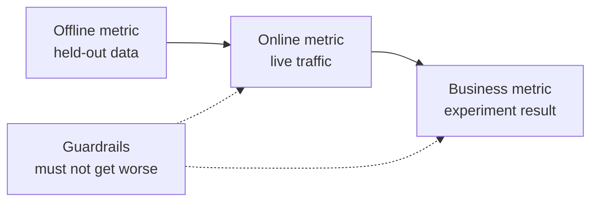

# 系统设计 从问题到部署模型

> 模型是系统的一部分. 设计决定模型预测什么,谁对它采取行动,成本多少,以及它失败时会发生什么.

**Type:** Build
**Languages:** Python
**Prerequisites:** Phase 2, Lessons 09 (Model Evaluation) and 13 (ML Pipelines)
**Time:** ~110 minutes

## 学习目标

- 设置一个业务问题作为一个ML任务,一个预测,一个使用它的决定,以及一个理由,为什么规则不够
- 区分离离线,在线,商业和防线指标,并将每个模型与微不足道和论的基线进行比较
- 从交通数量来估计批量和在线推断的每日成本,延迟和延迟
- 选择一个推出模式 (影子,鱼,A/B测试) 和每个故障模式的安全默认
- 确定模型改变其下一个版本训练数据的反循环
- 写一个ML设计文件,并与固定检查清单进行比分

## 问题

一家订阅公司要求"一个缩模型".一个数据科学家训练了一个加坡加大分类器,报告AUC为0.91.

原因与算法无关.没有人决定一个分数开始的操作.分数每周一次到来,但保留团队每天都打电话给客户.标签来自取消表,其中还存储了取消原因,所以一个功能包含了答案.没有人比较了模型与支持团队已经使用的规则:打电话给任何人休息两周.

设计失败是一个页面的设计文件询问它们中的每一个.这个课程教导了该文件中的决定.你建立了一个工具包,将批量和在线服务价格进行比较,将模型与基线进行比较,并与检查清单进行设计文件的评分.

## 概念

### 从业务目标到 ML任务

企业目标不是一个 ML 任务.

1. 模型预测什么,以及对哪个实体 (用户,支付,存储,项目)?
2. 预言使用哪个决定,谁或什么决定?
3. 预测是什么时候需要的,
4. 你怎么知道这个决定是更好的呢?

| Business goal | Prediction | Decision that uses it | ML task |
|---|---|---|---|
| Reduce churn | Probability that a user cancels in the next 30 days | Send a save offer to the top 5 percent each night | Binary classification |
| Cut fraud losses | Probability that a payment is fraud | Approve, review, or block within 100 ms | Binary classification |
| Keep shelves stocked | Units sold per store per day next week | Order quantity for each store | Forecasting |
| Show relevant items | Relevance score for a (user, item) pair | Order of items in the feed | Ranking |

"预测"让视野,实体和行动都开放. "预测用户在未来30天内是否会取消,以便今晚的工作可以选择谁得到报价"解决了所有三个问题.

### 什么时候不使用 ML

谷歌机器学习规则中的第1条规定,不要害怕在不使用机器学习的情况下推出产品.机器学习需要数据,而简单的论通常会让你走出一条路.

- 一个简短的规则能达到目标,保持正确.一个规则更便宜地运行,测试和解释.
- 你没有标签,也没有实用的方法来收集它们.
- 没有人会根据预测做任何事情,所以更好的预测不会改变任何事情.
- 预测时间存在的数据不包含信号.
- 一个错误是不可接受的,没有人可以检查输出.
- 建立和运行系统的成本比更好的决定更高.

当一个规则变得长而脆弱时,ML开始付出代价.同一个指南的第3规则更喜欢ML而不是复杂的论,因为学习模型更容易更新和维护.

### 测量表的三个层

测量一个 ML 系统的三个层次,加上一个限制:

| Layer | When you can measure it | Churn example |
|---|---|---|
| Offline metric | Before launch, on held-out past data | F1 at the offer threshold, precision in the top 5 percent |
| Online metric | During launch, on live traffic | Offer acceptance rate, share of users scored, score distribution |
| Business metric | Weeks after launch, with an experiment | 30-day churn rate in the treated group versus a holdout group |
| Guardrail metric | All the time | Offer cost per saved user, unsubscribe rate, p99 latency |



线上测量取决于人们如何对决策反应. 商业测量缓慢移动,并带来公司其他一切的噪音. 商业测量取决于人们如何对决策反应.

选择与决定相匹配的离线指标.如果工作与最前5%的用户联系,请在最前5%的用户中测量精度.AUC平均超过每一个门,包括你从来没有使用的门.同样的指南的第二规则说,在决定ML系统将做什么之前,首先设计和实施指标.

### 基线

只有一个指标值就意味着什么.如果最好的替代方案达到0.30,一个F1是好的,如果规则达到0.60,则是差的.

- **Trivial baseline.**我们在模型评估课中使用了这个检查.
- **Heuristic baseline.**根据领域知识的规则,或者一个特征的门,
- **Current system.**无论今天做出决定,即使是一个有电子表格的人.

升降率是模型分数减去最强基线的分数. 在查看结果之前设定最低升降率,并使其足够大,以支付额外的系统. 轻微的基线通常很弱. 精灵的基线是最难击败的.

### 数据和标签要求

在训练之前回答以下问题:

- **Label source.**标签是什么桌子或活动,谁拥有标签?
- **Label delay.**预测到底会到达什么时间? 欺诈收费可以在付款几周后到达. 缩标签到达30天的视界结束时.
- **Label quality.**谁赋予标签,而且有多少次是错误的?
- **Availability at prediction time.**预测时,每个特征都存在吗?系统在结果泄露后写出标签的特征.
- **Volume per class.**两百个积极的例子只限于简单的模型.
- **Time split.**我们在时间系列课程中分类数据按时间,同样的原因.

### 延迟,吞吐量和成本预算

每个服务设计都结合了三个数字:

- **Latency budget.**报价检查需要50ms,每晚报价需要几个小时.
- **Peak throughput.**测量系统以最繁忙的分钟,而不是每天平均.
- **Cost budget.**按每天的美元或每1000个预测的美元来表达,这样你可以比较设计.

利特尔的定律连接了前两种.正在进行的请求数量等于吞吐量时间延迟.每秒400次请求和每秒50秒,任何时候都在进行20次请求.

### 批量推断与在线推断

预测有两个基本方法:

- **Batch inference.**计划中的工作将每个实体进行分数,并将分数写入表格或关键值存储器.应用程序在请求时读取存储的分数.
- **Online inference.**申请在请求时间向模型服务发送功能,并等待得分.

| Property | Batch | Online |
|---|---|---|
| Freshness | As old as the last run, plus the run time | Uses the data of the request |
| Request latency | One key-value read, a few ms | Feature fetch plus model time |
| Cost driver | Number of entities times runs per day | Replicas sized for peak QPS |
| New entities | No score until the next run | Scored on the first request |
| When it breaks | Old scores stay readable | Requests fail or time out |

在本课程中,工具包的价格都会增加.每天的实体数量和运行数量增加.较短的延迟限制意味着更多运行.在线成本随着峰值流量增加,因为你在峰值之间支付空置复制.一个小时的批量工作不能以任何价格达到一个小时以下的延迟限制.

一个夜间批量工作会给已知用户分数,而一个在线路径则会给新用户和需要新数据的请求分数.

### 部署模式

新型车型将通过几个阶段到达用户:

1. **Shadow.**系统记录预测,从来没有使用过它们.你将延迟,错误率和预测分布与当前模型进行比较.
2. **Canary.**现在,我们在新车型上做出了很少的交通决定,通常是1到5%.
3. **A/B test.**随机用户的分类看到每个模型. 你用统计测试来测量业务指标,

任何阶段都需要一个需要几分钟的翻转. 保持旧模型版本部署和配置交换流量.[shadow and canary lesson](../../../17-infrastructure-and-production/20-shadow-canary-progressive/docs/en.md)其他[A/B testing lesson](../../../17-infrastructure-and-production/21-ab-testing-llm-features/docs/en.md)现在,我们要去.

### 反循环

模型的决定改变了其下一个版本的数据时存在反循环.Sculley等人列出了ML系统中技术债务的主要来源中直接和隐藏的反循环.三个常见情况:

- **Interventions hide the label.**车型发送报价,报价让一些用户留下来.下个月,高风险用户看起来很忠诚,再训练的模型发现,他们的功能并不能预测车.
- **Blocked actions have no outcome.**欺诈模式阻了支付,因此支付永远不会收到收费回收标签. 训练有素的模型从被封锁区域看到更少的欺诈例子.
- **Exposure limits feedback.**排名模型显示了其顶级项目,所以只有这些项目收集了点击.

修复共享一个想法:保留一些模型没有影响的数据. 保持一个小的随机组,从来没有得到干预. 给一个小部分的流量随机决定. 记录分数和决定,以便后来的训练可以分辨影响的数据从清洁数据.

### 失败模式和安全默认

系统的每个部分都会迟早失败.

| Failure | Result without a plan | Safe default |
|---|---|---|
| Model service times out | The request fails | Use the heuristic baseline |
| Nightly batch job fails | Scores go missing or get old | Serve the last good scores for a fixed time, then the rule |
| Feature is missing or out of range | The model scores bad input | Use the documented default value and log the event |
| New entity with no history | No score exists | Use the rule or the population average |
| Score distribution moves suddenly | Wrong decisions at scale | Pause automatic actions and alert a person |

对于大多数失败,从你的测量部分的统基线也是默认的,所以先构建它.

### 设计文件

设计文件在训练开始之前将上述每一个决定都记录在一个地方.本课程的检查器将其编写成JSON版本.六个项目阻止了审查,因为每个项目都使系统不安全或无用的:

| Section | Question it answers | Blocking |
|---|---|---|
| Problem | What is predicted, which decision uses it, and why rules are not enough? | The decision |
| Metrics | Which offline, online, business, and guardrail metrics apply? | The business metric |
| Baselines | Which trivial, heuristic, and current-system baselines apply? | A heuristic or current baseline |
| Data | Where do labels come from, how late, and does each feature exist at prediction time? | No leakage |
| Budgets and serving | Which latency, peak QPS, cost, and staleness limits apply, and which serving mode fits them? | No |
| Rollout | Which shadow, canary, and A/B stages apply, and how do you roll back? | Shadow or canary, plus rollback |
| Feedback loops | How can the model change its own future data, and what keeps clean data? | No |
| Failure modes | What is the default action for each failure? | A default for every failure |
| Monitoring | What do you watch after launch? | No |

```figure
mlprod-serving-cost
```

## 建立它

编码在`code/main.py`只有标准库使用. 它有三个工具:服务成本模型,基线比较器和设计文件检查器.

### 步骤1:描述工作量和价格

工作负载包含了交通数量和预算.成本模型包含了价格.价格是演习的圆数量,而不是供应商报价.

```python
@dataclass(frozen=True)
class Workload:
    name: str
    entities: int
    requests_per_day: int
    peak_qps: float
    max_staleness_hours: float
    latency_budget_ms: float


@dataclass(frozen=True)
class CostModel:
    batch_dollars_per_million: float = 0.40
    batch_job_hours: float = 1.0
    lookup_dollars_per_million: float = 0.25
    lookup_latency_ms: float = 4.0
    replica_dollars_per_hour: float = 0.50
    replica_qps: float = 200.0
    min_replicas: int = 2
    online_latency_ms: float = 35.0
```

### 步骤2:批量价格和在线服务

运行时间在延迟限制内完成. 运行之间的时间是限量减值的工作时间. 每个运行都得分每个实体,无论有人是否要求该分数.

```python
def batch_plan(workload: Workload, costs: CostModel) -> ServingPlan:
    refresh_hours = workload.max_staleness_hours - costs.batch_job_hours
    if refresh_hours <= 0:
        return ServingPlan(
            "batch", False, math.inf, costs.lookup_latency_ms, math.inf, 0.0,
            "staleness limit is shorter than one batch job",
        )
    runs_per_day = 24.0 / refresh_hours
    predictions = workload.entities * runs_per_day
    dollars = (
        predictions / 1e6 * costs.batch_dollars_per_million
        + workload.requests_per_day / 1e6 * costs.lookup_dollars_per_million
    )
    ...
```

在线服务为处理峰值的复制品支付了足够的费用,

```python
def online_plan(workload: Workload, costs: CostModel) -> ServingPlan:
    replicas = max(costs.min_replicas, math.ceil(workload.peak_qps / costs.replica_qps))
    dollars = replicas * costs.replica_dollars_per_hour * 24.0
    feasible = costs.online_latency_ms <= workload.latency_budget_ms
    ...
```

`choose_serving`能保持符合延迟和延迟限制的计划,并返回最便宜的计划.`None`没有计划合适,这告诉你改变预算.

### 步骤3:将模型与其基线进行比较

测量器将模型和每个基线都用相同的指标来评分. 它测量了起伏率与最强的基线相比,而不是最弱的基线.

```python
def compare_to_baselines(
    y_true: list,
    model_pred: list,
    baselines: dict[str, list],
    metric,
    metric_name: str,
    higher_is_better: bool = True,
    min_lift: float = 0.02,
) -> BaselineReport:
    if not baselines:
        raise ValueError("a model needs at least one baseline")
    scores = {name: metric(y_true, pred) for name, pred in baselines.items()}
    pick = max if higher_is_better else min
    best_name = pick(scores, key=scores.get)
    model_score = metric(y_true, model_pred)
    lift = model_score - scores[best_name] if higher_is_better else scores[best_name] - model_score
    return BaselineReport(metric_name, {"model": model_score, **scores}, best_name, lift, min_lift)
```

论的基线是一个特征的规则.`fit_rule`测试了每个功能值作为训练数据的门值,并保持了最佳F1的门值. 演示训练了合成转换数据的小物流回归,并将其与三个基线进行比较.

### 步骤4: 打出一个设计文件

每个检查列表项目都有一个键,一个重量,一个阻旗,一个消息,一个检查功能.一个阻项目有重量2.

```python
CheckItem("decision", 2, True, "name the action that uses each prediction", lambda d: _text(d, "problem.decision")),
CheckItem("baselines", 2, True, "add a heuristic or current-system baseline", check_baselines),
CheckItem("no_leakage", 2, True, "confirm every feature exists at prediction time",
          lambda d: get_path(d, "data.features_available_at_prediction_time") is True),
CheckItem("serving_fit", 1, False, "pick a serving mode that meets the staleness, latency, and cost budgets",
          check_serving_fit),
```

`check_serving_fit`通过使用成本模型. 它会读取文件中的工作负载数量,并定价选择的模式. 检查失败,当该模式错过延迟限制,延迟预算或每日成本预算时. 文件中写"批量"的3分钟停滞限制, 成本模型没有混合计划,所以写"混合"的文件会失败这个检查,直到你在练习1中添加该计划.

`review_design_doc`判决只有当分数达到0.85并且没有任何阻项失败时才"准备进行审查".

### 步骤5:运行

```bash
python3 code/main.py
```

```console
nightly churn scores
  ok batch        $0.91/day      4 ms  1.0 runs per day over 2,000,000 entities
  ok online      $24.00/day     35 ms  2 replicas sized for 40 peak QPS
  choose: batch

feed ranking, 2-hour freshness
  ok batch       $48.50/day      4 ms  24.0 runs per day over 5,000,000 entities
  ok online      $24.00/day     35 ms  2 replicas sized for 120 peak QPS
  choose: online

=== Model versus baselines (churn, metric F1) ===
  model                    0.564
  days_idle > 12.8688      0.500
  random at base rate      0.232
  majority class           0.000
  model beats the strongest baseline (days_idle > 12.8688) by +0.064
```

基本线在F1上得分0因为它从来没有预测转变. 适合的规则是真正的竞争对手. 模型击败了0.064,因此模型赢得了它的位置. 具有较弱的功能,规则可以赢得,然后规则是部署的正确系统.

设计文件审查打印了6个阻塞项的弱文件,以及一个1.00的完整文件.

```bash
python3 code/main.py my_design_doc.json
```

## 用它

工具包的每个部分都将团队在生产中使用的工具映射出来.

**Baselines.**作为估计器, scikit-learn 提供了微不足道的基线,

```python
from sklearn.dummy import DummyClassifier, DummyRegressor
from sklearn.metrics import f1_score

majority = DummyClassifier(strategy="most_frequent").fit(X_train, y_train)
base_rate = DummyClassifier(strategy="stratified", random_state=0).fit(X_train, y_train)
mean_value = DummyRegressor(strategy="mean").fit(X_train, y_reg_train)

print(f1_score(y_test, majority.predict(X_test)))
```

`most_frequent`匹配`majority_baseline`其他`stratified`匹配`base_rate_baseline`由于论来自你的领域,所以论没有论的基线.

**Batch serving.**工作流程安排器 (如Apache Airflow或Dagster) 运行了分数工作.该工作将分数写入仓库表或Redis或DynamoDB等关键值存储器中.

**Online serving.**模型服务器如KServe,BentoML,NVIDIA Triton和TorchServe包装一个模型后面HTTP或gRPC终端点.一个载载模型的简单的网络服务也适用于小型模型.

**Rollouts.**库伯内特工具如Argo Rollouts分开了加拿大版本的流量.像GrowthBook和Statsig这样的实验平台将用户分为A/B组,并计算了统计数据.

**Design review.**布雷克等人发表了ML测试成绩,该成绩包括28项测试和生产ML系统的监测需求.我们的检查器较小,它提出了这些测试之前的设计问题.

## 运送它

这一课产生了`outputs/skill-ml-design-review.md`技能检查ML设计文档的部分,并首先命名阻塞空白.它还检查了使用选择,以及本课程的批量和在线成本算法.

## 运动

1. 加入一个混合计划`choose_serving`通过网络进行分数,对已知用户进行分数和新用户进行分数.
2. 调整转动数据,直到模型不再超过规则. 报告移动电梯的最小变化系数.
3. 添加一个`budgets.max_dollars_per_1k_predictions`写一个没有它失败的测试.
4. 写一个JSON设计文件来检查支付欺诈. 运行检查器,并修复每个阻塞项.
5. 模拟转换反循环,删除获得报价的用户标签,重新训练,并测量F1的变化.

## 关键词

| Term | What people say | What it means |
|------|----------------|----------------------|
| ML task | "Build a churn model" | A prediction target, an entity, a horizon, and the decision that uses the prediction |
| Offline metric | "The model score" | A metric computed on held-out past data before launch |
| Online metric | "Live numbers" | A metric measured on real traffic while the model runs |
| Business metric | "The goal" | The company outcome that the decision must change, measured with an experiment |
| Guardrail metric | "Do no harm" | A metric that must not get worse when the new model launches |
| Baseline | "The dumb model" | A trivial, heuristic, or current-system predictor that the model must beat by a set margin |
| Batch inference | "Precomputed scores" | A scheduled job scores every entity and stores the results for lookup |
| Online inference | "Real-time model" | The model scores each request when it arrives |
| Shadow deployment | "Dark launch" | The new model scores live traffic, and nobody uses its output |
| Canary release | "Slow rollout" | The new model decides for a small, growing share of traffic, with a rollback ready |
| Feedback loop | "The model trains itself" | The model's decisions change the data that trains its next version |

## 进一步阅读

- [Sculley et al., Hidden Technical Debt in Machine Learning Systems (NeurIPS 2015)](https://papers.nips.cc/paper/2015/hash/86df7dcfd896fcaf2674f757a2463eba-Abstract.html)系统成本在模型周围
- [Google, Rules of Machine Learning](https://developers.google.com/machine-learning/guides/rules-of-ml):第一模型的实践规则,指标和培训服务一致性
- [Breck et al., The ML Test Score (IEEE Big Data 2017)](https://research.google/pubs/the-ml-test-score-a-rubric-for-ml-production-readiness-and-technical-debt-reduction/): 28项测量生产准备的测试
- [Kohavi, Tang, and Xu, Trustworthy Online Controlled Experiments (Cambridge University Press, 2020)](https://experimentguide.com/)如何执行正确答案的A/B测试
- [Sato, Wider, and Windheuser, Continuous Delivery for Machine Learning (2019)](https://martinfowler.com/articles/cd4ml.html):版本数据,模型和部署管道
- [Google Cloud, MLOps: Continuous delivery and automation pipelines in machine learning](https://cloud.google.com/architecture/mlops-continuous-delivery-and-automation-pipelines-in-machine-learning):培训和服务自动化的三个成熟水平
