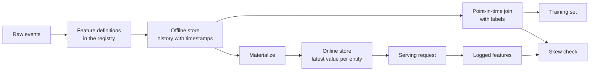

# 专业货物及培训服务器

> 训练读取其历史,每个标签时间,服务读取其最新值.当两个读者不同意时,模型会看到从未训练过的输入.

**Type:** Build
**Languages:** Python
**Prerequisites:** Phase 2, Lessons 08 (Feature Engineering), 13 (ML Pipelines), 15 (Time Series), and 19 (ML System Design)
**Time:** ~100 minutes

## 学习目标

- 描述离线商店,在线商店,实体,活动时间标签,TTL,以及每个商店的工作
- 实现一个时刻正确的结合,并展示一个天真的结合如何将未来的值复制到培训数据中
- 列出训练服务偏差的四个原因:两个代码路径,过时功能,不同的默认功能和时间旅行
- 建立一个功能登记库,其中一个定义提供了训练路径和服务路径
- 填写一个新的功能在过去的日期上,而不读取每日后的数据
- 通过对照记录的服务功能和同一实体和时间的训练路径来检测偏差

## 问题

一个团队构建了一个缩模型.每个标签显示用户在标签日后30天内是否没有购买.团队将标签加入用户功能表.`user_id`们的们`days_since_last_purchase`离线准确度为0.948.

在现场流量上,该模型比较旧,简单的版本更糟糕. 标签日后的几周,每个用户的功能表包含了最新的值. 一个用户最后购买的115天显示了175天的60个空白日, 另一支团队又在另一家服务中写下了服务功能. 他们的30天窗口包括一个额外的天,

训练和服务是以两种不同的方式计算的"相同的功能".这个课程从零开始构建功能商店的部分.你写一个注册表,一个后填,一个点在时间的连接,一个有TTL的在线商店和一个偏差检查.演示程序使用数字复制了两个缺陷.

## 概念

### 两个同样的读者

训练和服务要求不同的特征:

| Property | Training (offline) | Serving (online) |
|---|---|---|
| Question | "What was the value for each of 10 million (entity, time) pairs?" | "What is the value for this one entity now?" |
| Time | Many points in the past | The present |
| Volume | Millions of rows per job | One row per request |
| Latency | Minutes are fine | A few milliseconds |
| Storage | Offline store: full history with timestamps, in columnar files or a warehouse | Online store: the latest value per entity, in a key-value database |

功能商店将两个商店从一个集合的功能定义中填满.物质化是将最新值从线下商店复制到网上商店的工作.



### 实体,时间和TL

四个术语描述每个特征行:

- **Entity.**描述一个特征的关键,例如`user_id`或`card_id`现在,我们要去.
- **Event timestamp.**购买计数"截至14日"的时间表为14日.
- **Created timestamp.**系统编写了行时.今天运行的后填写时刻标记和新创建的时刻标记.
- **TTL (time to live).**值的最大年龄. 比TL较大的值被认为是缺失的,因此读者使用默认值.

一组具有相同的实体,源和TTL的功能通常被称为功能视图.

### 时间点正确的结合

训练行对标签与标签时存在的特征值. 时点结合对每个标签进行这样:

1. 找出同一实体的特征行.
2. 保持活动时间标记在标签时间标记前或前的行列.
3. 接下来,我们要把最后一行.
4. 如果标签时间减其事件时间超过TTL,则放下.

以下是一个用户,16日的标签,以及每周的功能行列:

| Feature row day | `purchases_30d` | Point-in-time join | Naive join on `user_id` |
|---|---|---|---|
| 7 | 4 | | |
| 14 | 3 | Selected | |
| 21 | 1 | Future | |
| 28 | 0 | Future | Selected |

标签问用户在17到46天购买什么东西吗.28日行已经计算了标签日后的安静的日子.它显示了0次购买,因为用户停止购买,这是标签测量的事件.天真的加入复制了答案到输入中.

我们在时间系列课程中分类数据以时间为同样的原因.一个点在时间合并适用于每个行,而不是一个分点.

### 培训服务偏差的原因

谷歌机器学习规则定义了训练服务偏差,即训练期间的性能和服务期间的性能之间的差异.它们列出了三个原因:两个管道中的不同数据处理,训练和服务之间的数据变化和反循环.在功能管道中,四个具体原因一再出现:

| Cause | What happens | Example from the demo |
|---|---|---|
| Two code paths | Training and serving compute the feature with different code | The serving window includes day `now - 30`, and the training window does not |
| Stale features | The value that serving reads has a different age from the value that training used | Training reads weekly snapshots, and a new service computes fresh values |
| Different defaults | The two paths fill a missing value differently | Training uses 365 for "no purchase yet", and serving uses -1 |
| Time travel | Training reads a value from after the label time | The naive join reads the newest snapshot for every label |

训练管道和服务管道之间,每当可能时,都应重复使用代码.

### 功能登记器

登记是特征定义的目录.每个条目包含一个名称,实体,源,转换,窗口,默认值,TTL,所有者,版本和描述.

两条规则是安全的:

- 任何服务都不会保存转换的私下副本.
- 换个定义,就会产生一个新的版本.旧版本仍然存在,所以旧模型保留了他们训练的功能.

### 后面填料

一个新功能没有历史,但训练需要在每一个旧标签时间运行其价值.一个后填充程序运行每个过去日期的定义,并以每一个实体和日期写一行.每个运行只读取其日期或之前的时间标签的事件.

后填料的成本计算是随着实体数量乘以日期数量的增加而增加的.它们还带来微妙的泄漏.今天运行的后填料会用旧事件时间印写行,但它可以读取迟到或后来纠正的数据.严格的时刻合并也检查创建的时间印是否在标签时间之前.

### 检测偏差

根据该指南的第29条规则,要在服务时间记录特征,并在训练中使用它们.即使是一个小的记录样本,也可以检查一致性.将每个记录的值与训练路径为同一实体和时间产生的值进行比较.对于每个特征,报告不匹配的比例和平均绝对差异.

为了找到原因,比较三个对:

1. 网上商店阅读与训练合并. 这样测试整个系统,应该显示零偏差.
2. 计算与训练的新结合,这将使得停滞不前.
3. 另一条代码路径与新的计算. 这将隔离代码差异,如窗户和默认.

```figure
mlprod-pit-join
```

## 建立它

编码在`code/main.py`时间是整数天.每周的一批工作写出7日,14日等,直到175天.

### 步骤1:功能定义和登记

`FeatureDefinition`转换的数据:一个总体,一个窗口,一个默认.`compute`方法从来没有读到事件之后`as_of`现在,我们要去.

```python
@dataclass(frozen=True)
class FeatureDefinition:
    name: str
    entity: str
    aggregate: str
    window_days: int | None
    default: float
    version: int = 1
    owner: str = "growth-team"
    description: str = ""

    def compute(self, events: list[Event], as_of: int) -> float:
        visible = [e for e in events if e.day <= as_of]
        if self.window_days is not None:
            visible = [e for e in visible if e.day > as_of - self.window_days]
        if self.aggregate == "count":
            return float(len(visible))
        if self.aggregate == "sum":
            return round(sum(e.amount for e in visible), 2)
        if self.aggregate == "days_since_last":
            return float(as_of - max(e.day for e in visible)) if visible else self.default
        raise ValueError(f"unknown aggregate {self.aggregate!r}")
```

`FeatureRegistry.register`两次接受相同的定义,但拒绝使用相同名称和版本的不同的定义. `fill_defaults`给出两个路径相同的默认值.

模型将定义附加在一个引用符上,例如`spend_30d@1`现在,我们要去.`compute`其他`fill_defaults`解决参考问题,并没有一个名字`@`阅读最新版本.`@`没有版本数量增加`ValueError`引用也是每个存储行中的关键,所以后填,在线商店和服务阅读都使用了固定定义.

### 步骤 2: 填写下载商店

```python
def backfill(registry: FeatureRegistry, names: list[str], events: list[Event], days: list[int]) -> list[FeatureRow]:
    rows = []
    for entity, entity_events in sorted(group_events(events).items()):
        for day in days:
            rows.append(FeatureRow(entity, day, registry.compute(names, entity_events, day)))
    return rows
```

演示版在25天内为299用户提供了3个功能,

### 步骤3: 时间点合并

每天排序每一个实体的排行.`bisect_right`在标签日前或在标签日前找到最后一行.

```python
def point_in_time_join(labels: list[LabelRow], rows: list[FeatureRow], ttl_days: int | None = None) -> list[JoinedRow]:
    by_entity: dict[str, list[FeatureRow]] = defaultdict(list)
    for row in rows:
        by_entity[row.entity].append(row)
    days_index = {}
    for entity, entity_rows in by_entity.items():
        entity_rows.sort(key=lambda r: r.day)
        days_index[entity] = [r.day for r in entity_rows]
    joined = []
    for label in labels:
        days = days_index.get(label.entity, [])
        pos = bisect.bisect_right(days, label.day) - 1
        match = by_entity[label.entity][pos] if pos >= 0 else None
        if match is not None and ttl_days is not None and label.day - match.day > ttl_days:
            match = None
        joined.append(JoinedRow(
            label.entity, label.day, label.label,
            match.day if match else None, match.values if match else None,
        ))
    return joined
```

### 步骤4:测量一个无明的结合的泄漏

`naive_latest_join`演示程序在100,120和140天建立标签,并适用于每个训练集的单个功能规则.然后从145天开始,它对标签进行了测试,并具有点-in-time功能:

```console
  naive join used a snapshot from after the label day for 100% of rows
  offline accuracy, naive join: 0.948 (rule: idle > 53 days)
  offline accuracy, PIT join:   0.893 (rule: idle > 19 days)
  accuracy on day 145, trained with naive join: 0.763
  accuracy on day 145, trained with PIT join:   0.876
```

简单的结合在线看起来更好,0.948比0.893. 在新的数据上,情况更糟,0.763比0.876.

### 步骤5:在线商店和物质化

网上商店每一个实体都保留一个行,拒绝超过TL的行. `materialize`只有在工作时间或之前的行.

```python
class OnlineStore:
    def __init__(self, ttl_days: int):
        self.ttl_days = ttl_days
        self._latest: dict[str, FeatureRow] = {}

    def write(self, row: FeatureRow) -> None:
        current = self._latest.get(row.entity)
        if current is None or row.day >= current.day:
            self._latest[row.entity] = row

    def read(self, entity: str, now: int) -> dict[str, float] | None:
        row = self._latest.get(entity)
        if row is None or row.day > now or now - row.day > self.ttl_days:
            return None
        return dict(row.values)
```

通过10天的TTL,145天的读取返回了140天的行. 160天的读取,没有新的物质化,返回了默认的,因为行已经20天了.

### 步骤 6: 偏向检查

`detect_skew`分析了两种观点`(entity, day)`报告不匹配率和每个特征的平均绝对差异,并标记一个特征,当超过1%的值不同时.`ValueError`错失请求可以隐藏偏差,而没有请求的检查显示没有什么.

```python
def detect_skew(
    training: dict[tuple[str, int], dict[str, float]],
    serving: dict[tuple[str, int], dict[str, float]],
    features: list[str],
    tolerance: float = 1e-6,
    max_mismatch_rate: float = 0.01,
) -> list[SkewReport]:
    if set(training) != set(serving):
        raise ValueError(f"{len(set(training) ^ set(serving))} keys are in only one view: log and compare the same requests")
    if not training:
        raise ValueError("no requests to compare")
    keys = sorted(training)
    reports = []
    for feature in features:
        diffs = [abs(training[k][feature] - serving[k][feature]) for k in keys]
        mismatches = sum(1 for d in diffs if d > tolerance)
        rate = mismatches / len(keys)
        mean_diff = sum(diffs) / len(keys)
        reports.append(SkewReport(feature, len(keys), rate, mean_diff, rate > max_mismatch_rate))
    return reports
```

演示记录141到150天的请求,并从概念部分进行三个比较. 请求库包括没有历史的20名新用户.

```bash
python3 code/main.py
```

```console
=== Skew checks on 383 logged requests, days 141 to 150 ===
  online store read  vs  training join (one definition, same snapshots)
    ok   days_since_last_purchase   mismatch   0.0%  mean |diff|    0.00
    ok   purchases_30d              mismatch   0.0%  mean |diff|    0.00
    ok   spend_30d                  mismatch   0.0%  mean |diff|    0.00
  fresh compute      vs  training join (staleness only)
    SKEW days_since_last_purchase   mismatch  83.0%  mean |diff|    2.77
    SKEW purchases_30d              mismatch  30.5%  mean |diff|    0.38
    SKEW spend_30d                  mismatch  37.1%  mean |diff|   16.77
  second code path   vs  fresh compute (code differences only)
    SKEW days_since_last_purchase   mismatch   5.5%  mean |diff|   20.07
    SKEW purchases_30d              mismatch  12.5%  mean |diff|    0.13
    SKEW spend_30d                  mismatch  12.5%  mean |diff|    5.09
```

阅读三个块的顺序:

- **One definition, same snapshots.**网上商店和训练组合读出相同的物质化行,所以偏差是零.
- **Staleness.**更新数据在此并不自动更好,因为模型从6天以前的值中学习.
- **Code differences.**由于其窗口包括一个额外的天,第二个代码路径在12.5%的窗口数量上不同.`days_since_last_purchase`只有新用户,但大量:1对365.

## 用它

节日是一个开源功能商店.从零开始的每个代码都有节日对应:

| From scratch | Feast |
|---|---|
| `FeatureDefinition`, `FeatureRegistry` | `Entity`, `FeatureView`, and `Field` in a feature repository, registered with `feast apply` |
| `FeatureRow` history | An offline store, for example a `FileSource` over Parquet files or a warehouse table |
| `point_in_time_join` with a TTL | `store.get_historical_features(entity_df=..., features=[...])` |
| `materialize` | `feast materialize-incremental <end time>` |
| `OnlineStore.read` | `store.get_online_features(features=[...], entity_rows=[...])` |
| Created timestamp check | `created_timestamp_column` on the source and `filter_by_created_timestamp=True` |

代码是按照节日快速启动的,

```python
from datetime import timedelta

from feast import Entity, FeatureView, Field, FileSource
from feast.types import Float32, Int64

user = Entity(name="user", join_keys=["user_id"])

user_activity_source = FileSource(
    name="user_activity_source",
    path="data/user_activity.parquet",
    timestamp_field="event_timestamp",
    created_timestamp_column="created",
)

user_activity = FeatureView(
    name="user_activity",
    entities=[user],
    ttl=timedelta(days=10),
    schema=[
        Field(name="purchases_30d", dtype=Int64),
        Field(name="spend_30d", dtype=Float32),
        Field(name="days_since_last_purchase", dtype=Int64),
    ],
    source=user_activity_source,
)
```

训练和服务,然后读出相同的功能视图:

```python
from feast import FeatureStore

store = FeatureStore(repo_path=".")

training_df = store.get_historical_features(
    entity_df=labels_df,
    features=["user_activity:purchases_30d", "user_activity:days_since_last_purchase"],
    filter_by_created_timestamp=True,
).to_df()

online = store.get_online_features(
    features=["user_activity:purchases_30d", "user_activity:days_since_last_purchase"],
    entity_rows=[{"user_id": 42}],
).to_dict()
```

`labels_df`标签每行一个行`user_id`现在`event_timestamp`节日文档指出,TTL与实体数据框架中的每个时间相对,而不是查询时间. 这与TTL检查相匹配.`point_in_time_join`同一页描述了`filter_by_created_timestamp=True`没有任何离线商店都支持这种选项.一个没有支持的商店会导致错误,而不是忽略选项.

对于偏差检查,Texon,Hopsworks和大型云ML平台的功能商店使用了离线和在线商店之间的相同分区.TensorFlow数据验证可以比较训练数据与服务数据来检测偏差.Break等描述了谷歌端到端ML平台的TFX数据验证系统,包括训练服务偏差.

## 运送它

这一课产生了`outputs/skill-feature-skew-audit.md`技能审计对时间旅行和训练服务的偏差的功能管道. 它通过连接,定义,默认,每个路径的新鲜性和偏差检查所需的记录.

## 运动

1. 改变快照间隔从7天到1天,再进行延迟比较,并解释结果.
2. 设置TTL为3天, 计算失效的训练行列,
3. 添加一个创建日`FeatureRow`让连接忽略标签日后写的行.
4. 登记`spend_7d`作为版本2`spend_30d`填写后,打印出两种版本.
5. 修复`legacy_serving_features`在第三个偏差检查通过之前.

## 关键词

| Term | What people say | What it means |
|------|----------------|----------------------|
| Feature store | "A database for features" | A system that computes features from one set of definitions and serves them to training and to serving |
| Offline store | "The training data" | Full feature history with event timestamps, read by training jobs and backfills |
| Online store | "The feature cache" | The latest value per entity, read by the serving path in milliseconds |
| Entity | "The ID" | The key that a feature describes, such as a user or a card |
| Event timestamp | "When it happened" | The time at which a feature value became true |
| Point-in-time join | "An as-of join" | A join that pairs each label with the latest feature row at or before the label time |
| TTL | "Expiry" | The maximum age of a feature value before a reader treats it as missing |
| Materialization | "Syncing to online" | The job that copies the latest feature values from the offline store to the online store |
| Backfill | "Computing history" | Running a feature definition at past dates to create its history |
| Training-serving skew | "It worked offline" | A difference between the features or behavior in training and in serving |

## 进一步阅读

- [Feast, Point-in-time joins](https://docs.feast.dev/getting-started/concepts/point-in-time-joins): TTL语义和创建的时刻标签过器
- [Feast documentation](https://docs.feast.dev/):功能查看,离线商店,在线商店,以及现实化
- [Google, Rules of Machine Learning](https://developers.google.com/machine-learning/guides/rules-of-ml)根据"教育"规则,从29条到37条
- [Breck et al., Data Validation for Machine Learning (SysML 2019)](https://research.google/pubs/data-validation-for-machine-learning/):谷歌的数据验证,包括提供培训的偏差
- [TensorFlow Data Validation guide](https://www.tensorflow.org/tfx/guide/tfdv): 方案检查,偏差检测和漂移检测
- [Sculley et al., Hidden Technical Debt in Machine Learning Systems (NeurIPS 2015)](https://papers.nips.cc/paper/2015/hash/86df7dcfd896fcaf2674f757a2463eba-Abstract.html):数据依赖性和模型周围的管道债务
