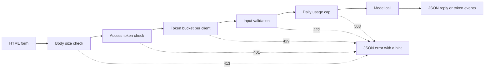

# 模型演示界面  从一个函数到一个可共享的应用程序

> 模型演示有一个合同:输入,模型调用和输出. 在分享链接之前,设定每个部分的限制.

**Type:** Build
**Languages:** Python
**Prerequisites:** Phase 11 · 13 (Building a Production LLM Application), Phase 17 · 08 (Inference Metrics), Phase 17 · 19 (AI Gateways)
**Time:** ~90 minutes

## 学习目标

- 写一个演示的输入,模型调用和输出合同,每个部分都有限制.
- 建立一个标准的图书馆 HTTP 应用程序,一个 HTML 页面,一个 JSON 终端点和一个服务器发送事件终端点.
- 验证输入以成本顺序,并返回将下一步操作告诉用户的JSON错误.
- 保护一个公开的演示,以每位客户的代币桶,每日使用限额,以及可选的访问代币.
- 写出没有输入文本和客户端地址的请求日志.
- 比较标准图书馆演示与两个框架版本,并命名一个演示必须成为产品的信号.

## 问题

你的模型在笔记本中工作.现在一个评论家想尝试十个输入,一个客户想在手机上看到一个结果.

笔记本电脑的电池没有输入限制,也没有进步显示.它的错误是只有你能读到的堆积痕迹.它还与你的凭证和预算运行.如果你把电池放在一个公开的URL后面,没有变化,你可以预期出现这样的失败:

- 用户将4万字符的文件粘贴, 调用模式持续一分钟,
- 一个脚本在一分钟内发送500个请求,每个请求都是一个付费的模特电话.
- 页面8秒钟没有显示任何东西,所以用户再点击按4次.
- 服务器日志存储所有输入,包括输入的客户帐号号.

演示界面可以通过少量代码来防止这些故障.这个课程将使用Python标准库构建一个,以便您可以看到每个部分.然后它将使用两个受欢迎框架构建相同的演示,并默认地比较每个程序的操作.

## 概念

### 演示是一份合同

每个演示都有三个部分.输入是用户可以发送的.模型调用将输入转换为输出.输出是用户看到的,包括错误.

在写页面之前,写下合同:

| Part | Question to answer | Answer in this lesson |
|------|--------------------|-----------------------|
| Input | What type, what size, which characters? | A string of 1 to 500 characters, with no control characters |
| Model call | How long does one call take, and what does it cost? | A toy keyword model that runs in under a millisecond at no cost |
| Output | What does the user see on success and on failure? | A label, a score, and a reply, or a JSON error with a hint |

一个笔记本没有任何三个部分的限制.一个演示设定每个部分的限制,服务器将这些限制适用于每个客户端.



检查按成本顺序运行.一个错误的请求在第一次检查时停止,所以它几乎不花费服务器任何东西. 模型调用是最后的,因为这是唯一的步骤,成本钱.

### 在模型运行之前验证

浏览器可以在发送任何东西之前检查输入.`maxlength`其他`required`任何客户端都可以在页面之外发送请求,因此服务器重复每一次检查.

按成本顺序进行服务器检查:

1. 阅读`Content-Length`在读完之前,拒绝超越界限的尸体.
2. 解析一个不属于JSON对象的体.
3. 检查字段. 拒绝空文字,超过限制的文字,控制字符.
4. 只有通过每支支票的请求才能进行模特通话.

| Failed check | HTTP status | Error code |
|--------------|-------------|------------|
| Body over 4,096 bytes | 413 Content Too Large | `body_too_large` |
| Body stops before `Content-Length` bytes arrive | 408 Request Timeout | `request_timeout` |
| Content type is not JSON | 415 Unsupported Media Type | `unsupported_media_type` |
| Body is not a JSON object | 400 Bad Request | `bad_json` |
| Text is missing, empty, too long, or has control characters | 422 Unprocessable Content | `missing_text`, `empty_text`, `text_too_long`, `control_characters` |

标准规则 9110 定义这些状态代码及其名称.

举个例子是输入设计的一部分.一个例子向用户展示了一个好的输入是什么样子.它还会给一个评论员一个单击的测试.为每个输出类选择一个例子.这个演示具有一个积极,一个负面和一个中立的例子.

### 显示模型正在工作

模型调用可能需要几秒钟.没有反,用户无法辨别一个缓慢的模型从破损页面.一个没有变化的用户可以再次点击,然后服务器得到第二次付费请求.

这一课中的页面提供了四种反:

- 在请求运行时,它将提交按禁用.
- 它显示了过去的时间,并每100毫秒更新.
- 显示了第一代代币到达时的时间.
- 要求结束时的总时间.

当你学习时[inference metrics](../../08-inference-metrics-goodput/)显示用户的时间到第一个代币 (TTFT) 是服务器的指标.

### 输出作为流

语言模型一次生成一个代币.如果服务器等待最后一个代币,用户等待整个代币.如果服务器准备的时候发送每个代币,用户开始读取第一代币后.

服务器发送事件 (SSE) 是此标准格式.`text/event-stream`每个事件都是一个群体`event:`其他`data:`什么是WATWG HTML标准定义格式.

```text
event: token
data: {"index":0,"text":"Label:"}

event: token
data: {"index":1,"text":" positive."}

event: done
data: {"label":"positive","score":1.0,"tokens":11}
```

浏览器有一个`EventSource`访问器的接口是SSE,但它只发送GET请求.一个GET请求将输入输入到URL中,网络服务器和代理程序将URL写入访问日志中.这个演示程序将发送一个POST请求,其实是JSON体.页面阅读了答案`fetch()`其他`response.body.getReader()`分析事件格式本身.

流有一个问题,一个JSON答案没有.服务器在第一个代币之前发送状态200.如果模型之后失败,服务器无法改变状态.`error`页面显示该事件是错误.

当你建造了[production LLM application](../../../11-llm-engineering/13-production-app/)这一课程手动写出相同的协议,所以你可以看到服务器发送的每一行.

### 写出用户可以解决的错误

错误信息有两个工作.它告诉用户发生了什么,然后告诉用户接下来该怎么做.一个堆跟踪对陌生人来说都没有任何工作.

在这个演示中,每个错误都有相同的JSON形状:

```json
{
  "error": {
    "code": "text_too_long",
    "message": "The text has 812 characters. The limit is 500.",
    "hint": "Shorten the text to 500 characters or fewer.",
    "request_id": "a8f3c2b435e3"
  }
}
```

- `code`客户代码和测试比较.
- `message`声明事实,并使用用户需要的数字.
- `hint`给用户一个操作.
- `request_id`将用户报告连接到一个日志记录.

RFC 9457定义了 HTTP API 的标准错误格式,称为问题细节.本演示使用一个较小的形状,用于相同目的.

### 安全地分享一个公开的演示

公共链接改变谁可以发送请求.

| Risk | Control in this demo | Control for a larger audience |
|------|----------------------|-------------------------------|
| One client sends too many requests | A token bucket per client, with 429 and `Retry-After` | Per-user limits after sign-in |
| Strangers find the link | An optional access token in the `Authorization` header | Single sign-on with an identity provider |
| Total cost grows with no limit | A daily usage cap, with 503 and `Retry-After` | Spend limits and alerts at the model provider |
| Very large or unusual input | Body size limit, text length limit, control character check | Content moderation on input and output |
| Logs keep private input | Records with the input length and a keyed hash of the client | A retention period and access control on the logs |

代币桶使用两个数字.容量是一个客户端可以发送的最大爆发.填充率是长期请求率.每个请求都需要一个代币,并且桶不断填充到其容量:

```text
tokens = min(capacity, tokens + refill_rate * seconds_since_last_request)
accept the request if tokens >= 1, then subtract 1
```

当桶空时,服务器会回答`429 Too Many Requests`根据RFC 6585定义了状态429,它允许服务器添加一个`Retry-After`标题.这个演示总是添加标题,直到下一个代币. 页面读取标题,并禁用按.

演示程序使用客户端IP地址作为桶键.反向代理后,每个请求都来自代理地址,所以所有用户都共享一个桶.在这种情况下,从您自己的代理设置的头条中读取客户端地址.不要相信其他来源的头条,因为客户端可以将任何价值放入其中.

当你学习时[AI gateways](../../19-ai-gateways/)通过"网关"来控制租户的利率限制.一个演示需要在较小规模上控制相同的控制.一个利率限制控制每个客户,但它不控制总数.每一个客户在限制以下的百个客户仍然可以使用全部预算.一个使用限制计算所有模型通话在一天内,并且拒绝电话后的固定号码.

记录需要与输入相同的照顾.`http.server`处理器将客户端IP地址和请求行写成标准错误.如果输入内容是URL中的,输入内容将进入日志.这个演示程序取代了该日志行.每个请求都会写出一个记录,包含路线,状态,错误代码,延迟和输入长度.客户端地址成为一个键式哈希,因此您可以不存储地址计算每个客户端的请求.

显示页面说服务器保存文本的长度,而不是文字本身.

### 当一个演示成为产品时

演示程序在一个过程中短暂的时间内服务于知名人士.

- 你的团队以外的人每周都使用它.
- 有人要求一个上机时间目标,或者报告停机.
- 用户要求登录,保存结果或查看他们的历史记录.
- 周次模型成本是预算中的一行.
- 输入包括合同或法律所涵盖的数据.

| Property | Demo | Product |
|----------|------|---------|
| Users | Known people, short sessions | Unknown people, daily use |
| State | None | Accounts, history, saved results |
| Availability | Best effort, one process | A written target, replicas, an on-call owner |
| Cost control | One daily usage cap | Per-user quotas and billing |
| Observability | One log record per request | Traces, metrics, and alerts |

当你看到这些信号时,将演示程序从生产LLM应用课程移动到生产堆上.该堆增加了每用户的真实身份验证,倒退模型,追踪和成本追踪.

```figure
demo-token-bucket
```

## 建立它

代码是一个文件,`code/main.py`首先,运行自我测试:

```bash
python3 code/main.py
```

自行测试检查验证器,代币桶,流量格式和一个真正的HTTP回路.它启动服务器在一个免费端口上,发送三个请求,停止服务器,然后退出.只启动服务器为浏览器当你需要它:

```bash
python3 code/main.py --serve
```

开放`http://127.0.0.1:8000`在浏览器中. 按Ctrl+C来停止服务器.

### 步骤1:模型调用

模型是玩具关键字计数器.它标记文本为积极,负面或中立.它还产生了一个简短的答案,一个代币一次.

```python
def classify(text):
    words = WORD_RE.findall(text.lower())
    positive = sum(1 for word in words if word in POSITIVE)
    negative = sum(1 for word in words if word in NEGATIVE)
    score = (positive - negative) / max(1, positive + negative)
    if score > 0:
        label = "positive"
    elif score < 0:
        label = "negative"
    else:
        label = "neutral"
    return {"label": label, "score": round(score, 3), "positive_cues": positive,
            "negative_cues": negative, "words": len(words)}


def generate(text):
    result = classify(text)
    reply = (
        f"Label: {result['label']}. Positive cues: {result['positive_cues']}. "
        f"Negative cues: {result['negative_cues']}. Words read: {result['words']}."
    )
    parts = reply.split(" ")
    yield parts[0]
    for part in parts[1:]:
        yield " " + part
```

一个真正的模型取代了`generate`输入一个字符串,然后输出代码.验证器,限制和页面保持相同.

### 验证和错误响应

一个例外类包含每个错误. 它包含HTTP状态,稳定代码,消息,提示和可选的响应标题.

```python
class DemoError(Exception):
    def __init__(self, status, code, message, hint, headers=None):
        super().__init__(message)
        self.status = status
        self.code = code
        self.message = message
        self.hint = hint
        self.headers = dict(headers or {})


def validate_text(payload, max_chars=MAX_CHARS):
    if "text" not in payload:
        raise DemoError(422, "missing_text", 'The field "text" is missing.', 'Add a "text" field with your input.')
    text = payload["text"]
    if not isinstance(text, str):
        raise DemoError(422, "text_not_string", 'The field "text" is not a string.', "Send the input as a string.")
    text = text.strip()
    if not text:
        raise DemoError(422, "empty_text", "The text is empty.", "Type a sentence or pick an example.")
    if len(text) > max_chars:
        raise DemoError(422, "text_too_long", f"The text has {len(text)} characters. The limit is {max_chars}.",
                        f"Shorten the text to {max_chars} characters or fewer.")
    if CONTROL_RE.search(text):
        raise DemoError(422, "control_characters", "The text contains control characters.",
                        "Remove the hidden characters, then send the text again.")
    return text
```

验证器首先删除前后的白空间.只有空格的文本然后被认为是空的,提示告诉用户该输入什么. `check_body_size`其他`parse_json_body`对于411例,413例,415例和400例,使用相同的模式. `error_body`任何一个`DemoError`通过概念部分将其转换为JSON.

### 步骤3:标志桶

```python
class TokenBucket:
    def __init__(self, capacity, refill_per_second, now):
        if capacity < 1:
            raise ValueError("capacity must be at least 1")
        if refill_per_second <= 0:
            raise ValueError("refill_per_second must be positive")
        self.capacity = float(capacity)
        self.refill_per_second = float(refill_per_second)
        self.tokens = float(capacity)
        self.updated = now

    def take(self, now, cost=1.0):
        elapsed = max(0.0, now - self.updated)
        self.tokens = min(self.capacity, self.tokens + elapsed * self.refill_per_second)
        self.updated = now
        if self.tokens >= cost:
            self.tokens -= cost
            return 0.0
        return (cost - self.tokens) / self.refill_per_second
```

`take`服务器将值升级并发送到`Retry-After`现在,我们要去.

`RateLimiter`让每位客户一个桶`OrderedDict`锁可以保护字典,因为`ThreadingHTTPServer`任何要求都以其自己的线程处理.`max_clients`设置 设置 设置 设置 设置 设置 设置 设置 设置 设置 设置 设置 设置 设置 设置 设置 设置 设置 设置 设置 设置 设置 设置 设置 设置 设置 设置 设置 设置 设置 设置 设置 设置 设置 设置 设置 设置 设置 设置 设置 设置 设置 设置 设置 设置 设置 设置 设置 设置 设置 设置 设置 设置 设置 设置 设置 设置 设置 设置 设置 设置 设置 设置 设置 设置 设置 设置 设置 设置 设置 设置 设置 设置 设置 设置 设置 设置 设置 设置 设置 设置 设置 设置 设置 设置 设置 设置 设置 设置 设置 设置 设置 设置 设置 设置 设置 设置 设置 设置 设置 设置 设置 设置 设置 设置 设置 设置 设置 设置 设置 设置 设置 设置 设置 设置 设置`max_clients`超过你预期的活跃客户数量.

限制器需要一个`clock`测试通过一个`FakeClock`测试可以在没有等待的情况下提升10秒.`UsageCap`它在固定窗口中计算电话, 并且返回到下一个窗口时的秒钟.

### 步骤 4: 流

```python
def sse_event(event, data):
    payload = json.dumps(data, separators=(",", ":"), ensure_ascii=False)
    return f"event: {event}\ndata: {payload}\n\n".encode("utf-8")


def stream_events(text, generate_fn=generate, delay=0.0, sleep=time.sleep):
    count = 0
    try:
        for token in generate_fn(text):
            yield sse_event("token", {"index": count, "text": token})
            count += 1
            if delay:
                sleep(delay)
    except Exception:
        yield sse_event("error", MODEL_ERROR)
        return
    result = classify(text)
    yield sse_event("done", {"label": result["label"], "score": result["score"], "tokens": count})
```

`json.dumps`字符串中写出一个新线,`\n`因此,每个事件都有一个数据行,没有原始新线.

发电机发现模型故障,然后发送一个`error`服务器已经发送了状态线.`delay`其他`sleep`它们会让浏览器的流量减慢,

### 步骤5:请求处理器

`DemoHandler`延伸`BaseHTTPRequestHandler`经过 POST 处理器,从概念部分进行检查:

```python
def do_POST(self):
    app = self.server.app
    request_id = uuid.uuid4().hex[:12]
    client_id = self.client_address[0]
    started = time.perf_counter()
    route = self.path if self.path in self.routes else "other"
    status, code, chars = 200, None, 0
    try:
        declared = self.headers.get("Content-Length")
        try:
            if route == "other":
                raise DemoError(404, "not_found", "This endpoint does not exist.",
                                "Send requests to /api/predict or /api/stream.")
            size = check_body_size(declared, app.config.max_body_bytes)
        except DemoError:
            self.drain(int(declared) if declared and declared.isdigit() else 0)
            raise
        try:
            body = self.rfile.read(size)
        except TimeoutError:
            self.close_connection = True
            raise DemoError(408, "request_timeout", "The request body did not arrive in time.",
                            "Send the request again with the full body.") from None
        app.admit(client_id, self.headers.get("Authorization"))
        text = app.read_text(self.headers.get("Content-Type"), body)
        chars = len(text)
        app.charge()
        if route == "/api/predict":
            self.send_json(200, predict(text), request_id)
        else:
            code = self.send_stream(text, request_id)
    except DemoError as err:
        status, code = err.status, err.code
        self.send_error_json(err, request_id)
    except TimeoutError:
        status, code = 408, "request_timeout"
        self.close_connection = True
    except Exception:
        status, code = 500, "internal_error"
        self.send_error_json(DemoError(500, "internal_error", "The server failed on this request.",
                                       "Try again. Quote the request id if you report the problem."), request_id)
    finally:
        latency_ms = (time.perf_counter() - started) * 1000
        app.log.record(request_id, route, client_id, status, chars, latency_ms, code)
```

`admit`检查访问令牌和令牌桶.`charge`查看日期限额. 它运行最后,所以只有有效的请求与限额计算. 每个请求都会在日期记录中写一个日志记录.`finally`其他国家也将会被拒绝.`route`由于路径可以携带一个用户文本的查询字符串.

避免错过的四个细节:

- `timeout = 10`在处理器类中,客户端停止发送时关闭连接.如果没有,声明100字节并发送10字节的客户端将永远保留服务器线程.处理器将请求 id 发送408 JSON 错误并关闭连接.流开始后的时间过关只关闭连接,因为状态线已经发送.
- `log_message`返回未输出. 这取消了默认日志行,包含客户端地址和请求行.
- `drain`通过RFC 1122来定义,当一个主机关闭一个连接与未读数据时,TCP会发送重置. 客户端可以丢失413回复.
- `send_stream`捕鱼`BrokenPipeError`用户关闭时,模型停止,请求不需要任何额外的费用.

`BaseHTTPRequestHandler`通过 HTTP/1.0 默认使用. 流媒体体的终点是服务器关闭连接的时刻. 使用 HTTP/1.1 的服务器将使用碎片传输编码的机体发送用于相同目的.

### 步骤 6:页面

`render_page`页面没有外部脚本,字体或图像.脚本读取流像这样:

```javascript
const reader = response.body.getReader();
const decoder = new TextDecoder();
let buffer = "";
while (true) {
  const chunk = await reader.read();
  if (chunk.done) { break; }
  buffer += decoder.decode(chunk.value, { stream: true });
  let cut = buffer.indexOf("\n\n");
  while (cut >= 0) {
    const frame = parseFrame(buffer.slice(0, cut));
    buffer = buffer.slice(cut + 2);
    cut = buffer.indexOf("\n\n");
    if (frame.event === "token") { output.textContent += frame.data.text; }
  }
}
```

网络部分可以在事件中结束.读者将未完整部分留在`buffer`在空白线到达之前.

页面写出模型的输出`textContent`没有什么.`innerHTML`假设页面插入一个答案作为HTML,答案包含一个元素.`onerror`并且可以在用户的浏览器中运行代码.

服务器还发送了一个`Content-Security-Policy`标题`default-src 'none'`浏览器拒绝所有其他脚本,包括攻击者注入页面的脚本.

```python
def csp_hash(source):
    digest = hashlib.sha256(source.encode("utf-8")).digest()
    return "'sha256-" + base64.b64encode(digest).decode("ascii") + "'"
```

### 步骤7:运行它,试图打破它

启动服务器,然后使用`curl`接下来,我们将将一个新的服务器发送到一个新的服务器.

```bash
for i in 1 2 3 4 5 6 7; do
  curl -s -o /dev/null -w '%{http_code} ' -X POST http://127.0.0.1:8000/api/predict \
    -H 'Content-Type: application/json' -d '{"text": "ok"}'
done
```

```text
200 200 200 200 200 429 429
```

等10秒,然后发一个空格短信:

```bash
curl -s -X POST http://127.0.0.1:8000/api/predict \
  -H 'Content-Type: application/json' -d '{"text": ""}'
```

```json
{"error": {"code": "empty_text", "message": "The text is empty.", "hint": "Type a sentence or pick an example.", "request_id": "e3e3599feaea"}}
```

观看活动流程`curl -N`关闭输出缓冲器:

```bash
curl -N -X POST http://127.0.0.1:8000/api/stream \
  -H 'Content-Type: application/json' -d '{"text": "The screen is bright."}'
```

要求一个访问令牌,设置`DEMO_ACCESS_TOKEN`在启动服务器之前,页面显示了代币的字段.

```bash
export DEMO_ACCESS_TOKEN="$(python3 -c 'import secrets; print(secrets.token_urlsafe(24))')"
echo "$DEMO_ACCESS_TOKEN"
python3 code/main.py --serve
```

进行测试:

```bash
python3 -m unittest discover -s code/tests -v
```

运行系统选择一个自由端口.`tearDown`停止服务器,检查其线程已结束.

## 用它

两个Python框架构建相同的示范,使用更少的代码: Gradio和 Streamlit.下面的两个例子都将合同从`main.py`您不需要任何框架运行`main.py`或是测试.

### 围绕一个函数的组件

格拉迪奥将一个Python函数围绕一个网络接口.输入和输出组件描述合约,而发电机函数发送部分输出.

```python
import os

import gradio as gr

from main import EXAMPLES, MAX_CHARS, DemoError, classify, generate, validate_text


def label_text(text):
    try:
        clean = validate_text({"text": text})
    except DemoError as err:
        raise gr.Error(f"{err.message} {err.hint}")
    label = classify(clean)["label"]
    reply = ""
    for token in generate(clean):
        reply += token
        yield reply, label


demo = gr.Interface(
    fn=label_text,
    inputs=gr.Textbox(label="Text to label", lines=5, max_length=MAX_CHARS),
    outputs=[gr.Textbox(label="Reply"), gr.Textbox(label="Label")],
    examples=list(EXAMPLES),
    flagging_mode="never",
)

if __name__ == "__main__":
    demo.queue(max_size=20).launch(auth=("demo", os.environ["DEMO_PASSWORD"]))
```

每个`yield`函数因此在每一步都会提供迄今为止的完整答案.

设置`flagging_mode`默认模式显示一个旗按.当用户按下它时,Gradio将输入和输出写入服务器上的CSV文件.值 `"never"`移除了按.

`queue(max_size=20)`预期请求数量限制.默认的同时时间限制是每次运行一次电话.慢模式然后一次地服务于一个用户,直到你提高了限制. Gradio也在应用程序启动时创建API端点,因此脚本可以在没有页面的情况下调用演示.你的速度限制必须适用于这些端点.

### 一个在每次输入中重演的脚本

流光每次用户更改一个小小小小小小小小小小小小小小小小小小小小小小小小小小小小小小小小小小小小小小小小小小小小小小小小小小小小小小小小小小小小小小小小小小小小小小小小小小小小小小小小小小小小小小小小小小小小小小小小小小小小小小小小小小小小小小小小小小小小小小小小小小小小小小小小小小小小小小小小小小小小小小小小小小小小小小小小小小小小小小小小小小小小小小小小小小小小小小小小小小小小小小小小小小小小小小小小小小小小小小小小小小小小小小小小小小小小小小小小小小小小小小小小小小小小小小小小小小小小小小小小小小小小小小小小小小小小小小小小小小小小小小小小小小小小小小小小小小小小小小小小小小小小小小小小小小小小小小小小小小小小小小小小小小小小小小小小小小小小小小小小小小小小小小小小小小小小小小小小小小小小小小小小小小小小小小小小小小小小小小小小小小小小小小小小小小小小小小小小小小小小小小小小小小小小小小小小小小小小小小小小小小小小小小小小小小小小小小小小小小小小小小小小小小小小小小小小小小小小小小小小小小小小小小小小小小小小小小小小小小小小小小小小小小小小小小小小小小小小小小小小小小小小小小小小小小小小小小小小小小小小小

```python
import streamlit as st

from main import EXAMPLES, MAX_CHARS, DemoError, classify, generate, validate_text

st.title("Toy sentiment demo")
st.caption("Do not paste private data.")

example = st.selectbox("Start from an example", ["", *EXAMPLES])
with st.form("demo"):
    text = st.text_area("Text to label", value=example, max_chars=MAX_CHARS)
    submitted = st.form_submit_button("Run model")

if submitted:
    try:
        clean = validate_text({"text": text})
    except DemoError as err:
        st.error(f"{err.message} {err.hint}")
    else:
        st.write_stream(generate(clean))
        st.write(f"Label: {classify(clean)['label']}")
```

`st.write_stream`接着将发电机直接运载到达时,将每个部分写入.`@st.cache_resource`装饰师每次都会保留一本模型.

### 默认情况下每个选项所做的

| Need | Standard library (this lesson) | Gradio | Streamlit |
|------|--------------------------------|--------|-----------|
| Form, examples, result area | You write the HTML | `Interface` builds them from components and `examples` | Widgets such as `st.text_area` and `st.selectbox` |
| Input length limit | `maxlength` on the page and a server check | `max_length` on `Textbox` | `max_chars` on `st.text_area` |
| Partial output | You write SSE and the stream reader | A generator function, where each `yield` replaces the output | `st.write_stream` with a generator of chunks |
| Progress display | You write the timer | A progress display on the output area, set by `show_progress` | `st.write_stream` shows each chunk when it arrives |
| Errors for the user | JSON with `code`, `message`, `hint`, `request_id` | `raise gr.Error(...)` shows the message | `st.error(...)` shows the message |
| Concurrency | One thread per request, no limit | A queue, with one running call per event by default | Each interaction runs the script again for that session |
| Public link | You run the server and the domain | `launch(share=True)` gives a link that expires after one week | You deploy the app to a server |
| Sign-in | A bearer token check | `launch(auth=...)` with user names and passwords | `st.login()` with an OpenID Connect provider |
| Rate limit and cost cap | Token bucket and daily cap | Your code, with the client address from the request | Your code |
| Input that the tool writes to disk | Only the input length, in the log | Flagged samples in a CSV file, unless `flagging_mode="never"` | Your code decides |

框架节省了页面上的大部分工作:表格,示例,进步显示和部分输出.它们节省了公共链接的风险的少量工作.在三个版本中,利率限制,成本限制和日志隐私都是你的工作.标准图书馆版本显示了这些部分,所以你知道在框架中检查什么.

## 运送它

这一课产生了`outputs/skill-demo-interface-checklist.md`给它一个模型演示或其代码的描述. 它返回了合同的通过或失败审查,反,错误和公共链接的控制. 每次失败都带有一个修正.

## 运动

1. 设置`BUCKET_CAPACITY`到2和`REFILL_PER_SECOND`预测7请求循环的输出,然后运行并比较.
2. 添加一个`language`申请机构的申请.`"en"`返回422错误,并暗示其他值,并添加两个测试.
3. 找一个玩具模型错误标签的句子,比如"屏幕不好".
4. 放一个反向代理后面的演示.`trust_proxy`选择一个字幕`X-Forwarded-For`写一个测试证明客户不能选择自己的桶钥匙.
5. 取代`generate`通过调用一个模型 API 来返回代币作为流. 保存验证器,限制和事件格式. 比较页面中的第一次代币时间和服务器日志中的延迟.

## 关键词

| Term | What people say | What it actually means |
|------|-----------------|------------------------|
| Demo contract | "The UI" | The input limits, the model call, and the output shape, including errors |
| Token bucket | "A rate limiter" | A per-client counter that refills at a fixed rate up to a capacity. Each request uses one token |
| Retry-After | "Try later" | A response header with the number of seconds, or a date, after which the client can try again |
| Server-Sent Events | "Streaming" | A `text/event-stream` response of `event:` and `data:` lines, with a blank line after each event |
| Time to first token | "Latency" | The time from the request to the first token on the user's screen |
| Usage cap | "The budget" | A limit on the total number of model calls in a time window, for all clients together |
| Keyed hash | "An anonymous ID" | An HMAC of the client address with a secret salt. It is a pseudonym: anyone with the salt can test a known address |
| Content Security Policy | "CSP" | A response header that tells the browser which scripts, styles, and connections the page can use |

## 进一步阅读

- [Python `http.server` documentation](https://docs.python.org/3/library/http.server.html):服务器类,HTTP/1.0默认,默认日志行,以及警告该模块不适用于生产.
- [WHATWG HTML Standard, server-sent events](https://html.spec.whatwg.org/multipage/server-sent-events.html)活动流格式和 活动流程`EventSource`接口.
- [MDN, Using server-sent events](https://developer.mozilla.org/en-US/docs/Web/API/Server-sent_events/Using_server-sent_events)举例:事件格式和浏览器API.
- [MDN, Using readable streams](https://developer.mozilla.org/en-US/docs/Web/API/Streams_API/Using_readable_streams)如何读取一个`fetch()`身体的反应,一块一块.
- [MDN, Using the Fetch API](https://developer.mozilla.org/en-US/docs/Web/API/Fetch_API/Using_Fetch)要求使用JSON体,以及响应处理.
- [MDN, 429 Too Many Requests](https://developer.mozilla.org/en-US/docs/Web/HTTP/Reference/Status/429)其他[MDN, Retry-After](https://developer.mozilla.org/en-US/docs/Web/HTTP/Reference/Headers/Retry-After)利率限制状态及其标题.
- [MDN, Content Security Policy](https://developer.mozilla.org/en-US/docs/Web/HTTP/Guides/CSP): 线条脚本的哈希和`default-src`关于"欧洲经济联盟"的指令.
- [RFC 6585](https://www.rfc-editor.org/rfc/rfc6585.html):包括429的HTTP状态代码.
- [RFC 9110](https://www.rfc-editor.org/rfc/rfc9110.html)包含413,415和422的HTTP语义
- [RFC 9457](https://www.rfc-editor.org/rfc/rfc9457.html):问题详细,为HTTPAPI提供标准JSON错误格式.
- [RFC 1122](https://www.rfc-editor.org/rfc/rfc1122.html): 托管要求,包括未读数据的 TCP 重置闭 (第 4.2.2.13 节).
- [Gradio, Sharing your app](https://gradio.app/guides/sharing-your-app)链接共享,身份验证,API页面和利率限制.
- [Gradio, Streaming outputs](https://gradio.app/guides/streaming-outputs)发电机作为部分输出功能.
- [Gradio, Interface](https://gradio.app/docs/gradio/interface)其他`examples`现在`flagging_mode`其他`concurrency_limit`现在,我们要去.
- [Gradio, Using flagging](https://gradio.app/guides/using-flagging):标记样本将放在磁盘上.
- [Streamlit, Basic concepts](https://docs.streamlit.io/get-started/fundamentals/main-concepts)数据流程:
- [Streamlit, st.write_stream](https://docs.streamlit.io/develop/api-reference/write-magic/st.write_stream)其他[Streamlit, Caching](https://docs.streamlit.io/develop/concepts/architecture/caching)部分输出和一次加载的模型.
- [Streamlit, st.login](https://docs.streamlit.io/develop/api-reference/user/st.login):与OpenID Connect提供商登录.
