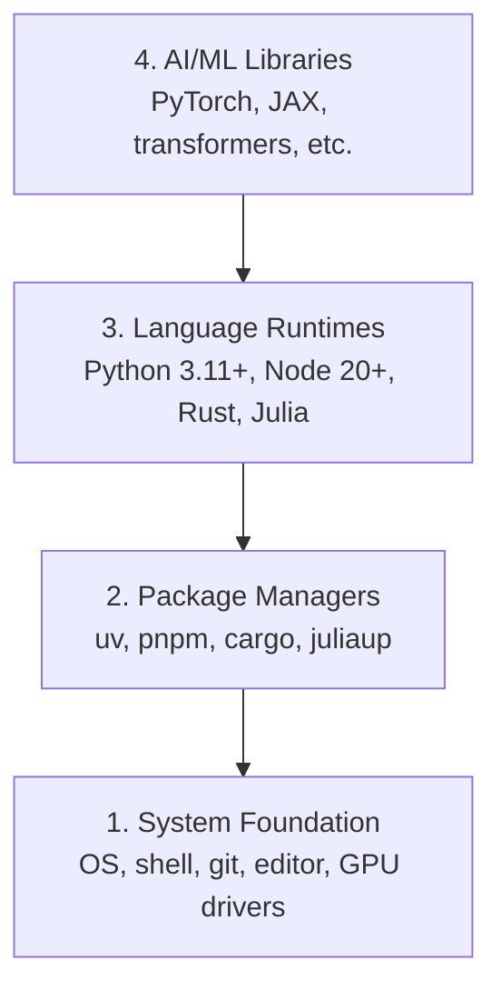

# 开发环境

> 工具会塑造你的思考方式。一次配置，就把它配置妥当。

**类型：** 动手构建
**语言：** Python、Node.js、Rust
**前置要求：** 无
**时间：** 约 45 分钟

## 学习目标

- 从零安装 Python 3.11+、Node.js 20+ 和 Rust 工具链。
- 配置虚拟环境和包管理器，使构建过程可以复现。
- 验证 CUDA/MPS 能否访问 GPU，并运行一次张量运算测试。
- 理解系统、包管理器、语言运行时、AI 库组成的四层技术栈。

## 问题

接下来，你将使用 Python、TypeScript、Rust 和 Julia，学习超过 500 节 AI 工程课程。如果环境出了问题，每一节课都会变成与工具的较量，而不是知识学习。

很多人跳过环境配置，随后却花费数小时排查导入错误、版本冲突和缺失的 CUDA 驱动。我们要一次把这件事做好。

## 核心概念

AI 工程环境分为四层：



图中从底层到顶层分别是：系统基础（操作系统、Shell、Git、编辑器、GPU 驱动）、包管理器、语言运行时，以及 AI/ML 库。我们从下往上安装，每层都依赖下一层。

```figure
s0-env-stack
```

此标记对应课程网站的环境技术栈交互图。

## 动手构建

### 第 1 步：系统基础

检查系统，安装基础工具。以下分别给出 macOS、Ubuntu/Debian 和 Windows 的命令；只使用适合自己平台的一组。

```bash
# macOS
xcode-select --install
brew install git curl wget

# Ubuntu/Debian
sudo apt update && sudo apt install -y build-essential git curl wget unzip

# Windows (use WSL2)
wsl --install -d Ubuntu-24.04
```

### 第 2 步：使用 uv 管理 Python

我们使用 `uv`：原文称它比 pip 快 10—100 倍，并能自动管理虚拟环境。

```bash
curl -LsSf https://astral.sh/uv/install.sh | sh

uv python install 3.12

uv venv
source .venv/bin/activate  # or .venv\Scripts\activate on Windows

uv pip install numpy matplotlib jupyter
```

这组命令安装 uv 和 Python 3.12，创建并激活 `.venv`，再安装 NumPy、Matplotlib 和 Jupyter。

进行验证：

```python
import sys
print(f"Python {sys.version}")

import numpy as np
print(f"NumPy {np.__version__}")
a = np.array([1, 2, 3])
print(f"Vector: {a}, dot product with itself: {np.dot(a, a)}")
```

代码打印 Python、NumPy 版本，并计算向量 `[1, 2, 3]` 与自身的点积。

### 第 3 步：Node.js 与 pnpm

它们用于 TypeScript 课程，例如智能体、MCP 服务器和 Web 应用。

```bash
curl -fsSL https://fnm.vercel.app/install | bash
fnm install 22
fnm use 22

npm install -g pnpm

node -e "console.log('Node', process.version)"
```

安装 fnm，用它安装并选用 Node.js 22，再安装 pnpm，最后打印 Node.js 版本。

fnm 安装器会先检查 `unzip`。缺少它时，安装器会显示 `Not installing fnm due to missing dependencies.` 并退出：Linux 上需要解压 ZIP 文件，macOS 上则通过 Homebrew 安装。macOS 自带 `unzip`；Ubuntu、Debian 和 WSL2 可通过第 1 步的 apt 命令安装它。若跳过了那一步，可以运行 `sudo apt install -y unzip`。

**macOS / Apple Silicon（M1/M2/M3/M4）：** 如果安装器报错 `Error: Cannot install under Rosetta 2 in ARM default prefix (/opt/homebrew)`，说明终端正运行在 Rosetta 2 下（`arch` 输出 `i386`），而 Homebrew 是原生 arm64 版本。强制使用 arm64 安装 fnm，将它接入 Shell，然后从上面的 `fnm install 22` 开始重新执行：

```bash
arch -arm64 brew install fnm
echo 'eval "$(fnm env --use-on-cd)"' >> ~/.zshrc
source ~/.zshrc
```

这里向 `~/.zshrc` 追加 fnm 初始化配置，并在当前 Shell 中加载。

### 第 4 步：Rust

Rust 用于对性能要求高的课程，例如推理和系统开发。

```bash
curl --proto '=https' --tlsv1.2 -sSf https://sh.rustup.rs | sh

rustc --version
cargo --version
```

安装 rustup，并核对 Rust 编译器和 Cargo 的版本。

### 第 5 步：Julia（可选）

在数学计算较多的课程中，Julia 有其优势。

```bash
curl -fsSL https://install.julialang.org | sh

julia -e 'println("Julia ", VERSION)'
```

安装 Julia，再打印其版本。

### 第 6 步：配置 GPU（如果有）

**NVIDIA（Linux / Windows）：**

```bash
nvidia-smi

# Install PyTorch with CUDA
uv pip install torch torchvision torchaudio --index-url https://download.pytorch.org/whl/cu124
```

先检查 NVIDIA GPU，再从指定 CUDA 构建的软件源安装 PyTorch 及相关包。

**macOS / Apple Silicon（M1/M2/M3/M4）：** Mac 没有 CUDA，这是预期行为，并非配置失败。不要传入 `--index-url .../cuXXX`：这些 wheel 仅支持 Linux/Windows，在 Mac 上会安装失败。直接安装普通版本，其中包含 Apple 的 MPS（Metal）GPU 后端：

```bash
uv pip install torch torchvision torchaudio
```

验证方式如下，适用于各个平台：

```python
import torch
print(f"CUDA available: {torch.cuda.is_available()}")           # False on macOS — expected
print(f"MPS available:  {torch.backends.mps.is_available()}")   # True on Apple Silicon
if torch.cuda.is_available():
    print(f"GPU: {torch.cuda.get_device_name(0)}")
```

代码分别检查 CUDA 和 MPS 是否可用；若 CUDA 可用，还会显示 GPU 名称。

没有 GPU 也没关系。大多数课程可以在 CPU 上运行。训练负载较重时，可以使用 Google Colab 或云 GPU。

### 第 7 步：验证准备开始的学习路线

本课所有命令都应在仓库根目录执行，即包含 `README.md` 和 `phases/` 的目录。预检只检查所选路线开始时需要的工具，默认跳过后续工具，让新学习者得到明确结论，而不是一整屏警告。

开始完整入门路线：

```bash
python3 phases/00-setup-and-tooling/01-dev-environment/code/verify.py --route beginner
```

或者仅检查你选择的路线：

```bash
python3 phases/00-setup-and-tooling/01-dev-environment/code/verify.py --route ml-foundations
python3 phases/00-setup-and-tooling/01-dev-environment/code/verify.py --route llm-engineering
python3 phases/00-setup-and-tooling/01-dev-environment/code/verify.py --route agents
python3 phases/00-setup-and-tooling/01-dev-environment/code/verify.py --route mcp
python3 phases/00-setup-and-tooling/01-dev-environment/code/verify.py --route agent-skills
python3 phases/00-setup-and-tooling/01-dev-environment/code/verify.py --route certification
```

这些命令分别检查机器学习基础、LLM 工程、智能体、MCP、Agent Skills 和认证路线。

如果也想查看后续课程使用的可选工具与依赖，可以添加 `--show-later`。缺少后续工具不会阻止当前路线开始。

每个失败的必需检查都会给出检测到的路径或导入错误，以及准确的修复命令。Agent Skills 和认证路线还会显示需要手动完成的宿主检查，因为 Python 脚本无法证明 AI 宿主是否发现了某个技能，也无法证明所选技能目录可写。

入门路线预检通过后，会打印第一节可运行课程的准确命令：

```text
Ready to start Beginner course.
Next: python3 phases/01-math-foundations/01-linear-algebra-intuition/code/vectors.py
```

## 实际使用

你的环境已经能够开始所检查的路线。后续工具等课程要求时再安装，不必为了配置整套技术栈而推迟第一课。整个课程会使用：

| 语言 | 使用范围 | 包管理器 |
|---|---|---|
| Python | Phase 1—12：机器学习、深度学习、NLP、视觉、音频、LLM | uv |
| TypeScript | Phase 13—17：工具、智能体、群体系统、基础设施 | pnpm |
| Rust | Phase 12、15—17：性能关键系统 | cargo |
| Julia | Phase 1：数学基础 | Pkg |

## 交付产物

本课提供一个任何人都能运行的环境验证脚本。

`outputs/prompt-env-check.md` 中的提示词可以帮助 AI 助手诊断环境问题。

## 练习

1. 运行验证脚本，修复所有失败项。
2. 为本课程创建 Python 虚拟环境，并安装 PyTorch。
3. 用四种语言分别编写并运行一个 Hello World。

### 练习提示

**练习 1.** 从仓库根目录运行 `python3 phases/00-setup-and-tooling/01-dev-environment/code/verify.py --route beginner`，先修复第一项失败的检查，再看下一项。重新运行脚本，直到所有必需的检查项通过，才算完成。

**练习 2.** 在仓库根目录用 `uv venv` 创建环境，激活后，使用第 6 步中与你硬件对应的命令安装 PyTorch。在该环境中运行 `python -c "import torch; print(torch.__version__)"`；输出版本号表示安装成功。

**练习 3.** 使用“核心概念”中技术栈的四种运行环境：Python、运行在 Node.js 上的 TypeScript、Rust 和 Julia。分别编写一个小文件，使用 `python3`、`npx tsx`（Node.js 不能直接运行 `.ts` 文件）、`cargo run` 或 `rustc`，以及 `julia` 运行。每次运行都必须输出你的消息，并以退出码 0 结束。

## 译者校注

- uv 的“10—100 倍”是原文性能表述，实际速度取决于缓存、网络和任务，不能作为本机速度保证。
- 原文命令按来源保留。当前用户约定在 WSL 中手动执行环境操作，已有环境不必重复安装。
- **新增提示中的 Node.js 限制需要按版本判断。** 原文“Node.js 不能直接运行 `.ts` 文件”不适用于所有版本。Node.js 22.18.0 起默认启用类型擦除，可直接运行仅含可擦除 TypeScript 语法的文件，但不执行类型检查，也不读取 `tsconfig.json`；这不等于完整支持所有 TypeScript 功能。`npx tsx` 仍是课程给出的运行方式。[Node.js TypeScript 官方说明](https://nodejs.org/api/typescript.html)
