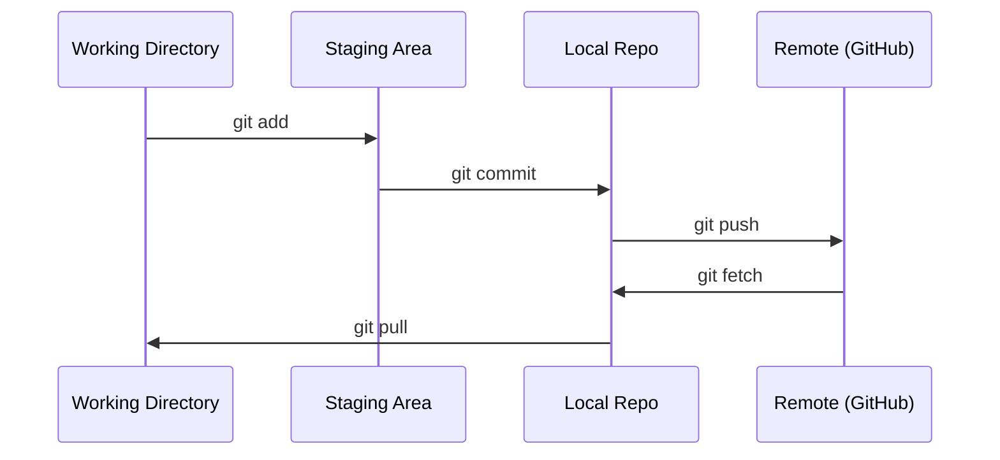

# Git 与协作

> 版本控制不是可选项。在这里构建的每个实验、每个模型、每节课的工作，都需要被跟踪。

**类型：** 学习
**语言：** --
**前置要求：** Phase 0，第 01 课
**时间：** 约 30 分钟

## 学习目标

- 配置 Git 身份，并使用 add、commit、push 组成的日常工作流。
- 创建和合并分支，隔离实验，避免破坏 main。
- 编写 `.gitignore`，排除模型检查点和大型二进制文件。
- 使用 `git log` 浏览提交历史，理解项目演变。

## 问题

你将在 20 个阶段中编写数百个代码文件。没有版本控制，就可能丢失工作成果、做出无法撤销的破坏，也难以与他人协作。

Git 是工具，GitHub 是托管代码的地方。本课只介绍完成课程所需的内容。

## 核心概念



图中依次为工作目录、暂存区、本地仓库和远程仓库。`git add` 将修改放入暂存区，`git commit` 形成本地提交，`git push` 将提交推送到远程；fetch 获取远程信息，pull 获取并整合远程变更。

记住三件事：

1. 经常保存工作（`git commit`）。
2. 推送到远程（`git push`）。
3. 使用分支进行实验（`git checkout -b experiment`）。

```figure
s0-commit-dag
```

此标记对应课程网站的提交有向无环图。

## 动手构建

### 第 1 步：配置 Git

```bash
git config --global user.name "Your Name"
git config --global user.email "you@example.com"
```

设置全局提交署名与邮箱。示例中的名字和邮箱应替换为自己的信息。

### 第 2 步：日常工作流

```bash
git status
git add file.py
git commit -m "Add perceptron implementation"
git push origin main
```

依次检查状态、暂存指定文件、创建提交，再推送到远程 main。

### 第 3 步：用分支做实验

```bash
git checkout -b experiment/new-optimizer

# ... make changes, commit ...

git checkout main
git merge experiment/new-optimizer
```

创建实验分支，完成修改和提交后，切回 main，再合并实验分支。

### 第 4 步：使用本课程仓库

只有维护者能直接写入课程仓库，你不能直接向它推送。先在 GitHub 上点击右上角 Fork 按钮，建立自己的副本，再让 `origin` 指向自己的仓库：

```bash
git clone https://github.com/YOUR-USERNAME/ai-engineering-from-scratch.git
cd ai-engineering-from-scratch

git checkout -b my-progress
# work through lessons, commit your code
git push origin my-progress
```

从自己的 Fork 克隆仓库，创建学习进度分支，然后将学习代码提交并推送到该分支。

## 实际使用

本课程需要以下命令：

| 命令 | 使用时机 |
|---|---|
| `git clone` | 获取课程仓库 |
| `git add` + `git commit` | 保存工作成果 |
| `git push` | 备份到 GitHub |
| `git checkout -b` | 试验新想法，避免破坏 main |
| `git log --oneline` | 查看已完成的工作 |

这些已经够用。本课程不要求先掌握 rebase、cherry-pick 或子模块。

## 练习

1. Fork 本仓库、克隆自己的 Fork、创建 `my-progress` 分支，新增一个文件，提交并推送。
2. 创建 `.gitignore`，排除模型检查点文件：`.pt`、`.pth`、`.safetensors`。
3. 使用 `git log --oneline` 查看本仓库历史，阅读课程是如何逐步加入的。

### 练习提示

**练习 1.** 在 GitHub 上点击 Fork，然后用 `git clone` 克隆你自己分叉仓库的 URL。执行 `git push -u origin my-progress` 后，在 GitHub 上打开你的分叉仓库，确认分支列表中出现 `my-progress`，且其中包含你的文件。

**练习 2.** 在仓库根目录的 `.gitignore` 文件中，为每个扩展名添加一条模式，例如 `*.pt`。分别创建一个对应扩展名的空文件，然后运行 `git status`；这些文件都不应出现在未跟踪文件列表中。

**练习 3.** 先运行 `git log --oneline`，再运行 `git log --oneline -- phases/00-setup-and-tooling`，只查看修改过本阶段的提交。选一个提交，运行 `git show --stat <hash>`，查看它添加了哪些课程文件。

## 关键术语

| 术语 | 常见说法 | 实际含义 |
|---|---|---|
| Commit（提交） | “保存” | 项目在某个时刻的完整快照 |
| Branch（分支） | “一个副本” | 指向某次提交的指针，随着工作推进而移动 |
| Merge（合并） | “把代码拼起来” | 将一个分支的变更整合到另一个分支 |
| Remote（远程） | “云端” | 托管在其他位置的仓库副本，例如 GitHub 或 GitLab |

## 译者校注

- 教材中的 push 命令是演示；本地学习约定仍是仅在用户明确要求后推送。
- Git 提交署名与 GitHub 登录认证是两回事；配置 name/email 不会自动授予推送权限。
