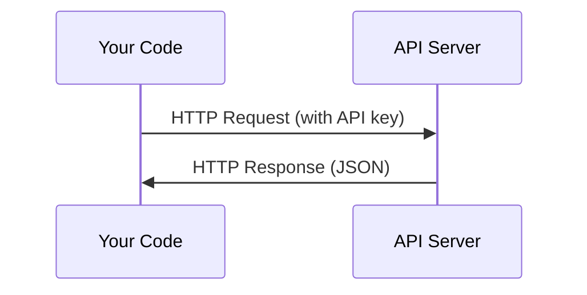

# API 与密钥

> 各种 AI API 都遵循同一个模式：发送请求，获得响应。细节会变化，基本模式不变。

**类型：** 动手构建
**语言：** Python、TypeScript
**前置要求：** Phase 0，第 01 课
**时间：** 约 30 分钟

## 学习目标

- 使用环境变量和 `.env` 文件安全保存 API 密钥。
- 分别通过 Anthropic Python SDK 和原始 HTTP 调用 LLM API。
- 对比 SDK 和原始 HTTP 的请求与响应格式，辅助排错。
- 识别并处理身份认证、速率限制等常见 API 错误。

## 问题

从 Phase 11 开始，你将调用 Anthropic、OpenAI、Google 等 LLM API。在 Phase 13—16，你还将构建循环使用这些 API 的智能体。你需要理解 API 密钥的作用、安全保存方法，以及第一次 API 调用的步骤。

## 核心概念



图示描述客户端向服务端发送请求、服务端返回响应的过程。

每次 API 调用都包含：

1. 端点，即 URL。
2. API 密钥，用于身份认证。
3. 请求体，描述你需要什么。
4. 响应体，包含服务返回的内容。

```figure
s0-secret-inject
```

此标记对应课程网站的 HTTP 请求与响应交互图。

## 动手构建

### 第 1 步：安全保存 API 密钥

不要把 API 密钥写进代码，使用环境变量。

```bash
export ANTHROPIC_API_KEY="sk-ant-..."
export OPENAI_API_KEY="sk-..."
```

也可以使用 `.env` 文件，但要将其加入 `.gitignore`：

```
ANTHROPIC_API_KEY=sk-ant-...
OPENAI_API_KEY=sk-...
```

### 第 2 步：第一次 API 调用（Python）

```python
import os

import anthropic

client = anthropic.Anthropic()

MODEL = os.environ.get("LLM_MODEL", "claude-sonnet-5")

response = client.messages.create(
    model=MODEL,
    max_tokens=256,
    messages=[{"role": "user", "content": "What is a neural network in one sentence?"}]
)

print(response.content[0].text)
```

代码创建 SDK 客户端，选择模型、构造消息并读取响应。`LLM_MODEL` 选择 Anthropic 模型 ID，默认值是无日期后缀的 Sonnet 别名。OpenAI、Google 等其他供应商也采用“密钥加模型 ID”的模式，但各自的 SDK、端点和请求/响应结构不同。

### 第 3 步：第一次 API 调用（TypeScript）

```typescript
import Anthropic from "@anthropic-ai/sdk";

const client = new Anthropic();

const MODEL = process.env.LLM_MODEL ?? "claude-sonnet-5";

const response = await client.messages.create({
  model: MODEL,
  max_tokens: 256,
  messages: [{ role: "user", content: "What is a neural network in one sentence?" }],
});

console.log(response.content[0].text);
```

这里使用 TypeScript SDK 完成同类请求，并从返回结果中读取文本。

### 第 4 步：原始 HTTP 调用（不用 SDK）

```python
import os
import urllib.request
import json

url = "https://api.anthropic.com/v1/messages"
headers = {
    "Content-Type": "application/json",
    "x-api-key": os.environ["ANTHROPIC_API_KEY"],
    "anthropic-version": "2023-06-01",
}
body = json.dumps({
    "model": os.environ.get("LLM_MODEL", "claude-sonnet-5"),
    "max_tokens": 256,
    "messages": [{"role": "user", "content": "What is a neural network in one sentence?"}],
}).encode()

req = urllib.request.Request(url, data=body, headers=headers, method="POST")
with urllib.request.urlopen(req) as resp:
    result = json.loads(resp.read())
    print(result["content"][0]["text"])
```

这展示了 SDK 在底层封装的工作。理解原始 HTTP 请求，有助于调试错误。

## 实际使用

本课程涉及：

| API | 何时使用 | 免费额度（原文描述） |
|---|---|---|
| Anthropic（Claude） | Phase 11—16：智能体与工具 | 注册时 5 美元额度 |
| OpenAI | Phase 11：对比 | 注册时 5 美元额度 |
| Hugging Face | Phase 4—10：模型与数据集 | 免费 |

现在不必全部开通，课程需要时再配置即可。

## 交付产物

本课提供：

- `outputs/prompt-api-troubleshooter.md`：用于诊断常见 API 错误。

## 练习

1. 获取 Anthropic API 密钥，完成第一次 API 调用。
2. 尝试原始 HTTP 版本，并将响应格式与 SDK 版本对比。
3. 故意使用错误的 API 密钥，阅读错误信息。

## 关键术语

| 术语 | 常见说法 | 实际含义 |
|---|---|---|
| API key | “API 密码” | 用于标识账户并授权请求的唯一字符串 |
| Rate limit | “被限流了” | 每分钟或每小时允许的最大请求数，用于防止滥用并公平分配资源 |
| Token | API 语境中的“一个词” | 一种计费单位；输入与输出 token 分别统计和收费 |
| Streaming | “实时响应” | 逐步收到响应，而不必等待完整响应生成 |

## 译者校注

- 表中的注册赠送额度、免费条件和模型别名是原文内容，未在本次翻译中核实为当前可用政策；实际使用前应查看对应平台说明，不应据此承诺免费调用。
- token 不等于一个词，流式传输的块也不一定是一个词。
- `.env` 不会仅因文件存在而自动进入进程环境，需要程序或启动工具显式加载；`.gitignore` 也不会删除已经提交过的密钥。
