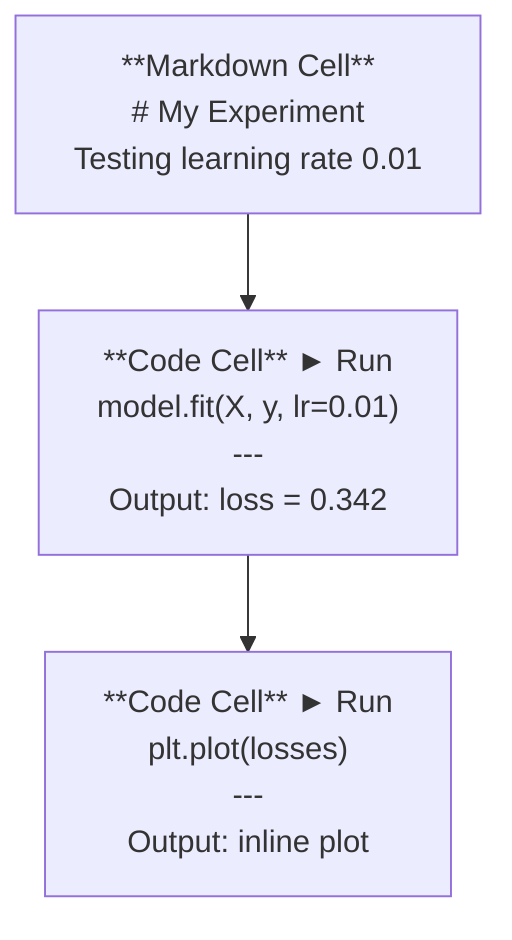
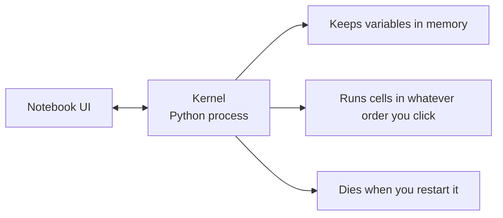

# Jupyter Notebook

> Notebook 是 AI 工程的实验台。先在这里做原型，再把验证有效的代码移入生产流程。

**类型：** 动手构建
**语言：** Python
**前置要求：** Phase 0，第 01 课
**时间：** 约 30 分钟

## 学习目标

- 安装并启动 JupyterLab、Jupyter Notebook，或安装 Jupyter 扩展的 VS Code。
- 使用 `%timeit`、`%%time`、`%matplotlib inline` 等魔法命令计时并内嵌展示图形。
- 区分 Notebook 与脚本的适用场景，实践“在 Notebook 中探索，用脚本交付”的流程。
- 识别并避免执行顺序混乱、隐藏状态和内存占用累积等常见陷阱。

## 问题

AI 论文、教程和 Kaggle 比赛广泛使用 Jupyter Notebook。它能让你分块运行代码、直接查看输出、将代码与解释混排，并快速迭代。不用 Notebook 学习 AI，就像做数学作业却没有草稿纸。

但 Notebook 也有实际陷阱。有些人把所有事情都放在里面做，包括它不擅长的工作。理解何时用 Notebook、何时用脚本，能避免日后陷入复杂排错。

## 核心概念

Notebook 是一组单元格，每个单元格包含代码或文本。



内核是在后台运行的 Python 进程。运行单元格时，代码被送到内核执行，再返回结果。所有单元格共享同一个内核，因此变量会在单元格之间保留。



图中“按你点击的任意顺序执行”既是强大之处，也是容易出错的地方。

```figure
s0-cell-order
```

此标记对应课程网站的 Notebook 内核状态交互图。

## 动手构建

### 第 1 步：选择界面

三种界面使用同一种文件格式：

| 界面 | 安装与启动 | 适合场景 |
|---|---|---|
| JupyterLab | `pip install jupyterlab`，再运行 `jupyter lab` | 完整 IDE 体验、多标签页、文件浏览器和终端 |
| Jupyter Notebook | `pip install notebook`，再运行 `jupyter notebook` | 简单轻量，一次处理一个 Notebook |
| VS Code | 安装 Jupyter 扩展 | 在已有编辑器中工作，使用 Git 集成与调试 |

三者都读写 `.ipynb` 文件，任选喜欢的一种即可。原文称 JupyterLab 在 AI 工作中最常见。

```bash
pip install jupyterlab
jupyter lab
```

这组命令安装并启动 Notebook 界面。

### 第 2 步：重要快捷键

操作分为两种模式：按 `Escape` 进入命令模式（原文描述左侧蓝条），按 `Enter` 进入编辑模式（绿条）。

**命令模式中的常用键：**

| 按键 | 功能 |
|---|---|
| `Shift+Enter` | 运行单元格，移动到下一个 |
| `A` | 在上方插入单元格 |
| `B` | 在下方插入单元格 |
| `DD` | 删除单元格 |
| `M` | 转为 Markdown |
| `Y` | 转为代码 |
| `Z` | 撤销单元格操作 |
| `Ctrl+Shift+H` | 显示全部快捷键 |

**编辑模式：**

| 按键 | 功能 |
|---|---|
| `Tab` | 自动补全 |
| `Shift+Tab` | 显示函数签名 |
| `Ctrl+/` | 切换注释 |

`Shift+Enter` 会被频繁使用，先掌握它。

### 第 3 步：单元格类型

**代码单元格**运行 Python 并显示结果：

```python
import numpy as np
data = np.random.randn(1000)
data.mean(), data.std()
```

示例输出：`(0.0032, 0.9987)`。

**Markdown 单元格**用于呈现格式化文本。用它记录正在做什么、为什么这样做。它支持标题、粗体、斜体、LaTeX 数学公式（如 `$E = mc^2$`）、表格与图片。

### 第 4 步：魔法命令

它们不是 Python 语法，而是 Jupyter 专用命令：`%` 表示行魔法，`%%` 表示单元格魔法。

**为代码计时：**

```python
%timeit np.random.randn(10000)
```

示例输出：`45.2 us +/- 1.3 us per loop`。

```python
%%time
model.fit(X_train, y_train, epochs=10)
```

示例输出：`Wall time: 2.34 s`。

`%timeit` 多次运行代码并统计结果；`%%time` 只运行一次。微型性能测试用 `%timeit`，训练运行可以用 `%%time`。

**启用内嵌图形：**

```python
%matplotlib inline
```

之后 `plt.plot()` 或 `plt.show()` 的图形会直接显示在 Notebook 中。

**不离开 Notebook 安装包：**

```python
!pip install scikit-learn
```

`!` 前缀用于运行 Shell 命令。

**检查环境变量：**

```python
%env CUDA_VISIBLE_DEVICES
```

### 第 5 步：内嵌显示丰富输出

Notebook 会自动显示单元格最后一个表达式的值，也可以显式控制显示：

```python
import pandas as pd

df = pd.DataFrame({
    "model": ["Linear", "Random Forest", "Neural Net"],
    "accuracy": [0.72, 0.89, 0.94],
    "training_time": [0.1, 2.3, 45.6]
})
df
```

这里显示的是格式化 HTML 表格，而不是纯文本。绘图也类似：

```python
import matplotlib.pyplot as plt

plt.figure(figsize=(8, 4))
plt.plot([1, 2, 3, 4], [1, 4, 2, 3])
plt.title("Inline Plot")
plt.show()
```

图形紧接着单元格显示。数据、图形和代码放在一起，是 Notebook 广泛用于 AI 工作的原因。

显示图片：

```python
from IPython.display import Image, display
display(Image(filename="architecture.png"))
```

### 第 6 步：Google Colab

Colab 是云端 Jupyter Notebook，提供 GPU、预装库和 Google Drive 集成，无需自行配置本地环境。

1. 打开 [colab.research.google.com](https://colab.research.google.com)。
2. 上传本课程中的任意 `.ipynb` 文件。
3. 选择 Runtime > Change runtime type > T4 GPU（原文标注免费）。

Colab 与本地 Jupyter 的差别：

- 文件不会自动跨会话持久保存，需要保存到 Drive 或下载。
- 预装 numpy、pandas、matplotlib、torch、tensorflow、sklearn。
- 使用 `from google.colab import files` 上传或下载文件。
- 使用 `from google.colab import drive; drive.mount('/content/drive')` 挂载持久存储。
- 原文称免费层连续闲置 90 分钟后会超时。

## 实际使用

### Notebook 与脚本：什么时候使用哪一个

| 使用 Notebook | 使用脚本 |
|---|---|
| 探索数据集 | 训练流水线 |
| 构建模型原型 | 可复用工具 |
| 可视化结果 | 使用 `if __name__` 的程序入口 |
| 解释工作过程 | 定时运行的代码 |
| 快速实验 | 生产代码 |
| 课程练习 | 软件包与库 |

原则：**在 Notebook 中探索，用脚本交付。**

常见 AI 工作流：

1. 在 Notebook 中探索数据。
2. 在 Notebook 中建立模型原型。
3. 确认有效后，将代码移到 `.py` 文件。
4. 再把这些 `.py` 模块导入 Notebook，继续实验。

### 常见陷阱

**执行顺序混乱。** 先运行第 5 格，再运行第 2 格和第 7 格，导致自己电脑上有效，别人从上往下执行却失败。解决方法：分享前选择 Kernel > Restart & Run All，重启内核并运行全部。

**隐藏状态。** 删除了单元格，但它创建的变量仍留在内存中。页面看起来清楚，实际却依赖一个已经看不到的单元格。解决方法：定期重启内核。

**内存占用累积。** 加载 4GB 数据集、训练模型、再加载另一个数据集，之前的对象一直没有释放。解决方法：使用 `del variable_name` 和 `gc.collect()`，或重启内核。

## 交付产物

本课提供：

- `outputs/prompt-notebook-helper.md`：用于排查 Notebook 问题。

## 练习

1. 打开 JupyterLab，新建 Notebook，用 `%timeit` 对比列表推导式与 NumPy 创建 100,000 个随机数的性能。
2. 创建同时包含 Markdown 和代码单元格的 Notebook：加载 CSV、显示 DataFrame、绘制图表，然后执行 Kernel > Restart & Run All，验证能从上到下运行。
3. 将 `code/notebook_tips.py` 中的代码复制到 Colab Notebook，使用免费 GPU 运行。

### 练习提示

**练习 1.** 用 `jupyter lab` 启动 JupyterLab，将两个版本分别放到以 `%timeit` 开头的单元格中。两个单元格都使用相同的 100,000 规模，保证两次计时衡量的是同等工作量。

**练习 2.** 用 `pd.read_csv` 读取数据，把 dataframe 放在单元格最后一行以显示它，并用 `df.plot()` 或 matplotlib 绘图。执行 Kernel > Restart & Run All 后，每个单元格的执行计数器都必须显示数字，且不能有单元格报错。

**练习 3.** 在 Colab 中，先选择 Runtime > Change runtime type > GPU，再粘贴代码。`code/notebook_tips.py` 中每个函数都输出其对应部分，且在一个单元格中执行 `torch.cuda.is_available()` 返回 `True`，表示运行正确。

## 关键术语

| 术语 | 常见说法 | 实际含义 |
|---|---|---|
| Kernel（内核） | “运行代码的东西” | 执行单元格、在内存中保留变量的独立 Python 进程 |
| Cell（单元格） | “一个代码块” | Notebook 中可独立操作的单位，包含代码或 Markdown |
| Magic command（魔法命令） | “Jupyter 技巧” | 以 `%` 或 `%%` 开头、控制 Notebook 环境的专用命令 |
| `.ipynb` | “Notebook 文件” | 保存单元格、输出和元数据的 JSON 文件，名称源于 IPython Notebook |

## 延伸阅读

- [JupyterLab 文档](https://jupyterlab.readthedocs.io/)：完整功能介绍。
- [Google Colab 常见问题](https://research.google.com/colaboratory/faq.html)：Colab 的限制和功能。
- [28 个 Jupyter Notebook 技巧](https://www.dataquest.io/blog/jupyter-notebook-tips-tricks-shortcuts/)：进阶快捷操作。

## 译者校注

- 示例数值是教材示例，不是本次实测结果。界面颜色与快捷键可能随版本和配置变化。
- Colab 的 GPU、免费额度和超时条件不是固定承诺，使用前核对服务页面。
- 删除一个变量名不保证内存立即归还：对象可能还有其他引用，底层分配器也可能保留缓存。
- **新增提示中的执行计数器只适用于代码单元格。** Markdown 单元格渲染后不显示数字执行计数器；核对 Restart & Run All 时，应确认代码单元格按顺序执行、没有报错，Markdown 单元格正常渲染。
