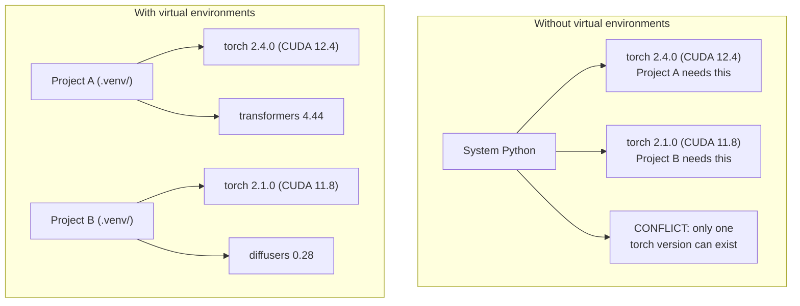

# Python 环境

> 依赖地狱确实存在。虚拟环境是解决办法。

**类型：** 动手构建
**语言：** Shell
**前置要求：** Phase 0，第 01 课
**时间：** 约 30 分钟

## 学习目标

- 使用 `uv`、`venv` 或 `conda` 创建隔离的虚拟环境。
- 编写包含可选依赖组的 `pyproject.toml`，生成锁文件以支持复现。
- 诊断全局安装、混用 pip/conda、CUDA 版本不匹配等常见问题。
- 为依赖相互冲突的项目实施按阶段划分环境的策略。

## 问题

你为微调项目安装 PyTorch 2.4。下周另一个项目因为固定的 CUDA 构建而需要 PyTorch 2.1。全局升级会破坏一个项目，降级又会破坏另一个。

这就是依赖地狱。它在 AI/ML 工作中很常见，原因包括：

- PyTorch、JAX 和 TensorFlow 各自提供 CUDA 相关绑定。
- 模型库固定特定框架版本。
- 全局 `pip install` 会覆盖原来安装的包。
- 原文声称 CUDA 11.8 构建无法搭配 CUDA 12.x 驱动，反之亦然。

解决办法是每个项目使用自己的隔离环境和软件包。

## 核心概念



图示对比多个项目共享全局环境，与每个项目独立维护包版本的情况。

```figure
s0-env-isolation
```

此标记对应课程网站的依赖隔离交互图。

## 动手构建

### 方案 1：uv venv（推荐）

原文称 `uv` 是最快的 Python 包管理器，比 pip 快 10—100 倍。它将虚拟环境、Python 版本和依赖解析集成在同一工具中。

```bash
curl -LsSf https://astral.sh/uv/install.sh | sh

uv python install 3.12

cd your-project
uv venv
source .venv/bin/activate
```

创建并激活虚拟环境。

安装软件包：

```bash
uv pip install torch numpy
```

用一步初始化包含 `pyproject.toml` 的项目：

```bash
uv init my-ai-project
cd my-ai-project
uv add torch numpy matplotlib
```

### 方案 2：venv（内置）

如果无法安装 uv，可以使用 Python 自带的 venv：

```bash
python3 -m venv .venv
source .venv/bin/activate  # Linux/macOS
.venv\Scripts\activate     # Windows

pip install torch numpy
```

虽然不如 uv 快，但安装了 Python 的地方通常都能使用它。

### 方案 3：conda（需要时使用）

Conda 可以管理 CUDA Toolkit、cuDNN 和 C 库等非 Python 依赖。以下情况适合使用：

- 需要特定 CUDA Toolkit，但不想安装到全系统。
- 在没有系统软件安装权限的共享集群上工作。
- 某个库明确要求使用 conda 安装。

```bash
# Install miniconda (not the full Anaconda)
curl -LsSf https://repo.anaconda.com/miniconda/Miniconda3-latest-Linux-x86_64.sh -o miniconda.sh
bash miniconda.sh -b

conda create -n myproject python=3.12
conda activate myproject

conda install pytorch torchvision torchaudio pytorch-cuda=12.4 -c pytorch -c nvidia
```

原文给出的规则是：一个环境选择 conda 后，尽量用 conda 管理其中所有软件包。将 `pip install` 混入 conda 环境可能产生难以排查的依赖冲突。

### 本课程：按阶段划分环境

虽然可以为整个课程只建一个环境，但原文不推荐这样做：不同阶段可能需要不同甚至冲突的依赖。

策略如下：

```
ai-engineering-from-scratch/
├── .venv/                    <-- shared lightweight env for phases 0-3
├── phases/
│   ├── 04-neural-networks/
│   │   └── .venv/            <-- PyTorch env
│   ├── 05-cnns/
│   │   └── .venv/            <-- same PyTorch env (symlink or shared)
│   ├── 08-transformers/
│   │   └── .venv/            <-- might need different transformer versions
│   └── 11-llm-apis/
│       └── .venv/            <-- API SDKs, no torch needed
```

`code/env_setup.sh` 会为本课程创建基础环境。

## pyproject.toml 基础

每个 Python 项目都应有 `pyproject.toml`。原文将它描述为整合替代 `setup.py`、`setup.cfg` 和 `requirements.txt` 的文件。

```toml
[project]
name = "ai-engineering-from-scratch"
version = "0.1.0"
requires-python = ">=3.11"
dependencies = [
    "numpy>=1.26",
    "matplotlib>=3.8",
    "jupyter>=1.0",
    "scikit-learn>=1.4",
]

[project.optional-dependencies]
torch = ["torch>=2.3", "torchvision>=0.18"]
llm = ["anthropic>=0.39", "openai>=1.50"]
```

示例声明项目元数据、基本依赖与可选依赖组。

然后安装：

```bash
uv pip install -e ".[torch]"    # base + PyTorch
uv pip install -e ".[llm]"     # base + LLM SDKs
uv pip install -e ".[torch,llm]" # everything
```

根据命令指定的额外依赖组安装项目。

## 锁文件

锁文件将所有依赖，包括间接依赖，固定到准确版本。原文称这样能够保证可复现：任何人根据锁文件安装，都会得到完全相同的软件包。

```bash
# uv generates uv.lock automatically when using uv add
uv add numpy

# pip-tools approach
uv pip compile pyproject.toml -o requirements.lock
uv pip install -r requirements.lock
```

将锁文件提交到 Git。别人克隆仓库后可以根据它安装，得到相同版本。

## 常见错误

### 1. 全局安装

```bash
pip install torch  # BAD: installs to system Python

source .venv/bin/activate
pip install torch  # GOOD: installs to virtual environment
```

这组示例对比全局安装与虚拟环境中的安装。

检查软件包安装到了哪里：

```bash
which python       # should show .venv/bin/python, not /usr/bin/python
which pip           # should show .venv/bin/pip
```

### 2. 混用 pip 和 conda

```bash
conda create -n myenv python=3.12
conda activate myenv
conda install pytorch -c pytorch
pip install some-other-package   # BAD: can break conda's dependency tracking
conda install some-other-package # GOOD: let conda manage everything
```

如果必须在 conda 中使用 pip，例如某些包只有 pip 发行版，应先装完所有 conda 包，再最后安装 pip 包。

### 3. 忘记激活

```bash
python train.py           # uses system Python, missing packages
source .venv/bin/activate
python train.py           # uses project Python, packages found
```

Shell 提示符通常会显示环境名称：

```
(.venv) $ python train.py
```

### 4. 把 .venv 提交到 Git

```bash
echo ".venv/" >> .gitignore
```

虚拟环境通常占用 200MB—2GB。它们是本地环境，不适合直接跨机器搬运。应提交 `pyproject.toml` 和锁文件。

### 5. CUDA 版本不匹配

```bash
nvidia-smi                # shows driver CUDA version (e.g., 12.4)
python -c "import torch; print(torch.version.cuda)"  # shows PyTorch CUDA version

# These must be compatible.
# PyTorch CUDA version must be <= driver CUDA version.
```

示例检查驱动与 PyTorch 构建信息，以排查 GPU 运行环境不一致。

## 实际使用

运行配置脚本，创建课程环境：

```bash
bash phases/00-setup-and-tooling/06-python-environments/code/env_setup.sh
```

它会在仓库根目录创建 `.venv`，安装并验证核心依赖。

## 练习

1. 运行 `env_setup.sh`，确认全部检查通过。
2. 创建第二个虚拟环境，安装另一个 NumPy 版本，确认两个环境相互隔离。
3. 为同时需要 PyTorch 和 Anthropic SDK 的项目编写 `pyproject.toml`。
4. 故意在未激活虚拟环境时全局安装一个包，查看其位置，然后卸载。

## 关键术语

| 术语 | 常见说法 | 实际含义 |
|---|---|---|
| 虚拟环境 | “一个 venv” | 与系统 Python 分开的目录，包含 Python 解释器和软件包 |
| 锁文件 | “固定依赖” | 列出各包和准确版本的文件，帮助不同机器安装一致版本 |
| pyproject.toml | “新的 setup.py” | Python 项目标准配置文件，承担原有多个配置文件的职责 |
| 间接依赖 | “依赖的依赖” | A 依赖 B，B 依赖 C，则 C 是 A 的间接依赖 |
| CUDA 不匹配 | “GPU 不能用了” | PyTorch 编译所用 CUDA 与 GPU 驱动支持范围不兼容 |

## 译者校注

- 原文关于 CUDA 11.8 构建与 CUDA 12.x 驱动绝不兼容的说法过于绝对。应区分驱动、Toolkit 与框架所带运行时，并根据实际兼容要求判断，不能只比较版本号是否相同。
- `pyproject.toml` 是项目配置标准，不代表任何项目都必须删除 requirements 文件；具体使用哪个文件取决于工具和工作流。
- 锁文件提高可复现性，但不会消除操作系统、硬件、平台条件和软件源差异。
- 全局安装是教材练习，并非要求修改当前系统。当前已有 WSL 课程环境应按需要使用，不必为演示破坏全局环境。
