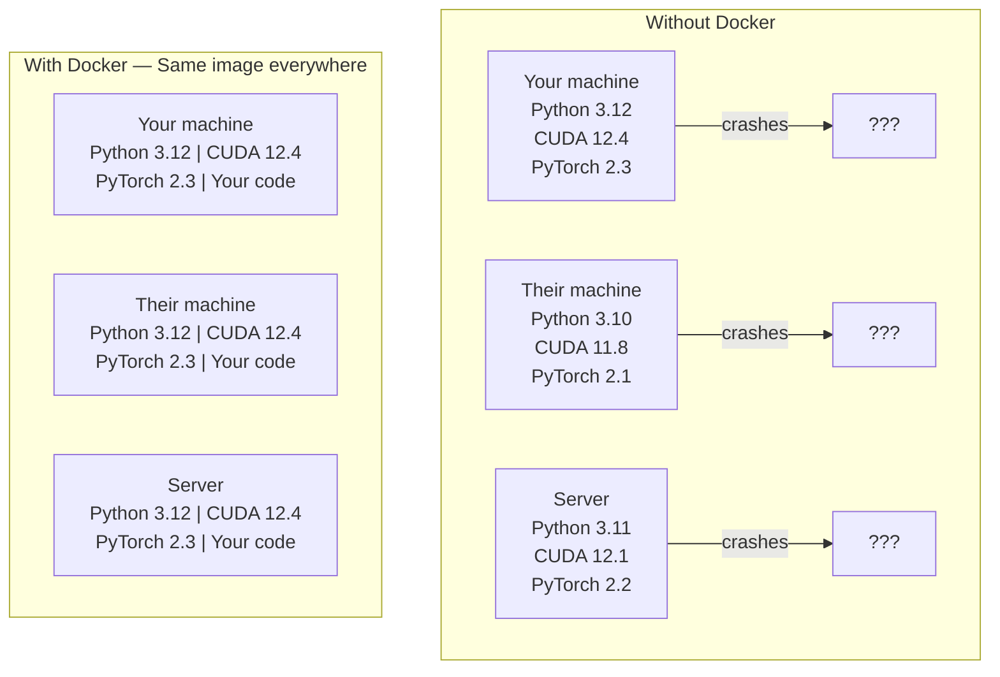

# 面向 AI 的 Docker

> 容器让“在我电脑上能跑”成为过去。

**类型：** 动手构建
**语言：** Docker
**前置要求：** Phase 0，第 01 与 03 课
**时间：** 约 60 分钟

## 学习目标

- 从 Dockerfile 构建支持 GPU、包含 CUDA、PyTorch 和 AI 库的镜像。
- 将宿主机目录挂载为持久存储，使模型、数据集和代码在容器重建后仍保留。
- 配置 NVIDIA Container Toolkit，向容器提供 GPU 访问能力。
- 使用 Docker Compose 编排多服务 AI 应用，例如推理服务器与向量数据库。

## 问题

你在笔记本上使用 PyTorch 2.3、CUDA 12.4 和 Python 3.12 训练模型。同事使用 PyTorch 2.1、CUDA 11.8 和 Python 3.10，模型到他那里就崩溃了，而 Dockerfile 可以帮助双方使用一致的环境。

AI 项目的依赖往往复杂：Python、PyTorch、CUDA 驱动、cuDNN、系统级 C 库，以及需要特定编译器版本的 flash-attn 等专用包。原文将 Docker 描述为把这些内容打包进同一个镜像，使其到处一致运行的工具。

## 核心概念

Docker 将代码、运行时、库和系统工具封装为隔离单元，称为容器。可以把它类比成轻量虚拟机，但容器共享宿主操作系统内核，不运行自己的内核，因此通常以秒而非分钟启动。



图示展示宿主系统、Docker 与多个隔离容器的关系。

### 为什么 AI 项目尤其需要 Docker

1. **GPU 驱动兼容性容易出问题。** 原文称 CUDA 12.4 代码无法在 CUDA 11.8 上运行。Docker 将 CUDA Toolkit 隔离在容器内，通过 NVIDIA Container Toolkit 共享宿主 GPU 驱动。
2. **模型权重大。** 70 亿参数模型的 fp16 权重约 14GB，不应每次重建都重新下载。可以挂载宿主机模型目录。
3. **多服务架构常见。** 实际 AI 应用不只是 Python 脚本，还可能有推理服务、RAG 向量数据库与 Web 前端。Docker Compose 用一条命令管理它们。

### 重要词汇

| 术语 | 含义 |
|---|---|
| Image（镜像） | 只读模板，类似配方，由 Dockerfile 构建 |
| Container（容器） | 镜像运行出来的实例，类似实际工作的厨房 |
| Dockerfile | 逐层构建镜像的指令 |
| Volume（卷） | 容器重启后仍保留的持久存储 |
| docker-compose | 使用 YAML 定义多容器应用的工具 |

### AI 中常见的容器模式

```
Dev Container
  Full toolkit. Editor support. Jupyter. Debugging tools.
  Used during development and experimentation.

Training Container
  Minimal. Just the training script and dependencies.
  Runs on GPU clusters. No editor, no Jupyter.

Inference Container
  Optimized for serving. Small image. Fast cold start.
  Runs behind a load balancer in production.
```

图示描述常见 AI 容器组合方式。

```figure
s0-image-layers
```

此标记对应课程网站的容器隔离交互图。

## 动手构建

### 第 1 步：安装 Docker

```bash
# macOS
brew install --cask docker
open /Applications/Docker.app

# Ubuntu
curl -fsSL https://get.docker.com | sh
sudo usermod -aG docker $USER
# Log out and back in for group change to take effect
```

根据平台安装 Docker 或 Docker Desktop。

验证安装：

```bash
docker --version
docker run hello-world
```

### 第 2 步：安装 NVIDIA Container Toolkit（有 NVIDIA GPU 的 Linux）

它让 Docker 容器访问 GPU。原文称 macOS 与 Windows（WSL2）用户可跳过，因为 Docker Desktop 在这些平台采用不同的 GPU 透传处理方式。

```bash
distribution=$(. /etc/os-release;echo $ID$VERSION_ID)
curl -fsSL https://nvidia.github.io/libnvidia-container/gpgkey | sudo gpg --dearmor -o /usr/share/keyrings/nvidia-container-toolkit-keyring.gpg
curl -s -L https://nvidia.github.io/libnvidia-container/$distribution/libnvidia-container.list | \
    sed 's#deb https://#deb [signed-by=/usr/share/keyrings/nvidia-container-toolkit-keyring.gpg] https://#g' | \
    sudo tee /etc/apt/sources.list.d/nvidia-container-toolkit.list

sudo apt-get update
sudo apt-get install -y nvidia-container-toolkit
sudo nvidia-ctk runtime configure --runtime=docker
sudo systemctl restart docker
```

命令配置软件源、安装 Toolkit，并配置 Docker 运行时。

测试容器内 GPU 访问：

```bash
docker run --rm --gpus all nvidia/cuda:12.4.1-base-ubuntu22.04 nvidia-smi
```

能看到 GPU 信息，说明此项配置正常。

### 第 3 步：理解基础镜像

选对基础镜像能省去大量排错时间。

```
nvidia/cuda:12.4.1-devel-ubuntu22.04
  Full CUDA toolkit. Compilers included.
  Use for: building packages that need nvcc (flash-attn, bitsandbytes)
  Size: ~4 GB

nvidia/cuda:12.4.1-runtime-ubuntu22.04
  CUDA runtime only. No compilers.
  Use for: running pre-built code
  Size: ~1.5 GB

pytorch/pytorch:2.6.0-cuda12.4-cudnn9-runtime
  PyTorch pre-installed on top of CUDA.
  Use for: skipping the PyTorch install step
  Size: ~6 GB

python:3.12-slim
  No CUDA. CPU only.
  Use for: inference on CPU, lightweight tools
  Size: ~150 MB
```

示例比较基础镜像类型；runtime 与 devel 的重要区别是是否包含开发编译工具。

### 第 4 步：编写 AI 开发 Dockerfile

以下是 `code/Dockerfile`，逐项阅读：

```dockerfile
FROM --platform=linux/amd64 nvidia/cuda:12.4.1-devel-ubuntu22.04

ENV DEBIAN_FRONTEND=noninteractive
ENV PYTHONUNBUFFERED=1

RUN apt-get update && apt-get install -y --no-install-recommends \
    software-properties-common \
    git \
    curl \
    build-essential \
    && add-apt-repository -y ppa:deadsnakes/ppa \
    && apt-get update && apt-get install -y --no-install-recommends \
    python3.12 \
    python3.12-venv \
    python3.12-dev \
    && rm -rf /var/lib/apt/lists/*

RUN update-alternatives --install /usr/bin/python python /usr/bin/python3.12 1

RUN curl -sSL https://raw.githubusercontent.com/pypa/get-pip/3b73145063be545b649ad9ca83ea8da5fc915a4f/public/get-pip.py -o /tmp/get-pip.py \
    && echo "a341e1a43e38001c551a1508a73ff23636a11970b61d901d9a1cad2a18f57055  /tmp/get-pip.py" | sha256sum -c - \
    && python /tmp/get-pip.py \
    && rm /tmp/get-pip.py \
    && update-alternatives --install /usr/bin/pip pip /usr/local/bin/pip3.12 1

RUN python -m pip install --no-cache-dir --upgrade pip setuptools wheel

RUN python -m pip install --no-cache-dir \
    torch==2.6.0+cu124 \
    torchvision==0.21.0+cu124 \
    torchaudio==2.6.0+cu124 \
    --index-url https://download.pytorch.org/whl/cu124

RUN python -m pip install --no-cache-dir \
    numpy \
    pandas \
    scikit-learn \
    matplotlib \
    jupyter \
    transformers \
    datasets \
    accelerate \
    safetensors

WORKDIR /workspace

VOLUME ["/workspace", "/models"]

EXPOSE 8888

CMD ["python"]
```

配置选择基础镜像，安装系统与 Python 依赖，设置工作目录和默认启动命令。

构建镜像：

```bash
docker build -t ai-dev -f phases/00-setup-and-tooling/07-docker-for-ai/code/Dockerfile .
```

首次下载 CUDA 基础镜像和 PyTorch 较慢，后续构建复用缓存层。

**macOS / Apple Silicon（M1/M2/M3/M4）：** `FROM` 行中的 `--platform=linux/amd64` 是此构建能在 Mac 上成功的关键。CUDA 基础镜像也有 arm64 变体，Apple Silicon 的 Docker Desktop 会自动选用它，但原文指定的 PyTorch `cu124` wheel 仅面向 x86_64，因此安装 `torch==2.6.0+cu124` 会报 `No matching distribution found for torch==2.6.0+cu124`。固定平台会拉取 x86_64 镜像并模拟执行：构建更慢，容器也没有 CUDA GPU。Mac 上运行下面命令时应去掉 `--gpus all`。Apple Silicon 的 GPU 工作应按第 01 课原生使用 MPS 版本，此镜像留给带 NVIDIA GPU 的 x86_64 Linux 主机。

运行容器：

```bash
docker run --rm -it --gpus all \
    -v $(pwd):/workspace \
    -v ~/models:/models \
    ai-dev python -c "import torch; print(f'PyTorch {torch.__version__}, CUDA: {torch.cuda.is_available()}')"
```

在容器中运行 Jupyter：

```bash
docker run --rm -it --gpus all \
    -v $(pwd):/workspace \
    -v ~/models:/models \
    -p 8888:8888 \
    ai-dev jupyter notebook --ip=0.0.0.0 --port=8888 --no-browser --allow-root
```

### 第 5 步：挂载数据与模型目录

持久存储对 AI 工作至关重要。原文说，不挂载时，下载的 14GB 模型会在容器停止后消失。

```bash
# Mount your code
-v $(pwd):/workspace

# Mount a shared models directory
-v ~/models:/models

# Mount datasets
-v ~/datasets:/data
```

命令将宿主机目录映射到容器路径。

训练脚本从挂载路径加载：

```python
from transformers import AutoModel

model = AutoModel.from_pretrained("/models/llama-7b")
```

模型在宿主文件系统上，反复重建容器也无需重新下载。

### 第 6 步：使用 Docker Compose 管理多服务 AI 应用

实际 RAG 应用需要推理服务器与向量数据库，Compose 可一条命令同时启动。

参见 `code/docker-compose.yml`：

```yaml
services:
  ai-dev:
    build:
      context: .
      dockerfile: Dockerfile
    deploy:
      resources:
        reservations:
          devices:
            - driver: nvidia
              count: all
              capabilities: [gpu]
    volumes:
      - ../../../:/workspace
      - ~/models:/models
      - ~/datasets:/data
    ports:
      - "8888:8888"
    stdin_open: true
    tty: true
    command: jupyter notebook --ip=0.0.0.0 --port=8888 --no-browser --allow-root

  qdrant:
    image: qdrant/qdrant:v1.12.5
    ports:
      - "6333:6333"
      - "6334:6334"
    volumes:
      - qdrant_data:/qdrant/storage

volumes:
  qdrant_data:
```

配置定义 AI 开发与 Qdrant 服务，包括端口、持久存储和 GPU 配置。

启动所有服务：

```bash
cd phases/00-setup-and-tooling/07-docker-for-ai/code
docker compose up -d
```

AI 开发容器可通过服务名访问 `http://qdrant:6333`，Compose 自动创建共享网络。

在 AI 容器内测试连接：

```python
from qdrant_client import QdrantClient

client = QdrantClient(host="qdrant", port=6333)
print(client.get_collections())
```

停止所有服务：

```bash
docker compose down
```

加 `-v` 还会删除 Qdrant 卷：

```bash
docker compose down -v
```

### 第 7 步：AI 工作常用 Docker 命令

```bash
# List running containers
docker ps

# List all images and their sizes
docker images

# Remove unused images (reclaim disk space)
docker system prune -a

# Check GPU usage inside a running container
docker exec -it <container_id> nvidia-smi

# Copy a file from container to host
docker cp <container_id>:/workspace/results.csv ./results.csv

# View container logs
docker logs -f <container_id>
```

这些命令用于查看容器、日志、镜像和资源，并管理容器。

## 实际使用

现在拥有便于复现的 AI 开发环境。后续课程中：

- 用 `docker compose up` 同时启动开发环境与向量数据库。
- 挂载代码、模型和数据，避免重建时丢失。
- 需要新 Python 包时，加入 Dockerfile 并重建。
- 与队友共享 Dockerfile，获得相同环境定义。

### 没有 GPU？

去掉 `--gpus all` 和 NVIDIA deploy 配置块，容器仍可用于 CPU 课程。原文称 PyTorch 会检测 CUDA 缺失并自动回退 CPU。

## 练习

1. 构建 Dockerfile，在容器中运行 `python -c "import torch; print(torch.__version__)"`。
2. 启动 Compose 服务，验证 AI 容器能访问 `http://qdrant:6333/collections`。
3. 在 Dockerfile 中增加 `flask`，重建，在 5000 端口运行简单 API 服务，用 `-p 5000:5000` 映射端口。
4. 用 `docker images` 测量镜像大小，将基础镜像从 devel 改为 runtime 并比较。

### 练习提示

**练习 1.** 用课程中的 `docker build -t ai-dev -f phases/00-setup-and-tooling/07-docker-for-ai/code/Dockerfile .` 命令构建，然后在 `docker run --rm ai-dev` 启动的容器内执行导入。按课程说明，在 Mac 上省略 `--gpus all`。容器必须打印以 `2.6.0` 开头的版本号。

**练习 2.** 在 `code/` 文件夹中运行 `docker compose up -d`，再用 `docker compose exec ai-dev bash` 打开 `ai-dev` 服务内的 shell。在其中运行 `curl http://qdrant:6333/collections`；返回 JSON 表示服务名能在 Compose 网络中解析。

**练习 3.** 在 Dockerfile 中添加一行 `RUN pip install flask`，重新构建，并使用 `host="0.0.0.0"` 启动服务器，因为只绑定到容器内 localhost 的服务器无法从外部访问。在你的电脑上打开 `http://localhost:5000`，确认端口映射有效。

**练习 4.** 运行 `docker images ai-dev`，记下 SIZE 列。将 `FROM` 行中的 `devel` 改为 `runtime`，使用新标签构建并比较两个镜像的大小；runtime 镜像不包含编译器和头文件。

## 关键术语

| 术语 | 常见说法 | 实际含义 |
|---|---|---|
| Container | “轻量虚拟机” | 共享宿主内核、具有独立文件系统和网络视图的隔离进程 |
| Image layer | “缓存步骤” | 原文把各 Dockerfile 指令描述为逐层构建，不变的层被缓存以加快重建 |
| NVIDIA Container Toolkit | “Docker 中的 GPU” | 通过 `--gpus` 等配置暴露宿主 GPU 的运行时集成 |
| Volume mount | “共享文件夹” | 映射到容器的宿主目录，容器停止后变更仍保留 |
| Base image | “起点” | Dockerfile 的 FROM 镜像，决定预装内容 |

## 译者校注

- Docker 不会完整打包宿主 GPU 驱动，也不保证跨架构、硬件和内核完全一致，宿主仍需兼容驱动。
- “停止后消失”不准确：一般容器停止后可写层仍保留，删除或重建容器才丢失；`--rm` 容器退出后会自动删除。
- 将宿主目录挂入容器通常是 bind mount，与 Docker 管理的命名卷不同；原文在 volume mount 名下混用了概念。
- PyTorch 不会自动将所有显式 CUDA 操作改为 CPU；硬编码 `.cuda()` 仍可能报错，应用需主动选择设备。
- macOS Docker Desktop 不会因此支持 NVIDIA CUDA，WSL2 透传与原生 Linux 配置也不应混淆。
- `docker compose down -v` 会删除卷数据，不是普通暂停。
