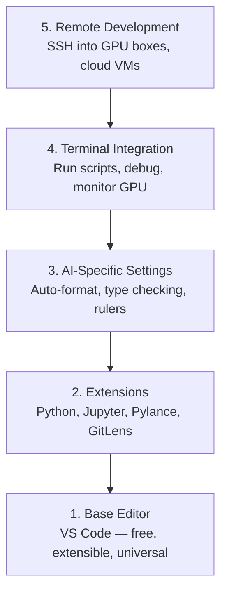

# 编辑器配置

> 编辑器是你的副驾驶。配置一次，让它减少阻力，真正帮助你工作。

**类型：** 动手构建
**语言：** --
**前置要求：** Phase 0，第 01 课
**时间：** 约 20 分钟

## 学习目标

- 安装 VS Code 及 Python、Jupyter、代码检查和 Remote SSH 必要扩展。
- 为 AI 工作流配置保存时格式化、类型检查和 Notebook 输出滚动。
- 设置 Remote SSH，像操作本地文件一样编辑、调试远程 GPU 机器上的代码。
- 评估 Cursor、Windsurf、Neovim 等编辑器及其取舍。

## 问题

你将在编辑器中花大量时间编写 Python、运行 Notebook、调试训练循环和连接 GPU 服务器。错误配置会不断制造阻力：没有自动补全、类型提示和行内错误，还要手动排版，终端操作也不顺畅。

原文称，正确配置只需 20 分钟，而跳过配置会每天浪费 20 分钟。

## 核心概念

AI 工程编辑器配置需要五个部分：



图示说明编辑器与语言支持、Notebook、调试、版本控制和远程开发等能力的关系。

```figure
s0-lsp-roundtrip
```

此标记对应课程网站的编辑器反馈交互图。

## 动手构建

### 第 1 步：安装 VS Code

本课推荐 VS Code：免费、跨平台，对 Jupyter Notebook 支持良好，扩展生态也能覆盖 AI 工作需求。

从 [code.visualstudio.com](https://code.visualstudio.com/) 下载。

在终端验证：

```bash
code --version
```

如果 macOS 找不到 code，打开 VS Code，按 `Cmd+Shift+P`，输入 Shell Command，选择 Install 'code' command in PATH。

### 第 2 步：安装必要扩展

打开集成终端（通常为 `` Ctrl+` ``），安装 AI 工作扩展：

```bash
code --install-extension ms-python.python
code --install-extension ms-python.vscode-pylance
code --install-extension ms-toolsai.jupyter
code --install-extension eamodio.gitlens
code --install-extension ms-vscode-remote.remote-ssh
code --install-extension ms-python.debugpy
code --install-extension ms-python.black-formatter
code --install-extension charliermarsh.ruff
```

各扩展的作用：

| 扩展 | 用途 |
|---|---|
| Python | 语言支持、虚拟环境识别、运行与调试 |
| Pylance | 快速类型检查、自动补全、导入解析 |
| Jupyter | 在 VS Code 中运行 Notebook，查看变量 |
| GitLens | 查看谁修改了什么，提供行内 Git blame |
| Remote SSH | 像打开本地目录一样打开远程 GPU 目录 |
| Debugpy | Python 单步调试 |
| Black Formatter | 保存时自动格式化，统一风格 |
| Ruff | 快速代码检查，发现常见错误 |

本课的 `code/vscode/extensions.json` 文件包含完整推荐列表。将它复制到你的项目文件夹中的 `.vscode/extensions.json`，打开该文件夹时，VS Code 会提示安装这些扩展。

### 第 3 步：配置设置

复制本课 `code/vscode/settings.json` 中的设置，或通过 Settings > Open Settings (JSON) 手动配置。

AI 工作的重要设置：

```jsonc
{
    "python.analysis.typeCheckingMode": "basic",
    "editor.formatOnSave": true,
    "editor.rulers": [88, 120],
    "notebook.output.scrolling": true,
    "files.autoSave": "afterDelay"
}
```

它们的意义：

- **basic 类型检查：** 运行前发现参数类型错误，减少张量形状或 API 参数排错时间。
- **保存时格式化：** 交给 Black 处理排版。
- **88 与 120 列标尺：** Black 通常按 88 列排版，120 列帮助发现过长注释与文档字符串。
- **Notebook 输出滚动：** 训练可能打印数千行，滚动区域避免输出挤满页面。
- **自动保存：** 避免忘记保存后运行旧脚本。

### 第 4 步：终端集成

集成终端用于训练脚本、GPU 监控和环境管理。按以下方式配置：

```jsonc
{
    "terminal.integrated.defaultProfile.osx": "zsh",
    "terminal.integrated.defaultProfile.linux": "bash",
    "terminal.integrated.fontSize": 13,
    "terminal.integrated.scrollback": 10000
}
```

常用快捷键：

| 操作 | macOS | Linux/Windows |
|---|---|---|
| 显示/隐藏终端 | `` Ctrl+` `` | `` Ctrl+` `` |
| 新建终端 | `` Ctrl+Shift+` `` | `` Ctrl+Shift+` `` |
| 拆分终端 | `Cmd+\` | `Ctrl+Shift+5` |

拆分后，一个终端运行脚本，另一个用 `nvidia-smi -l 1` 或 `watch -n 1 nvidia-smi` 监控 GPU。

### 第 5 步：远程开发（SSH 连接 GPU 机器）

Remote SSH 是 AI 工作中很重要的扩展。训练可能在云虚拟机、实验室服务器、Lambda 或 Vast.ai 上运行。它可打开远程文件系统、编辑文件、运行终端和调试，使操作体验接近本地。

设置步骤：

1. 安装 Remote SSH 扩展，第 2 步已完成。
2. 按 `Ctrl+Shift+P` 或 `Cmd+Shift+P`，输入 Remote-SSH: Connect to Host。
3. 输入 `user@your-gpu-box-ip`。
4. VS Code 自动在远程安装服务器组件。

用 SSH 密钥避免每次输入账户密码：

```bash
ssh-keygen -t ed25519 -C "your-email@example.com"
ssh-copy-id user@your-gpu-box-ip
```

为方便操作，将主机加入 `~/.ssh/config`：

```
Host gpu-box
    HostName 203.0.113.50
    User ubuntu
    IdentityFile ~/.ssh/id_ed25519
    ForwardAgent yes
```

之后选择 Remote-SSH: Connect to Host > gpu-box 即可连接。

## 其他选择

### Cursor

[cursor.com](https://cursor.com) 是内置 AI 代码生成的 VS Code 衍生编辑器。原文称它使用相同扩展生态和设置格式，因此可以导入同样的 settings.json 与 extensions.json。

### Windsurf

[windsurf.com](https://windsurf.com) 是另一款 AI 优先的 VS Code 衍生编辑器。原文同样认为它支持相同扩展、设置格式和 Remote SSH。

### Vim/Neovim

如果已熟练使用 Vim 或 Neovim，可以继续使用。AI Python 的最小配置包括：

- pyright 或 pylsp：类型检查，经 Mason 或手动安装。
- nvim-lspconfig：语言服务器集成。
- jupyter-vim 或 molten-nvim：类似 Notebook 的执行方式。
- telescope.nvim：文件与符号搜索。
- none-ls.nvim 配合 Black、Ruff：格式化和代码检查。

如果还没用过 Vim，本课不建议此时开始，因为编辑器学习会与 AI 工程争夺时间，先使用 VS Code。

## 实际使用

配置后的日常工作流：

1. 打开项目目录，或通过 Remote SSH 连接 GPU 机器。
2. 编写 Python，利用补全、类型提示和行内错误。
3. 用 Jupyter 扩展直接运行 Notebook。
4. 在集成终端运行训练脚本、uv pip install 和 GPU 监控。
5. 提交前用 GitLens 查看变更。

## 练习

1. 安装 VS Code 及第 2 步的所有扩展。
2. 将本课 settings.json 的配置复制到自己的 VS Code 设置。
3. 打开 Python 文件，验证 Pylance 显示类型提示、Black 在保存时格式化。
4. 有远程访问权限时，配置 Remote SSH 并打开远程目录。

### 练习提示

**练习 1.** 安装第 2 步表格中的扩展，或对 `code/vscode/extensions.json` 中的每个 ID 执行 `code --install-extension <id>`。运行 `code --list-extensions`，逐一对照该文件检查每个 ID。

**练习 2.** 打开 Settings > Open Settings (JSON)，将 `code/vscode/settings.json` 的内容复制进去。如果文件已有设置，合并键并保持 JSON 有效；文件格式错误时，VS Code 会用红线标出。

**练习 3.** 编写一个带类型注解的函数，然后将鼠标悬停在调用它的位置；Pylance 会显示推断出的类型。在某行添加多余空格并保存文件；Black 必须在保存时重新格式化该行。

**练习 4.** 先将服务器添加到 `~/.ssh/config`，并确认在终端中执行 `ssh <host>` 能正常连接。再使用 Remote SSH 命令连接；VS Code 在远程机器上运行时，状态栏会显示主机名。

## 关键术语

| 术语 | 常见说法 | 实际含义 |
|---|---|---|
| LSP | “自动补全引擎” | Language Server Protocol，编辑器向语言服务器获取类型、补全和诊断的标准协议 |
| Pylance | “Python 插件” | 微软 Python 语言服务器，用 Pyright 类型检查并提供 IntelliSense |
| Remote SSH | “在服务器工作” | 在远程运行轻量服务组件，将交互呈现在本地编辑器的 VS Code 扩展 |
| Format on save | “自动排版” | 每次保存运行 Black、Ruff 等格式化器以保持风格一致 |

## 译者校注

- 20 分钟是教材估计，不是测量结论。编辑器扩展兼容性、配置项和快捷键可能变化。
- Pylance 类型检查不是运行时强制检查，也不能普遍发现所有张量形状错误。
- WSL 课程要选择 WSL 仓库内解释器；code --version 无法证明窗口和解释器都在 WSL。
- 复制设置时应保留已有配置，避免覆盖其他项目所需选项。
