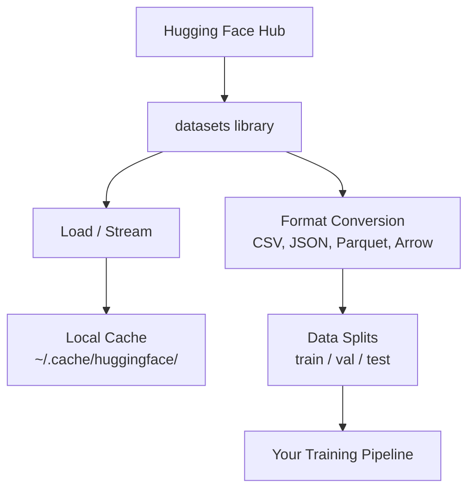

# 数据管理

> 数据是燃料，管理方式决定你能推进多快。

**类型：** 动手构建
**语言：** Python
**前置要求：** Phase 0，第 01 课
**时间：** 约 45 分钟

## 学习目标

- 使用 Hugging Face datasets 库加载、流式处理和缓存数据集。
- 在 CSV、JSON、Parquet 与 Arrow 间转换，并说明取舍。
- 用固定随机种子创建可复现的训练、验证和测试划分。
- 使用 .gitignore、Git LFS 或 DVC 管理大模型与数据文件。

## 问题

每个 AI 项目都从数据开始。你需要找到数据集、下载、转换格式、划分训练与评估数据，并管理版本以便复现实验。每次手动处理既慢又易错，需要可重复执行的流程。

## 核心概念



图示描述从获取数据到预处理、划分和训练的流程。

Hugging Face datasets 是 AI 数据加载的常用工具，内置下载、缓存、格式转换和流式处理能力。

```figure
s0-data-pipeline
```

此标记对应课程网站的数据格式交互图。

## 动手构建

### 第 1 步：安装 datasets 库

```bash
pip install datasets huggingface_hub
```

### 第 2 步：加载数据集

```python
from datasets import load_dataset

dataset = load_dataset("stanfordnlp/imdb")
print(dataset)
print(dataset["train"][0])
```

示例下载 IMDB 电影评论数据集。首次下载后，后续从 `~/.cache/huggingface/datasets/` 缓存加载。

### 第 3 步：流式读取大数据集

某些数据集大到磁盘也放不下。流式模式逐条读取，不必先下载完整数据集。

```python
dataset = load_dataset("wikimedia/wikipedia", "20231101.en", split="train", streaming=True)

for i, example in enumerate(dataset):
    print(example["title"])
    if i >= 4:
        break
```

流式模式返回 IterableDataset，数据到达后逐条处理。原文称内存使用不随数据集整体大小增长。

### 第 4 步：数据集格式

datasets 底层使用 Apache Arrow，可以按流水线需要转换格式。

```python
dataset = load_dataset("stanfordnlp/imdb", split="train")

dataset.to_csv("imdb_train.csv")
dataset.to_json("imdb_train.json")
dataset.to_parquet("imdb_train.parquet")
```

示例写出或读取 CSV、JSON、Parquet 与 Arrow 相关格式。

格式对比：

| 格式 | 大小 | 读取速度 | 适合场景 |
|---|---|---|---|
| CSV | 大 | 慢 | 人工阅读、电子表格 |
| JSON | 大 | 慢 | API、嵌套数据 |
| Parquet | 小 | 快 | 分析、列式查询 |
| Arrow | 小 | 最快 | 内存处理，datasets 内部使用 |

原文推荐 AI 工作用 Parquet 存储、Arrow 在内存中处理，CSV 和 JSON 用于交换数据。

### 第 5 步：数据划分

机器学习项目通常需要三部分数据：

- **训练集：** 模型从中学习，典型比例 80%。
- **验证集：** 训练期间检查进度，典型比例 10%。
- **测试集：** 训练完成后的最终评估，典型比例 10%。

有些数据集已有划分，没有时自行划分：

```python
dataset = load_dataset("stanfordnlp/imdb", split="train")

split = dataset.train_test_split(test_size=0.2, seed=42)
train_val = split["train"].train_test_split(test_size=0.125, seed=42)

train_ds = train_val["train"]
val_ds = train_val["test"]
test_ds = split["test"]

print(f"Train: {len(train_ds)}, Val: {len(val_ds)}, Test: {len(test_ds)}")
```

设置随机种子以支持复现。原文称同样的种子每次都会产生相同划分。

### 第 6 步：下载和缓存模型

模型文件很大，huggingface_hub 负责下载与缓存。

```python
from huggingface_hub import hf_hub_download, snapshot_download

model_path = hf_hub_download(
    repo_id="sentence-transformers/all-MiniLM-L6-v2",
    filename="config.json"
)
print(f"Cached at: {model_path}")

model_dir = snapshot_download("sentence-transformers/all-MiniLM-L6-v2")
print(f"Full model at: {model_dir}")
```

模型缓存到 `~/.cache/huggingface/hub/`。原文称下载一次后，后续加载可以立即完成。

### 第 7 步：处理大型文件

模型权重和大数据集不应直接放入普通 Git 历史。有三种方案：

**方案 A：.gitignore（最简单）**

```
*.bin
*.safetensors
*.pt
*.onnx
data/*.parquet
data/*.csv
models/
```

忽略可以重新获取的大文件及相关目录。

**方案 B：Git LFS（通过 Git 跟踪大文件）**

```bash
git lfs install
git lfs track "*.bin"
git lfs track "*.safetensors"
git add .gitattributes
```

Git LFS 在仓库中保存指针，实际文件放在独立服务端。原文称 GitHub 提供 1GB 免费额度。

**方案 C：DVC（数据版本控制）**

```bash
pip install dvc
dvc init
dvc add data/training_set.parquet
git add data/training_set.parquet.dvc data/.gitignore
git commit -m "Track training data with DVC"
```

DVC 创建小型 .dvc 文件指向数据，实际数据存放于 S3、GCS 或其他远程存储后端。

| 方案 | 复杂度 | 适合场景 |
|---|---|---|
| .gitignore | 低 | 个人项目，可以重新下载的数据 |
| Git LFS | 中 | 团队通过 Git 共享模型权重 |
| DVC | 高 | 实验复现、大数据集和团队协作 |

本课程用 .gitignore 即可。需要跨机器复现确切实验时，再使用 DVC。

### 第 8 步：存储模式

**本地存储：** 原文认为适用于约 10GB 以下的数据集，HF 缓存自动处理。

**云存储：** 适用于更大或需跨机器共享的数据：

```python
import os

local_path = os.path.expanduser("~/.cache/huggingface/datasets/")

# s3_path = "s3://my-bucket/datasets/"
# gcs_path = "gs://my-bucket/datasets/"
```

DVC 直接集成 S3 与 GCS：

```bash
dvc remote add -d myremote s3://my-bucket/dvc-store
dvc push
```

本课程使用本地存储足够，远程 GPU 实例微调时才更需要考虑云存储。

## 本课程使用的数据集

| 数据集 | 使用课程 | 大小（原文示例） | 学习内容 |
|---|---|---|---|
| IMDB | 分词、分类 | 84MB | 文本分类基础 |
| WikiText | 语言建模 | 181MB | 下一 token 预测 |
| SQuAD | 问答系统 | 35MB | 问答与答案区间 |
| Common Crawl 子集 | 嵌入 | 不固定 | 大规模文本处理 |
| MNIST | 视觉基础 | 21MB | 图像分类基础 |
| COCO 子集 | 多模态 | 不固定 | 图文配对 |

现在不必全部下载，每节课会说明所需数据。

## 实际使用

运行工具脚本，验证流程：

```bash
python code/data_utils.py
```

它会下载小数据集、转换格式、划分，并打印摘要。

## 交付产物

本课提供：

- code/data_utils.py：可复用的数据加载与缓存工具。
- outputs/prompt-data-helper.md：帮助为任务选择数据集的提示词。

## 练习

1. 加载 glue 数据集的 mrpc 配置，查看前 5 条样本。
2. 流式读取 c4，统计 10 秒内能处理多少条样本。
3. 将数据集转成 Parquet，与 CSV 文件大小比较。
4. 用固定种子创建 70/15/15 的训练、验证和测试划分，并验证大小。

## 关键术语

| 术语 | 常见说法 | 实际含义 |
|---|---|---|
| Dataset split | “训练数据” | 用于机器学习不同阶段的具名子集，如 train/val/test |
| Streaming | “惰性加载” | 从远程源逐条处理，不先下载完整数据集 |
| Parquet | “压缩的 CSV” | 为分析查询和存储效率优化的列式格式 |
| Arrow | “快速 DataFrame” | datasets 使用的内存列式格式，支持零复制读取 |
| Git LFS | “大文件 Git” | 实际大文件放在仓库外，版本控制中保留指针的扩展 |
| DVC | “数据的 Git” | 与云存储集成的数据集和模型版本控制工具 |
| Cache | “已经下载过” | 先前获取数据的本地副本，默认位于 ~/.cache/huggingface/ |

## 译者校注

- 格式大小和速度取决于压缩、类型与访问模式，表中排序不是普遍保证，Parquet 也不总是最优。
- 流式处理避免完整载入，但 shuffle 缓冲、预取和后续处理仍占内存。
- 固定种子只有在输入、样本顺序和算法等条件一致时才能得到相同划分；主体或时间相关的数据还需防泄漏。
- 缓存不是远程备份，也不保证瞬间加载；磁盘读取、反序列化和设备搬运仍需时间。
- .gitignore 不会移除已跟踪文件和历史。Git LFS 免费额度是原文内容，未核实为当前政策。
- 10GB 是粗略经验，存储选择还取决于容量、带宽、协作和成本。
