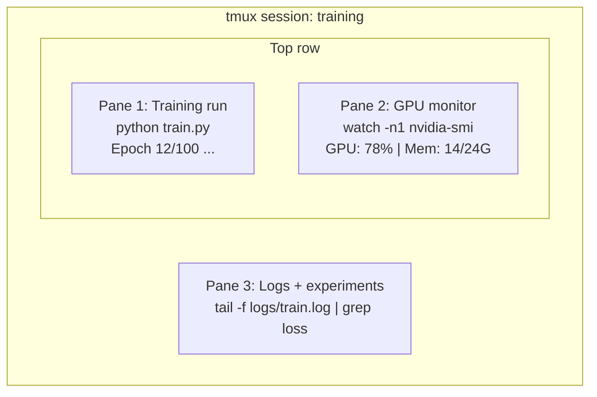

# 终端与 Shell

> 终端是 AI 工程师常用的工作场所，先熟悉它。

**类型：** 学习
**语言：** --
**前置要求：** Phase 0，第 01 课
**时间：** 约 35 分钟

## 学习目标

- 用管道、重定向和 grep 在命令行筛选并处理训练日志。
- 创建带多个窗格的持久 tmux 会话，同时训练并监控 GPU。
- 用 htop、nvtop、nvidia-smi 监控系统与 GPU 资源。
- 用 SSH、scp、rsync 在本地和远程机器间传输文件。

## 问题

训练运行、GPU 监控、追踪日志、远程 SSH 和环境管理都离不开终端。原文认为你在这里花的时间会超过编辑器，Shell 熟练程度会影响整个 AI 工作流。

本课只介绍 AI 工作需要的终端技能，不讲 Unix 历史，也不深入 Bash 脚本编程。

## 核心概念



一个终端同时管理三项工作。你可以分离会话，回家后重新 SSH 登录，再接回会话，训练继续运行。

```figure
s0-shell-pipeline
```

此标记对应课程网站的管道交互图。

## 动手构建

### 第 1 步：认识自己的 Shell

检查正在使用的 Shell：

```bash
echo $SHELL
```

大多数系统使用 Bash 或 Zsh，两者都可以。本课命令旨在兼容两者。

重要基础操作：

```bash
# Move around
cd ~/projects/ai-engineering-from-scratch
pwd
ls -la

# History search (most useful shortcut you'll learn)
# Ctrl+R then type part of a previous command
# Press Ctrl+R again to cycle through matches

# Clear terminal
clear   # or Ctrl+L

# Cancel a running command
# Ctrl+C

# Suspend a running command (resume with fg)
# Ctrl+Z
```

这一组涵盖导航、文件操作、历史和快捷编辑等基础操作。

### 第 2 步：管道与重定向

管道连接命令，用于日志处理、输出筛选与工具组合，会被频繁使用。

```bash
# Count how many times "loss" appears in a log
cat train.log | grep "loss" | wc -l

# Extract just the loss values from training output
grep "loss:" train.log | awk '{print $NF}' > losses.txt

# Watch a log file update in real time, filtering for errors
tail -f train.log | grep --line-buffered "ERROR"

# Sort experiments by final accuracy
grep "final_accuracy" results/*.log | sort -t= -k2 -n -r

# Redirect stdout and stderr to separate files
python train.py > output.log 2> errors.log

# Redirect both to the same file
python train.py > train_full.log 2>&1
```

示例展示筛选、计数、保存输出和组合处理。

需要掌握的重定向与管道符号：

| 符号 | 功能 |
|---|---|
| > | 将标准输出写入文件，覆盖已有内容 |
| >> | 将标准输出追加到文件 |
| 2> | 将标准错误写入文件 |
| 2>&1 | 将标准错误指向当时标准输出所在位置 |
| \| | 将前一个命令的标准输出传给下一个命令的标准输入 |

### 第 3 步：后台进程

训练可能持续数小时，不应需要一直守着终端。

```bash
# Run in background (output still goes to terminal)
python train.py &

# Run in background, immune to hangup (closing terminal won't kill it)
nohup python train.py > train.log 2>&1 &

# Check what's running in background
jobs
ps aux | grep train.py

# Bring a background job to foreground
fg %1

# Kill a background process
kill %1
# or find its PID and kill that
kill $(pgrep -f "train.py")
```

示例展示后台运行、查看作业、暂停恢复和用 nohup 保存日志。

&、nohup 与 screen/tmux 的差别：

| 方式 | 关闭终端后是否继续？ | 能否重新接入？ |
|---|---|---|
| command & | 原文：否 | 否 |
| nohup command & | 是 | 不能接回终端界面，查看日志 |
| screen / tmux | 是 | 是 |

原文推荐持续几分钟以上的工作使用 tmux。

### 第 4 步：tmux

tmux 提供持久终端会话和多窗格，是管理训练任务的实用工具。

```bash
# Install
# macOS
brew install tmux
# Ubuntu
sudo apt install tmux

# Start a named session
tmux new -s training

# Split horizontally
# Ctrl+B then "

# Split vertically
# Ctrl+B then %

# Navigate between panes
# Ctrl+B then arrow keys

# Detach (session keeps running)
# Ctrl+B then d

# Reattach
tmux attach -t training

# List sessions
tmux ls

# Kill a session
tmux kill-session -t training
```

命令用于新建、列出、分离和接回会话，以及拆分和切换窗格。

典型 AI 工作会话：

```bash
tmux new -s train

# Pane 1: start training
python train.py --epochs 100 --lr 1e-4

# Ctrl+B, " to split, then run GPU monitor
watch -n1 nvidia-smi

# Ctrl+B, % to split vertically, tail the logs
tail -f logs/experiment.log

# Now detach with Ctrl+B, d
# SSH out, go get coffee, come back
# tmux attach -t train
```

多个窗格分别运行训练、日志查看和资源监控。

### 第 5 步：用 htop 与 nvtop 监控

```bash
# System processes (better than top)
htop

# GPU processes (if you have NVIDIA GPU)
# Install: sudo apt install nvtop (Ubuntu) or brew install nvtop (macOS)
nvtop

# Quick GPU check without nvtop
nvidia-smi

# Watch GPU usage update every second
watch -n1 nvidia-smi

# See which processes are using the GPU
nvidia-smi --query-compute-apps=pid,name,used_memory --format=csv
```

命令用于安装或运行系统与 GPU 监控工具。

常用 htop 按键：

- F6 或 >：按列排序，如按内存排序查找异常占用。
- F5：切换树形视图，查看子进程。
- F9：终止进程或发送其他信号。
- /：搜索进程名。

### 第 6 步：SSH 连接远程 GPU

租用 Lambda、RunPod、Vast.ai 等云 GPU 后，通过 SSH 连接。

```bash
# Basic connection
ssh user@gpu-box-ip

# With a specific key
ssh -i ~/.ssh/my_gpu_key user@gpu-box-ip

# Copy files to remote
scp model.pt user@gpu-box-ip:~/models/

# Copy files from remote
scp user@gpu-box-ip:~/results/metrics.json ./

# Sync a whole directory (faster for many files)
rsync -avz ./data/ user@gpu-box-ip:~/data/

# Port forward (access remote Jupyter/TensorBoard locally)
ssh -L 8888:localhost:8888 user@gpu-box-ip
# Now open localhost:8888 in your browser

# SSH config for convenience
# Add to ~/.ssh/config:
# Host gpu
#     HostName 192.168.1.100
#     User ubuntu
#     IdentityFile ~/.ssh/gpu_key
#
# Then just:
# ssh gpu
```

这组示例涉及连接、配置、文件传输和本地端口转发。

### 第 7 步：AI 工作常用别名

将这些配置加入 ~/.bashrc 或 ~/.zshrc：

```bash
source phases/00-setup-and-tooling/10-terminal-and-shell/code/shell_aliases.sh
```

也可只复制需要的部分，主要别名如下：

```bash
# GPU status at a glance
alias gpu='nvidia-smi --query-gpu=index,name,utilization.gpu,memory.used,memory.total,temperature.gpu --format=csv,noheader'

# Kill all Python training processes
alias killtraining='pkill -f "python.*train"'

# Quick virtual environment activate
alias ae='source .venv/bin/activate'

# Watch training loss
alias watchloss='tail -f logs/*.log | grep --line-buffered "loss"'
```

完整集合见 code/shell_aliases.sh。

### 第 8 步：常见 AI 终端模式

实践中会反复使用：

```bash
# Run training, log everything, notify when done
python train.py 2>&1 | tee train.log; echo "DONE" | mail -s "Training complete" you@email.com

# Compare two experiment logs side by side
diff <(grep "accuracy" exp1.log) <(grep "accuracy" exp2.log)

# Find the largest model files (clean up disk space)
find . -name "*.pt" -o -name "*.safetensors" | xargs du -h | sort -rh | head -20

# Download a model from Hugging Face
wget https://huggingface.co/model/resolve/main/model.safetensors

# Untar a dataset
tar xzf dataset.tar.gz -C ./data/

# Count lines in all Python files (see how big your project is)
find . -name "*.py" | xargs wc -l | tail -1

# Check disk space (training data fills disks fast)
df -h
du -sh ./data/*

# Environment variable check before training
env | grep -i cuda
env | grep -i torch
```

这些组合简化日志查看、进程管理和 GPU 查询等重复任务。

## 实际使用

| 工具 | 使用时机 |
|---|---|
| tmux | Phase 3 及之后的训练运行 |
| tail -f + grep | 监控训练日志 |
| nohup / & | 快速后台任务 |
| htop / nvtop | 排查训练缓慢与 OOM |
| SSH + rsync | 使用云 GPU |
| 管道与重定向 | 处理实验结果 |
| 别名 | 缩短重复命令 |

## 练习

1. 安装 tmux，创建三个窗格，分别运行 htop、watch -n1 date 和 Python 脚本，然后分离与接回。
2. 将 code/shell_aliases.sh 的别名加入 Shell 配置，用 source ~/.zshrc 或 source ~/.bashrc 加载。
3. 用 `for i in $(seq 1 100); do echo "epoch $i loss: $(echo "scale=4; 1/$i" | bc)"; sleep 0.1; done > fake_train.log` 创建模拟日志，再用 grep、tail、awk 提取 loss。
4. 为可访问的服务器设置 SSH config 条目，或使用 localhost 练习语法。

### 练习提示

**练习 1.** 先运行 `tmux new -s practice`，然后按前缀键 `Ctrl+B`，再按 `"` 或 `%` 分割窗格；用 `Ctrl+B` 加方向键在窗格间移动。按 `Ctrl+B` 再按 `d` 分离会话，运行 `tmux ls`，再用 `tmux attach -t practice` 重新连接；三个程序都必须仍在运行。

**练习 2.** 将 `code/shell_aliases.sh` 中的内容复制到 `~/.zshrc` 或 `~/.bashrc` 末尾，再对该文件运行 `source`。执行 `alias`，或对某个新别名执行 `type <name>`，确认 shell 已识别它。

**练习 3.** 先运行 `tail -5 fake_train.log`，查看每行的格式。再用 `grep loss` 过滤，并用 `awk '{print $NF}'` 只打印最后一个字段；输出必须是 100 个逐渐减小的数字。

**练习 4.** 将课程中的 `Host gpu` 配置块复制到 `~/.ssh/config`，将 `HostName` 和 `User` 改为你的服务器信息，或改为 `localhost` 和你的用户名。运行 `ssh -G gpu`，打印 SSH 将使用的设置。如果有可访问且接受你密钥的 SSH 服务器，再运行 `ssh gpu` 连接。

## 关键术语

| 术语 | 常见说法 | 实际含义 |
|---|---|---|
| Shell | “终端” | 解释命令的程序，如 Bash、Zsh、Fish |
| tmux | “终端复用器” | 在单窗口中管理多个终端会话，支持分离与接回 |
| Pipe | “竖线符号” | 将一个命令输出传给另一个命令的 \| 运算符 |
| PID | “进程 ID” | 分配给运行中进程的编号，用于监控与发送信号 |
| nohup | “不挂断” | 使命令忽略挂断信号，帮助其在终端关闭后继续运行 |
| SSH | “连接服务器” | Secure Shell，通过加密连接在远程执行命令的协议 |

## 译者校注

- 终端是交互界面，Shell 是命令解释器；$SHELL 常表示登录 Shell，不一定是当前进程。
- 原文说“三种重定向”，实际表格有四种重定向和一种管道，此处保留全部条目。
- 重定向按从左向右处理；2>&1 复制当时输出去向，此后修改 stdout 不会自动改变 stderr。
- & 只表示后台执行，终端关闭后行为还受 Shell 和信号影响；nohup、tmux 也不能抵御关机或程序失败。
- htop 的 RES 是系统内存，不是显存。已有 Shell 需分别加载别名，配置不会自动跨窗格同步。
- fg 恢复已有作业，不会重新计时；Ctrl+Z 暂停，不等于结束。
