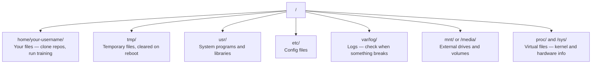

# 面向 AI 的 Linux

> 大多数 AI 工作运行在 Linux 上。掌握必要基础，避免被操作问题卡住。

**类型：** 学习
**语言：** --
**前置要求：** Phase 0，第 01 课
**时间：** 约 30 分钟

## 学习目标

- 浏览 Linux 文件系统，通过命令行完成基本文件操作。
- 用 chmod、chown 管理权限，解决 Permission denied 错误。
- 用 apt 安装系统包，为新 GPU 机器配置 AI 环境。
- 识别从 macOS 转向 Linux 时容易遇到的远程开发差异。

## 问题

你可能在 macOS 或 Windows 上开发，但 SSH 登录云 GPU、租用 Lambda 实例或启动 EC2 后，就可能进入 Ubuntu。终端可能是唯一界面：没有 Finder、资源管理器和图形桌面。如果不会导航目录、安装包和管理进程，就会一边支付闲置 GPU 费用，一边搜索“Linux 怎样解压文件”。

这是实用生存指南，只覆盖在远程 Linux 机器上开展 AI 工作所需的基础。

## 文件系统布局

Linux 将所有内容组织在单一根目录 / 下。原文用它与 Windows 的 C:\、macOS 的 /Volumes 对比。常用目录如下：



图中目录说明：

- /home/your-username/：个人文件，如仓库和训练代码。
- /tmp/：临时文件，可能在重启或定期清理时删除。
- /usr/：系统程序和库。
- /etc/：系统配置。
- /var/log/：系统与服务日志，出问题时查看。
- /mnt/ 或 /media/：外部驱动器与挂载卷。
- /proc/、/sys/：提供内核、进程和硬件信息的虚拟文件接口。

主目录通常是 /home/your-username，可用 ~ 表示，大部分个人工作在这里进行。

## 必备命令

原文称这 15 个命令能覆盖远程 GPU 机器上 95% 的操作，以下按场景列出。

### 目录导航

```bash
pwd                         # Where am I?
ls                          # What's here?
ls -la                      # What's here, including hidden files with details?
cd /path/to/dir             # Go there
cd ~                        # Go home
cd ..                       # Go up one level
```

pwd 显示当前位置，ls 列出内容，ls -la 包括隐藏文件与详细信息；cd 切换目录，~ 表示主目录，.. 表示上一级。

### 文件与目录

```bash
mkdir my-project            # Create a directory
mkdir -p a/b/c              # Create nested directories in one shot

cp file.txt backup.txt      # Copy a file
cp -r src/ src-backup/      # Copy a directory (recursive)

mv old.txt new.txt          # Rename a file
mv file.txt /tmp/           # Move a file

rm file.txt                 # Delete a file (no trash, it's gone)
rm -rf my-dir/              # Delete a directory and everything inside
```

mkdir 创建目录，-p 创建多层路径；cp 复制，-r 递归复制目录；mv 移动或重命名；rm 删除，rm -rf 递归强制删除目录。

rm -rf 不经过回收站，命令本身没有撤销功能，回车前必须仔细核对路径。

### 阅读文件

```bash
cat file.txt                # Print entire file
head -20 file.txt           # First 20 lines
tail -20 file.txt           # Last 20 lines
tail -f log.txt             # Follow a log file in real time (Ctrl+C to stop)
less file.txt               # Scroll through a file (q to quit)
```

cat 输出全文，head 与 tail 查看首尾；tail -f 持续追踪新增内容，Ctrl+C 停止；less 支持滚动阅读，q 退出。

### 搜索

```bash
grep "error" training.log           # Find lines containing "error"
grep -r "learning_rate" .           # Search all files in current directory
grep -i "cuda" config.yaml          # Case-insensitive search

find . -name "*.py"                 # Find all Python files under current dir
find . -name "*.ckpt" -size +1G     # Find checkpoint files larger than 1GB
```

grep 筛选匹配行，-r 递归，-i 忽略大小写；find 按文件名、大小等条件查找。

## 权限

Linux 文件具有所有者与权限位。脚本不能执行或目录不能写入时，经常会遇到它们。

```bash
ls -l train.py
# -rwxr-xr-- 1 user group 2048 Mar 19 10:00 train.py
#  ^^^             owner permissions: read, write, execute
#     ^^^          group permissions: read, execute
#        ^^        everyone else: read only
```

示例 -rwxr-xr-- 中首字符表示文件类型，后面三个一组，分别对应所有者、所属组和其他用户。r、w、x 分别表示读、写、执行。

常见处理方式：

```bash
chmod +x train.sh           # Make a script executable
chmod 755 deploy.sh         # Owner: full, others: read+execute
chmod 644 config.yaml       # Owner: read+write, others: read only

chown user:group file.txt   # Change who owns a file (needs sudo)
```

chmod +x 增加执行权限；755 表示所有者读写执行、组和其他用户读与执行；644 表示所有者读写、组和其他用户只读。chown 修改所有者与组，通常需要管理权限。

原文认为 Permission denied 多为权限问题，chmod +x 或 sudo 能解决大多数情况。

## 软件包管理（apt）

Ubuntu 使用 apt 安装系统级软件。

```bash
sudo apt update             # Refresh the package list (always do this first)
sudo apt install -y htop    # Install a package (-y skips confirmation)
sudo apt install -y build-essential  # C compiler, make, etc. Needed by many Python packages
sudo apt install -y tmux    # Terminal multiplexer (keep sessions alive after disconnect)

apt list --installed        # What's installed?
sudo apt remove htop        # Uninstall
```

apt update 刷新软件包索引，不是升级全部包；install 安装，-y 自动接受确认；list --installed 查看已安装包，remove 卸载。

新 GPU 机器常需安装：

```bash
sudo apt update && sudo apt install -y \
    build-essential \
    git \
    curl \
    wget \
    tmux \
    htop \
    unzip \
    python3-venv
```

包括编译工具、Git、下载工具、tmux、htop、解压工具和 Python 虚拟环境支持。

## 用户与 sudo

通常以普通用户登录，部分操作需要 root 管理员权限。

```bash
whoami                      # What user am I?
sudo command                # Run a single command as root
sudo su                     # Become root (exit to go back, use sparingly)
```

whoami 查看用户，sudo command 提权执行一条命令，sudo su 进入 root Shell，用 exit 返回，应谨慎使用。

原文称云 GPU 实例上通常只有你一个用户，且有 sudo 权限。不要所有操作都用 root，仅在需要时提权。

## 进程与 systemd

训练卡住或需要查看运行中的任务时：

```bash
htop                        # Interactive process viewer (q to quit)
ps aux | grep python        # Find running Python processes
kill 12345                  # Gracefully stop process with PID 12345
kill -9 12345               # Force kill (use when graceful doesn't work)
nvidia-smi                  # GPU processes and memory usage
```

htop 交互查看进程；ps aux | grep python 查找 Python 进程；kill 默认请求终止，kill -9 强制结束；nvidia-smi 查看 GPU 进程和显存。

systemd 管理后台服务，运行推理服务器时可能用到：

```bash
sudo systemctl start nginx          # Start a service
sudo systemctl stop nginx           # Stop it
sudo systemctl restart nginx        # Restart it
sudo systemctl status nginx         # Check if it's running
sudo systemctl enable nginx         # Start automatically on boot
```

start、stop、restart 控制当前运行状态，status 查看状态，enable 设置开机启动。

## 磁盘空间

GPU 机器的磁盘往往有限，模型与数据集很快就会占满。

```bash
df -h                       # Disk usage for all mounted drives
df -h /home                 # Disk usage for /home specifically

du -sh *                    # Size of each item in current directory
du -sh ~/.cache             # Size of your cache (pip, huggingface models land here)
du -sh /data/checkpoints/   # Check how big your checkpoints are

# Find the biggest space hogs
du -h --max-depth=1 / 2>/dev/null | sort -hr | head -20
```

df -h 查看文件系统容量与剩余空间；du -sh 统计目录或文件占用。最后一条命令遍历根目录下一级目录，隐藏错误信息，按大小排序并取前 20 项。

常见节省空间方式：

```bash
# Clear pip cache
pip cache purge

# Clear apt cache
sudo apt clean

# Remove old checkpoints you don't need
rm -rf checkpoints/epoch_01/ checkpoints/epoch_02/
```

分别清理 pip 缓存、apt 缓存和不需要的旧检查点。删除前确认目标不再需要。

## 网络

通过命令行下载模型、传输文件和调用 API：

```bash
# Download files
wget https://example.com/model.bin                   # Download a file
curl -O https://example.com/data.tar.gz              # Same thing with curl
curl -s https://api.example.com/health | python3 -m json.tool  # Hit an API, pretty-print JSON

# Transfer files between machines
scp model.bin user@remote:/data/                     # Copy file to remote machine
scp user@remote:/data/results.csv .                  # Copy file from remote to local
scp -r user@remote:/data/checkpoints/ ./local-dir/   # Copy directory

# Sync directories (faster than scp for large transfers, resumes on failure)
rsync -avz --progress ./data/ user@remote:/data/
rsync -avz --progress user@remote:/results/ ./results/
```

wget、curl 下载或请求 HTTP；python3 -m json.tool 美化 JSON；scp 在本地与远程复制文件，rsync 同步目录。

原文推荐大文件使用 rsync，理由是只传输变更部分并能处理连接中断。

## tmux：保持会话运行

SSH 登录后关闭电脑，可能使训练随终端断开而结束。tmux 帮助保留远程终端会话。

```bash
tmux new -s train           # Start a new session named "train"
# ... start your training, then:
# Ctrl+B, then D            # Detach (training keeps running)

tmux ls                     # List sessions
tmux attach -t train        # Reattach to session

# Inside tmux:
# Ctrl+B, then %            # Split pane vertically
# Ctrl+B, then "            # Split pane horizontally
# Ctrl+B, then arrow keys   # Switch between panes
```

新建 train 会话，Ctrl+B 再按 D 分离，tmux ls 查看，tmux attach -t train 接回；还可拆分与切换窗格。

原文强调：长时间训练始终放在 tmux 中运行。

## Windows 用户的 WSL2

WSL2 让 Windows 用户无需双系统，也能使用真实 Linux 环境。

```bash
# In PowerShell (admin)
wsl --install -d Ubuntu-24.04

# After restart, open Ubuntu from Start menu
sudo apt update && sudo apt upgrade -y
```

第一条在管理员 PowerShell 中运行。重启后打开 Ubuntu，再执行 Linux 的 apt 命令。

WSL2 运行真实 Linux 内核，本课操作可以在其中练习。Windows 文件可从 /mnt/c/Users/YourName/ 访问。

NVIDIA GPU 透传依赖 Windows 侧驱动。应安装 Windows NVIDIA 驱动，而不是在 WSL 中安装 Linux 显示驱动；兼容环境配置好后，即可在 WSL2 中使用 CUDA。

## 从 macOS 转向 Linux 的常见差异

| macOS | Linux | 说明 |
|---|---|---|
| brew install | sudo apt install | 包名可能不同。htop 名称相同，readline 则可能对应 libreadline-dev |
| open file.txt | xdg-open file.txt | 远程机器通常无 GUI，用 cat 或 less |
| pbcopy / pbpaste | 原文：不可用 | SSH 不会自动提供 macOS 本地剪贴板命令 |
| ~/.zshrc | ~/.bashrc | macOS 默认 Zsh，许多 Linux 服务器使用 Bash |
| /opt/homebrew/ | /usr/bin/、/usr/local/bin/ | 可执行文件安装位置不同 |
| `sed -i '' 's/a/b/' file` | `sed -i 's/a/b/' file` | macOS sed 的 -i 后显式传空备份后缀，GNU sed 写法不同 |
| 默认通常不区分大小写 | 常见原生文件系统区分大小写 | Model.py 和 model.py 通常可作为不同文件 |
| 换行 \n | 换行 \n | 两者相同；Windows 常用 \r\n，可能破坏 Bash 脚本，可用 dos2unix 转换 |

## 速查卡

```
Navigation:     pwd, ls, cd, find
Files:          cp, mv, rm, mkdir, cat, head, tail, less
Search:         grep, find
Permissions:    chmod, chown, sudo
Packages:       apt update, apt install
Processes:      htop, ps, kill, nvidia-smi
Services:       systemctl start/stop/restart/status
Disk:           df -h, du -sh
Network:        curl, wget, scp, rsync
Sessions:       tmux new/attach/detach
```

中文对照：导航用 pwd、ls、cd、find；文件操作用 cp、mv、rm、mkdir、cat、head、tail、less；搜索用 grep、find；权限用 chmod、chown、sudo；包管理用 apt；进程用 htop、ps、kill、nvidia-smi；服务用 systemctl；磁盘用 df、du；网络用 curl、wget、scp、rsync；会话用 tmux。

```figure
s0-process-fork
```

此标记对应课程网站的进程创建交互图。

## 练习

1. SSH 登录 Linux 机器或打开 WSL2，进入主目录。创建项目目录，用 touch 创建三个空文件，再用 ls -la 查看。
2. 通过 apt 安装 htop，运行并找出占内存最多的进程。
3. 新建 tmux 会话，运行 sleep 300，分离、列出会话，再接回。
4. 用 df -h 查看剩余空间，再用 du -sh ~/.cache/* 查找缓存中的大项目。
5. 用 scp 把本地文件传到远程，再用 rsync 完成相同传输，比较体验。

### 练习提示

**练习 1.** 使用 `cd ~`、`mkdir`，并用 `cd` 进入新文件夹，再用 `touch` 加三个文件名创建文件。在 `ls -la` 输出中，检查三个文件的大小都是 0，所有者都是你的用户名。

**练习 2.** 用 `sudo apt install -y htop` 安装，启动后按 `F6`（或点击列名），按 `MEM%` 排序。列表最上方的进程使用的内存最多。

**练习 3.** 按课程所示执行 `tmux new -s train`，运行 `sleep 300`，再按 `Ctrl+B` 和 `d` 分离会话。运行 `tmux ls` 查看会话，再用 `tmux attach -t train` 重新连接；`sleep` 必须仍在运行。

**练习 4.** 运行 `df -h`，读取包含主目录的文件系统对应的 `Avail` 列。再运行 `du -sh ~/.cache/* | sort -h`，使最大的文件夹显示在最后一行。

**练习 5.** 用 `scp file.txt user@host:~/` 复制文件，再对同一文件运行 `rsync -avP file.txt user@host:~/`。第二次运行同一条 `rsync` 命令：因为远程文件没有变化，几乎不会传输任何数据。

## 译者校注

- “15 个命令覆盖 95%”是原文经验性表述，未提供统计依据，实际列表也不止 15 个命令。
- /tmp 清理取决于配置。/、~、.、.. 分别是根目录、主目录、当前目录和上级目录。
- Permission denied 不应一律用 sudo 处理，还需核查所有权、父目录权限、挂载选项和访问策略，避免制造 root 所有的项目文件。
- kill 默认发 SIGTERM，能否清理保存由程序决定；SIGKILL 无法被捕获，会跳过程序清理。
- systemctl enable 不等于立即启动，还需 start 或 enable --now；WSL 的 systemd 支持取决于发行版设置。
- rsync 的续传取决于选项和已有文件状态，-avz 不保证保留中断的部分文件。源路径末尾 / 表示复制目录内容。
- tmux 不能抵御服务器重启、资源回收或程序失败。
- WSL 的 /mnt/d 等 Windows 挂载路径与原生 Linux 在权限、大小写和性能上可能不同，不能保证行为完全一致。
- 本次仅翻译，没有执行教材中的安装、删除、清缓存、结束进程或修改服务命令。
