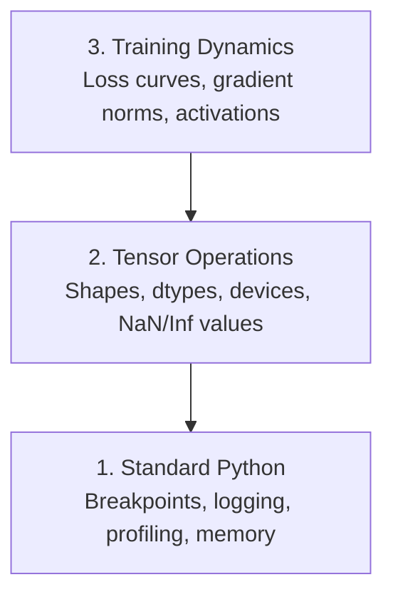

# 调试与性能分析

> 最糟糕的 AI 错误不会让程序崩溃。它们会悄悄用垃圾数据训练，还给出一条漂亮的损失曲线。

**类型：** 构建
**语言：** Python
**前置要求：** 第 1 课（开发环境），对 PyTorch 有基本了解
**时间：** 约 60 分钟

## 学习目标

- 使用带条件的 `breakpoint()` 和 `debug_print`，在训练过程中检查张量的形状、数据类型和 NaN 值。
- 使用 `cProfile`、`line_profiler` 和 `tracemalloc` 分析训练循环，找出瓶颈。
- 检测常见的 AI 错误：形状不匹配、损失为 NaN、数据泄漏，以及张量位于错误设备。
- 配置 TensorBoard，可视化损失曲线、权重直方图和梯度分布。

## 问题

AI 代码出错的方式与普通代码不同。Web 应用崩溃时会给出堆栈跟踪；配置错误的训练循环却可能运行 8 小时，花掉 200 美元的 GPU 费用，最终得到一个对每个输入都预测均值的模型。代码从未报错。问题可能是张量放在错误设备上、忘记调用 `.detach()`，或者标签泄漏进了特征。

你需要能在这些无声故障浪费时间和算力之前发现它们的调试工具。

## 核心概念

AI 调试分为三个层次：



中文说明：第 1 层是普通 Python 层，检查断点、日志、性能和内存；第 2 层是张量运算层，检查形状、数据类型、设备及 NaN/Inf；第 3 层是训练动态层，观察损失曲线、梯度范数和激活值。

大多数人直接跳到第 3 层，盯着 TensorBoard 看。然而，80% 的 AI 错误存在于第 1 层和第 2 层。

```figure
s0-flame-hot
```

中文说明：这是课程网站的自定义图示标记，原样保留；普通 Markdown 阅读器不一定能显示它。

## 从头构建

### 第 1 部分：打印调试（是的，它有效）

打印调试经常被轻视，但不应该如此。对于张量代码，有针对性的打印语句比在调试器中逐步执行更有效，因为你需要同时看到形状、数据类型和值的范围。

```python
def debug_print(name, tensor):
    print(f"{name}: shape={tensor.shape}, dtype={tensor.dtype}, "
          f"device={tensor.device}, "
          f"min={tensor.min().item():.4f}, max={tensor.max().item():.4f}, "
          f"mean={tensor.mean().item():.4f}, "
          f"has_nan={tensor.isnan().any().item()}")
```

中文说明：这个函数为张量打印一份摘要：名称、形状、数据类型、所在设备、最小值、最大值、均值，以及是否包含 NaN；`.item()` 把单元素张量中的值取出来用于显示。

在每个可疑操作后调用它。找到错误后，把这些打印移除。就这么简单。

### 第 2 部分：Python 调试器（pdb 与 breakpoint）

Python 内置调试器在 AI 工作中的价值被低估了。在训练循环里放入 `breakpoint()`，就能交互式检查张量。

```python
def training_step(model, batch, criterion, optimizer):
    inputs, labels = batch
    outputs = model(inputs)
    loss = criterion(outputs, labels)

    if loss.item() > 100 or torch.isnan(loss):
        breakpoint()

    loss.backward()
    optimizer.step()
```

中文说明：先从批次中取出输入和标签，计算模型输出与损失；当损失超过 100 或变为 NaN 时，暂停程序进入调试器，然后才继续反向传播和参数更新。100 是本例的触发阈值。

进入调试器后，以下命令很有用：

- `p outputs.shape`：检查形状。
- `p loss.item()`：查看损失值。
- `p torch.isnan(outputs).sum()`：统计 NaN 的数量。
- `p model.fc1.weight.grad`：检查梯度。
- `c`：继续执行；`q`：退出。

这就是条件调试：只有出现可疑情况时才停下。对于一次有 10,000 步的训练，这一点很重要。

### 第 3 部分：Python 日志

当调试超出一次快速检查的范围时，用日志替代打印语句。

```python
import logging

logging.basicConfig(
    level=logging.INFO,
    format="%(asctime)s [%(levelname)s] %(message)s",
    handlers=[
        logging.FileHandler("training.log"),
        logging.StreamHandler()
    ]
)
logger = logging.getLogger(__name__)

logger.info("Starting training: lr=%.4f, batch_size=%d", lr, batch_size)
logger.warning("Loss spike detected: %.4f at step %d", loss.item(), step)
logger.error("NaN loss at step %d, stopping", step)
```

中文说明：日志同时写入 `training.log` 和终端，包含时间、级别和消息；`info`、`warning`、`error` 分别记录一般信息、警告和错误。

日志提供时间戳、严重程度和文件输出。训练在凌晨 3 点失败时，你需要的是日志文件，而不是已经滚出屏幕的终端输出。

### 第 4 部分：给代码段计时

知道时间花在哪里，是优化的第一步。

```python
import time

class Timer:
    def __init__(self, name=""):
        self.name = name

    def __enter__(self):
        self.start = time.perf_counter()
        return self

    def __exit__(self, *args):
        elapsed = time.perf_counter() - self.start
        print(f"[{self.name}] {elapsed:.4f}s")

with Timer("data loading"):
    batch = next(dataloader_iter)

with Timer("forward pass"):
    outputs = model(batch)

with Timer("backward pass"):
    loss.backward()
```

中文说明：`Timer` 是一个上下文管理器；进入 `with` 时记录起点，离开时计算耗时。示例分别测量数据加载、前向传播和反向传播。

一种常见发现是：数据加载占用了 60% 的训练时间。解决方法是在 DataLoader 中设置 `num_workers > 0`，而不是换更快的 GPU。

### 第 5 部分：cProfile 与 line_profiler

当手动计时器还不够时：

```bash
python -m cProfile -s cumtime train.py
```

中文说明：用 Python 内置的 `cProfile` 执行 `train.py`，按累计耗时 `cumtime` 排序输出分析结果。

这会显示每个函数调用，并按累计耗时排序。要逐行分析：

```bash
pip install line_profiler
```

中文说明：安装第三方逐行性能分析工具 `line_profiler`。

```python
@profile
def train_step(model, data, target):
    output = model(data)
    loss = F.cross_entropy(output, target)
    loss.backward()
    return loss

# Run with: kernprof -l -v train.py
```

中文说明：给目标函数加上 `@profile`，使用注释中的 `kernprof -l -v train.py` 执行后，可以观察函数内部各行的耗时。

### 第 6 部分：内存分析

#### 使用 tracemalloc 分析 CPU 内存

```python
import tracemalloc

tracemalloc.start()

# your code here
model = build_model()
data = load_dataset()

snapshot = tracemalloc.take_snapshot()
top_stats = snapshot.statistics("lineno")
for stat in top_stats[:10]:
    print(stat)
```

中文说明：开启分配跟踪，执行待检查代码，再获取快照；按源码行号汇总，打印分配量最高的 10 项。

#### 使用 memory_profiler 分析 CPU 内存

```bash
pip install memory_profiler
```

中文说明：安装第三方内存分析工具 `memory_profiler`。

```python
from memory_profiler import profile

@profile
def load_data():
    raw = read_csv("data.csv")       # watch memory jump here
    processed = preprocess(raw)       # and here
    return processed
```

中文说明：用装饰器标记数据加载函数，观察读取 CSV 和预处理时的内存变化；原文的两处英文注释分别提示留意这两行的内存上升。

使用 `python -m memory_profiler your_script.py` 运行，查看逐行内存使用量。

#### 使用 PyTorch 分析 GPU 显存

```python
import torch

if torch.cuda.is_available():
    print(torch.cuda.memory_summary())

    print(f"Allocated: {torch.cuda.memory_allocated() / 1e9:.2f} GB")
    print(f"Cached: {torch.cuda.memory_reserved() / 1e9:.2f} GB")
```

中文说明：CUDA 可用时，输出显存摘要、张量已分配显存，以及缓存分配器保留的显存；原文将后一项打印为 `Cached`。

遇到 OOM（Out of Memory，内存或显存不足）时：

1. 减小 batch size（始终应首先尝试）。
2. 使用 `torch.cuda.empty_cache()` 释放缓存显存。
3. 对较大的中间张量先执行 `del tensor`，再执行 `torch.cuda.empty_cache()`。
4. 使用混合精度（`torch.cuda.amp`），把内存使用量减半。
5. 对很深的模型使用梯度检查点（gradient checkpointing）。

### 第 7 部分：常见 AI 错误及其检测方法

#### 形状不匹配

这是最常见的错误。模型需要 `[batch, channels, height, width]`，张量却是 `[batch, features]`。

```python
def check_shapes(model, sample_input):
    print(f"Input: {sample_input.shape}")
    hooks = []

    def make_hook(name):
        def hook(module, inp, out):
            in_shape = inp[0].shape if isinstance(inp, tuple) else inp.shape
            out_shape = out.shape if hasattr(out, "shape") else type(out)
            print(f"  {name}: {in_shape} -> {out_shape}")
        return hook

    for name, module in model.named_modules():
        hooks.append(module.register_forward_hook(make_hook(name)))

    with torch.no_grad():
        model(sample_input)

    for h in hooks:
        h.remove()
```

中文说明：给模型中的模块注册前向钩子，在一次前向运行中打印各模块的输入与输出形状；结束后移除钩子。`torch.no_grad()` 表示这次检查不记录用于反向传播的计算图。

用一个样例批次运行一次，就能看到模型中的各次形状变换。

#### 损失为 NaN

损失为 NaN 意味着某处数值已经失控。常见原因包括：

- 学习率过高。
- 自定义损失中出现除以零。
- 对零或负数取对数。
- RNN 中出现梯度爆炸。

```python
def detect_nan(model, loss, step):
    if torch.isnan(loss):
        print(f"NaN loss at step {step}")
        for name, param in model.named_parameters():
            if param.grad is not None:
                if torch.isnan(param.grad).any():
                    print(f"  NaN gradient in {name}")
                if torch.isinf(param.grad).any():
                    print(f"  Inf gradient in {name}")
        return True
    return False
```

中文说明：损失为 NaN 时，遍历模型参数，检查已有梯度中的 NaN 和 Inf，并返回是否发现 NaN 损失。

#### 数据泄漏

模型在测试集上的准确率达到 99%。听上去很好，但这是一个错误。

```python
def check_data_leakage(train_set, test_set, id_column="id"):
    train_ids = set(train_set[id_column].tolist())
    test_ids = set(test_set[id_column].tolist())
    overlap = train_ids & test_ids
    if overlap:
        print(f"DATA LEAKAGE: {len(overlap)} samples in both train and test")
        return True
    return False
```

中文说明：分别提取训练集和测试集的样本 ID，转换为集合并求交集；如果同一个 ID 同时存在于两边，就报告重叠样本数。

还要检查时间泄漏：使用未来的数据预测过去。划分之前，先按时间戳排序。

#### 设备错误

位于不同设备（CPU 与 GPU）的张量会导致运行时错误。不过，有时某个张量悄悄留在 CPU，而其他部分在 GPU，训练只是运行得很慢。

```python
def check_devices(model, *tensors):
    model_device = next(model.parameters()).device
    print(f"Model device: {model_device}")
    for i, t in enumerate(tensors):
        if t.device != model_device:
            print(f"  WARNING: tensor {i} on {t.device}, model on {model_device}")
```

中文说明：以模型第一个参数的设备为参照，逐一检查传入张量的设备；不一致时打印警告。

### 第 8 部分：TensorBoard 基础

TensorBoard 展示训练内部随时间发生的变化。

```bash
pip install tensorboard
```

中文说明：安装 TensorBoard。

```python
from torch.utils.tensorboard import SummaryWriter

writer = SummaryWriter("runs/experiment_1")

for step in range(num_steps):
    loss = train_step(model, batch)

    writer.add_scalar("loss/train", loss.item(), step)
    writer.add_scalar("lr", optimizer.param_groups[0]["lr"], step)

    if step % 100 == 0:
        for name, param in model.named_parameters():
            writer.add_histogram(f"weights/{name}", param, step)
            if param.grad is not None:
                writer.add_histogram(f"grads/{name}", param.grad, step)

writer.close()
```

中文说明：向 `runs/experiment_1` 写入事件文件；每一步记录训练损失和学习率，每 100 步记录一次权重与梯度直方图，最后关闭写入器。

启动它：

```bash
tensorboard --logdir=runs
```

中文说明：启动 TensorBoard，读取 `runs` 目录中的实验日志。

需要观察的现象：

- **损失不下降：** 学习率过低，或模型架构有问题。
- **损失剧烈振荡：** 学习率过高。
- **损失变为 NaN：** 数值不稳定，参见前面的 NaN 部分。
- **训练损失下降、验证损失上升：** 过拟合。
- **权重直方图收缩到零：** 梯度消失。
- **梯度直方图数值爆炸：** 需要梯度裁剪。

### 第 9 部分：VS Code 调试器

要进行交互式调试，为 VS Code 配置一个 `launch.json`：

```json
{
    "version": "0.2.0",
    "configurations": [
        {
            "name": "Debug Training",
            "type": "debugpy",
            "request": "launch",
            "program": "${file}",
            "console": "integratedTerminal",
            "justMyCode": false
        }
    ]
}
```

中文说明：用 `debugpy` 调试当前文件，在集成终端中运行；`justMyCode: false` 允许调试时进入库代码。

点击编辑器左侧边栏设置断点。使用 Variables（变量）面板检查张量属性。Debug Console（调试控制台）允许你在执行过程中运行任意 Python 表达式。

当你想观察每一次数据变换时，这对逐步检查数据预处理流水线很有用。

## 实际使用

下面这套调试流程可以发现大多数 AI 错误：

1. **训练前：** 用样例批次运行 `check_shapes`，确认输入和输出维度符合预期。
2. **前 10 步：** 对损失、输出和梯度使用 `debug_print`，确认没有 NaN，数值处于合理范围。
3. **训练期间：** 记录损失、学习率和梯度范数，使用 TensorBoard 可视化。
4. **出现故障时：** 在故障位置插入 `breakpoint()`，交互式检查张量。
5. **分析性能时：** 分别测量数据加载、前向传播和反向传播的时间；接近 OOM 时，分析内存使用量。

## 交付产物

运行调试工具包脚本：

```bash
python phases/00-setup-and-tooling/12-debugging-and-profiling/code/debug_tools.py
```

中文说明：从仓库根目录运行本课的调试工具包演示。

参见 `outputs/prompt-debug-ai-code.md`，其中提供了用于帮助诊断 AI 特有错误的提示词。

## 练习

1. 运行 `debug_tools.py`，阅读各部分输出。修改示例模型，让它产生 NaN（提示：在前向传播中除以零），观察检测器如何发现问题。
2. 使用 `cProfile` 分析一个训练循环，找出最慢的函数。
3. 使用 `tracemalloc` 找出数据加载流水线中分配内存最多的那一行。
4. 为一次简单训练配置 TensorBoard，判断模型是否过拟合。
5. 在训练循环中使用 `breakpoint()`，练习从调试器提示符检查张量形状、设备和梯度值。

## 译者校注

以下为对原文适用条件的补充，未改动上面的原文代码。

1. **原文数字没有给出统计来源。** “8 小时、200 美元”是成本情景；“80% 的错误在第 1、2 层”“数据加载占 60%”没有附调查或基准，不能当作通用比例。`num_workers > 0` 是否加速取决于实际瓶颈、数据、CPU、磁盘和进程开销，应先测量再调整。
2. **代码片段并非完整训练程序。** 其中的 `torch`、`F`、模型、数据加载器及超参数需要另行定义。普通训练通常每步先清空梯度，否则 `.backward()` 会累加已有梯度；第 2 部分示例没有展示 `optimizer.zero_grad()`。断点位于本轮 `backward()` 之前，此时 `.grad` 可能是 `None` 或上一轮的值；模型也不一定存在 `fc1` 属性。`logger.error()` 仅记录消息，并不会因为消息写了“stopping”就自动终止程序。[PyTorch 梯度清零说明](https://docs.pytorch.org/tutorials/recipes/recipes/zeroing_out_gradients.html)
3. **GPU 计时要考虑异步执行。** 原文 `Timer` 和 `cProfile` 不能直接等同于 CUDA 内核耗时；对 GPU 运算用墙钟计时，应在计时边界同步，或使用 CUDA Event。频繁读取 GPU 张量的 `.item()` 也会影响测量。[PyTorch 2.6 CUDA 异步执行说明](https://docs.pytorch.org/docs/2.6/notes/cuda.html#asynchronous-execution)
4. **tracemalloc 不代表全部 CPU 内存或 GPU 显存。** 它跟踪 Python 内存分配器记录的分配；不能默认把它输出的数字解释为 PyTorch 张量底层存储总量，也不能用它衡量 CUDA 显存。本课演示里的张量很大而跟踪量很小，并不矛盾。[Python tracemalloc 文档](https://docs.python.org/3/library/tracemalloc.html)
5. **OOM 建议需要区分对象占用与空闲缓存。** `memory_reserved()` 是分配器保留的总量，包含正在使用的部分；`empty_cache()` 只释放未使用的缓存，不会释放仍被活跃张量占用的显存。`del tensor` 也只有在相关引用不再保留张量时才有助于释放。混合精度并不保证总显存减半；原文 `torch.cuda.amp` 中的旧接口已有弃用提示，PyTorch 2.6 推荐使用 `torch.amp.autocast("cuda", ...)`、`torch.amp.GradScaler("cuda", ...)` 等接口。[CUDA 显存管理](https://docs.pytorch.org/docs/2.6/notes/cuda.html#memory-management)、[AMP 文档](https://docs.pytorch.org/docs/2.6/amp.html)
6. **高准确率不能单独证明数据泄漏。** 99% 可能是正常结果，也可能受任务简单、类别失衡或泄漏影响。ID 交集只检查一种重叠，不能排除同一用户或近重复样本跨集合、预处理使用测试集统计量、标签进入特征等情况。时间排序也不足以自动消除泄漏，还必须按预测时真正可用的信息构建特征与划分。[scikit-learn 数据泄漏说明](https://scikit-learn.org/stable/common_pitfalls.html#data-leakage)
7. **曲线和直方图提供线索，而非单独的诊断结论。** 损失不下降、振荡或权重接近零可能有多种原因；尤其“权重接近零”不等于“梯度消失”，还要观察实际梯度、激活和更新量。通常应检查参与运算的张量是否位于兼容设备；不同设备的数据留在不同阶段，与把它们直接混合运算，是不同情况。
8. **本地学习与原文示例分开执行。** 本课实践继续使用仓库的 WSL `.venv/bin/python`；上面的安装命令按原文保留，不表示已执行。`line_profiler` 的 `@profile` 由 `kernprof` 运行方式提供，不能假设普通 `python train.py` 自带它。练习应放入 `learning-artifacts/00-12-debugging-and-profiling/`，保留课程参考代码。
9. **损失有限仍可能出现非有限梯度。** 原文 `detect_nan` 仅在损失为 NaN 时进入梯度检查，不能覆盖有限损失配 Inf 梯度等情况。应在本轮 `backward()` 后、参数更新前，独立检查损失及各非空梯度的 `torch.isfinite` 结果。教材工具中的 `fake_nan_loss` 是独立构造的标量，没有对模型重新反向传播；此时打印出的梯度仍可能来自上一轮。输出标签写着“Normal”也不保证实际数值正常。[PyTorch 2.6 不可微点的梯度规则](https://docs.pytorch.org/docs/2.6/notes/autograd.html#gradients-for-non-differentiable-functions)
10. **训练监控要区分验证集和测试集。** 通常用训练集更新参数、验证集监控和选择模型、测试集作最终独立评估。反复根据测试集表现修改模型会引入选择偏差。训练损失下降且验证损失上升是应调查的信号，还要观察趋势、样本量及评估过程；单次变化不能独立证明过拟合。只有训练损失的玩具优化实验不能完成泛化能力评估。[scikit-learn 验证与最终评估说明](https://scikit-learn.org/stable/modules/cross_validation.html)
