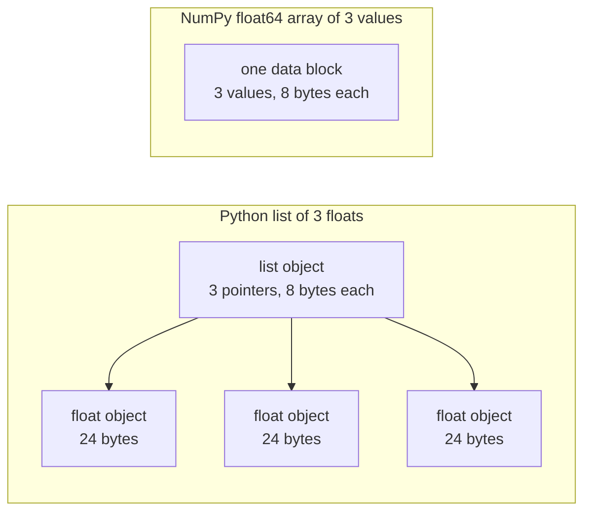

# 面向 AI 工程的 Python

> 本课程的大部分代码都使用同一小组 Python 惯用写法。在后续数学和模型课程依赖它们之前，先在这里学会。

**类型：** 构建
**语言：** Python
**前置课程：** 开发环境、Python 环境
**预计用时：** 约 120 分钟

## 学习目标

- 读懂并写出大多数课程代码使用的惯用写法，从解包、f-string，到 dataclass 和推导式。
- 识别三种不会报错却会产生错误结果的 Python 问题：共享列表、可变默认参数，以及已经耗尽的生成器。
- 只用标准库，构建 CSV 和 JSON 加载器、固定随机种子的数据划分，以及小批量生成器。
- 用纯 Python 编写点积、均值和标准差，并测量它们的速度与内存用量。
- 解释为什么纯 Python 数值循环很慢，以及 NumPy 广播如何把循环移到编译后的代码中。

## 要解决的问题

本阶段之后的课程使用普通 Python 编写数学运算和模型。在课程的 541 个 Python 文件中，有 276 个导入 `dataclasses`。另外，187 个文件调用 `random.seed` 或创建 `random.Random` 生成器。如果你还不熟悉这些惯用写法，本想读数学，注意力却会被语法占据。

Python 还有一些不会显示错误消息，却会产生错误结果的行为。两个名称可以指向同一个列表，因此通过一个名称进行修改，也会影响另一个名称看到的内容。默认参数的值会在多次调用之间保留。生成器遍历一次之后就空了，因此第二个训练轮次可能拿不到数据，损失也就不再变化。

最后一个问题是速度。在作者的测试笔记本电脑上，用纯 Python 循环处理一百万个浮点数大约需要 30 毫秒；NumPy 计算相同的点积不到 1 毫秒。你需要理解原因，才能在清晰的循环和数组操作之间作出选择。

## 核心概念

### 课程代码使用哪些写法

作者用 `ast` 模块解析了 `phases/*/*/code/` 中的全部 541 个 Python 文件。下表统计每种语法结构至少出现过一次的文件数。数字来自编写本课当天，会随着课程增加而变化。

| 语法结构 | 文件数 | 占比 |
|-----------|-------|-------|
| 函数定义 | 541 | 100% |
| `if __name__ == "__main__":` | 529 | 98% |
| f-string | 517 | 96% |
| 元组解包 | 448 | 83% |
| 类 | 379 | 70% |
| 列表推导式 | 375 | 69% |
| 函数类型提示 | 342 | 63% |
| 生成器表达式 | 326 | 60% |
| 切片 | 314 | 58% |
| `lambda` | 175 | 32% |
| `try` 和 `except` | 120 | 22% |
| `with` 语句 | 96 | 18% |
| 字典推导式 | 93 | 17% |
| 使用 `yield` 的生成器函数 | 14 | 3% |

导入语句说明了哪些标准模块比较重要。在这 541 个文件中，340 个以 `from __future__ import annotations` 开头，276 个导入 `dataclasses`。`math`、`random` 和 `json` 分别出现在 187、175 和 126 个文件中。`collections` 出现在 70 个文件中，`itertools` 只出现在 4 个文件中。

没有课程调用 `map()` 或 `filter()`，这些工作由推导式完成。超过 140 个文件在调用 `sorted`、`min`、`max` 或 `.sort` 时使用了 `key=` 函数。本课会把最多时间用在这些列表中排在前面的惯用写法上。

### 名称指向对象

在 Python 中，变量是指向对象的名称。赋值会把名称绑定到对象，而不会复制对象。如果两个名称指向同一个列表，通过任一名称所作的修改，都会通过另一个名称看到。数字、字符串和元组不能改变，因此这条规则不会给它们带来问题。列表、字典和集合可以改变，因此需要独立版本时，应创建副本。

### 列表保存指针，数组保存数值

Python 列表不直接存储数值，而是存储指针，每个指针指向一个完整的 Python 对象。在 64 位 CPython 中，每个指针占 8 字节，每个 `float` 对象占 24 字节。NumPy 的 `float64` 数组则把原始的 8 字节数值连续存放在一块内存中。


列表循环处理每个元素时都要做许多工作。解释器逐条执行字节码指令。对每个元素，它都要沿着指针找到对象，并检查各操作数的类型，然后调用浮点乘法代码，创建一个 Python 浮点对象保存结果。

NumPy 在编译后代码的循环中，对原始数值执行同样的算术运算。它只需为整个数组检查一次数据类型，不会为每个元素创建 Python 对象。向量化代码描述针对整个数组的一次操作，例如 `(x - mean) / std`，循环交给库执行。本课的向量函数遵循这一规则：每个函数执行一种数组操作，以后可以用一次 NumPy 调用替换。

### 列表保存全部元素，生成器逐个生成

列表推导式会在执行下一行之前构建全部元素。生成器则在调用者请求下一个元素时，才构建一个元素。列表的内存用量随元素数量增加；无论有多少元素，生成器自身的内存用量都大致不变。

一个生成器只能遍历一次。最后一个元素之后，每次请求都会引发 `StopIteration`，因此第二个 `for` 循环拿不到任何元素。训练代码每个 epoch 都会读取一次数据集，所以每个 epoch 都必须创建新的生成器。

生成器函数在课程代码中较少出现，但深度学习课程使用的数据加载器都是由批次构成的可迭代对象，因此每个训练循环都有这一思想。下图用同样的八行数据展示两种方式。

```figure
s0-list-vs-generator
```
## 你需要掌握的惯用写法

本节每个代码块都可以独立运行。将其保存为文件，用 `python3` 执行。代码需要 Python 3.11 或更新版本，也就是开发环境课安装的版本。

### 1. 值、集合类型与解包

Python 有四种内置集合类型。要掌握各自的使用场景。

| 类型 | 示例 | 是否有序 | 是否可变 | 课程中的典型用途 |
|------|---------|---------|------------|---------------------------|
| `list` | `[0.5, 1.2]` | 是 | 是 | 样本、损失、权重 |
| `tuple` | `(32, 784)` | 是 | 否 | 形状、固定记录、字典键 |
| `dict` | `{"lr": 0.01}` | 按插入顺序 | 是 | 配置、词表、JSON 数据行 |
| `set` | `{"cat", "dog"}` | 否 | 是 | 去重后的 token、重叠检查 |

下面的代码说明，赋值不会复制列表。

```python
weights = [0.5, -1.2, 3.0]
alias = weights
alias[0] = 99.0
print(weights)

independent = list(weights)
independent[1] = 0.0
print(weights, independent)

grid = [[0] * 3] * 2
grid[0][0] = 1
print(grid)

grid = [[0] * 3 for _ in range(2)]
grid[0][0] = 1
print(grid)
```

```text
[99.0, -1.2, 3.0]
[99.0, -1.2, 3.0] [99.0, 0.0, 3.0]
[[1, 0, 0], [1, 0, 0]]
[[1, 0, 0], [0, 0, 0]]
```
表达式 `[[0] * 3] * 2` 创建的外层列表包含两个引用，它们指向同一个内层列表。推导式则为每一行创建新的内层列表。数学阶段会用列表构建矩阵，因此应使用推导式的形式。

解包可以用一行代码把序列中的元素赋给多个名称。带星号的名称会收集剩余元素。f-string 将表达式的值放入字符串，还可以在冒号之后指定格式。

```python
shape = (32, 784)
batch_size, n_features = shape
first, *middle, last = [1, 2, 3, 4, 5]
x, y = 1.0, 3.0
x, y = y, x

config = {"lr": 0.01, "epochs": 5}
config["seed"] = 7
tokens = ["the", "cat", "sat", "on", "the", "mat"]
vocab = set(tokens)

print(batch_size, n_features, first, middle, last, x, y)
print(config.get("momentum", 0.9), "cat" in vocab, len(vocab))
print(f"lr={config['lr']:.0e} loss={0.123456:.3f} n={60_000:,} {batch_size=}")
```

```text
32 784 1 [2, 3, 4] 5 3.0 1.0
0.9 True 5
lr=1e-02 loss=0.123 n=60,000 batch_size=32
```
键不存在时，`dict.get` 返回默认值。无论集合有多大，集合上的 `in` 判断所需时间都大致相同。`{batch_size=}` 会同时打印名称和值，方便调试。

切片 `a[start:stop:step]` 包含 `start`，不包含 `stop`。负索引从末尾计数。列表切片会创建新列表，因此对大列表切片会复制所选元素的全部指针。

```python
tokens = ["<s>", "the", "cat", "sat", "on", "the", "mat", "</s>"]
print(tokens[1:-1])
print(tokens[:3], tokens[-3:])
print(tokens[::2])
print(tokens[::-1][:2])
windows = [tokens[i:i + 3] for i in range(len(tokens) - 2)]
print(len(windows), windows[0])
```

```text
['the', 'cat', 'sat', 'on', 'the', 'mat']
['<s>', 'the', 'cat'] ['the', 'mat', '</s>']
['<s>', 'cat', 'on', 'mat']
['</s>', 'mat']
6 ['<s>', 'the', 'cat']
```
### 2. 推导式

推导式用一个表达式，从可迭代对象构建列表、字典或集合。它读起来很像所描述的数学运算。

```python
scores = [0.91, 0.42, 0.77, 0.15, 0.66]
labels = [1 if s >= 0.5 else 0 for s in scores]
high = [s for s in scores if s > 0.6]
squares = {i: i * i for i in range(4)}
lengths = {len(word) for word in ["a", "bb", "cc", "ddd"]}
sum_sq = sum(s * s for s in scores)

matrix = [[1, 2, 3], [4, 5, 6]]
transposed = [list(column) for column in zip(*matrix)]
flat = [v for row in matrix for v in row]

print(labels, high, squares, lengths, round(sum_sq, 4))
print(transposed, flat)
```

```text
[1, 0, 1, 0, 1] [0.91, 0.77, 0.66] {0: 0, 1: 1, 2: 4, 3: 9} {1, 2, 3} 2.0555
[[1, 4], [2, 5], [3, 6]] [1, 2, 3, 4, 5, 6]
```
末尾的 `if` 用于筛选，只保留部分元素。`for` 前的表达式可以是条件表达式：`a if condition else b`。两个 `for` 子句的执行顺序与两层嵌套循环相同。

圆括号创建生成器表达式。在 `sum(s * s for s in scores)` 中，`sum` 每次读取一个平方值，Python 不会构建列表。在 `zip(*matrix)` 中，星号把每一行作为独立参数传入，`zip` 将相同位置的元素配对。

### 3. 函数、参数与闭包

默认值让参数可以省略。关键字参数在调用时写出参数名称。参数列表中单独出现的 `*` 会把后续参数设为只能使用关键字传入。

```python
def clip(value, low=0.0, high=1.0):
    return max(low, min(high, value))


def train(data, *, lr=0.01, epochs=3):
    return f"{len(data)} samples, lr={lr}, epochs={epochs}"


def make_scaler(factor):
    def scale(values):
        return [v * factor for v in values]
    return scale


print(clip(1.7), clip(-3.0, low=-1.0), clip(0.4, high=0.3))
print(train([1, 2, 3], lr=0.1))
to_percent = make_scaler(100)
print(to_percent([0.25, 0.5]))
```

```text
1.0 -1.0 0.3
3 samples, lr=0.1, epochs=3
[25.0, 50.0]
```
使用仅限关键字参数时，`train(data, 0.1, 3)` 这样的调用会引发 `TypeError`。调用者必须写 `lr=0.1`，这样两个数值就不会意外调换位置。

内部函数 `scale` 使用了创建它的函数中的 `factor`。只要 `scale` 存在，Python 就会保留 `factor`。能够保留创建环境中变量的函数称为闭包。后面“动手构建”中的标准化器用闭包保存训练集统计量。

`lambda` 是只包含一个表达式的匿名函数。课程代码主要将其用作 `key=` 函数，第 8 小节会展示。

Python 执行 `def` 语句时，只会对默认值求值一次。此后每次使用默认值的调用，拿到的都是同一个对象。

```python
def add_bad(item, bucket=[]):
    bucket.append(item)
    return bucket


def add_good(item, bucket=None):
    if bucket is None:
        bucket = []
    bucket.append(item)
    return bucket


add_bad("a")
print(add_bad("b"))
add_good("a")
print(add_good("b"))
```

```text
['a', 'b']
['b']
```
如果默认参数需要列表、字典或集合，就用 `None` 作默认值，在函数内部创建新对象。

### 4. 类与 dataclass

`@dataclass` 装饰器根据带类型标注的字段生成 `__init__`、`__repr__` 和 `__eq__`。设置 `frozen=True` 后，对象创建之后就不能修改，可以用作字典键或放入集合。

```python
from dataclasses import dataclass, field


@dataclass(frozen=True)
class Example:
    features: tuple[float, ...]
    label: int


@dataclass
class TrainConfig:
    lr: float = 0.01
    epochs: int = 5
    hidden: list[int] = field(default_factory=lambda: [64, 32])

    def describe(self):
        return f"lr={self.lr} epochs={self.epochs} hidden={self.hidden}"


ex = Example((1.5, 2.0), 1)
print(ex)
print(ex == Example((1.5, 2.0), 1), len({ex, Example((1.5, 2.0), 1)}))
print(TrainConfig(epochs=10).describe())
try:
    ex.label = 0
except AttributeError as err:
    print(type(err).__name__)
```

```text
Example(features=(1.5, 2.0), label=1)
True 1
lr=0.01 epochs=10 hidden=[64, 32]
FrozenInstanceError
```
`field(default_factory=...)` 会给每个实例创建一个新列表，解决第 3 小节中共享默认值的问题在 dataclass 中的对应情况。

特殊方法将类与 Python 语法连接起来。`len(ds)` 调用 `__len__`，`ds[2]` 调用 `__getitem__`。

```python
class SquaresDataset:
    def __init__(self, n):
        self.n = n

    def __len__(self):
        return self.n

    def __getitem__(self, index):
        if not 0 <= index < self.n:
            raise IndexError(index)
        return index, index * index


ds = SquaresDataset(4)
print(len(ds), ds[2])
print(list(ds))
```

```text
4 (2, 4)
[(0, 0), (1, 1), (2, 4), (3, 9)]
```
`list(ds)` 内部的 `for` 循环没有 `__iter__` 方法也能工作。Python 会依次用 0、1、2 等索引调用 `__getitem__`，直到得到 `IndexError`。PyTorch 的映射式数据集也使用 `__len__` 和 `__getitem__` 这两个方法。

### 5. 迭代器与生成器

可迭代对象是 `for` 循环能够接受的对象。`iter()` 从中取得迭代器，`next()` 向迭代器请求一个元素。没有更多元素时，迭代器引发 `StopIteration`。`for` 循环替你调用 `next()`，并在遇到 `StopIteration` 时停止。

```python
numbers = [10, 20, 30]
it = iter(numbers)
print(next(it), next(it), next(it))
try:
    next(it)
except StopIteration:
    print("no more items")


def countdown(n):
    while n > 0:
        yield n
        n -= 1


gen = countdown(3)
print(type(gen).__name__)
print(list(gen))
print(list(gen))
```

```text
10 20 30
no more items
generator
[3, 2, 1]
[]
```
函数体中包含 `yield` 的函数就是生成器函数。调用它不会执行函数体中的代码，而是返回生成器对象。每次 `next()` 都会把函数体执行到下一个 `yield`，然后暂停。第二次 `list(gen)` 得到空列表，是因为第一次已经耗尽了生成器。

生成器可以逐行读取文件。

```python
import os
import tempfile


def read_rows(path):
    with open(path, encoding="utf-8") as fh:
        header = fh.readline().rstrip("\n").split(",")
        for line in fh:
            yield dict(zip(header, line.rstrip("\n").split(",")))


with tempfile.TemporaryDirectory() as tmp:
    path = os.path.join(tmp, "rows.csv")
    with open(path, "w", encoding="utf-8") as fh:
        fh.write("x,label\n")
        fh.writelines(f"{i * 0.5},{i % 2}\n" for i in range(5))
    rows = read_rows(path)
    print(next(rows))
    print(sum(1 for _ in rows))
```

```text
{'x': '0.0', 'label': '0'}
4
```
`read_rows` 每次只在内存中保留一行文件内容，它就是图中的 `read_rows`。为了让示例简短，这里直接按逗号拆分。真实 CSV 文件可能在带引号的字段中包含逗号，因此“动手构建”使用 `csv` 模块。

```python
import sys

as_list = [i * i for i in range(1_000_000)]
as_generator = (i * i for i in range(1_000_000))
print(sys.getsizeof(as_list), sys.getsizeof(as_generator))
print(sum(as_list) == sum(as_generator))
```
在 64 位 CPython 中，列表报告的大小约为 8 MB，生成器约为 200 字节。`sys.getsizeof` 只计入列表中指针的空间，整数对象还会使用额外内存。“动手构建”将用上一课调试与性能分析中使用过的 `tracemalloc` 测量实际峰值。

### 6. 上下文管理器与异常

`with` 语句先执行准备代码，再执行语句体，最后执行清理代码。即使语句体引发异常，清理仍会执行。`open()` 返回的文件对象就是上下文管理器，会负责关闭文件。

在调试与性能分析课中，我们编写过实现 `__enter__` 和 `__exit__` 的 `Timer` 类。`contextlib.contextmanager` 装饰器可以把生成器变成同类对象。`yield` 之前的代码负责准备，`finally` 块负责清理。

```python
import time
from contextlib import contextmanager


@contextmanager
def timer(label):
    start = time.perf_counter()
    try:
        yield
    finally:
        print(f"{label}: {(time.perf_counter() - start) * 1000:.1f} ms")


def parse_label(text):
    try:
        return int(text)
    except ValueError:
        raise ValueError(f"label must be an integer, got {text!r}") from None


with timer("sum of squares"):
    total = sum(i * i for i in range(200_000))

print(parse_label("3"))
try:
    parse_label("cat")
except ValueError as err:
    print("rejected:", err)
```

```text
sum of squares: 9.4 ms
3
rejected: label must be an integer, got 'cat'
```
你机器上的耗时会不同。在 `except` 子句中写出你预期的具体异常类型，例如 `ValueError` 或 `KeyError`。不指定异常类型的 `except:` 也会捕获 `KeyboardInterrupt`，因此包含它的循环可能无法被 Ctrl+C 停止。输入不正确时，应抛出带有清晰消息的异常。当你的消息用于替代原始异常回溯时，可以加上 `from None`。

### 7. 类型提示、模块与主入口保护

类型提示告诉读者，函数接受什么、返回什么。Python 不会在代码运行时检查它们。mypy 等类型检查器会在代码运行前读取这些提示。

```python
from __future__ import annotations

from collections.abc import Iterable, Sequence


def mean(values: Sequence[float]) -> float:
    if not values:
        raise ValueError("mean() needs at least one value")
    return sum(values) / len(values)


def count_tokens(docs: Iterable[str]) -> int:
    return sum(len(doc.split()) for doc in docs)


def main() -> None:
    print(mean([1.0, 2.0, 4.0]))
    print(count_tokens(["the cat sat", "on the mat"]))
    print(mean.__annotations__)


if __name__ == "__main__":
    main()
```

```text
2.3333333333333335
6
{'values': 'Sequence[float]', 'return': 'float'}
```
使用 `from __future__ import annotations` 后，Python 会把各项类型提示保存为字符串，正如最后一行输出所示。`Sequence` 表示具有 `len()` 和索引操作的对象，例如列表或元组；`Iterable` 表示 `for` 循环能够接受的对象。许多课程文件从 `typing` 导入同名类型，这也能工作。

每个 `.py` 文件都是模块。用 `python3 file.py` 运行文件时，Python 将其 `__name__` 设为 `"__main__"`；另一个文件导入它时，`__name__` 就是模块名称。主入口保护只在第一种情况下调用 `main()`。因此，`code/tests/` 中的测试可以导入 `main.py`，而不会启动演示。

### 8. 文件、JSON、CSV 与排序

`pathlib.Path` 用 `/` 拼接路径，可以通过一次调用读取或写入整个文件。应始终指定 `encoding="utf-8"`，因为默认编码取决于操作系统。

```python
import csv
import json
import tempfile
from pathlib import Path

rows = [
    {"text": "great movie", "label": 1, "score": 0.93},
    {"text": "boring plot", "label": 0, "score": 0.12},
    {"text": "fine acting", "label": 1, "score": 0.58},
]

with tempfile.TemporaryDirectory() as tmp:
    json_path = Path(tmp) / "reviews.json"
    json_path.write_text(json.dumps(rows, indent=2), encoding="utf-8")
    from_json = json.loads(json_path.read_text(encoding="utf-8"))

    csv_path = Path(tmp) / "reviews.csv"
    with csv_path.open("w", newline="", encoding="utf-8") as fh:
        writer = csv.DictWriter(fh, fieldnames=["text", "label", "score"])
        writer.writeheader()
        writer.writerows(rows)
    with csv_path.open(newline="", encoding="utf-8") as fh:
        from_csv = list(csv.DictReader(fh))

print(from_json == rows)
print(from_csv[0])

by_score = sorted(rows, key=lambda r: r["score"], reverse=True)
print([r["text"] for r in by_score])
print(max(rows, key=lambda r: r["score"])["text"])
print([r["text"] for r in sorted(rows, key=lambda r: (-r["label"], r["text"]))])
```

```text
True
{'text': 'great movie', 'label': '1', 'score': '0.93'}
['great movie', 'fine acting', 'boring plot']
great movie
['fine acting', 'great movie', 'boring plot']
```
JSON 会把数值保留为数值。CSV 读取出来的每个字段都是字符串，因此需要逐个转换。按 `csv` 文档的要求，打开 CSV 文件时应使用 `newline=""`。

`key=` 函数为每个元素返回 Python 用于比较的值。`sorted`、`min` 和 `max` 都接受这样的函数。元组键先按第一个值排序，只有相同时才比较第二个值。负号让较大的标签排在前面。Python 排序是稳定的，相同键的元素保持原来的相对顺序。

### 9. 计数、分组与迭代工具

下面两个模块提供了普通列表和字典没有的数据结构与迭代工具。

```python
from collections import Counter, defaultdict, deque
from itertools import chain, islice, product

labels = ["cat", "dog", "cat", "bird", "cat", "dog"]
counts = Counter(labels)
print(counts.most_common(2))

positions = defaultdict(list)
for i, label in enumerate(labels):
    positions[label].append(i)
print(dict(positions))

recent = deque(maxlen=3)
for loss in [2.0, 1.5, 1.2, 1.1, 0.9]:
    recent.append(loss)
print(list(recent), round(sum(recent) / len(recent), 3))

print(list(product([0.1, 0.01], [16, 32])))
print(list(chain([1, 2], [3], [4, 5])))
print(list(islice(range(100), 5, 10)))
```

```text
[('cat', 3), ('dog', 2)]
{'cat': [0, 2, 4], 'dog': [1, 5], 'bird': [3]}
[1.2, 1.1, 0.9] 1.067
[(0.1, 16), (0.1, 32), (0.01, 16), (0.01, 32)]
[1, 2, 3, 4, 5]
[5, 6, 7, 8, 9]
```
`Counter` 为标签或 token 等可哈希元素计数。`defaultdict(list)` 在首次使用新键时创建空列表，因此分组循环不需要先检查键。`deque(maxlen=3)` 在加入第四个元素时移除最旧的元素，从而形成最近几次损失的移动窗口。`enumerate` 同时提供元素及其索引。

`product` 生成输入的全部组合，可用于超参数网格。`chain` 将可迭代对象首尾相接。`islice` 可以对任何迭代器取切片，包括生成器。“动手构建”的小批量生成器会使用 `islice`。

### 10. 为什么数值循环很慢

`dis` 模块打印解释器执行某个函数时使用的字节码指令。

```python
import dis


def dot(a, b):
    total = 0.0
    for x, y in zip(a, b):
        total += x * y
    return total


dis.dis(dot)
```
从 `FOR_ITER` 到跳回该位置的指令，每处理一个元素就会执行一次。每次乘法加法大约对应十条指令。具体指令名称会随 Python 版本变化。

当循环中更少的步骤作为字节码执行时，循环会更快。`sum`、`map` 和 `zip` 等内置函数由 C 编写。“动手构建”会在纯 Python 中测量这种影响，“使用现成工具”则会将整个循环移入 NumPy。

## 动手构建

现在构建后续课程需要的组件。完整版本在 `code/main.py`，由 `code/tests/test_main.py` 测试。以下每个代码块都可以独立运行。

### 第 1 步：记录类型与数据集加载器

加载器将 CSV 或 JSON 文件读成统一结构：由浮点特征组成的元组，加上整数标签。

```python
import csv
import json
import tempfile
from dataclasses import dataclass
from pathlib import Path


@dataclass(frozen=True)
class Record:
    features: tuple[float, ...]
    label: int


def row_to_record(row, names, label_field="label"):
    if label_field not in row:
        raise ValueError(f"row has no {label_field!r} field: {row}")
    if set(row) != {*names, label_field}:
        raise ValueError(f"row fields {list(row)} do not match {[*names, label_field]}")
    return Record(tuple(float(row[name]) for name in names), int(row[label_field]))


def load_records(path, label_field="label"):
    path = Path(path)
    if path.suffix == ".json":
        rows = json.loads(path.read_text(encoding="utf-8"))
    elif path.suffix == ".csv":
        with path.open(newline="", encoding="utf-8") as fh:
            rows = list(csv.DictReader(fh))
    else:
        raise ValueError(f"unsupported file type: {path.suffix!r}")
    if not rows:
        return []
    names = [key for key in rows[0] if key != label_field]
    return [row_to_record(row, names, label_field) for row in rows]


with tempfile.TemporaryDirectory() as tmp:
    csv_path = Path(tmp) / "data.csv"
    csv_path.write_text("x1,x2,label\n1.5,60,1\n1.8,82.5,0\n", encoding="utf-8")
    json_path = Path(tmp) / "data.json"
    json_path.write_text('[{"x1": 1.5, "x2": 60, "label": 1}]', encoding="utf-8")
    print(load_records(csv_path))
    print(load_records(json_path))
```

```text
[Record(features=(1.5, 60.0), label=1), Record(features=(1.8, 82.5), label=0)]
[Record(features=(1.5, 60.0), label=1)]
```
第一行确定特征名称及其顺序。`DictReader` 和 `json.loads` 保留文件中的键顺序，字典保留键的插入顺序。JSON 标准不规定对象中键的顺序，因此 `row_to_record` 按第一行确定的顺序，通过名称读取每一行。缺少标签、缺少或多出特征，以及不认识的文件类型，都会引发带消息的 `ValueError`，使不合格文件在运行开始时就被拦下。`main.py` 还包含 `save_records`，用于写出相同的两种格式。

### 第 2 步：固定随机种子的训练集与测试集划分

```python
import random


def train_test_split(items, test_fraction=0.2, seed=0):
    if not 0.0 < test_fraction < 1.0:
        raise ValueError(f"test_fraction must be between 0 and 1, got {test_fraction}")
    if len(items) < 2:
        raise ValueError(f"need at least 2 items to split, got {len(items)}")
    order = list(range(len(items)))
    random.Random(seed).shuffle(order)
    n_test = min(max(1, round(len(items) * test_fraction)), len(items) - 1)
    test = [items[i] for i in order[:n_test]]
    train = [items[i] for i in order[n_test:]]
    return train, test


items = list(range(10))
print(train_test_split(items, seed=1))
print(train_test_split(items, seed=1) == train_test_split(items, seed=1))
print(train_test_split(items, seed=2)[1])
print(items)
```

```text
([9, 7, 5, 3, 0, 4, 1, 2], [6, 8])
True
[5, 9]
[0, 1, 2, 3, 4, 5, 6, 7, 8, 9]
```
`random.Random(seed)` 创建私有随机数生成器。`random.seed(seed)` 则重置所有模块共享的那个全局生成器，因此另一个库中的调用可能改变你的随机序列。课程中有 100 个课程文件调用 `random.seed`，96 个创建 `random.Random`。新代码应使用私有生成器。

这个函数打乱的是索引列表，因此输入列表保持不变。相同种子总会给出相同划分。两边至少各保留一个元素，所以少于两个元素的列表会引发 `ValueError`。在标准化等任何需要从数据中学习的步骤之前，先划分数据。调试与性能分析课已经展示，训练集与测试集重叠会让测试分数虚高。

### 第 3 步：小批量生成器

```python
from itertools import islice


def batches(items, batch_size, drop_last=False):
    if batch_size < 1:
        raise ValueError(f"batch_size must be at least 1, got {batch_size}")
    return _batch_iter(iter(items), batch_size, drop_last)


def _batch_iter(iterator, batch_size, drop_last):
    while True:
        batch = list(islice(iterator, batch_size))
        if not batch or (drop_last and len(batch) < batch_size):
            return
        yield batch


print(list(batches(range(10), 4)))
print(list(batches(range(10), 4, drop_last=True)))
squares = (i * i for i in range(7))
print([len(b) for b in batches(squares, 3)])

for epoch in range(2):
    sizes = [len(b) for b in batches(range(10), 4)]
    print(f"epoch {epoch}: {sizes}")
```

```text
[[0, 1, 2, 3], [4, 5, 6, 7], [8, 9]]
[[0, 1, 2, 3], [4, 5, 6, 7]]
[3, 3, 1]
epoch 0: [4, 4, 2]
epoch 1: [4, 4, 2]
```
`islice` 从迭代器中最多取出 `batch_size` 个元素。`batches` 只需要输入支持 `iter()`，所以接受列表、文件及其他生成器。当长度不是批大小的整数倍时，最后一个批次更小。对于需要固定批次形状的模型，可以用 `drop_last=True` 丢弃这一批。

这里分成两个函数，是因为生成器函数在第一次 `next()` 之前不会执行代码。如果把检查放在生成器内部，调用 `batches(data, 0)` 时不会报错，错误会延后到训练循环内部。外层函数是普通函数，因此可以立即检查参数。每个 epoch 都重新调用 `batches()`，因为生成器只能提供一遍元素。

### 第 4 步：向量运算与标准化器

```python
import math


def dot(a, b):
    return sum(x * y for x, y in zip(a, b, strict=True))


def mean(values):
    if not values:
        raise ValueError("mean() needs at least one value")
    return sum(values) / len(values)


def std(values):
    mu = mean(values)
    return math.sqrt(sum((v - mu) ** 2 for v in values) / len(values))


def make_standardizer(rows):
    columns = list(zip(*rows))
    means = [mean(c) for c in columns]
    scales = [s if s > 0 else 1.0 for s in (std(c) for c in columns)]

    def standardize(row):
        return [(v - m) / s for v, m, s in zip(row, means, scales, strict=True)]

    return standardize


print(dot([1.0, 2.0, 3.0], [4.0, 5.0, 6.0]))
values = [2.0, 4.0, 4.0, 4.0, 5.0, 5.0, 7.0, 9.0]
print(mean(values), std(values))

train_rows = [(1.0, 100.0), (2.0, 300.0), (3.0, 500.0)]
standardize = make_standardizer(train_rows)
print([[round(v, 3) for v in standardize(r)] for r in train_rows])
print([round(v, 3) for v in standardize((4.0, 700.0))])
```

```text
32.0
5.0 2.0
[[-1.225, -1.225], [0.0, 0.0], [1.225, 1.225]]
[2.449, 2.449]
```
设置 `strict=True` 后，两个向量长度不同时，`zip` 会引发 `ValueError`。如果没有它，`zip` 会在较短输入结束时停止，不报错却给出错误答案。`strict` 参数需要 Python 3.10 或更新版本。

`std` 除以 `n`，因此得到总体标准差，与 `statistics.pstdev` 一致。从样本估计更大总体的离散程度时，应使用 `n - 1` 作分母。

`make_standardizer` 使用闭包。它从训练数据行计算一次均值和标准差，由 `standardize` 保留这些统计量。测试数据行也使用同一个函数，因此测试数据不会影响统计量。常数列的标准差为 0，标准化器对这种列使用缩放值 1。

### 第 5 步：完整运行

`code/main.py` 把这些组件连接起来。它从两个簇生成 400 条记录，保存为 CSV 和 JSON，再读取这两个文件。然后划分记录，仅用训练集拟合标准化器，并按每批 48 条计算各类别的质心。

最近质心分类器保存每个类别的平均特征向量，预测时选择均值离输入最近的类别。`fit_centroids` 逐批累加数据行，因此不需要把整个训练集放进内存。`predict` 使用带 `key=` 函数的 `min()` 查找最近质心。

```bash
python3 phases/00-setup-and-tooling/13-python-for-ai-engineering/code/main.py
```

```text
Python for AI engineering: a standard-library toolkit
data     400 records, CSV and JSON load back unchanged: True
split    320 train, 80 test, records in both: 0
batches  size 48: [48, 48, 48, 48, 48, 48, 32]
scale    train feature means after standardizing: [0.0, 0.0]
model    nearest-centroid test accuracy: raw 0.86, standardized 0.89
speed    dot product of 200,000 floats, best of 5:
           index loop         6.60 ms
           zip generator      5.93 ms
           map + mul          2.89 ms
memory   peak bytes to sum 100,000 squares:
           list              4,000,616
           generator               472
```
两个特征的尺度差异很大。第二个特征的离散程度是第一个的十倍，因此它主导原始距离，使未经标准化的准确率较低。你的速度和内存数据会与这些示例数字不同。

### 第 6 步：测量速度与内存

```python
import operator
import random
import time
import tracemalloc


def dot_index_loop(a, b):
    total = 0.0
    for i in range(len(a)):
        total += a[i] * b[i]
    return total


def dot_zip(a, b):
    return sum(x * y for x, y in zip(a, b, strict=True))


def dot_map(a, b):
    return sum(map(operator.mul, a, b))


def best_time(fn, *args, repeat=5):
    times = []
    for _ in range(repeat):
        start = time.perf_counter()
        fn(*args)
        times.append(time.perf_counter() - start)
    return min(times)


def peak_bytes(fn):
    tracemalloc.start()
    try:
        fn()
        return tracemalloc.get_traced_memory()[1]
    finally:
        tracemalloc.stop()


rng = random.Random(0)
a = [rng.random() for _ in range(1_000_000)]
b = [rng.random() for _ in range(1_000_000)]
for fn in (dot_index_loop, dot_zip, dot_map):
    print(f"{fn.__name__:15} {best_time(fn, a, b) * 1000:7.2f} ms")

print(peak_bytes(lambda: sum([i * i for i in range(100_000)])))
print(peak_bytes(lambda: sum(i * i for i in range(100_000))))
```
`best_time` 报告多次运行中最快的一次。机器上的其他程序只会增加耗时，因此最小值最接近实际成本。`timeit` 模块文档也给出相同建议。

在作者运行 Python 3.11 的测试笔记本上，索引循环约需 33 毫秒，zip 版本约需 30 毫秒，`map` 版本约需 14 毫秒。三种方法执行相同的算术运算。`map` 版本较快，是因为 `map` 和 `operator.mul` 由 C 编写，每个元素执行的字节码指令更少。内存数据再次体现图中的差别：列表约为 4 MB，生成器不到 1 KB。

## 使用现成工具

### 标准库版本

你刚刚构建的大多数组件，在标准库中都有经过测试的版本。

| 你构建的组件 | 标准库 | 说明 |
|-----------|------------------|------|
| `mean`、`std` | `statistics.fmean`、`statistics.pstdev` | 测试会与这些函数比较 |
| `dot` | `math.sumprod` | Python 3.12 或更新版本 |
| `batches` | `itertools.batched` | Python 3.12 或更新版本，返回元组 |
| `best_time` | `timeit.repeat` | 运行期间还会关闭垃圾回收 |
| `peak_bytes` | `tracemalloc` | 同一模块，还支持快照与逐行统计 |

```python
import statistics
import sys

values = [2.0, 4.0, 4.0, 4.0, 5.0, 5.0, 7.0, 9.0]
print(statistics.fmean(values), statistics.pstdev(values))

if sys.version_info >= (3, 12):
    import math
    from itertools import batched

    print(math.sumprod([1.0, 2.0, 3.0], [4.0, 5.0, 6.0]))
    print(list(batched(range(10), 4)))
```

```text
5.0 2.0
32.0
[(0, 1, 2, 3), (4, 5, 6, 7), (8, 9)]
```
课程支持 Python 3.11，因此 `main.py` 使用自行编写的 `dot` 和 `batches`。在 Python 3.11 上，这段代码只打印第一行。

### 用编译后的数组执行同样的数学运算

在 Python 环境课创建的虚拟环境中安装 NumPy，例如使用 `uv pip install numpy`。本课的主代码和测试本身不需要 NumPy。

```python
import time

import numpy as np

n = 1_000_000
rng = np.random.default_rng(0)
a = rng.random(n)
b = rng.random(n)
a_list, b_list = a.tolist(), b.tolist()

start = time.perf_counter()
slow = sum(x * y for x, y in zip(a_list, b_list))
python_ms = (time.perf_counter() - start) * 1000

start = time.perf_counter()
fast = float(a @ b)
numpy_ms = (time.perf_counter() - start) * 1000

print(f"pure Python {python_ms:8.2f} ms")
print(f"NumPy       {numpy_ms:8.2f} ms")
print(f"difference  {abs(slow - fast):.1e}")
print(a.dtype, a.itemsize, a.nbytes)
```
在作者的测试笔记本上，NumPy 不到 1 毫秒，纯 Python 版本约为 30 毫秒。两个结果的最后几位会不同，因为两个版本累加乘积的顺序不同。浮点数以不同顺序相加，会得到略有差异的结果。

NumPy 更快有三个原因：

- 数组把原始 `float64` 数值连续存储在同一块内存中，每个数值占 8 字节。浮点数列表中的每个数值则需要一个 8 字节指针和一个 24 字节的浮点对象。
- 循环运行在编译后的代码中。NumPy 只为整个数组检查一次数据类型，不会为每个元素创建 Python 对象。
- 相邻存放的数值让 NumPy 能使用 SIMD 指令，用一条指令处理多个数值。

对于很小的数组，一次 NumPy 调用的固定开销可能高于一个短 Python 循环。练习 4 会找出 NumPy 在你机器上开始更快的规模。

### 广播

广播让 NumPy 可以组合不同形状的数组，而不必在你的代码中编写循环。下面的代码与第 4 步中的 `make_standardizer` 执行相同的工作。

```python
import numpy as np

X = np.array([[1.0, 100.0], [2.0, 300.0], [3.0, 500.0]])
mu = X.mean(axis=0)
sigma = X.std(axis=0)
Z = (X - mu) / sigma
print(X.shape, mu.shape, Z.shape)
print(Z.round(3))

norms = np.sqrt((X ** 2).sum(axis=1, keepdims=True))
print(norms.shape, (X / norms).shape)
```

```text
(3, 2) (2,) (3, 2)
[[-1.225 -1.225]
 [ 0.     0.   ]
 [ 1.225  1.225]]
(3, 1) (3, 2)
```
NumPy 从最后一维向第一维比较两个形状。如果两个维度相等，或者其中一个是 1，它们就兼容。缺少的前导维度按 1 处理。大小为 1 的维度会沿较大维度重复使用，NumPy 不会复制这些数据。

| `X` 的形状 | 另一个数组的形状 | 结果 |
|--------------|--------------------------|--------|
| `(3, 2)` | `(2,)`，列均值 | `(3, 2)` |
| `(3, 2)` | `(3, 1)`，使用 `keepdims=True` 的行范数 | `(3, 2)` |
| `(3, 2)` | `(3,)`，未使用 `keepdims` 的行范数 | `ValueError` |

最后一行是常见错误。NumPy 比较末尾的 2 和 3，它们都不是 1。如果沿每一行归约后，还要将结果与原数组组合，应保留 `keepdims=True`。

## 交付产物

本课产出 `outputs/prompt-python-review.md`，它是面向 AI 与数据项目的 Python 代码审查提示词。给它一个文件或一份 diff，它会检查本课涉及的惯用写法和静默错误：

- 共享引用与可变默认参数。
- 第二个 epoch 再次读取已经耗尽的生成器。
- 未设置种子，或者只依赖全局种子的随机数。
- 来自测试集的统计量。
- 对大型数值数组执行纯 Python 循环。

每条发现都会报告位置、问题及修复方式。

## 练习

1. 运行 `main.py` 中的 `run_demo(seed=8)`。找出变化和不变的输出行，解释为什么划分后的数据集大小不变。
2. 用纯 Python 编写 `median(values)`，在奇数长度和偶数长度的列表上，与 `statistics.median` 对照测试。
3. 编写生成器 `stream_records(path)`，每次从 CSV 文件中产出一个 `Record`。创建包含 200,000 行的文件，用 `tracemalloc` 比较 `stream_records` 与 `load_records` 的峰值内存。
4. 分别用纯 Python 和 NumPy 编写 `matvec(matrix, vector)`。对规模 4、64、1024，使用 `best_time` 测量两者，找出 NumPy 在你机器上开始更快的规模。
5. 编写“核心概念”中的语法扫描程序。对 `phases/*/*/code/*.py` 中的每个文件使用 `ast.parse` 和 `ast.walk`，统计包含 `ast.ListComp`、`ast.Yield` 和 `ast.With` 的文件数，与表格比较。

### 提示

**练习 1。** 从 `code/main.py` 导入 `run_demo`，分别用 `seed=7` 和 `seed=8` 调用，再用 `format_report` 打印两次结果。来自随机数据的数值会变化；划分大小只依赖 `n` 和 `test_fraction`，因此保持不变。

**练习 2。** 先对列表的副本排序。奇数长度取中间元素，偶数长度取中间两个元素的平均值。在 `[3, 1, 2]` 和 `[4, 1, 3, 2]` 等列表上，与 `statistics.median` 比较；双方必须给出相同数值。

**练习 3。** 阅读 `code/main.py` 中的 `load_records`，保留解析步骤，但将每个 `Record` 用 `yield` 产出，而非追加到列表。使用 `save_records` 和 `make_dataset(200_000)` 生成文件，再比较 `peak_bytes(lambda: load_records(path))` 与 `peak_bytes(lambda: sum(1 for _ in your_generator(path)))`。必须在传入的可调用对象内部消费生成器，否则 `peak_bytes` 只会测到创建它的开销。生成器版本应报告明显更小的峰值。

**练习 4。** 纯 Python 版本参照 `dot`，对每一行调用一次；NumPy 版本使用 `np.array(matrix) @ np.array(vector)`。用 `best_time` 分别计时，为每个规模打印一行表格。比较耗时前，必须先确认两者结果相等。

**练习 5。** 用 `Path.read_text` 读取每个文件，用 `ast.parse` 解析，再用 `any(isinstance(node, ast.ListComp) for node in ast.walk(tree))` 检查一种语法结构。每个文件只计一次，因为“核心概念”的表格统计的是文件数。

## 关键术语

| 术语 | 常见说法 | 实际含义 |
|------|----------------|----------------------|
| 可迭代对象（Iterable） | “可以循环遍历的东西” | `iter()` 接受的对象，例如列表、文件或生成器 |
| 迭代器（Iterator） | “游标” | `__next__` 每次调用返回一个元素、结束时引发 `StopIteration` 的对象 |
| 生成器（Generator） | “惰性列表” | 由含 `yield` 的函数或生成器表达式得到的迭代器；按请求生成元素，只能遍历一次 |
| 推导式（Comprehension） | “一行循环” | 从可迭代对象构建列表、字典或集合的表达式，可附带筛选条件 |
| 闭包（Closure） | “函数里面的函数” | 保留创建它的函数中变量的函数 |
| 数据类（Dataclass） | “结构体” | Python 根据带类型标注的字段，生成 `__init__`、`__repr__` 和 `__eq__` 的类 |
| 上下文管理器（Context manager） | “with 代码块” | 在 `with` 开始时执行准备、结束时执行清理的对象，发生异常也会清理 |
| 种子（Seed） | “那个随机数” | 伪随机生成器的初始值；相同种子给出相同序列 |
| 向量化代码（Vectorized code） | “快速代码” | 将同一种操作应用于整个数组，由编译后代码执行循环 |
| 广播（Broadcasting） | “自动匹配形状” | NumPy 组合不同形状数组的规则，重复使用大小为 1 的维度，不需要复制 |

## 延伸阅读

- [Python 教程：数据结构](https://docs.python.org/3/tutorial/datastructures.html)：列表、元组、集合、字典和推导式。
- [Python 教程：类](https://docs.python.org/3/tutorial/classes.html)：作用域、类、迭代器和生成器。
- [dataclasses](https://docs.python.org/3/library/dataclasses.html)：装饰器的全部选项，包括 `frozen` 和 `field`。
- [collections](https://docs.python.org/3/library/collections.html)：`Counter`、`defaultdict`、`deque` 及其他容器类型。
- [itertools](https://docs.python.org/3/library/itertools.html)：`islice`、`chain`、`product`、`batched` 和组合这些工具的用法。
- [排序技巧](https://docs.python.org/3/howto/sorting.html)：键函数、稳定排序和多关键字排序。
- [timeit](https://docs.python.org/3/library/timeit.html)：如何测量小段代码，以及为什么报告最小值。
- [random](https://docs.python.org/3/library/random.html)：全局生成器、`random.Random` 实例与可复现性。
- [PEP 255：简单生成器](https://peps.python.org/pep-0255/)：引入 `yield` 的提案及其设计原因。
- [NumPy：广播](https://numpy.org/doc/stable/user/basics.broadcasting.html)：完整形状规则及图示。
- [Harris 等，使用 NumPy 进行数组编程，Nature 585，2020](https://doi.org/10.1038/s41586-020-2649-2)：NumPy 数组的设计及其速度优势的原因。

## 译者校注（与原文分开）

1. **原文统计与性能数字的边界。** 541 个文件、各模块数量和毫秒数均为原文写作时的统计或作者机器示例，不是本次对当前仓库的重新统计或学习者机器的实测。原文“没有课程调用 map”与本课稍后的 `dot_map` 示例存在表面冲突，应视为历史扫描范围或时间的描述，不能推广到当前全部代码。
2. **共享引用、浅复制与元组。** `list(weights)` 与列表切片都是浅复制；若元素本身是可变对象，新旧容器仍可能共享它们。元组不能更换元素引用，但内部引用的列表仍可变。集合的成员查询通常为平均 O(1)，不保证任意情况下用时恒定；字典键和集合元素还必须可哈希。
3. **冻结不等于深度不可变。** `frozen=True` 限制字段的普通赋值，并不会冻结字段内部的列表。生成的哈希仍要求参与哈希的字段可哈希。本课 `Example` 的数值元组与整数满足这一条件，含列表的冻结数据类则不能据此保证可哈希。参见 [Python 3.12 dataclasses 文档](https://docs.python.org/3.12/library/dataclasses.html)。
4. **生成器的内存与重新遍历。** 这里比较的是不缓存全部结果的简单生成器。生成器仍可能引用大型对象；`list(gen)` 仍会把全部结果收集到内存。每个 epoch 重新调用 `batches` 时，输入也必须能重新遍历，或重新创建；若一直传入同一个已耗尽的上游生成器，仅重建外层批次生成器不能恢复数据。`sys.getsizeof` 包含容器自身开销，但不递归统计元素对象。
5. **随机种子的复现条件。** 相同输入顺序、算法、运行条件与相应版本下，固定种子才能得到相同划分；不要把它理解为所有 Python 版本、所有随机 API 都永久输出同样结果。私有 `Random` 隔离的是状态，不会自动固定输入顺序。参见 [Python 3.12 random 文档](https://docs.python.org/3.12/library/random.html)。
6. **异常与输入检查的边界。** `raise ... from None` 抑制显示原异常上下文，并不删除新异常自身的回溯。示例加载器做的是基础字段检查，不能替代完整数据校验。标准化器示例假定非空、特征数一致的有限数值数据；`zip(*rows)` 未设 `strict=True`，不齐整的行可能被截短。
7. **标准差与流式内存。** 用 `n - 1` 得到通常的无偏样本方差估计，再开平方是常用样本标准差，不应声称该标准差本身无偏。`fit_centroids` 可以逐批处理输入，但演示中的加载器、划分结果和其他中间对象仍可能保存完整数据；不能由此认定整条流程都以常量内存运行。
8. **性能比较需要同样的语义。** `dot_map` 和索引版本没有与 `dot_zip` 等价的长度检查，应只在相同且等长的输入上比较。作者示例耗时不保证复现；预热、数据转换、线程、缓存和系统负载都会影响计时。浮点点积可能因归约顺序不同而略有差异，练习 4 应比较数值容差，例如 `np.allclose`，而非一律要求浮点结果逐位相等。
9. **广播不代表完全不分配内存。** 广播通常不需要复制输入来“扩展”它，但运算结果与中间数组仍可能分配内存。广播示例没有实现前面标准化器对零标准差的保护，因此两者在常数列上的行为不同。参见 [NumPy 广播文档](https://numpy.org/doc/stable/user/basics.broadcasting.html)。
10. **代码与图示的保留方式。** 原文的 Python、Bash、输出、Mermaid 和 `figure` 围栏块全部原样保留；代码说明已在块外翻译。Mermaid 中英文标签表示“Python 列表中的三个浮点对象”与“NumPy 连续数值块”。`s0-list-vs-generator` 是原课程网站的交互图标识，普通 Markdown 或聊天未必能加载对应图形。
