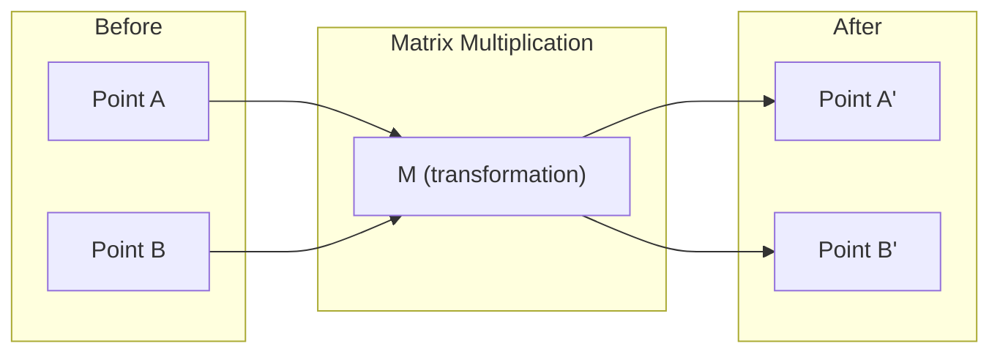
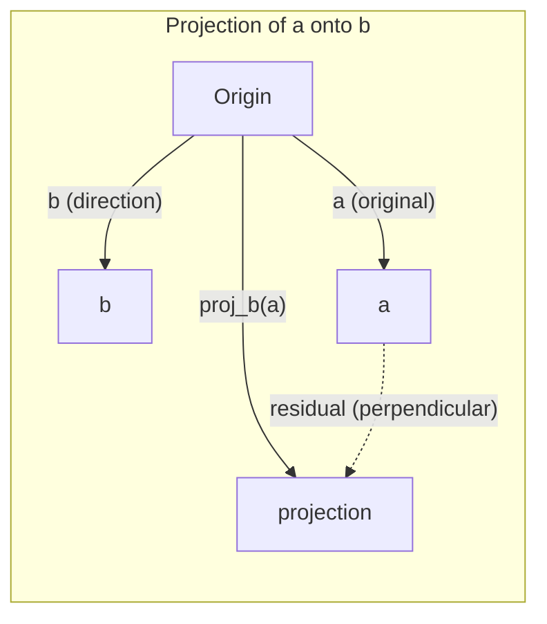

# 线性代数直觉

> 每个 AI 模型，都像是戴着一顶花哨帽子的矩阵数学。

**类型**： 学习
**语言**： Python、Julia
**先修要求**： Phase 0
**预计时间**： 约 60 分钟

## 学习目标

- 用 Python 从零实现向量与矩阵运算，包括加法、点积和矩阵乘法。
- 从几何角度解释点积、投影和 Gram–Schmidt 过程。
- 使用行化简判断一组向量的线性无关性、秩和基。
- 将线性代数概念与 AI 应用联系起来：嵌入、注意力分数和 LoRA。

## 问题

打开任何一篇机器学习论文，第一页内往往就会出现向量、矩阵、点积和变换。缺少线性代数直觉时，它们只是一堆符号；有了直觉，你就能看见神经网络实际上在做什么——移动空间中的点。

你不必成为数学家。你需要看懂这些运算的几何含义，然后亲手把它们写成代码。

## 核心概念

### 向量是点，也是方向

向量就是一列数字。但这些数字有含义：它们是空间中的坐标。

**二维向量 [3, 2]**：

| x | y | 点 |
|---|---|---|
| 3 | 2 | 该向量从平面原点 (0,0) 指向 (3,2) |

这个向量的长度是 $\sqrt{3^2+2^2}=\sqrt{13}$，方向朝向右上方。

在 AI 中，向量可以表示各种对象：

- 一个词 → 包含 768 个数字的向量，即它在嵌入空间中的“含义”。
- 一张图像 → 包含数百万个像素值的向量。
- 一个用户 → 表示其偏好的向量。

> 校注：768 只是某些模型的嵌入维度示例，并非固定标准；图像也常表示为多维张量，展平后才是一维向量。

### 矩阵是变换

矩阵把一个向量变成另一个向量。它可以旋转、缩放、拉伸或投影。



图示说明：变换前的点 A 和 B 经过矩阵 M，成为变换后的点 A′ 和 B′。

在 AI 中，矩阵就是模型的组成核心：

- 神经网络权重 → 将输入变为输出的矩阵。
- 注意力分数 → 决定关注什么的矩阵。
- 嵌入 → 将词映射成向量的矩阵。

> 校注：单独的矩阵乘法表示线性变换；偏置、激活函数等也参与构成神经网络。注意力分数通常还需归一化后才成为用于加权的注意力权重。

### 点积衡量相似性

两个向量的点积告诉你它们有多相似。

```math
\begin{aligned}
a \cdot b &= a_1 \times b_1 + a_2 \times b_2 + \cdots + a_n \times b_n \\[4pt]
\text{Same direction:} \quad a \cdot b &> 0 \quad \text{(similar)} \\
\text{Perpendicular:} \quad a \cdot b &= 0 \quad \text{(unrelated)} \\
\text{Opposite direction:} \quad a \cdot b &< 0 \quad \text{(dissimilar)}
\end{aligned}
```

公式说明：对应位置的分量相乘，再把结果相加。同向时点积为正，垂直时为零，反向时为负。

搜索引擎、推荐系统和 RAG 就会使用这种思路：寻找点积较大的向量。

> 校注：点积同时取决于长度与夹角：$a\cdot b=\lVert a\rVert\lVert b\rVert\cos\theta$。正值不要求完全同向，夹角小于 90° 即可；负值也不要求完全反向。正交不自动意味着语义无关，语义解释取决于表示模型。这些系统也可能采用余弦相似度、距离或其他评分方式。

### 线性无关

如果集合中没有任何一个向量能写成其他向量的线性组合，这组向量就线性无关。若 $v_1,v_2,v_3$ 线性无关，它们张成一个三维空间；若其中一个能由其他向量组合得到，它们就只张成一个平面。

它对 AI 的意义是：特征矩阵应当具有线性无关的列。如果两个特征完全相关，也就是线性相关，模型就无法区分它们各自的影响。这会在回归中造成多重共线性：权重矩阵变得不稳定，输入的微小变化会造成输出的大幅波动。

> 校注：三个相关向量张成的空间维数至多为 2，也可能是 1 或 0。共线性首先影响回归系数的可辨识性与估计稳定性，并不意味着所有输入上的预测都会大幅变化；正则化及数据分布也影响结果。“完全相关”与线性相关的对应还涉及中心化、截距和零方差等条件。

**具体例子**：

```text
v1 = [1, 0, 0]
v2 = [0, 1, 0]
v3 = [2, 1, 0]   # v3 = 2*v1 + v2
```

$v_1$ 和 $v_2$ 线性无关，任一个都不能由另一个乘以标量或线性组合得到。但是 $v_3=2v_1+v_2$，因此 $\{v_1,v_2,v_3\}$ 是线性相关的向量组。三个向量都位于 xy 平面，无论如何组合也无法到达 [0,0,1]。你有三个向量，却只有两个自由维度。

在数据集中，若 feature_3 = 2*feature_1 + feature_2，加入 feature_3 不会提供任何新信息。更糟的是，它会使正规方程中的矩阵奇异，权重没有唯一解。

### 基与秩

基是能够张成整个空间的一组最小的线性无关向量。基向量的个数就是空间的维数。

三维空间的标准基是 {[1,0,0], [0,1,0], [0,0,1]}。但三维空间中的任意三个线性无关向量都可以成为基。选择基，就是选择坐标系。

矩阵的秩 = 线性无关列的最大数量 = 线性无关行的最大数量。如果 $\mathrm{rank}<\min(\mathrm{rows},\mathrm{cols})$，矩阵就是秩亏的。这意味着：

- 方程组有无穷多个解，或者无解。
- 变换过程中会丢失信息。
- 矩阵不可逆。

| 情况 | 秩 | 对机器学习的含义 |
|---|---|---|
| 满秩，$\mathrm{rank}=\min(m,n)$ | 达到可能的最大值 | 行数至少等于列数且满列秩时，最小二乘解唯一；行数少于列数时，有无穷多个解能够精确拟合。 |
| 秩亏，$\mathrm{rank}<\min(m,n)$ | 低于最大值 | 特征冗余，有无穷多个权重解，需要正则化。 |
| 秩为 1 | 1 | 每一列都是某个向量的缩放副本，所有数据都在一条直线上。 |
| 接近秩亏，存在很小的奇异值 | 数值意义上秩低 | 矩阵病态，输入的微小噪声会造成输出的大幅变化，可使用 SVD 截断或岭回归。 |

> 校注：普通逆矩阵针对方阵。秩亏时，精确方程 $Ax=b$ 是否有解还取决于 $b$ 是否属于列空间；最小二乘问题仍然存在解，缺少满列秩时系数不唯一。正则化是常用处理方式，也可删除冗余特征或选取最小范数解。病态性主要描述求解、求逆等操作的敏感性，不表示直接计算 $Ax$ 必然放大微小扰动。

### 投影

将向量 **a** 投影到向量 **b** 上，得到 a 沿 b 方向的分量：

```math
\mathop{\mathrm{proj}}_b(a) = \frac{a \cdot b}{b \cdot b} \, b
```

残差 $a-\mathrm{proj}_b(a)$ 与 b 垂直。这种正交分解是最小二乘拟合的基础。

投影在机器学习中随处可见：

- 线性回归最小化观测值到列空间的距离，求解对应一次投影。
- PCA 将数据投影到方差最大的方向上。
- Transformer 中的注意力计算查询在键上的投影。

> 校注：这里要求 $b\ne0$。在线性最小二乘中，拟合值是观测向量在设计矩阵列空间上的正交投影。原文对注意力的表述不严格：常见注意力通过查询与键的点积计算分数，再归一化并对值向量加权；它并不直接执行这里的正交投影公式。



图示说明：a 和 b 从原点出发，a 沿 b 的投影与垂直残差共同分解原向量。

**例子**：$a=[3,4]$，$b=[1,0]$。

$\mathrm{proj}_b(a)=(3\times1+4\times0)/(1\times1+0\times0)\times[1,0]=3\times[1,0]=[3,0]$。

投影去掉了 y 分量。这是最简单的降维：舍弃你不关心的方向。

### Gram–Schmidt 过程

该过程把任意一组线性无关向量转换为标准正交基。“标准正交”表示每个向量长度为 1，且任意两个不同向量相互垂直。

算法步骤：

1. 取第一个向量，将它归一化。
2. 取第二个向量，减去它在第一个向量上的投影，再归一化。
3. 取第三个向量，减去它在此前所有向量上的投影，再归一化。
4. 对其余向量重复此过程。

```text
Input:  v1, v2, v3, ... (linearly independent)

u1 = v1 / |v1|

w2 = v2 - (v2 dot u1) * u1
u2 = w2 / |w2|

w3 = v3 - (v3 dot u1) * u1 - (v3 dot u2) * u2
u3 = w3 / |w3|

Output: u1, u2, u3, ... (orthonormal basis)
```

伪代码说明：先构造单位向量 u1，再从后续向量中减去已有基方向上的分量，最后归一化。

这就是 QR 分解内部的工作方式。Q 是标准正交基，R 保存投影系数。QR 分解用于：

- 求解线性方程组，比高斯消元更稳定。
- 计算特征值，即 QR 算法。
- 最小二乘回归，是常用的数值方法。

> 校注：Gram–Schmidt 是构造 QR 分解的一种方法。实际数值库还常使用 Householder 反射或 Givens 旋转；经典 Gram–Schmidt 可能丧失正交性。稳定性比较取决于具体算法、选主元策略与问题条件，不能笼统断言所有 QR 实现都比高斯消元稳定。

```figure
eigen-directions
```

交互图说明：这是课程注册的 `eigen-directions` 图，用于观察矩阵变换中的特征方向。

## 从零构建

### 第 1 步：从零实现向量（Python）

```python
class Vector:
    def __init__(self, components):
        self.components = list(components)
        self.dim = len(self.components)

    def __add__(self, other):
        return Vector([a + b for a, b in zip(self.components, other.components)])

    def __sub__(self, other):
        return Vector([a - b for a, b in zip(self.components, other.components)])

    def dot(self, other):
        return sum(a * b for a, b in zip(self.components, other.components))

    def magnitude(self):
        return sum(x**2 for x in self.components) ** 0.5

    def normalize(self):
        mag = self.magnitude()
        return Vector([x / mag for x in self.components])

    def cosine_similarity(self, other):
        return self.dot(other) / (self.magnitude() * other.magnitude())

    def __repr__(self):
        return f"Vector({self.components})"


a = Vector([1, 2, 3])
b = Vector([4, 5, 6])

print(f"a + b = {a + b}")
print(f"a · b = {a.dot(b)}")
print(f"|a| = {a.magnitude():.4f}")
print(f"cosine similarity = {a.cosine_similarity(b):.4f}")
```

代码说明：Vector 保存分量，实现加减、点积、长度、归一化和余弦相似度，最后对两个三维向量演示这些运算。

> 校注：示例假设向量维度一致，归一化和余弦相似度使用的向量非零。`zip` 会截断不同长度的输入，代码没有检查这一情况；零向量归一化会除以零。

### 第 2 步：从零实现矩阵（Python）

```python
class Matrix:
    def __init__(self, rows):
        self.rows = [list(row) for row in rows]
        self.shape = (len(self.rows), len(self.rows[0]))

    def __matmul__(self, other):
        if isinstance(other, Vector):
            return Vector([
                sum(self.rows[i][j] * other.components[j] for j in range(self.shape[1]))
                for i in range(self.shape[0])
            ])
        rows = []
        for i in range(self.shape[0]):
            row = []
            for j in range(other.shape[1]):
                row.append(sum(
                    self.rows[i][k] * other.rows[k][j]
                    for k in range(self.shape[1])
                ))
            rows.append(row)
        return Matrix(rows)

    def transpose(self):
        return Matrix([
            [self.rows[j][i] for j in range(self.shape[0])]
            for i in range(self.shape[1])
        ])

    def __repr__(self):
        return f"Matrix({self.rows})"


rotation_90 = Matrix([[0, -1], [1, 0]])
point = Vector([3, 1])

rotated = rotation_90 @ point
print(f"Original: {point}")
print(f"Rotated 90°: {rotated}")
```

代码说明：Matrix 用行列表存储矩阵，`@` 支持矩阵乘向量及矩阵乘矩阵，`transpose` 交换行列。例子将 [3,1] 逆时针旋转 90°。

> 校注：代码假设矩阵非空、每行等长且参与相乘的维度匹配。

### 第 3 步：这为什么对 AI 重要

```python
import random

random.seed(42)
weights = Matrix([[random.gauss(0, 0.1) for _ in range(3)] for _ in range(2)])
input_vector = Vector([1.0, 0.5, -0.3])

output = weights @ input_vector
print(f"Input (3D): {input_vector}")
print(f"Output (2D): {output}")
print("This is what a neural network layer does -- matrix multiplication.")
```

代码说明：构造 2×3 权重矩阵，将三维输入映射为二维输出；固定 Python 随机种子便于复现。

> 校注：这里演示的是无偏置的线性层；一般神经网络还会包含偏置、非线性及其他运算。

### 第 4 步：Julia 版本

```julia
a = [1.0, 2.0, 3.0]
b = [4.0, 5.0, 6.0]

println("a + b = ", a + b)
println("a · b = ", a ⋅ b)       # Julia supports unicode operators
println("|a| = ", √(a ⋅ a))
println("cosine = ", (a ⋅ b) / (√(a ⋅ a) * √(b ⋅ b)))

# Matrix-vector multiplication
W = [0.1 -0.2 0.3; 0.4 0.5 -0.1]
x = [1.0, 0.5, -0.3]
println("Wx = ", W * x)
println("This is a neural network layer.")
```

代码说明：Julia 直接支持数组运算和矩阵乘法，示例计算加法、点积、长度、余弦相似度以及 Wx。

> 校注：独立运行该片段时，需要先执行 `using LinearAlgebra`，以引入点积运算符 `⋅`。原代码保持不变。

### 第 5 步：从零实现线性无关判断与投影（Python）

```python
def is_linearly_independent(vectors):
    n = len(vectors)
    dim = len(vectors[0].components)
    mat = Matrix([v.components[:] for v in vectors])
    rows = [row[:] for row in mat.rows]
    rank = 0
    for col in range(dim):
        pivot = None
        for row in range(rank, len(rows)):
            if abs(rows[row][col]) > 1e-10:
                pivot = row
                break
        if pivot is None:
            continue
        rows[rank], rows[pivot] = rows[pivot], rows[rank]
        scale = rows[rank][col]
        rows[rank] = [x / scale for x in rows[rank]]
        for row in range(len(rows)):
            if row != rank and abs(rows[row][col]) > 1e-10:
                factor = rows[row][col]
                rows[row] = [rows[row][j] - factor * rows[rank][j] for j in range(dim)]
        rank += 1
    return rank == n


def project(a, b):
    scalar = a.dot(b) / b.dot(b)
    return Vector([scalar * x for x in b.components])


def gram_schmidt(vectors):
    orthonormal = []
    for v in vectors:
        w = v
        for u in orthonormal:
            proj = project(w, u)
            w = w - proj
        if w.magnitude() < 1e-10:
            continue
        orthonormal.append(w.normalize())
    return orthonormal


v1 = Vector([1, 0, 0])
v2 = Vector([1, 1, 0])
v3 = Vector([1, 1, 1])
basis = gram_schmidt([v1, v2, v3])
for i, u in enumerate(basis):
    print(f"u{i+1} = {u}")
    print(f"  |u{i+1}| = {u.magnitude():.6f}")

print(f"u1 · u2 = {basis[0].dot(basis[1]):.6f}")
print(f"u1 · u3 = {basis[0].dot(basis[2]):.6f}")
print(f"u2 · u3 = {basis[1].dot(basis[2]):.6f}")
```

代码说明：第一个函数通过行化简计算秩并判断线性无关性；`project` 计算投影；`gram_schmidt` 逐个去除已有方向上的分量并归一化，最后打印基向量的长度及两两点积。

> 校注：实现会跳过长度小于阈值的残差。这里的绝对阈值依赖数据尺度；投影目标仍须非零。循环使用更新后的 w 计算后续投影，属于修正 Gram–Schmidt 的计算形式。

## 使用成熟库

现在用 NumPy 完成相同的事情，这也是实践中通常会使用的方式：

```python
import numpy as np

a = np.array([1, 2, 3], dtype=float)
b = np.array([4, 5, 6], dtype=float)

print(f"a + b = {a + b}")
print(f"a · b = {np.dot(a, b)}")
print(f"|a| = {np.linalg.norm(a):.4f}")
print(f"cosine = {np.dot(a, b) / (np.linalg.norm(a) * np.linalg.norm(b)):.4f}")

W = np.random.randn(2, 3) * 0.1
x = np.array([1.0, 0.5, -0.3])
print(f"Wx = {W @ x}")
```

代码说明：NumPy 用数组运算、`np.dot`、`np.linalg.norm` 和 `@` 提供上述操作。此处没有设置 NumPy 的随机种子，随机权重不会因前面的 `random.seed(42)` 而固定。

### 用 NumPy 计算秩、投影和 QR 分解

```python
import numpy as np

A = np.array([[1, 2], [2, 4]])
print(f"Rank: {np.linalg.matrix_rank(A)}")

a = np.array([3, 4])
b = np.array([1, 0])
proj = (np.dot(a, b) / np.dot(b, b)) * b
print(f"Projection of {a} onto {b}: {proj}")

Q, R = np.linalg.qr(np.random.randn(3, 3))
print(f"Q is orthogonal: {np.allclose(Q @ Q.T, np.eye(3))}")
print(f"R is upper triangular: {np.allclose(R, np.triu(R))}")
```

代码说明：计算相关列构成的矩阵的秩，将 [3,4] 投影到 x 轴，并检查 QR 结果中的 Q 是否正交、R 是否上三角。

### PyTorch：张量是带有自动微分的向量

```python
import torch

x = torch.randn(3, requires_grad=True)
y = torch.tensor([1.0, 0.0, 0.0])

similarity = torch.dot(x, y)
similarity.backward()

print(f"x = {x.data}")
print(f"y = {y.data}")
print(f"dot product = {similarity.item():.4f}")
print(f"d(dot)/dx = {x.grad}")
```

代码说明：为 x 启用梯度记录，计算点积后反向传播，查看关于 x 的梯度。

点积关于 x 的梯度就是 y，PyTorch 自动算出了它。神经网络中的运算由矩阵乘法、点积、投影等操作构成，自动微分沿着这些运算追踪梯度。

你刚刚从零实现了 NumPy 一行就能完成的功能，现在你知道了内部在做什么。

> 校注：张量可以有任意多个轴，不限于向量；自动微分也覆盖许多非线性操作。此处标题是教学简化。

## 交付产物

本课产出：

- `outputs/prompt-linear-algebra-tutor.md`：供 AI 助手使用的提示词，通过几何直觉教授线性代数。

## 联系

本课的每个概念都对应现代 AI 中的具体应用：

| 概念 | 出现场景 |
|---|---|
| 点积 | Transformer 的注意力分数、RAG 中的余弦相似度 |
| 矩阵乘法 | 神经网络层、线性变换 |
| 线性无关 | 特征选择、避免多重共线性 |
| 秩 | 判断系统是否可解、LoRA 低秩适配 |
| 投影 | 线性回归投影到列空间、PCA |
| Gram–Schmidt / QR | 数值求解器、特征值计算 |
| 标准正交基 | 稳定的数值计算、白化变换 |

LoRA 值得特别说明。它把权重更新分解为低秩矩阵，从而微调大语言模型。与其更新一个 4096×4096 的权重矩阵，约 1600 万个参数，LoRA 更新两个大小分别为 4096×16 和 16×4096 的矩阵，约 13.1 万个参数。秩 16 的约束意味着 LoRA 假设权重更新位于完整 4096 维空间中的一个 16 维子空间。这就是线性代数的实际作用。

> 校注：准确参数量分别为 16,777,216 和 131,072，相差 128 倍，仅比较此处的更新参数。$\Delta W=BA$ 的秩至多为 16；更新后的输出位移属于 B 的列空间，该空间随训练学习。它不意味着全部 4096×4096 权重被一个总共只有 16 维的参数空间描述，也不意味着整个微调模型只有这些参数。

## 练习

1. 实现 `Vector.angle_between(other)`，返回两个向量之间的夹角，单位为度。
2. 创建二维缩放矩阵，将 x 坐标变成两倍、y 坐标变成三倍，然后作用于 [1,1]。
3. 给定 5 个随机的类词向量，每个 50 维，用余弦相似度找出最相似的一对。
4. 验证 Gram–Schmidt 的输出确实标准正交：任意两个不同向量点积为 0，每个向量长度为 1。
5. 创建秩为 2 的 3×3 矩阵，用 `rank()` 方法验证，再解释这些列张成什么几何对象。
6. 将 [1,2,3] 投影到 [1,1,1] 上，结果在几何上表示什么？

### 提示

**练习 1**： 从 `cosine_similarity` 开始，将结果限制在 -1 到 1 之间，再取反余弦并将弧度转为角度。检查 [1,0] 和 [0,1] 得到 90°，向量与自身得到 0°。

**练习 2**： 将两个缩放系数放在 2×2 矩阵的对角线上，其他两个位置放 0。[1,1] 的结果应为 [2,3]。

**练习 3**： 对 5 个向量的每一对计算余弦相似度，共 10 对，并保留最大值。先用向量与自身比较检查循环，其结果应为 1。

**练习 4**： 对三个线性无关向量调用 `gram_schmidt`，然后计算每一对的 `dot` 和每个向量的 `magnitude`。采用 `1e-9` 等容差比较，因为浮点计算不会保证结果精确为零。

**练习 5**： 令第三行或第三列等于前两者之和，使一个方向重复。`rank()` 应返回 2，列向量张成经过原点的平面。

**练习 6**： 计算比例 $\frac{a\cdot b}{b\cdot b}$ 并乘以 b，或者调用 `project_onto`。检查 a 减去投影所得的余量与 [1,1,1] 的点积为 0。

> 校注：练习 5 还要求前两行或前两列线性无关，才能保证秩恰好是 2。正文 Matrix 片段没有定义 `rank()`，正文投影函数名为 `project(a,b)`；做练习时可自行补实现、使用完整课程代码对应接口，或用 `np.linalg.matrix_rank` 核验，不能直接假定片段已提供这些方法。

## 关键术语

| 术语 | 常见说法 | 实际含义 |
|---|---|---|
| 向量 | “一支箭头” | 表示 n 维空间中一个点或方向的一列数字 |
| 矩阵 | “一张数字表” | 将向量从一个空间映射到另一个空间的变换 |
| 点积 | “相乘再求和” | 衡量两个向量对齐程度的量，是相似性搜索的核心操作 |
| 嵌入 | “某种 AI 魔法” | 表示词、图像、用户等对象含义的向量 |
| 线性无关 | “它们不重叠” | 集合中的任何向量都不能由其他向量线性组合得到 |
| 秩 | “有多少维” | 矩阵中线性无关列或行的最大数量 |
| 投影 | “影子” | 一个向量沿另一个向量方向的分量 |
| 基 | “坐标轴” | 张成空间的最小线性无关向量组 |
| 标准正交 | “互相垂直的单位向量” | 向量两两垂直，每个长度为 1 |

## 总结

| 公式 | 含义 |
|---|---|
| $a\cdot b=\sum_i a_i b_i$ | 点积，衡量对齐程度，是注意力分数和余弦相似度的核心操作 |
| $\cos\theta=\frac{a\cdot b}{\lVert a\rVert\lVert b\rVert}$ | 向量夹角的余弦，1 表示同向，0 表示正交 |
| $\lVert a\rVert=\sqrt{a\cdot a}$ | 向量的模，即长度 |
| $y=Ax,\ y_i=\sum_j A_{ij}x_j$ | 矩阵乘向量，神经网络的线性层对输入执行此操作 |
| $\mathrm{proj}_b a=\frac{a\cdot b}{b\cdot b}b$ | a 在 b 上的投影，即 a 沿 b 的部分 |
| $b^\perp=a-\mathrm{proj}_b a$ | a 中与 b 垂直的部分，用于 Gram–Schmidt |
| $\mathrm{rank}(A)\le\min(m,n)$ | 秩是独立列的数量，用于判断 Ax=b 是否有解 |
| $\Delta W=BA$，B 为 4096×16，A 为 16×4096 | 低秩更新，以两个秩至多为 16 的因子，约 131K 参数，替代 4096×4096 的更新，约 16M 参数 |
| 标准正交基：$\lVert v_i\rVert=1,\ v_i\cdot v_j=0$ | 稳定、可逆的变换，例如白化与 QR 分解 |

> 校注：最后一行的正交条件针对 $i\ne j$。是否有解的完整秩条件是 $\mathrm{rank}(A)=\mathrm{rank}([A\mid b])$。正交方阵可逆，但白化还包含尺度调整；数据秩亏或降维时不能笼统称为可逆。原文以 $b^\perp$ 表示这里计算出的垂直分量，其他教材也常用该符号表示整个正交补空间。
