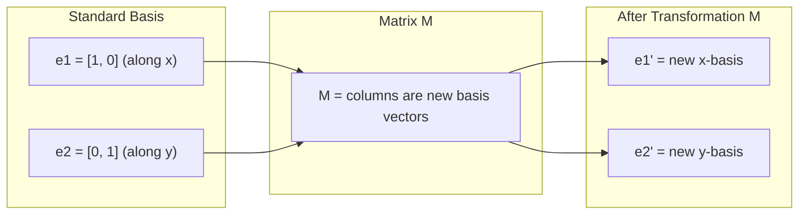
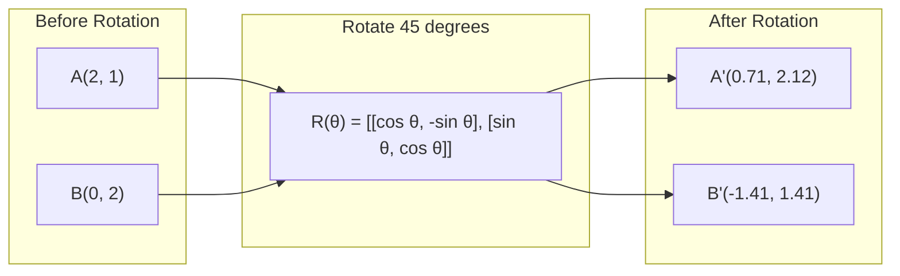
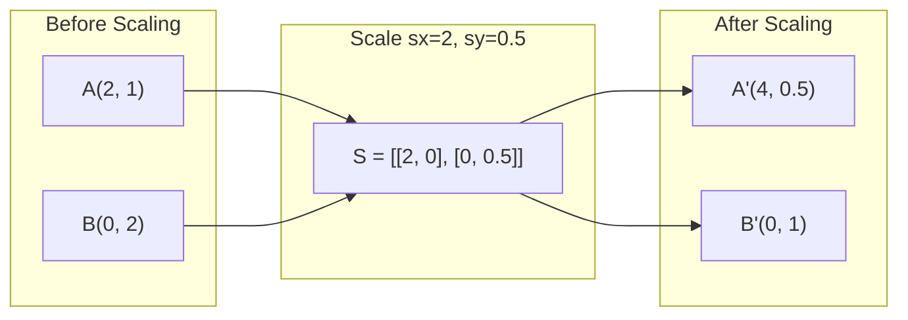
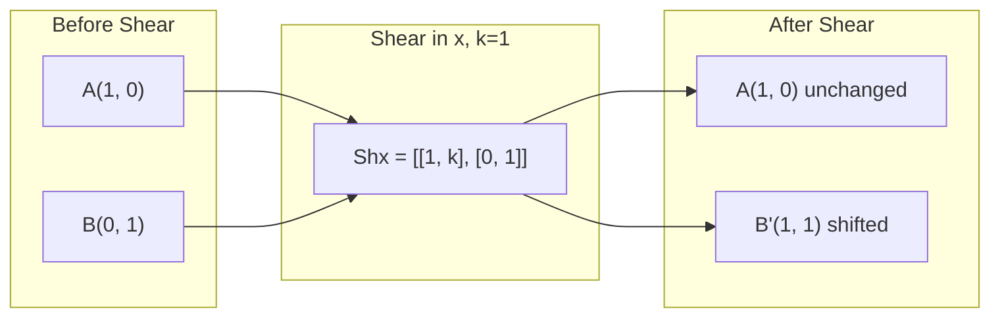
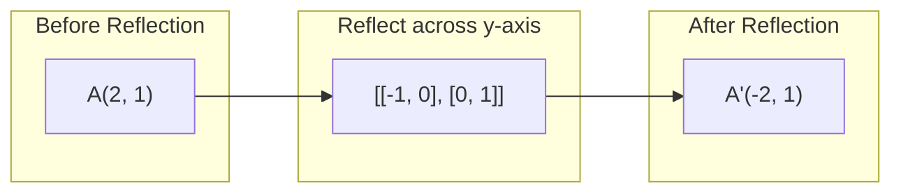
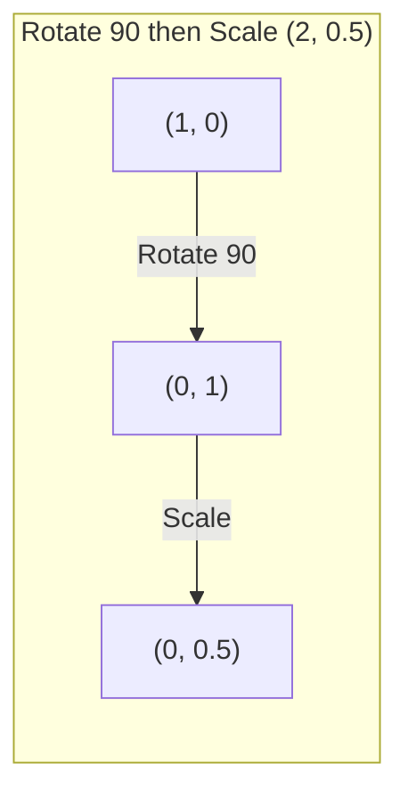
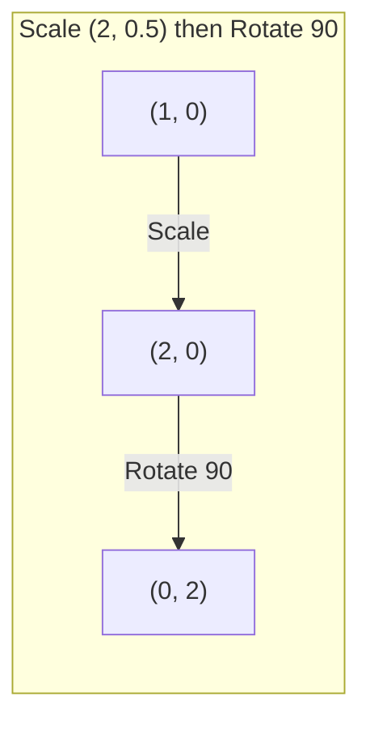

# 矩阵变换

> 矩阵可以重塑空间。弄清它把每个点移到哪里，就理解了整个变换。

**类型**　动手构建  
**语言**　Python、Julia  
**先修课程**　第 1 阶段第 01、02 课《线性代数直觉》《向量、矩阵与运算》  
**预计时间**　约 75 分钟

## 学习目标

- 构造旋转、缩放、剪切和反射矩阵，并将它们作用于二维和三维的点。
- 用矩阵乘法复合多个变换，验证变换顺序会影响结果。
- 从特征方程求出 2×2 矩阵的特征值和特征向量。
- 解释特征值与 PCA 主方向、循环神经网络稳定性以及谱聚类之间的关系。

## 问题从何而来

读到主成分分析（PCA），你会遇到“求协方差矩阵的特征向量”。读到模型稳定性，你会遇到“检查所有特征值的模是否小于 1”。读到数据增强，又会遇到“施加一次随机旋转”。要把这些话联系起来，先得看懂矩阵在几何上对空间做了什么。

旋转矩阵让点转动，缩放矩阵拉伸点的坐标，剪切矩阵让图形倾斜。原文将神经网络对数据的变换描述为这些操作或它们的组合。本课逐一把这些操作具体化。

**校注**　网络的权重矩阵执行线性变换，加上偏置后得到仿射变换。ReLU 等激活函数还会引入非线性。

## 核心概念

### 用矩阵表示变换

从二维空间到二维空间的每个线性变换都可以写成一个 2×2 矩阵。矩阵的第一列告诉你标准基向量 [1, 0] 的落点，第二列告诉你 [0, 1] 的落点。由线性性就能推出其余所有点的位置。



### 旋转

在二维平面上绕原点旋转 θ 角，各点沿圆弧移动，距离和夹角保持不变。图中逆时针旋转 45° 后，A(2, 1) 约落在 (0.71, 2.12)，B(0, 2) 约落在 (−1.41, 1.41)。



三维旋转要指定转轴。绕 z 轴旋转时，x、y 坐标参与旋转，z 不变。绕 x 轴时 x 不变，绕 y 轴时 y 不变。三个矩阵依次如下。

```math
\begin{aligned}
R_z(\theta) &= \begin{bmatrix} \cos\theta & -\sin\theta & 0 \\ \sin\theta & \cos\theta & 0 \\ 0 & 0 & 1 \end{bmatrix} \quad \text{Rotate around z-axis (x-y plane spins, z stays)} \\[6pt]
R_x(\theta) &= \begin{bmatrix} 1 & 0 & 0 \\ 0 & \cos\theta & -\sin\theta \\ 0 & \sin\theta & \cos\theta \end{bmatrix} \quad \text{Rotate around x-axis (y-z plane spins, x stays)} \\[6pt]
R_y(\theta) &= \begin{bmatrix} \cos\theta & 0 & \sin\theta \\ 0 & 1 & 0 \\ -\sin\theta & 0 & \cos\theta \end{bmatrix} \quad \text{Rotate around y-axis (x-z plane spins, y stays)}
\end{aligned}
```

### 缩放

缩放可以沿各条坐标轴独立拉伸或压缩。图中水平方向放大为 2 倍，竖直方向压缩为一半，A(2, 1) 变为 (4, 0.5)，B(0, 2) 变为 (0, 1)。



### 剪切

剪切使一条坐标轴倾斜，同时保持另一条轴固定。矩形由此变成平行四边形。图中沿 x 方向剪切，(1, 0) 保持原位，(0, 1) 移到 (1, 1)。



- 沿 x 方向剪切，矩阵为 `Shx = [[1, k], [0, 1]]`，x 坐标增加 ky。
- 沿 y 方向剪切，矩阵为 `Shy = [[1, 0], [k, 1]]`，y 坐标增加 kx。

### 反射

反射把点映到它关于某条轴或直线的镜像位置。点 (2, 1) 关于 y 轴的镜像是 (−2, 1)。



- 关于 y 轴反射，矩阵为 `[[-1, 0], [0, 1]]`。
- 关于 x 轴反射，矩阵为 `[[1, 0], [0, -1]]`。

### 复合变换

先做 A，再做 B，对列向量可写成 `result = B @ A @ point`。顺序会影响结果。来看同一个点 (1, 0)，先旋转 90°，再沿两轴分别缩放 2 倍和 0.5 倍。



复合矩阵为 `S @ R = [[0, -2], [0.5, 0]]`，终点是 (0, 0.5)。



调换顺序，复合矩阵为 `R @ S = [[0, -0.5], [2, 0]]`，终点是 (0, 2)。两次结果不同。矩阵乘法一般不满足交换律。

### 特征值与特征向量

矩阵作用于向量时，许多向量会改变方向。特征向量有一个特别之处：矩阵作用后的结果等于原向量乘以一个标量，这个标量就是特征值。

```text
A @ v = lambda * v

v is the eigenvector (direction that survives)
lambda is the eigenvalue (how much it stretches)

Example: A = | 2  1 |
             | 1  2 |

Eigenvector [1, 1] with eigenvalue 3:
  A @ [1,1] = [3, 3] = 3 * [1, 1]     (same direction, scaled by 3)

Eigenvector [1, -1] with eigenvalue 1:
  A @ [1,-1] = [1, -1] = 1 * [1, -1]  (same direction, unchanged)
```

在这个例子里，矩阵把 [1, 1] 方向拉伸为原来的 3 倍，并保持 [1, −1] 不变。平面上其他方向的向量都可由这两个向量线性组合得到。

**校注**　特征向量必须非零。实特征值为负时向量反向，为零时向量被映到原点。

### 特征分解

若 n 阶方阵有 n 个线性无关的特征向量，就可以作如下分解。

```text
A = V @ D @ V^(-1)

V = matrix whose columns are eigenvectors
D = diagonal matrix of eigenvalues
V^(-1) = inverse of V

This says: rotate into eigenvector coordinates, scale along each axis, rotate back.
```

V 的各列是特征向量，对角矩阵 D 的对应位置是特征值。读式子时从右往左：先用 V 的逆矩阵把向量换到特征向量坐标系，再沿各轴缩放，最后用 V 换回原坐标系。

**校注**　原文用“旋转进去、旋转回来”描述换基。一般的特征向量基可以是斜的，因此换基不一定是旋转。

### 为什么关心特征值

**PCA**　协方差矩阵的特征向量给出主成分方向，对应的特征值表示沿该方向的方差。按特征值从大到小排序，保留前 k 个方向，并把数据投影到这些方向上，就能降维。

**稳定性**　在循环网络和动力系统中，原文用模大于 1 的特征值说明反复作用时的爆炸，用模小于 1 的特征值说明衰减，并据此引出梯度消失与爆炸。

**校注**　对于固定线性递推，处在某个特征方向上的分量每步乘一次对应特征值。非线性 RNN 的梯度取决于沿时间展开的一串雅可比矩阵，还受激活函数及当前状态影响。

**谱方法**　图神经网络可以利用邻接矩阵的特征值。谱聚类使用图拉普拉斯矩阵的谱，它的特征向量能揭示图的结构。

### 行列式与面积、体积缩放

变换矩阵的行列式告诉你二维面积或三维体积如何变化。行列式为 1 时面积不变（如旋转），为 2 时面积翻倍，为 0 时空间被压到更低维，为 −1 时面积不变、定向翻转（如镜面反射）。

```text
det = 1:   area preserved (rotation)
det = 2:   area doubled
det = 0:   space crushed to lower dimension (singular)
det = -1:  area preserved but orientation flipped (reflection)

| det(Rotation) | = 1        (always)
| det(Scale sx, sy) | = sx * sy
| det(Shear) | = 1           (area preserved)
| det(Reflection) | = -1     (orientation flipped)
```

**校注**　原文最后一行把反射行列式的绝对值写成 −1。正确的是行列式等于 −1，其绝对值等于 1。面积或体积的缩放倍数取绝对值，所以二维缩放一般应写成 |sx × sy|。普通单向剪切的行列式为 1。

下方为本课的矩阵变换交互图。

```figure
matrix-transform
```

## 动手构建

### 第一步：用 Python 从零构造变换矩阵

用列表存矩阵，分别构造旋转、缩放、剪切和反射。矩阵乘向量时，用矩阵的每一行与向量做点积。矩阵乘矩阵时，用左矩阵的每一行与右矩阵的每一列做点积。最后四个例子分别对一个点执行这些变换。

```python
import math

def rotation_2d(theta):
    c, s = math.cos(theta), math.sin(theta)
    return [[c, -s], [s, c]]

def scaling_2d(sx, sy):
    return [[sx, 0], [0, sy]]

def shearing_2d(kx, ky):
    return [[1, kx], [ky, 1]]

def reflection_x():
    return [[1, 0], [0, -1]]

def reflection_y():
    return [[-1, 0], [0, 1]]

def mat_vec_mul(matrix, vector):
    return [
        sum(matrix[i][j] * vector[j] for j in range(len(vector)))
        for i in range(len(matrix))
    ]

def mat_mul(a, b):
    rows_a, cols_b = len(a), len(b[0])
    cols_a = len(a[0])
    return [
        [sum(a[i][k] * b[k][j] for k in range(cols_a)) for j in range(cols_b)]
        for i in range(rows_a)
    ]

point = [1.0, 0.0]
angle = math.pi / 4

rotated = mat_vec_mul(rotation_2d(angle), point)
print(f"Rotate (1,0) by 45 deg: ({rotated[0]:.4f}, {rotated[1]:.4f})")

scaled = mat_vec_mul(scaling_2d(2, 3), [1.0, 1.0])
print(f"Scale (1,1) by (2,3): ({scaled[0]:.1f}, {scaled[1]:.1f})")

sheared = mat_vec_mul(shearing_2d(1, 0), [1.0, 1.0])
print(f"Shear (1,1) kx=1: ({sheared[0]:.1f}, {sheared[1]:.1f})")

reflected = mat_vec_mul(reflection_y(), [2.0, 1.0])
print(f"Reflect (2,1) across y: ({reflected[0]:.1f}, {reflected[1]:.1f})")
```

**校注**　这里的剪切函数允许两个参数同时非零，此时行列式为 1 − kx × ky。本课的单向剪切示例都把其中一个参数设为零。

### 第二步：复合变换

构造 90° 旋转和非均匀缩放，交换两个矩阵的乘法顺序，把结果分别作用到同一个点，再比较终点。

```python
R = rotation_2d(math.pi / 2)
S = scaling_2d(2, 0.5)

rotate_then_scale = mat_mul(S, R)
scale_then_rotate = mat_mul(R, S)

point = [1.0, 0.0]
result1 = mat_vec_mul(rotate_then_scale, point)
result2 = mat_vec_mul(scale_then_rotate, point)

print(f"Rotate 90 then scale: ({result1[0]:.2f}, {result1[1]:.2f})")
print(f"Scale then rotate 90: ({result2[0]:.2f}, {result2[1]:.2f})")
print(f"Same? {result1 == result2}")
```

### 第三步：从零求 2×2 矩阵的特征值

对于矩阵 `[[a, b], [c, d]]`，特征值是特征方程 λ² − (a + d)λ + (ad − bc) = 0 的根。代码用判别式区分实根与复根，再为示例中的每个特征值构造一个特征向量，验证 Av = λv。

```python
def eigenvalues_2x2(matrix):
    a, b = matrix[0]
    c, d = matrix[1]
    trace = a + d
    det = a * d - b * c
    discriminant = trace ** 2 - 4 * det
    if discriminant < 0:
        real = trace / 2
        imag = (-discriminant) ** 0.5 / 2
        return (complex(real, imag), complex(real, -imag))
    sqrt_disc = discriminant ** 0.5
    return ((trace + sqrt_disc) / 2, (trace - sqrt_disc) / 2)

def eigenvector_2x2(matrix, eigenvalue):
    a, b = matrix[0]
    c, d = matrix[1]
    if abs(b) > 1e-10:
        v = [b, eigenvalue - a]
    elif abs(c) > 1e-10:
        v = [eigenvalue - d, c]
    else:
        if abs(a - eigenvalue) < 1e-10:
            v = [1, 0]
        else:
            v = [0, 1]
    mag = (v[0] ** 2 + v[1] ** 2) ** 0.5
    return [v[0] / mag, v[1] / mag]

A = [[2, 1], [1, 2]]
vals = eigenvalues_2x2(A)
print(f"Matrix: {A}")
print(f"Eigenvalues: {vals[0]:.4f}, {vals[1]:.4f}")

for val in vals:
    vec = eigenvector_2x2(A, val)
    result = mat_vec_mul(A, vec)
    scaled = [val * vec[0], val * vec[1]]
    print(f"  lambda={val:.1f}, v={[round(x,4) for x in vec]}")
    print(f"    A@v = {[round(x,4) for x in result]}")
    print(f"    l*v = {[round(x,4) for x in scaled]}")
```

**校注**　特征值函数支持复根。特征向量函数采用实向量的归一化公式；若扩展到复向量，应对各分量的模平方求和。原实现遇到某些复特征向量时会除以零。

### 第四步：用行列式观察体积缩放

依次计算旋转、缩放、剪切和反射矩阵的行列式。最后一个矩阵的两列成比例，整个平面被压缩到一条直线上。

```python
def det_2x2(matrix):
    return matrix[0][0] * matrix[1][1] - matrix[0][1] * matrix[1][0]

print(f"det(rotation 45) = {det_2x2(rotation_2d(math.pi/4)):.4f}")
print(f"det(scale 2,3)   = {det_2x2(scaling_2d(2, 3)):.1f}")
print(f"det(shear kx=1)  = {det_2x2(shearing_2d(1, 0)):.1f}")
print(f"det(reflect y)   = {det_2x2(reflection_y()):.1f}")

singular = [[1, 2], [2, 4]]
print(f"det(singular)     = {det_2x2(singular):.1f}")
print("Singular: columns are proportional, space collapses to a line.")
```

## 使用现成工具

NumPy 为上述运算提供了优化实现。下面用矩阵乘法旋转点并复合缩放，用特征值分解逐列检查 Av = λv，再求行列式。最后从一个矩阵的特征向量和特征值重建原矩阵。

```python
import numpy as np

theta = np.pi / 4
R = np.array([[np.cos(theta), -np.sin(theta)],
              [np.sin(theta),  np.cos(theta)]])

point = np.array([1.0, 0.0])
print(f"Rotate (1,0) by 45 deg: {R @ point}")

S = np.diag([2.0, 3.0])
composed = S @ R
print(f"Scale(2,3) after Rotate(45): {composed @ point}")

A = np.array([[2, 1], [1, 2]], dtype=float)
eigenvalues, eigenvectors = np.linalg.eig(A)
print(f"\nEigenvalues: {eigenvalues}")
print(f"Eigenvectors (columns):\n{eigenvectors}")

for i in range(len(eigenvalues)):
    v = eigenvectors[:, i]
    lam = eigenvalues[i]
    print(f"  A @ v{i} = {A @ v}, lambda * v{i} = {lam * v}")

print(f"\ndet(R) = {np.linalg.det(R):.4f}")
print(f"det(S) = {np.linalg.det(S):.1f}")

B = np.array([[3, 1], [0, 2]], dtype=float)
vals, vecs = np.linalg.eig(B)
D = np.diag(vals)
V = vecs
reconstructed = V @ D @ np.linalg.inv(V)
print(f"\nEigendecomposition A = V @ D @ V^-1:")
print(f"Original:\n{B}")
print(f"Reconstructed:\n{reconstructed}")
```

**校注**　最后一次重建使用变量 B，原代码打印的标题写成了 A。

### 用 NumPy 做三维旋转

让三维点 (1, 0, 0) 分别绕 z 轴和 x 轴转动 90°，观察两个结果。

```python
def rotation_3d_z(theta):
    c, s = np.cos(theta), np.sin(theta)
    return np.array([[c, -s, 0], [s, c, 0], [0, 0, 1]])

def rotation_3d_x(theta):
    c, s = np.cos(theta), np.sin(theta)
    return np.array([[1, 0, 0], [0, c, -s], [0, s, c]])

point_3d = np.array([1.0, 0.0, 0.0])
rotated_z = rotation_3d_z(np.pi / 2) @ point_3d
rotated_x = rotation_3d_x(np.pi / 2) @ point_3d

print(f"\n3D point: {point_3d}")
print(f"Rotate 90 around z: {np.round(rotated_z, 4)}")
print(f"Rotate 90 around x: {np.round(rotated_x, 4)}")
```

## 本课产出

本课为第 2 阶段的 PCA 和神经网络权重分析打下几何基础。手写特征值与特征向量的代码，展示了生产机器学习系统在降维、谱聚类和稳定性分析中使用的数学原理。

**校注**　原文称生产系统使用“同一算法”。这里相同的是特征值问题；本课用二次方程求解 2×2 情形，大规模问题通常使用数值分解或迭代算法。

## 练习

1. 对单位正方形的四个顶点 [0, 0]、[1, 0]、[1, 1]、[0, 1] 分别施加旋转、缩放和剪切，打印每种变换后的顶点。验证旋转保持顶点间的距离。
2. 用特征方程手算矩阵 [[4, 2], [1, 3]] 的特征值，再分别用手写函数和 NumPy 验证。
3. 依次旋转 30°、沿两轴缩放 [1.5, 0.8]、沿 x 方向以 kx = 0.3 剪切。把这个复合变换作用到圆上的 8 个点，打印变换前后的坐标。计算复合矩阵的行列式，验证它等于三个矩阵行列式的乘积。

### 提示

**练习 1**　用 `mat_vec_mul` 把 `rotation_2d`、`scaling_2d`、`shearing_2d` 生成的矩阵分别作用到各顶点。计算旋转前后的四条边长和两条对角线长，六组距离都应分别相等。

**练习 2**　写出特征方程 λ² − tr(A)λ + det(A) = 0 并求根。检查两个根之和是否等于迹 7，乘积是否等于行列式 10，再与 `eigenvalues_2x2` 和 `np.linalg.eigvals` 的结果比较。

**练习 3**　构造三个矩阵，剪切用 `shearing_2d(0.3, 0)`。用 `mat_mul` 按实际作用顺序复合，即列向量写法下的剪切矩阵 × 缩放矩阵 × 旋转矩阵。把结果作用到 8 个形如 (cos θ, sin θ) 的点。旋转和单向剪切的行列式都是 1，所以用 `det_2x2` 算出的复合行列式应为 1.5 × 0.8 = 1.2。

## 关键术语

| 术语 | 常见说法 | 准确含义 |
|---|---|---|
| 旋转矩阵 | 把东西转一下 | 使点沿圆弧移动、保持距离和夹角的正交矩阵，行列式为 1。 |
| 缩放矩阵 | 把东西变大 | 沿各坐标轴独立拉伸或压缩的对角矩阵，行列式等于各轴缩放系数的乘积。 |
| 剪切矩阵 | 把东西推斜 | 使一个坐标按另一个坐标的大小成比例地平移，将矩形变成平行四边形。单向剪切的行列式为 1。 |
| 反射 | 照镜子 | 关于一条轴或一个平面翻转空间的变换，行列式为 −1。 |
| 复合 | 接连做两件事 | 通过矩阵相乘串联变换。顺序很重要，B @ A 表示先 A 后 B。 |
| 特征向量 | 特殊方向 | 在线性变换下仅乘以一个标量的非零向量，揭示矩阵的固有方向。 |
| 特征值 | 拉伸了多少 | 与特征向量相乘的标量，可以为负（反向），也可以为复数（实矩阵在实平面上的旋转可对应一对复特征值）。 |
| 特征分解 | 把矩阵拆开 | 将可对角化的矩阵写成 V D V⁻¹，分离出基本的缩放方向与缩放系数。 |
| 行列式 | 从矩阵算出的一个数 | 描述二维有向面积或三维有向体积的缩放。行列式为零说明变换不可逆。 |
| 特征方程 | 求特征值的地方 | det(A − λI) = 0，此多项式方程的根就是特征值。 |

## 延伸阅读

- 直观看矩阵如何重塑空间。[3Blue1Brown《线性变换》](https://www.3blue1brown.com/lessons/linear-transformations)
- 从几何角度理解特征向量的含义，原作者尤其推荐这个讲解。[3Blue1Brown《特征向量与特征值》](https://www.3blue1brown.com/lessons/eigenvalues)
- Gilbert Strang 对特征值与特征向量的经典讲解。[MIT 18.06 第 21 讲](https://ocw.mit.edu/courses/18-06-linear-algebra-spring-2010/)
